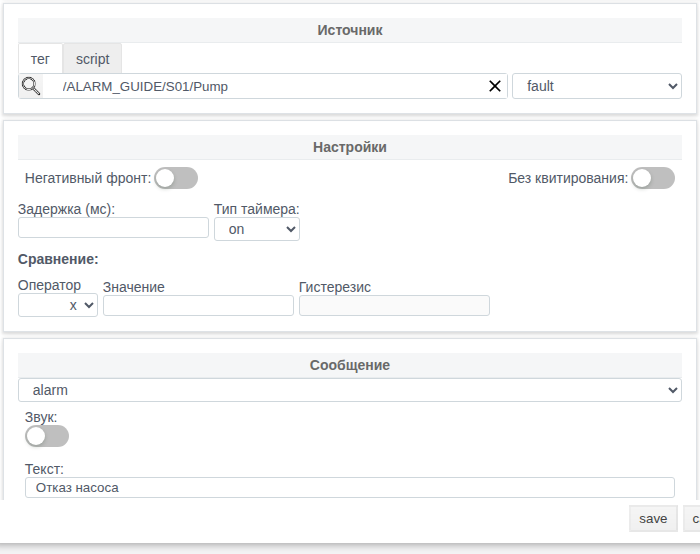
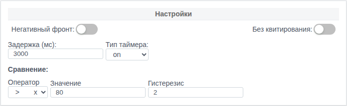
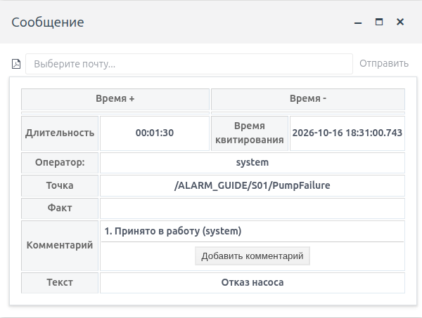
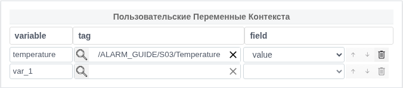

# Сообщения и тревоги в Faceplate

Руководство для интегратора и оператора. Настройка условий и уведомлений, работа с сообщениями, архив, хранение и интеграция.

Учебные сценарии и снимки проверены 16 октября 2026 года в русском интерфейсе Faceplate 4.0.6.subs. В примерах используется учебный проект ALARM_GUIDE. Названия оборудования и категорий замените принятыми в своём проекте.

Для работы достаточно знать навигацию Studio/Runtime и понятия «тег» и «поле». Erlang или JavaScript нужны только для скриптовых примеров. Настройку выполняет пользователь с соответствующими правами; оператору нужны права просмотра, квитирования и добавления комментариев.

## Как пользоваться руководством

Интегратору: начните с разделов 1–2, затем выполните сценарий 11.1. Условия по нескольким тегам и динамический текст рассмотрены в разделе 6 и сценарии 11.3. Точные поля и значения собраны в разделе 12.

Оператору: раздел 1 → раздел 3 → раздел 4 → раздел 5 → раздел 13. Квитирование подтверждает обработку сообщения; устранение причины определяется отдельно.

## Оглавление

- [1. Основные понятия](#1-основные-понятия)
- [2. Настройка сообщения](#2-настройка-сообщения)
- [3. Работа оператора](#3-работа-оператора)
- [4. Списки и индикаторы](#4-списки-и-индикаторы)
- [5. Архив и экспорт](#5-архив-и-экспорт)
- [6. Скрипты и динамический контекст](#6-скрипты-и-динамический-контекст)
- [7. Email-уведомления](#7-email-уведомления)
- [8. Связывание сообщений](#8-связывание-сообщений)
- [9. Хранение и автоматическая обработка](#9-хранение-и-автоматическая-обработка)
- [10. Работа из скриптов и внешних систем](#10-работа-из-скриптов-и-внешних-систем)
- [11. Три практических сценария](#11-три-практических-сценария)
- [12. Справочник](#12-справочник)
- [13. Диагностика и ограничения](#13-диагностика-и-ограничения)

## 1. Основные понятия

### Шаблон и отдельное сообщение

Шаблон сообщения задаёт источник, условие, текст и правила обработки. При возникновении условия Faceplate создаёт отдельную запись журнала — сообщение. После снятия запись сохраняется в архиве в пределах настроенного срока хранения. Новое возникновение после снятия создаёт новую запись.

Тревога — сообщение о нарушении условия. Один и тот же механизм используется для дискретного отказа, превышения температуры, составного условия по нескольким тегам и информационного события из внешней системы.

В тексте сообщения можно сохранить значения процесса на момент возникновения, указать оборудование через категории и включить отправку email. На экране оператора сообщения отображаются списком и индикатором; история доступна в архиве.

### Активность и квитирование

| Состояние | Что означает | Что делать |
| --- | --- | --- |
| Активно, не квитировано | Условие возникло; подтверждение ещё не выполнено. | Оценить сообщение, проверить источник и квитировать по правилам проекта. |
| Активно, квитировано | Подтверждение выполнено; условие сохраняется. | Продолжать работу с причиной; проверять снятие по состоянию и времени снятия. |
| Снято, не квитировано | Условие прекратилось; подтверждение ещё требуется. | Просмотреть событие и квитировать. |
| Снято, квитировано | Условие прекратилось, подтверждение выполнено. | При необходимости найти запись и комментарии в архиве. |

Квитирование не снимает активность. Снятие не выполняет квитирование. Комментарий также является отдельным действием. Фильтр списка может скрыть запись при любом из этих переходов; проверяйте состояние самой записи.

### Типы, категории и группа

Обычные значения типа: error, alarm, warning, info и dsf. Они задают классификацию и участвуют в фильтрах и отображении. Платформа не задаёт этими строками универсальную числовую шкалу технологического приоритета. Назначение каждого типа и порядок реагирования устанавливаются проектом.

Пять категорий позволяют описать, например, участок, установку и оборудование. Группа связывает запись с размещением шаблона в дереве проекта и позволяет вывести сообщения выбранного оборудования. Категории и группа решают разные задачи: категория — выбранная классификация, группа — область дерева проекта.

Поле «Точка» показывает путь источника сообщения в проекте. Для обычного шаблона это путь самого шаблона; поле исходного тега может находиться в другом объекте.

## 2. Настройка сообщения

### Создать первую полезную настройку

Подготовьте учебный тег Pump с числовым полем fault: 0 — норма, 1 — отказ. Начальное значение — 0. Поле должно быть доступно для управления на учебном стенде. Пример создаётся в папке ALARM_GUIDE/S01.

1. В Studio откройте папку ALARM_GUIDE/S01. Нажмите «Создать», выберите system → alarm_template → Ok. Это точное имя типа в окне создания; далее объект называется шаблоном сообщения.
2. Задайте название PumpFailure. В секции «Источник» выберите «тег», через выбор объекта укажите /ALARM_GUIDE/S01/Pump и поле fault. Поле выбора использует путь относительно проекта.
3. Оставьте сравнение и задержку незаполненными. Выключите «Негативный фронт» и «Без квитирования».
4. В секции «Сообщение» выберите alarm, введите «Отказ насоса» и выключите «Звук». Сохраните кнопкой save.
5. Запустите Runtime, если он остановлен: «Запустить Runtime» → подтверждение yes. Обновите редактор и убедитесь, что шаблон работает и ошибок нет.
6. Измените fault с 0 на 1 через форму тега, завершите ввод Tab и сохраните. В Runtime откройте «Активные сообщения» и найдите «Отказ насоса».
7. Квитируйте сообщение, затем верните fault в 0. В архиве проверьте время возникновения, снятия, квитирования и оператора. Подробная проверка обоих порядков действий — в сценарии 11.1.



*Рисунок 1. Дискретный источник fault, ручное квитирование, отсутствие сравнения и задержки; звук явно выключен.*

При создании проверенная форма предлагает тип alarm, текст Alarm text и включённый звук. Задержка пуста, а тип таймера показывает on; без значения задержки этот выбор не создаёт выдержку времени. Проверяйте фактические значения перед сохранением.

### Выбрать источник

| Вариант | Что настроить | Как проверить |
| --- | --- | --- |
| Поле тега | Объект и его поле в секции «Источник» → «тег». | Изменить учебное значение и проверить вход, состояние шаблона и запись. |
| Скрипт | Язык, переменные с привязкой к полям и выражение функции; раздел 6. | Скомпилировать, сохранить, изменить каждую привязанную переменную и проверить результат. |

Для обычной автоматической тревоги источник должен существовать и быть доступен. В скриптовом варианте JavaScript должна поддерживаться установленной системой. Отсутствие источника допускается в отдельных внешних интеграциях, однако автоматического наблюдения за тегом при этом нет.

Без сравнения вход преобразуется в дискретное значение: 0 — неактивно, ненулевой результат после округления — активно. Например, 0,2 округляется в 0. Используйте явное сравнение для аналогового сигнала. Логические true/false преобразуются в 1/0; числовые строки могут быть приведены к числу.

Непригодный результат источника (none) не равен нормальному false: он может сохранить уже активное сообщение и отменить ожидаемый переход по задержке. Для скрипта это зависит от того, что вернула функция. Очень короткие импульсы могут пропускаться при обработке обновлений; журнал не заменяет аппаратную фиксацию каждого фронта.

### Сравнения, отдельный бит и маска

| Оператор | Пример | Результат без гистерезиса |
| --- | --- | --- |
| > / >= | Значение 80 | Выше 80 / не ниже 80. |
| \< / \<= | Значение 20 | Ниже 20 / не выше 20. |
| == / != | Значение 1 | Равно 1 / отличается от 1; числовые 1 и 1,0 равны. |
| bit | Значение 3 | Проверяет бит с номером 3, то есть весом 8. Нумерация начинается с 0. |
| mask | Маска 10 | Достаточно любого общего бита: весом 2 или 8. В стандартном списке операторов формы mask отсутствует. |

Число и параметр битового сравнения округляются перед проверкой. Для bit=3 вход 8 вызывает сообщение, вход 4 — нет. Маска 10 подходит входам 2, 8 и 10; вход 4 не подходит.

Для маски через доступную форму используйте скриптовый источник Erlang: привяжите переменную status к числовому полю состояния, сравнение формы оставьте пустым и введите следующий пользовательский скрипт. Замените привязку status своим полем. При значении 2 или 8 ожидается активное условие.

```erlang
fun(VARS, State) ->
    Status = round(maps:get("status", VARS)),
    {(Status band 10) > 0, State}
end.
```

Точное значение compare для конфигурации маски приведено в справочнике. Его наличие в интерфейсе конфигурации не означает наличие пункта mask в обычной форме.

Переключатель «Негативный фронт» инвертирует результат проверки после сравнения. Например, для источника 1 — исправно, 0 — отказ включённая инверсия даёт сообщение при 0. Проверяйте оба устойчивых значения источника.

### Гистерезис

Гистерезис задаёт две границы вокруг порога. Для строгого верхнего предела >T с положительным гистерезисом H сообщение возникает при значении >T+H, снимается при значении \<T−H, а между границами сохраняет предыдущее состояние. В таблице ниже H положителен.

| Сравнение | Возникновение | Снятие |
| --- | --- | --- |
| >T | x > T+H | x \< T−H |
| >=T | x >= T+H | x \<= T−H |
| \<T | x \< T−H | x > T+H |
| \<=T | x \<= T−H | x >= T+H |

Пример >80 и H=2: 82 °C ещё не вызывает сообщение; требуется значение выше 82 °C. После возникновения 78 °C сохраняет активность; требуется значение ниже 78 °C. При строгих операторах равенство границе сохраняет предыдущее состояние. Для >= и \<= границы включены.

Поле можно не задавать: тогда выполняется обычное сравнение без памяти. Пропуск гистерезиса не следует заменять явным числом 0 в импортируемой конфигурации: при строгом сравнении на пороге поведение различается. Равенство, неравенство, бит и маска гистерезис не используют.

В проверенной форме гистерезис вводится целым числом от 1. Ввод 0.5 превращается в 5; при пороге 0 поле гистерезиса отключается. Проверяйте сохранённое значение повторным открытием формы и используйте скриптовое условие для вариантов, которые эта форма не позволяет задать корректно.

### Задержки и отмена перехода

| Тип таймера | Что задерживается | Если условие изменилось до окончания |
| --- | --- | --- |
| on | Возникновение. | Возврат к норме отменяет ожидаемое возникновение; записи не будет. |
| off | Снятие. | Возврат нарушения отменяет снятие; продолжается прежняя запись. |
| on_off | Возникновение и снятие, одним значением. | Каждый ожидаемый переход отменяется при обратном изменении. |

Единица поля «Задержка (мс)» — миллисекунды: 3000 означает 3 секунды. Пустое поле даёт работу без задержки. Устанавливайте неотрицательное значение и явно выбирайте тип таймера. Скрипт и сравнение сначала формируют результат, затем применяется инверсия и выдержка.



*Рисунок 2. Верхний предел >80, гистерезис 2 и задержка возникновения 3000 мс. Проверка граничных значений — в сценарии 11.2.*

### Текст, классификация и управление

Текст обязателен. Для обычной настройки введите понятное описание события и оборудования. Динамические значения добавляются через отдельные переменные контекста; они фиксируются при возникновении, после выдержки задержки. Синтаксис и примеры — в разделе 6.

Категории 1–5 необязательны. В универсальном примере используются «Участок 1», «Установка 1», «Охлаждение». Одинаковые значения категорий упрощают поиск в архиве, но сами по себе не меняют область группы на экране.

«Без квитирования» включает создание уже квитированной записи: время квитирования совпадает со временем возникновения, оператор автоматически не добавляется. При выключенном переключателе требуется отдельное квитирование, если его не выполнит системная обработка.

«Звук» разрешает звуковую реакцию сообщения. Воспроизведение также зависит от активного интерфейса и разрешений браузера. Проверьте реакцию на рабочем месте оператора; в учебных сценариях звук выключен.

Отключение шаблона останавливает автоматическую обработку и снимает его активные сообщения. Редактирование настроек и перезапуск исполнения способны снять прежнюю запись и сформировать новое возникновение при сохраняющемся условии. Сначала подготовьте безопасное учебное состояние, затем проверяйте изменение.

## 3. Работа оператора

### Прочитать сообщение и найти источник

1. Откройте «Активные сообщения» в верхней панели Runtime или список на мнемосхеме оборудования.
2. Проверьте текст, тип, категории, точку и время возникновения. Времена возникновения, снятия и квитирования сверяйте в архиве; в карточке — квитирование, оператора и комментарии. Цвет строки оценивайте с учётом настроек проекта.
3. В списке откройте карточку двойным щелчком по строке. В архиве достаточно одного щелчка. Просмотрите текст, точку, оператора и комментарии.
4. По точке определите шаблон в дереве проекта. Интегратор проверяет в его форме исходный тег/поле или переменные скрипта; оператор использует связанную мнемосхему оборудования.

Название окна «Активные сообщения» не гарантирует показ всех активных записей. Стандартное верхнее окно показывает неквитированные сообщения; после квитирования активная запись может исчезнуть из него. Список на экране настраивается отдельно.

### Квитировать выбранные сообщения

1. Выделите нужную строку или несколько строк в списке. Проверьте, какие записи действительно выбраны.
2. Нажмите «Квитировать». В проверенном списке отдельное подтверждение не появлялось.
3. Убедитесь, что заполнились время квитирования и оператор. Если источник по-прежнему нарушен, сообщение остаётся активным.

Для квитирования текущей страницы используйте «Квитировать Все». Область действия ограничена текущей страницей с учётом фильтра и размера страницы; обычно это 30 строк. Для нескольких строк используйте выделение с Ctrl. Проверяйте оставшиеся строки после каждой операции.

Проверенный пример: 35 снятых неквитированных записей, размер страницы 30, других подходящих сообщений нет. После массовой операции счётчик в этой сборке мог показывать некорректное значение; закрытие и повторное открытие окна восстанавливало его. Фактический результат проверен по строкам и свежему архиву.

| Действие | Обработано | Осталось неквитированных |
| --- | --- | --- |
| Квитировать Все на первой странице | 30 | 5 |
| Выбрать две строки с Ctrl и Квитировать | 2 | 3 |
| Квитировать Все на оставшейся странице | 3 | 0 |
| Снова открыть список и архив | Все 35 сохранены с оператором system и временем квитирования | 0 |

### Добавить комментарий

1. Откройте карточку и нажмите «Добавить комментарий».
2. Выберите предложенный вариант либо «Свой текст», введите, например, «Принято в работу» и нажмите «Отправить».
3. Проверьте новый текст с логином автора. Квитирование и снятие проверьте отдельно.

Предложенные варианты настраиваются в шаблоне. Комментарий конкретной записи хранится в истории; новое добавление отображается перед прежним текстом. Возможность изменения старой записи зависит от прав и режима хранения.



*Рисунок 3. Карточка сообщения с квитированием пользователя system и комментарием «Принято в работу». Комментарий и квитирование — отдельные действия.*

### Если квитирование выполнено системой

Проверьте время и оператора. Автоматическое квитирование возможно при накоплении более 200 неквитированных сообщений выбранных типов, переводе старого сегмента в режим чтения, связывании сообщений либо настройке «Без квитирования». Эти механизмы описаны в разделах 8–9; запись о квитировании не подтверждает физическое устранение причины.

## 4. Списки и индикаторы

### Разместить список оборудования на мнемосхеме

1. В Studio откройте папку оборудования, например ALARM_GUIDE/S03, и вкладку «Мнемосхема». Создайте или откройте экран в строке screen.
2. В графическом редакторе перетащите на экран элемент «Список сообщений».
3. В свойствах задайте group=/ALARM_GUIDE/S03. Для списка всех активных и всех неквитированных сообщений установите active=true и acknowledge=true.
4. Сохраните экран. В Runtime закройте архив, откройте «Меню» и выберите ALARM_GUIDE/S03 в появившемся дереве.
5. Проверьте список на реальном событии: квитируйте активное сообщение и убедитесь, что оно сохраняется до снятия. Затем проверьте снятое неквитированное сообщение.

В проверенном интерфейсе «Меню» уже раскрывает дерево мнемосхем. Дополнительное нажатие «Мнемосхемы» переключает его видимость. Предварительный просмотр в редакторе показывает макет; живые значения и действия проверяйте в Runtime.

### Как работают ограничения состояния

| active | acknowledge | Выборка |
| --- | --- | --- |
| false | true | Неквитированные: активные и снятые. |
| true | false | Активные: квитированные и неквитированные. |
| true | true | Активные ИЛИ неквитированные. |
| false | false | Без ограничения по этим двум состояниям; остальные фильтры сохраняются. |

Свойство acknowledge выбирает неквитированные записи. Оно не выдаёт право квитирования и не означает «показывать квитированные». Ограничения группы, типов и дополнительного фильтра применяются совместно с выбранным правилом состояния.

Компонент списка на мнемосхеме имеет собственные столбцы и фильтр. Сохранение именованного представления архива из раздела 5 автоматически его не перенастраивает. Для точного дополнительного отбора используется массив условий, например ["category_3", "=", "Охлаждение"]; проверьте фактически используемую категорию, группу и состояние.

Стандартное верхнее окно Runtime использует acknowledge=true, active=false и типы error/alarm/warning. Настройки представления архива не меняют эту выборку. Сообщения info или dsf ищите с подходящим выбором типов либо в архиве.

### Индикатор и звук

Добавьте на экран «Индикатор сообщений» и укажите ту же группу оборудования. Индикатор учитывает активные ИЛИ неквитированные сообщения. Для неквитированных предусмотрено мигание; отображение выбирается в порядке error → alarm → warning. Этот порядок относится к компоненту, а технологический приоритет задаётся проектом.

Нажатие индикатора открывает список его группы с обоими ограничениями состояния. В учебной проверке активное квитированное сообщение сохранилось и в списке группы, и в окне индикатора. После снятия и квитирования подходящих сообщений индикатор скрывался.

Укажите группу явно, если экран предназначен для отдельной установки. Убедитесь, что тип сообщения входит в выборку. Для звука проверьте настройку самого сообщения, состояние интерфейса и разрешение воспроизведения браузером; видимая строка и слышимый сигнал проверяются отдельно.

## 5. Архив и экспорт

### Найти событие в архиве

1. В Runtime откройте «Меню» → «Журнал сообщений». Появится «Архив сообщений».
2. Выберите временное поле и интервал. Для поиска возникновения используйте «Время +», для завершения — «Время -», для подтверждения — время квитирования.
3. Укажите текст и нужные типы. После ввода завершите поле Tab и выполните «Поиск» либо «Обновить». Если панель узкая, «Поиск» находится в меню ⋮.
4. Сверьте число результатов, точку и временные метки нужной записи. Один щелчок по строке открывает карточку.

В проверенной сборке ввод текста или Enter сами по себе не применяли фильтр. Для короткого текста менее трёх символов поиск использует точное совпадение; для более длинного — вхождение. Категории сверяйте в столбце и карточке: отдельного простого поля category_1 в панели архива нет. Чтобы найти снятое квитированное сообщение, используйте архив без ограничения текущего списка.

### Времена и длительность

| Поле | Смысл | Единицы и отображение |
| --- | --- | --- |
| Время + / dt_on | Момент возникновения записи; при задержке — после выдержки. | В API Unix-миллисекунды. На проверенном рабочем месте UTC+05:00. |
| Время - / dt_off | Момент снятия; у обычной активной записи пусто. | В API Unix-миллисекунды; отображается как дата и время. |
| Время квитирования / dt_ack | Момент подтверждения. | Заполняется независимо от времени снятия. |
| Длит. / duration | dt_off − dt_on для завершённой записи. | В API миллисекунды; в таблице длительность. |
| Время с прибора / dt_device | Внешнее время устройства, если передано. | Самостоятельное автоматическое заполнение не предусмотрено обычным примером. |

Сопоставляя экран, внешний API и письмо, учитывайте часовой пояс. В учебной проверке экран использовал Asia/Almaty (UTC+05:00). API передаёт числовое время; даты в почтовом шаблоне могут быть представлены в UTC с окончанием Z.

### Представления и сортировка

Представление определяет столбцы, фильтр и порядок таблицы. Используйте отдельное представление для ежедневной работы оператора и для разбора истории с временами, длительностью и оператором. Точные элементы сохранения представления показаны в проверенном примере ниже.

Проверенный пример именованного представления ограничивает архив категорией «Проверка пагинации». В поле Filter используется JSON-массив условий:

```json
["category_1", "=", "Проверка пагинации"]
```

1. В Studio откройте «Меню» → «Сообщение» → Runtime. Появится «Настройка отображения списка сообщений» с Default view и Custom views.
2. В Custom views введите имя, например «Проверка архива P01», и откройте соседнюю кнопку настройки. В «Настройки отображения» задайте столбцы «Время +», «Время -», «Время квитирования», «Текст», «Оператор», «Категория». В Filter введите показанный JSON, нажмите Compile и дождитесь OK.
3. В order by выберите «Время квитирования». Сохраните вложенное окно, затем внешнее. Откройте их повторно и проверьте параметры.
4. В Runtime заново откройте «Журнал сообщений», выберите флажком своё представление и нажмите save. Выберите «Время +» и дату учебного набора, оставьте текстовый поиск пустым, выполните «Поиск». В проверенном наборе получены только 35 записей нужной категории.

Столбцы перемещаются стрелками и удаляются корзиной. Доступны общая «Категория» и перечисленные временные поля; отдельных столбцов «Тип» и category_1 в проверенном редакторе нет. Представление изменяет вид таблицы, поэтому сверяйте выбранное временное поле при поиске.

Для группировки условий используйте, например, ["and", [["category_1", "=", "Проверка пагинации"], ["type", "=", "alarm"]]]. Compile проверяет JSON; правильность выборки проверяйте в архиве. Если ограничение не требуется, оставьте поле нового представления нетронутым и пустым. Текст [], null или {} не является пустым фильтром представления. Контракт JSON-экспорта из раздела 10 использует другую форму фильтра.

Проверенная выгрузка пользовательского представления содержала все 35 записей и шесть выбранных столбцов. Экран был отсортирован по квитированию и начинался записью 01, а XLSX и печатная таблица начинались записью 35 — по времени возникновения от новых к старым. Реальная печатная таблица содержала те же 35 записей.

### Выгрузить XLSX или распечатать

1. Сначала примените фильтр и проверьте интервал и количество результатов.
2. В архиве выберите выгрузку XLSX. Откройте полученный файл и проверьте число строк, нужные столбцы и времена.
3. Для печати используйте кнопку PDF/печати. В диалоге браузера выберите принтер или сохранение PDF. Карточка печатает одну запись; список и архив формируют таблицу.
4. При большом объёме разделите выборку по неперекрывающимся временным интервалам и при необходимости по дополнительным признакам. Проверьте каждый полученный файл.

Экспорт архива ограничен 10 000 записями и выдаёт их по времени возникновения от новых к старым. Выбранная на экране сортировка этот порядок не меняет. Запрос не содержит следующей страницы или признака усечения; результат ровно из 10 000 строк требует дополнительной проверки полноты.

Кнопка PDF в текущем списке также может выбирать до 10 000 подходящих записей отдельным запросом; область печати отличается от текущей страницы квитирования. PDF сохраняет браузер. XLSX формируется как alarm_logs.xlsx, лист alarm; значение ячейки длиннее 32 767 символов может быть пропущено с уведомлением.

## 6. Скрипты и динамический контекст

### Привязать переменные источника

В секции «Источник» выберите script и язык. Для каждой переменной задайте имя и привязку к объекту/полю. Пример использует temperature → Temperature.value и cooling → Cooling.value. Охлаждение — числовое поле: 1 означает работу, 0 — остановку.

Скрипт пересчитывается при обновлении привязанной переменной и читает остальные значения. Самостоятельный периодический опрос этим источником не задаётся. Сначала скомпилируйте функцию, затем сохраните шаблон и проверьте каждую ветвь условия реальным изменением тегов.

Примеры ниже рассчитаны на доступные числовые поля учебного стенда. Поведение при отсутствующих, нечисловых значениях и потере качества данных задайте в своём скрипте явно. Возвращённый функцией false будет воспринят как нормальный результат условия.

### Условие на Erlang

Введите в редактор скрипта функцию двух аргументов. VARS — map с именами переменных в виде строк; State — состояние предыдущего выполнения. Следующий пример возвращает результат и сохраняет State без изменения.

```erlang
fun(VARS, State) ->
    {(maps:get("temperature", VARS) > 80) andalso
     (maps:get("cooling", VARS) == 0), State}
end.
```

Ожидается true только при температуре выше 80 и cooling=0. В форме сравнение не задавайте, задержку установите 3000 мс/on. Для нормального начала используйте temperature=70, cooling=1.

### То же условие на JavaScript

Выберите javascript и введите выражение функции, а не отдельный файл или вызов функции. Пример для тех же числовых полей:

```javascript
async function(VARS, State) {
    return {
        value: VARS.temperature > 80 && VARS.cooling === 0,
        state: State
    };
}
```

Числовой 0 и логический false различаются при строгом сравнении JavaScript. Если ваш тег логический, измените условие под его фактический тип. В учебной проверке оба языка дали одинаковое условие и сообщение после заданной выдержки.

### Передать состояние скрипта

| Язык | Допустимый результат | Сохранение состояния |
| --- | --- | --- |
| Erlang | Value либо {Value, NewState}. | Для явной передачи верните второй элемент пары. |
| JavaScript | boolean, number, {value: …} либо {value: …, state: …}. | Для следующего выполнения верните state; без него следующий State будет undefined. |

Состояние скрипта служит данным между выполнениями функции и отличается от состояния сообщения «активно/снято». При перезапуске исполнения не рассчитывайте на сохранение прежнего состояния скрипта. Не используйте его как самостоятельный архив процесса.

### Добавить динамический текст

1. В переменных контекста добавьте temperature и отдельно привяжите её к Temperature.value. Переменная источника с тем же именем не добавляется в контекст автоматически.
2. В поле текста введите: Температура ${f:1:temperature}$ °C при остановленном охлаждении.
3. Задайте категории «Участок 1», «Установка 1», «Охлаждение», сохраните и вызовите условие temperature=85, cooling=0 более чем на 3 секунды.
4. Проверьте текст с 85.0 °C. Измените температуру на 90 при cooling=0: текст прежней записи сохраняет 85.0 °C. Текущее значение показывайте отдельным полем на мнемосхеме.

| Подстановка | Пример | Назначение |
| --- | --- | --- |
| ${s:name}$ | ${s:equipment}$ | Строковое значение переменной. |
| ${i:name}$ | ${i:count}$ | Число с округлением до целого. |
| ${f:N:name}$ | ${f:1:temperature}$ | Число с точностью N; N — одна цифра. Для f:0 дробная часть отбрасывается. |

Закрывающая последовательность — именно }$. Неизвестная или отсутствующая переменная пропускается; несовместимый тип даёт invalid_value. При ошибке синтаксиса может сохраниться исходный текст. Проверьте итоговую запись, а не только исходную строку.

Такие подстановки поддерживаются в тексте, категориях 1–5, fact и commentAI. Для relevant и type этот же проход не выполняется. Контекст фиксируется при возникновении после задержки; обычное последующее обновление тега не переписывает созданную запись.

### Преобразовать контекст

Преобразование контекста задаётся функцией Erlang одного аргумента независимо от языка источника. Функция получает map со строковыми ключами и должна вернуть map. Для замены системного текста используется ключ «.text» с точкой:

```erlang
fun(Context) ->
    Context#{".text" => "Контроль охлаждения"}
end.
```

Введите функцию в поле преобразования контекста, скомпилируйте и сохраните. При следующем возникновении ожидается «Контроль охлаждения». Ключ «text» без точки не заменяет системный текст. В учебной проверке замена выполнена; затем преобразование выключено, а исходный динамический текст восстановлен.

Системные ключи контекста включают .text, .type, .point и .acknowledged. Пользовательские имена выбирайте так, чтобы случайно не перекрыть системные значения. commentAI является дополнительным полем контекста; автоматический процесс создания AI-комментария этим полем не задаётся.

## 7. Email-уведомления

### Подготовить отправку

Для уведомления нужны общие SMTP-настройки, адреса пользователей и получатели в шаблоне сообщения. Успешное действие в интерфейсе проверяйте отдельно от фактического получения письма. Сначала выполните проверку на тестовом почтовом приёмнике.

Общие настройки открываются в Studio: «Меню» → «Сообщение» → «Настройки» → «Общие настройки». Здесь находятся SMTP, переключатель «Включить email-уведомления» и вкладки HTML-шаблонов alarm/error/info/warning. Заполните поля значениями своего SMTP или учебного примера ниже, сохраните и откройте повторно для проверки.

Для учебного получателя откройте «Меню» → «Права» → «Пользователи» → + → «Задайте имя». Создайте AlarmGuideOperator, откройте его строку, заполните Email значением operator@alarmguide.test и нажмите «Сохранить». Повторное открытие должно показать сохранённый адрес. Права и пароль настраиваются по правилам вашего проекта.

В проверенной сборке встроенная учётная запись system отсутствовала в редакторе обычных пользователей и получателях шаблона. Для автоматических уведомлений использован обычный пользователь AlarmGuideOperator. В «Дополнительных настройках» шаблона откройте «Уведомления», выберите его флажком и сохраните. Реальная доставка подтвердила применение сохранённой настройки; отдельный перезапуск Runtime в этой проверке не потребовался.

| Настройка | Учебное значение | Что заменить в своём проекте |
| --- | --- | --- |
| Отправка / email_send | true на время проверки | Включить только после заполнения настроек; false отключает отправку. |
| Сервер / email_smtp | 127.0.0.1 | Адрес совместимого SMTP-сервера. |
| Порт / email_smtp_port | 1465 | Порт implicit SSL вашего сервера; учебный порт относится к локальному приёмнику. |
| Логин / email_login | alarmguide | Отдельная учётная запись отправки. |
| Пароль / email_pass | alarm-guide, только учебный приёмник | Пароль этой учётной записи. |
| Отправитель / email_from | faceplate@alarm-guide.test | Разрешённый сервером адрес отправителя. |
| Получатель | operator@alarmguide.test | Email пользователя, выбранного в уведомлениях шаблона. |

Транспорт использует implicit SSL и обязательную аутентификацию. Настройка STARTTLS этим интерфейсом не предоставлена. Согласуйте режим и порт с администратором почты; наличие всех заполненных полей не доказывает совместимость сервера.

### Настроить получателей и проверить автоматическое письмо

1. Заполните email в учётной записи тестового получателя. В уведомлениях шаблона выберите этого пользователя или группу пользователей с заполненными адресами.
2. Сохраните шаблон. После изменения адресов или состава группы обновите исполнение шаблона через штатный интерфейс, чтобы применился список получателей.
3. Из нормального состояния вызовите новое сообщение. Проверьте запись в журнале и фактически полученное письмо: адрес, текст, источник и время возникновения.
4. Снимите и квитируйте учебное сообщение. После проверки выключите тестовую отправку и восстановите тестовые адреса, если они использовались временно.

Адресаты раскрываются из выбранных пользователей и групп; записи без адреса email пропускаются. Новая запись может вызвать уведомление, обновление уже существующей записи само по себе повторного уведомления не создаёт. Отправка при снятии или квитировании этим правилом не задаётся.

### Переслать существующее сообщение

Откройте карточку, раскройте «Выберите почту...», выберите пользователя и нажмите «Отправить». Проверьте поступление отдельного письма. Операция использует общие SMTP-настройки и шаблон типа. Ответ интерфейса об успешной операции не доказывает доставку: отправка может быть выключена, а SMTP-приём и дальнейшая доставка — разные этапы.

### Изменить HTML-шаблон письма

Редактируйте шаблон нужного типа сообщения в общих настройках email. Для типов без отдельного шаблона используется notification. Тема письма формируется отдельно: FACEPLATE: \<type>; изменение HTML-заголовка её не меняет.

Следующий HTML — пользовательский образец для учебной проверки. Вставьте его в шаблон alarm, сохраните и отправьте новое тестовое письмо. Ожидаются текст сообщения, тип, точка и время возникновения.

```html
<!doctype html>
<html lang="ru">
<meta charset="utf-8">
<body>
  <h1>Сообщение Faceplate</h1>
  <p>${text}</p>
  <p>Тип: ${type}</p>
  <p>Источник: ${point}</p>
  <p>Время возникновения: ${dt_on}</p>
</body>
</html>
```

В письме используется синтаксис ${text}, ${point}, ${dt_on} без завершающего $ и без формата s/i/f. Он отличается от подстановок текста сообщения. Имена чувствительны к регистру; отсутствующее значение заменяется дефисом. При ручной отправке временные поля преобразуются в UTC/RFC3339, длительность остаётся числом миллисекунд.

Автоматическое письмо при возникновении может ещё не содержать полей, которые заполняются позже при создании записи. Для надёжного начального шаблона используйте текст, тип, точку и время возникновения. Автоматического HTML-экранирования подставляемого текста нет; внешние значения подготавливайте для HTML.

Поле числа попыток присутствует в настройках, однако подтверждённую доставку и гарантированный повтор оно не обеспечивает. Контролируйте реальное получение. Изменение шаблона через интерфейс проверяйте повторной отправкой; сохранение после полной повторной инициализации требует отдельной проверки вашей сборки.

| Проверка | Ответ интерфейса | Фактическое получение |
| --- | --- | --- |
| Возникновение Отказ насоса | Новая активная запись | Автоматическое письмо принято, тема FACEPLATE: alarm. |
| Ручная пересылка из карточки | Сообщение отправлено | Получено отдельное второе письмо. |
| Тестовый SMTP-отказ 451, Попытки=5 | ERROR! с временным отказом SMTP | Одна отклонённая попытка; новых принятых писем и повторных DATA за 52 с не наблюдалось. |
| Восстановление SMTP и ручная отправка | Сообщение отправлено | Получено третье письмо. |

Проверка повторов ограничена указанным тестовым отказом и интервалом наблюдения. Число 5 в настройке не стало подтверждением пяти отправок. Для рабочей системы контролируйте получение и обрабатывайте ошибку SMTP; успешное сообщение интерфейса и фактическая доставка проверяются отдельно.


*Рисунок 4. Фактически полученный HTML учебного письма: текст, тип, точка и время UTC подставлены в шаблон.*

В этом автоматическом письме время было на 9 мс позже архивного времени возникновения. Ручная пересылка использовала сохранённое время записи. При сопоставлении письма и журнала сверяйте также точку и текст. После проверки учебное условие снято, запись квитирована, отправка отключена и исходный HTML восстановлен.

## 8. Связывание сообщений

### Объединить факт и связанные события

Связывание помогает отметить активные сообщения, относящиеся к одному факту. В шаблонах связанных событий задаётся relevant, а в шаблоне сообщения-факта — совпадающее значение fact. Условие запускается при формировании сообщения с fact.

В форме откройте «Причинно-следственные связи». Поле «Возможное следствие» задаёт relevant, «Является якорем» — fact, а «Минимум (мс)» и «Максимум (мс)» — временные границы кандидата. Введите одинаковое значение связи в соответствующие поля разных шаблонов.

| Учебный шаблон | Условие и текст | Настройки связи |
| --- | --- | --- |
| CauseA | Inputs.cause_a=1; warning; «Охлаждение недоступно». | relevant=cooling_stop; relevant_min=0; relevant_max=600000. |
| CauseB | Inputs.cause_b=1; warning; «Охлаждение остановлено». | Те же relevant и границы. |
| Fact | Inputs.fact_signal=1; alarm; «Высокая температура — проверка связи». | fact=cooling_stop. |

Все три источника начинаются с 0, ручное квитирование включено, звук выключен, сравнение и задержка не заданы. Замените имена тегов и значение связи своими. Временные границы задаются в шаблонах кандидатов CauseA/CauseB и измеряются в миллисекундах.

1. Включите cause_a, дождитесь возникновения; затем включите cause_b и дождитесь второго активного неквитированного сообщения.
2. Включите fact_signal. В архиве задайте cooling_stop в «Только относящиеся к...», выберите интервал возникновения и выполните «Поиск». Проверьте все три записи и состояние квитирования. Признаки is_head/is_relevant доступны в JSON-выгрузке, описанной в разделе 10.
3. Снимите все три учебных условия и квитируйте оставшиеся записи. Проверьте итоговую историю.

Кандидат должен оставаться активным, иметь relevant, совпадающий с fact, и возраст строго больше relevant_min и строго меньше relevant_max. Отсутствующая граница не ограничивает возраст. При границах 0 и 600000 выбирается событие возрастом больше 0 и меньше 10 минут.

Одна найденная запись отмечается главным связанным сообщением (is_head=true); связанные записи получают is_relevant=true, остальные кандидаты автоматически квитируются. Выбор главного сообщения не доказывает первопричину и не гарантирует выбор самого раннего события. Проверяйте фактические признаки и квитирование.

В проверенном примере CauseA возникло в 20:16:34.648, CauseB — в 20:16:46.282, Fact — в 20:17:13.596 (16.10.2026, UTC+05:00). Перед Fact оба кандидата были активны и не квитированы. После Fact получен следующий результат без ручного квитирования:

| Запись | Активность и квитирование после Fact | Признаки связи |
| --- | --- | --- |
| CauseA | Активно, не квитировано. | is_head=true; is_relevant=true. |
| CauseB | Активно, автоматически квитировано в 20:17:13.605 оператором system. | is_head не задан; is_relevant=true. |
| Fact | Активно, не квитировано. | fact=cooling_stop; is_head/is_relevant не заданы. |

Верхний список уменьшился с двух кандидатов до двух строк: CauseA и новое Fact. CauseB исчезло из этого списка из-за квитирования, а не снятия. Архив по cooling_stop сохранил все три записи; время снятия CauseB оставалось пустым.

В проверенном UI общая колонка «Факт» показывает совпавшее значение связи и у кандидатов. Карточка кандидата при этом может иметь пустое поле «Факт». Отдельные колонки is_head/is_relevant в стандартном редакторе представления отсутствуют; для точного разбора используйте JSON-выгрузку. Наблюдавшийся выбор CauseA не устанавливает правило выбора самой ранней причины.

После проверки все три входа возвращены в 0. Архив сохранил три снятые и квитированные записи; ранее поставленное автоматическое время квитирования CauseB не изменилось.

## 9. Хранение и автоматическая обработка

### Выбрать размещение и сроки

Хранение сообщений настраивается для базы проекта через полное значение log_params. Оно определяет узлы и каталоги хранения, глубину сегментов и возраст перехода в режим чтения или удаления. Настройки относятся к сегментам журнала целиком.

| Параметр | Резервное значение сервера | Назначение |
| --- | --- | --- |
| read_only_age | 10 дней | Возраст сегмента для перехода в режим только чтения. |
| max_age | 365 дней | Возраст сегмента для удаления. |
| shard_depth | 30 дней | Глубина временного сегмента. |
| database | Размещение по узлам базы | Для каждого узла: каталог и дисковое хранение. |

Резервные значения применяются, когда полная конфигурация отсутствует. Если log_params уже задан как map, безопасное дополнение пропущенных ключей не гарантируется. Передавайте полную структуру. Пример редактора Log с глубиной 10 дней отличается от серверного резервного значения 30 дней.

Даты сегментов рассчитываются в UTC. Переход в режим чтения и удаление выполняются по диапазону сегмента; это не точный индивидуальный срок каждой записи. Фактический срок зависит от положения записи внутри сегмента и фоновой проверки.

### Полный образец настройки

В Studio откройте «Меню» → «Хранилища», выберите project и откройте его редактор. Перейдите на вкладку «Сообщения» — это локализованная вкладка Log. Сохраните исходное полное значение. Образец ниже вводится в её JSON-редактор; замените faceplate@server1 фактическим именем узла базы и каталог — выбранным местом хранения.

Относительный каталог ./FP_ALARM разрешается относительно каталога схемы базы. Не меняйте размещение действующего архива без подготовки; для учебной проверки используйте отдельное хранилище. Префиксы :atom: и :string: в образце являются частью сериализации; не удаляйте их.

```json
{
  ":atom:database": {
    ":atom:faceplate@server1": {
      ":atom:dir": ":string:./FP_ALARM",
      ":atom:disc": {
        ":atom:module": ":atom:zaya_rocksdb",
        ":atom:params": {}
      }
    }
  },
  ":atom:max_age": 365,
  ":atom:read_only_age": 10,
  ":atom:shard_depth": 30
}
```

1. Вставьте полную структуру с реальным узлом и нажмите Compile. Дождитесь OK.
2. При настоящем изменении используйте доступную кнопку save, затем повторно откройте вкладку и проверьте все ключи. Если значение равно исходному, save остаётся недоступной; для проверки достаточно cancel и повторного открытия.
3. На учебной базе проверьте доступность свежих и старых сообщений. Возраст и удаление проверяйте по известному исходному набору; отсутствие строки само по себе не доказывает причину удаления.

В проверке полное значение с 10/365/30 повторно введено, Compile вернул OK. Изменений не было, поэтому save оставалась недоступной. После cancel и повторного открытия полная структура совпала с исходной; политика и размещение не менялись.

| Учебная запись | Сегмент и обработка | Результат в интерфейсе |
| --- | --- | --- |
| ReadOnlySample: info, возникновение 06.09.2026 | Сегмент 06.09–05.10.2026. При переводе в режим чтения запись автоматически квитирована оператором system. | Архив сохранил снятую запись: возникновение 19:50:31.136, снятие 19:50:31.236 (UTC+05:00). ACK 16.10.2026 19:50:44.978. |
| Комментарий к ReadOnlySample | Одна попытка «Проверка режима чтения». | Ответ ERROR! с read_only. После обновления комментарий пуст, запись и её времена сохранены. |
| PurgeSample: info, возникновение 11.09.2025 | Отдельный учебный сегмент 11.09–10.10.2025 автоматически удалён по сроку. | Поиск за известную дату без дополнительных ограничений не возвращает запись; старая read-only и недавняя история доступны. |

Образцы созданы за 40 и 400 дней до проверки. Для удалённого образца сначала подтверждались запись и отдельный сегмент, затем их исчезновение. Удаление архива не следует понимать как гарантию удаления самого каталога: в проверке пустой физический каталог остался. Для read-only подтверждён именно отказ добавления комментария; он не заменяет проверку других действий вашей сборки.

### Автоматическое квитирование при накоплении

Примерно каждые 5 секунд проверяются неквитированные сообщения типов error/alarm/warning во всех доступных архивных базах. Ограничения по активности, группе, категории или возрасту записи для этого правила нет.

Если число таких записей строго больше 200, система квитирует N−100 и оставляет 100 наиболее новых по времени создания записи. Это техническое время создания, а не время возникновения dt_on. Поздний импорт старого события может попасть в сохраняемую сотню. Заполняются время квитирования и служебный оператор, обычно system.

| Учебный набор | Неквитировано | Квитировано |
| --- | --- | --- |
| 205 завершённых записей alarm, до фонового прохода | 205 | 0 |
| После фонового прохода | 100 | 105, оператор system |
| После ручной обработки оставшихся страниц | 0 | 205; все сохранены в архиве |

Записи создавались в порядке 001→205, а время возникновения намеренно уменьшалось. Система квитировала 001–105 и оставила 106–205: это последние созданные записи с более старыми временами возникновения. UI подтвердил обе группы и итоговый архив из 205 записей. При ручном завершении после повторного открытия списка оставалось 70 → 40 → 10 → 0.

### Режим чтения, удаление и системное снятие

При переводе старого сегмента в режим только чтения система квитирует все его неквитированные записи, включая info и dsf. Это отдельное правило, для него порог 200 и ограничение трёх типов не применяются. Обычные действия оператора со старой записью могут быть недоступны; проверьте результат и режим хранения.

Проверка старых сегментов для режима чтения выполняется примерно раз в 60 секунд на ведущем узле, удаления — примерно раз в 10 секунд. Удаляется весь подходящий сегмент. Архивный фильтр не возвращает запись после фактического удаления.

Проверка снятия выполняется примерно каждые 5 секунд. Активная запись может быть снята системой, если её шаблон отсутствует или удалён, отключён либо не поддерживает активное состояние. Это особенно важно для внешних событий, созданных напрямую.

После запуска исполнения шаблон начинает обработку заново; прежние активные записи снимаются. Изменение настроек или перезапуск могут разделить продолжающееся физическое нарушение на несколько записей. Проверяйте историю и актуальный источник после таких действий.

## 10. Работа из скриптов и внешних систем

### Выбрать способ записи

Следующие примеры предназначены для интегратора и выполняются в авторизованной нативной Erlang-сессии Faceplate с нужными правами. Используйте учебную базу и проверяйте реальную запись в архиве. Публичные имена здесь приведены как точный ввод для интеграции.

| Интерфейс | Назначение | Основное условие проверки |
| --- | --- | --- |
| fp_alarm:write/1,2 | Создать прямую запись события. | Проверить её наличие; возврата ok недостаточно. |
| fp_alarm_template:run_context/2 | Сформировать или обновить сообщение через существующий шаблон и контекст. | Передать открытый объект шаблона и сохранить ключи идентичности при обновлении. |
| export_logs_json | Получить JSON-выборку через авторизованное соединение. | Обязателен filter; предел 10 000, порядок dt_on DESC. |

### Записать завершённое событие

Замените project при выборе другой базы и текст — своим. Время задаётся целым числом миллисекунд Unix. Пример создаёт завершённое информационное событие длительностью 5 секунд.

```erlang
T1 = erlang:system_time(millisecond),
T0 = T1 - 5000,
fp_alarm:write(project, #{
    <<"type">> => <<"info">>,
    <<"text">> => <<"Completed API event E09">>,
    <<"point">> => <<"/ALARM_GUIDE/P05/API/Completed">>,
    <<"category_1">> => <<"Проверка API"/utf8>>,
    <<"dt_on">> => T0,
    <<"dt_off">> => T1,
    <<"active">> => false,
    <<"acknowledged">> => true
}).
```

В архиве ожидается одна запись info с указанным текстом, временами T0/T1 и duration=5000. При создании acknowledged=true без отдельного времени квитирования время квитирования устанавливается в dt_on. Это отличается от ручного квитирования уже существующей записи.

write/1 выбирает базу проекта, а при её отсутствии — первую доступную базу хранения. write/2 позволяет указать atom имени базы либо полный binary-путь базы. Сегмент определяется временем возникновения. Повторный вызов с тем же remote_id не обеспечивает устранение дубликатов.

### Создать и обновить запись через контекст

Сначала откройте существующий шаблон. В примере используется учебный CauseA из раздела 8; замените путь своим. EventContext использует binary-ключи, а преобразование контекста из раздела 6 — строковые ключи. Смешивать эти форматы не следует.

```erlang
Template = fp_db:open(
    <<"/root/FP/PROJECT/ALARM_GUIDE/P05/CauseA">>),
EndTS = erlang:system_time(millisecond),
StartTS = EndTS - 1000,
EventContext = #{
    <<".dt_on">> => StartTS,
    <<".dt_off">> => EndTS,
    <<".active">> => false,
    <<".acknowledged">> => true,
    <<".type">> => <<"info">>,
    <<".text">> => <<"External event E09">>,
    <<".point">> => <<"/ALARM_GUIDE/P05/API/External">>,
    <<".category_1">> => <<"Проверка API"/utf8>>
},
fp_alarm_template:run_context(Template, EventContext),
fp_alarm_template:run_context(Template,
    EventContext#{
        <<".comment">> => <<"External event details updated">>
    }).
```

После второго вызова ожидается одна запись с обновлённым комментарием. Обычная ветвь сопоставляет шаблон, время возникновения, тип, текст и заданную точку. Сохраняйте эти значения при обновлении. Изменение текста или времени может создать другую запись; это не произвольное обновление по внешнему идентификатору.

### Явно снять внешнюю запись

Для обновления существующей активной записи передавайте вместе dt_off и active=false, сохраняя её ключи идентичности. Одно изменение dt_off пересчитывает время и длительность, но само по себе не снимает active.

```erlang
ClosingTS = erlang:system_time(millisecond),
OriginalContext = #{
    <<".dt_on">> => ClosingTS,
    <<".active">> => true,
    <<".acknowledged">> => true,
    <<".type">> => <<"info">>,
    <<".text">> => <<"Closing API event E09">>,
    <<".point">> => <<"/ALARM_GUIDE/P05/API/Closing">>,
    <<".category_1">> => <<"Проверка API"/utf8>>
},
fp_alarm_template:run_context(Template, OriginalContext),
FinishTS = erlang:system_time(millisecond),
fp_alarm_template:run_context(Template,
    OriginalContext#{
        <<".dt_off">> => FinishTS,
        <<".active">> => false
    }).
```

Пример использует Template, открытый выше. OriginalContext сохраняет контекст создаваемой записи; FinishTS — целое время завершения в миллисекундах. Передавайте окончательное время вместе с переходом active=false и сверяйте сохранённое dt_off. Не подставляйте контекст другого события.

Отдельная ветвь @value/@ts работает с последней активной записью шаблона и типа: true создаёт при отсутствии, false завершает найденную. Она отличается от сопоставления по времени/тексту; используйте единый контракт для одной интеграции.

Прямой вызов контекста не поддерживает активное состояние самого шаблона. Фоновое снятие может быстро завершить запись без действующего активного шаблона. Для внешних активных тревог отдельно проверьте жизненный цикл в проекте; завершённые события с явными временами проще контролировать. То же ограничение учитывается в смежных IoT/modeling и репликации.

| Проверенный вызов | Результат записи | Что проверять |
| --- | --- | --- |
| Completed API event E09 | Одна завершённая info, duration=5000, dt_ack=dt_on, оператор не задан. | Прямое создание; время квитирования при создании не означает ручное действие. |
| External event E09 | После изменения комментария сохранилась одна запись с прежней идентичностью; комментарий External event details updated. | Тип, текст, точка и время возникновения не изменены. |
| Closing API event E09 | dt_off без active=false оставил active=true. Явный переход active=false снял ту же запись. | Сверить итоговое время снятия и длительность. |
| Active API event E09 | Прямая активная запись без шаблона автоматически снялась; измеренная длительность 508 мс. | Это фаза фонового прохода, а не обещанная выдержка; служба работает циклом около 5 с. |

В отдельной проверке Closing сначала получило dt_off на 8 мс позже возникновения, сохранив active=true. Затем повторно передали то же dt_off с active=false. Итоговое снятие произошло на 11 мс позже возникновения: неизменённое время было заменено текущим при переходе активности. Повторная отправка уже сохранённого dt_off не гарантирует его сохранения. Для интеграции важны фактические active, dt_off и duration после обновления.

Все четыре записи имеют категорию «Проверка API» и точки /ALARM_GUIDE/P05/API/Completed, /External, /Closing и /DirectActive. Они созданы уже квитированными, поэтому оператор не заполнен. Начальное квитирование и последующее снятие независимы.

Авторизованный JSON-запрос с типом info, четырьмя префиксами текста и интервалом вернул ровно четыре записи в порядке Active → Closing → External → Completed. Подтверждены 20 фиксированных полей, числовые времена, null для отсутствующих значений и логические признаки связи. Предел 10 000 описывает контракт метода; учебная проверка не создаёт такой объём.

В Runtime архив defaultView за 16.10.2026 с текстом E09 и без ограничения типов показал ровно 4/4 записи. Подтверждены времена снятия и квитирования, длительности 5,000 с / 1,000 с / 0,011 с / 0,508 с, категория и пустой оператор. External event E09 найдено один раз с обновлённым комментарием.

### Получить JSON через WebSocket

Откройте ws://\<host>:\<port>/websocket либо wss для защищённого подключения. Отправьте login и дождитесь успешного ответа с тем же id. Затем отправьте application в том же соединении. Замените адрес и учётные данные своими; следующие JSON-объекты — отдельные сообщения протокола.

```json
{"id":1,"action":"login","params":{
  "login":"<login>","pass":"<password>"
}}
```

```json
{"id":2,"action":"application","params":{
  "module":"fp_alarm",
  "function":"export_logs_json",
  "function_params":{"filter":{
    "logic":"and",
    "filters":[
      {"field":"type","operator":"eq","value":"info"},
      {"field":"text","operator":"startswith",
       "value":"Completed API event E09"}
    ]
  }}
}}
```

Успешный ответ имеет id=2, type=ok и массив result. Ошибка возвращается с type=error. Для отсутствия дополнительного фильтра передайте filter:[]; пропуск filter или null не эквивалентны пустому фильтру.

Для временного окна добавьте лист с field=dt_on, operator=[] и value=[FromTS, ToTS], где обе границы — Unix-миллисекунды. Группы and/or объединяют условия; eq, contains и startswith применяются по назначению поля. gte/lte преобразуются в интервалы времени и не являются общим числовым сравнением любых полей.

Ответ ограничен 10 000 записями по dt_on от новых к старым; page, limit, offset, sort, orderBy и fields не меняют этот контракт. В ответе нет общего количества, следующей страницы и признака усечения. Состав фиксированных полей приведён в справочнике; active и acknowledged в эту выгрузку не входят.

## 11. Три практических сценария

Все три сценария выполняются на отдельном учебном проекте с управляемыми тегами. Перед каждым вариантом верните нормальные значения, снимите и квитируйте предыдущие сообщения. Не проверяйте переходы управлением реальным оборудованием.

### 11.1. Создать и проверить сообщение об отказе насоса

Задача: настроить один дискретный источник и различить четыре состояния. Подготовка: Pump.fault — числовое поле, 0 означает норму, 1 — отказ; начальное значение 0; пользователь имеет права настройки и квитирования.

| Настройка | Полное значение примера |
| --- | --- |
| Папка / название | ALARM_GUIDE/S01 / PumpFailure |
| Источник | тег /ALARM_GUIDE/S01/Pump, поле fault |
| Тип и текст | alarm / Отказ насоса |
| Сравнение / гистерезис / задержка | Не заданы |
| Инверсия / Без квитирования / звук / отключение | Все выключены |
| Категории / email / связи | Не заданы для этого сценария |

1. Создайте и сохраните шаблон по шагам раздела 2. Запустите Runtime. При fault=0 убедитесь, что сообщения нет.
2. Установите fault=1: откройте тег, введите значение, завершите ввод Tab и сохраните. В Runtime откройте «Активные сообщения»; найдите новую неквитированную запись.
3. Откройте карточку и добавьте «Принято в работу». Убедитесь, что комментарий появился, а квитирование ещё не выполнено.
4. Выделите запись и нажмите «Квитировать». Проверьте в архиве время квитирования и оператора; время снятия пока пусто. Вновь откройте Pump и убедитесь, что fault=1.
5. Верните fault=0. Проверьте время снятия и длительность той же записи; квитирование сохраняется.
6. Снова установите fault=1, затем верните 0 до квитирования. Возникнет другая запись: она снята, но ещё не квитирована и остаётся в стандартном верхнем списке.
7. Квитируйте вторую запись. В архиве найдите обе; проверьте времена, оператора и комментарий. Финальный fault=0.

| Проверенная запись, 16.10.2026 UTC+05:00 | Возникновение → снятие | Квитирование / оператор |
| --- | --- | --- |
| Сначала квитирование | 18:30:30.527 → 18:32:01.109 | 18:31:00.743 / system |
| Сначала снятие | 18:32:34.506 → 18:32:56.991 | 18:33:18.705 / system |

Критерий успеха: оба порядка дают завершённые записи в архиве, а квитирование и снятие заполняются независимо. Исчезновение активной записи из верхнего окна после квитирования объясняется его фильтром; время снятия проверяется в архиве.

### 11.2. Устойчивое сообщение о высокой температуре

Задача: исключить короткое нарушение и дребезг около границы. Подготовка: числовое Process.temperature, начальное значение 70 °C. Каждый вариант начинается с 70 и завершённых квитированных предыдущих записей.

| Настройка | Полное значение примера |
| --- | --- |
| Папка / название | ALARM_GUIDE/S02 / HighTemperature |
| Источник | тег /ALARM_GUIDE/S02/Process, поле temperature |
| Тип и текст | alarm / Высокая температура |
| Сравнение | >, значение 80, гистерезис 2 |
| Задержка / тип таймера | 3000 мс / on; затем отдельные варианты off и on_off |
| Инверсия / Без квитирования / звук / отключение | Все выключены |

1. Создайте шаблон с указанными параметрами и повторно откройте форму для проверки сохранённых значений.
2. При типе on установите 82 и выдержите более 3 секунд: сообщения нет. Верните 70.
3. Подайте 83 на время короче 3 секунд и верните 70. После окончания предполагаемой выдержки новой записи быть не должно. Учитывайте время реального сохранения значений, а не только начало ввода.
4. Установите 83 устойчиво. После выдержки найдите активную запись. Последовательно установите 82 и 78: та же запись остаётся активной. Установите 77: сообщение снимается.
5. Верните 70, квитируйте предыдущую запись и измените таймер на off. При 83 возникновение происходит без заданной выдержки. Подайте 77 менее чем на 3 секунды и верните 83: снятие отменяется, время возникновения сохраняется. Устойчивые 77 снимают запись после выдержки.
6. Снова начните с 70 и выполните вариант on_off: устойчивые 83 вызывают сообщение после выдержки; краткое восстановление отменяет снятие; устойчивые 77 снимают после выдержки.
7. Верните 70, квитируйте записи и восстановите базовые 3000/on. В архиве сравните времена и длительность.

| Проверка | Наблюдаемый результат | Подтверждение |
| --- | --- | --- |
| on: 82 более 3 с | Возникновения нет. | Строгое верхнее сравнение. |
| on: 83 → 70 за 1,141 с | Новая запись не появилась. | Отмена задержки возникновения. |
| on: устойчивые 83 | Возникновение примерно через 3,203 с после сохранения. | Время + 18:56:19.878. |
| После возникновения: 82, затем 78 | Сохраняется та же активная запись. | Обе строгие границы удерживают состояние. |
| on: 77 | Снятие без задержки off. | Время - 18:57:22.927. |
| off: 77 → 83 за 1,143 с | Снятие отменено, прежнее время + сохранено. | Устойчивые 77 затем сняли примерно через 3,204 с. |
| on_off: 77 → 83 за 1,126 с | Снятие отменено, новой записи нет. | Оба устойчивых перехода выдержали около 3,2 с. |

Измеренные интервалы включают доставку изменений из интерфейса; они не задают точность таймера. В конфигурации используется 3000 мс. Критерий успеха — правильные границы, отсутствие записи для отменённого короткого нарушения и сохранение прежней записи при отмене снятия.

### 11.3. Высокая температура при остановленном охлаждении

Задача: объединить два тега, сохранить температуру в тексте и вывести сообщения оборудования на экран. Подготовка: Temperature.value — число 70 °C, Cooling.value — целое 1; 1 означает работу охлаждения, 0 — остановку.

| Настройка | Полное значение примера |
| --- | --- |
| Папка / название | ALARM_GUIDE/S03 / CoolingStoppedHighTemperature |
| Источник | script: Erlang или JavaScript; полные функции в разделе 6 |
| Переменные источника | temperature → /ALARM_GUIDE/S03/Temperature.value; cooling → /ALARM_GUIDE/S03/Cooling.value |
| Условие / сравнение формы | temperature>80 и cooling=0 / сравнение формы пусто |
| Задержка | 3000 мс, тип on |
| Тип / текст | alarm / Температура ${f:1:temperature}$ °C при остановленном охлаждении |
| Контекст | Отдельная temperature → Temperature.value |
| Категории 1/2/3 | Участок 1 / Установка 1 / Охлаждение; категории 4/5 пусты |
| Инверсия / Без квитирования / звук / отключение | Все выключены |
| Список / индикатор | group=/ALARM_GUIDE/S03; список active=true и acknowledge=true; индикатор той же группы |

1. Создайте шаблон, выберите язык и введите соответствующую функцию из раздела 6. Привяжите две переменные источника, скомпилируйте и сохраните.
2. В «Дополнительных настройках» включите «Добавить пользовательские контекстные переменные». Добавьте отдельную temperature, затем текст и категории. Пересохраните и проверьте форму.
3. При cooling=1 установите temperature=85 и выдержите более 3 секунд: сообщения нет. Установите cooling=0 и выдержите более 3 секунд: появится текст с 85.0 °C.
4. Измените temperature на 90 при cooling=0. Проверьте, что прежняя запись сохраняет 85.0 °C. Квитируйте её и убедитесь, что она ещё активна.
5. Верните cooling=1: сообщение снимается. Верните temperature=70. Повторите основные переходы со вторым языком, начиная из 70/1.
6. Создайте мнемосхему по разделу 4: список и индикатор группы S03, показ Temperature.value и ввод Cooling.value. На учебном экране температура отображается, охлаждение управляется вводом 0/1 с Enter; температуру меняйте через форму тега Studio.
7. В Runtime откройте S03 через дерево. Проверьте активное квитированное сообщение в списке и в окне индикатора. Затем снимите следующее сообщение до квитирования: список сохраняет его до подтверждения.
8. Верните 70/1 и квитируйте оставшиеся записи. В архиве найдите сообщения по тексту и сверьте категории.



*Рисунок 5. Контекстная temperature привязана отдельно от переменных скриптового источника.*


*Рисунок 6. Проверенная запись JavaScript с зафиксированными 85.0 °C и категориями оборудования. После изменения тега на 90 °C текст этой записи сохранился.*


*Рисунок 7. Отдельное текущее значение температуры на мнемосхеме — 90 °C.*

| Вариант, 16.10.2026 UTC+05:00 | Возникновение / квитирование | Снятие |
| --- | --- | --- |
| Erlang | 19:15:16.214 / 19:15:57.345 | 19:16:27.432 |
| JavaScript | 19:18:53.155 / 19:19:26.342 | 19:19:34.453 |
| Преобразование контекста | 19:27:09.821 / 19:27:28.599 | 19:27:37.138 |

Дополнительный вариант внутри сценария: включите «Добавить скрипт трансформации контекста», введите функцию с .text из раздела 6 и вызовите новое сообщение. Ожидается «Контроль охлаждения». После проверки выключите преобразование и восстановите динамический текст. Критерий успеха — одинаковое условие на обоих языках, независимые снятие/квитирование, фиксированный текст и корректная выборка группы.

## 12. Справочник

В таблицах «не задано» означает допустимый пропуск с описанным результатом. Значение, предложенное формой, отделено от значения сервера. Служебные и вычисляемые данные не заполняются при обычной настройке. Точные имена нужны при работе с конфигурацией и публичными интерфейсами.

### 12.1. Поля шаблона сообщения

| Поле | Назначение и допустимое значение | Заполнение, пропуск и начальное значение |
| --- | --- | --- |
| source | Источник: JSON-строка с type=tag или script и settings. | Задаётся интегратором для автоматической тревоги. Без источника автоматической привязки нет. |
| compare | JSON-строка с type, числовым value и необязательным hysteresis. | Можно не задавать: дискретная обработка округлённого входа. |
| negative | Логическая инверсия результата. | Только true включает; при пропуске инверсия не применяется. |
| delay | Целое число миллисекунд выдержки. | Можно не задавать: задержки нет. Форма нового шаблона пустая. |
| delay_type | on, off, on_off. | Форма предлагает on. При заданной задержке отсутствие/другое значение даёт задержку возникновения. |
| type | error, alarm, warning, info, dsf; изменения через системный контекст требуют проверки. | Обязательный тип; сервер и форма предлагают alarm. |
| text | Текст с необязательными подстановками контекста. | Обязателен. Форма предлагает Alarm text; замените своим. |
| no_ack | true — создавать квитированным; false — обычная отдельная обработка. | Сервер false; форма «Без квитирования» выключена. |
| alarm_sound | Разрешение звуковой реакции. | У сервера начальное значение не задано; форма предлагает true. |
| category_1…category_5 | Пять строк классификации; допускают подстановки. | Необязательны, пользовательские значения проекта. |
| comment | Список предложенных вариантов комментария. | Необязателен. Отличается от comment отдельной записи. |
| commentAI | Дополнительное поле контекста; допускает подстановки. | Необязательно; самостоятельный AI-процесс не подтверждён. |
| context_user | Список пользовательских переменных с привязками. | Необязателен. Переменные источника не заменяют эту настройку. |
| context_transform | Erlang-функция одного аргумента: map → map. | Можно не задавать: контекст сохраняется без преобразования. |
| fact / relevant | Строковые значения связи; раздел 8. | Необязательны. Без fact связывание при возникновении не запускается. |
| relevant_min / relevant_max | Строгие границы возраста кандидата, миллисекунды. | Отсутствующая граница не ограничивает возраст. |
| notify | Выбранные пользователи и группы для email. | Необязательно; без получателей нет отправки. |
| disabled | Отключение исполнения. | Для работающего примера выключено; включение снимает активные записи. |

Название и папка определяют размещение шаблона. Заголовок и иконка относятся к его представлению. Шаблон-прототип предназначен для наследования и не запускается как обычный источник. Права и зависимости наследуют общие правила объектов проекта.

| Данные шаблона | Как появляются | Как использовать |
| --- | --- | --- |
| source_type | Из типа заданного источника. | Отдельно не заполнять. |
| input / value | Приведённый вход / поддерживаемая активность. | Просматривать при проверке условия; не использовать как пользовательскую уставку. |
| state / pid / node / error | Состояние исполнения, процесс, узел и ошибки. | Просматривать для проверки запуска; при обычной настройке не заполнять. |
| memory_limit | Общий лимит памяти исполнения, МиБ. | Наследуемая настройка; начальное значение 1024. Обычно менять не требуется. |
| prototype шаблона | Общий механизм наследования настройки. | Отличается от prototype записи, который указывает на породивший её шаблон. |

### 12.2. Типы и классификация

| Поле или значение | Назначение | Начальное значение и область |
| --- | --- | --- |
| error / alarm / warning / info / dsf | Обычные типы шаблона. | Новый шаблон alarm; значения не являются числовой шкалой приоритета. |
| oper | Может встречаться у системных записей действий/сеансов. | Дополнительный тип прямых системных записей; не пункт обычного выбора шаблона. |
| category_1…category_5 | Пользовательская классификация. | Необязательны; копируются в запись с подстановками контекста. |
| groups | Группы дерева от шаблона вверх, без корня проекта. | Для обычного сообщения вычисляются автоматически; в прямой записи задаются интеграцией при необходимости. |
| point | Точка сообщения. | Обычно путь шаблона относительно проекта; прямой API может задавать явно. |
| prototype записи | Ссылка на породивший шаблон. | Для обычной тревоги автоматическая; у прямой записи может отсутствовать. |

### 12.3. Состояния, времена и оператор

| Поле записи | Значение | Заполнение и условия |
| --- | --- | --- |
| active | true — активно, false — снято. | Поддерживается исполнением; при прямой записи задаётся с правилами создания. |
| acknowledged | true — квитировано. | Независимо от active; обычное ручное действие заполняет время и оператора. |
| dt_on | Время возникновения, целые Unix-миллисекунды. | При создании без значения — текущее время. |
| dt_off | Время снятия, целые Unix-миллисекунды. | При создании целое значение делает запись неактивной. При редактировании одного поля этого недостаточно. |
| duration | Длительность в миллисекундах. | Вычисляется dt_off−dt_on; при создании duration>=0 также может задать время снятия. |
| dt_ack | Время квитирования. | Ручное квитирование существующей записи — текущее время; создание квитированной без времени — dt_on. |
| operator | Логин квитировавшего пользователя/службы. | Обычно заполняется при квитировании; создание через no_ack автоматически его не добавляет. |
| comment / dt_comment | Комментарий и время его изменения. | Ручное изменение обновляет время; строковый комментарий при создании без времени получает dt_on. |
| dt_device | Время внешнего устройства. | Необязательно; передаётся интеграцией. |
| is_head / is_relevant | Главное / связанное сообщение. | Результат связывания fact/relevant. |
| remote_id | Идентичность удалённого события для соответствующей интеграции. | Не требуется обычной локальной тревоге; write не обеспечивает upsert по этому полю. |

При создании целое dt_off имеет приоритет при определении снятия; затем учитывается duration>=0; затем active=false без отдельного времени даёт dt_off=dt_on. Во всех остальных случаях запись создаётся активной. Наличие dt_ack делает её квитированной. При редактировании переход active=false без изменения dt_off заполняет текущее время снятия; изменение dt_off пересчитывает duration.

Текст, тип, категории, связь, звук и точка обычной записи получаются из шаблона и контекста. Размещение записи, её идентификатор и права создаются автоматически. Права копируются с шаблона, а у прямой записи без шаблона используются права папки.

### 12.4. Сравнения, биты, гистерезис и задержки

| Настройка | Допустимое значение | Пропуск и условия |
| --- | --- | --- |
| compare.type | >, >=, \<, \<=, ==, !=, bit; mask — точная конфигурация. | Без compare — округление входа и проверка ненулевого результата. |
| compare.value | Числовой порог, номер бита или маска. | Нужен при заданном сравнении. Бит с 0; маска — любое пересечение. |
| compare.hysteresis | Число для >, >=, \<, \<=. | Пропуск — обычное сравнение. Форма: целое от 1; порог 0 отключает поле. |
| negative | true включает инверсию. | Применяется после сравнения, до задержки. |
| delay / delay_type | Миллисекунды / on, off, on_off. | Без delay выдержки нет. Возврат условия отменяет ожидаемый переход. |

source и compare в точной конфигурации являются строками с JSON-содержимым. Следующие образцы показывают содержимое этих строк. В выборе объекта формы вводится проектный путь, а здесь — полный путь.

```json
{"type":"tag","settings":{
  "tag":"/root/FP/PROJECT/ALARM_GUIDE/S02/Process",
  "field":"temperature"
}}
```

```json
{"type":">","value":80,"hysteresis":2}
{"type":"bit","value":3}
{"type":"mask","value":10}
```

Каждая строка compare — отдельный вариант, а не три строки одного значения. mask отсутствует в обычной форме; доступный скриптовый вариант приведён в разделе 2. Непригодный вход не равен false и не гарантирует снятия.

### 12.5. Скрипты и контекст

| Настройка / синтаксис | Контракт | Условия |
| --- | --- | --- |
| source: type=script | settings.script_type, settings.vars, settings.script. | Если язык не задан, используется Erlang. Переменные привязываются к полям. |
| Erlang VARS / State | Строковые ключи / передаваемое состояние; Value или {Value, State}. | Функция двух аргументов; выполняется по обновлениям переменных. |
| JavaScript VARS / State | Свойства объекта / состояние; boolean, number, {value}, {value, state}. | Выражение функции, async поддерживается; state нужно вернуть явно. |
| context_user | Отдельный список именованных переменных с привязками. | Не заполняется автоматически из переменных источника. |
| context_transform | Erlang fun(Context) → map со строковыми ключами. | Системные ключи с точкой: .text, .type, .point, .acknowledged. |
| ${s:name}$ / ${i:name}$ / ${f:N:name}$ | Строка / округлённое целое / число с точностью N. | N — одна цифра; закрытие }$. Фиксация при возникновении. |
| Поля подстановок | text, category_1…5, fact, commentAI. | relevant и type не проходят ту же подстановку. |

### 12.6. Списки, фильтры и область действий

| Настройка / действие | Правило | Проверка |
| --- | --- | --- |
| group | Группа оборудования или конкретный шаблон. | Путь выбирается в проекте; группа и категории не взаимозаменяемы. |
| types | Ограничение типов; обычная выборка error/alarm/warning. | Для info/dsf измените набор или используйте архив. |
| active / acknowledge | Отбор активных / неквитированных; при обоих true объединение OR. | Стандартное верхнее окно false/true; список оборудования настраивается отдельно. |
| filter | Дополнительное ограничение массивом условий совместно с группой, типами и состояниями. | Пример ["category_1", "=", "значение"]; синтаксис формы представления отличается от API экспорта. |
| Квитировать | Выбранные строки. | Время и оператор изменились, активность проверяется отдельно. |
| Квитировать Все | Текущая страница; обычный размер 30. | Сверьте оставшиеся строки; при некорректном счётчике закройте и откройте окно. |
| Индикатор | Активные OR неквитированные; мигание неквитированных. | Группа и типы должны включать ожидаемое сообщение. |
| Представление | Столбцы, фильтр, сортировка. | Настройка таблицы не меняет контракт выгрузки архива. |

### 12.7. Экспорт и публичные API

| Интерфейс | Вход | Выход и ограничения |
| --- | --- | --- |
| fp_alarm:write/1,2 | Map с binary-ключами; во втором варианте база + map. | Проверять фактическое создание. remote_id не делает повторный вызов обновлением. |
| fp_alarm_template:run_context/2 | Открытый объект шаблона и контекст с бинарными ключами. | Сопоставление по ключам события; не поддерживает активность самого шаблона. |
| Обычная идентичность контекста | Шаблон, dt_on, type, text и заданный point. | При обновлении сохранять все; для снятия active=false вместе с dt_off. |
| @value / @ts | Отдельная ветвь контекста с обоими ключами. | Работает с последней активной записью шаблона/типа. |
| export_logs_json | Авторизованный WebSocket application; обязателен filter. | Массив result, до 10 000, dt_on DESC; без общего количества, следующей страницы и признака усечения. |
| filter | [] либо объект; объект можно передать JSON-строкой. and/or, eq, contains, startswith, интервал []. | Пропуск/null не заменяют []. gte/lte — интервалы времени. |
| XLSX архива | Применённая выборка. | alarm_logs.xlsx, лист alarm; до 10 000; ячейка длиннее 32 767 символов может быть пропущена. |
| Печать/PDF | Таблица архива/списка либо карточка. | Печатный HTML формируется в интерфейсе; PDF сохраняет браузер. |

Фиксированные поля JSON-выгрузки: dt_on, dt_off, dt_ack, duration, type, point, text, comment, category_1, category_2, category_3, category_4, category_5, fact, relevant, is_head, is_relevant, operator, dt_device, prototype. Времена остаются числами, отсутствующие значения — null, логические — boolean. prototype возвращается полным путём шаблона либо null.

Не включаются идентификатор записи, active, acknowledged, dt_comment, groups, alarm_sound, commentAI и remote_id. Не пытайтесь получить их параметром fields этого метода. Проверяйте состояние сообщения в интерфейсе или подходящим интерфейсом чтения записи.

### 12.8. Email

| Поле | Назначение | Обязательность и начальное значение |
| --- | --- | --- |
| email_send | Включение отправки. | Для отправки true; явный false отключает. Начальное значение схемы не задано. |
| email_smtp / email_smtp_port | Сервер / порт implicit SSL. | Нужны при включённой отправке; начальных значений схемы нет. Форма порта: целое 1–32768. |
| email_login / email_pass | Аутентификация. | Нужны при отправке; начальных значений схемы нет. |
| email_from | Адрес отправителя. | Нужен при отправке; начальное значение схемы не задано. |
| email_attempts | Настройка числа попыток. | Начальное значение схемы не задано; форма 1–10. Гарантированный повтор не подтверждён. |
| email_templates | HTML-шаблоны по типам и notification. | Начальное значение схемы не задано; шаблоны заполняются при инициализации и доступны для редактирования. |
| runtime_settings | Представления списков/архива. | Без значения используются стандартные представления; к доставке почты поле не относится. |
| autocomment | Объявленная дополнительная настройка. | Начальное значение не задано; пользовательский сценарий работы не подтверждён. |
| notify + email пользователя | Получатели шаблона; пользователи/группы. | Необязательны; без адресов отправлять некому. Изменение может потребовать обновления исполнения. |

Общие поля схемы изначально не имеют заданного значения. В проверенной форме порт 465 и число попыток 3 были подсказками, а сами поля оставались пустыми. Заполняйте нужные значения явно. Значения формы и данные, которые заполняет работающая система, проверяйте отдельно. Шаблоны обычных типов info/warning/error/alarm и резервный notification различаются по выбору, а тема FACEPLATE: \<type> формируется отдельно.

### 12.9. Связывание сообщений

| Поле | Значение | Пропуск и результат |
| --- | --- | --- |
| fact | Значение факта в запускающем сообщении. | Без значения поиск связанных сообщений не запускается; допускает подстановки. |
| relevant | Совпадающее значение у активных кандидатов. | Необязательно; тот же проход подстановок, что для fact, не выполняется. |
| relevant_min | Нижняя граница возраста кандидата, мс. | Возраст строго больше; без границы ограничения нет. |
| relevant_max | Верхняя граница возраста кандидата, мс. | Возраст строго меньше; без границы ограничения нет. |
| is_head | Главная найденная связанная запись. | Заполняется системой; выбор не доказывает первопричину. |
| is_relevant | Запись признана связанной. | Заполняется системой; другие кандидаты могут автоматически квитироваться. |

### 12.10. Хранение и автоматические правила

| Параметр / правило | Значения и период | Область действия |
| --- | --- | --- |
| read_only_age / max_age / shard_depth | Положительные целые дни; серверные резервные значения 10/365/30. | Полная конфигурация map; пример глубины 10 в UI — отдельное значение. |
| database → узел → dir | Размещение; резервный каталог ./FP_ALARM. | Относительный путь от каталога схемы; подставить реальный узел. |
| database → узел → disc | module=zaya_rocksdb, params=#{} в полном образце. | Точный ввод конфигурации дискового хранения. |
| Квитирование при накоплении | Около 5 с; при N>200 квитировать N−100, оставить 100. | Архив, error/alarm/warning, неквитированные; порядок по созданию, без ограничения активности. |
| Переход в режим чтения | Около 60 с, на ведущем узле. | Целые старые сегменты; квитируются все их неквитированные записи. |
| Удаление | Около 10 с, на ведущем узле. | Целые сегменты старше max_age по диапазону; индивидуальный TTL не задаётся. |
| Системное снятие | Около 5 с. | Активная запись без существующего работающего активного шаблона. |

## 13. Диагностика и ограничения

Начните с коротких проверок ниже. Подробные правила гистерезиса, фильтров, email и хранения находятся в соответствующих разделах; повторная настройка без проверки может изменить историю сообщений.

### Сообщение не появляется

- Проверьте фактический тег/поле, тип значения и сохранённые настройки сравнения, инверсии и задержки.
- Убедитесь, что шаблон включён, Runtime работает, а в состоянии выполнения нет ошибок или недоступных зависимостей.
- Поищите запись в архиве с подходящим интервалом и типом: текущий список мог её отфильтровать.

Если условия устойчиво выполнены, а записи нет, передайте поддержке версию, путь шаблона, снимок настроек, значения тегов и время проверки.

### Сообщение не снимается

- Проверьте реальное восстановление источника с учётом инверсии и нижней/верхней границы гистерезиса.
- Дождитесь задержки off/on_off и убедитесь, что условие не возвращается к нарушению.
- Проверьте доступность данных: отсутствующее значение или ошибка скрипта не равны нормальному false.

Если правильное устойчивое восстановление не снимает запись, передайте поддержке её точку, время возникновения и наблюдаемые значения.

### Квитирование дало неожиданный результат

- Проверьте выбранные строки, фильтр и текущую страницу; «Квитировать Все» относится к странице.
- Сверьте время квитирования и оператора в архиве. Системное квитирование описано в разделах 8–9; оно не снимает физическое условие.
- Если счётчик списка некорректен, закройте и откройте окно, затем проверьте фактические строки. Для старой записи проверьте права и режим чтения.

Если фактические изменения не соответствуют выбранным записям, сохраните снимки до/после и сообщите поддержке время действия.

### Сообщение не видно в списке или архиве

- В списке проверьте группу, типы и правило active/acknowledge; активная квитированная запись не входит в стандартное верхнее окно.
- В архиве проверьте выбранное временное поле, интервал, часовой пояс и применение поиска.
- Уточните права и срок хранения; для неполной выгрузки разделите выборку с учётом предела 10 000.

Если известная запись не находится в правильном интервале, передайте поддержке точку, текст, ожидаемое время и применённые фильтры.

### Email не получен

- Проверьте включение отправки, SMTP-адрес/порт и совместимость implicitSSL, заполнение учётных данных и отправителя.
- Проверьте адрес пользователя и получателей шаблона; после изменений обновите исполнение шаблона.
- Сравните факт возникновения/ручной отправки с фактическим приёмом письма и папкой нежелательной почты. Успешный ответ интерфейса не подтверждает доставку.

Если тестовое письмо не принято, передайте поддержке время, тип отправки, обезличенные настройки и доступный результат SMTP. Пароль в обращение не включайте.

Граница описанных возможностей: откладывание тревоги по таймеру, эскалация, расписания дежурств и квитирование из письма не подтверждены и не включаются в рабочие инструкции этой версии. Отключение шаблона, фильтрация и автоматическое квитирование имеют собственные правила, описанные выше.
