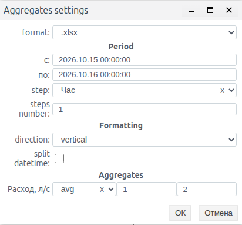

# Агрегаты: расчёт и выгрузка показателей

## О модуле

Агрегаты рассчитывают показатели по сохранённой истории за выбранный интервал: среднее, минимум, максимум, интеграл и стандартное отклонение. Их используют для итогов смены, оценки объёма по расходу и подготовки почасовых сводок. В «Аналитика» можно получить показатели за один период, в «Экспорт аналитики» — файл с результатами по последовательным интервалам.

Агрегат не является отдельным видом источника архива. Подготовка истории описана в документе [Архивы: настройка источников и запись данных](./archives_ru.md); выбор графика и обычная выгрузка его данных — в документе [Тренды: просмотр и выгрузка истории](./trends_ru.md).

## Подготовка к расчёту

Откройте тренд с прямой архивной серией. Убедитесь, что за нужное время есть история и известны исходные единицы. Выберите исторический период и включите паузу, чтобы окно не двигалось во время проверки.

В примерах давление имеет единицу бар, расход — л/с. История учебная, местное время Asia/Almaty, UTC+5. Результат зависит от границ, функции, множителя и полноты данных; проверяйте эти параметры вместе.

«Аналитика» открывает Analytics settings. В Period отображаются поля «с:» и «по:», в Aggregates — функции. Для изменения даты и времени откройте календарь поля. Справа от переключателя каждой функции расположены множитель и точность. Включите нужные функции, проверьте их параметры и нажмите «ОК». Результат открывается в Analytics: строки соответствуют сериям, столбцы — выбранным функциям. При повторном открытии настроек функции нужно включить заново.

## Функции и смысл результата

| Функция | Смысл расчёта | Единицы результата | Пропуски и особенности |
| --- | --- | --- | --- |
| avg | Среднее с весом по длительности значений | Единицы сигнала | Учитывает длительность числовых участков |
| min, в русской форме «мин» | Минимальное числовое значение | Единицы сигнала | Отсутствующий участок не становится нулём |
| max | Максимальное числовое значение | Единицы сигнала | Отсутствующий участок не становится нулём |
| integral | Площадь под ступенчатым сигналом | До множителя: единицы сигнала × мс | Пропуски не дают измеренного вклада |
| standard_deviation | Стандартное отклонение с весом по времени | Единицы сигнала | Рассчитывается по числовым участкам |
| Положительный интеграл, имя оканчивается на integral_pos | Площадь только положительных участков | До множителя: единицы сигнала × мс | При отсутствии положительных участков ноль не гарантируется |

### Среднее по времени

Для ступенчатой истории каждое значение действует до следующего изменения. Среднее равно сумме произведений значений на их длительности, делённой на суммарную длительность числовых участков. Редкие записи неизменного сигнала не делают его вклад меньше.

Это отличается от среднего последних пяти опросов скрипта вибрации из руководства об архивах. Для среднего по времени важна длительность; для среднего по отсчётам — состав окна.

### Границы, пропуски и качество

Расчётный интервал включает начало и исключает конец: [начало, конец). Предыдущее известное значение может продолжать действовать от начала выбранного периода.

Пропуск не равен нулю. Среднее рассчитывается по времени, на котором есть числовые значения; результат не подтверждает полноту данных за весь период. Интеграл по неполной истории не доказывает физический объём за пропущенное время.

Стандартные функции не отбрасывают числовое значение только по его коду качества. Если недостоверное измерение должно исключаться, согласуйте правило достоверности при подготовке исходной истории.

## Давление за смену

Задача: получить среднее, максимум и минимум давления за 15 октября, 08:00–16:00. Используется PressureArchive, подпись «Давление, бар».

1. Откройте прямую серию давления, включите паузу и задайте 08:00–16:00.
2. Нажмите «Аналитика».
3. В Analytics settings проверьте «с:» и «по:».
4. Включите avg, max и «мин». Для каждой оставьте множитель 1 и точность 2.
5. Нажмите «ОК». В Analytics проверьте строку «Давление, бар»: avg 3.44, max 6.00, мин 2.00.

*Рисунок 1. Период смены и включённые avg, max и «мин»; справа от каждой функции — множитель и точность.*

### Ручная проверка

| Участок смены | Давление, бар | Длительность, мин |
| --- | --- | --- |
| 08:00–08:10 | 2 | 10 |
| 08:10–08:20 | 4 | 10 |
| 08:20–08:30 | 6 | 10 |
| 08:30–10:00 | 3 | 90 |
| 10:00–12:00 | 3,5 | 120 |
| 12:00–14:00 | 4 | 120 |
| 14:00–16:00 | 3 | 120 |

Взвешенная сумма равна 1650 бар·мин, длительность — 480 минут. Среднее 1650 / 480 = 3,4375 бар; при точности 2 отображается 3,44. Экстремумы — 2 и 6 бар.

Для короткого контроля в том же сценарии выберите 08:00–08:30. Значения 2, 4 и 6 действуют по десять минут, поэтому avg = 4, min = 2, max = 6. Дополнительно включённая standard_deviation даёт 1,63.

*Рисунок 2. Контрольные результаты за 08:00–08:30: среднее 4, максимум 6, минимум 2 и стандартное отклонение 1,63.*

Точность определяет формат результата; она не меняет исходную историю. Точка в таблице Analytics — десятичный разделитель интерфейса.

## Объём воды по расходу

Задача: определить объём воды за десять минут по FlowArchive. Исходная единица — л/с; на всём интервале расход равен 2.

1. Откройте прямую серию «Расход, л/с», включите паузу и задайте 15 октября, 08:00–08:10.
2. Нажмите «Аналитика», проверьте те же границы в Period.
3. Включите integral. Справа от переключателя проверьте множитель 0.001 и точность 2.
4. Нажмите «ОК». В столбце integral должно быть 1200.00.

*Рисунок 3. Интеграл за 08:00–08:10: постоянный расход 2 л/с дал объём 1200 л.*

Ручной контроль: 10 минут = 600 секунд; 2 л/с × 600 с = 1200 л. Исходный интеграл использует время в миллисекундах, поэтому множитель 0.001 переводит результат в литры. Для другой исходной единицы расхода нужен соответствующий пересчёт.

Единица результата — литры. Подпись строки «Расход, л/с» продолжает обозначать исходный сигнал: отдельной колонки единицы результата в Analytics нет.

В учебной конфигурации также доступна функция с окончанием имени integral_pos — интеграл положительных участков. На этом же положительном расходе с множителем 0.001 и точностью 2 она дала 1200.00, как обычный integral. Состав дополнительных функций зависит от проекта. Если положительных участков нет, числовой ноль не гарантируется.

## Почасовая сводка

Задача: выгрузить средний расход за каждый час выбранных суток. Для примера выбран один день — 15 октября 2026, 00:00–16 октября 00:00, Asia/Almaty, UTC+5. На всех 24 часах учебный FlowArchive равен 2 л/с.

1. Откройте прямую серию «Расход, л/с», включите паузу и задайте границы суток.
2. Нажмите «Экспорт аналитики». Откроется Aggregates settings.
3. В format выберите .xlsx. В step выберите «Час», в steps number задайте 1.
4. После изменения шага заново проверьте Period: «с:» 2026.10.15 00:00:00, «по:» 2026.10.16 00:00:00. При необходимости верните эти даты через календарь.
5. Оставьте direction vertical и split datetime выключенным.
6. Для «Расход, л/с» выберите avg, множитель 1 и точность 2. Нажмите «ОК» и сохраните скачанный файл.
7. Повторите выгрузку с .csv и теми же параметрами. Откройте файлы, проверьте 24 результата, первое и последнее время.

*Рисунок 4. Настройки почасовой сводки: сутки, Час ×1, avg, множитель 1, точность 2.*

При смене единицы и множителя интерфейс нормализует конец периода. В проверке промежуточный шаг «Час ×10» расширил конец до 16 октября 06:00. Последующий выбор ×1 сам не заменяет проверку дат: перед «ОК» сверьте итоговые границы.

### Как читать строки сводки

datetime обозначает конец расчётного интервала. Первая строка 01:00 относится к часу [00:00, 01:00), последняя строка 00:00 следующих суток — к часу [23:00, 00:00).

| datetime | Расход, л/с, функция avg | Интервал |
| --- | --- | --- |
| 2026-10-15 01:00:00 | 2.00 | 15.10 00:00–01:00 |
| 2026-10-15 13:00:00 | 2.00 | 15.10 12:00–13:00 |
| 2026-10-16 00:00:00 | 2.00 | 15.10 23:00–16.10 00:00 |

В CSV получены заголовок datetime, «Расход, л/с» и 24 строки со значением 2.00. В XLSX — Sheet1, диапазон A1:B25: заголовок и 24 строки; время хранится текстом, значения — числами 2. В XLSX количество видимых знаков зависит также от формата ячейки.

Временные метки файлов записаны без смещения часового пояса; в этом примере они соответствуют UTC+5.

Отсутствие строки с меткой 00:00 начала суток не означает пропущенный первый час. Его результат находится в строке 01:00. Для дней с переходом часового смещения отдельно проверяйте фактическую длительность периода.

## Справочник настроек

### Аналитика за один период

| Поле | Назначение | Тип / ед. | Нужно | По умолч. | Если пусто | Ограничения |
| --- | --- | --- | --- | --- | --- | --- |
| Period: с / по | Интервал расчёта | Дата и время | Да | Период графика | Выберите границы | Проверьте часовой пояс |
| Функция on/off | Выбор показателя | on/off | Хотя бы одна | off | Нет выбранного показателя | Включите заново при открытии |
| Множитель | Пересчёт результата | Число | Да | 0.001 для интегралов; 1 для остальных | Оставьте исходный | Согласуйте единицы |
| Точность | Знаки после точки | Целое | Нет | 2 | Оставьте 2 | Формат результата |
| ОК | Выполнить расчёт | Команда | Да | — | — | После выбора функций |
| Отмена | Закрыть настройки | Команда | Нет | — | — | Без нового расчёта |

В полях множителя используйте десятичную точку: 0.001. После выбора функции проверьте множитель, даже если интерфейс подставил его автоматически.

### Экспорт аналитики

| Поле | Назначение | Тип / ед. | Нужно | По умолч. | Если пусто | Ограничения |
| --- | --- | --- | --- | --- | --- | --- |
| format | Способ выдачи | .xlsx / .csv / .xml / preview | Да | .xlsx | Выберите формат | preview без скачивания |
| Period: с / по | Общий период | Дата и время | Да | Из графика | Выберите границы | Конец нормализуется по шагу |
| step | Единица интервала | Секунд / минута / Час | Да | минута | Оставьте единицу | После смены проверьте даты |
| steps number | Множитель шага | Целое | Да | 10 | Задайте число | Для сводки > 0 |
| direction | Размещение времени | vertical / horizontal | Да | vertical | Оставьте vertical | Строки / колонки |
| split datetime | Разделить дату и время | Checkbox | Нет | Выключен | Общий datetime | Проверено при vertical |
| Aggregates: функция серии | Показатель по интервалам | Выбор | Для каждой серии | avg | Выберите функцию | Состав зависит от проекта |
| Множитель серии | Пересчёт единиц | Число | Да | 1 для avg | Оставьте исходный | Для интеграла проверьте 0.001 |
| Точность серии | Знаки результата | Целое | Нет | 2 | Оставьте 2 | XLSX хранит число |
| ОК / Отмена | Выполнить / закрыть | Команды | По задаче | — | — | Проверить настройки до ОК |

vertical размещает время по строкам, horizontal — по колонкам. В горизонтальном предпросмотре этого примера показаны одна строка серии и 24 часовые колонки.

При vertical включение split datetime создаёт отдельные колонки «Дата», «Время» и значения серии. После изменения direction проверяйте checkbox повторно: в проверке переключение направления сбрасывало его.

При новом открытии Aggregates settings формат, шаг, оформление и функция возвращаются к исходным значениям. Для повторной выгрузки заново задайте Час ×1, нужный формат, функцию и оформление; период проверьте по полям «с:» и «по:».

| Формат | Содержимое | Получение | Особенности |
| --- | --- | --- | --- |
| XLSX | Таблица показателей по интервалам | format .xlsx → ОК | Время текстом, значения числовые |
| CSV | Та же сводка текстом | format .csv → ОК | UTF-8 без BOM, TAB, CRLF; время до секунд |
| XML | Строки и колонки сводки | format .xml → ОК | Структура rows / row / column; значения текстом |
| preview | Таблица в интерфейсе | format preview → ОК | Проверка содержания до скачивания |

Для этого примера CSV и XML содержат одинаковые временные метки и текст 2.00; XLSX содержит численно равные значения 2. Предпросмотр vertical подтвердил те же 24 интервала. Выбирайте формат под способ дальнейшей обработки, сохраняя сведения о функции, периоде и единицах.

### Пользовательские функции

В Studio откройте «Меню» → Aggregates. Этот редактор предназначен для пользовательских функций на Erlang, которые доступны в аналитике проекта.

1. Внесите нужные изменения в текст.
2. Нажмите Compile и прочитайте результат. При успешной проверке отображается OK, Save становится доступной.
3. Если показаны errors или warnings, исправьте указанные места и выполните Compile повторно.
4. Сохраните подготовленные изменения кнопкой Save.
5. Заново откройте список функций в аналитике и проверьте результат на известной истории.

При ошибках компиляции Save недоступна. Правильность расчётной формулы проверяйте отдельно на контрольных значениях и интервалах. Для отказа от правок выйдите без Save; при запросе интерфейса подтвердите отказ от сохранения.

| Действие | Назначение | Когда доступно | Результат |
| --- | --- | --- | --- |
| Изменение текста | Настройка пользовательских функций | Открыт редактор, есть права | Несохранённая правка |
| Compile | Проверка подготовленного текста | Открыт редактор | OK либо сообщения диагностики |
| Save | Сохранение функций проекта | После успешного Compile | Сохранённые настройки |
| Выход без Save | Отказ от правок | Редактор открыт | Исходный сохранённый текст |

Скриптовый источник архива настраивается в форме самого архива. Функции в Aggregates используют для расчёта показателей по уже сохранённой истории.

## Диагностика

| Наблюдение | Что проверить | Как сверить |
| --- | --- | --- |
| Нет результатов | Есть ли история и включена ли функция | Известный короткий период |
| Среднее отличается от среднего записей | Длительности значений и пропуски | Взвешенная сумма / числовое время |
| Объём отличается в 1000 раз | Единицы расхода и множитель интеграла | Для 2 л/с за 10 минут — 1200 л |
| Результат выглядит округлённым | Поле точности | Увеличить знаки при необходимости |
| Показатель есть при неполной истории | Пропуски внутри периода | Просмотреть исходный тренд |
| Неожиданное число строк сводки | Итоговые границы, шаг и часовой пояс | Проверить первый и последний интервал |
| Дата файла не совпала с датой истории | Имя файла и строки времени | Проверять содержимое |
| Пользовательская функция не доступна | Сохранение и результат компиляции | Снова открыть список функций |
| Save недоступна в редакторе | Результат Compile, errors / warnings | Исправить текст и получить OK |

Обычная команда «Сохранить в .csv» выгружает данные графика. Для сводки по часам используйте «Экспорт аналитики» и явно задавайте функцию и шаг. Совпадение формата файла не означает совпадение содержания.
