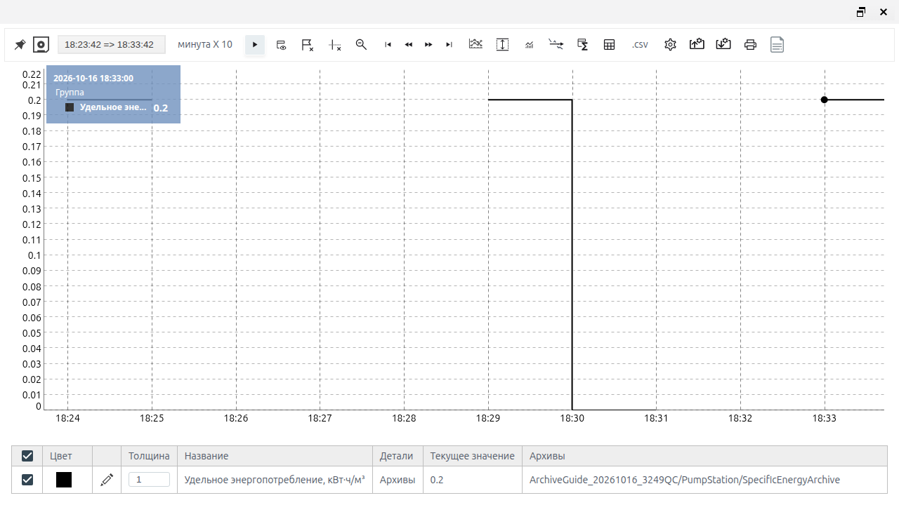

# Архивы: настройка источников и запись данных

## О модуле

Архив сохраняет историю значений с временными метками. Его используют, чтобы видеть изменения технологических параметров, разбирать отклонения и готовить данные для трендов и расчёта показателей. Источником служит поле тега или результат скрипта на JavaScript либо Erlang. Для каждого архива можно задать период опроса, минимальный шаг изменения и отключить сбор.

Для просмотра истории используйте документ [Тренды: просмотр и выгрузка истории](./trends_ru.md), для расчётов по истории — [Агрегаты: расчёт и выгрузка показателей](./aggregates_ru.md).

## Подготовка к настройке

Нужны доступ к созданию и редактированию объектов проекта, работающий Runtime и исходные объекты с доступными полями. Для скриптового источника необходима поддержка выбранного языка в вашей установке.

Заранее определите тип и единицу каждого входа. В примерах давление измеряется в барах, энергия — в кВт·ч, объём — в м³, вибрация — в мм/с. Подпись единицы в названии архива помогает читать график, но сама не пересчитывает значения.

Все числа далее учебные. Примеры предполагают заранее созданные исходные объекты и поля в папке PumpStation вашего проекта. При выборе объектов используйте дерево проекта: путь в поле выбора отображается относительно проекта.

### Что считать результатом настройки

Сохранённая форма подтверждает настройки. RUN и отсутствие ошибки подтверждают активность архива. Чтобы подтвердить запись, откройте историю и проверьте изменение значения и время точки. Текущее значение во вкладке Runtime само по себе не доказывает наличие новой точки.

## Архив давления из тега

Задача: сохранить изменения давления на выходе насоса. Источник Pressure, числовое поле value; учебная последовательность 3 → 3,2 → 3,5 бар.

1. В Studio откройте папку PumpStation в общем дереве. Нажмите «Создать», откройте system, выберите ARCHIVE и нажмите «Ok».
2. Введите «Название» PressureArchive и «Заголовок» «Давление на выходе насоса, бар».
3. Во вкладке «Настройки» выберите источник «тег». Через дерево выберите Pressure, затем поле value.
4. Оставьте «Период (мс)» 1000, «Минимальный шаг» пустым, «Отключено» выключенным. Нажмите save.
5. Повторно откройте архив и проверьте источник и настройки. Если Runtime ещё выключен, используйте «Запустить Runtime» и подтвердите yes.
6. Убедитесь, что архив показывает RUN и no errors. На учебном источнике измените давление с 3 до 3,2, затем до 3,5; между изменениями выдержите больше одного периода опроса.
7. Откройте Runtime → «Меню» → «Тренды» → «Архивы». В редакторе серии выберите PressureArchive и подтвердите save, затем «ОК».
8. Проверьте ступени давления и подсказку с временем и значением. Кнопкой «Старт-Стоп» можно зафиксировать график для проверки.


*Рисунок 1. История учебного давления: подсказка подтверждает значение 3,2. Пауза относится к графику.*

Период 1000 мс означает чтение раз в секунду. Одинаковое значение не обязано записываться заново каждую секунду. Пауза тренда не останавливает сбор архива.

Источник «тег» сохраняет числовое представление поля: число используется напрямую, bool преобразуется в 0 или 1, числовая строка — в число. Непреобразуемое значение становится отсутствующим. Время и качество исходного поля при простой привязке не переносятся автоматически; если они нужны в результате, задайте их в скриптовом источнике.

## Скриптовый источник

Скрипт нужен, когда следует сохранять вычисляемую величину: отношение приращений счётчиков, среднее нескольких отсчётов или результат с условиями достоверности.

В форме архива выберите источник script, язык erlang или javascript. В таблице переменных задайте имя, объект и поле каждого входа. Имя в таблице должно точно совпадать с именем в функции.

| Элемент | JavaScript | Erlang |
| --- | --- | --- |
| Входные переменные | VARS.energy_total | maps:get("vibration", VARS, none) |
| Состояние | Второй аргумент State | Второй аргумент State |
| Возврат значения и состояния | { value: число, state: новоеСостояние } | {Значение, НовоеСостояние} |
| Нет расчётного значения | null | none |
| Логические входы | true / false | true / false |

State хранит данные между опросами: предыдущую пару счётчиков или окно отсчётов. Это состояние возвращает сама функция; отдельного поля для его ручного заполнения нет. При повторном запуске архива состояние теряется. После изменения настроек и повторного включения учитывайте повторное накопление исходных данных.

Отсутствующий результат отличается от нуля. Числовой 0 — полноценный результат; null или none означает, что вычислять значение сейчас нельзя. Переход к отсутствующему значению виден в истории как разрыв.

Результат скрипта может дополнительно содержать ts — целую временную метку Unix в миллисекундах — и quality — код качества. В JavaScript эти поля входят в объект результата вместе с value и state; в Erlang value, ts и quality можно вернуть картой в первом элементе пары, оставив новое состояние вторым. В приведённых функциях время и качество явно не задаются; используется время выполнения расчёта. Смысл кодов качества согласуйте для вашей системы.

### Ввод и проверка функции

1. Заполните привязки входов и выберите язык.
2. Замените текст примера в редакторе полной функцией.
3. Завершите ввод, дождитесь обработки правки и нажмите Compile.
4. После успешной компиляции дождитесь доступности save и сохраните архив.
5. Откройте форму заново: проверьте язык, каждую привязку и сохранённый текст.
6. Проверьте текущий результат и историю на известных входах.

Успешная компиляция проверяет функцию, но не правильность выбранных объектов, единиц и входных показаний. Если чтение поля завершилось ошибкой до вызова функции, проверки null или none внутри неё эту ошибку не обработают.

## Удельное энергопотребление на JavaScript

Задача: получить расход энергии на единицу перекачанной воды. Показатель равен приращению энергии, делённому на приращение объёма за один интервал опроса.

| Переменная | Объект и поле в PumpStation | Тип и единица |
| --- | --- | --- |
| energy_total | EnergyTotal → value | Неотрицательное число, накопленная энергия, кВт·ч |
| volume_total | VolumeTotal → value | Неотрицательное число, накопленный объём, м³ |

1. Создайте архив SpecificEnergyArchive, заголовок «Удельное энергопотребление, кВт·ч/м³».
2. Выберите script → javascript и заполните две привязки из таблицы.
3. Задайте период 60000 мс, оставьте минимальный шаг пустым и сбор включённым.
4. Вставьте функцию ниже, выполните Compile, сохраните и повторно проверьте текст.

```javascript
async function(VARS, State) {
    const energy = VARS.energy_total;
    const volume = VARS.volume_total;
    const valid = x => Number.isFinite(x) && x >= 0;
    if (!valid(energy) || !valid(volume)) {
        return { value: null, state: null };
    }
    const next = { energy_total: energy, volume_total: volume };
    const hasPrevious =
        State !== null &&
        typeof State === "object" &&
        valid(State.energy_total) &&
        valid(State.volume_total);
    if (!hasPrevious) {
        return { value: null, state: next };
    }
    const deltaEnergy = energy - State.energy_total;
    const deltaVolume = volume - State.volume_total;
    if (deltaEnergy < 0 || deltaVolume <= 0) {
        return { value: null, state: next };
    }
    const result = deltaEnergy / deltaVolume;
    return {
        value: Number.isFinite(result) ? result : null,
        state: next
    };
}
```

Функция запоминает предыдущие показания. Первый корректный опрос только задаёт базу. Уменьшение любого счётчика или отсутствие положительного прироста объёма даёт пропуск и новую базу. Неверный вход очищает состояние.

### Проверка на учебной последовательности

Таблица показывает ожидаемые последовательные вызовы функции. При ручной проверке задавайте оба счётчика до очередного опроса и удерживайте пару до фиксации результата. Дополнительный опрос неизменной пары означает нулевой прирост объёма и может дать пропуск.

| Опрос | Энергия, кВт·ч | Объём, м³ | Результат, кВт·ч/м³ | Объяснение |
| --- | --- | --- | --- | --- |
| 1 | 1000 | 500 | Нет значения | Исходная база |
| 2 | 1002 | 510 | 0,2 | 2 / 10 |
| 3 | 1003 | 510 | Нет значения | Объём не увеличился; новая база |
| 4 | 1004 | 515 | 0,2 | 1 / 5 |
| 5 | 2 | 2 | Нет значения | Сброс счётчиков; новая база |
| 6 | 3 | 7 | 0,2 | 1 / 5 после сброса |
| 7 | null | 8 | Нет значения | Вход неверен; состояние очищено |
| 8 | 4 | 12 | Нет значения | Новая исходная база |
| 9 | 5 | 17 | 0,2 | 1 / 5 |
| 10 | 5 | 22 | 0 | Нулевая энергия при положительном объёме |



*Рисунок 2. Проверка восстановления после сброса счётчиков: в истории получено 0,2 кВт·ч/м³.*

Показания должны относиться к одной станции и сопоставимому времени. Скрипт не обнаружит скрытый сброс счётчика, если к следующему опросу тот уже вырос выше прежнего показания. При отсутствии прироста объёма энергия этого интервала не переносится в следующий расчёт. Числовые строки и логические значения намеренно отклоняются.

Практический контекст показателя — контроль энергоэффективности водоснабжения и опреснения, описанный в материалах [AVEVA о водоснабжении](https://www.aveva.com/en/our-industrial-life/type/podcast/smart-water-for-a-changing-environment/) и [энергозатратах опреснения](https://www.aveva.com/en/our-industrial-life/type/article/deep-sea-desalination-pods-cleaner-cheaper-water/). Функция и правила обработки сбросов здесь разработаны для учебного примера Faceplate.

## Скользящее среднее вибрации на Erlang

Задача: сгладить вибрацию работающего насоса, не смешивая отсчёты до остановки и после нового запуска. Используются последние пять корректных опросов; результат появляется с третьего.

| Переменная | Объект и поле в PumpStation | Тип и смысл |
| --- | --- | --- |
| vibration | Vibration → value | Число ≥ 0, мм/с |
| running | Running → value | Bool: насос работает |
| sensor_ok | SensorOK → value | Bool: источник подтверждает достоверность |

1. Создайте архив VibrationAverageArchive, заголовок «Средняя вибрация, мм/с».
2. Выберите script → erlang и заполните три привязки.
3. Задайте рабочий период 1000 мс, минимальный шаг оставьте пустым.
4. Вставьте функцию, выполните Compile, сохраните и проверьте повторное открытие.

```erlang
fun(VARS, State) ->
    Vibration = maps:get("vibration", VARS, none),
    Running = maps:get("running", VARS, none),
    SensorOK = maps:get("sensor_ok", VARS, none),
    Valid = Running =:= true
        andalso SensorOK =:= true
        andalso is_number(Vibration)
        andalso Vibration >= 0,
    case Valid of
        false ->
            {none, []};
        true ->
            Previous = case State of
                L when is_list(L) -> L;
                _ -> []
            end,
            Window = lists:sublist([Vibration | Previous], 5),
            case length(Window) >= 3 of
                false -> {none, Window};
                true -> {lists:sum(Window) / length(Window), Window}
            end
    end
end.
```

State содержит список от нового отсчёта к старому. При остановке насоса, неверном признаке достоверности или недопустимой вибрации функция возвращает отсутствие значения и пустое окно. Значения running и sensor_ok должны быть именно true или false; числа 0/1 и строки их не заменяют.

### Проверка накопления и очистки окна

Для ручной проверки можно временно задать период 30000 мс, чтобы успевать менять входы между опросами. После проверки верните рабочие 1000 мс. Изменение периода может запустить накопление окна заново.

| Опрос | vibration | running | sensor_ok | Результат | Окно, от нового к старому |
| --- | --- | --- | --- | --- | --- |
| 1 | 2 | true | true | Нет значения | [2] |
| 2 | 4 | true | true | Нет значения | [4, 2] |
| 3 | 6 | true | true | 4 | [6, 4, 2] |
| 4 | 8 | true | true | 5 | [8, 6, 4, 2] |
| 5 | 10 | true | true | 6 | [10, 8, 6, 4, 2] |
| 6 | 12 | true | true | 8 | [12, 10, 8, 6, 4] |
| 7 | 12 | false | true | Нет значения | [] |
| 8 | 3 | true | true | Нет значения | [3] |
| 9 | 4 | true | false | Нет значения | [] |
| 10 | none | true | true | Нет значения | [] |
| 11 | 4 | true | true | Нет значения | [4] |
| 12 | 5 | true | true | Нет значения | [5, 4] |
| 13 | 6 | true | true | 5 | [6, 5, 4] |


*Рисунок 3. Ручная проверка с периодом 30000 мс: среднее 4 → 5 → 6 → 8, разрыв и восстановление. После проверки рабочий период возвращён к 1000 мс.*

Таблица — контрольная последовательность отдельных вызовов. В окно входит каждый корректный опрос, включая неизменный вход. Это среднее по отсчётам, а не среднее за фиксированное время и не среднее последних пяти записанных изменений. Числа примера не являются нормами вибрации оборудования.

Подход к сглаживанию показан в [Ignition: Easy Chart Calculated Pens](https://docs.inductiveautomation.com/docs/8.3/ignition-modules/vision/historian-in-vision/using-the-vision-easy-chart/easy-chart-calculated-pens); среднее последних N значений — в [Ignition SDK: MovingAverage](https://sdk.inductiveautomation.com/javadoc/ignition81/8.1.50/index-files/index-13.html). Условия для насоса, окно из пяти опросов и очистка состояния — авторская адаптация этого примера.

## Настройки и управление архивами

### Общие поля и запись

| Поле | Назначение | Тип / ед. | Нужно | По умолч. | Если пусто | Ограничения |
| --- | --- | --- | --- | --- | --- | --- |
| Папка | Место архива | Путь | Да | Текущая папка | Выберите папку | В пределах доступного проекта |
| Шаблон | Тип объекта | ARCHIVE | Да | Выбор в создании | Выберите ARCHIVE | Категория system |
| Название | Имя объекта | Текст | Да | Ввод пользователя | Заполните | Уникально в папке |
| Заголовок | Понятная подпись | Текст | Нет | Пусто | Без подписи | Не меняет единицы |
| Период (мс) | Частота опроса / расчёта | Целое, мс | Да | 1000 | Оставьте 1000 | Положительное целое |
| Минимальный шаг | Подавление малых изменений | Целое; ед. сигнала | Нет | Пусто | Без порога | Положительное целое; 0 недопустим |
| Отключено | Остановка сбора архива | Да/нет | Нет | Выключен | Сбор разрешён | Runtime должен работать |

В проверенном интерфейсе дробный минимальный шаг не сохранился. Для исходной настройки оставляйте поле пустым; при необходимости порога используйте положительное целое.

Минимальный шаг сравнивает новое значение с последним сохранённым. Для записи изменение должно строго превысить порог; равенство порогу подавляется. Например, при последнем сохранённом 10 и шаге 1 значения 10,4 и 11 находятся внутри порога, а 11,2 его превышает. Несколько малых изменений могут в сумме превысить порог. Изменение качества также влияет на появление точки.

### Источник и привязки

| Поле | Назначение | Тип / ед. | Нужно | По умолч. | Если пусто | Ограничения |
| --- | --- | --- | --- | --- | --- | --- |
| Источник | Способ получения значения | тег / script | Да | тег | Выберите явно | Настройки зависят от источника |
| Объект и поле | Вход тега | Путь и поле | Для тега | Не выбраны | Настройка не завершена | Поле должно существовать |
| Язык | Язык функции | erlang / javascript | Для script | erlang | Выберите явно | Должен поддерживаться установкой |
| Переменные | Привязки входов | Имя, объект, поле | По функции | Пустая таблица | Нет нужных входов | Имена совпадают с кодом |
| Текст функции | Расчёт | Функция двух аргументов | Для script | Пример | Введите функцию | Compile и проверка сохранения |

Пустая строка, автоматически появляющаяся после заполненных привязок, служит для следующей переменной. Не обращайтесь к ней в коде, пока не задали имя, объект и поле.

### Список и команды

В Studio откройте «Меню» → «Архив». В таблице показаны «Путь», «Статус», «Источник», «Отключено», Period,ms. и Min.step. Для поиска введите имя или часть пути в NameOrPart, выберите фильтр Tag либо «Скрипты» и нажмите «Найти». Для поиска по части пути используйте не менее трёх символов.

| Действие | Назначение | Когда доступно | Результат |
| --- | --- | --- | --- |
| Создать → system → ARCHIVE | Новый архив | В папке проекта при наличии прав | Открыта форма создания |
| Двойной щелчок по архиву | Редактирование | Архив существует | Открыта форма |
| save | Сохранение | Есть допустимые изменения | Настройки применены |
| cancel | Закрытие без сохранения | Форма открыта | Несохранённые правки отброшены |
| Отключено → save | Приостановка сбора | В форме архива | Новые значения не собираются |
| Снять Отключено → save | Возобновление | Архив был отключён | Сбор возобновляется; State накапливается заново |
| Compile | Проверка функции | Источник script | Результат компиляции |
| Диагностика | Журнал архива, см. [«Диагностика объектов Runtime»](../administration/diagnostics/diagnostics.md) | Сохранённый архив | Открыто окно **Диагностика** |
| Найти | Поиск по имени и источнику | Список архивов | Отфильтрованные строки |

После изменения настроек повторно откройте форму и проверьте их. Состояние RUN, поле «Ошибка» и вкладка Runtime заполняются автоматически; вручную их задавать не нужно.

## Диагностика и особенности записи

| Наблюдение | Что проверить | Как подтвердить исправление |
| --- | --- | --- |
| STOP, нет текущего результата | Runtime проекта и «Отключено» | RUN после разрешения сбора |
| RUN, но нет новой точки | Было ли изменение; период; минимальный шаг | Изменение видно в истории |
| Точки появляются реже периода | Неизменные значения и подавление порогом | Проверить известный переход сигнала |
| Ошибка привязки | Объект и поле каждой переменной | Повторно открыть источник и архив |
| Compile не завершён успешно | Язык, полный текст, два аргумента, имена VARS | Compile успешен, код сохранился |
| После запуска скрипт даёт пропуск | База счётчиков или первые два отсчёта вибрации | Дождаться достаточных корректных опросов |
| Пропуск вместо ожидаемого числа | Нет прироста объёма, сброс, тип входа, bool-флаги | Проверить входы по таблице сценария |
| «Неправильное значение» в легенде | Возвращены null / none | Сверить с условиями функции и полем ошибки |
| Текущая форма показывает старое значение | Повторно открыть вкладку / форму | Сравнить свежий результат с историей |
| Ошибка при минимальном шаге | Ноль или дробное значение | Оставить поле пустым либо задать целое > 0 |

Журнал архива смотрите в окне **Диагностика**, см. [«Диагностика объектов Runtime»](../administration/diagnostics/diagnostics.md): нажмите **Start**, воспроизведите проблему, затем **Stop**. Отсутствие сообщений за короткий просмотр не подтверждает запись: проверяйте также историю и подсказки точек.

Повторяющийся отсутствующий результат не обязан порождать новую точку. Поэтому длина разрыва и число записей не равны числу неудачных вызовов функции.
