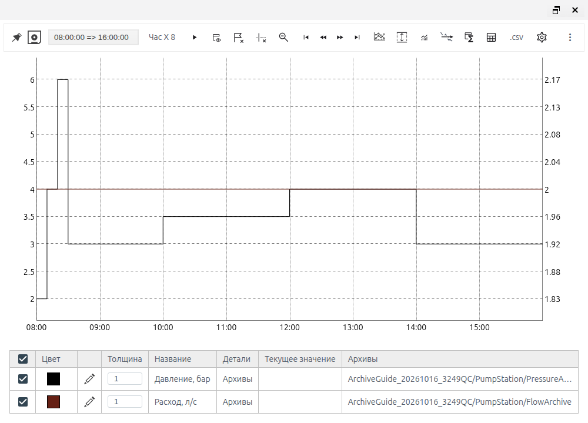
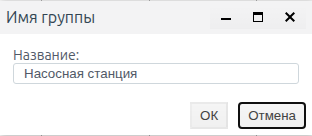
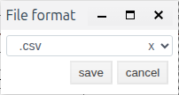

# Тренды: просмотр и выгрузка истории

## О модуле

Тренды показывают историю одного или нескольких архивов на общей временной шкале. Их используют для анализа смены, сопоставления технологических параметров и поиска момента отклонения. Можно настроить серии и две вертикальные оси, выбрать период, изучить значения курсором и срезом, сохранить группу, закрепить график за мнемосхемой и выгрузить данные.

Создание источников описано в документе [Архивы: настройка источников и запись данных](./archives_ru.md). Расчёт показателей по истории и почасовые сводки — в документе [Агрегаты: расчёт и выгрузка показателей](./aggregates_ru.md).

## Подготовка к просмотру

Нужны доступные архивы с историей за выбранный период. Тренд читает уже записанные значения. Если архив создан только сейчас, данных за предыдущую смену в нём не появится.

Серия — отдельная линия с источником, названием, цветом и осью. Группа — набор серий и настроек графика для повторного открытия. График можно открыть отдельным окном в Runtime или разместить как элемент «Тренды» на мнемосхеме.

График может содержать точки, подготовленные для отображения границ окна; его вид не является перечнем всех сохранённых записей. Разрыв соответствует отсутствующему значению. В историческом окне колонка «Текущее значение» относится к концу этого окна, а не обязательно к текущему показанию оборудования.

## Давление и расход за смену

Задача: сопоставить давление и расход насосной станции за 15 октября 2026 года, 08:00–16:00. В учебном примере используется местное время Asia/Almaty, UTC+5. Архивы PressureArchive и FlowArchive уже содержат контрольную историю.

| Серия | Источник | Единица | Ось |
| --- | --- | --- | --- |
| Давление, бар | PressureArchive | бар | y |
| Расход, л/с | FlowArchive | л/с | y2 |

1. В Runtime откройте «Меню» → «Тренды». Во вкладке «Архивы» откройте редактор первой серии кнопкой справа от её имени.
2. Введите «Давление, бар», оставьте ось y. Во вкладке источника «Архивы» выберите PressureArchive через дерево проекта и нажмите save.
3. Нажмите «Добавить серию». Для второй серии задайте «Расход, л/с», источник FlowArchive и ось y2. Сохраните серию, затем нажмите «ОК» в окне «Выбор трендов».
4. Нажмите «Старт-Стоп», чтобы остановить автоматическое продвижение окна.
5. Нажмите кнопку с текущими датами. В Set period задайте «с:» 2026-10-15 08:00:00 и «по:» 2026-10-15 16:00:00. Для выбора используйте календарь и список времени.
6. В «Период» → «Задание интервала» выберите hour и множитель 8. Проверьте подпись «Час X8» и фактические даты 08:00–16:00.
7. Наведите курсор на известный момент: в 08:20 учебное давление равно 6 бар, расход — 2 л/с. Сверьте подписи и обе оси.

*Рисунок 1. Давление и расход за смену: шкала давления слева, шкала расхода справа.*

Положение линии расхода относительно левой шкалы не является её числовым значением: расход читается по правой оси y2. Оси и подписи не пересчитывают единицы.

Пауза касается только графика. Архивы продолжают собирать значения при работающем Runtime.

### Период, навигация и значения

Абсолютный период задаёт конкретные начало и конец. Единица и множитель задают длительность окна для просмотра и перемещения. После изменения любого из них проверьте фактические даты в верхней панели.

Кнопки шага назад и вперёд перемещают окно на его длительность: для восьмичасового окна 08:00–16:00 предыдущий период — 00:00–08:00. Для изучения исторического события сначала включите паузу, затем задайте даты.

Подсказка курсора показывает время отсчёта и значения серий. Для фиксированного среза нажмите правой кнопкой внутри области построения. Команда «Таблица среза» показывает значения на времени среза; на узком окне она находится в меню ⋮. «Удалить аннотации и срезы» убирает срез.

В проверенном учебном примере срез 11:11:46 показал давление 3,5 и расход 2. Подсказка курсора может привязаться к соседнему отсчёту, поэтому время подсказки и зафиксированного среза проверяйте отдельно.

### Линии уровня

«Линии уровня» позволяют добавить постоянную отметку с названием, значением, цветом и толщиной. Например, учебная отметка «Рабочая отметка» со значением 4 помогает читать давление. Откройте диалог, добавьте строку, заполните поля и нажмите «ОК». Для удаления откройте тот же диалог, удалите строку и подтвердите «ОК». Отметка служит ориентиром отображения.

## Серии и инструменты графика

Редактор серии доступен при выборе трендов и через значок редактирования в легенде. Задавайте понятное название с единицей, особенно при двух осях.

| Поле | Назначение | Тип / ед. | Нужно | По умолч. | Если пусто | Ограничения |
| --- | --- | --- | --- | --- | --- | --- |
| Название | Подпись серии | Текст | Нет | График / График 1 | Для архива возможен путь | Не меняет источник |
| Группа | Принадлежность серии | Выбор | Да | Группа | Выберите группу | Относится к составу графика |
| Ось | Вертикальная шкала | y / y2 | Да | y | Оставьте y | Единицы не пересчитывает |
| Архивы | Источник линии | Путь | Да для прямой серии | Не выбран | Нет данных серии | Выберите архив, а не исходный тег |
| Видимость | Показ линии | Да/нет | Нет | Да | Оставьте Да | История не удаляется |
| Толщина | Толщина линии | Число | Нет | 1 | Оставьте 1 | Оформление |
| Цвет | Цвет линии | Цвет | Нет | Первая чёрная; новые генерируются | Оставьте выбранный | Оформление |
| Ступенчатость | Ступени между значениями | Да/нет | Нет | Да | Оставьте Да | Не меняет запись |
| Маркер | Вид точки | Выбор | Нет | Нет | Без маркеров | Оформление |
| Размер маркеров | Размер точки | Число | Нет | 1 | Оставьте 1 | При включённом маркере |
| Диапазон min/max | Границы значений серии | Ед. сигнала | Нет | Пусто | Без ограничения серии | Не заменяет масштаб оси |

Вкладки источника в редакторе: «Архивы», «Скрипты», «Формула». Для прямой серии выбирают один архив. В «Скрипты» показываются таблица переменных с архивами, редактор JavaScript и Compile; в «Формула» — таблица переменных с архивами и поле выражения. Имена переменных должны соответствовать выражению. Вычисляемая серия относится к отображению и сама не создаёт расчётный архив. Для сохраняемой расчётной величины создайте скриптовый архив по отдельному руководству.

Диапазон серии ограничивает отображаемые значения самой серии; диапазон оси задаёт масштаб. Для исходного просмотра оставьте оба диапазона пустыми и используйте автоматический масштаб.

### Действия панели

| Действие | Назначение | Когда доступно | Результат |
| --- | --- | --- | --- |
| Выбор архивов / Редактор групп | Изменить состав | Открыт график | Редактор серий и групп |
| Старт-Стоп | Обновление / пауза | Открыт график | Окно движется / фиксируется |
| Кнопка дат / Set period | Абсолютные границы | Открыт график | История выбранного периода |
| Период | Единица и длительность | Открыт график | Новый интервал просмотра |
| Шаг назад / вперёд | Соседний интервал | На паузе | Перемещение на длительность |
| Скрыть/Показать описание | Легенда | Открыт график | Легенда скрыта / видна |
| Задание шкалы | Параметры y и y2 | Открыт график | Диалог «Ограничение шкалы» |
| Линии уровня | Постоянные отметки | Открыт график | Добавление и удаление уровня |
| Таблица среза | Значения фиксированного времени | Создан срез | Таблица значений |
| Удалить аннотации и срезы | Убрать срез | Срез существует | Срез удалён |
| Настройки отображения | Обновление и оформление | Открыт график | Диалог настроек |
| Сохранить как группу | Повторное использование | Настроен график | Новая / обновлённая группа |
| Закрепить за экраном | Вернуть график с экраном | Открыта мнемосхема | Закрепление для пользователя и экрана |
| Экспортировать тренды в файл | Перенести настройки | Настроен график | Файл .tnd |
| Импортировать тренды из файла | Загрузить настройки | Есть .tnd | Восстановлен состав и настройки |
| Аналитика / Экспорт аналитики | Расчёт показателей | Есть история | См. руководство об агрегатах |

При небольшой ширине окна часть команд находится в ⋮. Наличие кнопок зависит также от свойств встроенного тренда. Скрытие кнопки или линии не ограничивает права пользователя на исходные данные.

## Сохранение и перенос настроек

### Сохранить группу «Насосная станция»

1. Настройте две серии из предыдущего примера.
2. Нажмите «Сохранить как группу».
3. В диалоге «Имя группы» заполните «Название»: Насосная станция. Нажмите «ОК».
4. Закройте график и старое окно выбора трендов.
5. Снова откройте Runtime → «Тренды» → «Группы». В «Искать по имени» введите Насосная и нажмите «Найти».
6. Выберите «Насосная станция» и нажмите «ОК».
7. Проверьте обе подписи, источники, оси y/y2, оформление и длительность «Час X8».

*Рисунок 2. Имя новой группы задаётся в диалоге сохранения.*

Группа хранит настройки. В проверке восстановились серии, оси, цвета, ступенчатость и длительность окна. График открылся с текущим восьмичасовым периодом и автоматическим обновлением. Конкретные исторические даты и пауза не восстановились: для прежней смены задайте их заново.

Чтобы обновить группу, измените настройки открытого графика, нажмите «Сохранить как группу» и подтвердите то же имя. Проверяйте результат через заново открытое окно «Выбор трендов»: уже открытое окно может сохранять прежний выбор. В учебной проверке изменение подписи серии сохранилось именно таким способом.

### Файл настроек .tnd

Из настроенного графика выберите «Экспортировать тренды в файл»; при необходимости откройте ⋮. Скачивается файл trend_settings.tnd.

Для загрузки откройте «Выбор трендов» → «Файл» → Select files..., выберите свой .tnd и нажмите «ОК». Проверьте состав серий, пути, оси и длительность. После загрузки исторические даты и паузу задайте повторно.

Файл .tnd не содержит копию измерений. На другом проекте выбранные в нём архивы должны быть доступны по соответствующим путям.

### Закрепить график за мнемосхемой

Откройте нужную мнемосхему в Runtime. На этом экране откройте настроенный график и нажмите «Закрепить за экраном». При последующем открытии экрана тем же пользователем восстанавливается отдельное окно графика.

Закрепление и встроенный элемент тренда — разные объекты отображения: на экране могут быть одновременно оба. Изменения сохранённой группы не следует считать автоматическим обновлением уже созданного закрепления; в проверке оно сохранило настройки момента закрепления.

## Выгрузка выбранного периода

Для выгрузки используйте прямые архивные серии. Настройте состав графика, включите паузу и задайте нужные начало и конец до запуска выгрузки.

1. Откройте график давления и расхода за 15 октября, 08:00–16:00.
2. Нажмите «Сохранить в .csv» на панели.
3. В диалоге File format выберите .csv и нажмите save.
4. Для той же истории повторите команду, выберите .xlsx и нажмите save.
5. Откройте скачанные файлы. Проверьте заголовки, первые и последние даты и известные значения.

*Рисунок 3. В File format выбирается формат файла; период и серии берутся из графика.*

В проверенной форме доступны только .csv и .xlsx, кнопки save и cancel. Отдельного выбора периода, серий или функции расчёта в этом диалоге нет.

Для учебного окна оба файла содержат datetime, «Давление, бар», «Расход, л/с» и восемь строк данных. Контрольные строки:

| datetime | Давление, бар | Расход, л/с |
| --- | --- | --- |
| 2026-10-15 08:00:00.000 | 2 | 2 |
| 2026-10-15 08:20:00.000 | 6 | 2 |
| 2026-10-15 16:00:00.000 | 3 | 2 |

Количество строк определяется данными графика. В этом файле присутствует строка правой границы 16:00; не переносите это правило на интервалы расчёта агрегатов.

| Формат | Содержимое | Получение / загрузка | Особенности |
| --- | --- | --- | --- |
| CSV | Время и значения серий графика | «Сохранить в .csv» → .csv | UTF-8 без BOM, разделитель TAB, строки CRLF |
| XLSX | Те же время и значения | «Сохранить в .csv» → .xlsx | В проверке Sheet1, время текстом, значения числами |
| .tnd | Настройки графика | Экспортировать тренды в файл; Файл → Select files | Без копии истории |
| Выгрузка аналитики | Показатели по интервалам | «Экспорт аналитики» | Параметры и пример — в руководстве об агрегатах |

Если CSV открылся одним столбцом, используйте импорт текста с кодировкой UTF-8 и разделителем «табуляция». Десятичная часть чисел в файле отделяется точкой. Время записано без явного смещения, поэтому сохраняйте сведения о часовом поясе выбранного окна.

В проверке предложены имена archives.10_16_2026.csv и archives.10_16_2026.xlsx, хотя история относится к 15 октября. Проверяйте период по строкам файла, а не по дате в имени. Выгрузка относится к данным, подготовленным графиком; она не обещает перечень всех исходных сохранённых точек.

## Справочник настроек

### Обновление и оформление отдельного графика

Откройте «Настройки отображения». Изменения относятся к просмотру, а не к настройкам записи исходных архивов.

| Поле | Назначение | Тип / ед. | Нужно | По умолч. | Если пусто | Ограничения |
| --- | --- | --- | --- | --- | --- | --- |
| Период обновления | Обновление графика | Секунды | Да | 1 | Оставьте 1 | Отличается от периода архива |
| Цвет фона | Фон построения | Цвет | Нет | #fff | Оставьте цвет | Оформление |
| Ylabel / Y2label | Подписи осей | Текст | Нет | Пусто | Без подписи | Единицы задайте явно |
| Кол-во символов после запятой | Числа в легенде | Целое | Нет | 2 | Оставьте 2 | Формат отображения |
| Заполнить площадь | Заливка под линией | Да/нет | Нет | Выключено | Без заливки | Оформление |
| Прозрачность | Заливка | Число | Нет | 0,20 | Оставьте 0,20 | Для заливки |
| Размер метки Y | Размер подписи | Число | Нет | 18 | Оставьте 18 | Оформление |
| Отображать сетку | Показ сетки | Да/нет | Нет | Включено | Сетка видна | Не меняет историю |
| Шаг сетки X / Y | Плотность сетки | Число | Нет | 100 / 20 | Оставьте исходные | Отображение |
| Цвет сетки Y | Цвет сетки | Цвет | Нет | #000000 | Оставьте цвет | Оформление |
| Тип отображения легенды | Поведение подсказки | Выбор | Нет | onmouseover | Оставьте режим | never / always / follow / onmouseover |
| Количество срезов | Число срезов | Целое | Нет | 2 | Оставьте 2 | Отображение |
| Отображение панели | Показ панели | Выбор | Нет | show | Оставьте show | Не задаёт права |
| Авто / min / max для Y, Y2 | Масштаб осей | Ед. серии | Нет | Границы пусты | Авто | Отдельно для каждой оси |

Переключатели панели позволяют выбрать доступные инструменты просмотра. Для типового графика оставьте выбор архивов, периода, интервала, шкал, легенды, уровней, срезов и настроек. Выгрузка данных и аналитика настраиваются отдельно от содержания архива.

### Разместить встроенный тренд

В Studio выберите объект экрана → «Мнемосхема» → редактирование строки screen. В графическом редакторе откройте «Элементы управления» и перетащите «Тренды» на рабочую область.

Выберите созданный элемент. В «Свойства» → value → archives откройте редактор и добавьте архивные серии с нужными осями. Настройте положение и размер элемента, нажмите верхнюю кнопку «Сохранить». Закройте и повторно откройте редактор, чтобы проверить привязки. Фактические данные проверяйте на мнемосхеме в Runtime: предварительный просмотр редактора может показывать демонстрационные кривые.

### Свойства встроенного элемента

В каталоге ниже использованы имена, видимые в редакторе свойств. Значения положения зависят от места перетаскивания; они не являются постоянными значениями по умолчанию.

| Поле | Назначение | Тип / ед. | Нужно | По умолч. | Если пусто | Ограничения |
| --- | --- | --- | --- | --- | --- | --- |
| appearance: visible, opacity | Видимость и непрозрачность | Bool; число | Нет | true; 1 | Оставьте исходные | Отображение элемента |
| border: color, radius, style, width | Рамка | Цвет; числа; стиль | Нет | #808080; 0; solid; 0 | Без видимой рамки | В UI имена с border_ |
| geometry: width, height | Размер | Координаты редактора | Да | 800; 350 | Задайте размер | Проверьте на экране |
| geometry: left, top | Положение | Координаты редактора | Да | Место выбора | Разместите мышью | Зависит от экрана |
| grid: grid, color, x, y | Сетка | Bool; цвет; числа | Нет | true; #000000; 100; 20 | Оставьте исходные | В UI grid_color/x/y |
| legend | Режим легенды | Выбор | Нет | onmouseover | Оставьте режим | never / always / follow / onmouseover |
| legend: font, size, colors | Шрифт и цвета | Шрифт; число; цвета | Нет | system-ui; 12; фон #7092be; текст #fff | Оставьте исходные | Имена перечислены ниже |
| legend: digits, max_hairlines | Точность и срезы | Целые | Нет | 2; 2 | Оставьте 2 | Только отображение |
| misc: background_color, cursor | Фон и указатель | Цвет; выбор | Нет | #fff; inherit | Оставьте исходные | Оформление |
| misc: name, title | Имя и подсказка | Текст | Нет | Пусто | Без текста | Общие свойства элемента |
| misc: z_index | Порядок наложения | Число | Нет | 0 | Оставьте 0 | Общая геометрия |
| scale: time_step, time_factor | Длительность окна | Единица; множитель | Да | minute; 10 | Оставьте исходные | Проверяйте итоговые даты |
| scale: range_min/max, y2_range_min/max | Границы осей | Ед. серий | Нет | Пусто | Авто | Две независимые оси |
| series_view: fill_graph, fill_opacity | Заливка | Bool; число | Нет | false; 0,20 | Без заливки | Оформление |
| series_view: ylabel, y2label, ylabel_width | Подписи осей | Текст; число | Нет | Пусто; пусто; 18 | Без подписи | Не меняет единицы |
| value: archives | Состав серий | Редактор | Да | Нет выбранных архивов | Нет истории | Привяжите архивы |
| value: cycle | Обновление | Секунды | Да | 1 | Оставьте 1 | Не период записи |
| value: update_depth | Перечитывание конца | Секунды | Нет | 5 | Оставьте 5 | Для обновления истории |
| value: show_description | Показ описания | Bool | Нет | true | Описание видно | Оформление |
| toolbar: toolbar_visible | Панель инструментов | Выбор | Нет | show | Панель видна | Не задаёт права |

В border используются border_color, border_radius, border_style, border_width. Настройки шрифта и цвета в legend: legend_background_color, legend_font_family, legend_font_size, legend_text_color. Число знаков — legend_max_numbers_after_point; число срезов — max_hairlines.

Для подтверждённых инструментов toolbar предусмотрены отдельные переключатели: select_archives, set_period, set_interval, set_show_description, set_scale, add_level_lines, hairline_grid, annotations, appearance, data_export, analytics, analytics_export, export. Они исходно включены. Управляйте составом панели под задачу оператора; это не замена правам доступа.

## Диагностика и ограничения

| Наблюдение | Что проверить | Проверка результата |
| --- | --- | --- |
| График пустой | Выбран именно архив; есть история; даты и часовой пояс | Курсор на известной точке |
| RUN у архива, но история не меняется | Изменения источника и минимальный шаг | Сопоставить источник и историю |
| Параметры визуально несопоставимы | Единицы, ось y/y2 и подписи | Читать каждую серию по её оси |
| Текущая легенда отличается от источника | Исторический конец окна | Выбрать текущий период |
| После открытия группы другая дата | Восстановилась длительность, график live | Пауза и повторный выбор дат |
| Обновление группы не видно | Старое окно «Выбор трендов» | Закрыть и открыть новое окно выбора |
| Файл .tnd открыл пустые серии | Доступность исходных архивов по путям | Заново выбрать архивы |
| Preview показывает другие числа | Демонстрационный просмотр редактора | Проверить мнемосхему в Runtime |
| Закрытый график снова появился | Сохранённое закрепление экрана | Различать закрепление и встроенный элемент |
| На узком окне не видна команда | Меню ⋮ и свойства панели | Найти доступную команду |
| CSV открылся одним столбцом | Разделитель и кодировка файла | Импортировать с параметрами из раздела выгрузки |

При сверке результата используйте одно и то же время, период и единицы. Видимость линии, сохранённая группа и файл настроек не меняют содержание исходной истории.
