# Расчёты (Calculation)

Документ для инженера-интегратора, который настраивает в проекте Faceplate вычисления над значениями тегов.

# Содержание

- [Глоссарий](#глоссарий)
- [Введение](#введение)
- [Основная часть](#основная-часть)
    - [Список расчётов](#список-расчётов)
    - [Создание расчёта](#создание-расчёта)
    - [Переменные](#переменные)
    - [Скрипт](#скрипт)
    - [Условия запуска](#условия-запуска)
    - [Ошибки](#ошибки)
    - [Изменение и удаление](#изменение-и-удаление)
    - [Особенности интерфейса](#особенности-интерфейса)
- [Заключение](#заключение)

# Глоссарий

| Термин | Значение |
|---|---|
| Расчёт | Объект проекта типа `calculation`. Читает текущие значения полей тегов, вычисляет формулу на Erlang и записывает результат в поля тегов |
| Runtime расчёта | Вкладка **Runtime** в форме расчёта. Поле `in` — значения входных переменных, `out` — всех выходных переменных при последнем успешном выполнении |
| Calculation | Раздел главного меню Studio: список всех расчётов проекта |
| Общий вид | Раздел главного меню Studio с деревом объектов проекта (см. [«Структура проекта»](../Project_strucure/FACEPLATE-start.md)). Здесь расчёты создаются |
| Тег | Объект проекта, поле которого служит источником или приёмником значения |
| Входная переменная | Строка в таблице **Вводные данные**: имя переменной скрипта и поле тега, из которого берётся значение |
| Выходная переменная | Строка в таблице **Выходные данные**: имя переменной скрипта и, необязательно, поле тега, куда записывается результат |
| Автозапуск | Запуск расчёта при изменении любого входного поля. В форме — переключатель **Выполнять при изменении значений** |
| Период | Интервал запуска расчёта по таймеру, в миллисекундах |

# Введение

Расчёт берёт текущие значения полей тегов, вычисляет по формуле новые значения и, если нужно, записывает их в поля других тегов.

| Подходит для Calculation | Реализуйте в [User Script](../user_script/user_script.md) |
|---|---|
| Пересчёт единиц, масштабирование | Расчёты по истории и за окно времени, скорость изменения |
| Формулы от нескольких входов: сумма, разность, отношение, процент, мощность, КПД | Накопление и сумматоры, состояние между запусками |
| Пороговые признаки и статусы | Алармы, SQL, работа с интерфейсом |
| Простые условия: ограничение диапазона, запасное значение, защита от деления на ноль | Сложная логика и управление ходом выполнения |
| Выделение бита из слова, сопоставление целых кодов состояний | Разбор протоколов, библиотеки формул |

Расчёт видит только текущие значения входов: предыдущие запуски он не помнит.

Расчёт состоит из трёх частей:

| Часть | Что задаёт |
|---|---|
| Входные переменные | Какие поля каких тегов читать и под какими именами они доступны в скрипте |
| Скрипт | Выражения на Erlang, которые вычисляют выходные переменные |
| Выходные переменные | Куда записать вычисленные значения |

Расчёт запускается по изменению входов, по таймеру или по обоим условиям.

Сквозной пример: папка `calc_demo` с тегами `p_in_1`, `p_in_2`, `p_avg`. Это экземпляры примитива с числовым полем `out_value`; как создать такой тип, описано в документе [«Примитивы»](../primitives/Primitives.md). Расчёт `p_avg_calc` записывает в `p_avg` среднее двух давлений и дополнительно считает их разность `DIFF`.

Понадобится доступ к Studio (`http://<сервер>:9000/fp/studio`) под учётной записью с правом изменять проект.

# Основная часть

## Список расчётов

Откройте **Calculation** в главном меню Studio. В таблице собраны все расчёты проекта, независимо от папки.

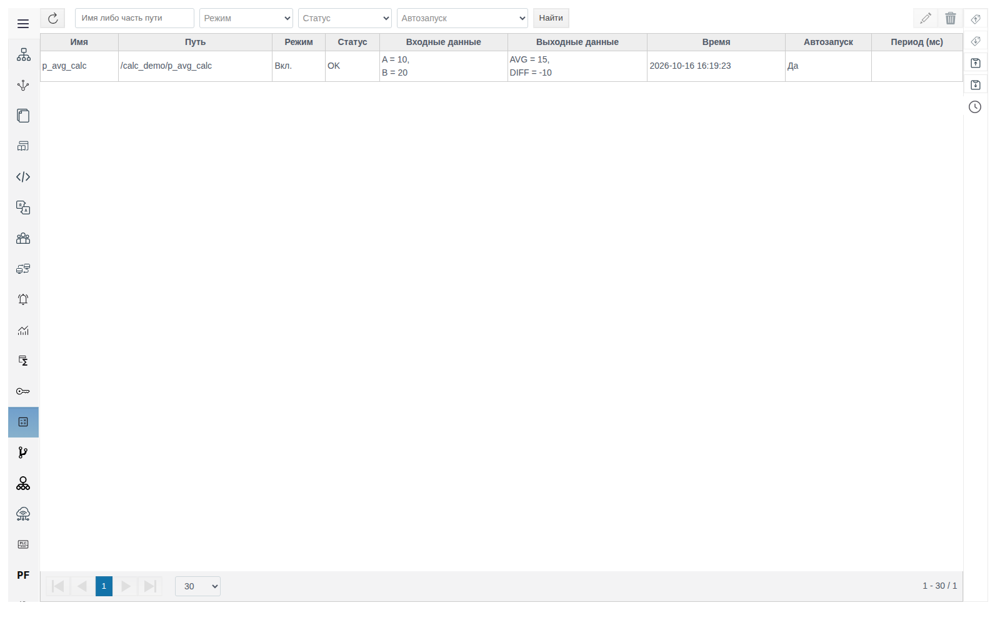

| Колонка | Содержимое |
|---|---|
| **Имя**, **Путь** | Имя расчёта и путь от корня проекта |
| **Режим** | `Вкл.` или `Откл.` (переключатель **Отключено** в форме) |
| **Статус** | `OK` или `ОШИБКА`. Строка с ошибкой выделена красным, причина видна в форме расчёта |
| **Входные данные**, **Выходные данные** | Значения переменных при последнем успешном выполнении |
| **Время** | Время последнего успешного выполнения |
| **Автозапуск** | `Да` — расчёт запускается при изменении входов |
| **Период (мс)** | Интервал запуска по таймеру, пусто — таймер не задан |

Фильтры над таблицей: часть пути, **Режим**, **Статус**, **Автозапуск**. Применяются кнопкой **Найти**.

Справа кнопки редактирования (карандаш) и удаления (корзина). Двойной щелчок по строке тоже открывает расчёт. Создать расчёт из этого раздела нельзя.

## Создание расчёта

1. В **Общем виде** перейдите в папку расчёта двойным щелчком (в примере — `calc_demo`) и нажмите **Создать**.
2. Раскройте **system**, выберите **calculation**, нажмите **Ok**.

   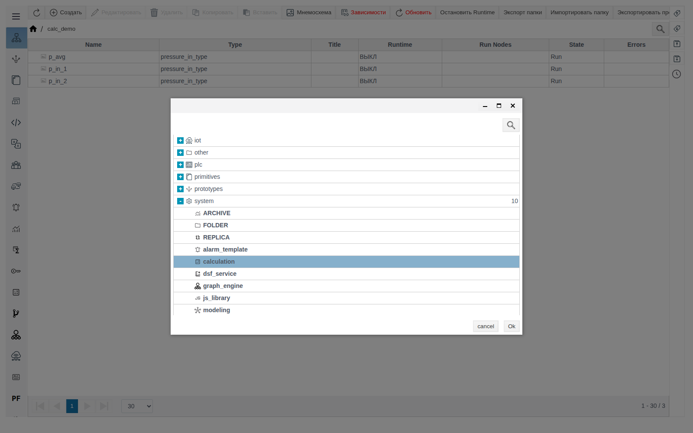

3. Заполните **Название**: `p_avg_calc`.
4. Задайте условия запуска (см. [«Условия запуска»](#условия-запуска)). Для примера оставьте **Период (мс)** пустым и **Выполнять при изменении значений** включённым — это значение по умолчанию.
5. Заполните **Вводные данные**, скрипт и **Выходные данные** (см. ниже).
6. Нажмите **Compile**, дождитесь `OK` и сохраните.

Расчёт выполняется сразу после сохранения. Результат виден в разделе **Calculation** и в поле `out_value` тега `p_avg`.

## Переменные

Строки в **Вводных данных** и **Выходных данных** заполняются одинаково:

| Колонка | Что указать |
|---|---|
| **value** | Только чтение: значение переменной при последнем успешном выполнении |
| **variable** | Имя переменной в скрипте. Первая буква автоматически становится заглавной (`diff` → `Diff`) |
| **тег** | Тег. Нажмите лупу, переходите по папкам двойным щелчком, выберите тег и нажмите **ОК** |
| **field** | Поле выбранного тега. Список содержит все поля тега, включая системные; для значения обычно нужно `out_value` |

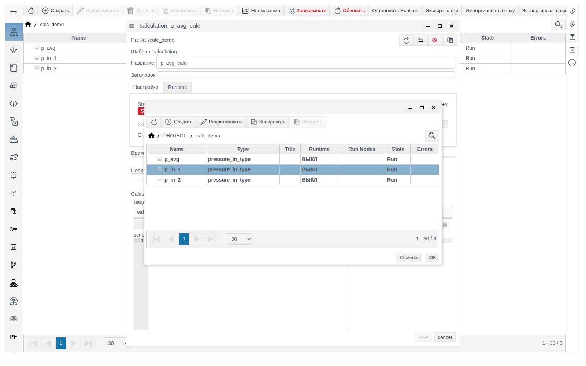

После заполнения строки ниже появляется пустая. Стрелки меняют порядок строк, корзина удаляет строку.

Для входной переменной тег и поле обязательны. Для выходной — нет:

| Выходная переменная | Куда попадает значение |
|---|---|
| С тегом и полем | В указанное поле тега и в Runtime расчёта |
| Без тега | Только в Runtime расчёта (поле `out`). Видно также в колонке **value** формы и в **Выходных данных** списка |

Выходы без тега удобны для промежуточных величин и отладки. Тег у выхода указывайте, только если значение нужно другим объектам проекта: мнемосхеме, [архиву](../data_storage/archives/archives_ru.md), другому расчёту.

Не записывайте выход в поле, которое этот же расчёт читает как вход. Получится обратная связь: расчёт будет менять собственный вход.

Пример:

| Таблица | variable | тег | field |
|---|---|---|---|
| Вводные данные | `A` | `/calc_demo/p_in_1` | `out_value` |
| Вводные данные | `B` | `/calc_demo/p_in_2` | `out_value` |
| Выходные данные | `AVG` | `/calc_demo/p_avg` | `out_value` |
| Выходные данные | `DIFF` | — | — |

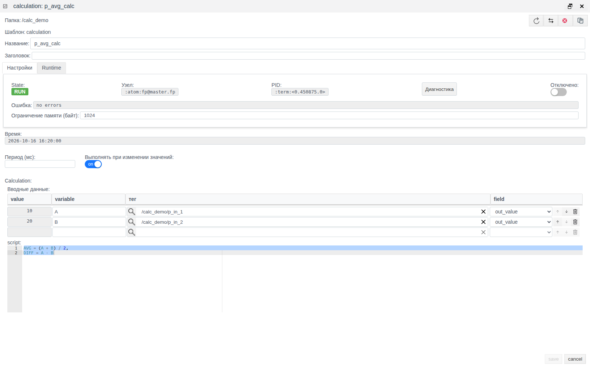

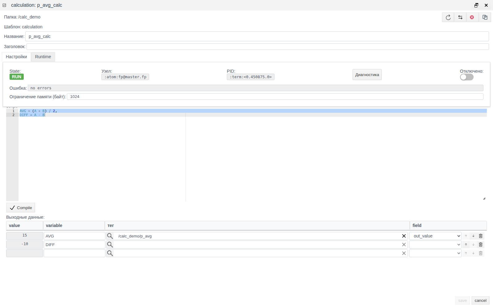

На вкладке **Runtime** в `out` видны обе выходные переменные: `AVG` записана ещё и в тег `p_avg`, `DIFF` — только здесь.

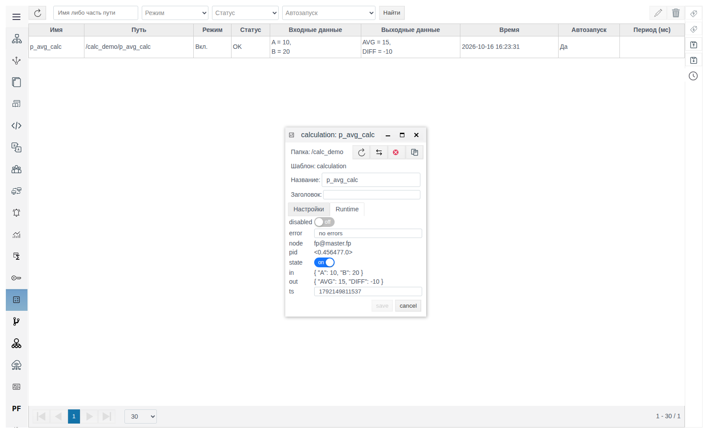

## Скрипт

Скрипт — формулы на Erlang через запятую. Входные переменные уже содержат значения полей. Каждой выходной переменной присвойте значение.

```erlang
AVG = (A + B) / 2,
DIFF = A - B
```

Правила:

- Точку в конце не ставьте. Ошибка: `{invalid_expression,{4,erl_parse,["syntax error before: ","'.'"]}}`.
- Имена переменных — с заглавной буквы, как в колонке **variable**. Если выходная переменная не присвоена или написана со строчной буквы, **Compile** вернёт `{unbound_var,'ИМЯ'}`.
- Операции: `+`, `-`, `*`, `/` (дробный результат), `div` (целочисленное деление), `rem` (остаток), `band`, `bsr` (битовые), скобки, `min`, `max`, функции модуля `math`, например `math:sqrt(A * B)`.

Типовые формулы (`X`, `Y`, `Word` — входы, `R` — выход):

| Задача | Формула |
|---|---|
| Защита от деления на ноль | `R = if Y == 0 -> 0; true -> X / Y end` |
| Ограничение диапазона 0…100 | `R = min(max(X, 0), 100)` |
| Статус по порогам | `R = if X > 80 -> 2; X > 50 -> 1; true -> 0 end` |
| Бит 3 из слова | `R = (Word bsr 3) band 1` |

Пороги, коэффициенты и коды статусов возьмите из проекта: в формуле они записываются числами.

**Compile** проверяет скрипт на сервере вместе со списками переменных. Рядом с кнопкой появляется `OK` или текст ошибки. Пока проверка не пройдена, **save** недоступна. После любой правки скрипта или переменных снова нажмите **Compile**.

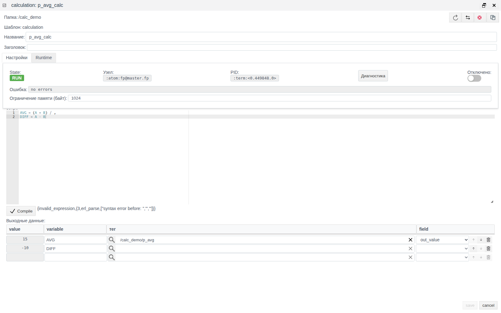

## Условия запуска

| Период (мс) | Выполнять при изменении значений | Когда выполняется расчёт |
|---|---|---|
| пусто | вкл. | При изменении любого входного поля |
| `N` | выкл. | Каждые `N` мс |
| `N` | вкл. | Каждые `N` мс и при изменении любого входного поля |
| пусто | выкл. | Не сохраняется: `no_trigger_defined` |

Период должен быть больше 10 мс. При меньшем значении сохранение отклоняется с ошибкой `{invalid_cycle,N}`.

Кроме того, расчёт выполняется один раз при запуске: после сохранения и после снятия флага **Отключено**.

Пока включён **Отключено**, расчёт не выполняется (State — `STOP`), значения выходных тегов не меняются.

## Ошибки

### При сохранении

Сервер проверяет расчёт при сохранении. При ошибке появляется окно **ERROR!**, окно расчёта закрывается, изменения не сохраняются. Откройте расчёт снова и повторите правки.

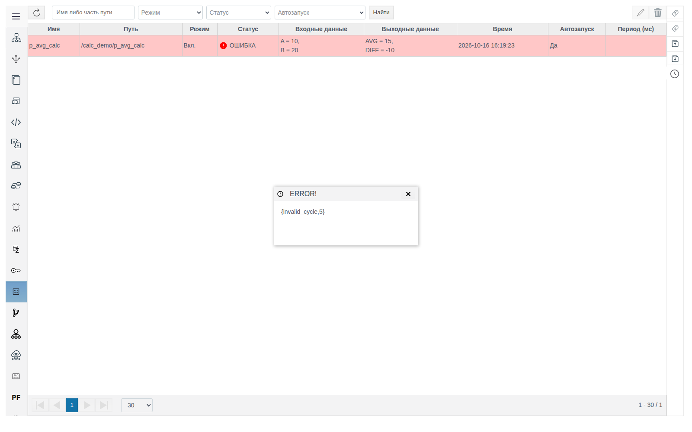

| Текст | Причина |
|---|---|
| `{invalid_cycle,N}` | **Период (мс)** не больше 10 |
| `no_trigger_defined` | Период пуст и **Выполнять при изменении значений** выключен |

### При выполнении

Если скрипт падает во время выполнения (например, деление на ноль), то:

- в форме в поле **Ошибка** появляется причина, например `badarith`;
- в разделе **Calculation** строка выделяется красным, **Статус** — `ОШИБКА`;
- в **Общем виде** причина видна в колонке **Errors**;
- выходные теги не изменяются, **Входные данные**, **Выходные данные** и **Время** остаются от последнего успешного выполнения.

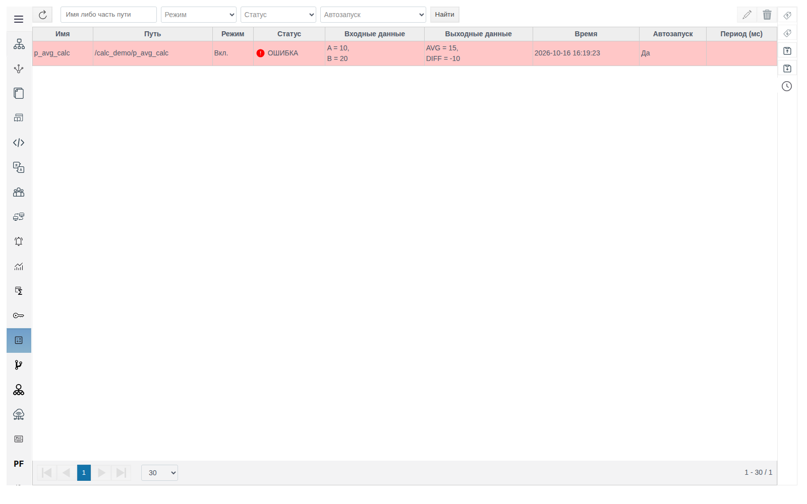

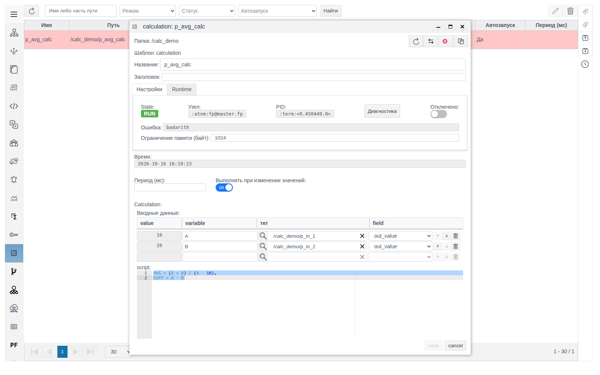

Ошибка сбрасывается при следующем успешном выполнении.

## Изменение и удаление

Откройте расчёт двойным щелчком в **Calculation** или в **Общем виде**, внесите правки, нажмите **Compile** и сохраните. Расчёт перезапускается с новыми настройками.

Для удаления выберите одну или несколько строк в **Calculation** и нажмите корзину. Окно подтверждения показывает только число строк (`delete items: 1`). Подтвердите кнопкой **yes**. В **Общем виде** расчёт удаляется так же, как любой объект, кнопкой **Удалить**.

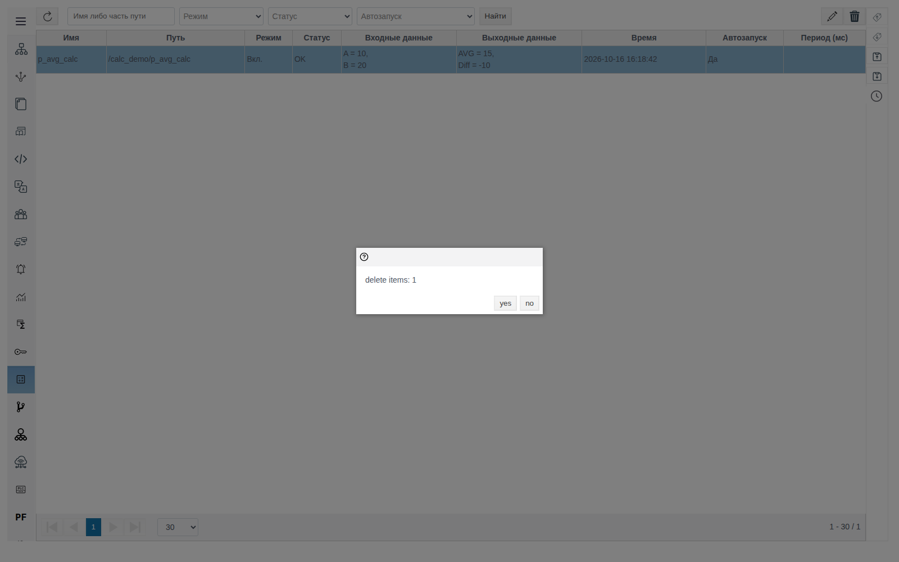

## Особенности интерфейса

| На экране | Где |
|---|---|
| Кнопки **save**, **cancel**, **Compile**, **yes**, **no**, подписи **variable**, **field**, **value**, **script** без перевода | Форма расчёта, подтверждение удаления |
| Кнопка подтверждения в окне выбора тега — **ОК** (кириллица), в окне выбора типа — **Ok** | Окна выбора |
| Ошибки сервера в виде `{invalid_cycle,5}` | Окно **ERROR!** |
| Окно **ERROR!** не закрывается клавишей Esc, только крестиком | Окно ошибки |

# Заключение

Порядок настройки расчёта:

1. Определите теги-источники, теги-приёмники и их поля.
2. В **Общем виде** перейдите в нужную папку и создайте объект **system → calculation**.
3. Задайте условия запуска: период больше 10 мс, автозапуск по изменению входов или оба.
4. Опишите входные переменные с тегом и полем. Выходные — с тегом, если результат нужно записать в тег, или без тега, если достаточно Runtime расчёта. Не направляйте выход в поле, которое служит входом этому же расчёту.
5. Напишите скрипт: формулы через запятую, без точки в конце, каждой выходной переменной присвоено значение. Расчёты по истории, накопление и сложную логику переносите в [User Script](../user_script/user_script.md).
6. Нажмите **Compile**, дождитесь `OK`, сохраните.
7. Проверьте результат в разделе **Calculation**: статус `OK`, значения входов и выходов, время выполнения.
