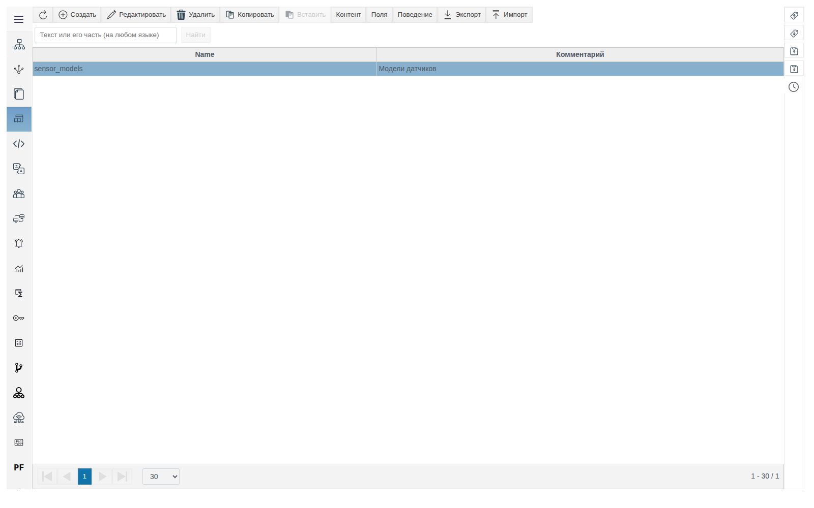
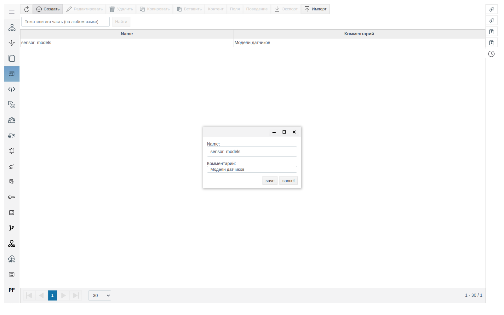
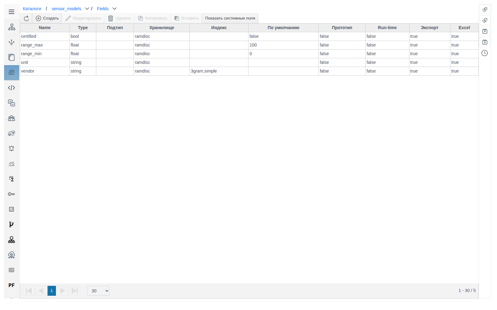
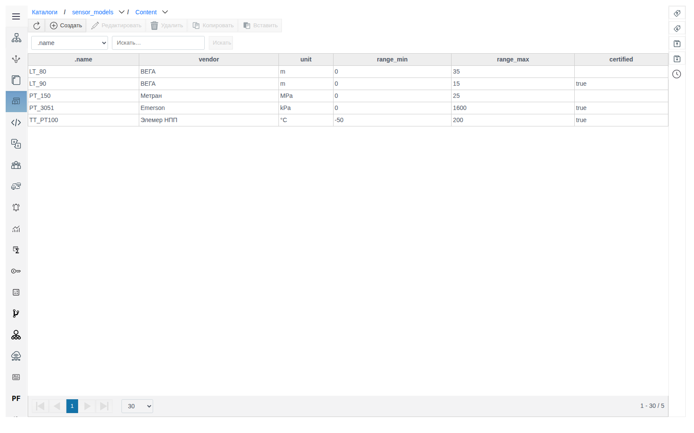
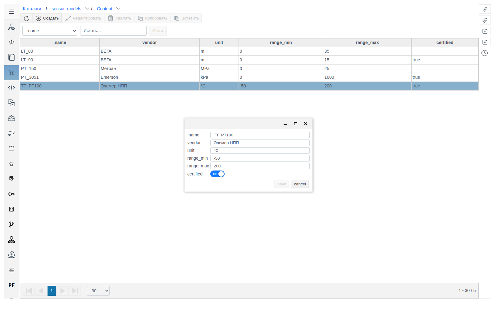
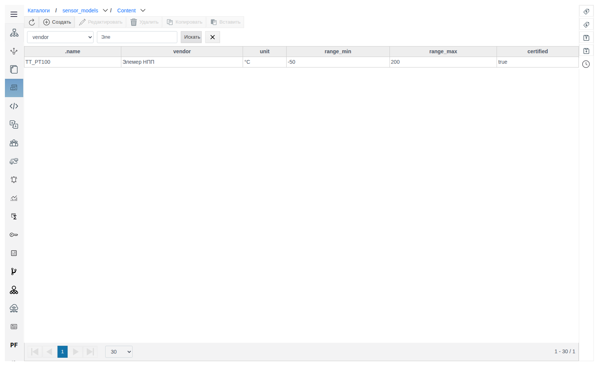
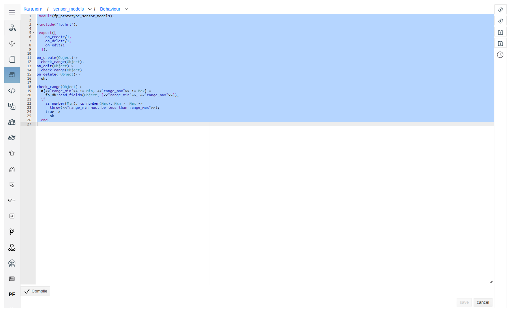
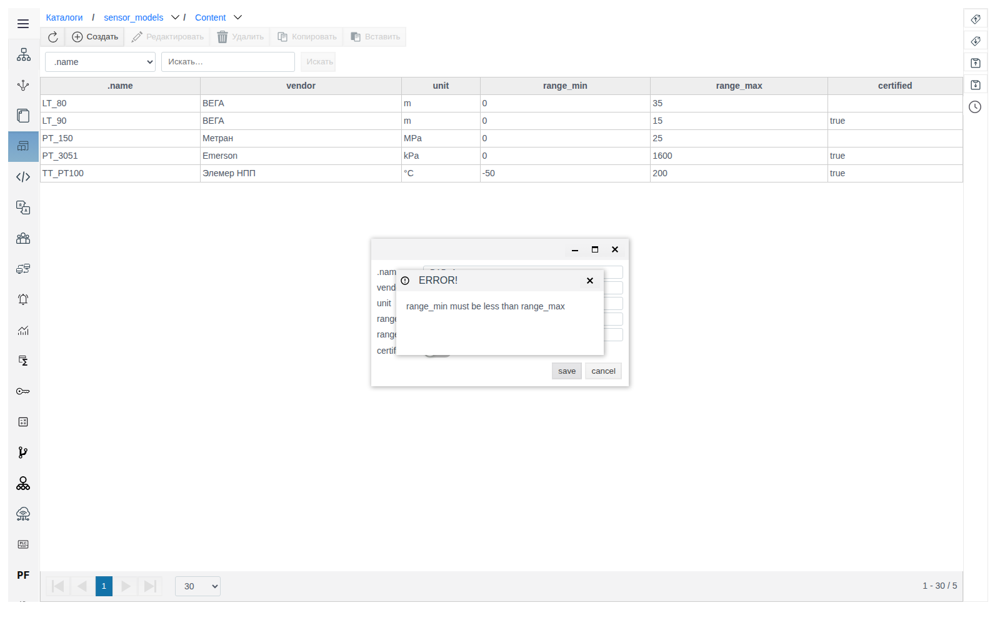
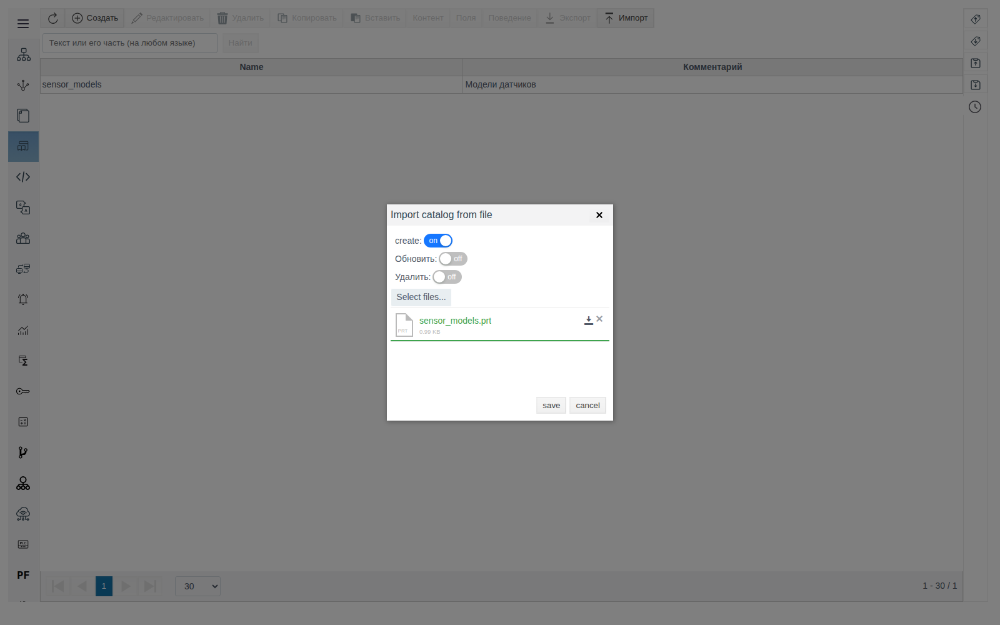
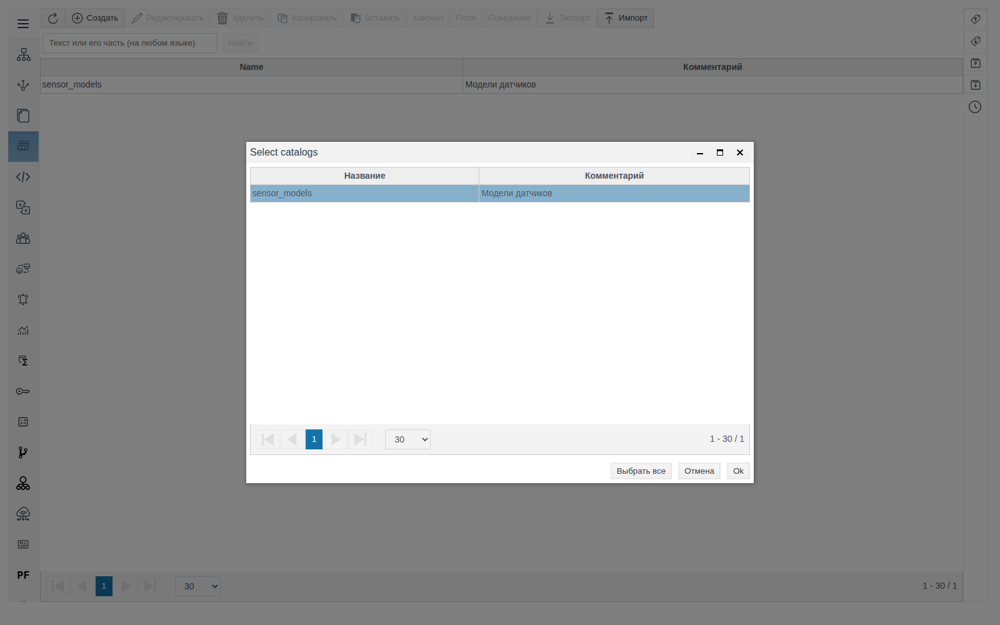

# Каталоги

Документ для инженера-интегратора, который хранит в проекте справочные данные в виде таблиц.

# Содержание

- [Глоссарий](#глоссарий)
- [Введение](#введение)
- [Основная часть](#основная-часть)
    - [Создание каталога](#создание-каталога)
    - [Поля](#поля)
    - [Записи](#записи)
    - [Поиск записей](#поиск-записей)
    - [Поведение](#поведение)
    - [Копирование и удаление](#копирование-и-удаление)
    - [Экспорт и импорт каталога](#экспорт-и-импорт-каталога)
    - [Обмен через Excel](#обмен-через-excel)
    - [Каталог на мнемосхеме](#каталог-на-мнемосхеме)
- [Заключение](#заключение)

# Глоссарий

| Термин | Значение |
|---|---|
| Каталог | Таблица справочных данных проекта из раздела **Каталоги**: набор полей (колонки), записи (строки) и необязательное Поведение |
| Запись | Строка каталога. Имя записи (`.name`) уникально внутри каталога |
| Поведение | Модуль на Erlang с функциями `on_create/1`, `on_edit/1`, `on_delete/1`. Сервер вызывает их при создании, изменении и удалении записи |
| Файл `.prt` | Файл экспорта каталога: поля, записи и Поведение |

# Введение

Каталог — таблица справочных данных внутри проекта: модели оборудования, типы датчиков, коды причин, параметры материалов и любые другие перечни, которые удобнее вести таблицей, а не деревом объектов. Структуру таблицы задают поля каталога, данные — его записи. Поведение позволяет проверять или дополнять записи при сохранении.

Раздел находится в главном меню Studio: **Каталоги**. У каждого каталога три части, каждая открывается своей кнопкой:

| Часть | Кнопка | Что содержит |
|---|---|---|
| Записи | **Контент** | Таблица записей каталога |
| Поля | **Поля** | Колонки таблицы: имя, тип, хранилище, индекс, значение по умолчанию |
| Поведение | **Поведение** | Код на Erlang, который сервер выполняет при операциях с записями |

Сквозной пример — каталог моделей датчиков `sensor_models` с полями `vendor` (производитель), `unit` (единица измерения), `range_min`, `range_max` (диапазон) и `certified` (признак поверки).

Понадобится доступ к Studio (`http://<сервер>:9000/fp/studio`) под учётной записью с правом изменять проект.

# Основная часть

## Создание каталога

Откройте **Каталоги** в главном меню Studio. В таблице показаны имя и комментарий каждого каталога, строка поиска над таблицей ищет по имени.



Нажмите **Создать**, заполните **Name** (обязательное) и **Комментарий** и сохраните. Вместе с каталогом создаются пустые Поля и Контент.



Хлебные крошки над таблицей (**Каталоги / sensor_models / Content**) возвращают к списку и переключают части каталога.

## Поля

Выделите каталог и нажмите **Поля**. Форма поля та же, что у прототипа: назначение каждого параметра описано в документе [«Прототипы»](../prototypes/prototypes.md), раздел «Поля». Для каталога важны:

| Параметр | Что даёт в каталоге |
|---|---|
| **Type** | Вид поля ввода в форме записи: `string` — текст, `integer` и `float` — число, `bool` — переключатель |
| **Значение по умолчанию** | Подставляется в форму новой записи |
| **Индекс** | `3gram` включает поиск по части значения (раздел [«Поиск записей»](#поиск-записей) ниже) |
| **excel** | Поле попадает в обмен через Excel (раздел [«Обмен через Excel»](#обмен-через-excel) ниже) |

Поля примера: `vendor` и `unit` типа `string`, `range_min` и `range_max` типа `float` со значениями по умолчанию `0` и `100`, `certified` типа `bool`. У всех полей установлены флажки **export** и **excel**.



## Записи

Выделите каталог и нажмите **Контент**. Колонки таблицы — `.name` и поля каталога.



Нажмите **Создать**, укажите `.name` и значения полей и сохраните. Существующая запись открывается двойным щелчком.



> [!NOTE]
> Значение `false` поля `bool` в таблице не отображается: ячейка пустая. В форме записи переключатель стоит в положении **off**.

## Поиск записей

Над таблицей записей выберите колонку, введите значение и нажмите **Искать**. Кнопка с крестиком справа сбрасывает фильтр.

| Колонка | Как ищет |
|---|---|
| `.name` | По части имени: `PT` находит `PT_3051` и `TT_PT100` |
| Поле с индексом `3gram` | По части значения |
| Остальные поля | Только по точному значению: `Emerson`, `kPa`, `200`, `true` |



> [!WARNING]
> Индекс действует только на записи, сохранённые после его добавления. В примере после добавления `3gram` к полю `vendor` запрос `Эле` нашёл запись только после её пересохранения, а `Emer` не нашёл `PT_3051`, которую после этого не меняли. Задавайте индекс до заполнения каталога или пересохраните записи после его добавления.

## Поведение

Выделите каталог и нажмите **Поведение**. Откроется редактор кода на Erlang с шаблоном модуля `fp_prototype_<имя каталога>`:

| Функция | Когда вызывается |
|---|---|
| `on_create/1` | Создана запись |
| `on_edit/1` | Изменена запись |
| `on_delete/1` | Удалена запись |

Функция получает объект записи и должна вернуть `ok`. Исключение отменяет операцию, его текст выводится пользователю. Нажмите **Compile**, дождитесь `OK`, затем **save**.

Пример: проверка, что нижняя граница диапазона меньше верхней.

```erlang
-module(fp_prototype_sensor_models).

-include("fp.hrl").

-export([
    on_create/1,
    on_delete/1,
    on_edit/1
  ]).

on_create(Object)->
  check_range(Object).
on_edit(Object)->
  check_range(Object).
on_delete(_Object)->
  ok.

check_range(Object)->
  #{<<"range_min">> := Min, <<"range_max">> := Max} =
    fp_db:read_fields(Object, [<<"range_min">>, <<"range_max">>]),
  if
    is_number(Min), is_number(Max), Min >= Max ->
      throw(<<"range_min must be less than range_max">>);
    true ->
      ok
  end.
```



Запись с `range_min` = `10` и `range_max` = `5` не сохраняется: появляется окно **ERROR!** с текстом исключения, форма записи остаётся открытой со введёнными значениями.



Поведение срабатывает и при импорте из Excel. Строка, которая не прошла проверку, не меняется, в ошибке указан путь записи:

`{<<"/root/FP/catalogs/sensor_models/content/LT_90">>, <<"range_min must be less than range_max">>}`

## Копирование и удаление

Каталоги в списке **Каталоги** и записи в **Контент** копируются и удаляются одинаково.

**Копирование.** Выделите строку, нажмите **Копировать**, затем **Вставить**. В окне «Вставить элементы?» оставьте **Operation** = `copy`, укажите **Количество копий** и нажмите **OK**. Копия получает имя с суффиксом `_1`: `PT_150` → `PT_150_1`, `sensor_models` → `sensor_models_1`. Копия каталога получает все поля и записи оригинала.

**Удаление.** Выделите строку, нажмите **Удалить** и подтвердите кнопкой **yes**.

## Экспорт и импорт каталога

**Экспорт.** Выделите каталог и нажмите **Экспорт**. Браузер сохранит файл `catalog.prt` с полями, записями и Поведением каталога.

**Импорт.** Нажмите **Импорт**, включите режимы, выберите файл `.prt` через **Select files...** и сохраните. При успехе появится сообщение «The catalog was imported successfully».



| Переключатель | Что делает |
|---|---|
| **create** | Создаёт записи из файла, которых нет в каталоге. Существующие записи не меняет |
| **Обновить** | Переписывает существующие записи значениями из файла |
| **Удалить** | Удаляет записи каталога, которых нет в файле |

## Обмен через Excel

Excel удобен для массового заполнения и правки записей.

**Выгрузка.** В разделе **Каталоги** нажмите **Экспорт .xlsx** на правой панели. В окне выбора отметьте каталоги (или **Выбрать все**) и нажмите **Ok**. Браузер сохранит файл `faceplate_project.xlsx`.



Каждый каталог — отдельный лист `catalog@<имя каталога>`. Первая колонка — имя записи, остальные — поля с флажком **excel**. Значения `bool` записаны как `:atom:true` и `:atom:false`.

| catalog@sensor_models | certified | range_max | range_min | unit | vendor |
|---|---|---|---|---|---|
| PT_3051 | :atom:true | 1600 | 0 | kPa | Emerson |
| LT_80 | :atom:false | 30 | 0 | m | ВЕГА |

**Загрузка.** Нажмите **Импорт .xlsx**, выберите файл и нажмите **ok**. В окне `select_import_items` выделите листы и нажмите **OK**. Появится сообщение об успешном импорте. Строки с новыми именами создают записи, строки с существующими именами обновляют их.

## Каталог на мнемосхеме

В палитре **Controls** редактора мнемосхем есть элемент **CatalogSelect**. В группе свойств **value** у него три свойства: **catalog** — каталог из раздела **Каталоги** (выпадающий список), **value** и **config**.

# Заключение

Порядок работы с каталогом:

1. В **Каталоги** создайте каталог.
2. В **Поля** опишите колонки. Отметьте **excel** у полей для обмена через Excel и задайте индекс `3gram` у полей, по которым нужен поиск по части значения, до заполнения записей.
3. При необходимости напишите Поведение: проверки в `on_create/1` и `on_edit/1`. Порядок: **Compile** → `OK` → **save**.
4. Заполните записи в **Контент** или загрузите их из Excel.
5. Для переноса каталога между проектами используйте **Экспорт** и **Импорт**.
