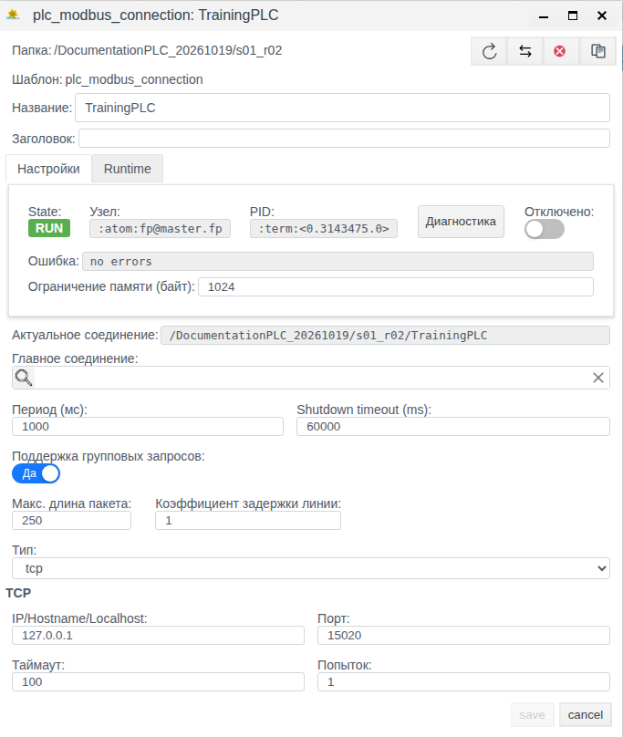
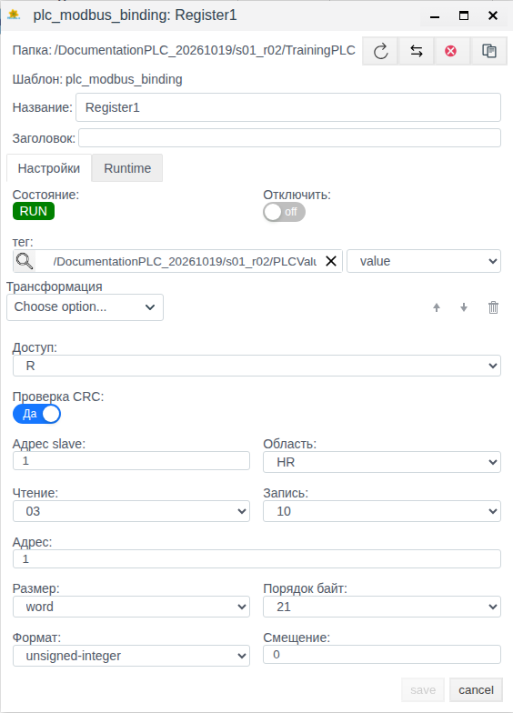

# PLC-соединения в Faceplate: выбор протокола и настройка связи

Руководство для интеграторов: выбор драйвера, настройка соединения и проверка обмена через Студию Faceplate. Примеры проверены 19 октября 2026 года в проекте релиза 4.0.7.

**Содержание**

- [Маршрут настройки](#маршрут-настройки)
- [Назначение и принцип работы](#назначение-и-принцип-работы)
- [Выбор протокола](#выбор-протокола)
- [Подготовка и учебные объекты](#подготовка-и-учебные-объекты)
- [Основные настройки](#основные-настройки)
- [Привязки: создание и настройка](#привязки-создание-и-настройка)
- [Подключить PLC насосной станции](#подключить-plc-насосной-станции)
- [Восстановить чтение после изменений](#восстановить-чтение-после-изменений)
- [Управление соединением](#управление-соединением)
- [Справочник настроек и состояний](#справочник-настроек-и-состояний)
- [Диагностика](#диагностика)
- [Ограничения](#ограничения)

[Каталог соединений](./index.md) · [Подготовка поля и привязки](./bindings_ru.md) · [Преобразования](./transformation_ru.md) · [Диагностика и восстановление](./diagnostics_ru.md)

## Маршрут настройки

Подготовьте внешний источник или клиент и совместимое поле тега по общей инструкции. Затем настройте канал, сохраните полную привязку и проверьте новое значение. Для поддержанной записи/приёма отдельно подтвердите результат на внешней стороне; после исправления сбоя повторите проверку с новым контрольным значением.

[Альтернативный канал и карта сигналов](./bindings_ru.md#настроить-альтернативный-канал) описаны одинаково для всех типов; условия переключения уточняйте по драйверу.

Этот документ сохраняет подробный учебный маршрут Modbus TCP и его прежние свидетельства. Начните выбор другого протокола с каталога; общие привязки, обработка и диагностика доступны по ссылкам выше. Для подготовки источника используйте раздел в инструкции Modbus с портом 15020.

Окно **Диагностика** описано в документе [«Диагностика объектов Runtime»](../../administration/diagnostics/diagnostics.md). Общие настройки резервирования каналов и служб — в [инструкции по резервированию ресурсов](../../administration/redundancy/redundancy.md).

## Назначение и принцип работы

PLC-соединение организует обмен с контроллером, модулем ввода-вывода, счётчиком, шлюзом или промышленным сервером. В соединении выбирают драйвер и задают параметры связи; адреса отдельных сигналов задают в привязках.

| Понятие | Что определяет |
|---|---|
| Протокол | Правила обмена данными с источником |
| Драйвер | Поддержку выбранного протокола в Faceplate |
| Соединение | Параметры конкретного канала: адрес, транспорт и настройки обмена |
| Привязка | Адрес данных устройства, направление обмена и связанное поле тега |
| Тег | Объект проекта, поле которого принимает данные или служит источником задания для записи |

В примере данные проходят цепочку: учебный регистр → Modbus TCP → соединение **TrainingPLC** → привязка **Register1** → поле **value** тега **PLCValue**.

Клиент инициирует обмен с устройством или сервером. Сервер предоставляет данные внешним клиентам и принимает их запросы. Роль определяется выбранным драйвером: общего переключателя между клиентом и сервером для всех соединений нет.

Общий порядок работы: подготовить источник и тег, создать соединение в дереве проекта, настроить привязку, проверить состояние в списке драйверов PLC, затем проверить фактическое значение тега. Само создание соединения не создаёт сигналы автоматически.

Соединение и привязка решают разные задачи. Соединение хранит настройки канала и управляет его выполнением. Внутри него создают привязки отдельных сигналов. Все привязки этого соединения используют его канал и общие параметры обмена; адрес и поле назначения каждого сигнала задаются отдельно.

Тег принадлежит проекту Faceplate и служит точкой использования данных. В нашем примере источник содержит число 1000, соединение обеспечивает обмен с источником, привязка выбирает нужный регистр, а тег принимает результат в поле **value**. Поэтому при настройке нужно определить и источник данных, и место, куда они должны поступать.

Такое разделение помогает при сопровождении. Если меняется адрес устройства или общий период обмена, проверяют соединение. Если неверно читается отдельный сигнал, проверяют его привязку и целевое поле тега. Само наличие числа в теге оценивают вместе с состоянием канала и подтверждением нового чтения.

### Что задаётся в соединении, привязке и теге

| Настройка | Где задаётся | Что проверить |
|---|---|---|
| Драйвер, транспорт и параметры доступа к источнику | Соединение | Протокол, роль, адрес узла, порт или другой транспорт по документации драйвера |
| Период, ожидание завершения, группирование и общее отключение | Соединение | Параметры относятся ко всем привязкам канала; поддержка зависит от драйвера |
| Адрес отдельного сигнала и представление данных | Привязка | Область, регистр, канал, имя параметра, формат и другие поля конкретного драйвера |
| Связь с полем проекта, направление обмена, преобразование и собственное отключение | Привязка | Выбранные тег и поле, **Доступ**, **Трансформация**, **Отключить** |
| Тип и назначение поля, права пользователя и исходное задание для записи | Тег и конфигурация проекта | Совместимость поля с сигналом и доступность требуемого действия |
| Состояние, ошибка, узел и результат обмена | Заполняет Faceplate | Эти значения используются для проверки работы, а не вместо параметров адресации |

Например, в Modbus TCP сетевой адрес источника задаётся в соединении, а идентификатор устройства **Адрес slave** и адрес регистра — в привязке. Набор адресных полей у другого драйвера может быть иным.

## Выбор протокола

Выбирайте драйвер по интерфейсу, который предоставляет устройство или промежуточный сервер. До настройки уточните протокол и его вариант, роль Faceplate, параметры доступа и карту данных. Наличие драйвера не подтверждает совместимость с любой моделью устройства.

В проверенной установке доступны следующие 15 типов. В первом столбце приведены точные значения фильтра **Тип соединения:**.

| Тип в списке | Назначение | Роль Faceplate |
|---|---|---|
| dcon | Модули ввода-вывода с протоколом DCON | Опрос устройства |
| ethernet_ip | Обмен с поддерживаемыми контроллерами по EtherNet/IP | Клиент |
| opcda | Подключение к источнику данных OPC DA | Клиент |
| opcua_client | Получение данных от OPC UA-сервера | Клиент |
| opcua_server | Предоставление данных Faceplate внешним OPC UA-клиентам | Сервер |
| s7 | Обмен с поддерживаемыми контроллерами Siemens S7 | Клиент |
| snmp | Получение параметров от SNMP-агента; в проверенной реализации используется v2c | Опрос устройства |
| iec101_client | Телемеханика IEC 60870-5-101 | Клиент |
| iec101_server | Предоставление данных по IEC 60870-5-101 | Сервер |
| iec104_client | Телемеханика IEC 60870-5-104 по TCP | Клиент |
| iec104_server | Предоставление данных по IEC 60870-5-104 | Сервер |
| iec62056 | Обмен с приборами учёта по IEC 62056 | Опрос прибора |
| mbus | Обмен с приборами учёта M-Bus | Опрос прибора |
| mercury230 | Обмен со счётчиками Меркурий 230 | Опрос прибора |
| modbus | Обмен с PLC, модулями и шлюзами Modbus | Клиент / опрос устройства |

Для Modbus форма предлагает **tcp**, **rtu-tcp** и **rtu-serial**. Здесь используется только **tcp**. IEC 101 относится к последовательной телемеханике; IEC 104 — к обмену по TCP. Подробная адресация, транспорт и безопасность каждого драйвера рассматриваются отдельно.

Для учебного сценария выбран Modbus TCP: у подготовленного источника известны сетевой адрес, порт и один регистр с постоянным значением. На таком примере можно последовательно проверить создание соединения, выбор данных, связь с тегом и получение результата. Роль устройства на стенде выполняет учебный Modbus TCP-сервер; использование примера не требует физического контроллера насосной станции.

Общий порядок настройки относится к PLC-соединениям: выбрать поддерживаемый драйвер, задать канал, настроить привязки и проверить данные. В этом сценарии конкретные поля канала и адресации показаны для Modbus TCP. Для другого драйвера сохраняется порядок работы, а параметры подключения и адрес сигнала берутся из его формы и документации устройства. Выбор Modbus для примера не определяет протокол вашего проекта.

## Подготовка и учебные объекты

Перед началом обеспечьте:

- Доступ к Студии и права создания, изменения и удаления объектов в учебной папке.
- Активную папку проекта и доступный узел выполнения обмена.
- Работающий источник Modbus TCP с известными адресом, портом и картой регистров.
- Подготовленный числовой тег с полем значения, доступным для просмотра через форму объекта.

Доступ к источнику требуется с узла, выполняющего обмен Faceplate. Адрес 127.0.0.1 в примере относится к этому узлу. Для удалённого PLC укажите его фактический адрес.

| Объект или параметр | Исходное состояние | Кто подготавливает |
|---|---|---|
| Учебная папка проекта | Доступна для записи, выполнение разрешено | Подготавливается до примера |
| Учебный Modbus TCP-сервер | 127.0.0.1, порт 15020; запущен на узле обмена | Подготавливается до примера |
| Регистр источника | Unit 1, holding register с PDU-адресом 0, значение 1000 | Подготавливается до примера |
| PLCValue | Числовой тег; целочисленное поле value с начальным значением 0 | Подготавливается до примера |
| TrainingPLC | Соединения ещё нет | Создаётся в первом сценарии |
| Register1 | Привязки ещё нет | Создаётся в первом сценарии |

Число 1000 — учебное значение в отсчётах регистра, без пересчёта в физические единицы. Числовой тип тега подготовлен для стенда; его наличие не подразумевается в каждом новом проекте. В своём проекте используйте подходящий числовой тег и его реальное поле значения.

Тег можно проверить через **Меню → Общий вид**: откройте учебную папку, затем **PLCValue**. До создания привязки поле **value** должно показывать 0. Закройте форму кнопкой **cancel**.

В учебных сценариях используется одна привязка для проверки чтения. Общий порядок настройки привязок и их поля описаны ниже; подробная настройка отдельных преобразований рассматривается отдельно.

## Основные настройки

**Период (мс)** задаёт период циклической части обмена. Для Modbus-примера это период опроса. Если опрос заканчивается раньше периода, соединение ожидает оставшееся время; если длится дольше, следующий цикл начинается без дополнительной паузы. Период не гарантирует появление нового значения на экране ровно через указанное число миллисекунд. У некоторых драйверов циклическое чтение получает готовые значения из кэша драйвера. Поэтому период не обязательно равен частоте сетевых запросов к оборудованию.

**Таймаут** в TCP-настройках Modbus относится к ожиданию ответа устройства. **Shutdown timeout (ms)** относится к штатному завершению рабочего процесса соединения. Эти параметры решают разные задачи.

**Поддержка групповых запросов** разрешает объединение поддерживаемых драйвером запросов. В учебной R-привязке это чтения; возможность групповой записи определяется драйвером. При **Нет** поля размера пакета и коэффициента недоступны для изменения. **Макс. длина пакета** и **Коэффициент задержки линии** влияют на формирование групп; коэффициент не задаёт отдельную паузу между запросами и не заменяет настройку повторов. Единицы и допустимый размер групп зависят от протокола.

Изменение исполняемых параметров соединения приводит к перезапуску его выполнения. После сохранения проверяйте состояние и значение тега. Точные исходные значения и пределы полей приведены в справочнике.

## Привязки: создание и настройка

Привязка создаётся внутри выбранного соединения и использует его драйвер. Для каждого нужного сигнала укажите его адрес и поле проекта. Один тег может содержать несколько полей; поле не обязано называться **value**.

При клиентском чтении драйвер получает данные источника, привязка применяет настроенное преобразование и согласует представление результата с типом поля тега. Затем результат становится доступен в поле проекта. Сам тег или дополнительный сигнал при создании привязки автоматически не создаются.

### Создать и проверить привязку

Ниже приведён общий порядок для формы, показанной в примере Modbus. Адресные поля заполняются по выбранному драйверу и карте данных устройства; общего адреса регистра или формата для всех PLC-соединений нет.

1. В **Общем виде** откройте нужное соединение двойным щелчком.
2. Нажмите **Создать**.
3. Введите свободное **Название** привязки.
4. На вкладке **Настройки** включите **Отключить**, чтобы сначала сохранить подготовленную настройку без обмена.
5. Через кнопку выбора у **тег** выберите нужный объект проекта.
6. В списке справа от **тег** выберите конкретное поле объекта.
7. Выберите **Доступ** по таблице ниже.
8. Заполните адресные поля и представление данных по документации драйвера.
9. Настройте **Трансформация**, если требуется обработка; для передачи без обработки оставьте блок пустым.
10. Нажмите **save**.
11. Выделите созданную привязку в списке.
12. Нажмите **Редактировать**.
13. Сверьте сохранённые тег, поле, доступ, адресацию, формат, преобразование и включённый **Отключить**.

Подготовленная отключённая привязка не должна выполнять обмен. Для запуска также нужны разрешённое выполнение соединения, активный Runtime проекта и разрешение выполнения в родительских папках.

14. Когда источник и сигнал подготовлены к работе, выключите **Отключить**.
15. Нажмите **save**.
16. Проверьте состояние и ошибку привязки, затем результат передачи по выбранному направлению.

При чтении проверяйте поле тега после известного изменения входного сигнала. При записи проверяйте принятие задания устройством и фактический результат, если он доступен для независимого контроля. Сохранение формы подтверждает параметры, а не выполненную команду устройства.

Список полей может содержать больше вариантов, чем **value**. Наличие поля в списке не подтверждает совместимость его типа с драйвером или права на требуемое изменение. Выбирайте поле с понятным назначением; для команд записи определите один ответственный источник задания.

### Режимы R, W и RW

**Доступ** задаёт направление обмена, а не права пользователя. Для клиентского опроса значения трактуются так:

| Доступ | Чтение | Запись |
|---|---|---|
| **R** | Данные драйвера поступают в связанное поле тега | Команды из поля не отправляются |
| **W** | Привязка не участвует в периодическом чтении | Изменения связанного поля передаются драйверу |
| **RW** | Данные драйвера поступают в поле тега | Внешние изменения поля передаются драйверу; обновление поля самим чтением не создаёт обратную команду |

При наличии связи источник команды — выбранное поле тега. Вкладка **Runtime** привязки используется для наблюдения; её **value** не следует считать универсальным полем ручного ввода команды.

Запись обычно вызывается изменением задания. Режим **W** также передаёт текущее значение при подключении, восстановлении связи и создании или изменении включённой W-привязки. Перед включением проверьте исходное задание и допустимый диапазон устройства. Для клиентской **RW** нет такого же общего правила обязательной отправки исходного значения при каждом подключении.

Не рассчитывайте на гарантированную доставку изменений задания, сделанных во время разрыва связи. После восстановления проверьте фактическое состояние устройства. Наличие **W/RW** в списке и успешное состояние привязки сами по себе не подтверждают поддержку записи выбранным драйвером или изменение физического выхода.

Для серверных драйверов учитывайте направление обмена относительно их серверной модели данных. Не переносите схему «удалённое устройство → тег» на публикацию данных внешним клиентам; назначение адресуемых объектов и поддержка операций определяются драйвером.

### Преобразование, отключение и сохранённые значения

**Трансформация** — необязательная цепочка обработки; пустой блок передаёт значение без такой обработки. Для **W/RW** цепочка должна поддерживать обратное преобразование. Не всякая операция чтения подходит для записи; допустимость выбранной цепочки проверяется при сохранении.

**Отключить** относится только к этой привязке. **Отключено** в соединении относится ко всему каналу. При отключении одной привязки остальные привязки работающего соединения могут продолжать обмен.

Отключение привязки не гарантирует очистку связанного поля тега и её последнего **value**. При ошибке клиентского чтения **R/RW** в поле может передаваться признак отсутствующих данных, в том числе через настроенное преобразование. Это не универсальное присваивание числового нуля: отображение зависит от поля и обработки.

Значение **Runtime → value** может быть преобразованным результатом или оставшимся прежним значением. При общей ошибке соединения оно может сохранять последний успешный результат, хотя привязка уже остановлена. Всегда сопоставляйте значение с состоянием, ошибкой и подтверждением нового чтения. Общего для всех драйверов поля качества, отметки свежести или гарантированного срока актуальности здесь не предполагается.

## Подключить PLC насосной станции

Задача первого сценария — создать **TrainingPLC** и получить 1000 отсчётов в подготовленном теге. Сценарий выполняется независимо от второго; его исходные объекты перечислены в разделе «Подготовка и учебные объекты».

### Создать объект соединения и настроить канал

На этом этапе создаётся объект, который будет выполнять обмен с источником. В **Общем виде** выбирают место соединения в проекте, затем тип драйвера. Выбор **plc_modbus_connection** определяет состав протокольных настроек; имя **TrainingPLC** позволяет находить этот конкретный канал среди других соединений.

Параметры канала отвечают на вопрос, куда обращаться. В Modbus TCP это **Тип**, **IP/Hostname/Localhost** и **Порт**. Для стенда они указывают на подготовленный сервер 127.0.0.1:15020. Перед повторением примера на другом узле проверьте, что источник доступен именно с узла выполнения Faceplate.

Общие параметры отвечают на вопрос, как выполнять обмен. **Период (мс)** задаёт цикл, **Отключено** управляет выполнением соединения, а настройки группирования определяют возможность объединять чтения. Адрес регистра и тег назначения на этом этапе ещё не выбираются: они появятся в привязке.

После ввода значения в поле **Порт** нажмите **Tab**, затем сохраняйте форму. При повторном открытии проверьте сохранённый порт: он определяет фактический адрес подключения.

1. В **Меню** выберите **Общий вид**.
2. Откройте подготовленную учебную папку.
3. Нажмите **Создать**.
4. Откройте группу **plc** двойным щелчком.
5. Выберите **plc_modbus_connection**.
6. Нажмите **Ok**.
7. В поле **Название** введите **TrainingPLC**.
8. Проверьте значение **tcp** в поле **Тип**.
9. Введите **127.0.0.1** в **IP/Hostname/Localhost**.
10. Введите **15020** в **Порт**.
11. Сверьте остальные параметры с таблицей.

| Поле | Значение первого сценария |
|---|---|
| Период (мс) | 1000 |
| Shutdown timeout (ms) | 60000 |
| Таймаут | 100 |
| Попыток | 1 |
| Поддержка групповых запросов | Да |
| Макс. длина пакета | 250 |
| Коэффициент задержки линии | 1 |
| Отключено | Выключено |
| Главное соединение | Пусто |

12. Нажмите **save**.
13. Выделите созданное **TrainingPLC**.
14. Нажмите **Редактировать**.
15. Проверьте сохранённые адрес, порт и параметры.
16. Закройте форму кнопкой **cancel**.

После сохранения соединение может показывать **RUN** ещё до создания привязки. Для подтверждения получения данных требуется проверка тега в конце сценария.

### Связать данные устройства с тегом проекта

После создания канала нужно определить, какие данные передавать в проект. Для этого внутри **TrainingPLC** создаётся привязка **Register1**. Она связывает конкретные данные устройства с конкретным полем тега **PLCValue**. Создание одного соединения без такой связи не задаёт, какое значение должно появиться в проекте.

У привязки есть две стороны. На стороне Faceplate выбираются тег и поле **value**. На стороне устройства задаются адрес и представление данных. В примере **Адрес slave** выбирает устройство с идентификатором 1, а **Область**, **Чтение** и **Адрес** выбирают его holding register. Поэтому одинаковое число 1 в полях **Адрес slave** и **Адрес** обозначает разные параметры.

**Доступ: R** задаёт чтение из источника в тег. **Размер**, **Порядок байт** и **Формат** определяют, как интерпретировать полученные данные. Даже при работающем канале ошибочная адресация или формат могут дать неверный результат. В этом примере они согласованы с одним 16-битным беззнаковым регистром; преобразование в физические единицы не выполняется.

1. Откройте **TrainingPLC** двойным щелчком в **Общем виде**.
2. Нажмите **Создать**.
3. Введите **Register1** в **Название**.
4. Нажмите кнопку выбора с лупой у поля **тег**.
5. Откройте учебную папку в окне выбора.
6. Выделите **PLCValue**.
7. Нажмите **ОК**.
8. В соседнем списке поля выберите **value**.
9. Проверьте **R** в **Доступ**.
10. Установите **1** в **Адрес**.
11. Выберите **unsigned-integer** в **Формат**.
12. Сверьте остальные параметры с таблицей.

| Поле | Значение | Смысл в примере |
|---|---|---|
| Адрес slave | 1 | Идентификатор учебного устройства |
| Область | HR | Holding register |
| Чтение | 03 | Чтение выбранной области |
| Адрес | 1 | Соответствует PDU-адресу 0 учебного источника |
| Размер | word | Учебное 16-битное значение |
| Порядок байт | 21 | Порядок, проверенный на данном источнике |
| Формат | unsigned-integer | Беззнаковое целое |
| Смещение | 0 | Дополнительное смещение не используется |

13. Проверьте, что **Трансформация** пуста.
14. Нажмите **save**.
15. Откройте **Register1** повторно и проверьте сохранённые поля.
16. Закройте форму кнопкой **cancel**.

В новой форме **Адрес** первоначально равен 0; для учебного источника его необходимо изменить на 1. Размер, формат и порядок байтов в таблице относятся к данному регистру. Для своего устройства используйте его карту данных. Поле **Запись** может оставаться видимым при **R**; направление обмена в этом примере задаётся полем **Доступ**.

### Проверить соединение и поступление данных

Проверка состоит из двух частей. Сначала найдите нужное соединение в списке драйверов PLC и убедитесь, что выполнение разрешено, процесс работает и выбран ожидаемый канал. Это общая проверка соединения, независимо от того, какой сигнал вы собираетесь использовать.

Затем проверьте путь конкретного сигнала: дочернюю привязку, её целевой тег и поле **value**. В учебном примере исходное значение тега равно 0, а источник содержит 1000. Появление ожидаемых 1000 после настройки привязки подтверждает результат чтения. **RUN** без проверки сигнала подтверждает только запущенное выполнение, а оставшееся прежнее число не подтверждает новый обмен.

После проверки у вас должны быть три связанных объекта: соединение **TrainingPLC**, привязка **Register1** и тег **PLCValue**. Соединение обеспечивает канал, привязка описывает один сигнал, тег предоставляет его значение проекту. При дальнейшем расширении обмена сигналы описываются своими привязками внутри подходящего соединения.

1. В **Меню** откройте список драйверов PLC.
2. В **Поиск по пути** введите фрагмент пути учебной папки длиной не менее трёх символов.
3. Раскройте список **Тип соединения:**.
4. Установите флажок **modbus**.
5. Закройте список типов.
6. Нажмите **Найти**.
7. Нажмите крайнюю левую кнопку с круговой стрелкой для обновления.
8. Проверьте строку **TrainingPLC** по таблице.

| Где смотреть | Ожидаемый результат |
|---|---|
| Режим | Вкл. |
| Статус | OK |
| Состояние | RUN |
| Актуальное соединение | Путь к TrainingPLC в выбранной учебной папке |
| Список привязок после двойного щелчка по соединению | Одна Register1, RUN/OK |

9. В **Меню** выберите **Общий вид**.
10. Откройте **PLCValue** в учебной папке.
11. Проверьте **value: 1000**.
12. Закройте форму кнопкой **cancel**.

Исходное поле было равно 0, а после настройки привязки показывает 1000. Источник содержит 1000 отсчётов; преобразований нет, поэтому ожидаемое сохранённое и отображаемое значение также равно 1000. Это подтверждает чтение в условиях стенда. Проверяйте результат после успешного цикла и обновления формы; время самой проверки не является измерением задержки обмена.

Если выбран фильтр **modbus**, состав столбцов списка может измениться: появляются протокольные поля. Пустые ячейки полей привязки у строки самого соединения не означают ошибку настройки.

## Восстановить чтение после изменений

Задача второго сценария — изменить параметры существующего **TrainingPLC**, проверить диагностику и восстановить чтение. Начинайте после успешного первого сценария: соединение включено, тег показывает 1000, привязка остаётся **R**, преобразований нет.

| Объект или параметр | Исходное состояние | Изменение в сценарии |
|---|---|---|
| TrainingPLC | Включено, RUN/OK; период 1000 мс | Период 500 мс; отключение и повторное включение |
| Групповые запросы | Да; пакет 250; коэффициент 1 | Нет, затем Да; пакет 250; коэффициент 2 |
| Register1 и PLCValue | R-привязка без преобразований; value показывает 1000 | Контроль отображения при STOP и после включения |
| Источник | Unit 1, HR/PDU 0 = 1000 | Остаётся без изменений |

### Изменить параметры опроса

Здесь изменяется существующий канал, поэтому заново выбирать регистр и тег не требуется. В примере период уменьшается с 1000 до 500 мс, затем проверяются два режима группирования. Это параметры всего соединения; у привязки остаются прежние адрес, направление чтения и поле назначения.

После сохранения сначала проверьте, что форма показывает новые параметры, затем — что выполнение и чтение восстановились. Сохранённая настройка, запущенный процесс и полученное значение являются разными результатами проверки. Период 500 мс используется для демонстрации изменения; пригодность такого периода для реального оборудования определяется условиями проекта.

1. В **Общем виде** выделите **TrainingPLC**.
2. Нажмите **Редактировать**.
3. Установите **500** в **Период (мс)**.
4. Переключите **Поддержка групповых запросов** на **Нет**.
5. Нажмите **save**.
6. Откройте соединение повторно.
7. Проверьте сохранённые **500** и **Нет**: поля пакета и коэффициента недоступны.
8. Закройте форму кнопкой **cancel**.
9. Откройте тег и проверьте отображение **1000**.
10. Закройте форму тега.
11. Откройте настройки **TrainingPLC**.
12. Переключите **Поддержка групповых запросов** на **Да**.
13. Проверьте **250** в **Макс. длина пакета**.
14. Установите **2** в **Коэффициент задержки линии**.
15. Нажмите **save**.
16. Откройте соединение повторно и проверьте сохранённые значения.
17. Закройте форму соединения кнопкой **cancel**.
18. Откройте тег и проверьте **1000**.
19. Закройте форму тега кнопкой **cancel**.

Один регистр позволяет проверить работу обоих режимов и сохранение настроек. Выигрыш производительности группирования этим примером не измеряется. Отображаемое прежнее 1000 после изменения настроек само по себе недостаточно для доказательства нового чтения; отдельная проверка восстановления приведена ниже.

### Проверить диагностику

Диагностика нужна, чтобы сопоставить состояние соединения с его выполнением и сообщениями. Открывайте её у того объекта, параметры которого изменяли. Проверьте выбранный уровень и лимит вывода, запустите сбор, просмотрите доступные сообщения, затем остановите сбор.

**Start** и **Stop** в этом окне управляют сбором диагностической информации. Для управления самим обменом используется **Отключено** в настройках соединения. После остановки сбора отдельно проверьте состояние соединения: это позволяет различить управление диагностикой и управление каналом.

1. Откройте настройки сохранённого **TrainingPLC** и нажмите **Диагностика**.
2. Установите **100** в **Log limit**.
3. Выберите **info** в **Log level**.
4. Нажмите **Start**.
5. Просмотрите **Logs**.
6. Выберите **warning** в **Log level** и просмотрите результат.
7. Выберите **error** в **Log level** и просмотрите результат.
8. Выберите **debug** в **Log level** и просмотрите результат.
9. Нажмите **Копировать** для имеющегося вывода.
10. Нажмите **Очистить** для очистки отображаемого вывода.
11. Нажмите **Stop**.
12. Закройте окно диагностики.
13. Проверьте **RUN** и наличие **PID** в форме соединения.

При активном сборе **Start** недоступна, **Stop** доступна; после остановки — наоборот. **Stop** останавливает сбор диагностики, а соединение продолжает выполнение. Журнал обновляется примерно раз в секунду во время сбора.

В проверке **Logs** и **Процессы** оставались пустыми на всех четырёх уровнях. Нажатия **Копировать** и **Очистить** выполнены на пустом выводе; перенос содержательного текста в буфер не проверен. Пустой список **Процессы** не подтверждает отсутствие рабочего процесса: проверяйте **PID** и состояние самого соединения. Просмотр карточки процесса в данной проверке не воспроизведён.

### Отключить и проверить повторное чтение

Отключение применяется к выполнению соединения целиком. В учебной настройке это прекращает обмен единственной привязки **Register1**. На этом этапе параметры адресации остаются сохранёнными, а тег продолжает существовать как объект проекта.

Сначала подтвердите остановку по **STOP** и отсутствию процесса, затем посмотрите отображение поля тега. После включения подтвердите запуск процесса, состояние канала и ожидаемые данные. Такая последовательность объясняет, почему значение тега проверяется вместе с состоянием соединения: отображение при остановке и первое полученное значение после запуска имеют разный смысл.

1. В форме **TrainingPLC** включите **Отключено**.
2. Нажмите **save**.
3. Откройте соединение повторно.
4. Дождитесь **State: STOP** и **PID: no process**.
5. Нажмите **Диагностика** и проверьте, что окно открывается у сохранённого STOP-соединения.
6. Закройте окно диагностики.
7. Закройте форму соединения.
8. Откройте **PLCValue**.
9. Зафиксируйте отображаемое значение после полной остановки.

В проверенной учебной форме отображалось **0**. Повторное открытие также показало 0; ввод того же числа не активировал **save**, поэтому ручного сохранения не потребовалось. Это отображение после остановки, а не новое показание источника. Для другого типа тега отображение при отсутствии обмена может отличаться.

10. Закройте тег кнопкой **cancel**.
11. Откройте настройки **TrainingPLC**.
12. Выключите **Отключено**.
13. Нажмите **save**.
14. Откройте соединение повторно и проверьте **RUN**, наличие **PID** и **no errors**.
15. Закройте форму соединения кнопкой **cancel**.
16. Откройте тег и проверьте новое отображение **1000**.
17. Закройте форму тега кнопкой **cancel**.
18. В списке драйверов PLC проверьте **Вкл. / OK / RUN**.

| Этап | Процесс соединения | Отображение value в учебной форме |
|---|---|---|
| До отключения | RUN, PID присутствует | 1000 |
| После полной остановки | STOP, no process | 0 в проверенном типе |
| После включения и успешного обмена | RUN, новый PID; OK | Снова 1000 |

Источник всё время содержит 1000, а привязка остаётся **R**. Переход отображения после остановки к 1000 после включения подтверждает восстановление чтения на стенде. Сопоставляйте состояние и изменение значения; оставшееся старое значение не подтверждает новый обмен.

### Завершить учебную настройку

Выполните процедуру удаления из следующего раздела для **TrainingPLC**. Перед подтверждением проверьте его дочернюю **Register1** и перекрёстную ссылку **PLCValue**. Завершение сценария подтверждается отсутствием соединения после поиска и обновления списка.

## Управление соединением

| Задача | Где выполнить | Как проверить результат |
|---|---|---|
| Найти соединение | Меню → список драйверов PLC; Поиск по пути, Тип соединения:, Найти | В списке есть нужный объект; путь соответствует проекту |
| Обновить список | Крайняя левая кнопка с круговой стрелкой | Повторно прочитаны строки и состояния |
| Изменить настройки | Общий вид; выделить объект → Редактировать | Повторное открытие подтверждает сохранённые поля; обмен проверен отдельно |
| Отключить или включить | Переключатель Отключено в форме | STOP/no process либо восстановленные RUN/OK и чтение |
| Проверить входящие ссылки | Перекрёстная ссылка в форме объекта | Видны использующие его объекты |

Пустой результат кнопки **Зависимости** не подтверждает отсутствие всех ссылок на объект. В учебной проверке он был пустым, тогда как **Перекрёстная ссылка** тега показывала **Register1**.

### Удалить учебное соединение

> [!WARNING]
> Удаление завершает обмен и в данном примере удаляет дочернюю привязку. Выполняйте процедуру только для учебного соединения, работу которого вы завершили.

1. Откройте **PLCValue**.
2. Нажмите **Перекрёстная ссылка** — значок встречных стрелок вверху формы.
3. Проверьте строку **Register1** и её принадлежность **TrainingPLC**.
4. Закройте окно ссылок.
5. Закройте форму тега кнопкой **cancel**.
6. В учебной папке выделите только **TrainingPLC**.
7. Нажмите **Удалить**.
8. Проверьте количество **1** в диалоге **delete items: 1**.
9. Нажмите **yes**.
10. Обновите содержимое папки.
11. Проверьте, что в ней остался тег, а соединение отсутствует.
12. Откройте **Перекрёстная ссылка** тега и проверьте отсутствие прежней **Register1**.
13. Найдите удалённое соединение по его пути в списке драйверов PLC.
14. Обновите список и проверьте отсутствие строк.

В проверенном примере отдельного подтверждения удаления дочерней привязки не было; отдельно удалять **Register1** не потребовалось. Тег сохранился и продолжал отображать 1000. После удаления соединения это остаточное отображение, а не продолжающееся чтение.

Резервирование, копирование и перенос выходят за практическую часть руководства.

## Справочник настроек и состояний

### Общие поля соединения

Значения ниже относятся к проверенной форме и сборке. Пределы числовых полей приведены по настройкам формы; поведение конкретного протокола уточняется отдельно.

| Поле | Ввод и исходное значение | Назначение и пределы |
|---|---|---|
| Название | Задаётся пользователем; новая форма пустая | Имя объекта; при пустом имени сохранение недоступно |
| Заголовок | Необязателен; пусто | Дополнительное отображаемое описание |
| Период (мс) | 1000 | Период циклов; 1–3600000 мс |
| Shutdown timeout (ms) | 60000 | Ожидание завершения процесса; 10–3600000 мс |
| Поддержка групповых запросов | В новой форме Да | Разрешение группирования при поддержке драйвером |
| Макс. длина пакета | 250 | Предел группы; 1–10000 в единицах драйвера; поле активно при группировании |
| Коэффициент задержки линии | 1 в новой форме; в сценарии 2 установлен 2 | Расчёт группирования; 1–10; поле активно при группировании |
| Отключено | В новой форме выключено | Управление выполнением соединения |
| Главное соединение | Необязательная ссылка; пусто | Основное соединение того же типа для резервирования; в примерах не задаётся |
| Ограничение памяти (байт) | До сохранения поле пусто; после сохранения 1024 | Лимит кучи рабочего процесса. В этой сборке число интерпретируется в МиБ: 1024 соответствует 1 ГиБ; подпись «байт» с этим не совпадает. В примерах поле не меняется |
| Актуальное соединение | Заполняет система | Путь канала, выбранного при успешном подключении; до подключения путь может отсутствовать |
| Узел, PID | Заполняет система | Узел выполнения и идентификатор рабочего процесса |
| Ошибка | Заполняет система | Диагностическое сообщение; при успешной проверке no errors |

### Общие поля привязки

Эти поля относятся к общей модели привязки. Протокольные адреса и числовые пределы добавляет конкретный драйвер.

| Поле | Кто задаёт и исходное состояние | Назначение и проверка |
|---|---|---|
| **Папка** | Место создания; родительское соединение | Перед сохранением проверьте путь нужного соединения |
| **Название** | Пользователь; новая форма пустая | Свободное имя привязки внутри соединения |
| **Заголовок** | Пользователь; необязателен, пусто | Описание сигнала для сопровождения |
| **тег** | Пользователь; исходно не выбран | Объект проекта для получения данных или источника команды |
| Список поля справа от **тег** | Пользователь; выберите явно | Конкретное поле объекта; **value** — значение учебного примера, не общее обязательное имя |
| **Доступ** | Пользователь; исходно **R** | **R**, **W**, **RW**; направление и поддержка операции проверяются по драйверу |
| **Отключить** | Пользователь; исходно выключено | При включении исключает эту привязку из обмена |
| **Трансформация** | Пользователь; пусто, необязательно | Обработка данных; для записи требуется обратимая цепочка |
| **Состояние** | Заполняет Faceplate; до работы **STOP** | Результат выполнения привязки; **RUN** не доказывает свежесть или правильный физический смысл числа |
| **Runtime → error**, **Статус** в списке | Заполняет Faceplate | Ошибка отдельного сигнала; в списке **OK** либо **ОШИБКА** с пояснением |
| **Runtime → value** | Заполняет Faceplate | Результат обмена и обработки; может быть прежним или отражать обработку ошибки |
| Протокольные поля | Пользователь; состав и значения зависят от драйвера | Адрес, область, канал, формат и другие параметры по карте устройства; общего диапазона для всех драйверов нет |

Для передачи результата в нужное поле проекта укажите и тег, и поле. Если связь не работает, проверьте существование объекта и поля, родительское соединение и состояние зависимостей. Существование самого объекта привязки не подтверждает её участие в обмене.

### Поля Modbus TCP

| Поле | Значение формы / примера | Что означает |
|---|---|---|
| Тип | tcp | В примере TCP; другие варианты формы: rtu-tcp, rtu-serial |
| IP/Hostname/Localhost | В форме показан 127.0.0.1 | Адрес источника со стороны узла обмена; задайте фактический адрес |
| Порт | Исходно 502; на стенде 15020 | TCP-порт источника |
| Таймаут | 100 | Ожидание ответа, мс; минимальное значение формы 1 |
| Попыток | 1 | Параметр числа попыток обмена; диапазон формы 1–50 |

### Состояния и диагностические элементы

| Элемент | Как читать |
|---|---|
| Режим Вкл. / Откл. | Разрешение выполнения соединения |
| State / Состояние RUN | Выполнение запущено; получение нужных данных подтверждается значением тега |
| State / Состояние STOP | Выполнение остановлено; причину проверяют по настройкам, Runtime и ошибке |
| Статус OK / ОШИБКА | Результат обмена в списке; при ошибке смотрите сообщение |
| no process / no node | В форме нет текущего рабочего процесса / узла |
| shutdown после отключения | В проверке появлялось с отметкой времени после включения Отключено; сопоставляйте с выполненным действием |
| Log level | info, warning, error, debug — выбор уровня вывода диагностики |
| Log limit | Исходно 1000 строк; диапазон 1–100000; в примере 100 |
| Start / Stop | Начать / остановить сбор диагностики |
| Очистить / Копировать | Очистить отображаемый вывод / скопировать имеющийся вывод |

## Диагностика

Проверяйте три уровня: разрешено ли выполнение, работает ли канал, поступает ли нужное значение. Окно **Диагностика** доступно и у сохранённого соединения в **STOP**.

| Симптом | Где проверить | Возможная причина | Действие | Проверка восстановления |
|---|---|---|---|---|
| STOP, no process | Отключено; активность папки и узла выполнения | Соединение отключено или выполнение не разрешено | Восстановить разрешение выполнения в нужной учебной конфигурации | RUN, PID присутствует; подтверждено новое чтение |
| Ошибка связи | Ошибка, Актуальное соединение, адрес и порт | Источник недоступен или параметры не совпадают | Сверить параметры с настройками источника, исправить соединение | OK и ожидаемое значение тега |
| RUN/OK, но нужное значение не появляется | Список привязок, тег и выбранное поле | Нет привязки, неверно выбрано поле, адрес или направление | Проверить R-привязку и её адресацию по карте данных | Появилось ожидаемое значение в правильном поле |
| Значение не равно ожидаемым 1000 | Адрес slave, Область, Адрес, Размер, Порядок байт, Формат | Настройки не соответствуют учебному регистру | Сверить поля с таблицей привязки | В учебном теге отображается 1000 |
| После остановки отображается 0 | Состояние соединения и форма тега | Особенность отображения учебного поля при прекращении обмена | Сопоставить значение с STOP; выполнить проверку включения | После включения отображается 1000 и RUN/OK |
| После удаления осталось 1000 | Наличие соединения и входящих ссылок тега | Остаточное отображение тега | Проверить отсутствие соединения и привязки | Подтверждено завершение обмена; старое число не принимается за новое чтение |
| Logs и Процессы пусты | Start/Stop, Log level, PID соединения | В проверке диагностический вывод не поступал | Проверить состояние самого соединения и фактическое чтение | Работоспособность оценена по каналу и данным, а не пустому списку |
| Поиск не даёт нужной строки | Поиск по пути и Тип соединения: | Неверный фрагмент пути или оставленный фильтр | Уточнить путь длиной от трёх символов, проверить тип и нажать Найти/обновление | Нужный объект найден либо его удаление подтверждено |

## Ограничения

- Доступные типы зависят от установленных драйверов. Каталог в этом руководстве не заменяет проверку поддержки конкретного устройства.
- Практически проверен Modbus TCP с одной R-привязкой. Общие режимы W/RW, преобразования и собственное отключение привязки описаны справочно; их выполнение с оборудованием этим примером не подтверждено. Подробная настройка остальных протоколов и RTU-транспортов рассматривается отдельно.
- Одинаковые общие поля не означают одинаковый алгоритм обмена и поддержку группирования у всех драйверов.
- Диагностические **Процессы** и **Logs** на проверенном стенде были пустыми. Открытие карточки процесса и копирование содержательного журнала не подтверждены; соответствующая пошаговая процедура просмотра карточки здесь не приводится.
- Измерения задержки, нагрузки и эффективности группирования в учебных сценариях не выполнялись.
- Поле лимита памяти имеет несогласованную подпись единиц; интерпретация проверенной сборки указана рядом с полем в справочнике.
