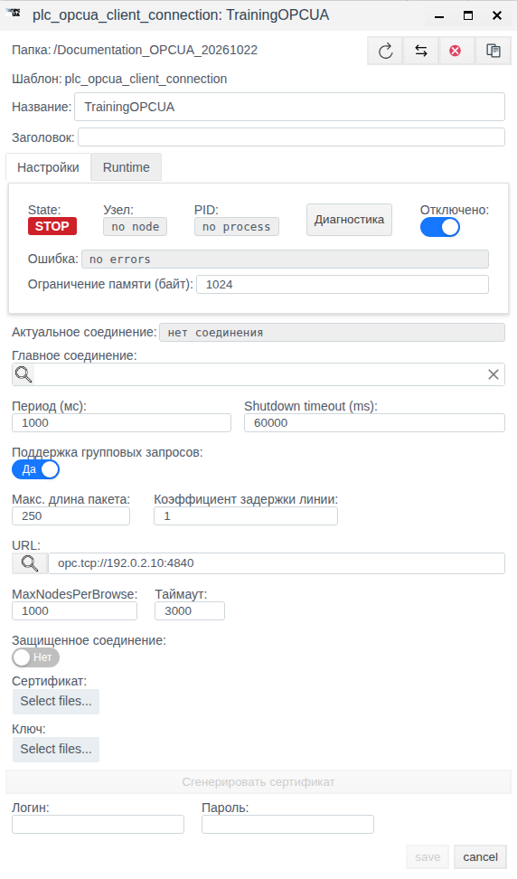
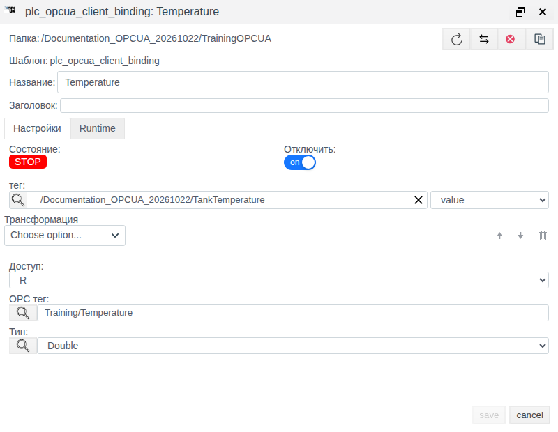

# OPC UA в Faceplate: настройка клиентского соединения и привязок

Версия Faceplate: v4.0.7

Инструкция помогает настроить OPC UA-клиент, связать переменную сервера с полем тега и понять параметры обмена. Подписи приведены по русскоязычной Студии; названия операций и типов данных сохранены в форме, используемой интерфейсом.

Показан один пример конфигурации без OPC UA-сервера. Проверены создание, сохранение и отдельное повторное открытие соединения и привязки. Оба объекта оставлены отключёнными. Условные адреса не проверялись подключением; чтение, запись и восстановление обмена этим примером не подтверждаются.

**Содержание**

- [Маршрут настройки](#маршрут-настройки)
- [Проверить внешний сервер, тип и запись](#проверить-внешний-сервер-тип-и-запись)
- [Назначение и движение данных](#назначение-и-движение-данных)
- [Что подготовить](#что-подготовить)
- [Пример настройки клиента](#пример-настройки-клиента)
- [Управление и восстановление обмена](#управление-и-восстановление-обмена)
- [Параметры соединения](#параметры-соединения)
- [Привязки и обработка значений](#привязки-и-обработка-значений)
- [Справочник настроек и состояний](#справочник-настроек-и-состояний)
- [Диагностика](#диагностика)

[Каталог соединений](./index.md) · [Подготовка поля и привязки](./bindings_ru.md) · [Преобразования](./transformation_ru.md) · [Диагностика и восстановление](./diagnostics_ru.md)

## Маршрут настройки

Подготовьте внешний источник или клиент и совместимое поле тега по общей инструкции. Затем настройте канал, сохраните полную привязку и проверьте новое значение. Для поддержанной записи/приёма отдельно подтвердите результат на внешней стороне; после исправления сбоя повторите проверку с новым контрольным значением.

[Альтернативный канал и карта сигналов](./bindings_ru.md#настроить-альтернативный-канал) описаны одинаково для всех типов; условия переключения уточняйте по драйверу.

## Проверить внешний сервер, тип и запись

Для рабочего чтения заранее создайте на сервере скалярный Double по BrowseName-пути Training/Temperature. Откройте сохранённое соединение, используйте обзор у «OPC тег», выберите этот узел, затем отдельно получите/сверьте его тип у «Тип». Обзор требует доступного сервера; строка NodeId не заменяет путь.

Для привязки к float-полю TankTemperature.value задайте R, пустую цепочку и подтвердите новое изменение 23.5→24.5 на сервере и в том же поле. Для записи подготовьте отдельный Double Training/Setpoint и float-поле Setpoint.value; задайте W/RW и подтвердите задание 25.0 независимым клиентом сервера.

Защищённый маршрут: загрузите оба файла DER-сертификата клиента и PEM-ключа, включите защиту, согласуйте доверие к клиенту на сервере и реквизиты пользователя, сохраните и проверьте фактически выбранный защищённый endpoint с новыми данными. Неполный комплект может дать незащищённую ветку; проверка доверия к сертификату сервера данным клиентом не обеспечивается.

Для R Boolean→bool проверяйте true и false; пример нормализации есть в общем руководстве преобразований. Script не подходит W/RW. Передачу текста из string-поля в String не считайте готовым маршрутом без исправления/проверки адаптации. Приведённые рабочие проверки требуют сервера и здесь не объявляются выполненными.

## Назначение и движение данных

Faceplate обращается к внешнему OPC UA-серверу по бинарному протоколу через TCP, используя URL вида `opc.tcp://host:port/path`. Сервером может быть источник данных оборудования или отдельное серверное приложение. Этот драйвер работает как клиент; для предоставления данных Faceplate внешним клиентам используется другое, серверное соединение.

| Понятие | Что определяет |
|---|---|
| Протокол | Правила обмена OPC UA с сервером |
| Драйвер | Поддержку этого обмена в Faceplate |
| Соединение | URL сервера, доступ и общие параметры выполнения |
| Привязка | Путь переменной, направление, обработку значения и связь с полем проекта |
| Тег и поле тега | Объект проекта и конкретное место получения данных или задания для записи |

При чтении данные проходят цепочку: переменная OPC UA → соединение → привязка → преобразования → согласование с типом выбранного поля → поле тега. Соединение само по себе не создаёт теги и сигналы. Привязка находится внутри соединения, а тег выбирается из проекта.

Чтение выполняется циклическими запросами, одиночными или групповыми. Настройка подписок OPC UA, событий, методов и исторического чтения в этом клиенте не предоставляется. Для привязок используйте скалярные переменные; группа нескольких узлов не означает поддержку массивов и структур значений.

При записи изменение выбранного поля проходит согласование типа, обратные преобразования и отправляется в узел с настроенным типом OPC UA. Направления R/W/RW и условия отправки описаны в разделе привязок.

## Что подготовить

Для реального подключения заранее получите сведения от администратора сервера и проекта:

| Что получить | Зачем это нужно |
|---|---|
| Полный URL, адрес/имя и порт сервера | Endpoint может включать суффикс пути; одного IP-адреса недостаточно |
| Доступность сервера с узла выполнения Faceplate | Адрес относится к узлу обмена, а не к компьютеру с браузером; localhost обозначает сам узел выполнения |
| Путь нужной переменной по BrowseName и её тип | Поле «OPC тег» использует путь относительно Objects; текстовый NodeId его не заменяет |
| Разрешённые операции и контрольное значение | Режим привязки не выдаёт прав чтения/записи на сервере |
| Требования к пользователю, endpoint и сертификатам | Аутентификация пользователя и сертификат приложения решают разные задачи |
| Тег, поле, его тип и единицы | Значение должно попадать в нужное поле с совместимым представлением |

В Студии нужны права создания и редактирования объектов. Для работающего обмена дополнительно необходимы разрешённое выполнение проекта и родительских папок, доступный узел и корректные зависимости. Для сохранения отключённой конфигурации запускать Runtime не требуется.

Для примера заранее подготовлены папка `Documentation_OPCUA_20261022` и тег `TankTemperature` с полем `value` типа `float`. Исходное значение — 0.0; форма показывает его как 0. Это подготовленное значение, а не показание сервера.

## Пример настройки клиента

Настроим соединение `TrainingOPCUA` и его привязку `Temperature` к `TankTemperature.value`. URL `opc.tcp://192.0.2.10:4840` и путь `Training/Temperature` служат только иллюстрацией заполнения полей. Доступного сервера нет, поэтому значения вводятся вручную, а оба объекта сохраняются отключёнными.

### Создать и проверить соединение

| Поле | Значение примера |
|---|---|
| Название | TrainingOPCUA |
| URL | opc.tcp://192.0.2.10:4840 |
| Период (мс) | 1000 |
| Shutdown timeout (ms) | 60000 |
| Таймаут | 3000 |
| MaxNodesPerBrowse | 1000 |
| Поддержка групповых запросов | Да |
| Макс. длина пакета | 250 |
| Коэффициент задержки линии | 1 |
| Защищенное соединение | Нет |
| Сертификат, Ключ, Логин, Пароль | Не заданы |
| Главное соединение | Не задано |
| Отключено | Включено |

1. Откройте Студию `http://127.0.0.1:9000/fp/studio`, выберите «Меню» → «Общий вид» и откройте подготовленную учебную папку.
2. Нажмите «Создать», двойным щелчком откройте категорию `plc`, выделите `plc_opcua_client_connection` и нажмите «Ok».
3. Задайте «Название» `TrainingOPCUA`. До первого сохранения включите «Отключено».
4. Введите условный URL и переключите «Защищенное соединение» в «Нет». В новой форме оно исходно установлено в «Да».
5. Сверьте остальные поля с таблицей. В проверенной форме числовые значения уже совпадали; файлы и реквизиты оставлены незаданными. Генерация сертификата здесь не нужна.
6. Нажмите `save`. После закрытия формы выделите `TrainingOPCUA` и нажмите «Редактировать».
7. Проверьте отдельно открытую сохранённую конфигурацию: URL, числа, «Нет» у защиты и включённое «Отключено». Закройте её кнопкой `cancel`, сохраняя параметры без изменений.

*Рисунок 1. Соединение после сохранения и отдельного открытия. Оно отключено; STOP и отсутствие процесса не являются проверкой связи с сервером.*

### В том же примере настроить привязку

| Поле | Значение примера |
|---|---|
| Название | Temperature |
| тег и выбранное поле | TankTemperature, value |
| Доступ | R |
| OPC тег | Training/Temperature |
| Тип | Double |
| Трансформация | Пустая цепочка |
| Отключить | Включено, on |

1. Двойным щелчком откройте `TrainingOPCUA` и нажмите «Создать». Внутри соединения форма привязки открывается сразу, без повторного выбора типа соединения.
2. Задайте «Название» `Temperature` и включите «Отключить».
3. Нажмите лупу у поля «тег», откройте учебную папку, выделите `TankTemperature` и подтвердите «ОК».
4. В соседнем списке поля явно выберите `value`. Выбор объекта без выбора поля не завершает связь с проектом.
5. Вручную введите `Training/Temperature` в «OPC тег» и выберите `Double` в «Тип».
6. Проверьте «Доступ» R и пустую «Трансформация». Лупы у «OPC тег» и «Тип» в этом примере не нажимаются: они обращаются к серверу.
7. Нажмите `save`. После закрытия выделите `Temperature` и нажмите «Редактировать».
8. Сверьте сохранённые путь, тип, тег/поле, R, пустую обработку и включённое «Отключить». Закройте форму кнопкой `cancel`.

*Рисунок 2. Та же учебная конфигурация: путь введён вручную, выбран Double и поле value, привязка отключена.*

Результат примера — две сохранённые настройки, совпадающие с таблицами после отдельного открытия. В дереве оба объекта показывают «ВЫКЛ» и Stop. Тег продолжает показывать подготовленный ноль. Сохранение формы не подтверждает существование endpoint, узла или успешную передачу данных.

## Управление и восстановление обмена

Следующие сведения относятся к сопровождению реального подключения. В учебном примере выполнение не включалось и отказ связи не воспроизводился.

| Задача | Где выполнить | Что проверить |
|---|---|---|
| Найти соединение | «Общий вид» либо «Меню» → «Драйверы ПЛК», поиск по пути и фильтр `opcua_client` | Имя и папка относятся к нужному каналу |
| Изменить настройки | Выделить объект → «Редактировать» → `save` | Отдельно открыть объект и сверить сохранённые поля |
| Разрешить или остановить канал | Флаг «Отключено» соединения и сохранение | Флаг задаёт разрешение выполнения; дополнительно важны Runtime, родители и узел |
| Отключить один сигнал | «Отключить» в привязке и сохранение | Остальные привязки канала могут продолжать работу |

Изменение исполняемых параметров работающего соединения пересоздаёт его выполнение. После изменения сначала проверьте настройки, затем состояние канала, ошибку конкретной привязки и новое ожидаемое значение нужного поля.

Отключение отдельной привязки не гарантирует очистку прежнего значения тега. При остановке или ошибке канала в R/RW-поля может передаваться отсутствие данных через цепочку преобразований. Поэтому поле может стать пустым, получить подстановку или продолжать показывать остаточное значение в зависимости от обработки и состояния. Последнее значение привязки также не является признаком свежести.

Для подтверждения восстановления нужен доступный сервер и известное изменение его переменной после возобновления связи. Сопоставьте разрешение выполнения, состояние/ошибку канала, состояние/ошибку привязки и появление нового значения именно в выбранном поле. Исчезновение ошибки, RUN или сохранение старого числа сами по себе недостаточны. Для записи отдельно требуется обратное чтение сервера, а физический результат проверяется на оборудовании, когда такая проверка применима.

## Параметры соединения

### URL и обнаружение сервера

Задавайте полный endpoint с портом и нужным суффиксом пути. Лупа у «URL» предназначена для поиска серверных URL по адресу и порту. Найденный URL следует сверить с сервером: обнаружение адреса не доказывает работоспособность сохранённого соединения или нужного сигнала. В примере эта функция не запускалась.

### Цикл, Browse и групповые запросы

«Период (мс)» задаёт цикл обработки чтения. Если запросы занимают больше периода, следующий цикл не получает дополнительной паузы; это не гарантированная частота обновления экрана.

«Поддержка групповых запросов» разрешает групповые чтения и поддержанную групповую запись. «Макс. длина пакета» ограничивает группу чтения **числом узлов**, а не байтами. Этот предел не делит группы записи. Одинаковые пути в групповой записи могут объединяться в одну запись. «Коэффициент задержки линии» присутствует в общей форме, но на группирование строковых путей этого клиента не влияет и паузу между запросами не задаёт.

MaxNodesPerBrowse задаёт число исходных узлов одного запроса обхода дерева, а не общий размер дерева или число значений для чтения. При ограничениях сервера просмотр может быть неполным: продолжение BrowseNext не обрабатывается. Уменьшение параметра не заменяет проверку, что нужные переменные найдены и читаются.

«Таймаут» относится к ожиданию обычных операций чтения/записи. Установление подключения, обнаружение сервера и просмотр дерева имеют отдельные ожидания; изменение этого поля не меняет их все одновременно. Для редкого опроса и W-соединения без изменений учитывайте таймаут отсутствия запросов 300000 мс: клиент может пересоздаваться, даже если задача не предусматривает постоянного чтения.

### Пользователь и защищённое подключение

При незаданных реквизитах используется Anonymous. Для доступа по пользователю задаются и логин, и пароль. Явные пустые строки могут отправляться как пустая пара Username/Password, поэтому не используйте их как способ выбора Anonymous. Учётная запись должна иметь разрешения на конкретные узлы и операции.

Для «Защищенное соединение» нужны **оба** загруженных файла: сертификат клиента DER и закрытый ключ PEM. Это содержимое выбранных файлов, а не пути к ним на диске. В сертификате должен присутствовать URI приложения в subjectAltName; при необходимости администратор сервера добавляет сертификат клиента в доверенные.

При полном комплекте используется SignAndEncrypt. Отдельных переключателей Sign-only и конкретной SecurityPolicy нет: совместимый endpoint и политика согласуются с сервером. **Одного флага защиты недостаточно:** без полного комплекта файлов настройки могут перейти к незащищённому подключению. Кроме того, клиент принимает сертификаты сервера без проверки доверия к ним; шифрование здесь не подтверждает подлинность сервера. Пользовательской настройки списка доверенных серверных сертификатов в этой форме нет.

Кнопка «Сгенерировать сертификат» создаёт самоподписанный сертификат и незашифрованный ключ, требует имени соединения и подтверждения. Полученные файлы подставляются в форму; конфигурация сохраняется отдельно кнопкой `save`. Генерация создаёт файлы на узле ещё до сохранения формы, поэтому отмена формы не отменяет эту файловую операцию. Генерируемый сертификат использует общие параметры URI приложения; совместимость с политикой доверия сервера нужно проверить. В учебном примере генерация и защищённый обмен не выполнялись.

### Альтернативные подключения

«Главное соединение» связывает альтернативное соединение с основным того же типа. Объект альтернативы отключается, а его параметры использует выполнение основного канала при переключении. Цепочка альтернатив не допускается. Данные разных endpoint должны соответствовать одним логическим путям; текущее выбранное подключение показывает «Актуальное соединение». Переключение и возврат нужно проверять по новым данным; оставшийся путь после ошибки не доказывает доступность источника.

## Привязки и обработка значений

### Путь узла и тип

«OPC тег» хранит точный путь по BrowseName относительно Objects. Условный `Training/Temperature` обозначает переменную Temperature внутри Training. Не добавляйте `Objects/` или начальный `/`. Строки вида `ns=2;s=...` и `i=2258` здесь не разбираются как NodeId.

Лупа у «OPC тег» открывает браузер переменных по сохранённым настройкам соединения. Его «Обновить» сбрасывает кэш отображаемого дерева. Выбор узла заполняет путь, но не определяет тип автоматически. Лупа у «Тип» отдельно читает текущее значение и получает его тип. Для этих функций нужен доступный сервер; в нашем примере путь и тип заданы вручную.

Путь использует BrowseName, а не локализованный DisplayName. Пространство имён в текстовом пути не сохраняется, а `/` внутри имени не экранируется: совпадающие или неоднозначные пути требуют проверки на сервере. Не найденный в кэше путь может дать `invalid node`; запасное разрешение пути не является универсальным для любых пространств имён.

В списке «Тип» доступны `Float`, `Double`, `UInt64`, `String`, `Boolean`, `SByte`, `Byte`, `Int16`, `UInt16`, `Int32`, `UInt32`, `Int64`. При чтении используется фактическое значение сервера; выбор «Тип» не перекодирует чтение и автоматически не переписывается. Для записи отправляются выбранный тип и значение, поэтому несовпадение может дать отказ сервера.

Для Int64/UInt64 не обеспечивается полная точность всех 64-битных целых. Перед использованием крайних значений проверяйте точность всей цепочки. Массивы и структуры не рассматриваются как поддержанные скалярные значения.

У Boolean есть существенная особенность: при передаче в поле Faceplate типа `bool` без корректирующей обработки значение `false` может стать `true` из-за общего приведения типов. Такой путь нельзя принимать в эксплуатацию без проверки обеих логических величин. Для записи String из поля `string`/`binary` обычный текст также не проходит без изменений: поле преобразуется в число либо отсутствие данных. Наличие типа в списке не подтверждает корректный обмен с любым типом поля проекта.

### Направление и запись

| Доступ | Чтение в поле | Отправка в сервер |
|---|---|---|
| R | Циклическое | Изменение поля не отправляется |
| W | Не выполняется | По изменению поля, а также текущее задание при подключении/восстановлении и добавлении или изменении активной привязки |
| RW | Циклическое | По внешнему изменению поля; собственное обновление чтением не создаёт обратную команду |

W не обеспечивает постоянное выравнивание значения на сервере. RW при подключении не имеет такой же обязательной отправки исходного задания, как W: сначала возможно чтение серверного значения. Изменения во время разрыва не образуют гарантированной очереди; после восстановления проверьте сервер и при необходимости выдайте новое осознанное задание.

Если связь с тегом не задана, для W/RW источником может служить runtime-значение самой привязки. Для обычного проекта задайте и тег, и поле явно. Успех записи и runtime-значение привязки отражают отправленное задание, а не независимое подтверждение изменения сервера.

### Преобразования

Пустая цепочка не добавляет обработку. Прямые операции выполняются сверху вниз, обратные при записи — в обратном порядке. Для W/RW выбирайте только обратимые операции.

| Операция | Чтение | Запись / условия |
|---|---|---|
| Scaling | Y = X × Factor + Shift | X = (Y − Shift) / Factor; Factor должен быть ненулевым |
| Default Value | Сохраняет числовой вход, заменяет любой нечисловой числовой подстановкой Value | Обратно передаёт значение без подстановки |
| Limit Control | Сохраняет число в диапазоне включительно, иначе даёт отсутствие данных | Обратно прижимает к границе; Upper Limit должен быть больше Lower Limit |
| Integration | Накопление в единицах входа × мс; первый числовой отсчёт не даёт результата | Для W/RW не допускается |
| Derivative | Изменение в единицах входа/мс; первый числовой отсчёт не даёт результата | Для W/RW не допускается |
| Damper | Сглаживание; Tlag в мс, в форме исходно 1 и минимум 1 | Обратно без сглаживания |
| Script | Пользовательская обработка Erlang с входом, контекстом и накопленным состоянием | Для W/RW не допускается; JavaScript в этой обработке не предлагается |

У Scaling исходно Factor = 1 и Shift = 0, у Default Value — Value = 0. У Limit Control оба исходных предела равны 0: перед сохранением задайте допустимый диапазон. Проверка нуля Factor не покрывает все представления нуля; для записи сами обеспечьте ненулевой коэффициент.

Временные операции используют время обработки в миллисекундах, а не метки времени OPC UA. Их состояние пересоздаётся при изменении или перезапуске; Integration не заменяет сохраняемый архивный итог. Ошибка преобразования может дать отсутствие данных при успешном чтении транспорта. Подстановка Default Value может скрыть отсутствие реального сигнала числом — учитывайте это при диагностике.

## Справочник настроек и состояний

Исходные значения и диапазоны ниже относятся к форме проверенной установки; диапазоны прочитаны из её контролов, испытаний граничных значений не было. Поля без исходного значения нужно выбрать явно либо оставить незаданными только в описанных случаях.

### Общие поля соединения

| Поле | Исходное значение / диапазон | Назначение |
|---|---|---|
| Название / Заголовок | Имя пустое; заголовок необязателен | Имя объекта и описание |
| Период (мс) | 1000; 1–3600000 мс | Цикл чтения и ожидание перед повтором неудачного подключения |
| Shutdown timeout (ms) | 60000; 10–3600000 мс | Ожидание штатного завершения выполнения |
| Поддержка групповых запросов | Да | Разрешение поддержанных групповых операций |
| Макс. длина пакета | 250; 1–10000 узлов | Предел группы чтения; при отсутствии сохранённого целого значения используется 5000 узлов |
| Коэффициент задержки линии | 1; 1–10 | Общая настройка; группирование путей данного клиента не меняет |
| Отключено | Выключено в новой форме; в примере включено | Запрет выполнения канала |
| Ограничение памяти (байт) | До сохранения пусто, после 1024 | При этой подписи фактическая единица — МиБ: 1024 МиБ = 1 ГиБ кучи рабочего процесса; это не число тегов и не вся память внешнего клиента |
| Главное соединение | Не задано | Необязательная связь альтернативного подключения с основным |

### Поля OPC UA

| Поле | Исходное значение / диапазон | Назначение |
|---|---|---|
| URL | Пусто | Полный endpoint, обязательный для настройки |
| MaxNodesPerBrowse | 1000; 5–6000, шаг 5 | Число исходных узлов запроса Browse |
| Таймаут | 3000; 5–6000 мс | Ожидание обычного чтения/записи |
| Защищенное соединение | Да; в примере Нет | Защищённая ветка требует полного комплекта файлов; флаг не подтверждает её сам по себе |
| Сертификат / Ключ | Файлы не выбраны | Сертификат приложения DER и ключ PEM; нужны для защищённой ветки |
| Логин / Пароль | Не заданы | Anonymous либо пользовательская аутентификация по полному комплекту реквизитов |

### Поля привязки

| Поле | Исходное состояние | Назначение |
|---|---|---|
| Название / Заголовок | Имя пустое; описание необязательно | Идентификация сигнала внутри соединения |
| тег / соседний список поля | Не выбраны | Объект назначения и конкретное поле |
| Доступ | R | R, W или RW; направление, а не серверные права |
| OPC тег | Пусто | Точный путь узла BrowseName |
| Тип | Выберите явно | Скалярный тип OPC UA; особенно важен при записи |
| Трансформация | Пустая цепочка | Дополнительная обработка; для записи требуется обратное направление |
| Отключить | off; в примере on | Исключение только этой привязки из обмена |
| Runtime | Заполняется при выполнении | Значение и ошибка; сохранённое число не доказывает нового чтения |

### Состояния и результаты

| Что смотреть | Что означает | Чего достаточно для проверки |
|---|---|---|
| «Отключено» / «Отключить» | Разрешение выполнения канала/сигнала | Для конфигурации — повторно открыть флаг; для обмена нужна проверка данных |
| State / Состояние | RUN/STOP выполнения | RUN может появиться до успешного подключения или при ошибке одного сигнала |
| Узел / PID | Где и каким процессом выполняется канал | Наличие процесса не подтверждает прочитанные данные |
| Ошибка и «Актуальное соединение» | Результат канала и выбранный путь | Путь может остаться после ошибки; проверяйте конкретную операцию |
| Состояние/ошибка привязки | Результат отдельного сигнала | Общий успех канала не исключает ошибку узла |
| Поле тега и значение Runtime | Прочитанное, отправленное, подставленное или прежнее значение | Нужен новый известный результат; при записи — независимое чтение |

Драйвер не сохраняет в этой цепочке исходные OPC UA quality/timestamp как общий признак свежести поля. Даже пустой набор чтения или ошибка одной привязки могут соседствовать с успешным состоянием канала. В примере наблюдались STOP, `no node`, `no process`, `no errors` и «нет соединения»; это согласуется с отключённой конфигурацией.

## Диагностика

У сохранённого соединения кнопка «Диагностика» доступна и в STOP. Start/Stop управляют сбором журнала, а не включением канала. Log level выбирает info, warning, error или debug; Log limit исходно 1000, диапазон 1–100000. «Процессы» и Logs показывают доступный диагностический вывод; «Копировать» и «Очистить» относятся к этому выводу. Пустой журнал не доказывает исправность связи. Работа с журналом не включалась в учебный пример.

| Симптом | Что проверить и исправить | Подтверждение результата |
|---|---|---|
| STOP, no process | Флаги, Runtime, родители, зависимости и узел; для текущего примера отключение намеренное | При вводе в работу — процесс, успешный канал и новое значение |
| Ошибка подключения или поиска URL | Полный endpoint, host/port/path и доступность с узла выполнения | Успешная адресованная операция, не только найденный URL |
| RUN/OK, но один сигнал не читается | Отключение привязки, путь, поле, зависимости и серверные разрешения | Новое значение правильного поля |
| invalid node или неполное дерево | Точный BrowseName-путь, обновление дерева, ограничения Browse; не вводить текстовый NodeId | Нужный узел найден и успешно прочитан |
| Ошибка типа/значения при записи | Выбранный OPC type, скалярность, диапазон и тип поля Faceplate | Ответ на запись и независимое обратное чтение |
| Boolean или String передаётся неверно | Особенности приведения к bool и из string/binary, описанные рядом с типами | Отдельная проверка всех значимых значений на реальном источнике |
| Не работает защищённый endpoint | Оба файла, DER/PEM, URI приложения, требования сервера к доверию и пользователю | Фактический защищённый канал и новые данные |
| После исправления осталось старое число | Остаточное значение, отсутствие новых операций, Default Value или другая обработка | Известное изменение на сервере появилось в выбранном поле |
| W/RW-задание во время разрыва не дошло | Доставка и повтор не гарантируются; проверить сервер и выдать новое допустимое задание | Независимое подтверждение нового задания |

Проверку нового чтения, защищённого обмена, обратного чтения и восстановления выполняйте при наличии доступного сервера. Сохранённые формы и снимки этой инструкции подтверждают только настройку клиента.
