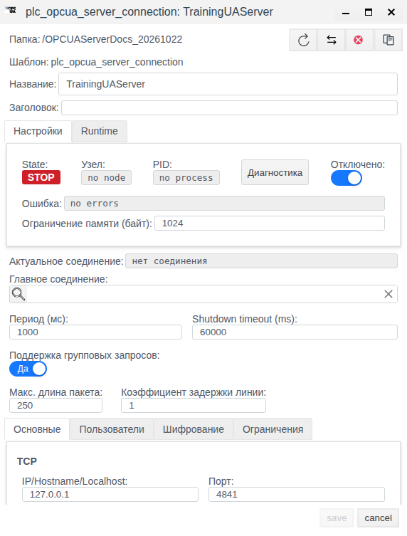
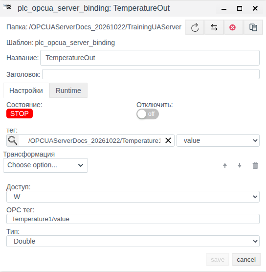

# OPC UA — сервер в Faceplate: настройка соединения и обмена данными

Версия документации: Faceplate v4.0.7

Инструкция предназначена для интеграторов, которые публикуют поля тегов Faceplate через OPC UA или принимают значения от внешней системы. Единственный практический пример показывает сохранение и повторное открытие настроек отключённого сервера. Подключение клиента, чтение и запись в этом примере не проверялись. Остальные разделы объясняют назначение настроек и порядок проверки при наличии клиента; особенности реализации установлены по исследованию исходников.

**Содержание**

- [Маршрут настройки](#маршрут-настройки)
- [Проверить публикацию и принять новое значение](#проверить-публикацию-и-принять-новое-значение)
- [Как работает сервер](#как-работает-сервер)
- [Подготовить исходные данные](#подготовить-исходные-данные)
- [Опубликовать значения тегов](#опубликовать-значения-тегов)
- [Принимать записи и настроить двусторонний обмен](#принимать-записи-и-настроить-двусторонний-обмен)
- [Настроить пользователей и защиту](#настроить-пользователей-и-защиту)
- [Управлять сервером](#управлять-сервером)
- [Диагностировать и восстанавливать обмен](#диагностировать-и-восстанавливать-обмен)
- [Справочник параметров и типов](#справочник-параметров-и-типов)

[Каталог соединений](./index.md) · [Подготовка поля и привязки](./bindings.md) · [Преобразования](./transformation.md) · [Диагностика и восстановление](./diagnostics.md)

## Маршрут настройки

Подготовьте внешний источник или клиент и совместимое поле тега по общей инструкции. Затем настройте канал, сохраните полную привязку и проверьте новое значение. Для поддержанной записи/приёма отдельно подтвердите результат на внешней стороне; после исправления сбоя повторите проверку с новым контрольным значением.

[Альтернативный канал и карта сигналов](./bindings.md#настроить-альтернативный-канал) описаны одинаково для всех типов; условия переключения уточняйте по драйверу.

## Проверить публикацию и принять новое значение

После настройки TemperatureOut подготовьте внешний OPC UA-клиент. Подключитесь к реальному адресу узла и порту 4841, найдите Temperature1/value просмотром Objects и подтвердите 23.5. Измените исходное поле на 24.5 и прочитайте новое 24.5 клиентом; сохранение формы не заменяет эту проверку.

Для приёма подготовьте float-тег Setpoint.value. В отключённом сервере создайте привязку SetpointIn: Доступ R, Тип Double, OPC тег Commands/Setpoint, тег Setpoint, поле value, пустая цепочка. Сохраните, отдельно откройте и проверьте путь после возможного пересчёта формой. После запуска запишите клиентом 25.0 и проверьте новое 25.0 в поле Faceplate.

Для R Boolean используйте проверку true/false и применимую нормализацию из общей инструкции. Публикация исходного текста String требует исправления/проверки адаптации. При защите нужны оба файла сертификата и ключа, проверенные доверенные стороны и фактически выбранная политика; сам флаг не исключает незащищённый endpoint.

Эти процедуры дополняют ранее сохранённую конфигурацию; новое клиентское чтение/запись и защищённый обмен здесь не объявляются выполненными.

## Как работает сервер

**Соединение** задаёт один локальный OPC UA-сервер: адрес, порт, пользователей, защиту и параметры выполнения. Для него выбирают тип `plc_opcua_server_connection`. Это сервер Faceplate, к которому обращаются внешние клиенты по `opc.tcp`; адрес другого OPC UA-сервера здесь не задают.

Внутри соединения создают **привязки** типа `plc_opcua_server_binding`. Каждая связывает выбранное поле тега Faceplate с переменной в адресном пространстве сервера. Несколько привязок могут обслуживаться одним соединением.

Поле **Доступ** задаёт направление относительно Faceplate:

- **W** — публикация поля Faceplate в переменную OPC UA. При запуске передаётся текущее поле, затем его изменения.
- **R** — приём значения переменной OPC UA в поле Faceplate. Внешний клиент записывает переменную, а Faceplate считывает её в своём цикле.
- **RW** — оба направления. При полном запуске сервера исходным становится текущее поле Faceplate.

Эти обозначения не задают права внешнего клиента. Переменные создаются доступными для чтения и записи; отдельного запрета клиентской записи для W и отдельных прав пользователей на узлы здесь нет. Клиентская запись в W-переменную не переносится обратно в поле Faceplate.

**OPC тег** — путь публикации из сегментов через `/`. Промежуточные сегменты образуют папки под Objects, последний — переменную. Нужны как минимум два непустых сегмента. Этот путь не является строковым NodeId. Имена для просмотра создаются в пространстве имён 1, а NodeId назначается сервером автоматически; постоянство идентификатора после перезапуска не гарантируется. При подключении клиента узел следует находить просмотром адресного пространства. Загрузка NodeSet и импорт дерева удалённого сервера этой формой не предусмотрены.

Переменные появляются при первом локальном обращении работающего сервера, а не при сохранении формы. Сохранённая привязка сама по себе ещё не подтверждает наличие доступного узла.

## Подготовить исходные данные

До настройки определите локальный сетевой адрес и свободный порт, поля тегов и их типы, направление каждого сигнала, пути публикации, единицы измерения и необходимые преобразования. Для защищённого доступа дополнительно нужны серверные учётные записи, сертификат с ключом, доверенные цепочки и сведения о требуемом клиентом режиме безопасности.

Адрес **127.0.0.1** доступен только на машине сервера. Для удалённого клиента нужен адрес, доступный ему по сети, и разрешённый TCP-порт. Настройка **IP/Hostname/Localhost** используется одновременно для привязки слушающего сокета и объявляемого адреса. Форма принимает IPv4, полное доменное имя или `localhost`; ввод IPv6 не предусмотрен. При `0.0.0.0` сервер слушает все IPv4-интерфейсы, но этот же адрес попадает в объявление endpoint: клиенту понадобится реальный адрес машины и проверка полученного endpoint.

В учебном примере заранее подготовлена отдельная папка `OPCUAServerDocs_20261022` и тег `Temperature1` с доступным полем `value` типа float, значение **23.5**. Температура в °C — учебный смысл этого числа. Создание серверного соединения не создаёт тег автоматически.

## Опубликовать значения тегов

### Пример настройки сервера и одного сигнала

Результат — сохранённый `TrainingUAServer` и его привязка `TemperatureOut`. Сервер оставляем отключённым: клиент для этого примера не нужен.

1. В Студии откройте **Общий вид** и папку `OPCUAServerDocs_20261022`, содержащую подготовленный `Temperature1`. Нажмите **Создать**, раскройте **plc**, выберите **plc_opcua_server_connection**, подтвердите **Ok**.
2. В поле **Название** введите `TrainingUAServer`. Включите **Отключено**. На вкладке **Основные** задайте **IP/Hostname/Localhost** = `127.0.0.1`, **Порт** = `4841`, **Таймаут** = `3000` мс. Это соответствует адресу `opc.tcp://127.0.0.1:4841` после будущего запуска.
3. На вкладке **Пользователи** оставьте **Разрешить анонимный досуп** включённым, список пользователей — пустым. На вкладке **Шифрование** оставьте **Защищенное соединение** выключенным. Такие настройки используются здесь для локальной конфигурации.
4. Сохраните через **save**. После закрытия формы выберите созданную строку и нажмите **Редактировать**. Убедитесь, что имя, адрес и порт сохранены, **Отключено** включено. В примере показаны **STOP**, `no node`, `no process`, `no errors` и **Актуальное соединение** = `нет соединения`.

5. Закройте редактор через **cancel** и дважды нажмите строку `TrainingUAServer`, чтобы открыть его содержимое. Нажмите **Создать**: откроется дочерняя форма **plc_opcua_server_binding**.
6. Введите **Название** = `TemperatureOut`. Кнопкой поиска у **тег** выберите `Temperature1` в своей учебной папке и подтвердите **ОК**. В появившемся списке полей выберите **value**.
7. Установите **Доступ** = `W`, **Тип** = `Double`, **OPC тег** = `Temperature1/value`. Выбор float-поля в осмотренной форме автоматически предложил Double и этот путь; проверьте оба значения явно. **Трансформация** остаётся пустой, **Отключить** — выключенным. Завершите ввод пути переходом в другое поле.
8. Нажмите **save**. После закрытия формы выберите строку `TemperatureOut` и **Редактировать**. Проверьте тег, поле `value`, W, Double, `Temperature1/value` и отсутствие преобразований.

9. Закройте форму через **cancel**. Соединение должно остаться отключённым. Сама привязка разрешена, но её **STOP** ожидаем под отключённым родителем. Отметка **ВКЛ** у привязки в списке не означает запуск сервера.

Рисунок 1. Сохранённый сервер после независимого повторного открытия. Нижнее поле таймаута находится за пределами кадра.

Рисунок 2. Сохранённая привязка публикации. Путь тега в форме показан относительно корня проекта.

Подтверждённый результат примера — настройки обоих объектов сохранились после закрытия и отдельного повторного открытия. Значение 23.5 подготовлено в теге; его передачу клиенту не проверяли.

### Путь и тип публикуемого значения

В текущем редакторе выбор тега/поля формирует путь из последнего имени тега и поля. Повторное открытие также может пересчитать путь в черновике формы; сохранение способно заменить ранее заданный пользовательский путь. После изменения проверяйте именно поле **OPC тег**. Колонка с тем же названием тоже вычисляется из тега/поля и не доказывает фактический путь узла. Отмена формы не сохраняет её черновик.

Разные привязки с одинаковым путём обращаются к одной переменной; в группе одинаковые ключи могут объединиться. Планируйте уникальные пути. После переименования, удаления или отключения привязки прежний узел и его значение могут оставаться до перезапуска сервера.

**Тип** определяет исходящий скалярный Variant. Backend не наследует тип от поля автоматически: выберите его и проверьте после сохранения. Форма предлагает integer → Int64, float → Double, bool → Boolean, string → String; при смене поля уже выбранный тип может сохраниться. Тип в этой форме не задаёт строгую проверку всех клиентских записей: у переменной остаётся общий DataType и разрешена произвольная размерность.

Для публикации строковых полей исследование выявило дефект адаптации: строка сначала преобразуется в число либо отсутствующее значение, поэтому выбор String не обеспечивает корректной публикации исходного текста. Не закладывайте такой обмен без отдельной проверки. Приём строки в строковое поле использует другой путь обработки.

## Принимать записи и настроить двусторонний обмен

Для приёма выберите целевое поле и **R**. Начальное поле Faceplate при этом не публикуется. До первой клиентской записи переменная может быть пустой; чтение пустого значения способно заменить поле отсутствующим значением. Учитывайте это до включения привязки.

Для обмена в обе стороны выберите **RW** и заранее определите, какая сторона задаёт начальное значение. При полном запуске текущее поле Faceplate публикуется в сервер. Для новой или изменённой привязки на уже работающем сервере принудительная начальная публикация предусмотрена для W; для RW она может ждать изменения поля или полного перезапуска. Для предсказуемой инициализации подготовьте привязки при остановленном соединении.

При наличии клиента проверяйте направления отдельно: для W измените поле и прочитайте новый результат клиентом; для R запишите новое значение клиентом и проверьте нужное поле; для RW выполните обе проверки. Сохранение формы и отсутствие ошибки такой проверки не заменяют. В этой инструкции эти действия не воспроизводились.

### Преобразования

Прямая цепочка действует **OPC UA → Faceplate**, сверху вниз. Обратная цепочка действует **Faceplate → OPC UA**, с обратными операциями в обратном порядке. Поэтому преобразование в W применяется в обратном направлении.

- **Scaling**: прямая формула `x × factor + shift`, обратная — `(x − shift) / factor`. Для W/RW коэффициент factor должен быть ненулевым.
- **Default Value**: при приёме подставляет числовое значение вместо нечислового входа; в обратном направлении пропускает значение. Подстановка не подтверждает свежесть данных.
- **Limit Control**: при приёме возвращает отсутствующее значение вне диапазона; при публикации прижимает результат к ближайшей границе.
- **Damper**: сглаживает принимаемое значение; обратно пропускает его без сглаживания. Время задаётся в мс.
- **Скрипт**, **Derivative**, **Integration** поддерживают прямую обработку. Обратная цепочка для W/RW с ними не проходит проверку.

Для приёма Boolean в bool-поле без нормализации исследование выявило ошибку: входное false может стать true. Это не проверенный на стенде результат, но основание не считать прямую Boolean-привязку исправной без проверки обоих логических состояний. Исходящая обработка bool использует отдельное преобразование.

Отсутствующее исходящее значение обрабатывается по-разному: в одиночном режиме для числовых/Boolean типов возможна ошибка `invalid value`, а для String — буквальная строка `none`; в групповом режиме передаётся null со статусом `BadNotConnected`. Переключение группирования может изменить видимый результат такого сигнала.

## Настроить пользователей и защиту

### Анонимный доступ и учётные записи

На вкладке **Пользователи** переключатель **Разрешить анонимный досуп** разрешает вход без логина. Для входа с паролем заполните серверный список через поля **Логин** и **Пароль**, сохраните его и отключите анонимный доступ, если он не нужен. Это отдельные учётные записи OPC UA-сервера, а не пользователи проекта Faceplate. Ролей и разрешений на отдельные переменные в данной настройке нет.

В осмотренной форме список по умолчанию пустой, а анонимный доступ разрешён. При настройке вне формы важно различать явно пустой список и отсутствие списка: при его отсутствии могут сохраниться библиотечные настройки доступа, включая анонимный вход и демонстрационные учётные записи. Проверяйте фактический вход клиентом с разрешёнными и запрещёнными данными; такая проверка здесь не выполнялась.

### Сертификат, ключ и доверие

На вкладке **Шифрование** включите **Защищенное соединение**, задайте **Сертификат** в DER и **Ключ** в PEM. Нужна пара файлов. Если флажок включён, но одного файла нет, реализация может запустить сервер без шифрования; сам флажок не подтверждает защищённый endpoint.

Кнопка **Сгенерировать сертификат** создаёт самоподписанный сертификат с RSA 2048 и ключ без пароля. Генератор использует DNS `localhost` и URI `urn:faceplate.io:Faceplate:OPCUA:Server`; смена имени сертификата не меняет эти значения. Для нужных сетевых имён и совместимости ApplicationUri подготовьте подходящий сертификат и проверьте его с клиентом. Генерация и загрузка файлов в примере не выполнялись.

**Доверенные сертификаты** и **Доверенные корневые сертификаты** содержат DER-сертификаты доверенных сторон и цепочки. **Отозванные сертификаты** в реализации означают файлы списков отзыва CRL, а не перечень обычных сертификатов для блокировки. В обработке двух и более файлов внутри любого из этих списков найден дефект работы с памятью. Надёжность такой конфигурации не подтверждена; не считайте многозначные списки проверенным способом настройки доверия.

Наличие шифрования не исключает endpoint с политикой None. В осмотренной действующей форме нет отдельного переключателя отключения незащищённых подключений. В реализации он существует отдельно; даже его отключение не сводит защищённые режимы только к SignAndEncrypt — остаётся Sign. Требуемую политику и режим проверяют по фактически объявленным endpoint и выбранному подключению клиента.

Реализация пытается добавить Basic128Rsa15, Basic256, Basic256Sha256 и Aes128Sha256RsaOaep с режимами Sign/SignAndEncrypt наряду с None. Успех добавления каждой политики зависит от сборки и не подтверждён осмотром формы. Перечень не является рекомендацией выбирать устаревшие политики.

## Управлять сервером

Изменения сохраняйте через **save**, затем открывайте форму заново и проверяйте поля. Двойное нажатие контейнера открывает его содержимое; для настройки сохранённого объекта используйте выбор строки и **Редактировать**.

**Отключено** у соединения запрещает его выполнение. **Отключить** у привязки прекращает её обработку, но не удаляет уже созданный узел. Для включения серверного обмена снимите флажок соединения и сохраните; затем отдельно проверьте состояние, endpoint и свежие данные. Учебный сервер из примера включать для проверки конфигурации не требуется.

Изменение настроек соединения может пересоздать серверный процесс. Для полного пересоздания адресного пространства отключите и сохраните соединение, дождитесь остановки, затем включите и сохраните. При этом клиенты теряют текущие подключения; старые узлы исчезают, а NodeId могут измениться. После перезапуска проверяйте адресное пространство и новые значения.

**Период (мс)** задаёт цикл обработки Faceplate. **Поддержка групповых запросов** объединяет обращения Faceplate к локальному серверному обработчику; **Макс. длина пакета** задаёт число элементов, не размер в байтах. Это не ограничение внешнего клиентского Read/Write. **Коэффициент задержки линии** присутствует в общей форме, но не влияет на группирование строковых путей этого драйвера. Измерения производительности не выполнялись.

На вкладке **Ограничения** задаются ресурсы сессий, защищённых каналов и размеры отдельных запросов. Поля «одновременных операций» фактически ограничивают число узлов в одном клиентском Read/Write, а не количество параллельных потоков. Пустые поля оставляют библиотечные значения; это не введённый ноль.

Для нескольких серверов создайте отдельные соединения с совместимыми локальными адресами и разными свободными портами. Общий механизм **Главное соединение** связывает соединения одного типа; цепочки главных соединений не допускаются. Само наличие этого поля не гарантирует перенос клиентских сессий, переключение сетевого адреса или сохранность данных при отказе. Работа нескольких серверов и резервирования здесь не проверялась.

У **Ограничение памяти (байт)** обнаружено расхождение подписи и расчёта: фактическое значение трактуется в МиБ. Сохранённое `1024` означает 1 ГиБ, а не 1024 байта. Учитывайте это при планировании ресурсов.

## Диагностировать и восстанавливать обмен

Различайте разрешение выполнения, состояние процесса и результат сигнала. Снятый **Отключено** только разрешает запуск. **RUN** и наличие PID показывают работу процесса, но не доказывают доступность endpoint или поступление новых данных. Ошибка отдельной привязки может сочетаться с RUN соединения.

В сохранённой форме соединения доступны **Состояние**, **Узел**, **PID**, **Ошибка**, **Актуальное соединение** и кнопка **Диагностика**. Внешняя вкладка **Runtime** показывает текущие поля выполнения. Запуск и остановка сбора сообщений в **Диагностика** управляют журналом, а не самим сервером. Список клиентов, счётчик сессий и универсальная отметка свежести этим модулем в объект не публикуются.

Если клиент не подключается, последовательно проверьте разрешение выполнения, ошибку соединения, привязку к локальному адресу, занятость порта, доступность адреса из сети клиента и выбранный endpoint. Для защиты дополнительно проверьте наличие обоих файлов, доверие, CRL, ApplicationUri, фактическую политику и режим. **Таймаут** на вкладке **Основные** — ожидание ответа локального обработчика в мс; это не время простоя клиентской сессии. Ошибка этого таймаута не устанавливает причину сетевого отказа клиента.

Если соединение работает, а сигнал неверен, откройте привязку и проверьте тег/поле, R/W/RW, путь, тип и цепочку преобразований. Для R учитывайте пустое значение до первой записи, для W — особенности String, для bool-приёма — обработку false. При старом имени узла учитывайте его сохранение до перезапуска. Не считайте вычисляемую колонку **OPC тег** доказательством фактического NodeId или пути клиента.

Ошибка соединения не очищает выбранное поле Faceplate. Отключение внешнего клиента тоже не очищает значение в локальном сервере: Faceplate продолжает обращаться к собственному адресному пространству. Поэтому прежнее число, отсутствие ошибки и даже успешное локальное чтение не доказывают восстановление внешнего обмена.

После устранения причины восстановление подтверждают **новым контрольным значением**: поле → клиент для W, клиент → поле для R, оба направления для RW. Результат должен быть получен после события восстановления. В данном примере восстановление и клиентский обмен не проверялись.

## Справочник параметров и типов

### Параметры соединения

Исходные значения ниже относятся к осмотренной форме; эффективные значения пустых ресурсных полей установлены по реализации. Границы формы не заменяют проверку доступности адреса, ресурсов и клиентской совместимости.

| Поле | Назначение | Исходное значение, единицы и границы |
|---|---|---|
| Название / Заголовок | Имя объекта / отображаемый заголовок | Имя задаёт интегратор; заголовок может быть пустым |
| Отключено | Запрет выполнения соединения | В примере включено |
| Ограничение памяти (байт) | Предел памяти процесса | После сохранения 1024; фактически МиБ, несмотря на подпись |
| Главное соединение | Ссылка общего механизма резервирования | Пусто; тот же тип, без цепочек |
| Актуальное соединение | Текущий выбор механизма соединений | Поле состояния; в примере «нет соединения» |
| Период (мс) | Цикл обработки | 1000 мс; 1–3600000, шаг формы 10 |
| Shutdown timeout (ms) | Ожидание завершения процесса | 60000 мс; 10–3600000, шаг 10 |
| Поддержка групповых запросов | Группировать локальные обращения | Да |
| Макс. длина пакета | Число элементов локальной группы | 250; 1–10000, шаг 1 |
| Коэффициент задержки линии | Общее поле группирования | 1; 1–10, шаг 1; для строковых путей эффекта нет |

Вкладка **Основные**:

| Поле | Назначение | Исходное значение, единицы и границы |
|---|---|---|
| IP/Hostname/Localhost | Локальный адрес прослушивания и объявления | 127.0.0.1; IPv4, полное доменное имя или localhost |
| Порт | TCP-порт OPC UA-сервера | 4841; 1–65535, шаг 1 |
| Таймаут | Ожидание ответа локального обработчика | 3000 мс; 5–6000, шаг 1 |

Вкладка **Пользователи**:

| Поле | Назначение | Исходное значение и условия |
|---|---|---|
| Разрешить анонимный досуп | Вход без логина | Включено |
| Логин / Пароль | Записи локального списка сервера | Список пустой; не учётные записи проекта |

Вкладка **Шифрование**:

| Поле | Назначение | Исходное значение и условия |
|---|---|---|
| Защищенное соединение | Включить настройку шифрования | Выключено; нужны оба файла |
| Сертификат / Ключ | Серверный сертификат и закрытый ключ | Пусто; DER / PEM |
| Сгенерировать сертификат | Создать самоподписанную пару | RSA 2048, ключ без пароля; проверить имена и URI |
| Доверенные сертификаты | Сертификаты доверенных сторон | Пусто; DER; дефект обработки нескольких файлов описан выше |
| Доверенные корневые сертификаты | Доверенные издатели/цепочка | Пусто; DER; та же оговорка о нескольких файлах |
| Отозванные сертификаты | Списки отзыва | Пусто; CRL; та же оговорка о нескольких файлах |

Вкладка **Ограничения**:

| Поле | Назначение | Пустая форма: значение реализации; границы ввода |
|---|---|---|
| Максимальное кол-во сессий | Число сессий | 100; минимум 1, шаг 1 |
| Максимальное кол-во защищенных соединений | Число защищённых каналов | 40; минимум 1, шаг 1 |
| Максимальное кол-во одновременных операций на чтение | Узлы одного клиентского Read | 0 — без лимита; форма принимает от 1, шаг 1 |
| Максимальное кол-во одновременных операций на запись | Узлы одного клиентского Write | 0 — без лимита; форма принимает от 1, шаг 1 |
| Таймаут сессии (мс) | Максимальный таймаут сессии | 3600000 мс; минимум 100, шаг 100 |
| Максимальное время жизни секретного токена (мс) | Максимальная жизнь токена канала | 600000 мс; минимум 100, шаг 100 |

У перечисленных ресурсных полей верхняя граница в осмотренной форме не задана. Эффективные пределы под нагрузкой и согласованные клиентом интервалы здесь не измерялись.

### Параметры привязки

| Поле | Назначение | Исходное значение и условия |
|---|---|---|
| Название / Заголовок | Имя привязки / отображаемый заголовок | В примере TemperatureOut; заголовок пустой |
| Состояние | Результат выполнения | В отключённом примере STOP |
| Отключить | Запрет обработки привязки | Выключено; родитель также должен быть включён для работы |
| тег / поле | Объект Faceplate и конкретное поле | Выбрать явно; в примере Temperature1 / value |
| Трансформация | Цепочка преобразований | Пусто; учитывать прямое и обратное направления |
| Доступ | Направление относительно Faceplate | В новой форме R; в примере W; также RW |
| OPC тег | Путь публикации | Изначально пусто; минимум два непустых сегмента через /; в примере Temperature1/value |
| Тип | Исходящий скалярный Variant | До выбора поля не задан; в примере Double |

### Поддерживаемые типы

Доступны **String, Float, Double, Boolean, SByte, Byte, Int16, UInt16, Int32, UInt32, Int64, UInt64**. SByte/Byte — знаковое/беззнаковое целое 8 бит, остальные пары целых имеют указанную разрядность. Float и Double — числа с плавающей точкой; для учебного float-поля выбран Double. Учитывайте особенности адаптации String и Boolean в разделах о публикации и приёме.

Преобразование чисел не проверяет диапазон целевого типа. Большие Int64/UInt64 проходят промежуточное представление с точностью double, поэтому точность больших целых не гарантирована. Для значимых точных счётчиков заранее проверьте весь требуемый диапазон.

Эта настройка рассчитана на скаляры. Полноценный обмен массивами и адресация их элементов не реализованы; возможность записи массива внешним клиентом не доказывает правильную передачу в поле Faceplate. DateTime, ByteString, структуры и GUID в данном наборе преобразователей не представлены.
