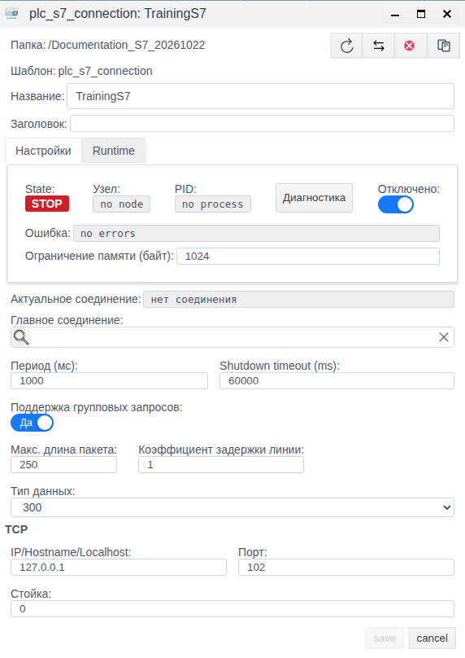
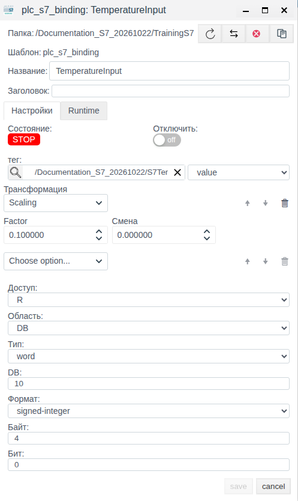
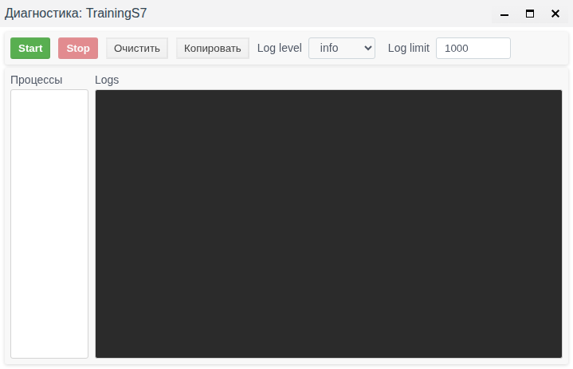

# Siemens S7 в Faceplate: настройка соединения и привязок

Версия Faceplate: v4.0.7

Статья предназначена для интегратора, которому нужно получить сигнал Siemens S7 в поле тега Faceplate, пересчитать его в инженерные единицы и проверить обмен. Подписи интерфейса приведены по русскоязычной Студии.

В учебном примере проверены создание, сохранение и отдельное повторное открытие конфигурации, изменение периода, отключение привязки и управление сбором диагностики. Подходящий источник S7 и его карта не установлены, поэтому соединение оставлено отключённым. Чтение, применение масштаба к данным PLC и восстановление обмена не подтверждены; ниже указано, как проверить их с доступным источником.

**Содержание**

- [Маршрут настройки](#маршрут-настройки)
- [Проверить применимость и подготовить запись](#проверить-применимость-и-подготовить-запись)
- [Как работает соединение Siemens S7](#как-работает-соединение-siemens-s7)
- [Подготовка подключения](#подготовка-подключения)
- [Настроить чтение и масштабирование](#настроить-чтение-и-масштабирование)
- [Изменить настройки и управлять обменом](#изменить-настройки-и-управлять-обменом)
- [Найти неисправность и проверить восстановление](#найти-неисправность-и-проверить-восстановление)
- [Запись данных: режимы W и RW](#запись-данных-режимы-w-и-rw)
- [Групповое чтение и резервные соединения](#групповое-чтение-и-резервные-соединения)
- [Справочник настроек и адресации](#справочник-настроек-и-адресации)

[Каталог соединений](./index.md) · [Подготовка поля и привязки](./bindings_ru.md) · [Преобразования](./transformation_ru.md) · [Диагностика и восстановление](./diagnostics_ru.md)

## Маршрут настройки

Подготовьте внешний источник или клиент и совместимое поле тега по общей инструкции. Затем настройте канал, сохраните полную привязку и проверьте новое значение. Для поддержанной записи/приёма отдельно подтвердите результат на внешней стороне; после исправления сбоя повторите проверку с новым контрольным значением.

[Альтернативный канал и карта сигналов](./bindings_ru.md#настроить-альтернативный-канал) описаны одинаково для всех типов; условия переключения уточняйте по драйверу.

## Проверить применимость и подготовить запись

До запуска сверьте IP, CPU, Rack/Slot и доступ к выбранной адресной памяти с проектом PLC. Для примера DB10.DBW4 и команды DB10.DBW6 карта должна разрешать соответствующие операции; один TCP-порт 102 не подтверждает доступ к DB.

В показанном редакторе Slot/timeout отсутствовали. Если вашему CPU требуется другое значение Slot, сохранение такого объекта не завершает подготовку рабочего подключения. Используйте доступный проверенный редактор/исправление целевой сборки и подтвердите сохранённый Slot в списке S7. Готовый обходной способ ввода отсутствующего поля этим руководством не заявляется.

Для отдельной уставки подготовьте float-тег S7Setpoint.value. Создайте внутри отключённого соединения привязку SetpointRW: Область DB, DB 10, Байт 6, Бит 0, Тип word, Формат signed-integer, Доступ RW, Scaling 0.1/0, тег S7Setpoint, поле value. Сохраните и повторно откройте все поля.

На разрешённом источнике raw 200 должен читаться как 20.0. После задания 21.0 независимо прочитайте DB10.DBW6: ожидается raw 210. Проверяйте команду отдельно от измерения DB10.DBW4. Исходное задание W проверяется до активации; новый рецепт не является выполненной записью на PLC.

## Как работает соединение Siemens S7

Faceplate устанавливает исходящее TCP-соединение с PLC и обменивается данными по S7. Это клиентское подключение; отдельного серверного режима у этого драйвера нет. Обычный порт — 102. В списке CPU доступны LOGO, 200, 300 и 1200. Наличие варианта в списке не заменяет проверку конкретной модели, прошивки и настроек доступа. Отдельных вариантов 400 и 1500 в форме нет.

| Понятие | Что означает в настройке |
|---|---|
| Протокол | Правила обмена S7 между Faceplate и оборудованием |
| Драйвер | Средство Faceplate, которое выполняет этот обмен |
| Соединение | Конкретный адрес PLC, порт, вариант CPU и общие параметры выполнения |
| Привязка | Один адрес сигнала, его размер и формат, направление, преобразования и ссылка на поле тега |
| Тег | Объект проекта с полями; выбранное поле принимает прочитанное значение либо служит источником задания |

Для чтения путь данных такой: память PLC → соединение → привязка с адресом и форматом → преобразования → выбранное поле тега. Привязки находятся внутри соединения. Тег выбирается отдельно: создание соединения само по себе не создаёт технологические теги и адресные привязки.

При записи значение выбранного поля проходит обратные преобразования и кодирование для адреса PLC. Режимы R, W и RW определяют направление и момент передачи; их поведение описано в разделе записи.

## Подготовка подключения

До настройки получите следующие сведения:

- IP-адрес либо имя, разрешаемое в IPv4 с узла, где выполняется обмен, и TCP-порт PLC.
- Вариант CPU; для 300 — стойку и слот по конфигурации оборудования. Эти два параметра участвуют в установлении связи именно для варианта 300.
- Карту сигналов: область I/Q/M/DB, номер DB для области DB, байтовое и битовое смещение, размер, числовой формат, разрешённое направление доступа.
- Условия доступа к памяти для выбранного CPU и DB. Согласуйте их с администратором PLC; драйвер не настраивает проект контроллера.
- Существующий тег, поле назначения и его тип, единицы, формулу пересчёта и контрольные значения источника.

Адрес относится к узлу выполнения обмена. Например, 127.0.0.1 обозначает этот узел, даже если Студия открыта браузером на другом компьютере.

Для учебной задачи подготовлена папка `Documentation_S7_20261022` и тег `S7Temperature` с полем `value` типа `float`. Его исходное значение 0.0 не является показанием PLC. Вещественное поле сохраняет дробную часть результата; при выборе целочисленного поля результат округляется.

Учебный адрес температуры — `DB10.DBW4`: знаковое слово в DB 10 с байта 4. Коэффициент 0.1 и сдвиг 0 дают ожидаемые пары 2345 → 234.5 °C и 2360 → 236.0 °C. Это контрольная арифметика; пригодность адреса и новые значения необходимо подтвердить на источнике.

## Настроить чтение и масштабирование

### Создать и проверить соединение

1. Откройте Студию по адресу http://127.0.0.1:9000/fp/studio и перейдите в учебную папку.
2. Нажмите «Создать», откройте категорию `plc`, выберите `plc_s7_connection` и подтвердите кнопкой «Ok».
3. Задайте «Название» `TrainingS7`. Включите флаг «Отключено» до первого сохранения, пока параметры оборудования и источник не проверены.
4. В поле «Тип данных» выберите 300. В этой форме поле обозначает вариант CPU. Явно введите IP 127.0.0.1 и порт 102, стойку 0; оставьте период 1000 мс. Адрес здесь служит сохранению учебной конфигурации и не обозначает установленный источник S7.
5. Нажмите `save`. После закрытия формы выделите сохранённый `TrainingS7` и нажмите «Редактировать». Проверьте адрес, CPU, период и установленный флаг отключения.

В воспроизведённой форме поля «Слот» и `timeout` не отображались. Через «Меню» → «Драйверы ПЛК» → фильтр типа `s7` → «Найти» в строке сохранённого соединения прочитаны слот 0 и таймаут 100 мс. Плановый слот 2 через эту форму не задавался. Слот определяется конфигурацией оборудования: значение 0 или 2 не является универсальным. Если необходимый слот нельзя задать доступным редактором, подготовку соединения нельзя считать завершённой для реального CPU.

*Рисунок 1. Соединение после отдельного повторного открытия: отключено, STOP, без узла и процесса. Снимок подтверждает настройки, а не связь с PLC.*

### Добавить адрес температуры и преобразование

1. Закройте проверенную форму кнопкой `cancel`, откройте `TrainingS7` двойным щелчком и нажмите «Создать». Внутри соединения открывается форма `plc_s7_binding`.
2. Задайте «Название» `TemperatureInput`. Флаг «Отключить» оставьте выключенным; родительское соединение пока отключено.
3. Кнопкой поиска рядом с «тег» выберите `S7Temperature`, подтвердите «ОК» и отдельно выберите поле `value`.
4. Установите «Доступ» R, «Область» DB, «Тип» word, DB 10, «Формат» signed-integer, «Байт» 4, «Бит» 0. «Тип» задаёт размер, «Формат» — интерпретацию числа. Текст `DB10.DBW4` целиком в отдельное поле не вводится.
5. В блоке «Трансформация» выберите Scaling. Введите Factor 0.1 и оставьте сдвиг 0; подпись поля сдвига в этой форме — «Cмена». Выйдите из числового поля клавишей Tab и проверьте отображённое число.
6. Нажмите `save`, затем отдельно откройте сохранённый `TemperatureInput`. Проверьте ссылку на тег и поле, адрес, R, word/signed-integer и Factor 0.100000 со сдвигом 0.000000.

*Рисунок 2. Повторно открытая привязка: DB 10, байт 4, бит 0, word/signed-integer и Scaling 0.1. STOP согласуется с отключённым родителем.*

### Проверить чтение с доступным источником

1. Сверьте endpoint, CPU, стойку, слот и адрес сигнала с реальным источником. Сохраните необходимые исправления и откройте настройки повторно.
2. Убедитесь, что родительская папка разрешена к выполнению и доступен узел обмена. Снимите флаг «Отключено» соединения и сохраните. Флаг отдельной привязки «Отключить» также должен быть снят.
3. Проверьте состояние соединения, его ошибку и фактически выбранное «Актуальное соединение». Затем отдельно проверьте состояние и ошибку привязки.
4. При известном исходном значении 2345 проверьте 234.5 °C именно в `S7Temperature.value`. Затем измените значение на источнике на 2360 и дождитесь 236.0 °C в том же поле. Не меняйте поле Faceplate вручную для имитации чтения.

Для учебного стенда эта часть не выполнена. Одного RUN, отсутствия ошибки или прежнего числа недостаточно для приёмки чтения.

## Изменить настройки и управлять обменом

### Изменить период

1. Выделите сохранённое соединение и нажмите «Редактировать».
2. Измените «Период (мс)» с 1000 на 500, выйдите из поля и нажмите `save`.
3. Откройте соединение отдельно и проверьте сохранённые 500 мс.
4. Для возврата к учебной конфигурации сохраните 1000 мс и снова откройте форму для проверки.

*Рисунок 3. Период 500 мс сохранён при отключённом соединении. Это демонстрационное значение, а не измеренная рекомендация для PLC; после проверки возвращены 1000 мс.*

Период задаёт цикл обработки, а не гарантированное время доставки каждого сигнала. Учитывайте время ответов, объём адресов и группирование. Изменение настроек выполняющегося соединения пересоздаёт его процесс; после изменения проверьте возобновление получения новых данных. У отключённого соединения сохранение параметров не запускает обмен.

### Отключить или разрешить обмен

Для всего канала установите «Отключено» в форме соединения и сохраните. Для одного сигнала установите «Отключить» в форме привязки и сохраните. Чтобы разрешить выполнение снова, снимите соответствующий флаг и сохраните. Отдельное повторное открытие подтверждает флаг; проверка нового значения источника подтверждает обмен после включения.

В примере флаг привязки проверен сохранением в обоих положениях и возвращён в выключенное положение. Родитель оставался отключённым, обе формы показывали STOP. Разрешённая привязка не запускает отключённый родительский канал. В списках колонка Runtime «ВКЛ» отражает разрешение выполнения и может соседствовать с состоянием Stop.

Отключение отдельной привязки не очищает прежнее значение поля тега. При остановке работавшего соединения в поле, напротив, может передаваться пустой вход через цепочку преобразований — с пустым результатом либо подстановкой. При повторной инициализации привязки накопленное состояние временных преобразований начинается заново. Рабочее отключение и возобновление родителя на доступном PLC в этом примере не испытывались.

## Найти неисправность и проверить восстановление

### Разделить выполнение, результат и новые данные

| Что проверять | Что это показывает | Как подтвердить результат |
|---|---|---|
| Флаги «Отключено» и «Отключить» | Разрешено ли выполнение канала и сигнала | Повторно открыть сохранённую настройку; отдельно проверить условия запуска папки и узла |
| State соединения, «Узел», PID | Наличие выполнения; RUN может появиться до успешного обмена | Проверить ошибку, выбранное соединение и конкретную привязку |
| «Ошибка» соединения и «Актуальное соединение» | Общий результат канала и выбранный endpoint | Проверить результат адресованной операции; общий OK не исключает ошибки одного сигнала |
| «Состояние» и ошибка привязки | Результат операции конкретного адреса | Сверить адрес, размер, формат, преобразование и поле назначения |
| Значение поля тега | Сохранённое, прочитанное или подставленное значение | Получить новое известное значение источника; прежнее число не доказывает свежесть |

У отключённого учебного соединения наблюдались STOP, `no node`, `no process`, `no errors`. В специализированном списке колонка «Статус» при этом показывала «ОШИБКА» с подсказкой `no errors`. Для такой строки оценивайте флаг, состояние и текст ошибки вместе; одна надпись не доказывает отказ связи S7.

### Открыть журнал

1. В сохранённой форме соединения нажмите «Диагностика».
2. Выберите Log level: info, warning, error или debug. Log limit исходно 1000, диапазон 1–100000 записей.
3. Нажмите Start для начала диагностического сбора. Смотрите области «Процессы» и Logs. Уровень debug полезен для повторяющихся ошибок, которые могут не повторяться в обычном журнале.
4. При наличии сообщений кнопка «Копировать» позволяет перенести строки, «Очистить» очищает отображаемый список. При наличии строки процесса можно открыть его сведения. Пустой вывод не подтверждает работу этих действий с содержательными данными.
5. Нажмите Stop после сбора и закройте окно. Закрытие также останавливает сбор диагностики.

*Рисунок 4. Проверены Start/Stop и выбор уровней; в отключённом примере процессы и журнал пусты. Это не снимок успешного обмена или восстановленной связи.*

Start/Stop этого окна управляют диагностическим сбором. Для управления самим каналом используется флаг соединения. В примере перенос содержательных логов и карточка процесса не проверены, поскольку соответствующих данных не было.

### Найти причину по признаку

| Признак | Проверка и исправление | Подтверждение после исправления |
|---|---|---|
| STOP, нет узла или процесса | Проверьте флаг канала, активность родительской папки, доступность узла и нарушенные зависимости. Разрешите выполнение там, где оно должно работать | Процесс выполняется, адресованная операция успешна, получено новое известное значение |
| Ошибка подключения, timeout или разрыв | Проверьте достижимость IP/имени с узла обмена, TCP-порт, выбранный CPU, стойку/слот для 300 и доступ оборудования. Отличайте таймаут ответа от ожидания TCP-подключения | После восстановления доступа проверены канал, привязка и новое значение источника |
| Канал RUN/OK, привязка с ошибкой | Откройте ошибку именно привязки. Проверьте область, существование DB, смещение, размер, формат и разрешение доступа; исправьте адрес по карте | Успешно читается исправленный адрес и его новое значение доходит до выбранного поля |
| Число неверное | Сопоставьте исходные данные PLC, signed/unsigned, размер, float, смещения, порядок преобразований и тип поля тега. Для byte/word/dword установите бит 0 | Известное raw-значение даёт рассчитанное инженерное число, затем проходит второе известное значение |
| Ошибка исчезла, число осталось прежним | Проверьте нужный тег/поле, разрешение привязки, её ошибку, подстановку Default Value и действительное изменение источника | После восстановления источнику задано новое значение, оно появилось в нужном поле; старое число не засчитывается |

В ответах PLC могут встречаться `db_not_exists` (0x0A), `address_not_exists` (0x05), `invalid_data_size` (0x07). Сопоставьте их соответственно с DB, границами адреса и размером данных. `unknown_error` требует разбора кода ответа; `invalid_response` или `unexpected` — проверки endpoint и совместимости ответа. Эти сообщения перечислены справочно, в учебном примере они не воспроизводились.

### Подтвердить восстановление

1. На управляемом источнике зафиксируйте исходное значение и соответствующее поле Faceplate.
2. Для неисправного адреса исправьте конфигурацию по карте, сохраните и повторно откройте её. Для потери связи восстановите доступ к прежнему endpoint; проверьте «Актуальное соединение», если используются альтернативы.
3. Проверьте результат канала и отдельно привязки. При общей ошибке связи драйвер выполняет переподключение; не каждый timeout отдельной операции означает одинаковый перезапуск канала.
4. После восстановления измените источник на новое известное значение, например с 2345 на 2360. Убедитесь, что `S7Temperature.value` получил 236.0 °C. Для записи дополнительно требуется независимое чтение памяти PLC.

Без управляемого источника ошибка адреса, разрыв и восстановление не испытывались. Совпадающее прочитанное значение может не записываться в поле повторно, а Default Value способен дать число даже при отсутствии данных. Поэтому исчезновение ошибки и неизменившаяся температура не являются доказательством восстановления.

## Запись данных: режимы W и RW

Запись описана справочно; операция записи и физическое действие оборудования в этом примере не проверялись.

| Доступ | Направление | Когда передаётся значение |
|---|---|---|
| R | PLC → поле тега | Циклическое чтение по плану соединения |
| W | Поле тега → PLC | Текущее значение при запуске, переподключении и повторной инициализации привязки после изменения её настроек; затем при изменении выбранного поля |
| RW | Оба направления | Циклическое чтение и запись внешних изменений поля; без начальной принудительной отправки по правилу W |

W не удерживает память PLC постоянной повторной записью. Если другой участник изменил память PLC, неизменившееся задание Faceplate само по себе не вызывает исправляющую запись. В RW обновление поля собственным чтением не создаёт обратную запись этого же результата.

Перед разрешением W проверьте уже сохранённое значение поля: оно будет отправлено при запуске или восстановлении соединения. Изменение настроек действующей W-привязки также повторно инициализирует её и отправляет текущее значение, даже без изменения задания. Согласуйте разрешение записи, размер, формат и допустимый диапазон задания с оборудованием.

При чтении цепочка преобразований выполняется сверху вниз. При записи применяется обратная операция каждого элемента в обратном порядке. Для Scaling с Factor 0.1 и сдвигом 0 задание 20.0 превращается в raw 200: `(20.0 − 0) / 0.1 = 200`. Это расчёт, а не подтверждённая запись. Для обратного масштаба коэффициент должен отличаться от 0.

Integration, Derivative и «Скрипт» не имеют поддержанной обратной цепочки для W/RW; такая настройка приводит к ошибке её подготовки. Damper и Default Value в обратном направлении пропускают значение, Limit Control прижимает его к границам. Не считайте фильтрацию чтения полноценной проверкой допустимости задания.

Для приёмки различайте успешную операцию записи, независимое последующее чтение памяти PLC и фактический эффект оборудования. Изменившееся поле Faceplate подтверждает только изменение задания. Режим W сам не даёт циклического чтения для проверки результата.

## Групповое чтение и резервные соединения

### Групповое чтение

«Поддержка групповых запросов» объединяет адреса одной области памяти, а в области DB — одного DB. Вместо отдельных операций читаются диапазоны, из которых извлекаются сигналы. Это оптимизация чтения; групповой записи здесь нет.

«Макс. длина пакета» ограничивает формируемый диапазон группового запроса; исходно в форме 250 байт. Значение выбирайте по допустимому запросу конкретного источника: сохранённое число не доказывает согласованный с PLC размер PDU. «Коэффициент задержки линии» участвует в выборе групп с учётом расстояний между адресами; это коэффициент, не таймаут в миллисекундах. В проверенной форме он равен 1.

При изменении группирования проверьте весь набор сигналов и новые значения, затем измеряйте выигрыш в обмене. Наличие включённого флага в сохранённом отключённом примере не означает испытания групповых запросов.

### Резервные соединения

У альтернативного S7-соединения поле «Главное соединение» ссылается на основное соединение того же типа. Альтернативный объект предоставляет параметры другого подключения, его самостоятельное выполнение принудительно отключается. Цепочку главных соединений строить не следует.

Основное соединение использует свой набор привязок и выбирает доступные параметры подключения при ошибках связи. Поэтому альтернативные endpoints должны предоставлять согласованную карту данных для этих привязок. Поле «Актуальное соединение» показывает фактически выбранный канал после подключения.

Не предполагайте гарантированного автоматического возврата к предпочтительному endpoint. При приёмке резервирования проверяйте выбранный канал и новое известное значение после переключения. Переключение, порядок предпочтений на реальном стенде и восстановление основного источника в этом примере не испытывались.

## Справочник настроек и адресации

### Параметры соединения

Исходные значения ниже относятся к проверенной новой форме и повторно открытому объекту. Для уже существующего соединения ориентируйтесь на сохранённые значения.

| Поле | Назначение | Исходное значение, диапазон и применение |
|---|---|---|
| «Название», «Заголовок» | Имя и необязательное описание | В примере TrainingS7; заголовок можно оставить пустым |
| «Отключено» | Запрет выполнения канала | В новой форме выключен; для подготовки примера включён до сохранения |
| «Тип данных» | Вариант CPU | 300; варианты LOGO/200/300/1200 |
| «IP/Hostname/Localhost» | IPv4-адрес или разрешаемое имя PLC | Поле новой формы пустое, подсказка 127.0.0.1 не заменяет ввод; пример 127.0.0.1 |
| «Порт» | TCP-порт источника | 102; диапазон формы 1–65535 |
| «Стойка» | Rack при варианте 300 | 0; диапазон формы 0–1. Для остальных вариантов CPU не определяет установление связи |
| «Слот» | Slot при варианте 300 | Предусмотрен диапазон редактора 0–11; новый UI-объект сохранил 0. В проверенной форме поле ввода отсутствовало; значение прочитано в списке S7 |
| timeout | Ожидание ответа и установления S7-сессии | 100 мс; предусмотрен диапазон редактора 10–20000 мс, шаг 5. Поле ввода отсутствовало; сохранённое значение прочитано в списке S7 |
| «Период (мс)» | Цикл обработки | 1000 мс; диапазон формы 1–3600000 мс |
| «Shutdown timeout (ms)» | Ожидание завершения процесса | 60000 мс; диапазон формы 10–3600000 мс. Это отдельный параметр от ожидания ответа PLC |
| «Поддержка групповых запросов» | Объединение диапазонов чтения | «Да»; применимость и размер проверяются с источником |
| «Макс. длина пакета» | Размер диапазона группового чтения | 250 байт; диапазон формы 1–10000 |
| «Коэффициент задержки линии» | Коэффициент планирования групп | 1; диапазон формы 1–10, без единиц времени |
| «Главное соединение» | Ссылка альтернативного канала на основное | Необязательно; в примере пусто, только тот же тип S7 |
| «Актуальное соединение» | Выбранное подключение | Заполняется системой после подключения; в примере «нет соединения» |
| «Ограничение памяти (байт)» | Лимит памяти процесса | В новой форме пусто, после сохранения 1024. Несмотря на подпись «байт», значение интерпретируется в МиБ; 1024 не означает 1024 байта |
| State, «Узел», PID, «Ошибка» | Наблюдение выполнения и результата | Заполняются системой; не заменяют проверки отдельного сигнала и свежих данных |

Ожидание TCP-подключения составляет 5000 мс и отличается от timeout ответа. Отдельного поля числа попыток нет. Увеличение периода или таймаута не исправляет неверный адрес и числовой формат.

### Параметры привязки

| Поле | Назначение | Исходное значение, диапазон и применение |
|---|---|---|
| «Название», «Заголовок» | Имя и необязательное описание сигнала | В примере TemperatureInput; родитель — TrainingS7 |
| «Отключить» | Исключение одного сигнала из обмена | Выключен; не включает отключённого родителя |
| «тег» и список полей | Объект проекта и точное поле назначения/задания | Новая форма пуста; в примере S7Temperature и value. Имя value не обязательно для всех тегов |
| «Доступ» | Направление R/W/RW | R; W/RW требуют учёта поведения записи |
| «Трансформация» | Упорядоченная цепочка преобразований | Исходно отсутствует. Без неё число передаётся без пересчёта; стрелки меняют порядок, корзина удаляет элемент |
| «Область» | Область памяти | I; варианты I/Q/M/DB. Номер DB используется только при области DB |
| «Тип» | Размер данных | bit; варианты bit/byte/word/dword |
| DB | Номер блока данных | 1; диапазон формы 1–65335. Для области DB задаётся по карте при любом выбранном CPU |
| «Формат» | Числовая интерпретация | integer; список зависит от размера, см. таблицу ниже |
| «Байт» | Байтовое смещение, не номер слова | 0; диапазон формы 0–65335 |
| «Бит» | Бит внутри начального байта | 0; диапазон 0–7. Для byte/word/dword явно устанавливайте 0 |
| «Состояние», ошибка, Runtime-значение | Результат конкретной привязки | Заполняются при выполнении; значение самой привязки и выбранное поле тега проверяются раздельно |

Для доставки в технологический тег выбирайте и объект, и поле. Сохранение адреса без такой цели не завершает задачу передачи данных в проект. Диапазоны DB и байта 65335 приведены так, как они заданы проверенной формой; не подменяйте их диапазоном числового формата word.

### Области памяти

| Область | Назначение | Как задаётся адрес |
|---|---|---|
| I | Входы | Область I, байт и бит; DB в запросе не используется |
| Q | Выходы | Область Q, байт и бит; наличие области не гарантирует разрешённую запись конкретного адреса |
| M | Маркерная память | Область M, байт и бит |
| DB | Блоки данных | Область DB, номер блока, байт и бит |

Используйте Q для выходов; обозначение O не является вариантом этой формы. Для LOGO/200 номер DB не подменяется автоматически на 1: при области DB используется заданное поле DB.

### Размер и формат

| «Тип» | Размер | Варианты «Формат» и представление |
|---|---|---|
| bit | 1 бит; для получения используется байт | integer, значение бита 0 или 1 |
| byte | 8 бит, 1 байт | integer: 0–255; signed-integer: −128–127 |
| word | 16 бит, 2 байта | integer: 0–65535; signed-integer: −32768–32767 |
| dword | 32 бита, 4 байта | integer: 0–4294967295; signed-integer: −2147483648–2147483647; float: 32-битное вещественное |

integer — беззнаковый формат, signed-integer — знаковый. float выбирается для dword. Многобайтовые значения используют порядок big endian; переключателя перестановки байтов нет. Для исправления неверного числа сначала сверьте размер и формат с картой PLC.

### Преобразования

Порядок элементов влияет на результат. Прямая цепочка используется для чтения; обратная для записи разворачивает порядок. Пустой результат преобразования не является новым корректным измерением даже при успешном чтении адреса.

| Элемент и параметры | При чтении | При записи W/RW |
|---|---|---|
| Scaling: Factor 1, сдвиг 0 | Умножает вход на коэффициент и прибавляет сдвиг | Вычитает сдвиг и делит на коэффициент; коэффициент не равен 0 |
| Default Value: Value 0 | Числовой вход пропускает, нечисловой или отсутствующий заменяет заданным числом | Пропускает значение |
| Limit Control: Lower Limit 0, Upper Limit 0 | Пропускает число внутри включительного диапазона, вне его возвращает пустой результат. Верхнюю границу задайте больше нижней: исходные равные границы не подходят | Прижимает число к границам диапазона |
| Integration: без параметров | Накапливает текущее значение × фактический интервал времени; первый числовой вызов даёт пустой результат | Обратная цепочка не поддерживается |
| Derivative: без параметров | Изменение входа / фактический интервал времени; первый числовой вызов даёт пустой результат | Обратная цепочка не поддерживается |
| Damper: Tlag 1 мс, минимум формы 1 | Сглаживает с учётом предыдущих значений и интервала; первый числовой вход пропускает | Пропускает значение без обратного сглаживания |
| «Скрипт»: редактор Erlang и переменные со ссылками на тег/поле | Функция с тремя аргументами: вход, контекст переменных, состояние; результат — выход и новое состояние | Обратная цепочка не поддерживается |

Временные операции используют миллисекунды: единицы результата Integration — единицы входа × мс, Derivative — единицы входа / мс, Tlag задаётся в мс. Автоматического пересчёта к секундам нет. При повторной инициализации состояние таких преобразований сбрасывается.

Default Value после Limit Control может заменить отвергнутое значение числом. При ошибке чтения подстановка также способна дать число вместо отсутствующего входа. Поэтому подстановку следует отличать от подтверждённого значения источника.

### Примеры адресации

Все адреса в таблице учебные. Они поясняют настройку, а не подтверждают доступность этой памяти на выбранном CPU.

| Адрес | Поля привязки | Поле тега и преобразование |
|---|---|---|
| DB10.DBW4 — температура | DB, DB 10, Байт 4, Бит 0, word, signed-integer, R | float; Scaling 0.1, сдвиг 0; 2345 → 234.5 °C |
| DB1.DBX0.2 — состояние бита | DB, DB 1, Байт 0, Бит 2, bit, integer, R | Числовое поле для значения 0 или 1; без масштаба |
| DB1.DBD8 — вещественное число | DB, DB 1, Байт 8, Бит 0, dword, float, R | float; без масштаба |

Для bit с ненулевым смещением отдельно подтвердите одиночное чтение на источнике. При групповом чтении нужный бит извлекается из прочитанного байта. Учебная иллюстрация DB1.DBX0.2 не является выполненной проверкой этого случая.
