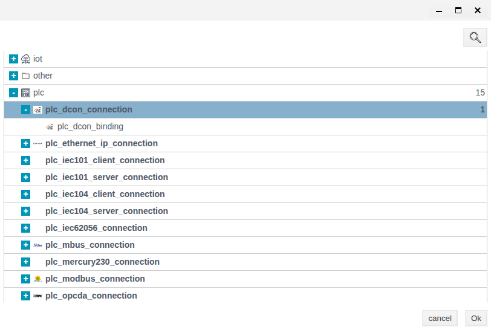
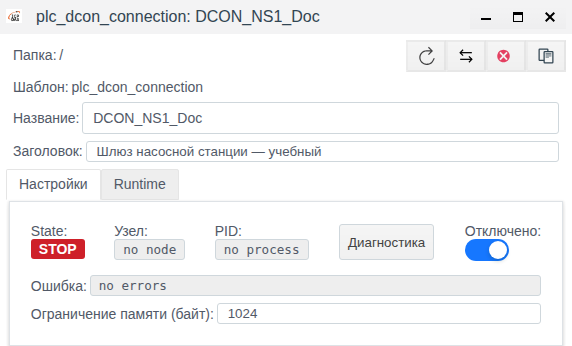
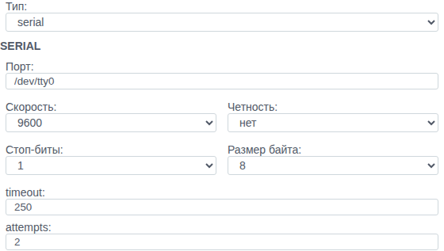
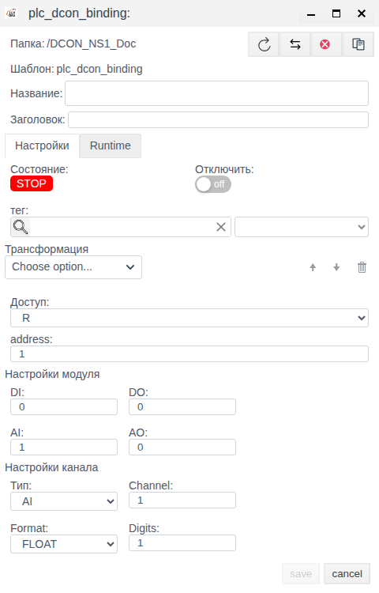

# Соединение DCON в Faceplate: создание и настройка

Инструкция для интеграторов Faceplate v4.0.7. Описаны настройка соединения DCON и привязок каналов. Создание, сохранение и повторное открытие соединения проверены на отключённом учебном объекте.

**Содержание**

- [Маршрут настройки](#маршрут-настройки)
- [Полный пример: аналоговый канал и выход](#полный-пример-аналоговый-канал-и-выход)
- [Для чего нужно соединение DCON](#для-чего-нужно-соединение-dcon)
- [Что подготовить](#что-подготовить)
- [Транспорт и параметры обмена](#транспорт-и-параметры-обмена)
- [Подготовить соединение шлюза насосной станции](#подготовить-соединение-шлюза-насосной-станции)
- [Настройка привязок каналов](#настройка-привязок-каналов)
- [Проверка после подключения оборудования](#проверка-после-подключения-оборудования)
- [Справочник параметров](#справочник-параметров)
- [Если соединение не работает](#если-соединение-не-работает)

[Каталог соединений](./index.md) · [Подготовка поля и привязки](./bindings.md) · [Преобразования](./transformation.md) · [Диагностика и восстановление](./diagnostics.md)

## Маршрут настройки

Подготовьте внешний источник или клиент и совместимое поле тега по общей инструкции. Затем настройте канал, сохраните полную привязку и проверьте новое значение. Для поддержанной записи/приёма отдельно подтвердите результат на внешней стороне; после исправления сбоя повторите проверку с новым контрольным значением.

[Альтернативный канал и карта сигналов](./bindings.md#настроить-альтернативный-канал) описаны одинаково для всех типов; условия переключения уточняйте по драйверу.

## Полный пример: аналоговый канал и выход

Используйте подготовленный float-тег AnalogValue.value. Ниже — иллюстративная карта модуля: address 1, DI 2, DO 2, AI 1, AO 1; фактический состав возьмите из паспорта целиком.

| Поле новой привязки AnalogInput | Значение |
|---|---|
| Тип / Channel | AI / 1 |
| address / DI / DO / AI / AO | 1 / 2 / 2 / 1 / 1 |
| Format / Digits | FLOAT / 1 |
| Доступ / Отключить | R / включено до проверки |
| тег / поле | AnalogValue / value, float |
| Трансформация | Scaling: Factor 0.1, Cмена 0 |

Внутри отключённого соединения создайте AnalogInput, заполните таблицу, выберите тег и поле, сохраните и отдельно откройте объект. Проверьте все количества каналов: они описывают модуль, а не только выбранный вход. После подготовки источника снимите оба запрета выполнения. При подтверждённом числовом ответе 1000 ожидается 100.0; при 1001 — 100.1.

Для DO подготовьте отдельное integer-поле задания, создайте привязку с тем же составом, Тип DO, Channel 1, W и пустой цепочкой. Для AO — Тип AO, Channel 1, FLOAT и подходящее числовое поле; Digits задаёт формат записи. До активации проверьте допустимое исходное задание. Передайте разрешённое тестовое значение и независимо проверьте выход. Это рецепт конфигурации, а не выполненное испытание физического модуля.

## Для чего нужно соединение DCON

Соединение DCON задаёт способ доступа к устройствам и параметры обмена. Через него Faceplate обращается к модулям дискретного и аналогового ввода-вывода.

Доступны два транспорта: **tcp** для доступа через TCP-шлюз DCON и **serial** для последовательного порта сервера Faceplate. TCP-шлюз должен передавать протокол DCON; выбор **tcp** не означает использование Modbus TCP.

Соединение задаёт транспорт. Адрес устройства, состав модуля, номер канала и связь с тегом задаются в привязках. Настройка привязок описана ниже. Общие преобразования, резервирование и проверка выхода доступны по ссылкам в маршруте настройки.

Рабочий порядок: подготовить параметры оборудования → создать соединение → настроить привязки → проверить обмен. Эта инструкция позволяет выполнить подготовку соединения до появления оборудования. Сохранение настроек подтверждает конфигурацию; для проверки данных потребуется устройство или имитатор DCON.

| Понятие | Значение и место настройки |
|---|---|
| Протокол DCON | Правила запросов и ответов устройств. Транспорт TCP или SERIAL выбирается отдельно |
| Драйвер | Поддержка DCON в Faceplate: формирует запросы и разбирает ответы. При создании выбирают тип соединения DCON |
| PLC-соединение | Объект обмена с оборудованием. Хранит транспорт, адрес шлюза или порт сервера, период, ожидание ответа и число попыток |
| Привязка (биндинг) | Дочерний объект соединения для одного сигнала. Хранит адрес модуля, состав DI/DO/AI/AO, тип и номер канала, формат, доступ и связь с полем тега |
| Тег и поле тега | Объект проекта и выбранное поле: место поступления прочитанных данных или источник задания для записи |

При чтении данные проходят цепочку: канал устройства → обмен DCON через соединение → привязка с доступом **R** или **RW** → необязательная трансформация → выбранное поле тега. Создание соединения само по себе не создаёт привязки и теги. В режиме записи источником служит поле тега; для DO/AO команда передаётся через привязку и соединение устройству.

## Что подготовить

- Учётную запись с правами создания и изменения объектов в Студии.
- Папку проекта для соединения и свободное название объекта.
- Для TCP — адрес и порт шлюза, на котором настроен DCON.
- Для SERIAL — имя последовательного порта на сервере Faceplate, скорость, чётность, число стоп-битов и размер байта из настроек оборудования.

Порт SERIAL относится к серверу Faceplate. Порт компьютера, на котором открыт браузер, не используется автоматически.

В примере создаётся один объект для шлюза модулей насосной станции. Папка **/** — корень проекта. При работе со своим проектом выберите подходящую папку и название.

| Параметр примера | Значение |
|---|---|
| Название | DCON_NS1_Doc |
| Заголовок | Шлюз насосной станции — учебный |
| Отключено | Включено на обоих этапах |
| Период (мс) | 2000 |
| timeout | 250 мс |
| attempts | 2 |
| Этап TCP | 127.0.0.1, порт 1024 |
| Этап SERIAL | /dev/tty0, 9600, чётность нет, 1 стоп-бит, 8 бит |

Заголовок примера сохранён ровно в том виде, как он введён на снимках.

Адрес и порт приведены для сохранения учебной конфигурации. Наличие шлюза по этому адресу и пригодность последовательного порта не предполагаются. Для реального подключения замените их параметрами оборудования.

## Транспорт и параметры обмена

В поле **Тип** выберите **tcp** или **serial**. При переключении меняется группа транспортных полей. Общие параметры обмена остаются доступны для обоих вариантов.

**Период (мс)** задаёт интервал опроса. **timeout** определяет время ожидания ответа в миллисекундах. **attempts** задаёт общее число попыток при отсутствии корректного ответа: значение **1** означает одну попытку, без дополнительного повтора. Длительный обмен и повторы могут увеличить фактический цикл относительно заданного периода.

Переключатель **Отключено** исключает соединение из рабочего обмена. В новой форме он выключен. Для подготовки конфигурации без оборудования включите его до первого сохранения.

## Подготовить соединение шлюза насосной станции

### Создать и сохранить TCP-соединение

1. Откройте **Студию**. Если открыт Runtime, используйте **Меню → Студия**.
2. В Студии откройте **Меню → Общий вид**.
3. Закройте меню повторным нажатием **Меню**.
4. Нажмите **Создать**.
5. В окне выбора типа раскройте группу **plc**.
6. Выберите родительскую строку соединения DCON, показанную на рисунке. Вложенная строка предназначена для привязки канала.

7. Нажмите **Ok**.

В новой форме **Главное соединение** оставьте пустым. Поле **Ограничение памяти (байт)** не заполняйте. Остальные общие настройки в этом примере не изменяются.

8. На вкладке **Настройки** включите переключатель **Отключено**.
9. Проверьте, что в поле **Папка** выбран корень **/**.
10. Введите в **Название** значение **DCON_NS1_Doc**. Если такое название уже занято, выберите другое для своего учебного объекта.
11. Введите в **Заголовок** значение **Шлюз насосной станции — учебный**.
12. Установите **Период (мс)** равным **2000**.
13. Проверьте, что в поле **Тип** выбрано **tcp**.
14. Явно введите **127.0.0.1** в **IP/Hostname/Localhost**. Такой же серый текст в пустом поле является подсказкой, а не введённым адресом.
15. Укажите **Порт** **1024** в группе **TCP**.
16. Установите **timeout** равным **250**.
17. Установите **attempts** равным **2**.
18. Проверьте, что **Отключено** включено.
19. Нажмите **save**.

При проверке после сохранения в оставленном пустым поле **Ограничение памяти (байт)** автоматически появилось **1024**. Не очищайте подставленное системой значение ради совпадения с новой формой.

После успешного сохранения редактор закрывается, а объект появляется в списке. В проверенном примере отдельного сообщения об успешном сохранении не было.

### Проверить сохранённые параметры

1. Выделите строку **DCON_NS1_Doc** в **Общем виде**. Если строка уже выделена, повторный щелчок может снять выделение.
2. Нажмите **Редактировать**.
3. Проверьте название, заголовок, **Тип**, введённый адрес и порт по таблице исходных данных.
4. Проверьте **Период (мс)**, **timeout** и **attempts** по той же таблице.
5. Убедитесь, что переключатель **Отключено** включён.

В проверенном отключённом объекте отображались **State: STOP**, **Узел: no node**, **PID: no process**, **Ошибка: no errors** и **Актуальное соединение: нет соединения**. В списке **Runtime** показывал **ВЫКЛ**. Эти признаки соответствуют подготовленному объекту и не подтверждают связь с оборудованием.

Оставьте редактор открытым для следующего этапа. На неизменённой сохранённой форме **save** неактивна; повторное сохранение без изменений не требуется.

### Настроить последовательный порт в том же объекте

Этот этап меняет транспорт уже созданного учебного соединения. В рабочем проекте выбирайте транспорт по фактической схеме подключения.

1. В открытом объекте выберите **serial** в поле **Тип**.
2. Укажите **/dev/tty0** в поле **Порт** группы **SERIAL**.
3. Выберите **9600** в поле **Скорость**.
4. Выберите **нет** в поле **Четность**.
5. Выберите **1** в поле **Стоп-биты**.
6. Выберите **8** в поле **Размер байта**.
7. Проверьте, что **Период (мс)**, **timeout** и **attempts** остались равны **2000**, **250** и **2**.
8. Проверьте, что **Отключено** включено.
9. Нажмите **save**.
10. В списке выделите тот же объект.
11. Нажмите **Редактировать**.
12. Сверьте **Тип** и все поля **SERIAL** с введёнными значениями.
13. Убедитесь, что **Отключено** по-прежнему включено.

После проверки закройте неизменённую форму кнопкой **cancel**. Итог примера — один сохранённый отключённый объект с транспортом **serial**. Второе соединение, каналы и теги не создаются.

## Настройка привязок каналов

Привязка канала (биндинг) связывает один канал физического модуля с полем тега Faceplate. Соединение задаёт транспорт для всех своих привязок. В каждой привязке указываются адрес модуля, его полный состав и выбранный канал.

Подготовьте адрес устройства, количества DI/DO/AI/AO по паспорту, тип и номер канала, формат аналоговых данных, тег и его поле. DI — дискретные входы, DO — дискретные выходы, AI — аналоговые входы, AO — аналоговые выходы. Для каждого используемого канала создайте отдельную привязку.

### Создать привязку и выбрать канал

1. В Студии откройте **Меню → Общий вид**.
2. Перейдите в папку с нужным соединением DCON.
3. Дважды нажмите на название нужного соединения DCON, чтобы перейти внутрь него.
4. Проверьте название соединения в строке пути.
5. Нажмите **Создать**. Откроется форма привязки; **Папка** указывает на выбранное соединение.
6. Введите свободное **Название** привязки.
7. При необходимости заполните **Заголовок** описанием сигнала.
8. На вкладке **Настройки** включите переключатель **Отключить** для подготовки без обмена.
9. Введите адрес физического модуля в **address**.
10. В группе **Настройки модуля** укажите полный состав в **DI**, **DO**, **AI**, **AO**. Для отсутствующих видов оставьте **0**.
11. В группе **Настройки канала** выберите нужный вид сигнала в **Тип**.
12. Укажите номер канала в **Channel**.
13. Для AI/AO выберите **Format**, соответствующий настройкам устройства.
14. Для AI/AO с **FLOAT** явно задайте **Digits**.

Количество входов и выходов описывает весь модуль, даже если используется только один канал. Не обнуляйте физически существующие группы из-за того, что эта привязка их не использует. Для нескольких привязок одного модуля адрес и состав должны совпадать. Неверный состав может дать неверное значение без ошибки связи.

Если нужного варианта нет в **Тип**, проверьте соответствующее количество: вариант появляется при значении больше нуля. После смены типа или количества перепроверьте **Channel**: форма может уменьшить номер автоматически.

### Связать с тегом и сохранить

1. Выберите существующий объект в поле **тег**.
2. В списке справа от **тег** выберите конкретное поле этого тега.
3. Установите **Доступ** по таблице ниже. Для DI/AI выберите **R**.
4. Если преобразование данных не требуется, оставьте блок **Трансформация** пустым.
5. Проверьте, что привязка отключена, если оборудование ещё не подключено.
6. Нажмите **save**.
7. Выделите созданную привязку в списке.
8. Нажмите **Редактировать**.
9. Сверьте адрес, все четыре количества, тип и номер канала, формат, **Digits**, тег, поле, доступ и отключённое состояние с введёнными параметрами.

| Доступ | Направление данных | Применение |
|---|---|---|
| **R** | Устройство → поле тега | Чтение DI, DO, AI или AO |
| **W** | Поле тега → устройство | Управление DO/AO без периодического чтения |
| **RW** | Чтение устройства и запись изменений поля тега | Чтение и управление DO/AO |

**Доступ** задаёт направление обмена, а не права пользователя. Для **W** текущее значение поля записывается при активации привязки после запуска или восстановления соединения, а затем при изменении задания. Для **RW** чтение совмещается с записью изменений поля; такой же начальной отправки задания, как у **W**, ожидать не следует. Перед включением **W** или **RW** проверьте значение источника и допустимый диапазон выхода по документации устройства.

Для дискретного сигнала выберите поле, совместимое со значениями **0/1**, для аналогового — числовое поле. Тег и поле выбираются явно. Привязка без связи с тегом не передаст результат в нужное поле проекта.

**Трансформация** — необязательная общая цепочка обработки данных. Выбор **HEX/FLOAT** сам по себе не переводит значение в инженерные единицы. Настройка общих преобразований рассматривается в документации PLC-соединений.

На снимке показана несохранённая форма: **AI = 1**, **Тип = AI**, **Format = FLOAT**, тег не выбран. Эти значения иллюстрируют доступность полей, а не готовую конфигурацию устройства. Форма закрыта через **cancel** без сохранения.

### Параметры привязки

| Поле | Что задать | Начальное значение и ограничения |
|---|---|---|
| **Папка** | Нужное соединение DCON; определяется местом создания | Путь выбранного соединения |
| **Название** | Свободное имя привязки внутри соединения | Пусто |
| **Заголовок** | Понятное описание сигнала | Пусто; необязательно |
| **address** | Адрес физического модуля числом | **1**; допустимо **1–254**, хотя форма позволяет ввод до **6000** |
| **DI** | Полное количество дискретных входов модуля | **0**; по паспорту |
| **DO** | Полное количество дискретных выходов модуля | **0**; по паспорту |
| **AI** | Полное количество аналоговых входов модуля | **0**; по паспорту |
| **AO** | Полное количество аналоговых выходов модуля | **0**; по паспорту |
| **Тип** | Вид выбранного канала | Не выбран; **DI/DO/AI/AO**, если соответствующее количество больше нуля |
| **Channel** | Номер канала выбранного вида | **1**; форма **1–32**, не выше соответствующего количества |
| **Format** | Формат данных AI/AO на устройстве | **HEX**; варианты **HEX**, **FLOAT** |
| **Digits** | Количество десятичных знаков при записи FLOAT | В новой форме **1**; **1–5**; задайте явно и проверьте после сохранения |
| **тег**, поле | Объект и поле для результата чтения или источника записи | Не выбраны |
| **Доступ** | Направление обмена | **R**; варианты **R**, **W**, **RW** |
| **Отключить** | Исключение этой привязки из обмена | Выключено |
| **Трансформация** | Обработка значения | Пусто; необязательно |

**Format** и **Digits** применяются к AI/AO; **Digits** доступно при **FLOAT**. При чтении **FLOAT** это поле не округляет результат и не задаёт точность датчика. Диапазоны элементов формы не гарантируют поддержку любого количества каналов физическим модулем. В этой версии каналы AI/AO с номерами выше **16** не адресуются однозначно. Работа DO с номерами выше **16** не подтверждена; не используйте предел формы **32** как основание для такой настройки.

На вкладке **Настройки** индикатор **Состояние** показывает состояние привязки. На вкладке **Runtime** доступны **state**, **error**, **value** — состояние, ошибка и значение привязки. Их заполняет Faceplate; это диагностические поля, а не параметры адресации. Для проверки доставки данных откройте также именно то поле тега, которое выбрано в привязке.

Для отключения одной привязки откройте её через **Редактировать**, включите **Отключить**, нажмите **save** и повторно проверьте признак. Остальные привязки соединения имеют собственные разрешения. При отключении привязки ранее прочитанное значение может остаться в **value** и поле тега; наличие числа не подтверждает свежесть данных.

Повторное открытие проверяет сохранённую конфигурацию. Для подтверждения обмена выполните проверку с оборудованием, описанную ниже.

## Проверка после подключения оборудования

Выполняйте этот порядок при наличии устройства или имитатора и настроенных привязок каналов. Runtime проекта должен быть запущен, выполнение в родительских папках разрешено, а проверяемая привязка не отключена. Управление Runtime проекта относится к общей настройке Faceplate.

Устройство должно работать с контрольной суммой DCON: Faceplate добавляет её к запросам и проверяет в ответах. Отдельного переключателя контрольной суммы в форме соединения нет.

1. Сверьте параметры транспорта с настройками оборудования: TCP-адрес и порт либо серверный последовательный порт и параметры кадра.
2. Сверьте адрес устройства, состав модуля, тип и номер канала в привязке.
3. В привязке выключите **Отключить**, когда канал подготовлен к рабочему обмену.
4. В соединении снимите **Отключено**, когда линия подготовлена к рабочему обмену.
5. Проверьте состояния соединения и нужной привязки.
6. Измените известный входной сигнал на устройстве.
7. Проверьте новое значение привязки и связанного поля тега после цикла обмена.

При ошибке чтения связанное поле может получить **none** либо значение подстановки из трансформации. Это не новое показание устройства. При общей ошибке соединения **value** привязки может сохранить предыдущее число; сравнивайте его с ошибкой и выбранным полем тега. Отдельной метки времени последнего чтения в общих полях привязки нет.

Состояние соединения само по себе не доказывает исправность всех каналов. Успешная проверка чтения требует нового контрольного значения. Этот порядок обмена с оборудованием в учебном примере не выполнялся.

Для изменения рабочего соединения выделите его в **Общем виде**, нажмите **Редактировать**, измените нужные параметры и нажмите **save**. Затем откройте объект снова и сверьте значения. Для остановки обмена всех его каналов включите **Отключено** и сохраните; для разрешения обмена снимите этот признак и сохраните. Разрешение соединения не заменяет запуск Runtime проекта и разрешения родительских папок.

При восстановлении обмена после сбоя:

1. Проверьте ошибку соединения и **error** нужной привязки; определите, затронута вся линия или отдельный канал.
2. Восстановите доступ к шлюзу или последовательному порту и устраните несовпадение настроек.
3. Убедитесь, что соединение, привязка и родительские папки разрешены, а Runtime проекта запущен. Дождитесь нового цикла обмена с учётом ожиданий и повторов.
4. Проверьте состояние и ошибки, затем задайте новое известное входное значение и сравните **value** привязки с выбранным полем тега. Учитывайте настроенную трансформацию.

Исчезновение ошибки или сохранение прежнего числа не подтверждает восстановления чтения. Успех — получение нового контрольного значения в нужном поле. Восстановление связи с оборудованием в этой проверке не воспроизводилось.

## Справочник параметров

Начальные значения ниже наблюдались в новой несохранённой форме. Они не являются рекомендуемыми настройками для любого устройства. Диапазоны числовых полей соответствуют ограничениям элементов формы; сохранение всех граничных значений отдельно не проверялось.

### Основные поля и транспорт

| Поле | Назначение и ввод | Начальное значение и допустимые значения |
|---|---|---|
| Папка | Расположение объекта в проекте | Выбирается для текущего проекта; в примере **/** |
| Название | Имя нового объекта; задайте свободное название | Пусто |
| Заголовок | Описательное название; в примере заполнено | Пусто |
| Отключено | Включите для подготовки без рабочего обмена | Выключено |
| Тип | Пользовательский выбор транспорта | **tcp**; варианты **tcp**, **serial** |
| IP/Hostname/Localhost | При TCP укажите адрес или имя шлюза | Поле пустое; **127.0.0.1** — подсказка |
| Порт, TCP | Порт DCON-шлюза | **1024**; **1–65535** |
| Порт, SERIAL | Имя порта на сервере Faceplate | **/dev/tty0**; реальный порт определяет схема подключения |
| Скорость | Скорость передачи, бод; согласуйте с устройством | **9600**; 300, 600, 1200, 2400, 4800, 9600, 19200, 38400, 57600, 115200, 230400, 460800, 500000, 576000 |
| Четность | Параметр последовательного кадра | **нет**; варианты **нет**, **четный**, **нечетный** |
| Стоп-биты | Параметр последовательного кадра | **1**; варианты **1**, **2** |
| Размер байта | Число бит данных | **8**; варианты **5**, **6**, **7**, **8** |

Заполняйте перечисленные параметры для своего транспорта. Отметки обязательности в проверенной форме не отображались; пример подтверждает сохранение указанного набора полей.

### Обмен и общие настройки процесса

| Поле | Назначение | Начально / пределы |
|---|---|---|
| Период (мс) | Интервал опроса | **1000 мс**; **1–3600000 мс** |
| timeout | Ожидание ответа | **100 мс**; **1–6000 мс** |
| attempts | Общее число попыток при отсутствии корректного ответа | **1**; **1–500** |
| Shutdown timeout (ms) | Время ожидания остановки процесса; не тайм-аут ответа устройства | **60000 мс**; **10–3600000 мс** |
| Главное соединение | Необязательная связь для резервной схемы; для самостоятельного соединения оставьте пустым | Пусто |
| Поддержка групповых запросов | Общий параметр драйверов; сам переключатель не добавляет групповой обмен DCON | **Да** |
| Макс. длина пакета | Общая настройка; в примере не изменяется | **250**; **1–10000** |
| Коэффициент задержки линии | Общая настройка линии; в примере не изменяется | **1**; **1–10** |
| Ограничение памяти (байт) | Необязательное поле процесса; в этой инструкции оставьте системное значение | Новая форма пустая; после первого сохранения наблюдалось **1024** без ручного ввода |

Несмотря на подпись «байт», значение лимита кучи процесса задаётся в МиБ: 1024 соответствует 1 ГиБ. В учебной конфигурации системное значение не меняйте.

### Поля состояния

| Поле | Что показывает | В отключённом учебном объекте |
|---|---|---|
| State | Состояние процесса | **STOP** |
| Узел | Узел выполнения | **no node** |
| PID | Идентификатор процесса | **no process** |
| Ошибка | Зарегистрированная ошибка | **no errors** |
| Актуальное соединение | Текущий маршрут обмена | **нет соединения** |

Эти поля заполняет Faceplate. **no errors** в отключённом объекте не проверяет адрес шлюза, существование порта или ответы устройства.

Колонка **Runtime** в списке соединений и переключатель **Отключено** в форме отражают одно разрешение выполнения: **ВЫКЛ** соответствует включённому **Отключено**. Runtime проекта и разрешение выполнения в родительских папках проверяются отдельно.

## Если соединение не работает

| Симптом | Где и что проверить | Действие и проверка результата |
|---|---|---|
| **Редактировать** неактивно | Выделение строки в **Общем виде** | Выделите нужную строку один раз; повторный щелчок может снять выделение. Кнопка станет доступна |
| **save** неактивна | Новая ли это форма; заполнены ли поля; есть ли изменения | Заполните параметры примера. В неизменённом сохранённом объекте неактивная **save** ожидаема |
| Поле адреса выглядит заполненным, но значение не вводилось | **IP/Hostname/Localhost** | Явно введите адрес, сохраните и проверьте его после повторного открытия; серый placeholder не является значением |
| После сохранения нет данных каналов | **Отключено**, Runtime проекта и родительских папок, наличие включённой привязки и устройства | Для учебного объекта это ожидаемо. Для рабочей проверки подготовьте условия Runtime, устройство и привязку, затем выполните порядок проверки обмена |
| TCP-устройство не отвечает | **Тип**, адрес и порт шлюза, его протокол и настройки | Сверьте их с оборудованием; после восстановления проверьте новое контрольное значение, а не только состояние соединения |
| SERIAL-устройство не отвечает | Порт на сервере, доступ сервера к нему, скорость и параметры кадра | Исправьте несогласованные параметры; после восстановления проверьте новое контрольное значение |
| Указанные параметры верны, но канал не обновляется | Адрес, состав устройства, тип и номер канала в привязке | Исправьте привязку и повторите проверку входного сигнала; один статус соединения недостаточен |
