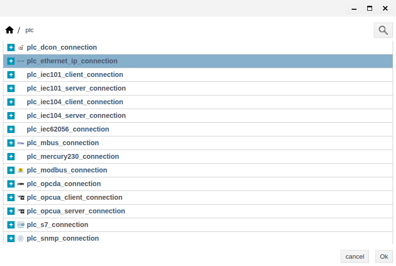
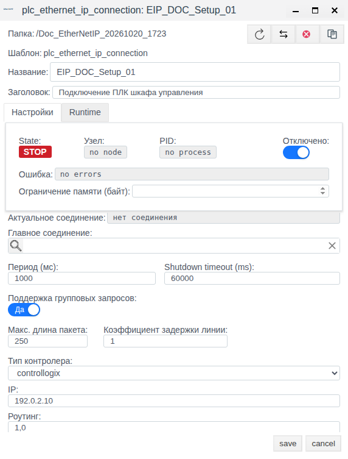
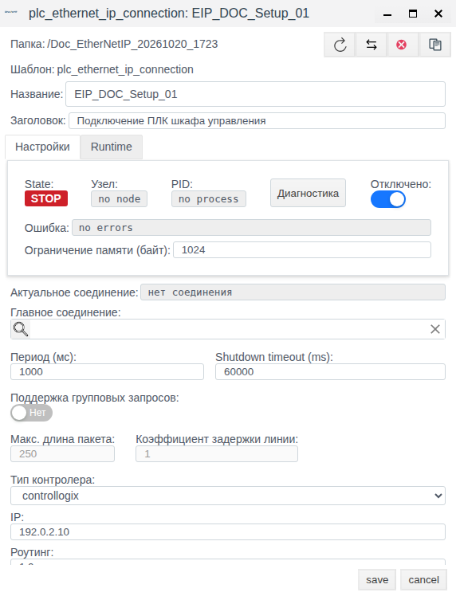
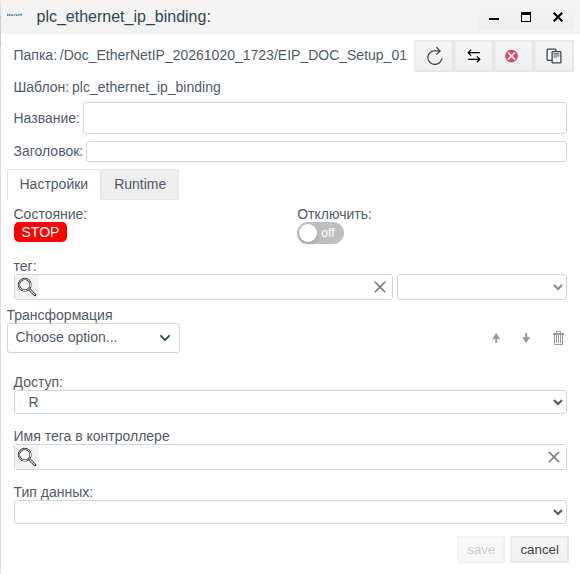
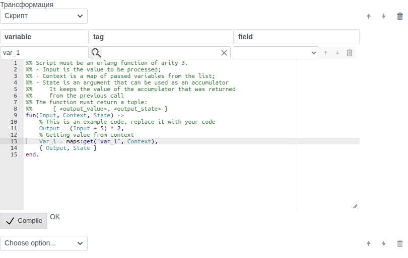
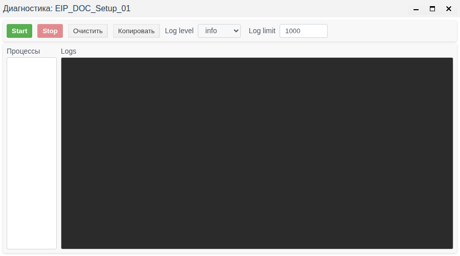

# EtherNet/IP в Faceplate: настройка подключения и биндингов

Руководство для интеграторов, которые подключают переменные ПЛК Allen-Bradley к полям Faceplate v4.0.7.

**Содержание**

- [Маршрут настройки](#маршрут-настройки)
- [Полный пример: переменная PLC и поле проекта](#полный-пример-переменная-plc-и-поле-проекта)
- [Назначение модуля](#назначение-модуля)
- [Что подготовить](#что-подготовить)
- [Создание и настройка подключения](#создание-и-настройка-подключения)
- [Создание и настройка биндингов](#создание-и-настройка-биндингов)
- [Справочник параметров и состояний](#справочник-параметров-и-состояний)
- [Проверка работы и диагностика](#проверка-работы-и-диагностика)

[Каталог соединений](./index.md) · [Подготовка поля и привязки](./bindings.md) · [Преобразования](./transformation.md) · [Диагностика и восстановление](./diagnostics.md)

## Маршрут настройки

Подготовьте внешний источник или клиент и совместимое поле тега по общей инструкции. Затем настройте канал, сохраните полную привязку и проверьте новое значение. Для поддержанной записи/приёма отдельно подтвердите результат на внешней стороне; после исправления сбоя повторите проверку с новым контрольным значением.

[Альтернативный канал и карта сигналов](./bindings.md#настроить-альтернативный-канал) описаны одинаково для всех типов; условия переключения уточняйте по драйверу.

## Полный пример: переменная PLC и поле проекта

В проекте PLC подготовьте скалярную переменную Training_Temperature типа REAL с контрольными значениями 23.5 и 24.5. В Faceplate подготовьте float-тег EIPTemperature.value. Имя и тип PLC должны быть подтверждены его проектом или обзором; это учебные имена.

| Поле новой привязки TemperatureInput | Значение |
|---|---|
| Имя тега в контроллере / Тип данных | Training_Temperature / REAL |
| тег / поле | EIPTemperature / value |
| Доступ / Отключить | R / включено до проверки |
| Трансформация | Пусто |

Внутри отключённого подключения создайте TemperatureInput. Заполните таблицу, сохраните и отдельно откройте привязку. Явно проверьте тип и оба элемента назначения; одной доступной save недостаточно. Для реального PLC сначала подтвердите семейство, IP и маршрут, затем разрешите подключение и привязку. Измените источник 23.5→24.5 и проверьте новое 24.5 в EIPTemperature.value.

Если используете обзор, выберите переменную у «Имя тега в контроллере», затем сверяйте точное имя и тип. Для массива или члена структуры берите адрес конкретного скалярного элемента из проекта/Browse; имя Faceplate не подставляется вместо него.

Для записи подготовьте отдельную разрешённую переменную Training_Setpoint REAL и float-поле задания. Задайте W/RW, пустую цепочку и проверьте текущее задание до активации. После изменения на 25.0 независимо прочитайте Training_Setpoint на PLC. Поддержаны групповые чтение и запись; максимум чтения задаётся числом переменных, а не байтами. Этот пример расширяет инструкцию настройки; новый обмен и Browse здесь не объявляются выполненными.

## Назначение модуля

Используйте EtherNet/IP для получения измерений из ПЛК и передачи значений из Faceplate в ПЛК. Настройка состоит из подключения и вложенных в него биндингов.

| Понятие | Что определяет |
|---|---|
| Протокол EtherNet/IP | Правила обмена с устройством; поддержка протокола должна быть предусмотрена в проекте ПЛК |
| Драйвер EtherNet/IP | Реализацию поддержки протокола в Faceplate; выбранный драйвер определяет доступные настройки подключения и биндинга |
| Подключение | Семейство контроллера, IP, маршрут до процессора, период и способ обмена |
| Биндинг, или привязка | Переменную ПЛК, её тип, целевой объект и поле Faceplate, направление обмена и преобразования |
| Тег Faceplate | Отдельный объект проекта, поля которого используют для отображения, обработки и передачи значений |
| Целевое поле Faceplate | Куда поступает полученное значение или откуда берётся значение для записи |

При чтении значение проходит от переменной ПЛК через преобразования биндинга в поле Faceplate. При записи используется обратное направление. Одного подключения недостаточно для обмена технологическими значениями: настройте биндинги.

Параметры семейства, IP, маршрута и общего опроса задаются в подключении и используются его биндингами. Имя и тип переменной ПЛК, объект и поле Faceplate, направление и преобразования задаются отдельно для каждого биндинга. Создание подключения и выбор переменной ПЛК не создают технологический тег Faceplate автоматически.

Имя тега в контроллере обозначает источник или приёмник на стороне ПЛК. Поле **тег** в биндинге обозначает объект Faceplate; соседний список выбирает поле этого объекта. Это разные стороны привязки.

Начните с подключения, затем создайте биндинги внутри него. Проверьте сохранённые параметры и только после подготовки реального устройства включайте обмен.

### Как влияют параметры опроса

**Период (мс)** задаёт требуемый цикл обновления. Фактический интервал зависит от продолжительности обмена; заданное число не гарантирует точного времени появления значения.

При **Поддержка групповых запросов = Да** переменные объединяются в группы для обмена. **Макс. длина пакета** ограничивает количество переменных в группе. При **Нет** используются одиночные запросы, а поля длины пакета и коэффициента задержки недоступны для редактирования.

Для самостоятельного подключения оставьте **Главное соединение** пустым. Для альтернативного транспорта используйте [общий порядок резервирования](./bindings.md#настроить-альтернативный-канал).

## Что подготовить

Для настройки форм нужны доступ к Студии, права создания и изменения объектов проекта и папка для подключения. Для биндинга подготовьте целевой объект Faceplate с подходящим по типу полем. Создание типов объектов и настройка трендов рассматриваются отдельно.

| Для какой операции | Необходимые данные и условия |
|---|---|
| Настройка подключения | Семейство ПЛК, IP точки входа, маршрут до процессора; для учебной конфигурации допустимы явно обозначенные учебные значения |
| Настройка биндинга вручную | Точное имя и тип переменной из проекта ПЛК, целевой объект и поле Faceplate |
| Обзор переменных ПЛК | Доступный контроллер и корректное подключение; сеть должна быть доступна от сервера Faceplate |
| Проверка чтения | Известная переменная ПЛК и возможность независимо проверить её значение |
| Проверка записи | Разрешённая тестовая переменная ПЛК, согласованное значение записи и возможность проверить результат на ПЛК |

Маршрут зависит от топологии: Ethernet-модуль и процессор могут находиться в разных позициях или устройствах. Уточните IP и маршрут у специалиста по ПЛК; значение из примера не является универсальным.

### Данные примера подключения

Задача — подготовить конфигурацию подключения к ПЛК шкафа управления и проверить её сохранение. ПЛК для этого примера не требуется. Подключение остаётся отключённым.

| Параметр | Значение примера |
|---|---|
| Уже существующая папка проекта | Doc_EtherNetIP_20261020_1723; в своём проекте выберите подготовленную папку |
| **Название** | EIP_DOC_Setup_01 |
| **Заголовок** | Подключение ПЛК шкафа управления |
| **Тип контролера** | controllogix |
| **IP** | 192.0.2.10 — учебный адрес |
| **Роутинг** | 1,0 — явно заданный учебный маршрут |
| **Период (мс)** | 1000 |
| **Shutdown timeout (ms)** | 60000 |
| **Поддержка групповых запросов** | Да |
| **Макс. длина пакета** | 250 переменных |
| **Коэффициент задержки линии** | 1 |
| **Главное соединение** | Пустое |
| **Ограничение памяти (байт)** | Не заполнять при создании |
| **Отключено** | Включить до первого сохранения |

Для своего устройства замените учебные IP, маршрут и семейство данными проекта ПЛК. Готовые биндинги и технологические объекты этому примеру не нужны.

## Создание и настройка подключения

### Создать отключённое подключение

1. Откройте **Меню → Общий вид**.
2. Двойным щелчком войдите в подготовленную папку.
3. Нажмите **Создать**.
4. В группе **plc** выберите тип подключения EtherNet/IP, показанный на рисунке.

5. Нажмите **Ok**.
6. Введите **Название** из таблицы примера.
7. Введите **Заголовок** из таблицы примера.
8. Выберите **Тип контролера**.
9. Введите **IP**.
10. Введите **Роутинг**.
11. Сверьте остальные параметры с таблицей примера.
12. Включите **Отключено**.

13. Нажмите **save**.

### Проверить сохранение и найти подключение

1. Выделите созданную строку в разделе **Общий вид**.
2. Нажмите **Редактировать**.
3. Сверьте IP, маршрут, семейство и параметры опроса с таблицей примера.
4. Проверьте, что **Отключено** осталось включённым.

В проверенном примере редактор показал **State = STOP**, **Узел = no node**, **PID = no process**, **Ошибка = no errors**, **Актуальное соединение = нет соединения**. Это результат сохранения отключённой конфигурации, а не проверки связи с ПЛК.

Поле **Ограничение памяти (байт)** после сохранения автоматически показывает **1024**, хотя при создании оно оставалось пустым. Возвращать его к пустому значению не требуется.

5. Закройте редактор кнопкой **cancel**.
6. Откройте **Меню → Драйверы ПЛК**.
7. Введите имя подключения в **Поиск по пути**.
8. В фильтре **Тип соединения:** оставьте выбранным **ethernet_ip**.
9. Нажмите **Найти**.

Для примера в списке ожидаются **Режим = Откл.** и **Состояние = STOP**.

> [!NOTE]
> В проверенной версии столбец **Статус** показал **ОШИБКА**, а его подсказка и редактор — **no errors**. Причина такого отображения не установлена. Откройте подробности и проверяйте состояние биндингов и реальные значения; одной надписи в этом столбце недостаточно для вывода о сбое обмена.

Двойной щелчок строки в **Драйверы ПЛК** открывает список биндингов. Для изменения самого подключения используйте **Общий вид → Редактировать**.

### Проверить одиночный и групповой режимы

Продолжите работу с тем же отключённым подключением.

1. Откройте его через **Общий вид → Редактировать**.
2. Переключите **Поддержка групповых запросов** в **Нет**.
3. Проверьте, что **Макс. длина пакета** и **Коэффициент задержки линии** стали недоступны.

4. Нажмите **save**.
5. Повторно откройте подключение.
6. Проверьте сохранённое **Нет** и значения **250** и **1** в недоступных полях.
7. Переключите режим обратно в **Да**.
8. Нажмите **save**.
9. Повторно откройте подключение.
10. Проверьте **Да**, значения **250** и **1** и включённое **Отключено**.

Конфигурация сохранена и допускает дальнейшую настройку биндингов. Результат этой проверки — сохранение параметров и переключение режима; обмен с устройством не выполнялся.

### Изменить, включить или отключить подключение

Учебное подключение оставьте отключённым. Следующие действия по включению применяйте к подготовленной рабочей конфигурации с реальными параметрами устройства и готовыми биндингами.

| Задача | Действие в Студии | Проверка результата |
|---|---|---|
| Изменить параметры | В **Общий вид** выделите подключение, нажмите **Редактировать**, измените нужные поля и нажмите **save** | Повторно откройте форму и сверьте значения; поступление данных проверьте отдельно |
| Отключить подключение | Включите **Отключено** и нажмите **save** | Повторно откройте форму; ожидаются STOP и no process; биндинги этого подключения не должны выполнять обмен |
| Включить подготовленное подключение | Выключите **Отключено** и нажмите **save** | Проверьте процесс, ошибки подключения и биндингов, затем новое значение по процедуре проверки обмена |
| Отключить только один биндинг | Откройте его внутри подключения, включите **Отключить** и нажмите **save** | Биндинг исключён из обмена; само подключение и другие биндинги не отключаются этим переключателем |

Сохранение изменённых параметров канала переинициализирует процесс подключения. Правки биндинга применяются отдельно; ручной перезапуск всего подключения после каждой такой правки не требуется.

Повторная активация подключения может передать текущие задания W-биндингов. Перед включением или контролируемым перезапуском проверьте значения всех таких заданий и разрешение записи. Само восстановление сети не подтверждает повторную передачу ранее неудачного задания W.

## Создание и настройка биндингов

Биндинг связывает отдельную переменную ПЛК с полем Faceplate. Ниже приведена общая инструкция для ваших объектов, без отдельного учебного сценария.

### Создать и заполнить биндинг

1. Откройте **Меню → Общий вид**.
2. Войдите в папку нужного подключения.
3. Двойным щелчком войдите внутрь подключения.
4. Нажмите **Создать**.

Форма биндинга открывается непосредственно, без дополнительного выбора типа.

5. Введите **Название** биндинга.
6. Включите **Отключить**, пока конфигурация не готова к работе.
7. Задайте переменную ПЛК одним из способов, описанных ниже.
8. Выберите **Тип данных**, соответствующий переменной ПЛК.
9. Нажмите лупу у поля **тег**.
10. В селекторе выделите целевой объект Faceplate.
11. Нажмите **ОК**.
12. В списке справа от **тег** выберите нужное поле объекта.

> [!WARNING]
> В режиме W текущее значение поля может попасть в ПЛК при активации, до нового действия оператора. Перед включением проверьте исходное задание и разрешение записи в выбранную переменную. Пока устройство и задание не подготовлены, оставьте биндинг и подключение отключёнными.

13. Выберите **Доступ**: R, W или RW.
14. При необходимости настройте **Трансформация** по следующему разделу.
15. Проверьте переменную, тип данных, целевой объект, поле, направление и преобразования.
16. Нажмите **save**.
17. Выделите биндинг в списке внутри подключения.
18. Нажмите **Редактировать**.
19. Сверьте сохранённые параметры.

Доступность **save** не означает полноту настройки. В проверенной форме кнопка становилась доступной уже после одного названия; тип данных изначально не выбран. Для связи с полем Faceplate явно задайте источник и оба элемента назначения — объект и поле.

Список полей объекта может включать служебные параметры. Выбирайте заранее подготовленное подходящее поле; само присутствие поля в списке не подтверждает его пригодности для технологического обмена. Выбор переменной ПЛК из обзора не создаёт целевой объект Faceplate.

### Задать переменную вручную или через обзор

| Способ | Действия | Когда использовать |
|---|---|---|
| Ручной ввод | Введите точное **Имя тега в контроллере** и выберите **Тип данных** | Имя и тип известны из проекта ПЛК; конфигурация готовится без доступа к устройству |
| Обзор | Нажмите лупу у **Имя тега в контроллере**, выберите доступную переменную, затем сверьте заполненные имя и тип | Контроллер доступен и нужно выбрать переменную из его структуры |

Для элемента массива или члена структуры задавайте отдельную скалярную переменную. После изменения проекта ПЛК обновите список в обзоре. Успешный обзор требует реального контроллера; в выполненную UI-проверку он не входил.

### Выбрать направление обмена

| **Доступ** | Что происходит | Что проверять |
|---|---|---|
| R | ПЛК → поле Faceplate; выполняется чтение | Изменение источника и результат прямых преобразований |
| W | Поле Faceplate → ПЛК; передаются изменения поля, запись возможна также при активации или повторном применении настроек | Значение задания до включения и фактический результат записи на ПЛК |
| RW | Чтение из ПЛК и передача изменений поля в ПЛК | Обе стороны обмена с учётом прямых и обратных преобразований |

W не опрашивает сторонние изменения переменной ПЛК. Если такие изменения должны появляться в Faceplate, используйте подходящее направление чтения.

### Настроить преобразования

В **Трансформация** выберите операцию из **Choose option...**. После добавления появляется следующая пустая строка для ещё одной операции. Порядок меняется стрелками; корзина удаляет операцию. Если преобразования не нужны, оставьте список пустым.

При чтении операции выполняются сверху вниз. При записи — в обратном порядке с обратной обработкой. Границы и единицы каждой операции относятся к значению на соответствующем этапе цепочки.

| Выбор в UI | Параметры и начальные значения | Действие при чтении R | Действие при записи W/RW |
|---|---|---|---|
| **Scaling** | Factor = 1; Cмена = 0 | y = x × Factor + Cмена | x = (y − Cмена) / Factor; Factor должен быть ненулевым |
| **Default Value** | Значение = 0 | Числовой вход пропускается; нечисловой или отсутствующий заменяется заданным числом | Пропускает значение без подстановки |
| **Limit Control** | Lower Limit = 0; Upper Limit = 0; задайте Upper Limit больше Lower Limit | Значение вне включительных границ или нечисловой вход становится отсутствующим | Ограничивает значение указанными границами |
| **Integration** | Параметров нет | Накапливает значение с учётом времени | Недопустимо; используйте R |
| **Derivative** | Параметров нет | Вычисляет скорость изменения | Недопустимо; используйте R |
| **Damper** | Tlag = 1, минимум 1 мс | Сглаживает изменение; первый результат равен входу | Пропускает значение без сглаживания |
| **Скрипт** | Переменные контекста и функция Erlang | Пользовательская обработка значения | Недопустимо; используйте R |

В подписи **Cмена** редактор использует латинскую C; это параметр смещения.

Integration и Derivative используют миллисекунды. Результат интегрирования имеет размерность входа, умноженную на мс; производной — входа, делённого на мс. Приведите масштаб к нужным единицам времени. Первый результат обеих операций отсутствует: нужен следующий действительный отсчёт.

Форма может показывать все семь операций и при W/RW. Это не разрешает несовместимые сочетания. До сохранения исключите Integration, Derivative и Скрипт для W/RW, задайте правильные границы Limit Control и ненулевой Factor для обратного масштаба.

Подстановка не устраняет ошибку обмена. Число на целевом поле после подстановки не подтверждает, что ПЛК успешно прочитан.

### Настроить скрипт и контекст

Используется функция Erlang с тремя аргументами.

| Элемент | Назначение |
|---|---|
| Input | Значение, поступившее на эту операцию цепочки |
| Context | Карта переменных из таблицы контекста |
| State | Аккумулятор, переданный из предыдущего вызова функции |
| Результат | Пара из выходного значения и нового состояния аккумулятора |

1. Установите **Доступ = R**.
2. Выберите **Скрипт** в **Трансформация**.
3. В колонке **variable** задайте имя используемой переменной контекста.
4. В **tag** выберите объект Faceplate, из которого берётся контекст.
5. В **field** выберите его поле.
6. Введите свою функцию в редакторе.
7. Нажмите **Compile**.
8. Проверьте результат компиляции перед сохранением биндинга.

Имя строки **variable** используется как строковый ключ в Context. Штатный шаблон, например, обращается к `maps:get("var_1", Context)`. Свяжите все используемые переменные с полями; обращения к ненужным переменным удалите из функции.

> [!NOTE]
> Шаблон может дать **Compile → OK** даже при незаполненных tag и field. Это подтверждает компиляцию функции, а не наличие контекста, правильность расчёта или обмен с ПЛК. Не используйте неизменённый шаблон как готовую рабочую обработку.

## Справочник параметров и состояний

В таблицах указаны значения формы проверенной версии. Числовые диапазоны относятся к контролам UI; допустимость сочетаний параметров проверяется дополнительно. Значения для работающего ПЛК определяются его проектом.

### Подключение

| Поле | Назначение и ввод | Начальное значение / диапазон UI |
|---|---|---|
| **Папка** | Место размещения; выбирается до создания | Текущая папка |
| **Шаблон** | Определяется выбранным типом подключения | Отображение типа |
| **Название** | Имя объекта; задайте свободное в выбранной папке | Пусто |
| **Заголовок** | Необязательная понятная подпись | Пусто |
| **Тип контролера** | Выберите вариант для своего ПЛК | controllogix; также plc5, slc500, logixpccc, micro800, micrologix |
| **IP** | IP точки входа к ПЛК; введите явно | Пусто; 127.0.0.1 — подсказка, не настроенный адрес |
| **Роутинг** | Маршрут до процессора по топологии ПЛК | Пусто; в примере явно задано 1,0 |
| **Главное соединение** | Общая ссылка для дополнительной конфигурации связи; для самостоятельного подключения пустая | Пусто |
| **Период (мс)** | Требуемый цикл обновления | 1000; 1–3600000 мс |
| **Shutdown timeout (ms)** | Ожидание завершения процесса при останове | 60000; 10–3600000 мс |
| **Поддержка групповых запросов** | Групповой или одиночный обмен | Да / Нет; начальное Да |
| **Макс. длина пакета** | Максимум переменных в группе; доступен при Да | 250; 1–10000 переменных |
| **Коэффициент задержки линии** | Общий параметр PLC. В этом драйвере группировку задаёт длина пакета; коэффициент её не меняет. Для начальной настройки оставьте 1 | 1; 1–10; доступен при Да |
| **Отключено** | Отключает работу подключения | Выключено; в учебном примере включено |
| **Ограничение памяти (байт)** | Общий параметр процесса; для первичной настройки не изменять | Пусто при создании; после сохранения примера отображается 1024 |

**Shutdown timeout (ms)** не является тайм-аутом ответа контроллера. Отдельные поля порта, тайм-аута запроса и числа попыток в этой форме отсутствуют.

При подписи **Ограничение памяти (байт)** значение лимита кучи процесса интерпретируется в МиБ: 1024 соответствует 1 ГиБ. В примере оставьте системное значение.

### Биндинг

| Поле | Назначение и ввод | Начальное состояние |
|---|---|---|
| **Название / Заголовок** | Имя биндинга и необязательная подпись | Пустые |
| **Отключить** | Отключает конкретный биндинг независимо от других | Выключено |
| **тег** | Целевой объект Faceplate; выберите для обмена с полем | Пусто |
| Список справа от тег | Поле целевого объекта; выбирается после объекта | Пустой и недоступный до выбора объекта |
| **Трансформация** | Необязательная упорядоченная цепочка; параметры описаны выше | Операции не выбраны |
| **Доступ** | Направление обмена | R; варианты R, W, RW |
| **Имя тега в контроллере** | Имя переменной ПЛК; ручной ввод или выбор обзором | Пусто |
| **Тип данных** | Тип переменной ПЛК; выберите явно | Пусто; варианты BOOL, SINT, LREAL, USINT, INT, UINT, DINT, UDINT, LINT, ULINT, REAL |
| **Состояние** | Отображение состояния биндинга | В новом черновике STOP |

**тег** в назначении и **tag** в контексте скрипта обозначают объекты Faceplate. **Имя тега в контроллере** обозначает переменную ПЛК. Не подставляйте одно вместо другого.

### Состояния и подробности

| Где смотреть | Значение |
|---|---|
| Подключение: State | Состояние процесса; STOP наблюдался у отключённого примера |
| Подключение: Узел / PID | Узел и процесс исполнения; у отключённого примера no node / no process |
| Подключение: Ошибка | Подробность ошибки; в примере no errors |
| Подключение: Актуальное соединение | Используемое соединение; у отключённого примера нет соединения |
| Биндинг: Состояние | Состояние отдельной привязки; проверяйте вместе с её диагностикой |
| Биндинг: Runtime | Служебные строки error, state, value; доступны для просмотра диагностики |

Для обычной настройки используйте **Настройки**. Не задавайте служебные состояния вручную вместо исправления конфигурации.

RUN у подключения сам по себе не доказывает доступность ПЛК. Успех подтверждается корректным обменом значениями и состоянием биндингов.

Значение **value** биндинга после чтения уже включает обработку; оно не обязательно равно исходному значению контроллера. После записи это значение стороны Faceplate, а не независимое подтверждение результата на ПЛК. Отключённый биндинг может сохранять прежнее число. Проверяйте направление, ошибки и новое поступление данных вместе.

## Проверка работы и диагностика

### Открыть диагностику

Окно диагностики доступно у сохранённого подключения, в том числе в STOP. Оно помогает сопоставить сообщения с состояниями подключения и биндингов. **Start** и **Stop** управляют сбором диагностических сообщений; подключение включается и отключается через **Отключено** с сохранением.

1. Откройте форму подключения через **Общий вид → Редактировать**.
2. Нажмите **Диагностика**.
3. Выберите нужный **Log level**: info, warning, error или debug.
4. При необходимости измените **Log limit**.
5. Нажмите **Start**.
6. Просмотрите сообщения в **Logs**.
7. При наличии нужных сообщений нажмите **Копировать** для сохранения вывода в буфер обмена.
8. Нажмите **Stop** после завершения сбора.
9. Закройте окно диагностики.

Начальные значения — **Log level = info**, **Log limit = 1000**; диапазон контрола лимита — 1–100000 строк. Во время сбора Start недоступна, Stop доступна; после остановки — наоборот. **Очистить** очищает отображаемый журнал. Область **Процессы** предназначена для сведений о процессах; пустой список не подтверждает отсутствие рабочего процесса.

В выполненной проверке у отключённого подключения **Logs** и **Процессы** оставались пустыми. Состояние и PID проверяйте в форме подключения, а результат — в биндинге и поле тега. Пустой журнал не подтверждает исправность канала. Копирование содержательного журнала, очистка и просмотр сведений выбранного процесса не проверялись.

### Проверить обмен с реальным ПЛК

Эта процедура требует доступного ПЛК и подготовленного биндинга с известной переменной и подходящим полем Faceplate. Она не выполнялась в описанной UI-проверке.

1. Независимо проверьте исходное значение тестовой переменной в ПЛК.
2. Сверьте реальные семейство, IP и маршрут в подключении.
3. Для W/RW проверьте согласованное исходное значение поля Faceplate перед включением.
4. Выключите **Отключено** у подготовленного подключения.
5. Нажмите **save**.
6. Выключите **Отключить** у готового биндинга.
7. Нажмите **save**.
8. Проверьте состояние и подробности ошибки биндинга.
9. Для R/RW проверьте изменение целевого поля после согласованного изменения источника.
10. Для W/RW передайте разрешённое тестовое значение из поля Faceplate.
11. Независимо проверьте результат записи на ПЛК.

Наблюдайте чтение в течение нескольких настроенных периодов. Если обмен занимает больше периода, ожидание увеличивается. Для R/RW сравнивайте поле Faceplate с результатом прямых преобразований; для W/RW — переменную ПЛК с результатом обратных. Прямое равенство двух значений при масштабировании не обязательно.

### Проверить восстановление обмена

Процедура предназначена для реального ПЛК после устранения сбоя. В этой документационной проверке сетевой отказ и восстановление обмена не воспроизводились.

1. Зафиксируйте текущие ошибки подключения и проблемного биндинга.
2. При необходимости начните сбор диагностических сообщений.
3. Восстановите доступность сети и ПЛК.
4. Сверьте семейство, IP, маршрут, имя и тип переменной с проектом ПЛК.
5. Проверьте, что подготовленные подключение и нужный биндинг включены.
6. Для R/RW выполните согласованное изменение источника и наблюдайте несколько периодов опроса.
7. Проверьте новое ожидаемое значение в правильном поле с учётом преобразований.
8. Для W выполните разрешённую повторную тестовую запись из целевого поля Faceplate.
9. Независимо проверьте записанное значение на устройстве.
10. Проверьте текущие ошибки и новые успешные результаты конкретного биндинга.
11. Сохраните нужные диагностические сообщения и остановите их сбор кнопкой **Stop**.

W не входит в опрос чтения. Возвращение сети или RUN не подтверждает повторную отправку прежней неудачной записи. Если вместо новой записи требуется контролируемая повторная активация подключения, сначала проверьте исходные задания всех W-биндингов; они могут быть отправлены при активации. Не используйте повторную активацию как безусловную команду восстановления для любого проекта.

### Найти причину отклонения

| Симптом | Где проверить | Возможная причина | Действие | Проверка восстановления |
|---|---|---|---|---|
| save недоступна у подключения | Название, IP | Пустое поле или ввод не завершён | Заполните поля, переведите фокус | Кнопка доступна, введённое значение удержалось |
| Нет списка целевых полей | тег и соседний список | Объект не выбран | Выберите подходящий объект через лупу | Список его полей доступен |
| Значение не появляется | Доступ, имя/тип переменной, объект/поле | Неверная привязка, неподходящее направление или недоступный ПЛК | Сверьте источник и назначение, затем подробность ошибки | Изменение источника приходит в нужное поле |
| Нет обмена у отключённой конфигурации | Отключено / Отключить | Подключение или биндинг отключён | Включайте только подготовленную конфигурацию по процедуре выше | Проверка значений проходит; одного RUN недостаточно |
| Сочетание преобразования и W/RW не принимается | Доступ и Трансформация | Integration, Derivative или Скрипт требуют R | Выберите R либо удалите несовместимую операцию | Настройки сохранены, направление соответствует задаче |
| Неверный масштаб или отсутствующее значение | Factor, Cмена, границы, порядок | Неверные единицы, обратный масштаб или фильтрация диапазоном | Сверьте расчёт; задайте Upper Limit больше Lower Limit и ненулевой Factor для записи | Результат соответствует источнику после преобразований |
| Первый результат интеграла/производной отсутствует | Источник и последующие отсчёты | Нужен предыдущий действительный отсчёт | Дождитесь следующего действительного измерения | Появился расчётный результат |
| Число отображается при ошибке обмена | Подстановка, ошибка биндинга | Сработал Default Value | Восстановите источник и проверьте ошибку отдельно | Приходит реальное значение, ошибка устранена |
| Compile даёт OK, но скрипт не работает | variable / tag / field и функция | Не задан используемый контекст или неверна логика | Свяжите поля, уберите ненужные обращения, проверьте функцию | Есть правильный результат при действительных входах |
| Обзор не получает переменные | IP, маршрут, семейство, проект ПЛК | Нет доступа или список требует обновления | Восстановите доступ, обновите обзор; при известном имени используйте ручной ввод | Выбраны правильные имя/тип, чтение проверено |
| В списке ОШИБКА, в подсказке no errors | Редактор подключения, диагностика биндингов | Несогласованное отображение наблюдалось в проверенной версии | Оцените подробности и фактические значения | Причина определена по диагностике и обмену, а не только цвету строки |
| Подключение RUN, отдельный сигнал не работает | Проблемный биндинг, его адрес, тип, направление, преобразования и поле назначения | Ошибка отдельного сигнала не обязательно останавливает подключение | Исправьте конфигурацию сигнала и проверьте его текущую ошибку | Новый результат соответствует источнику и выбранному полю |
| Сеть восстановлена, но задание W не подтверждено | Значение задания и независимое чтение устройства | W не опрашивает устройство; возврат сети не подтверждает повторную запись | Выполните разрешённую тестовую запись после проверки задания | Результат записи независимо подтверждён на устройстве |
