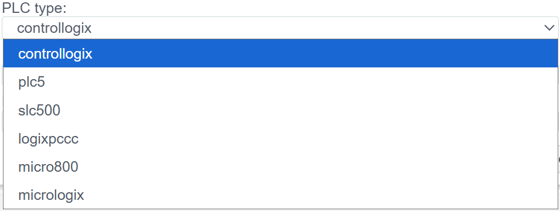

# Конфигурация драйвера Ethernet/IP (Rockwell Automation)

> См. также: [Общие сведения о PLC-соединениях](./general_ru.md)

## Общее описание
Протокол **EtherNet/IP** (Industrial Protocol) — это промышленный стандарт, использующий Common Industrial Protocol (CIP) поверх стандартного Ethernet.
В системе **Faceplate** данный драйвер используется для нативной интеграции с контроллерами **Allen-Bradley (Rockwell Automation)** и совместимыми устройствами.

###  Поддерживаемое оборудование
Согласно конфигурации драйвера, поддерживаются следующие семейства контроллеров:
* **ControlLogix / CompactLogix** (Теговая адресация, CIP)
* **Micro800** (Серия Micro820/850/870)
* **MicroLogix** (PCCC адресация)
* **SLC 500** (Legacy, PCCC)
* **PLC-5** (Legacy, PCCC)
* **LogixPCCC** (Специфичный режим для Logix через PCCC)

Процесс настройки состоит из двух этапов:
1.  **Connection (`plc_ethernet_ip_connection`):** Настройка сетевого соединения протокола.
2.  **Binding (`plc_ethernet_ip_binding`):** Адресация конкретных информационных объектов и настройка привязки.

---

## 1. Настройка соединения (Connection)

На этом этапе создается сессия связи с контроллером.
> Создать PLC cоединения → [Шаги создания PLC соединения](./general_ru.md#создание-plc-соединения)

> Панель диагностики и общие параметры соединения (Settings) описаны в разделе [Общие параметры соединения](./general_ru.md#общие-параметры-соединения-settings).

### 1.1 Параметры контроллера (Controller Settings)

Это критически важная секция, определяющая метод адресации.

| Поле | Описание и аналитика |
| :--- | :--- |
| **Тип контроллера** | Выберите семейство ПЛК: • **ControlLogix:** Использует символьные имена тегов. Самый современный режим. • **MicroLogix / SLC / PLC5:** Используют адресацию файлов данных (N7:0, F8:1). |
| **IP** | IP-адрес коммуникационного модуля или процессора. |
| **Routing** | *Опционально.* Путь CIP (CIP Path) для доступа к процессору, если он находится не в том же слоте, куда приходит Ethernet, или в другом шасси. *Формат:* Обычно указывается как последовательность пар `Порт,Адрес`. *Пример:* `1,0` (Backplane, Slot 0). Оставьте пустым для CompactLogix (без шасси). |

---

##  2. Настройка переменных (Binding)

В протоколе Ethernet/IP (особенно для ControlLogix) мы обращаемся к данным по **Имени тега**, а не по адресу памяти.

> Создать PLC привязку → [Шаги создания PLC привязки](./general_ru.md#создание-plc-привязки)

> Общие поля привязки (Name, Title, State, Tag, Transformation, Access) описаны в разделе [Общие поля PLC-привязки](./general_ru.md#общие-поля-plc-привязки).

### 2.1 Адресация данных (Target Data)

| Поле | Инструкция по заполнению |
| :--- | :--- |
| **Controller tag name** | **Символьный адрес в ПЛК.** • Для **ControlLogix:** Имя тега, как в Studio 5000. Например: `MyTag`, `Program:MainProg.Step`. • Для **SLC/MicroLogix:** Адрес элемента. Например: `N7:0`, `F8:10`, `B3:0/5`. |
| **Data type** | Тип данных, ожидаемый от контроллера (BOOL, SINT, LREAL, USINT, INT, UINT, DINT, UDINT, LINT, LINT, ULINT, REAL). Должен совпадать с типом, объявленным в PLC. |

>Ошибка в PLC привязке -> [ошибка привязки](./general_ru.md#ошибка-в-привязке)
---

