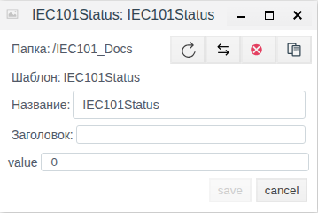
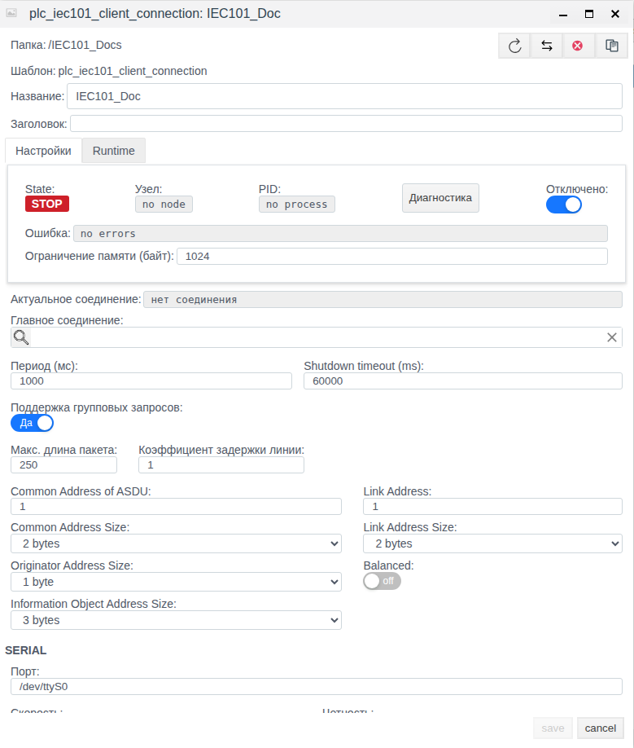
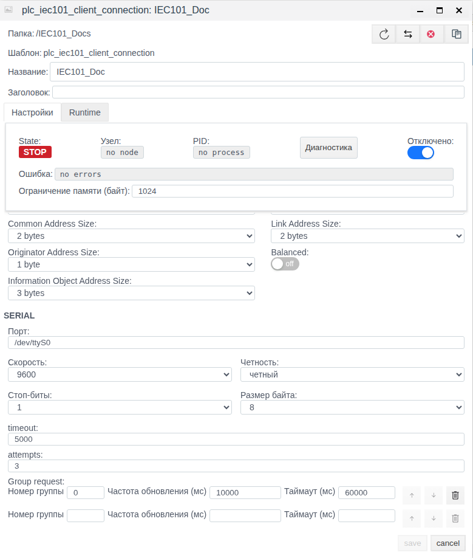
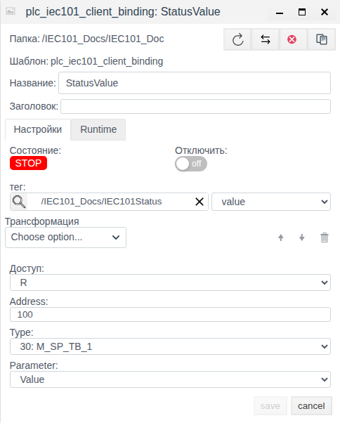

# МЭК 60870-5-101 в Faceplate: настройка клиентского соединения и привязок

Версия Faceplate: v4.0.7.

Настройте последовательный канал IEC 60870-5-101, затем свяжите атрибуты сигналов с полями проекта. Ниже приведён один пример настройки без устройства: соединение остаётся отключённым, проверяются сохранение и отдельное повторное открытие. Запись, диагностика рабочего канала и резервирование описаны справочно.

**Содержание**

- [Маршрут настройки](#маршрут-настройки)
- [Согласовать измерение, качество, время и команду](#согласовать-измерение-качество-время-и-команду)
- [Как работает клиентское соединение](#как-работает-клиентское-соединение)
- [Что подготовить перед настройкой](#что-подготовить-перед-настройкой)
- [Создать соединение и настроить привязки](#создать-соединение-и-настроить-привязки)
- [Управлять соединением](#управлять-соединением)
- [Проверить данные и результат записи](#проверить-данные-и-результат-записи)
- [Справочник настроек](#справочник-настроек)
- [Диагностика и восстановление обмена](#диагностика-и-восстановление-обмена)

[Каталог соединений](./index.md) · [Подготовка поля и привязки](./bindings.md) · [Преобразования](./transformation.md) · [Диагностика и восстановление](./diagnostics.md)

## Маршрут настройки

Подготовьте внешний источник или клиент и совместимое поле тега по общей инструкции. Затем настройте канал, сохраните полную привязку и проверьте новое значение. Для поддержанной записи/приёма отдельно подтвердите результат на внешней стороне; после исправления сбоя повторите проверку с новым контрольным значением.

[Альтернативный канал и карта сигналов](./bindings.md#настроить-альтернативный-канал) описаны одинаково для всех типов; условия переключения уточняйте по драйверу.

## Согласовать измерение, качество, время и команду

Используйте [единый каталог IEC](./iec_reference.md). Для IOA 100, Type 36: M_ME_TF_1 подготовьте float-поле Measurement.value и integer-поля Quality.value и Timestamp.value. Создайте отдельные привязки Value, QDS и TS с одинаковыми Address 100 и Type 36.

Для получения задайте R; подтвердите новое измерение 21.5→22.5 от источника в Measurement.value. Для отдельного управления подготовьте integer-поле Command.value и RW-привязку: Address 101, Type 1, Parameter Value, Remote control type 45, Remote control address 200. Команда 1 передаётся на IOA 200, обратное состояние читается с IOA 101; проверьте ACTCON/ACTTERM и независимо обратный сигнал.

Карту примера замените согласованными IOA/TypeID устройства. Качество — числовой дескриптор, TS с CP24/CP56 имеют разный смысл; старый кэш и время отправки не доказывают нового измерения. Сохраните отключённые настройки и отдельно откройте каждую привязку до рабочего включения. Это рецепты конфигурации; новые команды и внешние обновления здесь не объявляются испытанными.

## Как работает клиентское соединение

Faceplate выступает клиентом: принимает телесигнализацию и телеизмерения от удалённого устройства, запрашивает общий или групповой опрос и при соответствующей настройке передаёт значения и команды. Этот клиент использует последовательный порт **узла выполнения Faceplate**. Браузер порт не открывает.

Протокол IEC101 задаёт правила обмена. Драйвер реализует их в Faceplate. **PLC-соединение** хранит параметры одного канала: порт, режим связи и адреса устройства. **PLC-привязка** внутри соединения выбирает один информационный объект и один его атрибут. **Тег** — объект проекта, а **поле тега** — конкретное место чтения или записи. Выбор тега без выбора поля не завершает настройку назначения. Прикладные теги и карта сигналов автоматически не создаются.

Различайте три адреса: **Link Address** — адрес канального уровня; **COA** — общий адрес ASDU, прикладного блока данных; **IOA** — адрес информационного объекта внутри ASDU. Одно соединение имеет один Link Address и один COA. **TypeID** определяет формат ASDU и набор её атрибутов.

Переключатель **Balanced** выбирает балансную передачу (balanced) или небалансную (unbalanced). Роль Faceplate остаётся клиентской. В unbalanced клиент выполняет канальные запросы классов 1 и 2; для нескольких устройств создают отдельные соединения. Условия общего порта описаны в справочнике.

Путь чтения: последовательный канал → принятый ASDU → внутреннее хранилище данных (кеш) по IOA → выбор атрибута привязкой → прямое преобразование → приведение к типу поля → выбранное поле тега. В привязке также доступен собственный результат. Каждый PLC-цикл читает кеш: отдельная R-привязка не отправляет индивидуальный запрос сигнала устройству. Кеш пополняют ответы на опрос и спонтанные ASDU.

Путь записи: изменение связанного поля → приведение типа → обратное преобразование → выбор TypeID и IOA записи → исходящий ASDU. Доступ R разрешает чтение, W — запись, RW — оба направления. Значение, записанное в поле самим соединением при чтении, не должно вызывать его обратную отправку. У W текущее значение передаётся также при запуске, переподключении и обновлении конфигурации привязки: учитывайте повторную отправку при использовании команд.

## Что подготовить перед настройкой

Получите от владельца устройства и администратора узла:

- Путь последовательного порта на узле выполнения, права доступа ОС, физический интерфейс и параметры линии: скорость, чётность, биты данных и стоповые биты.
- Режим balanced/unbalanced, Link Address, COA и размеры полей Link Address, COA, адреса инициатора и IOA. Совпадать должны и адреса, и размеры их представления.
- Карту сигналов: IOA, TypeID, атрибут, единицы, масштаб, допустимые значения, наличие времени и качества. Уточните поддерживаемые группы опроса и спонтанную передачу.
- Для управления — TypeID и IOA команды, допустимые управляющие значения, поддержку прямого управления, ожидаемые подтверждения и отдельный сигнал обратного состояния.
- Тег и совместимое поле проекта, права на настройку и разрешённый узел выполнения. Для числовых масок и упакованных слов выбирайте поле, сохраняющее все биты; для измерений учитывайте дробную часть и преобразование.

Для учебного примера подготовьте отдельную папку **IEC101_Docs** и тег **IEC101Status** с целочисленным полем **value**, исходно 0. Поле должно быть доступно в форме тега. Если имя папки занято, используйте отдельное свободное имя и последовательно подставьте его в назначения.

Устройства для этого примера нет. Порт `/dev/ttyS0`, COA 1, Link Address 1 и IOA 100 — условные параметры. Для сохранения отключённого соединения наличие такого порта не требуется; перед рабочим подключением их заменяют данными реального устройства.

## Создать соединение и настроить привязки

### Проверить подготовленный тег

Откройте Студию, в дереве проекта дважды щёлкните **IEC101_Docs**. Выделите **IEC101Status** и нажмите **Редактировать**. Проверьте наличие поля **value** и исходного числа 0, затем закройте окно кнопкой **cancel** без изменений.

Рисунок 1. Подготовленное поле тега. Число 0 задано до настройки клиента и не получено по IEC101.

### Создать и повторно открыть соединение

1. В папке **IEC101_Docs** нажмите **Создать**. В окне типов откройте **plc**, выберите `plc_iec101_client_connection` и нажмите **Ok**.
2. В новой форме сразу включите переключатель **Отключено**. Оставляйте его включённым на всём протяжении примера, в том числе до первого сохранения.
3. Задайте **Название** и параметры по таблице. Ввод чисел и пути завершайте переходом в другое поле; перед сохранением перечитайте значения. **Главное соединение** оставьте пустым.

| Поле формы | Значение примера |
|---|---|
| Название | IEC101_Doc |
| Отключено | Включено: соединение отключено |
| Период (мс) / Shutdown timeout (ms) | 1000 / 60000 мс |
| Common Address of ASDU / Common Address Size | 1 / 2 bytes |
| Originator Address Size / Information Object Address Size | 1 byte / 3 bytes |
| Link Address / Link Address Size | 1 / 2 bytes |
| Balanced | off: unbalanced |
| SERIAL → Порт | /dev/ttyS0 |
| Скорость / Четность | 9600 бит/с / четный (even, код 1) |
| Стоп-биты / Размер байта | 1 / 8 |
| timeout / attempts | 5000 мс / 3 |
| Group request → Номер группы | 0 |
| Частота обновления (мс) / Таймаут (мс) строки группы | 10000 / 60000 мс |
| Главное соединение | Пусто |

В **Group request** заполните имеющуюся строку группы 0. Незаполненная нижняя строка служит заготовкой; вторую группу в примере не задавайте. Номер 0 соответствует общему опросу; число 20 вместо него вводить не нужно.

Оставьте общие поля **Поддержка групповых запросов**, **Макс. длина пакета**, **Коэффициент задержки линии** без изменения: в проверенной форме это **Да**, 250 и 1. Этот общий переключатель не управляет опросом **Group request** IEC101. Поле **Ограничение памяти (байт)** также не меняйте: в новой форме оно было пустым, после сохранения стало 1024. Его фактические единицы поясняются в справочнике.

Нажмите **save**. Окно закроется автоматически. В папке появится **IEC101_Doc**. Теперь отдельно выделите эту сохранённую строку и нажмите **Редактировать**. Сверьте таблицу, включённое **Отключено** и группу, прокрутив форму вниз. В неизменённой повторно открытой форме **save** недоступен. Закройте её кнопкой **cancel**.

Рисунок 2. Сохранённое и отдельно открытое соединение: отключение, период и адреса. STOP, no node и no process соответствуют отключённому примеру.

Рисунок 3. Та же сохранённая конфигурация после прокрутки: линия 9600/even/8/1 и одна заполненная группа 0/10000/60000.

### Создать и повторно открыть привязку в том же примере

1. Дважды щёлкните **IEC101_Doc**, чтобы перейти внутрь соединения, затем нажмите **Создать**. Здесь сразу открывается форма `plc_iec101_client_binding`; отдельного выбора типа в проверенном UI нет.
2. Задайте **Название**, **Address** и **Type** по таблице. В **Parameter** явно выберите **Value**. Это отображаемое название атрибута `value`.
3. Нажмите лупу слева от **тег**. В окне выбора откройте **PROJECT → IEC101_Docs**, выделите **IEC101Status**, нажмите **ОК**. Затем в отдельном списке справа от тега выберите поле **value**.
4. Проверьте **Доступ: R**, собственное **Отключить: off** и отсутствие трансформации. Родительское соединение продолжает оставаться отключённым.

| Поле формы | Значение примера |
|---|---|
| Название | StatusValue |
| Папка | /IEC101_Docs/IEC101_Doc |
| тег / отдельное поле | /IEC101_Docs/IEC101Status / value |
| Доступ / Отключить | R / off |
| Address | 100 |
| Type | 30: M_SP_TB_1 |
| Parameter | Value — атрибут value |
| Трансформация | Не задана: Choose option... |
| Remote control type / address | Не заданы; при R скрыты |

Нажмите **save**: форма закроется, появится одна дочерняя строка **StatusValue**. Отдельно выделите её и нажмите **Редактировать**. Сверьте IOA, тип, **Parameter**, доступ и оба элемента назначения: тег и поле. Закройте **cancel**.

Рисунок 4. Привязка сохранена и отдельно открыта. Parameter показывает Value, а справа от тега отдельно выбрано поле value.

Вернитесь в **IEC101_Docs** и повторно откройте **IEC101Status**: конечное поле доступно. В проверенном примере в нём осталось исходное число 0. Итог — сохранённые соединение и одна привязка с правильным назначением. Порт не открывался, приём, запись и фактическое состояние устройства не проверялись. Оставьте **IEC101_Doc** отключённым.

## Управлять соединением

### Найти и изменить конфигурацию

В дереве проекта выделите соединение и используйте **Редактировать**. Для обзора нескольких каналов предназначен список PLC-соединений в Студии; двойной щелчок по соединению открывает его привязки. Изменяйте общие параметры в соединении, а IOA, атрибут, доступ, преобразование и назначение — в соответствующей дочерней привязке.

После изменения нажмите **save**, дождитесь закрытия и отдельно откройте объект повторно. Для адресов сверяйте значение вместе с размером, для назначения — тег вместе с полем. Изменение настроек работающего канала может перестроить его выполнение и подписки; после применения нужно заново подтвердить обмен.

### Разрешить или остановить выполнение

**Отключено** в соединении задаёт разрешение его выполнения. Выключение этого переключателя разрешает запуск при выполнении условий проекта и узла. Если проект или родительская область отключены либо нет подходящего узла выполнения, собственное разрешение соединения не обеспечивает запуск. Проверяйте **State**, **Узел**, **PID** и **Ошибка** отдельно от переключателя.

Перед включением рабочего канала сверьте порт, карту сигналов и назначения записи. Особенно проверьте W-привязки: при запуске, переподключении и обновлении конфигурации их текущее значение может отправиться повторно. W не требует предварительного изменения поля оператором при каждом запуске.

Включение **Отключено** останавливает соединение и инициирует инвалидацию связанных читаемых полей; W-поля не перезаписываются этим сбросом. **Отключить** в привязке исключает только её из чтения и подписок записи. При отключении одной привязки прежнее число в конечном поле может остаться. Оценивайте его вместе с состоянием и признаками нового приёма; учитывайте подстановку **Default Value**, если она настроена.

## Проверить данные и результат записи

### Установить, что данные действительно получены

Разрешение выполнения, работающий процесс и получение данных — разные результаты. RUN и отсутствие общей ошибки не гарантируют успех каждой привязки. Проверьте ошибку нужной привязки, её IOA и атрибут, результат преобразования и **конкретное конечное поле**.

Для рабочего подключения сопоставьте новое ожидаемое событие источника с принятым ASDU нужных COA и IOA, затем с результатом привязки и полем тега. Если число не изменяется по условиям процесса, нужен иной признак нового приёма этого IOA после проверяемого действия. Повторное чтение прежнего числа из кеша таким признаком не является.

Настроенный **Type** определяет список атрибутов формы, обработку качества и базовый тип записи, но не фильтрует кешированное `value` по TypeID входящего ASDU. Поэтому правдоподобное число не доказывает правильность выбранного типа. В кеше нет срока годности данных, доступного как настройка этой привязки; время приёма не предлагается отдельным **Parameter**.

### Оценить качество и время

Значение, качество и время — отдельные атрибуты. Для получения нескольких атрибутов одного IOA требуются отдельные привязки с подходящими полями. Качество передаётся числовым дескриптором: плохие флаги автоматически не превращают `value` в `none` и не переводят привязку в ошибку. Нужна прикладная обработка качества.

Атрибут `ts` зависит от типа ASDU. Для CP24 это миллисекунды в пределах часа; для CP56 — миллисекунды от эпохи после преобразования локального времени узла в UTC. Проверьте часовой пояс и часы узла. Некорректная дата CP56 может дать `none`. При последующем сообщении без времени в кеше может сохраниться прежний `ts`; одна такая метка не доказывает свежесть. Отдельные флаги времени в параметры привязки не выведены.

### Различить отправку и результат управления

Для команды проверяйте исходящий запрос, положительное **ACTCON** — подтверждение приёма, затем положительное **ACTTERM** — завершение по протоколу. После этого сверяйте ожидаемую обратную связь устройства. Даже ACTTERM не подтверждает физическое переключение без сигнала обратного состояния.

Если отдельный командный TypeID не задан, используется базовый тип привязки: передача информационного ASDU выполняется асинхронно. Успех этого пути означает передачу сообщения на отправку, а не удалённое выполнение команды. В учебном примере с R и отключённым родителем проверено только сохранение конфигурации и доступность выбранного поля.

## Справочник настроек

### Общие настройки соединения

Исходное значение формы может отличаться от исходного значения типа объекта. Ниже эти случаи указаны отдельно. Диапазон UI также не заменяет проверку параметров реальной линии.

| Настройка | Исходное значение | Назначение и допустимые условия | Проверка |
|---|---|---|---|
| Название / Заголовок | Пусто | Название идентифицирует объект; заголовок — необязательное пояснение | Имя и папка после повторного открытия |
| Отключено | Выключено | Включённый переключатель запрещает выполнение всего соединения | Разрешение проекта/узла, State и PID |
| Период (мс) | 1000 | 1–3600000 мс, шаг 10 в форме. Обход кеша и задержка новой попытки подключения | Результат нужной привязки; это не частота нового ASDU |
| Shutdown timeout (ms) | 60000 | 10–3600000 мс, шаг 10 в форме. Ожидание завершения выполнения; при неположительном значении применяется 60000 | Завершение рабочего процесса |
| Главное соединение | Не задано | Ссылка из резервной конфигурации на главное соединение того же клиентского типа; циклические ссылки запрещены | Связи, применённая конфигурация и новый обмен |
| Актуальное соединение | До подключения: нет соединения | Выводится автоматически: последняя успешно выбранная конфигурация | Сопоставить с ожидаемым каналом и свежими данными |
| Ограничение памяти (байт) | Тип объекта: 1024; новая форма пустая, после сохранения 1024 | Ресурс рабочего процесса. Фактически число задаётся в МиБ: ×1048576 байт, несмотря на подпись | Ресурс узла; не трактовать как размер кадра |
| Поддержка групповых запросов | Форма: Да | Общая настройка пакетного чтения; у этого клиента не включает пакетное чтение и не управляет IEC101 Group request | Группы IEC101 задавать в их собственном списке |
| Макс. длина пакета | Форма: 250 | 1–10000, шаг 1; общий параметр пакетного чтения здесь не задаёт длину IEC-кадра | Не подбирать через него размер ASDU |
| Коэффициент задержки линии | Тип объекта: 2; форма: 1 | 1–10, шаг 1; относится к общему пакетному чтению и здесь не применяется | Не использовать для настройки периода групп |

Если обход привязок занял дольше заданного периода, следующий обход начинается без дополнительной паузы. Точный интервал доставки новых данных этим полем не гарантируется.

Резервная конфигурация содержит альтернативные параметры соединения и ссылку **Главное соединение**; она принудительно отключается как самостоятельный канал. Выполнение главного соединения пробует связанные конфигурации и использует **свои** привязки. Не рассчитывайте на автоматическое использование привязок резервного объекта. Настройте связи до рабочего запуска, исключите рекурсию. После изменения резерва проверьте заново применённую конфигурацию и новый обмен: горячее изменение активного резервного пути не подтверждено. Переключение в учебном примере не выполнялось.

### Последовательный порт и адресация IEC101

| Настройка | Исходное значение | Диапазон и смысл | Как выбирать и проверять |
|---|---|---|---|
| SERIAL → Порт | Форма: /dev/tty0; обязательный путь | Непустое имя порта ОС узла выполнения | Фактический порт, права и физический интерфейс; исходная строка не означает обнаруженное устройство |
| Скорость | 9600 бит/с | Выбор из списка формы | Совпадение с линией и поддержка аппаратурой |
| Четность | нет, код 0 | нет / четный / нечетный: коды 0 / 1 / 2 | Совпадение с устройством |
| Стоп-биты | 1 | 1–2 | Совпадение с линией |
| Размер байта | 8 | 5–8 бит данных | Совпадение с линией |
| Balanced | off | off — unbalanced; on — balanced | Режим противоположной стороны; роль остаётся клиентской |
| Common Address of ASDU | 1 | 1–65535, с учётом размера COA | Входящий COA должен точно совпасть |
| Common Address Size | 2 bytes | 1–2 байта | Вместимость адреса и формат источника |
| Originator Address Size | 1 byte | 0–1 байт | Размер поля адреса инициатора; его значение фиксировано 0 |
| Information Object Address Size | 3 bytes | 1–3 байта | Должен вмещать IOA чтения и записи |
| Link Address | 1 | UI: 1–65535, с учётом размера | Канальный адрес конкретного устройства |
| Link Address Size | 2 bytes | None — 0 байт; 1 или 2 байта | Формат канального уровня; None не означает автоопределение |
| timeout | 5000 мс | UI: 1–6000 мс; ожидание канального ответа | По времени линии; не таймаут группы или команды |
| attempts | 3 | UI: 1–500; попытки канального запроса, включая первую | Учитывать повторное восстановление link после исчерпания попыток |

Список скоростей проверенной формы: 300, 600, 1200, 2400, 4800, 9600, 19200, 38400, 57600, 115200, 230400, 460800, 500000 и 576000 бит/с. Выбор в списке не подтверждает поддержку адаптером и устройством.

Адрес должен помещаться в выбранный размер: один байт — до 255, два — до 65535, три — до 16777215. Совместная проверка адреса и размера не гарантируется сохранением. Особенно учитывайте IOA: верхняя граница формы 16777216 на единицу больше представимого трёхбайтового адреса.

Открытие порта имеет собственное ожидание 3000 мс. **attempts** не задаёт общий предел всех передач за эпизод восстановления: после исчерпания канальных попыток link может устанавливаться заново. Новая общая попытка подключения зависит также от PLC-периода.

Для нескольких unbalanced-устройств одного физического порта создавайте отдельные соединения с согласованными Link Address и COA каждого устройства. Доступ к общему порту сериализуется. Первое открывшее его соединение определяет параметры порта и размер канального адреса; остальные должны использовать совместимые настройки. Одинаковое имя порта не создаёт независимые физические линии. Этот вариант не проверялся в учебном примере.

### Группы опроса и независимые времена

| Настройка или режим | Исходное значение | Диапазон и поведение | Проверка |
|---|---|---|---|
| Group request | Тип объекта: пустой список; новая форма предлагает группу 0 | Список запросов; принадлежность IOA группе задаёт источник | Сохранённые строки после повторного открытия |
| Номер группы | Новая строка общего опроса: 0 | 0–16. 0 → QOI20, 1–16 → QOI21–36 | Поддержка выбранной группы источником |
| Частота обновления (мс) | Не задана | При задании: 500–604800000 мс; без значения — один опрос после подключения | Повторный запрос после завершения предыдущего и выдержки периода |
| Таймаут (мс) | Поле пустое; при отсутствии используется 60000 мс | UI: 50–120000 мс; фаза получения данных группы | Полнота и завершение ответа источника |
| Подтверждение опроса | Отдельное ожидание 10000 мс | Не поле timeout последовательной линии | Подтверждение активации опроса |
| Действительно пустой список | Нет запросов interrogation | Спонтанный приём и канальный опрос unbalanced продолжаются | Не ожидать начальный снимок данных от GI |
| Порядок строк | Порядок начальной очереди | Не задаёт гарантированный приоритет или точную частоту | Сопоставить фактические запросы и ответы |

Опрос отправляется как Type100 `C_IC_NA_1`, активация, IOA 0. Для общего опроса в форме нужен номер **0**, соответствующий протокольному QOI20. Период обновления отсчитывается после завершения предыдущего опроса, поэтому реальный интервал включает его длительность. Ошибка одного опроса не обязательно останавливает всё соединение.

Различайте PLC-период чтения кеша, внутренний канальный опрос unbalanced с исходным периодом 1000 мс и период **Group request**. Изменение одного не заменяет остальные. Таймаут остановки соединения, канального ответа, группы и подтверждений команды также независимы.

При отсутствии периода оставляйте необязательное поле строки незаданным. После изменения или удаления групп обязательно проверяйте итоговый список повторным открытием: наличие пустой заготовки не является второй настроенной группой, а новая форма сама предлагает группу 0. В примере проверена только одна явно заполненная строка.

### Поля PLC-привязки

| Поле | Исходное значение | Назначение и условия | Проверка |
|---|---|---|---|
| Название / папка | Имя пустое; папка выбранного соединения | Привязка должна лежать непосредственно внутри своего соединения | Путь после сохранения |
| тег / отдельное поле | Не заданы | Пара назначения чтения или источник записи; без пары результат может остаться только в привязке | Реальный тег, поле и его тип |
| Отключить | off | Исключает только эту привязку из выполнения и подписок | Состояние; прежнее поле может сохраниться |
| Доступ | R | R — чтение; W — запись без чтения; RW — чтение и запись изменений | У W учитывать отправку текущего значения при запуске и переподключении |
| Address | Тип объекта: 1; новая форма пустая | UI: 0–16777216; фактически не выше 16777215 при 3 байтах | Карта IOA и размер адреса соединения |
| Type | Тип объекта: 1; новая форма без выбранного типа | 1–21 и 30–38 | Формат источника и набор атрибутов; не фильтр входящего value |
| Parameter | Нет исходного значения | Обязательный выбор атрибута; Value соответствует value | Наличие атрибута у принятого IOA |
| Трансформация | Не задана | Цепочка операций; для W/RW нужна обратная операция | Единицы, диапазон, тип поля и обратимость |
| Remote control type | Не задан | 45–51 или 58–64; без значения используется базовый Type | Командный тип и поддержка устройством |
| Remote control address | Не задан | UI: 0–16777216; без значения используется Address | Реальная представимость IOA записи |

Поля **Remote control type/address** доступны при W или RW **и** `Parameter=value`. Выбор другого атрибута очищает оба поля. Тип и адрес записи подставляются независимо: можно переопределить только один из них. Командный тип при другом атрибуте вызывает `invalid_remote_type_parameter` — несовместимую настройку типа управления и атрибута.

Для записи нужен числовой результат после приведения и обратного преобразования. Связанное логическое поле переводится в 1/0, числовая строка разбирается как число; нечисловой текст не даёт допустимого значения. Логическое значение, заданное напрямую у несвязанной привязки, не следует считать такой же числовой командой. Нечисловой результат драйвер не отправляет.

### Типы ASDU и доступные атрибуты

В столбце атрибутов приведены их точные имена. Каждый выбирается отдельной привязкой. В форме `value` отображается как **Value**, а `ts` остаётся одним атрибутом независимо от формата CP24/CP56.

| TypeID и имя ASDU | Представление value | Доступные атрибуты | Время ts |
|---|---|---|---|
| 1: M_SP_NA_1 | Одиночное состояние 0/1 | value, qds, siq | Нет |
| 2: M_SP_TA_1 | Одиночное состояние 0/1 | value, qds, siq, ts | CP24 |
| 3: M_DP_NA_1 | Двойное состояние 0–3 | value, qds, diq | Нет |
| 4: M_DP_TA_1 | Двойное состояние 0–3 | value, qds, diq, ts | CP24 |
| 5: M_ST_NA_1 | Позиция ступени, −64…63 | value, vti, qds | Нет |
| 6: M_ST_TA_1 | Позиция ступени, −64…63 | value, vti, qds, ts | CP24 |
| 7: M_BO_NA_1 | Битовая строка unsigned32 | value, qds | Нет |
| 8: M_BO_TA_1 | Битовая строка unsigned32 | value, qds, ts | CP24 |
| 9: M_ME_NA_1 | Нормализованное [−1,1] | value, qds | Нет |
| 10: M_ME_TA_1 | Нормализованное [−1,1] | value, qds, ts | CP24 |
| 11: M_ME_NB_1 | Масштабированное signed16 | value, qds | Нет |
| 12: M_ME_TB_1 | Масштабированное signed16 | value, qds, ts | CP24 |
| 13: M_ME_NC_1 | Число float32 | value, qds | Нет |
| 14: M_ME_TC_1 | Число float32 | value, qds, ts | CP24 |
| 15: M_IT_NA_1 | Счётчик signed32 | value, bcr | Нет |
| 16: M_IT_TA_1 | Счётчик signed32 | value, bcr, ts | CP24 |
| 17: M_EP_TA_1 | Событие защиты, состояние 0–3 | value, sep, duration, ts | CP24 |
| 18: M_EP_TB_1 | Пакет событий защиты | value, qdp, duration, ts | CP24 |
| 19: M_EP_TC_1 | Пакет выходных событий защиты | value, qdp, duration, ts | CP24 |
| 20: M_PS_NA_1 | Упакованное слово SCD unsigned32 | value, qds | Нет |
| 21: M_ME_ND_1 | Нормализованное [−1,1] | value | Нет |
| 30: M_SP_TB_1 | Одиночное состояние 0/1 | value, qds, siq, ts | CP56 |
| 31: M_DP_TB_1 | Двойное состояние 0–3 | value, qds, diq, ts | CP56 |
| 32: M_ST_TB_1 | Позиция ступени, −64…63 | value, vti, qds, ts | CP56 |
| 33: M_BO_TB_1 | Битовая строка unsigned32 | value, qds, ts | CP56 |
| 34: M_ME_TD_1 | Нормализованное [−1,1] | value, qds, ts | CP56 |
| 35: M_ME_TE_1 | Масштабированное signed16 | value, qds, ts | CP56 |
| 36: M_ME_TF_1 | Число float32 | value, qds, ts | CP56 |
| 37: M_IT_TB_1 | Счётчик signed32 | value, bcr, ts | CP56 |
| 38: M_EP_TD_1 | Событие защиты, состояние 0–3 | value, sep, interval, ts | CP56 |

Нормализованные измерения уже приведены в диапазон [−1,1]; не применяйте к ним повторно пересчёт из signed16 без проверки. Масштабированное signed16 представляет −32768…32767. Битовые строки и слово SCD передаются одним числом 0…4294967295; отдельные биты и признаки изменения автоматически не разворачиваются.

`siq`, `diq`, `vti`, `sep` и `qdp` — исходные байты 0…255. SIQ/DIQ включают состояние, VTI — полный элемент позиции, SEP — полный элемент события защиты, QDP — качество защиты. `qds` — числовые биты качества: у одиночного состояния используется маска 254, у двойного — 252, без сдвига флагов в 0/1. Читайте качество отдельно от состояния.

`bcr` содержит все пять байтов как беззнаковое 40-битное число, включая служебный байт. Показание счётчика находится отдельно в `value` как signed32; BCR не заменяет его. `duration` и `interval` — исходные 16-битные поля CP16Time2A, 0…65535, без пересчёта; у Type38 выбирайте именно `interval`. Это не метка `ts`. Для масок, полных BCR и упакованных слов логическое поле теряет информацию — используйте подходящее числовое поле.

CP24 `ts` вычисляется как миллисекунды плюс минуты ×60000; это не безусловная метка Unix. CP56 `ts` представляет миллисекунды от эпохи с учётом локального часового пояса узла. Тип70 и атрибут `coi` не доступны в обычной форме этой клиентской привязки.

### Команды телеуправления

Тип выбирается в **Remote control type**, атрибут — `value`, доступ — W или RW. Для чтения обратного состояния и отправки по другому адресу задайте базовый **Address** и отдельный **Remote control address**. W также поддерживает команды; RW не является обязательным условием управления.

| TypeID без времени / с временем | Имена ASDU | Назначение | Представление значения |
|---|---|---|---|
| 45 / 58 | C_SC_NA_1 / C_SC_TA_1 | Одиночная команда | 1 бит, 0…1 |
| 46 / 59 | C_DC_NA_1 / C_DC_TA_1 | Двойная команда | 2 бита, 0…3 |
| 47 / 60 | C_RC_NA_1 / C_RC_TA_1 | Шаг регулирования | 2 бита, 0…3 |
| 48 / 61 | C_SE_NA_1 / C_SE_TA_1 | Нормализованная уставка | [−1,1], кодирование в signed16 |
| 49 / 62 | C_SE_NB_1 / C_SE_TB_1 | Масштабированная уставка | signed16, −32768…32767 |
| 50 / 63 | C_SE_NC_1 / C_SE_TC_1 | Уставка с плавающей точкой | float32 |
| 51 / 64 | C_BO_NA_1 / C_BO_TA_1 | Битовая строка | unsigned32, 0…4294967295 |

Границы таблицы описывают представление, а не гарантированный контроль ввода. Допустимые управляющие состояния и диапазоны уставок определяет устройство. Целочисленные команды кодируются с округлением; отдельной проверки диапазона и конечности float в этом маршруте нет. Обеспечьте правильный числовой результат до отправки.

Используется **прямая активация**. Выбора select-before-execute и полей произвольных qualifiers нет; квалификаторы используются с исходным значением 0. Для команд с временем метка формируется по текущему времени узла при кодировании, отдельного поля её ввода нет. Если устройство требует предварительного выбора или иного квалификатора, совместимость такого управления не следует из этой формы.

Ожидаются положительные ACTCON и ACTTERM. `reject` означает отказ в приёме, `not_executed` — отрицательное завершение, `confirm_timeout` и `execute_timeout` — отсутствие соответствующего подтверждения. Для фаз подтверждения и завершения используются отдельные таймеры 10000 мс; фактическое ожидание вызова записи может закончиться раньше. Поле **timeout** последовательной линии не является общим таймаутом команды.

Без отдельного командного типа отправляется информационный ASDU базового типа с причиной spontaneous. Этот асинхронный путь нужно отдельно согласовать с устройством; подтверждения телеуправления ему не приписываются.

### Преобразования

Прямое преобразование выполняется от источника к полю в порядке списка. Для W/RW операции выполняются обратно, от поля к источнику, в обратном порядке; каждая должна поддерживать обратное направление. Приведение к типу конечного поля учитывается дополнительно.

| Операция | Исходные настройки | Источник → поле | Поле → источник |
|---|---|---|---|
| Scaling | factor=1, shift=0 | x×factor+shift; нечисловое даёт none | (x−shift)/factor; factor должен отличаться от 0 |
| Default Value | value=0 | Число сохраняется; отсутствие или нечисловое заменяется заданным значением | Без изменения |
| Limit Control | lower=0, upper=0 | Вне включительного диапазона — none | Ограничение ближайшей границей |
| Damper | tlag=1 мс; минимум формы 1 | Сглаживание, первая числовая выборка проходит | Без изменения |
| Derivative | Нет параметров | Δзначение/Δвремя; первая выборка — none | Не поддерживается для W/RW |
| Integration | Нет параметров | Предыдущее значение + Δвремя×текущий вход; первая выборка — none | Не поддерживается для W/RW |
| Script | Шаблон редактора | Пользовательское преобразование с состоянием | Не поддерживается для W/RW |

Для **Limit Control** обязательно upper>lower: исходная пара 0/0 ещё не является законченной настройкой. **Damper** использует положительный tlag в миллисекундах. Производная имеет единицы значения/мс, интеграл — значение×мс; время берётся по обработке выборок, не по `ts` источника. Неподдержанная обратная операция не позволит подготовить преобразование W/RW.

**Default Value** может превратить отсутствие данных в обычное число. Поэтому проверяйте получение и качество отдельно от результата подстановки. Для измерений сравнивайте единицы до и после преобразования, а для записи — результат обратной цепочки и допустимый диапазон устройства.

### Состояния и признаки результата

| Наблюдение | Что означает | Что проверить дополнительно |
|---|---|---|
| Отключено / Отключить, Runtime ВКЛ/ВЫКЛ | Собственное разрешение выполнения | Разрешение проекта, родителя и узла |
| STOP, no node, no process | Выполнение сейчас не запущено | Для отключённого примера ожидаемо; для рабочего канала искать причину запуска |
| RUN, Узел и PID | Есть работающий процесс | Готовность канала и приём нужного IOA |
| no errors или общий успех соединения | Нет общей зарегистрированной ошибки | Ошибки отдельных привязок; возможна пустая коллекция |
| Успешная привязка / OK | Успешна выборка кеша или путь записи | Новый приём, качество и реальное подтверждение записи |
| Число в привязке и поле тега | Результат маршрутизации и преобразования | Исходное, старое, кешированное или подставленное число |
| Качество и ts | Отдельные атрибуты принятого объекта | Флаги качества, формат времени и возможная старая метка |
| Новый ASDU нужного COA/IOA | Новый приём после проверяемого события | Нужный атрибут и конечное поле после преобразования |
| Положительное ACTCON | Приём команды по протоколу | ACTTERM и обратное состояние устройства |
| Положительное ACTTERM | Завершение команды по протоколу | Физический результат по обратной связи |
| save и отдельное повторное открытие | Сохранена конфигурация | Порт, обмен и данные этим не подтверждаются |

## Диагностика и восстановление обмена

### Собрать сведения

У сохранённого соединения есть кнопка **Диагностика**, в том числе при STOP. Запуск выполнения не является условием появления этой кнопки. Содержательный журнал зависит от событий работающего канала; в отключённом учебном примере сбор не выполнялся.

Откройте диагностику и выберите уровень **info**, **warning**, **error** или **debug**; исходный уровень — info, лимит — 1000 записей. **Start** начинает сбор журнала, **Stop** заканчивает сбор. Эти кнопки не включают и не отключают само соединение. **Logs** обновляется примерно раз в секунду. Сохраните относящиеся к проблеме сообщения вместе со временем, путём соединения, привязкой и её параметрами; при большом объёме ограничьте интервал сбора нужным событием.

**Processes** показывает отправителей захваченных событий журнала, а не полное дерево работающих процессов. Пустой список или пустой Logs не доказывают ни исправность канала, ни отсутствие процесса. Наличие полного протокольного кадра в этом окне не гарантируется; вывод о новом приёме должен опираться на доступное свидетельство нужного ASDU или события источника.

### Найти причину по симптому

Эта таблица описывает рабочую проверку с реальным источником. Неисправности и восстановление в единственном учебном примере не воспроизводились.

| Симптом | Что проверить | Действие | Признак результата |
|---|---|---|---|
| Соединение остаётся STOP | Отключено, Runtime проекта/родителя, доступный узел, ошибки зависимостей | Устранить конкретную причину запрета или отсутствия узла | Появились Узел/PID; далее подтвердить обмен |
| Порт не открывается | Путь на узле выполнения, наличие порта, права ОС, компонент доступа к serial | Исправить путь/доступ и параметры установки | Порт открыт, затем получен новый протокольный обмен |
| Link timeout | Скорость, чётность, биты, balanced, Link Address и его размер, линия и устройство | Согласовать параметры обеих сторон и физическую связь | Новый успешный канальный обмен и нужный ASDU |
| ASDU отклоняется или данные не разбираются | COA, размеры COA/ORG/IOA, структура сообщения | Сверить формат с картой источника; COA должен совпасть точно | Новый разобранный ASDU нужных COA/IOA |
| address_not_available | Наличие IOA в принятых данных, группы и спонтанная передача | Исправить IOA или обеспечить его передачу источником | Новый приём этого IOA и результат в нужном поле |
| invalid_parameter | Есть ли выбранный атрибут у принятого IOA, правильны ли Type и Parameter | Выбрать реально доступный атрибут; сверить карту | Получен нужный атрибут без этой ошибки |
| Значение неверное или попадает не туда | Пара тег/поле, тип поля, масштаб, порядок и границы преобразований | Исправить назначение или цепочку; проверить прямое и обратное направления | Ожидаемый результат в правильном конечном поле |
| Число или RUN при плохом качестве | Отдельный дескриптор качества, подстановка Default Value, смысл ts | Обработать флаги качества в проекте и устранить причину у источника | Актуальные value и качество согласованы; старое число не принимается за достоверное |
| Запись не уходит или команда не завершается | W/RW, числовой результат, обратная операция, TypeID/IOA, reject/not_executed и тайм-ауты | Исправить настройку и причину отказа; согласовать прямое управление | Новый запрос, ACTCON/ACTTERM для команды и ожидаемая обратная связь |
| После остановки или reconnect осталось старое число | Состояние привязки, кеш без срока годности, Default Value и возможный старый ts | После восстановления вызвать согласованное новое событие источника и проследить нужный IOA | Новый приём после действия и правильное поле; исчезновения ошибки недостаточно |

### Подтвердить восстановление

После исправления причины зафиксируйте новое ожидаемое значение или событие источника. Подтвердите приём ASDU нужного IOA **после** исправления, затем результат соответствующей привязки и правильное поле тега после преобразования. Сопоставьте качество и смысл времени. Если значение процесса осталось прежним, подтвердите новый приём другим наблюдаемым признаком этого IOA; повторная выборка кеша не заменяет его.

Для управления дополнительно проследите подтверждения команды и обратное состояние оборудования. RUN, снятая ошибка, заполненное Актуальное соединение или прежнее число сами по себе восстановление обмена не подтверждают.
