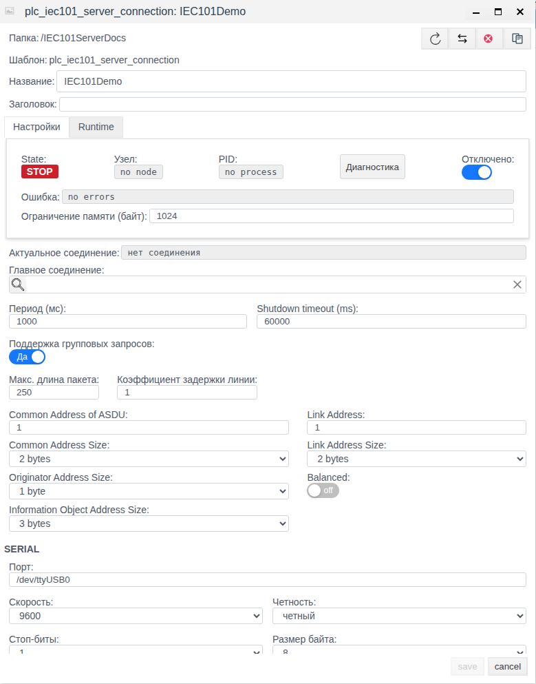
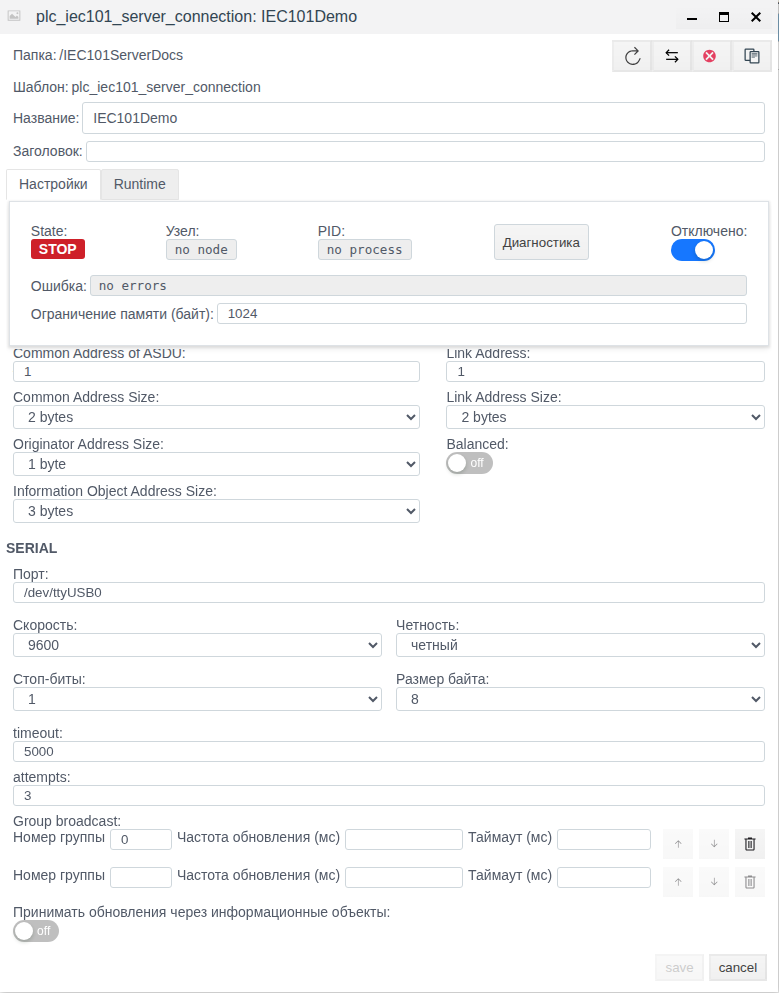
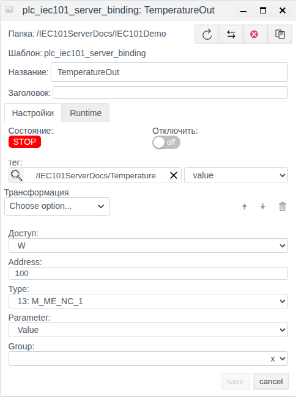

# Настройка сервера МЭК 60870-5-101 в Faceplate

Faceplate v4.0.7. Руководство для интеграторов: настройка последовательного серверного соединения и карты данных для внешнего ведущего. В единственном учебном примере проверены создание, сохранение и независимое повторное открытие конфигурации. Сервер оставлен отключённым; клиент, линия и обмен не проверялись.

**Содержание**

- [Маршрут настройки](#маршрут-настройки)
- [Согласовать измерение, качество, время и команду](#согласовать-измерение-качество-время-и-команду)
- [Назначение и движение данных](#назначение-и-движение-данных)
- [Подготовка](#подготовка)
- [Настройка соединения](#настройка-соединения)
- [Публикация данных и приём команд](#публикация-данных-и-приём-команд)
- [Дополнительные настройки обмена](#дополнительные-настройки-обмена)
- [Управление и восстановление обмена](#управление-и-восстановление-обмена)
- [Диагностика](#диагностика)
- [Справочник параметров](#справочник-параметров)

[Каталог соединений](./index.md) · [Подготовка поля и привязки](./bindings.md) · [Преобразования](./transformation.md) · [Диагностика и восстановление](./diagnostics.md)

## Маршрут настройки

Подготовьте внешний источник или клиент и совместимое поле тега по общей инструкции. Затем настройте канал, сохраните полную привязку и проверьте новое значение. Для поддержанной записи/приёма отдельно подтвердите результат на внешней стороне; после исправления сбоя повторите проверку с новым контрольным значением.

[Альтернативный канал и карта сигналов](./bindings.md#настроить-альтернативный-канал) описаны одинаково для всех типов; условия переключения уточняйте по драйверу.

## Согласовать измерение, качество, время и команду

Используйте [единый каталог IEC](./iec_reference.md). Для IOA 100, Type 36: M_ME_TF_1 подготовьте float-поле Measurement.value и integer-поля Quality.value и Timestamp.value. Создайте отдельные привязки Value, QDS и TS с одинаковыми Address 100 и Type 36.

Для публикации задайте W и одинаковую Group у атрибутов объекта. Измените Measurement.value 21.5→22.5 и подтвердите новое 22.5 у внешнего ведущего/клиента. Для входящей команды создайте R-привязку с Address 101, Type 1, Parameter Value, Remote control type 45 и Remote control address 200, связанную с отдельным полем Command.value. Запись клиентом числового 1 на IOA 200 должна обновить серверную модель, затем это поле; ACTCON/ACTTERM не подтверждают физическое действие.

Карту примера замените согласованными IOA/TypeID устройства. Качество — числовой дескриптор, TS с CP24/CP56 имеют разный смысл; старый кэш и время отправки не доказывают нового измерения. Сохраните отключённые настройки и отдельно откройте каждую привязку до рабочего включения. Это рецепты конфигурации; новые команды и внешние обновления здесь не объявляются испытанными.

## Назначение и движение данных

Сервер МЭК 60870-5-101 предоставляет данные Faceplate внешнему ведущему (Master) и принимает его команды. Faceplate выполняет роль контролируемой станции. Этот тип соединения использует последовательный порт узла Faceplate; поддержаны сбалансированный и несбалансированный режимы канального обмена.

Протокол определяет правила обмена и форматы сообщений. Драйвер реализует их в Faceplate. PLC-соединение задаёт конкретный порт, адресацию и параметры выполнения. Дочерняя привязка связывает параметр информационного объекта с выбранным полем тега. Тег — объект проекта, данные которого используют экраны, архивы, расчёты и другие функции проекта.

ASDU (Application Service Data Unit) — блок данных прикладного уровня МЭК 60870-5-101. В этих блоках передаются измерения, состояния, команды и другие данные протокола.

Различайте три адреса: **Link Address** относится к канальному уровню, **Common Address of ASDU (CA)** — к станции в ASDU, **Address (IOA)** привязки — к отдельному информационному объекту. **Remote control address** — адрес входящей команды; он может отличаться от локального IOA, в котором хранится её результат.

Направление **Доступ** задаётся со стороны Faceplate:

- **W**: поле тега → обратное преобразование → локальные данные сервера → передача ведущему. Так публикуют измерения и состояния. W-привязка не выбирается для приёма команд.
- **R**: локальные данные сервера → прямое преобразование → выбранное поле тега. Так можно получать результат принятой команды или разрешённое информационное обновление.
- **RW**: оба направления; поле может получать данные сервера и передавать свои изменения в сервер.

Сохранение привязки ещё не означает, что ведущий получил данные. Соединение обеспечивает канал, привязка задаёт информационный объект и поле, а фактическую передачу проверяют на принимающей стороне.

## Подготовка

Для учебного примера откройте Студию `http://127.0.0.1:9000/fp/studio` и войдите с правами создания и изменения объектов в учебной папке.

Для рабочего подключения получите у администратора линии и внешнего ведущего:

- имя порта на узле Faceplate и права доступа к нему;
- скорость, чётность, стоповые биты и число битов данных;
- режим Balanced, адрес и размер адреса канального уровня;
- CA и размеры полей CA, адреса отправителя и IOA;
- карту IOA, типов ASDU, параметров, групп, единиц и диапазонов сигналов;
- для команд — командные TypeID/IOA, значения и соответствующие поля проекта;
- источник качества и времени, если они должны передаваться явно.

Порт относится к узлу выполнения соединения. Путь на компьютере с браузером не определяет доступный порт сервера. Все параметры линии и формата ASDU должны соответствовать настройкам ведущего.

Для учебного примера подготовлена папка **IEC101ServerDocs** и тег **Temperature** с float-полем **value**, равным **23.5**. Соединение **IEC101Demo** и его привязка **TemperatureOut** создаются ниже. В своём проекте используйте отдельную учебную папку и подходящее числовое поле.

`/dev/ttyUSB0` в примере — сохраняемая строка конфигурации. Наличие такого устройства не предполагается. Число 23.5 задано заранее и не является результатом обмена.

## Настройка соединения

### Создать учебный сервер

1. Откройте подготовленную папку **IEC101ServerDocs** в общем виде проекта.
2. Нажмите **Создать**, раскройте **plc**, выберите **plc_iec101_server_connection** и нажмите **Ok**.
3. Введите **IEC101Demo** в **Название**. Сразу включите **Отключено**. **Заголовок** можно оставить пустым.
4. Установите **Common Address of ASDU = 1**, **Common Address Size = 2 bytes**, **Originator Address Size = 1 byte**, **Information Object Address Size = 3 bytes**.
5. Проверьте **Link Address = 1**, **Link Address Size = 2 bytes**, **Balanced = off**.
6. В блоке **SERIAL** выделите прежний текст в **Порт**, введите `/dev/ttyUSB0` и нажмите **Tab**. Убедитесь, что поле сохранило введённую строку.
7. Выберите **Скорость = 9600**, **Четность = четный**, **Стоп-биты = 1**, **Размер байта = 8**.
8. Проверьте **timeout = 5000** и **attempts = 3**.
9. Оставьте **Период (мс) = 1000**, **Shutdown timeout (ms) = 60000**. **Главное соединение** не выбирайте.
10. В **Group broadcast** оставьте исходную строку группы **0** с пустыми **Частота обновления (мс)** и **Таймаут (мс)**. Пустая следующая строка — область ввода. **Принимать обновления через информационные объекты** оставьте **off**.
11. Не меняйте общие настройки групповых запросов и памяти. Нажмите **save**.
12. После закрытия формы выделите **IEC101Demo** и нажмите **Редактировать**. Проверьте сохранённые поля, особенно **Порт** и **Четность**, и включённое **Отключено**.
13. Закройте форму кнопкой **cancel**.

**timeout** измеряется в миллисекундах и относится к ожиданию подтверждений в balanced-режиме; **attempts** — число его попыток. В выбранном unbalanced-режиме эти настройки не управляют ожиданием запросов ведущего. **Shutdown timeout (ms)** задаёт ожидание завершения процесса соединения.

Отдельного поля значения Originator Address в этой форме нет; **Originator Address Size** задаёт только размер. В учебном примере значение адреса отправителя через UI не изменялось.

В сохранённом примере показаны **STOP**, **no node**, **no process**, **нет соединения** и **no errors**. Это ожидаемо для отключённой конфигурации. Строка группы 0 без периода не подтверждает работающую периодическую рассылку.

## Публикация данных и приём команд

### Настроить публикуемое измерение в том же примере

1. В папке **IEC101ServerDocs** откройте **IEC101Demo** двойным щелчком.
2. Нажмите **Создать**. Внутри соединения сразу открывается форма **plc_iec101_server_binding**.
3. Введите **TemperatureOut** в **Название**.
4. Нажмите кнопку поиска рядом с **тег**. Раскройте **IEC101ServerDocs**, выберите **Temperature** и нажмите **ОК**.
5. В соседнем списке поля выберите **value**. В форме путь тега показан как **/IEC101ServerDocs/Temperature**.
6. Выберите **Доступ = W** и введите **Address = 100**. После ввода нажмите **Tab**.
7. Выберите **Type = 13: M_ME_NC_1**, затем **Parameter = Value**.
8. Оставьте **Трансформация** и **Group** пустыми. **Отключить** самой привязки оставьте выключенным; родительское соединение остаётся отключённым.
9. Нажмите **save**. После закрытия формы выделите **TemperatureOut**, нажмите **Редактировать** и проверьте сохранённые тег, поле, W, адрес, тип и параметр.
10. Убедитесь, что преобразование и группа не назначены. Закройте форму кнопкой **cancel**.

Привязка описывает будущий поток **Temperature.value → Value информационного объекта IOA 100**. Состояние **STOP** здесь связано с отключённым соединением. Разрешение выполнения самой привязки не запускает родительский сервер. Результат примера — сохранённая конфигурация, не получение 23.5 внешним ведущим.

### Настройки приёма команд

Для входящей команды используют R или RW. В **Remote control type** выбирают командный TypeID, в **Remote control address** — IOA команды, ожидаемой от ведущего. Локальные **Address** и **Type** по-прежнему описывают информационный объект сервера; связанное поле тега получает его выбранный **Parameter**.

При совпадении командного адреса и типа сервер переносит значение и имеющуюся метку времени в локальные данные. Поле тега обновляется последующим циклом чтения. В форме при W поля Remote control скрыты. RW не обязателен для приёма команды: R также поддерживается.

Командное ASDU должно содержать один информационный объект. Отдельного этапа Select/Execute нет: признак Select и дополнительные квалификаторы не удерживают обновление до Execute. Положительные ACTCON/ACTTERM означают обработку команды серверными данными; они не подтверждают физическое действие и не ждут обновления тега. При проектировании телеуправления учитывайте это у карты команд. Приём команд в учебном примере не проверяется.

### Преобразования и совместимость поля

Пустая **Трансформация** передаёт значение без пересчёта. При R применяется прямое преобразование, при W — обратное, при RW — оба. Цепочка выполняется в прямом порядке при чтении и в обратном при записи. Для масштаба прямое направление равно `вход × коэффициент + сдвиг`, обратное — `(вход − сдвиг) / коэффициент`; коэффициент для записи должен быть ненулевым.

Скрипт, производная и интегрирование не имеют обратного преобразования и не подходят для W/RW. Подстановка значения по умолчанию может скрыть отсутствие данных. Ограничитель диапазона при чтении отвергает выход за границы, а при обратном преобразовании ограничивает значение границами; обратное действие демпфера не изменяет число.

Выбирайте поле по типу сигнала. Bool передаётся как 0/1; при чтении в integer вещественное значение округляется, а при чтении в bool используется порог 0.5. Наличие поля в списке выбора не доказывает его пригодности. Без выбранного тега и поля используется собственное значение привязки, и результат не связывается с нужным полем проекта автоматически.

## Дополнительные настройки обмена

### Группы и повторная рассылка

**Group** привязки назначает информационный объект группе **1…16**. Общая интеррогация ведущего получает все объекты, групповая — соответствующую группу. Объект без Group остаётся доступен общей интеррогации. Если несколько привязок задают разные параметры одного IOA, согласуйте их Type и Group: это один объект, а позднее обновление способно изменить его метаданные.

**Group broadcast** задаёт повторную постановку текущих данных сервера в очередь передачи. **Номер группы = 0** выбирает все объекты, **1…16** — заданную группу. **Частота обновления (мс)** задаёт период; без неё периодическая рассылка не запускается. Первый запуск назначается сразу. Стрелки меняют порядок строк, корзина удаляет строку; порядок не является приоритетом опроса.

**Таймаут (мс)** строки группы не используется серверным расписанием. Рассылка повторяет имеющиеся данные и не получает новое измерение от удалённого устройства. В unbalanced-режиме ведущий должен обслуживать запросы классов 1/2; наличие расписания не означает, что сервер передаёт кадры без этих запросов. Интеррогация работает независимо от расписания.

Общая **Поддержка групповых запросов**, **Макс. длина пакета** и **Коэффициент задержки линии** не управляют группами IEC101 и сборкой его пакетов у этого типа соединения. В примере они оставлены исходными.

### Качество и время измерения

Для явной передачи качества или времени создают привязки соответствующих Parameter к их источникам с теми же Address и Type, что у значения. Состояние и ошибка тега не преобразуются в качество автоматически. При отсутствии заданного атрибута качества обычно передаётся 0; это не свидетельство проверенной достоверности источника. Не связывайте качественный или временной атрибут с неподходящим пустым полем.

**QDS**, **SIQ**, **DIQ**, **VTI**, **BCR**, **SEP** и **QDP** — числовые представления атрибутов, а не названия дополнительных полей конфигурации. Для них выбирайте подходящий целочисленный источник:

- QDS — байт 0…255. Для Single Point младший бит состояния отделяется маской 0xFE, для Double Point младшие два бита — маской 0xFC.
- SIQ и DIQ читаются как полный байт 0…255; при передаче биты состояния берутся из отдельного Value. Запись качества не изменяет существующее Value.
- VTI читается как полный байт 0…255; при передаче используется его старший бит, а позиция берётся из Value. Для позиции применяется 7-битное знаковое представление −64…63; для типа 32 передачу крайних значений отдельно согласуйте с ведущим.
- BCR читается как 40-битное число 0…1099511627775; при передаче от BCR используется младший байт атрибутов, значение счётчика задаётся отдельно через Value как signed32: −2147483648…2147483647.
- SEP читается как байт 0…255; два младших бита состояния на передаче берутся из Value 0…3. QDP — байт 0…255.
- Duration и Interval передаются как 16-битное целое 0…65535 без пересчёта. Физическую единицу сверяйте с согласованной картой данных; автоматическое масштабирование не выполняется.

Это диапазоны представления, а не гарантия автоматической проверки или ограничения значения. Параметры кроме Value приводятся к целому с отбрасыванием дробной части. Публикация одного качества до появления значения может создать объект со значением 0.

**TS** зависит от выбранного типа. Для типов **2, 4, 6, 8, 10, 12, 14, 16, 17, 18, 19** используется CP24: числовое значение соответствует `миллисекунды + минуты × 60000`, без даты и часа. POSIX-время в миллисекундах сюда как календарную дату не передают; при отсутствии подходящей целой метки используется 0.

Для типов **30…38** и команд **58…64** используется CP56. TS — POSIX-миллисекунды; календарная часть сообщения преобразуется с учётом часового пояса ОС узла Faceplate. Несуществующее или неоднозначное локальное время при чтении может дать пустой результат. Служебные признаки времени не сохраняются как отдельные поля тега. Без явной целой TS при передаче используется текущее системное время, поэтому временной Type сам по себе не обеспечивает время первичного измерения.

### Информационные обновления и общий порт

**Принимать обновления через информационные объекты** по умолчанию выключено. При включении входящие информационные ASDU обновляют локальные данные по своему IOA, после чего R/RW-привязка с таким **Address** может передать выбранный параметр в тег. Remote control type/address для этого пути не используются.

Приём включает информационные типы из справочника и тип 70; сам тип 70 в Type привязки не выбирается. Строгое совпадение входящего Type с Type привязки не проверяется. Совпадающие типы объединяют параметры; совместимое обновление без времени может сохранить временной тип. Иной тип может заменить объект, включая прежние параметры и группу. Принятое обновление также может попасть в исходящую очередь. Согласуйте карту входящих данных, чтобы они не заменяли публикуемые объекты неожиданно.

Несколько unbalanced-соединений могут разделять последовательный порт с разными Link Address. Параметры физического порта задаёт первое открывшее его соединение; у остальных они должны быть согласованы. Повторный адрес способен заменить прежнее соответствие на линии. Для обычной настройки одного сервера отдельные соединения на том же порту не требуются.

Синхронизация часов этим сервером не выполняется. Счётчиковая интеррогация получает отрицательное подтверждение; это отличается от передачи значения счётчика поддержанным информационным типом.

## Управление и восстановление обмена

Изменяют соединение через выделение объекта и **Редактировать**. После **save** форму открывают заново и проверяют сохранённые значения. Изменение исполняемых настроек работающего соединения может перезапустить его; параметры порта и адресации сверяют с ведущим перед включением.

**Отключено** управляет выполнением всего соединения. Для рабочего запуска после подготовки действительной линии снимают этот флаг и сохраняют. Для остановки включают его и сохраняют. Оценивайте отдельно разрешение выполнения, State/PID и фактические данные. В учебном примере флаг остаётся включённым.

**Отключить** привязки прекращает её обычное чтение и подписку на поле, но не удаляет уже опубликованный IOA из локальных данных сервера. Входящая команда может всё ещё сопоставиться с такой привязкой и обновить локальные данные, хотя перенос в тег отключён. Удалённый или отключённый сигнал может оставаться доступен ведущему до перезапуска соединения; проверяйте актуальную карту после согласованного перезапуска.

При активации W передаёт текущее значение источника в данные сервера. Для RW такая начальная публикация не гарантируется. До первой команды R/RW может показать пустое значение, затем 0, либо прежнее значение привязки. При повторном заполнении уже преобразованное число способно пройти преобразование снова. На ошибке связи R/RW получает результат прямого преобразования отсутствующих данных; W не изменяет исходное поле по этой причине. Старое число может остаться видимым и в привязке.

Изменения, произошедшие при отсутствии соединения, не образуют гарантированной очереди. Пустое значение не следует считать командой очистить опубликованный объект. После восстановления проверяйте новый отличимый результат: новое значение источника должно появиться у ведущего, а новая команда — в нужном поле тега. RUN, новый PID, прежнее число и исчезновение ошибки не заменяют эту проверку. Здесь приведён критерий для рабочего подключения; восстановление в учебном примере не выполнялось.

**Главное соединение** относится к резервированию конфигураций Faceplate, а не к внешнему ведущему IEC101. У резервной конфигурации выбирают основное соединение того же типа; цепочка таких ссылок не допускается, а собственное выполнение резервной конфигурации отключается автоматически. Основное соединение использует её параметры как альтернативу при ошибке подключения, сохраняя свои привязки. Отсутствие запросов unbalanced-ведущего само по себе не гарантирует переключение на резерв.

## Диагностика

Начинайте с трёх вопросов: разрешено ли выполнение, есть ли работающий процесс, подтверждены ли новые данные. В этом примере **Отключено** включено, **State = STOP**, **PID = no process** и **Актуальное соединение = нет соединения**. Наличие **no errors** подтверждает отсутствие показанной ошибки, но не открытие линии.

Кнопка **Диагностика** доступна и у сохранённого STOP-соединения. Окно содержит **Процессы**, **Logs**, **Log level**, **Log limit**, кнопки **Start**, **Stop**, **Очистить**, **Копировать**. Start начинает сбор вывода, Stop останавливает его обновление; это управление диагностикой, не запуском сервера. Исходный Log limit — 1000. Уровни info, warning, error и debug выбирают по требуемой детализации. В учебном осмотре сбор не запускался; пустые панели не доказывают исправность канала.

Если линия не открывается, проверьте порт и права процесса на узле выполнения, доступность последовательного адаптера и средства работы с портом. При отсутствии корректного обмена сверяйте скорость/чётность/биты, Balanced, Link Address и его размер, CA и размеры полей ASDU. В unbalanced запросы ведущего должны обслуживать передачу; длительная тишина может сопровождаться предупреждением при остающемся процессе.

Если не работает один сигнал, проверьте родительское соединение, **Отключить**, **тег** и выбранное поле, **Доступ**, **Address**, **Type**, **Parameter**, группу и преобразование. При команде дополнительно сверяйте Remote control type/address. **Runtime → value**, **error** и состояние привязки сопоставляйте с полем тега и внешним источником; последнее число не является отметкой времени нового обмена. Отсутствие показанной общей ошибки не исключает ошибку формата отдельного значения или преобразования.

После исправления сначала подтвердите сохранённую конфигурацию повторным открытием, затем при рабочем подключении проверьте новый результат у принимающей стороны. Для качества и времени проверяйте именно эти атрибуты, а не только Value. Положительное подтверждение команды проверяется отдельно от изменения поля и результата на оборудовании.

## Справочник параметров

### Параметры соединения

Границы числовых полей относятся к настройкам формы, а не к испытанию всех граничных значений. Адрес должен помещаться в выбранный размер поля. Для IOA в 1/2/3 байта используйте соответственно 0…255, 0…65535, 0…16777215; разрешённое формой число 16777216 уже не помещается в 3 байта. Для однобайтного CA используйте адрес в пределах 1…255.

| Поле | Исходное значение / варианты | Назначение и проверка |
|---|---|---|
| Название, Заголовок | Имя задаётся; заголовок необязателен | Имя канала и дополнительное описание; в примере IEC101Demo |
| Отключено | Новая форма: выключено; в примере включено | Разрешение выполнения всего соединения |
| Common Address of ASDU | 1; форма 1…65535 | CA станции; проверить размер и совпадение с ведущим |
| Common Address Size | 2 bytes; 1/2 байта | Размер CA |
| Originator Address Size | 1 byte; 0/1 байт | Размер адреса отправителя; значение адреса отдельным полем не представлено |
| Information Object Address Size | 3 bytes; 1/2/3 байта | Размер IOA всех объектов |
| Link Address | 1; форма 1…65535 | Адрес канального уровня; согласовать с размером |
| Link Address Size | 2 bytes; 2/1 байт либо None (0) | Размер канального адреса; согласовать с ведущим |
| Balanced | off; on/off | Сбалансированный или несбалансированный канальный обмен |
| SERIAL → Порт | В новой форме /dev/tty0 | Действительный порт runtime-узла; в примере сохранено /dev/ttyUSB0 |
| Скорость | 9600 | Доступные в форме скорости перечислены ниже |
| Четность | нет; нет/четный/нечетный | В примере четный; фактическая линия определяет выбор |
| Стоп-биты | 1; 1/2 | Число стоповых битов |
| Размер байта | 8; 5/6/7/8 | Число битов данных |
| timeout | 5000; 1…6000 мс | Ожидание подтверждения balanced; не таймаут отдельного байта |
| attempts | 3; 1…500 | Попытки balanced-процедур; в unbalanced не используются |
| Group broadcast → Номер группы | В исходной строке 0; 0…16 | 0 — все объекты, 1…16 — выбранная группа |
| Частота обновления (мс) | Пусто; 500…604800000 мс | Период повторной постановки текущих данных в очередь |
| Таймаут (мс) группы | Пусто; 50…120000 мс | Серверным расписанием не используется |
| Принимать обновления через информационные объекты | off | Разрешение входящих информационных обновлений по IOA |
| Период (мс) | 1000; 1…3600000 мс | Период чтения локальных данных R/RW, не опроса ведущего |
| Shutdown timeout (ms) | 60000; 10…3600000 мс | Ожидание завершения рабочего процесса |
| Поддержка групповых запросов | Да в новой форме | Общая настройка; этот драйвер не выполняет такие групповые операции |
| Макс. длина пакета | 250; 1…10000 | Общая настройка, не размер пакетов IEC101 этого соединения |
| Коэффициент задержки линии | 1 в форме; 1…10 | Общая настройка; не отдельная задержка serial-линии |
| Главное соединение | Пусто | Основная конфигурация того же типа для резервирования |
| Ограничение памяти (байт) | После сохранения 1024; min 10 | Фактически число в МиБ для кучи процесса: 1024 соответствует 1 ГиБ; подпись «байт» не соответствует вычислению |
| State, Узел, PID, Ошибка | Заполняет система | Процесс и его диагностика; в примере STOP/no node/no process/no errors |
| Актуальное соединение | Заполняет система | Выбранный канал; в отключённом примере нет соединения |

Форма предлагает скорости **300, 600, 1200, 2400, 4800, 9600, 19200, 38400, 57600, 115200, 230400, 460800, 500000, 576000**. Поддержку конкретной скорости проверяют у ОС и адаптера. В unbalanced ожидание тишины линии имеет отдельные внутренние интервалы 60000 мс; изменение timeout/attempts их не настраивает.

### Параметры привязки

| Поле | Исходное значение / варианты | Назначение и проверка |
|---|---|---|
| Папка, Название, Заголовок | Родитель — нужное соединение; имя задаётся, заголовок необязателен | Убедиться, что сигнал создан внутри нужного сервера |
| тег и соседний список поля | Не выбраны | Пара существующего объекта и конкретного поля; в примере Temperature/value |
| Доступ | R; R/W/RW | Направление со стороны Faceplate; для публикации примера W |
| Address | Системное исходное 1; форма 0…16777216 | Локальный IOA; в примере 100; учитывать размер IOA |
| Type | Системное исходное 1; 1…21, 30…38 | Информационный TypeID; выбирать явно по карте данных |
| Parameter | Выбирается после Type | Параметр из каталога; в примере Value |
| Group | Пусто; Group 1…Group 16 | Группа объекта; очистка выбором x |
| Remote control type | Пусто; 45…51, 58…64 | Тип входящей команды для R/RW; каталог ниже |
| Remote control address | Пусто; форма 0…16777216 | IOA входящей команды; учитывать размер поля IOA |
| Трансформация | Пусто | Прямое/обратное преобразование; для W/RW нужна обратимость |
| Отключить | Выключено | Обычное выполнение только этой привязки; IOA автоматически не удаляет |
| Состояние, Runtime → value/error | Заполняет система | Результат работы привязки; STOP при отключённом родителе не опровергает сохранение |

### Информационные ASDU и параметры

Информационные ASDU передают измерения, состояния и другие данные объекта. В таблице ниже перечислены типы для поля **Type** привязки и доступные для каждого типа параметры поля **Parameter**. В учебном примере **Type = 13 (M_ME_NC_1)** задаёт формат вещественного измерения, а **Parameter = Value** выбирает его значение.

Value означает значение. Для Single Point оно равно 0/1, для Double Point — 0…3; масштабированное целое использует signed16 −32768…32767, битовая строка — unsigned32 0…4294967295, нормированное измерение — −1…1, вещественное — float32. Тип поля и диапазон источника согласуют с форматом; сохранение адреса и типа не проверяет все возможные значения.

| TypeID | Имя | Parameter в форме |
|---|---|---|
| 1 | M_SP_NA_1 | Value, QDS, SIQ |
| 2 | M_SP_TA_1 | Value, QDS, SIQ, TS |
| 3 | M_DP_NA_1 | Value, QDS, DIQ |
| 4 | M_DP_TA_1 | Value, QDS, DIQ, TS |
| 5 | M_ST_NA_1 | Value, VTI, QDS |
| 6 | M_ST_TA_1 | Value, VTI, QDS, TS |
| 7 | M_BO_NA_1 | Value, QDS |
| 8 | M_BO_TA_1 | Value, QDS, TS |
| 9 | M_ME_NA_1 | Value, QDS |
| 10 | M_ME_TA_1 | Value, QDS, TS |
| 11 | M_ME_NB_1 | Value, QDS |
| 12 | M_ME_TB_1 | Value, QDS, TS |
| 13 | M_ME_NC_1 | Value, QDS |
| 14 | M_ME_TC_1 | Value, QDS, TS |
| 15 | M_IT_NA_1 | Value, BCR |
| 16 | M_IT_TA_1 | Value, BCR, TS |
| 17 | M_EP_TA_1 | Value, SEP, Duration, TS |
| 18 | M_EP_TB_1 | Value, QDP, Duration, TS |
| 19 | M_EP_TC_1 | Value, QDP, Duration, TS |
| 20 | M_PS_NA_1 | Value, QDS |
| 21 | M_ME_ND_1 | Value |
| 30 | M_SP_TB_1 | Value, QDS, SIQ, TS |
| 31 | M_DP_TB_1 | Value, QDS, DIQ, TS |
| 32 | M_ST_TB_1 | Value, VTI, QDS, TS |
| 33 | M_BO_TB_1 | Value, QDS, TS |
| 34 | M_ME_TD_1 | Value, QDS, TS |
| 35 | M_ME_TE_1 | Value, QDS, TS |
| 36 | M_ME_TF_1 | Value, QDS, TS |
| 37 | M_IT_TB_1 | Value, BCR, TS |
| 38 | M_EP_TD_1 | Value, SEP, Interval, TS |

### Командные ASDU

Командные ASDU передают команды телеуправления и уставки от внешнего ведущего серверу Faceplate. Эти типы выбирают в Remote control type у R/RW. Командный и информационный TypeID задают раздельно. Команды с CP56 используют ту же семантику TS, что описана рядом с настройкой времени.

| Без времени | С CP56Time2A | Назначение |
|---|---|---|
| 45 C_SC_NA_1 | 58 C_SC_TA_1 | Однопозиционная команда |
| 46 C_DC_NA_1 | 59 C_DC_TA_1 | Двухпозиционная команда |
| 47 C_RC_NA_1 | 60 C_RC_TA_1 | Пошаговое регулирование |
| 48 C_SE_NA_1 | 61 C_SE_TA_1 | Нормированная уставка |
| 49 C_SE_NB_1 | 62 C_SE_TB_1 | Масштабированная целочисленная уставка |
| 50 C_SE_NC_1 | 63 C_SE_TC_1 | Вещественная уставка |
| 51 C_BO_NA_1 | 64 C_BO_TA_1 | 32-битовая строка |
