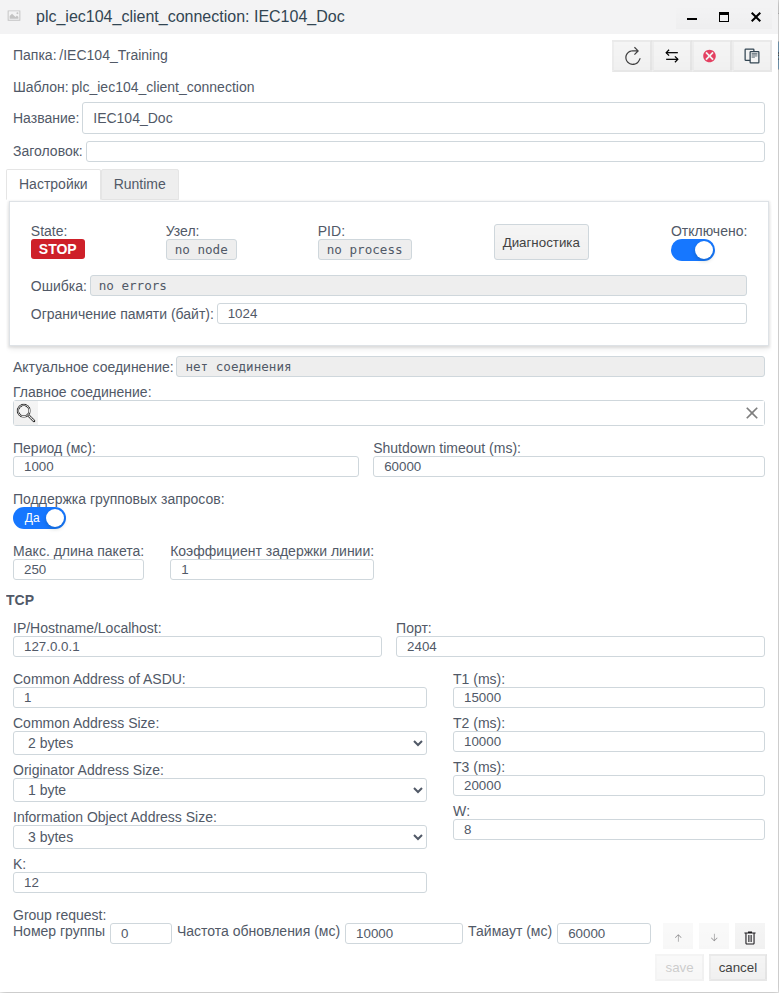
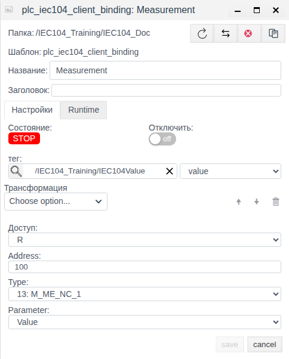

# МЭК 60870-5-104 в Faceplate: настройка клиентского соединения и привязок

Версия документации: Faceplate v4.0.7.

Руководство помогает настроить клиент IEC 60870-5-104 и связать сигналы сервера с полями тегов. Единственный практический пример показывает сохранение отключённого клиента и одной привязки без сервера. Его настройки проверены отдельным повторным открытием. Остальные возможности описаны справочно; обмен с оборудованием этим примером не подтверждается.

**Содержание**

- [Маршрут настройки](#маршрут-настройки)
- [Согласовать измерение, качество, время и команду](#согласовать-измерение-качество-время-и-команду)
- [Как работает соединение](#как-работает-соединение)
- [Что подготовить](#что-подготовить)
- [Создать соединение и настроить привязки](#создать-соединение-и-настроить-привязки)
- [Читать значение, качество и время](#читать-значение-качество-и-время)
- [Настроить запись команд](#настроить-запись-команд)
- [Управлять соединением и резервированием](#управлять-соединением-и-резервированием)
- [Справочник настроек и преобразований](#справочник-настроек-и-преобразований)
- [Диагностика и восстановление](#диагностика-и-восстановление)

[Каталог соединений](./index.md) · [Подготовка поля и привязки](./bindings.md) · [Преобразования](./transformation.md) · [Диагностика и восстановление](./diagnostics.md)

## Маршрут настройки

Подготовьте внешний источник или клиент и совместимое поле тега по общей инструкции. Затем настройте канал, сохраните полную привязку и проверьте новое значение. Для поддержанной записи/приёма отдельно подтвердите результат на внешней стороне; после исправления сбоя повторите проверку с новым контрольным значением.

[Альтернативный канал и карта сигналов](./bindings.md#настроить-альтернативный-канал) описаны одинаково для всех типов; условия переключения уточняйте по драйверу.

## Согласовать измерение, качество, время и команду

Используйте [единый каталог IEC](./iec_reference.md). Для IOA 100, Type 36: M_ME_TF_1 подготовьте float-поле Measurement.value и integer-поля Quality.value и Timestamp.value. Создайте отдельные привязки Value, QDS и TS с одинаковыми Address 100 и Type 36.

Для получения задайте R; подтвердите новое измерение 21.5→22.5 от источника в Measurement.value. Для отдельного управления подготовьте integer-поле Command.value и RW-привязку: Address 101, Type 1, Parameter Value, Remote control type 45, Remote control address 200. Команда 1 передаётся на IOA 200, обратное состояние читается с IOA 101; проверьте ACTCON/ACTTERM и независимо обратный сигнал.

Карту примера замените согласованными IOA/TypeID устройства. Качество — числовой дескриптор, TS с CP24/CP56 имеют разный смысл; старый кэш и время отправки не доказывают нового измерения. Сохраните отключённые настройки и отдельно откройте каждую привязку до рабочего включения. Это рецепты конфигурации; новые команды и внешние обновления здесь не объявляются испытанными.

## Как работает соединение

Faceplate выступает клиентом: устанавливает исходящее TCP-соединение с сервером телемеханики, принимает данные, отправляет запросы опроса и поддержанные команды. Сервером может быть RTU, контроллер или другой источник с совместимым профилем IEC 104. Серверная роль настраивается другим типом соединения.

| Понятие | Что означает |
|---|---|
| Протокол | Правила обмена IEC 60870-5-104 |
| Драйвер | Поддержка протокола в Faceplate |
| Соединение | Конкретный канал к серверу: сетевые и общие параметры обмена |
| Привязка | Выбор сигнала, атрибута, направления и конкретного поля тега |
| Тег и поле | Объект проекта и место для результата чтения либо источника задания |

Соединение содержит дочерние привязки. Оно задаёт адрес сервера и общий адрес ASDU — **CA**, а привязка — адрес информационного объекта **IOA**, тип ASDU **TypeID** и нужный атрибут. Создание соединения не создаёт теги или карту сигналов автоматически.

При чтении данные проходят путь: сервер → TCP/ASDU → внутренний кэш соединения → атрибут выбранного IOA → преобразование → приведение к типу поля → поле тега. Поле не обязано называться `value`: его выбирают явно. Период PLC управляет чтением кэша; периодические запросы серверу задаются отдельно в **Group request**. Также принимаются спорадические обновления сервера.

При записи выбранное поле служит источником задания. Его изменение проходит обратную цепочку преобразований и отправляется по командному адресу с командным TypeID. Собственное обновление поля при чтении не должно порождать обратную команду. Без ссылки на тег результат может храниться в значении самой привязки; для передачи данных в проект настройте и тег, и поле.

## Что подготовить

Для рабочего подключения получите у администратора сервера или из карты устройства:

- IPv4-адрес либо hostname и TCP-порт, доступные с узла выполнения Faceplate. Поддерживается разрешение hostname в IPv4; адрес `127.0.0.1` относится к этому узлу.
- CA и размеры адресов ASDU: CA, адреса отправителя ORG и IOA.
- Карту IOA, фактические TypeID, доступные атрибуты, единицы и типы значений.
- Поддержанные группы опроса и правила начальной/спорадической передачи.
- Для записи — командные TypeID/IOA, допустимые задания и требования к подтверждениям.

Подготовьте существующий тег с подходящим полем и права настройки учебной папки. Для числовых измерений выберите числовое поле; для полного двухэлементного состояния сохраните числовые коды, а не только boolean. Совместимость конкретного устройства определяется его профилем данных и команд.

В единственном примере используется папка **IEC104_Training** и подготовленный тег **IEC104Value** с float-полем **value**. Сервер отсутствует; сетевые и протокольные адреса ниже иллюстративные. Доступ к Студии: `http://127.0.0.1:9000/fp/studio`.

## Создать соединение и настроить привязки

Задача примера — показать настройку клиента и выбор поля тега. Клиент остаётся отключённым от первого сохранения до завершения. Проверка состоит в сохранении и отдельном повторном открытии обоих объектов.

| Настройка | Значение примера |
|---|---|
| Папка / соединение | IEC104_Training / IEC104_Doc |
| Отключено | Включено |
| IP/Hostname/Localhost / Порт | 127.0.0.1 / 2404 |
| Период (мс) / Shutdown timeout (ms) | 1000 / 60000 |
| Common Address of ASDU | 1 |
| Размеры CA / ORG / IOA | 2 / 1 / 3 байта |
| T1 / T2 / T3 | 15000 / 10000 / 20000 мс |
| K / W | 12 / 8 |
| Group request | Номер группы 0; частота 10000 мс; таймаут 60000 мс |
| Главное соединение | Пусто |

### Сохранить настройки канала

1. Откройте **Общий вид** в Студии.
2. Дважды щёлкните папку **IEC104_Training**.
3. Нажмите **Создать**, откройте группу **plc**, выберите **plc_iec104_client_connection** и нажмите **Ok**. Это имя типа в окне выбора.
4. Введите **IEC104_Doc** в **Название**; **Заголовок** оставьте пустым.
5. До первого сохранения включите **Отключено**.
6. Явно введите **127.0.0.1** в **IP/Hostname/Localhost**; не принимайте подсказку в пустом поле за введённый адрес.
7. Сверьте порт, параметры ASDU, период, таймеры и окна с таблицей.
8. В **Group request** оставьте **Номер группы = 0**. Введите **10000** в **Частота обновления (мс)** и смените фокус клавишей **Tab**. Затем введите **60000** в **Таймаут (мс)** и снова нажмите **Tab**. Пустую строку добавления группы не заполняйте.
9. Нажмите **save** и дождитесь закрытия формы.
10. Выделите строку **IEC104_Doc**, нажмите **Редактировать** и сверяйте уже сохранённые значения. Проверьте включённое **Отключено** и строку группы.
11. Закройте форму кнопкой **cancel**.

Рисунок 1. Отдельно открытое соединение после сохранения; Group request находится внизу формы.

В этом примере **STOP**, **no node**, **no process** и **нет соединения** ожидаемы: клиент отключён. **no errors** означает отсутствие показанной ошибки, а не успешное подключение к отсутствующему серверу.

### Добавить сигнал в том же примере

| Настройка привязки | Значение |
|---|---|
| Название | Measurement |
| тег / поле | /IEC104_Training/IEC104Value / value |
| Доступ | R |
| Address | 100 |
| Type | 13: M_ME_NC_1 |
| Parameter | Value |
| Трансформация | Пусто |
| Отключить | Выключено; родительское соединение остаётся отключённым |

1. Дважды щёлкните **IEC104_Doc**, чтобы открыть его дочерние объекты.
2. Нажмите **Создать**: откроется форма привязки.
3. Введите **Measurement** в **Название**.
4. Проверьте **R** в **Доступ** и пустую **Трансформация**; список **Choose option...** оставьте без выбора.
5. Введите **100** в **Address** и нажмите **Tab**.
6. Выберите **13: M_ME_NC_1** в **Type**.
7. Явно выберите **Value** в **Parameter**. Для этого типа также доступен **QDS**.
8. Нажмите лупу у **тег**, откройте **IEC104_Training**, выберите **IEC104Value** и нажмите **ОК**.
9. В соседнем списке поля явно выберите **value**. Проверьте и путь тега, и имя поля.
10. Сверьте параметры с таблицей и нажмите **save**.
11. После закрытия формы выделите **Measurement** и нажмите **Редактировать**. Проверьте сохранённые адрес, тип, атрибут, доступ, тег/поле и пустое преобразование.
12. Закройте форму через **cancel**, вернитесь в **IEC104_Training** и повторно проверьте, что **IEC104_Doc** отключён.

Рисунок 2. Отдельно открытая R-привязка после сохранения.

В списке привязка может показывать **Runtime ВКЛ** при **State Stop**: её собственное выполнение разрешено, но родительский канал отключён. Итог примера — сохранённые настройки. Значение подготовленного тега не считается полученным от сервера; чтение, запись и восстановление обмена не проверялись.

## Читать значение, качество и время

**Parameter** выбирает атрибут одного IOA. **Value** — полезное значение; **QDS**, **SIQ**, **DIQ** и другие статусные поля — упакованные числа, которые нужно интерпретировать по профилю сигнала. Для качества или времени в отдельном поле используются дополнительные привязки того же IOA с соответствующим Parameter; это справочная возможность, в практический пример они не входят.

Выбирайте **Type** по карте сервера. При чтении он не фильтрует фактический TypeID поступившего ASDU: поиск идёт по IOA. Неверный Type может дать неподходящую маску качества либо внешне успешное чтение чужого представления. Сверяйте пару Type/Parameter с картой сигналов сервера и списком Parameter для выбранного Type.

Для одноэлементного состояния Value — целое 0/1, для двухэлементного — 0…3. Приведение к boolean теряет различие нескольких кодов. Нормализованные измерения уже представлены в диапазоне −1…1; масштабируемые — как signed16, float — как IEEE32. При записи float в целочисленное поле происходит округление. Инженерные единицы и дополнительный пересчёт задаются картой устройства и преобразованием.

| Метка TS | Представление и проверка |
|---|---|
| CP24 | Миллисекунды внутри часа: миллисекунды + минуты × 60000; даты и номера часа нет. Не отображайте как полную Unix-дату |
| CP56 | Unix epoch в миллисекундах. Принятые календарные компоненты интерпретируются через локальную timezone ОС узла выполнения; настройки timezone в соединении нет |

Для CP56 неоднозначное или невозможное преобразование времени может дать отсутствие значения. При переходе от сообщения с меткой к совместимому сообщению без метки прежняя TS может сохраниться. Поэтому наличие TS не доказывает, что она пришла вместе с последним Value.

Качество не блокирует Value автоматически: даже признак недостоверности в QDS не означает ошибку чтения привязки. Для single QDS получается из SIQ с маской 254, для double — из DIQ с маской 252. BCR содержит упакованное 40-битное поле, тогда как Value счётчика — signed32. Duration и Interval возвращают числовое содержимое 16-битного поля без пересчёта в секунды.

Внутренний кэш не проверяет возраст каждого IOA. Рабочий канал и неизменное число не подтверждают свежесть. Сопоставляйте состояние с фактической передачей источника, ожидаемым изменением сигнала и смыслом его качества/времени.

## Настроить запись команд

Запись настраивается в привязке, а задание поступает из выбранного поля тега. Для обычной команды выберите **Parameter = Value**, нужный доступ и командные **Remote control type** и **Remote control address**. Эти поля видимы при **W** или **RW** и **Value**; выбор другого Parameter очищает их.

| Доступ | Поведение |
|---|---|
| R | Чтение; команды по изменению поля не отправляются |
| RW | Чтение состояния и запись при изменении задания. Обычной стартовой отправки текущего задания нет |
| W | Только запись; текущее задание отправляется при активации, переподключении и изменении активной привязки, затем при изменениях задания |

Перед применением W проверьте допустимость автоматической отправки текущего задания после восстановления. W не читает состояние устройства и не обеспечивает непрерывное поддержание задания при изменениях на самом устройстве. Изменения во время отсутствия соединения не образуют гарантированной очереди; отложенные запросы внутри работающего протокольного обмена — другой механизм.

Командный IOA может отличаться от IOA чтения. При пустых remote-control полях используются основные Address/Type. Если это информационный TypeID, передача идёт асинхронно и не имеет обычного командного подтверждения ACTCON/ACTTERM; совместимость такого режима нужно установить для конкретного сервера.

Для командных TypeID отправляется активация, ожидаются совпадающие IOA/TypeID и положительные подтверждение **ACTCON**, затем завершение **ACTTERM**. Ожидание ACTCON — 10000 мс, после него ACTTERM — ещё 10000 мс; эти интервалы не задаются T1 или таймаутом группы. Отрицательные ответы и таймауты дают `reject`, `confirm_timeout`, `not_executed`, `execute_timeout`. Во время опроса либо другой команды запрос может ожидать освобождения канала.

Отдельных полей выбора/исполнения select-before-operate и квалификаторов нет; используется их исходное нулевое значение. Для команд с CP56 берётся текущее системное время. Уточните, соответствует ли это требованиям устройства.

Задание должно после приведения и обратного преобразования быть числом. Нечисловое или отсутствующее значение может не отправляться без отдельной ошибки записи. Успешное состояние привязки само по себе не доказывает отправку. Положительное ACTTERM подтверждает протокольное завершение; фактическое положение или уставку проверяют по оборудованию и обратному сигналу. Команды в учебном примере не отправлялись.

## Управлять соединением и резервированием

| Задача рабочего проекта | Действие и проверка |
|---|---|
| Изменить настройки | Открыть нужное соединение через Редактировать, изменить поля, сохранить и отдельно открыть заново; исполняемые изменения могут перезапустить его выполнение |
| Отключить канал | Включить Отключено и сохранить; проверить STOP и отсутствие процесса; остановится обмен всех его привязок |
| Разрешить выполнение | Снять Отключено и сохранить; проверить процесс, ошибки и отдельно новые данные источника |
| Отключить один сигнал | Включить Отключить у нужной привязки; остальные сигналы канала имеют свои настройки |
| Проверить связь с тегом | Сверить существование тега, имя поля, тип и зависимости; сохранённая битая ссылка может исключить привязку из выполнения |
| Настроить резерв | У дополнительного соединения того же типа выбрать Главное соединение; проверить конфигурации и Актуальное соединение |

Резервное соединение ссылается на основное и автоматически отключается как самостоятельное выполнение. Основное не должно само ссылаться на другое главное соединение. При проблемах используются связанные конфигурации; **Актуальное соединение** показывает выбранный канал. Это общий механизм резервирования соединений; переключение подтверждают новыми данными по выбранному пути.

В учебном примере **IEC104_Doc** остаётся отключённым; включение и резервное переключение не выполнялись. Отключение либо удаление связи не гарантирует очистку ранее отображённого значения тега. Проверяйте существование канала и свежесть данных отдельно.

## Справочник настроек и преобразований

### Общие параметры соединения

Исходные отображения ниже относятся к проверенной форме; диапазоны — к настройкам её числовых полей. Они не заменяют проверку значения для выбранного сервера.

| Поле | Исходное значение / диапазон формы | Назначение и проверка |
|---|---|---|
| Название / Заголовок | Пусто; название задаётся явно, заголовок необязателен | Имя объекта и описание |
| Период (мс) | 1000; 1–3600000 мс | Циклы чтения кэша; при длительном цикле следующий начинается без дополнительной паузы |
| Shutdown timeout (ms) | 60000; 10–3600000 мс | Ожидание штатного завершения; не ожидание ответа TCP |
| Поддержка групповых запросов | Да | Общая оптимизация PLC; этот клиент не выполняет такие групповые операции |
| Макс. длина пакета | 250; 1–10000 | Общий параметр оптимизации; не предел ASDU и не настройка IEC-опроса |
| Коэффициент задержки линии | В форме 1; 1–10 | Общий параметр оптимизации; не пауза и не число повторов. В схеме исходное значение 2; при настройке через форму проверено сохранение 1 |
| Отключено | В новой форме выключено; в примере включено | Управление всем каналом |
| Главное соединение | Пусто | Независимое соединение либо ссылка резервного на основное того же типа |
| Ограничение памяти (байт) | Пусто до сохранения; 1024 после | Фактические единицы — МиБ: 1024 соответствует 1 ГиБ лимита рабочей кучи. Подпись «байт» этому не соответствует; в примере значение не меняется |

Поля группирования выше не управляют **Group request**. При выборе **Нет** их числовые параметры недоступны для изменения; наличие флажка не добавляет IEC-клиенту эту оптимизацию.

### TCP и параметры IEC104

| Поле | Исходное значение / диапазон | Назначение |
|---|---|---|
| IP/Hostname/Localhost | Подсказка 127.0.0.1; задайте явно | IPv4-адрес или hostname сервера; используется TCP с IPv4 |
| Порт | 2404; 1–65535 | Порт сервера |
| Common Address of ASDU | 1; 1–65535 | CA; должен помещаться в выбранный размер |
| Common Address Size | 2 bytes; 1 или 2 байта | Размер CA |
| Originator Address Size | 1 byte; 0 или 1 байт | Размер ORG; само значение адреса отправителя фиксировано 0 |
| Information Object Address Size | 3 bytes; 1, 2 или 3 байта | Размер IOA |
| T1 (ms) | 15000; 1–3600000 мс | Подтверждение переданных I-пакетов и тестового кадра |
| T2 (ms) | 10000; 1–3600000 мс | Отложенное подтверждение принятых I-пакетов; при редактировании ограничивается текущим T1 |
| T3 (ms) | 20000; 1–3600000 мс | Приёмная неактивность до TESTFR; ответ на тест ожидается в пределах T1 |
| K | 12; 1–32767 | Порог ограничения неподтверждённых отправленных пакетов |
| W | 8; 1–32767 | Порог принятых I-пакетов для подтверждения |

Таймеры и окна согласуются с условиями канала и требованиями сервера; они не обязаны все численно совпадать на обеих сторонах. Изменение T1 само по себе не гарантирует корректного соотношения с ранее введённым T2: сверяйте оба поля. При частичных подтверждениях фактическое ожидание может превышать T1.

Отдельного поля **To/t0** нет. Установка TCP и ожидание STARTDT имеют фиксированные интервалы по 5000 мс. Выбор TLS или сертификатов этой формой не предусмотрен.

### Group request

| Поле | Исходное значение / диапазон формы | Поведение |
|---|---|---|
| Номер группы | 0 в первой строке; 0–16 | В протоколе QOI = номер + 20: 0 означает общий опрос, 1–16 — соответствующие группы |
| Частота обновления (мс) | Пусто; 500–604800000 мс | Без целого значения — только начальный запрос; с ним следующий запрос планируется после завершения предыдущего |
| Таймаут (мс) | Пусто; 50–120000 мс | Без значения используется 60000 мс; ожидание завершения после положительного ACTCON |

Сам ACTCON ожидается до 10000 мс. Клиент может быть готов к работе до успешного окончания опроса; ошибка запроса не обязательно останавливает всё соединение. Повтор с заданной частотой планируется и после завершения через ошибку.

Добавляйте строки в пустой строке списка, удаляйте корзиной. Стрелки меняют исходный порядок; постоянный приоритет опроса ими не задаётся. Состав группы определяет сервер: отдельного назначения привязки в группу нет. Пустой список отключает запросы опроса, но допускает спорадические данные.

### Привязка

| Поле | Значение / диапазон | Как использовать |
|---|---|---|
| Папка | Родительское соединение | Привязка должна находиться непосредственно внутри нужного канала |
| Название / Заголовок | Новая форма пустая | Имя и необязательное описание сигнала |
| тег / соседний список поля | Изначально не выбраны | Выбрать существующий объект и конкретное поле; одна ссылка на тег недостаточна |
| Доступ | R; варианты R, W, RW | Направление обмена и поведение стартовой записи |
| Отключить | Выключено | Исключить отдельную привязку |
| Address | В новой форме пусто; используйте 0–16777215 | IOA чтения; форма допускает лишнюю верхнюю границу 16777216, непригодную для сохранённого основного адреса |
| Type | В новой форме не выбран; 1–21, 30–38 | Тип сигнала по карте; не фильтрует поступивший ASDU |
| Parameter | Не выбран; список зависит от Type | Value, качество, время или специальный атрибут |
| Remote control type | Пусто; 45–51, 58–64 | Тип команды; показывается при W/RW и Value |
| Remote control address | Пусто | IOA команды; должен помещаться в размер IOA, как и основной адрес |
| Трансформация | Пусто | Упорядоченная обработка; для W/RW нужна обратная цепочка |

Для IOA размером 1, 2 и 3 байта верхние представимые адреса соответственно 255, 65535 и 16777215. Если карта задаёт октеты от младшего к старшему, десятичный IOA = младший + 256 × средний + 65536 × старший. Порядок октетов в записи карты уточняйте у её автора; точечную запись нельзя автоматически считать порядком байтов протокола. CA и IOA остаются разными настройками.

### Командные TypeID

| TypeID | Тип | Представление задания |
|---|---|---|
| 45 | C_SC_NA_1 | Однобитная команда, числовое 0/1 |
| 46 | C_DC_NA_1 | Двухбитная команда; допустимые действия по карте устройства |
| 47 | C_RC_NA_1 | Двухбитная шаговая команда; смысл направления по карте |
| 48 | C_SE_NA_1 | Нормализованная уставка −1…1 |
| 49 | C_SE_NB_1 | Уставка signed16, −32768…32767 |
| 50 | C_SE_NC_1 | Уставка float32 |
| 51 | C_BO_NA_1 | Числовая 32-битная маска, 0…4294967295 |
| 58 | C_SC_TA_1 | Однобитная команда 0/1 с CP56 |
| 59 | C_DC_TA_1 | Двухбитная команда с CP56 |
| 60 | C_RC_TA_1 | Шаговая команда с CP56 |
| 61 | C_SE_TA_1 | Нормализованная уставка −1…1 с CP56 |
| 62 | C_SE_TB_1 | Уставка signed16, −32768…32767 с CP56 |
| 63 | C_SE_TC_1 | Уставка float32 с CP56 |
| 64 | C_BO_TA_1 | 32-битная маска 0…4294967295 с CP56 |

Это представления данных, а не разрешения на произвольные действия устройства. Реальные значения, биты, направления, пределы и единицы берите из его карты. Автоматическое безопасное ограничение значения диапазоном кодирования не гарантируется.

### Преобразования

Пустая **Трансформация** не изменяет значение до приведения к типу поля. Методы добавляются через **Choose option...**, выполняются сверху вниз; обратная цепочка записи — в обратном порядке. Числовые поля методов отображают до 6 знаков после запятой; это не точность протокола.

| Метод | Параметры и начальные значения | Чтение / запись |
|---|---|---|
| Scaling | Factor = 1, Shift = 0; числовые, без заданных границ формы | Чтение: X × Factor + Shift. Запись: (X − Shift) / Factor; для записи Factor не должен быть 0 |
| Default Value | Value = 0; число | Сохраняет любой числовой вход; нечисловой, включая отсутствие данных, заменяет этим числом. При записи пропускает вход без изменения |
| Limit Control | Lower Limit = 0, Upper Limit = 0; задайте Upper выше Lower | Чтение: вне включительных границ — отсутствие значения. Запись: ограничение ближайшей границей. Исходная пара 0/0 требует исправления |
| Damper | Tlag = 1; в форме минимум 1, в расчёте миллисекунды | Сглаживает с учётом времени и истории; первый числовой вход пропускает. При записи пропускает задание без фильтрации |
| Derivative | Специальных числовых полей нет | Разность значений / прошедшие миллисекунды; первый результат отсутствует. Для R; обратного преобразования нет |
| Integration | Специальных числовых полей нет | Накапливает текущее значение × прошедшие миллисекунды; первый результат отсутствует. Для R; обратного преобразования нет |
| Script | Erlang, таблица переменных и текст функции | Получает Input, Context, State; возвращает Output и новое State. Для R; обратного преобразования нет |

Для W/RW список со Script, Derivative или Integration не подходит: требуется обратное преобразование. Для Script переменные задаются именем, тегом и полем; Context содержит их значения, State хранится между вызовами и начинается без значения. Перезапуск или перенастройка сбрасывает историю. Успешная компиляция текста не подтверждает работу вычисления на реальных данных.

Порядок методов меняет результат: Default Value после метода, давшего отсутствие значения, может подставить число. Такая подстановка не исправляет причину ошибки связи. Единицы Derivative — единицы входа на миллисекунду, Integration — единицы входа × миллисекунды; автоматического пересчёта в секунды нет.

## Диагностика и восстановление

Различайте разрешение выполнения, работающий канал и поступление нужных данных. Общий успешный цикл не означает успешность каждого IOA.

| Признак | Что проверять |
|---|---|
| Runtime ВКЛ / ВЫКЛ, Отключено | Разрешено ли выполнение; у привязки и соединения оно отдельное |
| State RUN / STOP, PID, Узел | Состояние рабочего процесса; не подтверждение свежего сигнала |
| Актуальное соединение | Какой основной/резервный канал выбран |
| Ошибка соединения | Проблема канала; no errors само по себе не подтверждает данные |
| Состояние, error и value привязки | Результат конкретного сигнала и преобразования; сравнивать с выбранным полем тега |
| Число в поле тега | Может быть прежним или подставленным; нужно подтверждение нового поступления |

Общая **Диагностика** служит для просмотра процессов и журнала. **Start/Stop** управляют сбором журнала; Stop здесь не останавливает соединение. Доступны уровни **info**, **warning**, **error**, **debug** и **Log limit**: исходно 1000, диапазон 1–100000 строк. Пустой журнал не является признаком исправности. В единственном примере окно диагностики не воспроизводилось.

| Симптом | Проверка | Действие | Подтверждение результата |
|---|---|---|---|
| STOP / no process | Отключение, папка/узел, зависимости | Для рабочего канала устранить запрет выполнения; учебный оставить отключённым | Появился процесс; данные проверены отдельно |
| Ошибка TCP/STARTDT/ASDU | Host/порт, доступ с узла выполнения, CA и размеры | Сверить канал и профиль сервера | Подтверждены канал и нужные данные |
| address_not_available / invalid_parameter | IOA в кэше, фактический тип и атрибут, опрос | Исправить адрес/Parameter, обеспечить передачу сервером | Нужный атрибут появился в правильном поле |
| Опрос не повторяется или завершается ошибкой | Номер группы, update, подтверждение и завершение | Сверить группу и интервалы с сервером | Получены новый ответ и ожидаемые данные |
| RUN/OK со старым числом, качеством или TS | Реальный входящий поток, состояние источника, смысл TS/QDS | Проверить передачу конкретного сигнала, а не только heartbeat | Известное новое изменение либо свежий ответ сопоставлен с полем тега |
| Неверное значение | Тип поля, нормализация, единицы, цепочка преобразований | Исправить представление и пересчёт | Значение соответствует карте и источнику |
| Команда не отправлена/отвергнута либо повторилась после восстановления | W/RW, числовое задание, reverse, Type/IOA и подтверждения | Проверить исходное задание и профиль команды | Протокольное завершение и фактическое состояние оборудования проверены отдельно |
| Пустой журнал | Сбор, уровень, лимит и процесс | Настроить сбор и сверить состояние канала/сигнала | Есть относящиеся к проблеме сообщения и независимая проверка данных |

После восстановления проверяйте известное новое значение источника либо свежий ответ/ASDU, сопоставленный с выбранным полем тега. Исчезновение ошибки, RUN/OK, новый PID и сохранение прежнего числа недостаточны. Ошибка чтения может передать в поле отсутствие данных через преобразование, а Default Value — заменить его числом. Восстановление обмена и физический результат в данном примере не проверялись.
