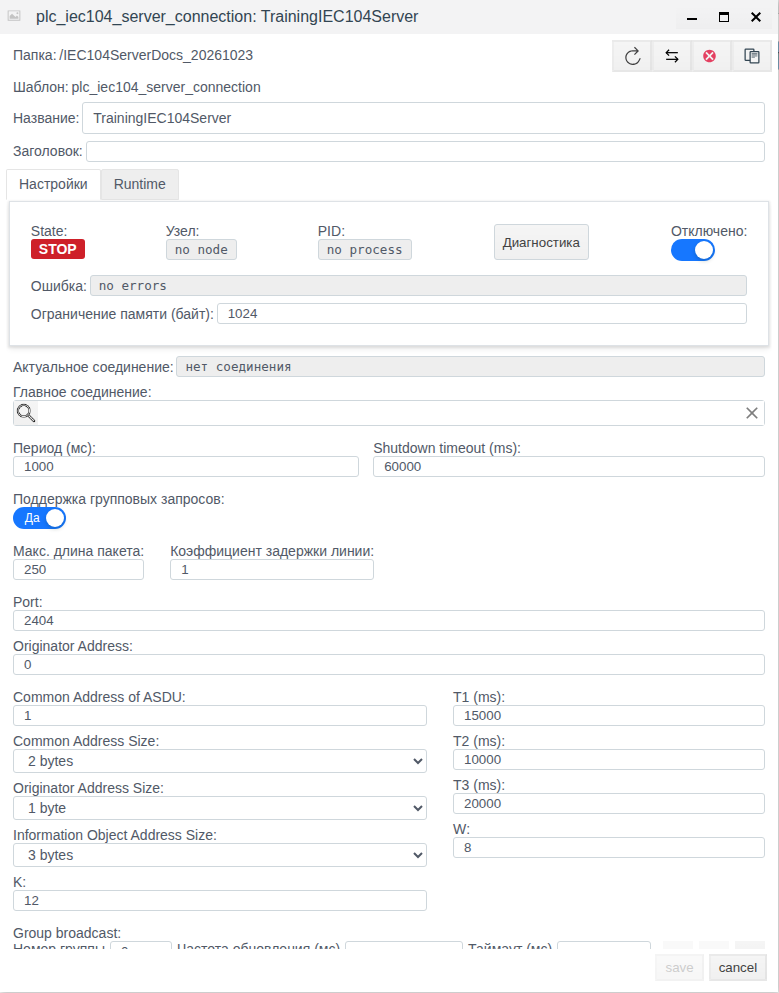
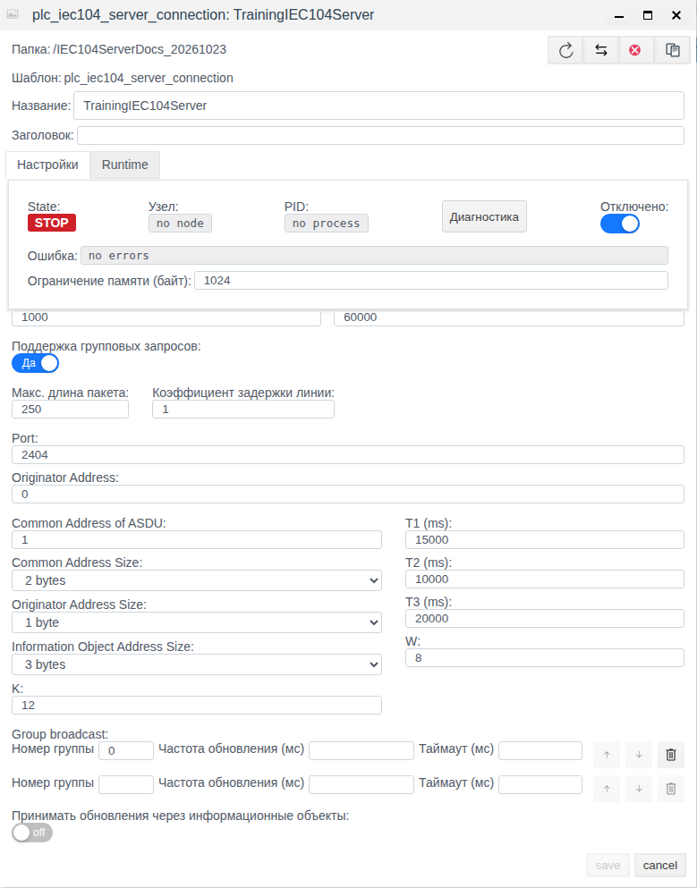
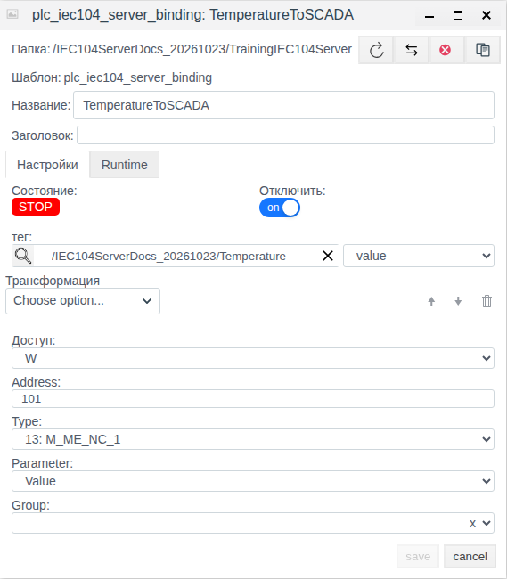

# МЭК 60870-5-104 — сервер: настройка соединения и обмена данными в Faceplate

Версия документации: Faceplate v4.0.7.

Руководство помогает предоставить данные Faceplate внешней SCADA и настроить приём её команд. Единственный практический пример показывает конфигурацию сервера и публикацию поля температуры. В примере проверены сохранение и отдельное повторное открытие; соединение и привязка оставлены отключёнными. Клиентский обмен не выполнялся.

**Содержание**

- [Маршрут настройки](#маршрут-настройки)
- [Согласовать измерение, качество, время и команду](#согласовать-измерение-качество-время-и-команду)
- [Назначение и схема обмена](#назначение-и-схема-обмена)
- [Подготовка к настройке](#подготовка-к-настройке)
- [Настройка соединения и публикация тегов](#настройка-соединения-и-публикация-тегов)
- [Приём команд и информационных обновлений](#приём-команд-и-информационных-обновлений)
- [Группы, качество, время и преобразования](#группы-качество-время-и-преобразования)
- [Управление соединением](#управление-соединением)
- [Проверка данных и восстановления обмена](#проверка-данных-и-восстановления-обмена)
- [Диагностика](#диагностика)
- [Справочник настроек](#справочник-настроек)

[Каталог соединений](./index.md) · [Подготовка поля и привязки](./bindings_ru.md) · [Преобразования](./transformation_ru.md) · [Диагностика и восстановление](./diagnostics_ru.md)

## Маршрут настройки

Подготовьте внешний источник или клиент и совместимое поле тега по общей инструкции. Затем настройте канал, сохраните полную привязку и проверьте новое значение. Для поддержанной записи/приёма отдельно подтвердите результат на внешней стороне; после исправления сбоя повторите проверку с новым контрольным значением.

[Альтернативный канал и карта сигналов](./bindings_ru.md#настроить-альтернативный-канал) описаны одинаково для всех типов; условия переключения уточняйте по драйверу.

## Согласовать измерение, качество, время и команду

Используйте [единый каталог IEC](./iec_reference_ru.md). Для IOA 100, Type 36: M_ME_TF_1 подготовьте float-поле Measurement.value и integer-поля Quality.value и Timestamp.value. Создайте отдельные привязки Value, QDS и TS с одинаковыми Address 100 и Type 36.

Для публикации задайте W и одинаковую Group у атрибутов объекта. Измените Measurement.value 21.5→22.5 и подтвердите новое 22.5 у внешнего ведущего/клиента. Для входящей команды создайте R-привязку с Address 101, Type 1, Parameter Value, Remote control type 45 и Remote control address 200, связанную с отдельным полем Command.value. Запись клиентом числового 1 на IOA 200 должна обновить серверную модель, затем это поле; ACTCON/ACTTERM не подтверждают физическое действие.

Карту примера замените согласованными IOA/TypeID устройства. Качество — числовой дескриптор, TS с CP24/CP56 имеют разный смысл; старый кэш и время отправки не доказывают нового измерения. Сохраните отключённые настройки и отдельно откройте каждую привязку до рабочего включения. Это рецепты конфигурации; новые команды и внешние обновления здесь не объявляются испытанными.

## Назначение и схема обмена

Сервер МЭК 60870-5-104 представляет Faceplate как контролируемый пункт. Он открывает TCP-порт, принимает подключения клиентов и предоставляет им информационные объекты. Источником публикуемого значения служит выбранное поле тега Faceplate. Клиент также может передавать команды в серверную модель данных, откуда привязка переносит результат в поле проекта.

| Понятие | Что означает |
|---|---|
| Протокол | Правила передачи кадров и ASDU МЭК 60870-5-104 по TCP |
| Драйвер | Реализация серверной роли протокола в Faceplate |
| Соединение | Конкретный серверный канал: порт, общая адресация, таймеры и рассылки |
| Привязка | Соответствие атрибута информационного объекта конкретному полю тега и направлению передачи |
| Тег и поле | Объект проекта и выбранное поле, которое служит источником или получателем данных |
| Серверный кэш | Хранимые информационные объекты сервера; их наличие не доказывает новый обмен с клиентом |

Роль определяется выбранным типом соединения. Здесь настраивается TCP-сервер. Сетевой адрес узла Faceplate сообщает администратор клиенту; поля удалённого хоста в этом соединении нет. Выбор отдельного локального интерфейса, TLS и сертификатов в форме этого драйвера не предусмотрен.

**Публикация:** поле тега → обратное преобразование привязки → атрибут серверного кэша → клиент. **Приём:** команда или разрешённое информационное обновление клиента → серверный кэш → прямое преобразование и приведение типа → выбранное поле тега.

Создание соединения не создаёт теги автоматически. Привязка должна находиться непосредственно внутри своего соединения. Для связи с проектом нужно выбрать и тег, и его конкретное поле; одинаковые имена объектов такой связи не создают.

В протокольных обозначениях **ASDU** — блок данных прикладного уровня, **IOA** — адрес информационного объекта, **TypeID** — идентификатор его типа. **ACK** означает подтверждение, **ACTCON** — подтверждение активации, **ACTTERM** — завершение активации. **GI** — общий опрос, **QOI** — его квалификатор, **COT** — причина передачи. **STARTDT** разрешает передачу данных в клиентской сессии, **TESTFR** проверяет её активность. **TTL** — срок хранения или актуальности значения.

## Подготовка к настройке

До рабочего включения согласуйте карту обмена и сетевые параметры.

| Что получить | Зачем это нужно |
|---|---|
| Узел выполнения Faceplate, его сетевой адрес и свободный TCP-порт | Клиент подключается к этому узлу; порт открывается на узле выполнения |
| Common Address of ASDU (COA), Originator Address и размеры адресов | Обе стороны должны одинаково разбирать заголовок ASDU |
| Карта IOA и TypeID | IOA адресует объект, TypeID задаёт его протокольное представление |
| Направление каждого сигнала и карта команд | Публикация и приём имеют разные настройки; адрес команды может отличаться от адреса информационного объекта |
| Поля тегов, их типы, единицы и допустимые значения | Привязка работает с выбранным полем, а не со всем тегом |
| Группы, условия отправки, качество и источник времени | Эти свойства не определяются автоматически по наличию значения в теге |
| Согласованные K, W, T1, T2 и T3 | Окна и таймеры должны соответствовать условиям канала и настройкам клиента |
| Права в Студии и место создания объектов | Для настройки нужны права создания и изменения в выбранной папке |

Для сохранения конфигурации клиент не требуется. Для проверки реальной передачи нужен клиент с известной картой данных и возможностью увидеть принятые значения или отправленные команды.

В учебной папке **IEC104ServerDocs_20261023** заранее подготовлен тег **Temperature**: поле **value**, тип float, исходное число **21.5**, смысл — температура в °C. Тип и тег в этом примере не создаются. В своём проекте используйте подготовленное числовое поле с понятным назначением.

| Объект | Перед примером | Результат настройки |
|---|---|---|
| Temperature | Уже существует, value = 21.5 | Источник выбранного поля |
| TrainingIEC104Server | Отсутствует | Сохранённое отключённое соединение |
| TemperatureToSCADA | Отсутствует | Сохранённая отключённая W-привязка внутри соединения |

## Настройка соединения и публикация тегов

### Пример настройки сервера для публикации температуры

Задача — описать публикацию **Temperature.value** по IOA **101**. Используется **W**: поле тега служит источником серверного объекта. Преобразование не требуется, поэтому число сохраняет физический смысл °C. Тип **13: M_ME_NC_1** представляет значение в формате float без временной метки.

#### Сохранить соединение

| Поле | Значение примера |
|---|---|
| Название | TrainingIEC104Server |
| Отключено | Включено |
| Период (мс) | 1000 |
| Shutdown timeout (ms) | 60000 |
| Port | 2404 |
| Originator Address | 0 |
| Common Address of ASDU | 1 |
| Common Address Size | 2 bytes |
| Originator Address Size | 1 byte |
| Information Object Address Size | 3 bytes |
| K / W | 12 / 8 |
| T1 (ms) / T2 (ms) / T3 (ms) | 15000 / 10000 / 20000 |
| Group broadcast | Частота обновления и таймаут не заполнены |
| Принимать обновления через информационные объекты | Выключено |

1. В общем дереве проекта откройте папку **IEC104ServerDocs_20261023** двойным щелчком.
2. Выделите **Temperature**, нажмите **Редактировать**, проверьте **value = 21.5** и закройте форму кнопкой **cancel**.
3. Нажмите **Создать**. В выборе типа откройте группу **plc**, выберите серверное соединение МЭК 60870-5-104 и нажмите **Ok**.
4. Сразу включите **Отключено**, чтобы сохранить подготовленную конфигурацию без запуска сервера.
5. Введите **TrainingIEC104Server** в **Название**.
6. Сверьте поля с таблицей. Если нужные значения уже заполнены, оставьте их. **Заголовок** и **Главное соединение** оставьте пустыми.
7. В **Group broadcast** не задавайте частоту. Нулевая строка группы и пустая строка ввода могут оставаться видимыми: без частоты расписание не создаётся. Флаг приёма информационных объектов оставьте выключенным.
8. Нажмите **save** и дождитесь закрытия формы.
9. Выделите сохранённую строку **TrainingIEC104Server** и нажмите **Редактировать**. Сверьте параметры и включённое **Отключено** в заново открытой форме.

В проверке отображались **STOP**, **no node**, **no process**, **no errors** и **Актуальное соединение: нет соединения**. Это ожидаемое состояние отключённого примера. Оно не подтверждает работу TCP-сервера.

Рисунок 1. Отдельно повторно открытое соединение: отключение включено, параметры сохранены.

Рисунок 2. Group broadcast без заданной частоты и выключенный приём информационных объектов.

Закройте форму кнопкой **cancel**, затем продолжите настройку внутри этого же соединения.

#### Связать поле температуры с информационным объектом

| Поле | Значение примера |
|---|---|
| Название | TemperatureToSCADA |
| Отключить | Включено |
| тег | Temperature из учебной папки |
| Поле справа от тег | value |
| Доступ | W |
| Address | 101 |
| Type | 13: M_ME_NC_1 |
| Parameter | Value |
| Group | Пусто |
| Трансформация | Пустая цепочка, Choose option... |

1. Двойным щелчком по **TrainingIEC104Server** откройте его содержимое.
2. Нажмите **Создать** — откроется форма привязки.
3. Сразу включите **Отключить**. Эта подпись относится к привязке; у соединения используется **Отключено**.
4. Введите **TemperatureToSCADA** в **Название**, оставьте **Заголовок** пустым.
5. В **Доступ** измените исходное **R** на **W**.
6. Нажмите лупу у **тег**, откройте учебную папку, выделите **Temperature** и нажмите **ОК**.
7. В отдельном списке справа от **тег** явно выберите **value**.
8. Укажите **Address = 101**, выберите **Type = 13: M_ME_NC_1** и затем **Parameter = Value**. После смены типа параметр не выбирается автоматически.
9. Оставьте **Group** и цепочку **Трансформация** пустыми. Для W поля телеуправления скрыты; в этом примере они не заполняются.
10. Нажмите **save** и дождитесь закрытия формы.
11. Выделите сохранённую **TemperatureToSCADA**, нажмите **Редактировать** и сверьте значения таблицы, включая тег, поле и включённое **Отключить**.
12. Закройте форму кнопкой **cancel**. Соединение и привязка остаются отключёнными.

Рисунок 3. Сохранённая W-привязка к Temperature.value: IOA 101, тип 13, параметр Value, состояние STOP.

Результат примера — сохранённое соответствие **Temperature.value → информационный объект 101**. Число **21.5** было подготовлено заранее. Его наличие в поле не является результатом обмена с клиентом; запуск listener и передача значения здесь не проверялись.

## Приём команд и информационных обновлений

**Доступ** задаёт направление работы привязки относительно серверного кэша, а не права клиента.

| Доступ | Поле тега → кэш | Кэш → поле тега | Сопоставление входящих команд |
|---|---|---|---|
| W | Начальная запись при запуске соединения, затем изменения поля | Нет | Не используется как цель команды |
| R | Нет | Циклическое чтение выбранного атрибута | Поддерживается через remote-поля |
| RW | Изменения поля | Циклическое чтение выбранного атрибута | Поддерживается через remote-поля |

В стандартной конфигурации начальная публикация текущего поля при старте гарантирована для W. Для RW такого общего правила нет: пустая серверная точка может дать отсутствующее значение, затем 0 в поле тега. До рабочего включения RW определите источник и порядок начальной установки значения. Обновление поля самим чтением не должно рассматриваться как новая внешняя команда.

### Команды телеуправления

В форме при **R** и **RW** доступны **Remote control type** и **Remote control address**. Они задают ожидаемый тип команды C_* и её IOA. **Address** остаётся адресом информационного объекта; командный адрес может отличаться. Входящая команда обновляет серверный объект, затем привязка переносит его атрибут через преобразование в выбранное поле тега.

Remote-поля можно оставить пустыми при сохранении. Это не готовая настройка приёма C-команды: без совпадающих типа и адреса команда не найдёт привязку. Одна команда может сопоставляться с несколькими информационными объектами. Сопоставление не ограничивается выбором **Parameter = Value**, поэтому remote-поля должны быть заполнены только у предназначенных для команды привязок.

Положительные **ACTCON** и **ACTTERM** подтверждают обработку серверной модели, а не завершённое изменение поля тега или оборудования. Перенос в поле выполняется следующим циклом с преобразованием и приведением типа. Для физического результата нужна отдельная обратная связь.

Отдельный контроль последовательности **select-before-execute (SBO)** не реализован; нельзя рассчитывать на подтверждённую двухэтапную семантику выбора и исполнения. Дополнительные командные признаки SCO/DCO/RCO/QOS не передаются в поле как самостоятельные атрибуты. Опрос счётчиков C_CI_NA_1 получает отрицательное подтверждение; C_CS_NA_1 не устанавливает часы узла.

### Информационные обновления M_*

**Принимать обновления через информационные объекты** — отдельное разрешение входящих M-объектов. Оно выключено по умолчанию и не требуется для обычных C-команд. При включении полученный объект обновляет кэш непосредственно по своему IOA, без сопоставления remote-полей и без проверки доступа привязки на этапе записи кэша. R/RW затем переносит выбранный атрибут в поле; W обратно кэш не читает.

Принимаются информационные типы 1–21, 30–38 и 70. Тип 70 не доступен как Type привязки. В кэш могут попасть и объекты без привязок. Немедленная спорадическая пересылка такого входящего обновления остальным клиентам не гарантируется; общий кэш доступен им при опросе или периодической рассылке.

## Группы, качество, время и преобразования

### Группы и отправка клиентам

Изменение серверного кэша может вызвать спорадическую отправку. **Период (мс)** соединения задаёт цикл чтения кэша привязками, а не период внешнего опроса клиента и не расписание рассылки.

| Настройка | Назначение |
|---|---|
| Group привязки: пусто | Объект участвует в общем опросе, но не относится к отдельной группе |
| Group 1 … Group 16 | Принадлежность информационного объекта отдельной группе |
| Group broadcast / Номер группы 0 | Периодический снимок всего кэша, если задана частота |
| Group broadcast / Номер группы 1–16 | Периодический снимок соответствующей группы |
| Частота обновления (мс) | 500–604800000; заполненное целое число включает первую немедленную и последующие периодические рассылки для клиентской сессии |
| Таймаут (мс) | В форме 50–120000; серверная рассылка это поле не использует, оно не задаёт ожидание ответа клиента |

Логические номера 0–16 соответствуют **QOI 20–36** на проводе: 0 → общий опрос 20, 1 → 21, 16 → 36. Для запроса клиента **C_IC_NA_1** строка Group broadcast не нужна. Ответ включает ACTCON, выбранные данные и ACTTERM; данные имеют COT 20 + номер группы. Периодический снимок передаётся с COT 3. Перестановку строк не следует трактовать как гарантированный приоритет опроса.

Несколько клиентов используют общий кэш и собственные сессии. Последняя запись в один IOA влияет на общий объект. Числовой предел клиентов в форме не задаётся; это не обещание неограниченной производительности. Повторный вызов записи кэша может вызвать отправку и того же значения; очередь может объединять ещё не отправленные обновления одного IOA. Обычное чтение кэша само по себе новой публикации не создаёт.

### Качество и временная метка

Для значения, качества и времени одного объекта используют отдельные совместимые привязки с одинаковым IOA. Согласуйте у них **Type** и **Group**: один кэш-объект имеет один тип и одну группу. Одновременный атомарный снимок нескольких полей тегов не обеспечивается.

Качество — числовой атрибут протокола, который не формируется автоматически из RUN/STOP, ошибки или возраста значения. Отсутствующий атрибут качества обычно кодируется как 0; это не независимое подтверждение исправности источника.

**TS** зависит от типа: CP24 содержит миллисекунды внутри часа, CP56 — Unix-время в миллисекундах с преобразованием через локальное время узла выполнения. Изменение Value автоматически не обновляет явно заданный TS. Если TS для CP56 не задан, используется время кодирования ASDU, поэтому новое время отправки может относиться к старому значению.

### Преобразования

При приёме применяется прямая цепочка сверху вниз, затем тип поля тега. При публикации выполняется выходное приведение типа и обратная цепочка в обратном порядке. При пустой цепочке преобразования не выполняются, приведение типа сохраняется.

| Пункт меню | При приёме R/RW | При публикации W/RW |
|---|---|---|
| Scaling | Value × Factor + Shift | (Value − Shift) / Factor; Factor не равен 0 |
| Default Value | Заменяет нечисловой вход заданным числом | Пропускает значение |
| Limit Control | Значение вне Lower/Upper Limit становится отсутствующим | Ограничивает значение границами; Upper должен быть больше Lower |
| Damper | Сглаживание; Tlag > 0, в мс | Пропускает значение |
| Скрипт | Пользовательская функция Erlang с входом, контекстом полей и состоянием | Обратное преобразование не поддерживается |
| Derivative | Производная; первый результат отсутствует | Не поддерживается |
| Integration | Интеграл; первый результат отсутствует | Не поддерживается |

Для W/RW требуется возможность обратного преобразования: Скрипт, Derivative и Integration для этих направлений не подходят. Время Derivative/Integration берётся в миллисекундах; учитывайте это в физических единицах результата. Порядок операций меняется стрелками, удаление — корзиной.

При преобразовании float в integer используется округление; integer в float становится вещественным. Bool при публикации даёт 1 или 0, при приёме порог равен 0.5. Строковое значение при публикации пытается преобразоваться в число. Ошибка прямой цепочки даёт отсутствующее значение; при ошибке обратной цепочки запись может продолжиться с исходным приведённым числом без ожидаемого преобразования. Поэтому проверяйте результат, а не только успешное сохранение цепочки.

## Управление соединением

| Действие | Как выполнить | Что проверить |
|---|---|---|
| Изменить параметры | Выделить объект → Редактировать → изменить → save | Отдельно открыть снова и сверить параметры |
| Отключить соединение | Включить Отключено и сохранить | STOP, отсутствие рабочего процесса; значения тегов могут сохраняться |
| Включить рабочий сервер | После подготовки клиента и канала выключить Отключено и сохранить | Разрешение Runtime/папок/узла, listener, клиентскую сессию и новые данные проверить отдельно |
| Отключить привязку | Включить её Отключить и сохранить | Исключение из циклического переноса и локальной подписки; это не удаление IOA из кэша |
| Изменить адрес или удалить точку | Проверить её связь с полем и изменить нужный объект | Старый IOA может оставаться в работающем кэше и возвращаться общим опросом |

В единственном учебном примере включение, удаление и проверка обмена не выполнялись. Действия выше поясняют управление рабочей конфигурацией.

Изменение исполняемых параметров соединения перезапускает сервер и создаёт новый кэш; W заново публикует исходные поля при запуске. Переподключение только клиента не равнозначно перезапуску сервера. Изменение или удаление привязки не удаляет старый кэш-объект автоматически; актуальный состав модели после удаления IOA требует отдельного учёта и перезапуска сервера в подходящий момент.

Отключение привязки также не является универсальным запретом сопоставления входящих C-команд. Для запрета приёма проверьте командную карту и заполненные remote-поля; остановка самого соединения прекращает его серверное выполнение.

При общей ошибке канала W не переписывает исходное поле тега. В стандартной конфигурации R/RW может передать в поле отсутствующее значение или замену Default Value. Runtime-значение привязки при общей ошибке может остаться прежним; при индивидуальной ошибке оно может стать результатом обработки отсутствующего входа. Такое число не подтверждает свежесть.

## Проверка данных и восстановления обмена

| Уровень | Что подтверждает | Чего недостаточно |
|---|---|---|
| Отключено / Отключить | Разрешение выполнения объекта | Сохранённый флаг не доказывает клиентскую связь |
| Сохранение и повторное открытие | Параметры приняты и сохранены | Не подтверждает TCP или ASDU |
| RUN соединения | Работа локального процесса и цикла | RUN возможен без клиента |
| RUN привязки | Успешная локальная операция с кэшем | Не подтверждает отправку или свежесть внешних данных |
| TCP и STARTDT | Клиентская сессия и разрешённая передача | Не доказывает правильный IOA и результат выбранного сигнала |
| Новое ожидаемое значение | Передача конкретного сигнала в нужном направлении | Старое число и положительный ACK не заменяют эту проверку |
| Обратная связь оборудования | Фактическое действие | Запись тега сама по себе не подтверждает физический результат |

Для публикации в рабочем проекте подтвердите у клиента приём нового известного значения на нужном IOA. Для приёма подтвердите новую команду или разрешённый M-объект и новое значение именно выбранного поля тега с учётом преобразования.

После разрыва восстановите сессию, затем выполните подходящее для направления новое изменение. Проверяйте данные, полученные после восстановления. Исчезновение ошибки, прежний снимок GI или сохранённое число недостаточны: кэш не имеет TTL и не очищается при отключении клиента. Автоматическое время CP56 также может быть временем кодирования старого значения.

## Диагностика

У сохранённого соединения кнопка **Диагностика** доступна и при STOP. В окне используются **Start**, **Stop**, **Log level**, **Log limit**, очистка и копирование журнала. Start/Stop управляют сбором диагностической информации; самим соединением управляет **Отключено**. Уровни — error, warning, info, debug; исходный уровень info, лимит 1000 строк.

| Симптом | Проверить и исправить | Признак результата |
|---|---|---|
| STOP, no process | Отключено, разрешения выполнения папок/Runtime, узел и ошибку | Процесс запущен; клиент и данные проверены отдельно |
| Порт не открывается / eaddrinuse | Конфликт listener, выбранный порт и завершение предыдущего процесса | Нужный сервер открыл порт; затем проверена клиентская сессия |
| RUN, но клиент не получает сигнал | Адрес узла/порт клиента, COA/размеры, STARTDT, W, IOA/Type/Parameter | Новый сигнал принят клиентом |
| Команда отклонена / no_bindings_found | Remote type/address, R/RW, родительское соединение и COA | Новая команда обработана, затем обновлено поле |
| ACK есть, поле не изменилось | Выбранный тег/поле, отключение привязки, период и преобразование | Получено новое ожидаемое значение поля |
| M-объект не поступает в тег | Флаг приёма, полученный IOA и R/RW | Новый M-объект перенесён в поле |
| Значение, качество или время неверны | Совместимость Type/Parameter, диапазон, единицы, CP24/CP56 и часовой пояс узла | Приняты новые согласованные атрибуты |
| Удалённый IOA остался в GI | Сохранённый кэш после изменения/удаления привязки | Состав модели соответствует новым настройкам после её обновления |
| После восстановления отображается старое число | Отсутствие TTL, fallback-преобразование, состояние и новый обмен | Принято известное новое значение после восстановления |

Ошибки ASDU или отдельной команды могут попасть в журнал без STOP всего соединения. Пустой журнал не подтверждает исправность канала. Сопоставляйте сообщения с состоянием конкретной привязки и фактическими данными.

## Справочник настроек

### Общие поля соединения

| Поле | Исходное значение / диапазон | Назначение |
|---|---|---|
| Название / Заголовок | Имя обязательно, описание необязательно | Идентификация объекта; в примере описание пустое |
| Период (мс) | 1000; 1–3600000 | Цикл чтения серверного кэша; также участвует в ожидании повторного подключения |
| Shutdown timeout (ms) | 60000; форма 10–3600000 | Ожидание завершения процесса, не ответа клиента |
| Поддержка групповых запросов | В форме Да | Общий механизм PLC; у этого драйвера не включает пакетные чтения и не заменяет Group broadcast |
| Макс. длина пакета | В форме 250; 1–10000 | Для этого сервера не задаёт длину ASDU и не влияет на рассылку |
| Коэффициент задержки линии | В форме 1; 1–10 | Для этого сервера не задаёт паузу или период рассылки |
| Отключено | В новой форме выключено; в примере включено | Общее разрешение выполнения соединения |
| Главное соединение | Необязательно, пусто | Общий механизм резервирования: совместимый тип, без циклических ссылок; при указании главного текущее соединение автоматически отключается от самостоятельного выполнения |
| Актуальное соединение | Заполняет система | Путь выбранного канала, а не адрес клиента; в отключённом примере нет соединения |
| Ограничение памяти (байт) | В новой форме пусто; после сохранения 1024 | Несмотря на подпись, число обрабатывается в МиБ: 1024 соответствует 1 ГиБ; поле примера не меняется |
| State, Узел, PID, Ошибка | Заполняет система | Рабочий процесс и его диагностика; не критерий свежести сигнала |

### Протокольные поля соединения

| Поле | Default / допустимое значение | Как выбрать и проверить |
|---|---|---|
| Port | 2404; 1–65535 | Входящий порт на узле Faceplate, согласованный с клиентом |
| Originator Address | 0; 0–255 | Однобайтовый ORG; форма допускает более широкий ввод, но корректное значение не превышает 255 |
| Common Address of ASDU | 1; 1–65535 | COA должен совпасть у сторон и помещаться в Common Address Size |
| Common Address Size | 2 bytes; 1 или 2 байта | При 1 байте COA 1–255, при 2 байтах 1–65535 |
| Originator Address Size | 1 byte; 0 или 1 байт | При 0 ORG отсутствует в ASDU; отдельного размера COT в форме нет |
| Information Object Address Size | 3 bytes; 1–3 байта | IOA: 0–255 / 0–65535 / 0–16777215; значение и размер автоматически не согласуются |
| K | 12; 1–32767 | Окно исходящих неподтверждённых I-кадров; реализация может допустить на 1 кадр больше K |
| W | 8; 1–32767 | Порог числа входящих I-кадров для S-подтверждения; согласованность K/W автоматически не проверяется |
| T1 (ms) | 15000; форма 1–3600000 | Ожидание подтверждения; confirmation_timeout завершает сессию. Частичное подтверждение может продлить фактическое ожидание |
| T2 (ms) | 10000; форма 1–3600000 | Задержка S-подтверждения; редактор ограничивает изменяемое значение текущим T1 |
| T3 (ms) | 20000; форма 1–3600000 | Простой входящего канала до TESTFR; затем ответ ожидается T1, иначе heartbeat_timeout |
| Group broadcast | Без заданной частоты расписания нет | Номер группы, частота и неиспользуемый сервером таймаут описаны в разделе о группах |
| Принимать обновления через информационные объекты | false / off | Разрешение входящих M-объектов; отдельно от C-команд |

Таймеры протокола не задают срок актуальности значения. Несовпадение входящего COA приводит к invalid_common_address_received. ORG не является механизмом допуска команд.

### Поля привязки

| Поле | Исходное значение / допустимое значение | Назначение |
|---|---|---|
| Название / Заголовок | Имя обязательно, описание необязательно | Имя привязки внутри непосредственного родительского соединения |
| тег и список поля | Не выбраны | Объект и конкретное поле; без полной пары используется собственное runtime-значение привязки, а не поле проекта |
| Доступ | R; R/W/RW | Направление относительно кэша; не права клиента |
| Отключить | Выключено; в примере включено | Прекращает обычный перенос этой привязки, не очищая кэш |
| Трансформация | Пусто | Цепочка обработки; W/RW требует обратного направления |
| Address | 1; 0–16777215 | IOA объекта, дополнительно ограниченный размером адреса. Ввод 16777216, допускаемый формой, не является корректным трёхбайтовым IOA |
| Type | 1; 1–21, 30–38 | Информационный TypeID |
| Parameter | Обязателен, автоматически не выбран | Атрибут выбранного Type; после смены Type проверьте выбор повторно |
| Group | Пусто; Group 1–16 | Группа объекта; очистка через x. Пустая группа не исключает общий опрос |
| Remote control type | Пусто; 45–51, 58–64 | Ожидаемый тип C-команды, виден при R/RW |
| Remote control address | Пусто или корректный IOA в выбранном размере | Адрес входящей команды; не обязательно равен Address. Широкая проверка ввода не заменяет проверку протокольного диапазона |
| Состояние, Runtime value/error | Заполняет система | Локальный результат привязки; последнее число может сохраняться после ошибки |

Основной IOA для нескольких атрибутов должен иметь согласованные Type/Group. Пустые remote-колонки в списке не заменяют проверку формы: условия их отображения в таблице и диалоге различаются.

### Значение атрибутов

| Parameter | Что передаёт | Если атрибут не задан |
|---|---|---|
| Value | Основное числовое значение | Отсутствующее значение серверной модели нормализуется в 0 |
| QDS | Числовой дескриптор качества; для SP/DP связан с SIQ/DIQ | Обычно 0 при кодировании |
| SIQ / DIQ | Байт качества/состояния; младшие 1/2 бита при отправке берутся из Value | 0 |
| VTI | Байт step-представления; transient bit из VTI, значение из Value | 0 |
| BCR | 40-битное представление; последние 8 бит задают qualifiers, счётчик берётся из Value | 0 |
| SEP | Старшие 6 бит из SEP, младшие 2 из Value | 0 |
| QDP | Байт качества protection data | 0 |
| Duration | CP16, целые миллисекунды | 0 |
| Interval | Uint16 миллисекунды для Type 38 | 0 |
| TS с CP24 | Минуты × 60000 + миллисекунды внутри минуты; не Unix-время | 0 |
| TS с CP56 | Unix-время в мс с учётом локального времени узла | Время кодирования ASDU |

CP24 используется у типов 2, 4, 6, 8, 10, 12, 14, 16–19; CP56 — у 30–38 и команд 58–64. Для SP значение QDS очищает младший бит SIQ маской 254, для DP — младшие 2 бита DIQ маской 252. Протокольные флаги не раскладываются автоматически в отдельные bool-поля. COI не имеет доступного сочетания с Type из формы привязки.

### Типы входящих команд: Remote control type

Таблица помогает выбрать **Remote control type** при настройке приёма команд от клиента. Выберите код и обозначение ожидаемой команды: без временной метки или с **CP56Time2A**. Для сопоставления также задайте **Remote control address** и **Доступ = R** или **RW**. Тип входящей команды задаётся отдельно от **Type** информационного объекта.

| Без временной метки | С временной меткой CP56Time2A | Передаваемое значение |
|---|---|---|
| 45: C_SC_NA_1 | 58: C_SC_TA_1 | Однопозиционная команда, 1 бит |
| 46: C_DC_NA_1 | 59: C_DC_TA_1 | Двухпозиционная команда, 2 бита |
| 47: C_RC_NA_1 | 60: C_RC_TA_1 | Команда пошагового регулирования, 2 бита |
| 48: C_SE_NA_1 | 61: C_SE_TA_1 | Нормированная уставка |
| 49: C_SE_NB_1 | 62: C_SE_TB_1 | Масштабированная уставка, signed16 |
| 50: C_SE_NC_1 | 63: C_SE_TC_1 | Уставка, float32 |
| 51: C_BO_NA_1 | 64: C_BO_TA_1 | Битовая строка, unsigned32 |
