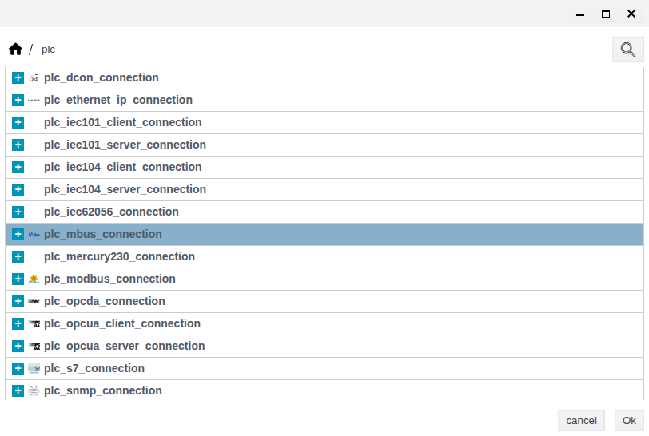
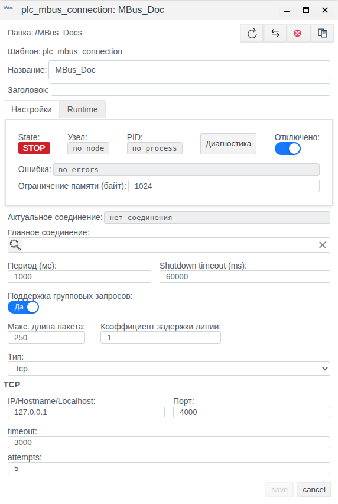
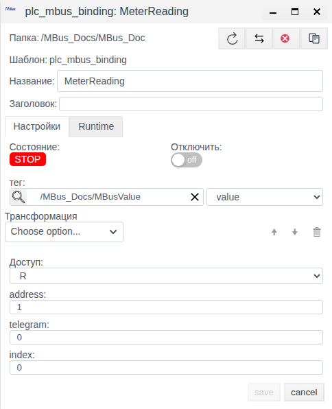
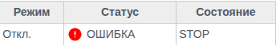
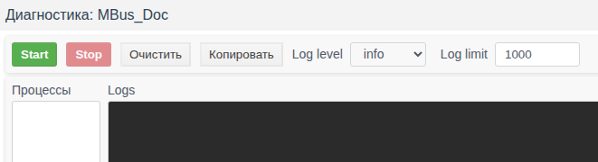

# M-Bus в Faceplate: настройка соединения и привязок

Faceplate v4.0.7. Руководство для интеграторов.

**Содержание**

- [Маршрут настройки](#маршрут-настройки)
- [Пример карты: индекс, число и единицы](#пример-карты-индекс-число-и-единицы)
- [1. Как работает соединение](#1-как-работает-соединение)
- [2. Что подготовить](#2-что-подготовить)
- [3. Создать соединение и настроить привязки](#3-создать-соединение-и-настроить-привязки)
- [4. Управлять соединением](#4-управлять-соединением)
- [5. Проверить данные](#5-проверить-данные)
- [6. Справочник настроек](#6-справочник-настроек)
- [7. Диагностика и восстановление](#7-диагностика-и-восстановление)

[Каталог соединений](./index.md) · [Подготовка поля и привязки](./bindings.md) · [Преобразования](./transformation.md) · [Диагностика и восстановление](./diagnostics.md)

## Маршрут настройки

Подготовьте внешний источник или клиент и совместимое поле тега по общей инструкции. Затем настройте канал, сохраните полную привязку и проверьте новое значение. Для поддержанной записи/приёма отдельно подтвердите результат на внешней стороне; после исправления сбоя повторите проверку с новым контрольным значением.

[Альтернативный канал и карта сигналов](./bindings.md#настроить-альтернативный-канал) описаны одинаково для всех типов; условия переключения уточняйте по драйверу.

## Пример карты: индекс, число и единицы

Для своего прибора получите полный состав телеграммы и подтвердите, что нужный блок и все предшествующие блоки декодируются. Пример условной карты: address 1, telegram 0, index 0, беззнаковое число 1000, множитель по карте 0.001, единица м³.

В MeterReading задайте R, тег MBusValue, float-поле value и Scaling: Factor 0.001, Cмена 0. Сохраните и отдельно откройте адресацию, поле и масштаб. Только при указанной карте число 1000 должно дать 1.0 м³; новое 1001 — 1.001 м³. VIF/VIFE автоматически этот пересчёт не выполняют.

Для serial сохраните те же параметры привязки, а в соединении задайте действительный порт и кадр линии; независимо проверьте открытие и новый ответ. Для постоянного показания подтвердите свежий ответ нужного address/telegram/index внешним средством. W/RW не применяются для записи показаний. Это условный рецепт карты, не испытание конкретного прибора.

## 1. Как работает соединение

M-Bus используют для чтения приборов учёта. Faceplate инициирует опрос: открывает TCP-канал к шлюзу либо последовательный порт узла выполнения, запрашивает данные прибора и передаёт выбранный результат в проект. Переключателя в серверную роль у этого драйвера нет. TCP-шлюз должен передавать подходящие кадры M-Bus; наличие Ethernet или последовательного интерфейса само по себе не подтверждает совместимость.

| Понятие | Что определяет |
|---|---|
| Протокол | Правила запроса и ответа M-Bus |
| Драйвер | Поддерживаемые команды, транспорт и разбор данных |
| Соединение | Общий канал, параметры ожидания и выполнения |
| Привязка | Прибор, телеграмму, блок данных, преобразование и поле назначения |
| Тег / поле тега | Объект проекта и конкретное поле, принимающее результат |
| Код телеграммы | Значение для выбора данных по документации прибора |
| Индекс | Номер блока в ответе, начиная с 0 |

Путь чтения: **прибор → канал соединения → телеграмма и индекс привязки → декодирование → преобразование → выбранное поле тега**. Одно соединение может содержать несколько привязок к разным параметрам и адресам. Тег создают заранее; создание соединения не создаёт прикладные сигналы автоматически.

Каждая читаемая привязка вызывает отдельную последовательность служебного сброса, выбора телеграммы и запроса ответа. Общего кэша одной телеграммы для нескольких привязок и групповых запросов у M-Bus нет. Количество параметров, ожидания и повторы увеличивают время полного обхода.

**Запись значений в прибор не реализована.** Общая форма предлагает R/W/RW, но W исключает привязку из чтения, а RW не добавляет работающую запись. Для получения показаний выбирайте **R**. Успешный статус исходящей операции не подтверждает изменения прибора. Служебные команды внутри опроса при этом отправляются.

## 2. Что подготовить

До рабочего подключения получите у поставщика прибора или администратора:

- Транспорт, узел выполнения Faceplate и фактические IPv4/порт шлюза либо системный порт и параметры последовательной линии.
- Адрес прибора, код телеграммы и карту блоков с индексами, форматами, единицами и множителями.
- Подходящее поле существующего тега и права настройки объектов проекта.
- Допустимую нагрузку опроса, время ответа и способ независимо проверить новое показание.

IP и системный порт относятся к узлу выполнения, а не к компьютеру с браузером. Для serial нужен подходящий преобразователь и доступ к порту этого узла. У драйвера нет поиска по вторичному адресу или автоматического обнаружения приборов.

Проверьте структуру ответа целиком до нужного блока. Поддерживаются беззнаковые целые little-endian и BCD; отдельного декодирования знаковых чисел, дат, строк и знака BCD нет. Форматы 32-битного real и переменной длины не поддерживаются; неподдерживаемый предыдущий блок также может помешать дойти до нужного индекса. Некоторые служебные признаки блока отвергаются. Продолжение из следующего кадра не собирается.

Единицы и множители VIF/VIFE автоматически не применяются. Декодированное число может требовать пересчёта по карте прибора. Совпадение номера индекса без проверки формата и единиц недостаточно.

### Учебные объекты

Пример проверяет **сохранение конфигурации**, без прибора. Подготовлены папка `/MBus_Docs` и тег `/MBus_Docs/MBusValue` с отображаемым полем `value` типа float, исходно 0. Это начальное число, не показание источника. В своём проекте подготовьте соответствующие папку, тег и поле.

| Параметр | Значение примера |
|---|---|
| Соединение | MBus_Doc, всё время отключено |
| Транспорт и адрес | tcp, 127.0.0.1:4000 — учебный endpoint |
| Период / timeout / attempts | 1000 мс / 3000 мс / 5 |
| Привязка | MeterReading внутри соединения |
| address / telegram / index | 1 / 0 / 0 — иллюстративная адресация |
| Доступ / преобразование | R / без преобразования |
| Назначение | /MBus_Docs/MBusValue, поле value |

Значения 1/0/0 не являются картой какого-либо проверенного прибора. Соединение и привязку создаём в следующем разделе в рамках одного примера.

## 3. Создать соединение и настроить привязки

### Создать и сохранить канал

1. Откройте **Меню → Общий вид**, затем подготовленную папку `/MBus_Docs`.
2. Нажмите **Создать**, двойным щелчком откройте группу **plc** и выберите строку соединения M-Bus, выделенную на рисунке. Подтвердите **Ok**. Список использует технические подписи; ориентируйтесь на показанную строку.
3. Введите **Название** = `MBus_Doc`. До первого сохранения включите **Отключено**.
4. Выберите **Тип** = **tcp**. Введите **IP/Hostname/Localhost** = `127.0.0.1`, **Порт** = **4000**.
5. Установите **Период (мс)** = **1000**, **timeout** = **3000**, **attempts** = **5**. Остальные общие настройки оставьте исходными, **Главное соединение** — пустым.
6. После ввода числа нажмите **Tab** и проверьте значение. Для замены порта выделите содержимое через **Ctrl+A**, наберите **4000** и снимите фокус.
7. Убедитесь, что **Отключено** включено, и нажмите **save**.
8. После закрытия формы выделите `MBus_Doc` и нажмите **Редактировать**. Сверьте все заданные параметры, затем закройте неизменённую форму через **cancel**.

Рисунок 1. Нужная строка в реальном списке типов. Повторная съёмка этого списка завершена отменой без создания второго объекта.

Рисунок 2. Проверены TCP, адрес, порт, параметры ожидания и отключение после отдельного повторного открытия.

В новой форме IP показан подсказкой без введённого значения, а порт равен 1024. Введите фактический IP и порт явно. Одно визуальное изменение числа до снятия фокуса не доказывает сохранения: при проверке автоматического ввода порт возвращался к исходному. Клавиатурный ввод, Tab и отдельное повторное открытие подтвердили 4000.

### Выбрать данные и поле тега

1. Двойным щелчком откройте `MBus_Doc` и нажмите **Создать**. Внутри соединения сразу открывается форма дочерней привязки.
2. Задайте **Название** = `MeterReading`, **address** = **1**, **telegram** = **0**, **index** = **0**.
3. В поле **тег** укажите `/MBus_Docs/MBusValue`, нажмите **Tab**, затем в соседнем списке выберите **value**. Это путь относительно проекта; выбор только объекта без поля не завершает назначение.
4. Оставьте **Доступ** = **R**, **Трансформация** пустой, **Отключить** — выключенным. Родительское соединение по-прежнему отключено.
5. Нажмите **save**, дождитесь закрытия формы и отдельно откройте `MeterReading` через **Редактировать**.
6. Сверьте адресацию, R, отсутствие преобразования, путь тега и выбранное поле. Закройте форму через **cancel**.

Рисунок 3. Отдельно повторно открытая привязка с сохранёнными адресацией и назначением.

Без правильной пары тег/поле результат может оставаться только в собственном значении привязки. Откройте `MBusValue` и проверьте доступность `value`; исходный 0 не используйте для подтверждения чтения. В примере float-поле принимает числовые результаты, но преобразование единиц не настроено.

## 4. Управлять соединением

### Изменить параметры

В **Общем виде** выберите объект и откройте **Редактировать**. Изменяйте общие параметры в соединении, адресацию и назначение отдельного сигнала — в его привязке. После **save** закройте и отдельно повторно откройте объект. Изменение исполняемых параметров рабочего канала может пересоздать его выполнение; затем проверяют новые данные.

Для последовательного подключения выберите **serial** и задайте порт и параметры линии из документации оборудования. Активен только выбранный транспорт. Параметры serial приведены в справочнике; практический пример остаётся TCP и дополнительных сохранений serial не содержит.

### Включить или отключить

Для рабочего запуска сначала замените учебные значения подтверждёнными параметрами источника и проверьте все привязки. Выключите **Отключено** у соединения и сохраните. Проверьте также разрешение выполнения проекта, зависимости и доступность узла, затем процесс, ошибки и новые данные.

Для остановки всего канала включите **Отключено** и сохраните соединение. Чтобы исключить один сигнал, включите **Отключить** в его привязке. Разрешённая привязка не запускает отключённый родительский канал. Значение при остановке зависит от типа поля и преобразования; универсального обнуления нет.

**Главное соединение** связывает резервную конфигурацию с главным соединением того же типа. Резервная конфигурация автоматически отключается от самостоятельного запуска; её использует главный канал. Рекурсивные цепочки запрещены. Переключение связано с ошибкой подключения; ошибка отдельной привязки не гарантирует его. В примере поле пустое.

### Найти и проверить режим

Откройте **Меню → Драйверы ПЛК**, в **Поиск по пути** укажите путь или его достаточно определённый фрагмент, нажмите **Найти**. При необходимости выберите тип **mbus**. Проверьте путь найденного соединения, режим и состояние. Двойной щелчок строки открывает его привязки.

Рисунок 4. Фрагмент строки найденного MBus_Doc: Откл., ОШИБКА, STOP.

В проверенном отключённом объекте красная **ОШИБКА** сопровождалась подсказкой `no errors`; в форме было **Ошибка: no errors**. Индикатор списка реагирует на непустой текст сообщения. Читайте подсказку вместе с режимом и процессом: это наблюдение не подтверждает ошибку транспорта, который в примере не открывался.

## 5. Проверить данные

Проверяйте последовательно разрешение выполнения, процесс/канал, отдельную привязку и результат в выбранном поле. **RUN** может появиться до ответа прибора; общее **OK** не исключает ошибки отдельного чтения. У отключённого учебного канала привязка показывала **Вкл. / OK / STOP** — чтение этим не подтверждено.

После рабочего включения сопоставьте адрес, телеграмму, индекс, формат, единицы, преобразование и тип поля. Декодер не применяет VIF-множитель. Float округляется при передаче в integer-поле, а integer преобразуется в float для float-поля.

При отсутствии нужного блока собственное значение привязки может содержать `not_defined`, тогда как статус остаётся OK, а числовое поле тега сохраняет старое число. Проверяйте карту и фактический состав ответа; успешного статуса недостаточно.

Новое чтение подтверждайте отличимым ожидаемым показанием источника. Если показание не меняется, нужен независимо наблюдаемый свежий корректный ответ, сопоставленный с полученным результатом. Отдельной универсальной метки времени успешного чтения нет; одинаковое число не перезаписывается в поле при каждом опросе. Старое число, исчезновение ошибки или ручной ввод в тег не подтверждают восстановление.

В учебном примере подтверждены сохранение и повторное открытие настроек. Соединение остаётся отключённым, а начальное значение тега не является результатом обмена.

## 6. Справочник настроек

### Общие параметры соединения

В таблицах различаются исходные значения формы и модели объекта. Диапазоны формы описывают числовой ввод, а не выполненные испытания граничных сохранений. Необязательный **Заголовок** можно оставить пустым; **Название** и место в проекте выбирает пользователь.

| Поле | Исходное значение и пределы | Назначение и применение | Как проверить |
|---|---|---|---|
| Период (мс) | 1000; форма 1–3600000 мс | Плановый период полного обхода. Долгий цикл может превышать его | Сверить сохранённое число и длительность реального обмена |
| Shutdown timeout (ms) | 60000; форма 10–3600000 мс | Ожидание штатного завершения процесса, не ответ прибора | Повторно открыть; проверять завершение отдельно |
| Отключено | В новой форме выключено | Запрещает собственное выполнение всего соединения | Сохранить; сопоставить режим, процесс и состояние |
| Главное соединение | Пусто | Необязательная резервная конфигурация того же типа | Проверить ссылку и реальные условия переключения |
| Поддержка групповых запросов | В форме Да | У M-Bus групповое чтение не реализовано | Включённый переключатель не считать подтверждением группирования |
| Макс. длина пакета | В форме 250; 1–10000 | Общее поле группирования; не размер телеграммы M-Bus | Для M-Bus одиночного чтения не используется |
| Коэффициент задержки линии | Форма 1; модель 2; форма 1–10 | Безразмерный параметр группирования, не пауза между M-Bus запросами | Для M-Bus одиночного чтения не используется |
| Ограничение памяти (байт) | Новая форма пустая, после сохранения 1024 | Фактически число интерпретируется в МиБ: 1024 соответствует 1 ГиБ, вопреки подписи | В примере оставлено исходным; не трактовать как байты |

### TCP и serial

| Поле | Исходное значение и пределы | Назначение и применение | Как проверить |
|---|---|---|---|
| Тип | tcp; tcp / serial | Единственный активный транспорт | Повторно открыть и сверить выбранную группу |
| IP/Hostname/Localhost | Ввод пустой, подсказка 127.0.0.1; модель 127.0.0.1 | Только TCP, числовой IPv4; DNS и localhost не разрешаются драйвером | Ввести фактический IPv4 явно |
| Порт TCP | Форма 1024; модель 4000; форма 1–65535 | Порт шлюза, не адрес прибора | Tab, save, отдельное открытие и сверка |
| Порт SERIAL | /dev/tty0 в форме | Путь порта на узле выполнения; должен существовать и быть доступен | Сверить с системой и проверить при рабочем запуске |
| Скорость | 9600 | Варианты: 300, 600, 1200, 2400, 4800, 9600, 19200, 38400, 57600, 115200, 230400, 460800, 500000, 576000 | Сверить с прибором и возможностями порта |
| Четность | нет; нет / четный / нечетный | Параметр последовательной линии | Сверить с оборудованием |
| Стоп-биты | 1; 1 / 2 | Параметр последовательной линии | Сверить с оборудованием |
| Размер байта | 8; 5 / 6 / 7 / 8 | Число бит данных последовательной линии | Сверить с оборудованием |
| timeout | 3000; форма 1–6000 мс | Ожидание отдельных частей ответа; TCP connect отдельно имеет 3000 мс | Учитывать весь запрос, повторы и фактическое время ответа |
| attempts | 5; форма 1–500 | Максимальное число отправок одной транзакции, включая первую | Не считать все повторы гарантированными для любой ошибки |

При TCP timeout первого байта возвращается как ошибка отдельного чтения без исчерпания повторов; при serial такое ожидание повторяется до предела попыток. Исчерпание попыток даёт `no_response` и ведёт к переподключению. Полный опрос включает несколько транзакций и приём отдельных частей, поэтому timeout не равен длительности цикла. Список скоростей не гарантирует поддержку конкретным портом.

### Привязка

| Поле | Исходное значение и пределы | Назначение и применение | Как проверить |
|---|---|---|---|
| address | 1; форма 1–250, драйвер 1–254 | Адрес прибора в кадре и проверяемом ответе | По карте/настройке прибора, отдельно от IP и порта |
| telegram | 0; форма 0–6000 | Код выбора телеграммы, передаваемый одним байтом | Подтвердить байтовый код по документации прибора |
| index | 0; форма 0–6000 | Порядковый блок с нуля, не байтовое смещение | Сопоставить с полным составом ответа |
| тег и соседнее поле | Пусто | Существующий объект и конкретное поле назначения | Проверить путь и выбранное поле после save/reopen |
| Доступ | R; R / W / RW | R читает, W исключает чтение; RW не даёт физической записи | Для показаний использовать R |
| Трансформация | Пустая цепочка | Прямая обработка перед адаптацией к типу поля | Сверить порядок, параметры и единицы результата |
| Отключить | Выключено | Исключает отдельную привязку | Проверить вместе с разрешением родителя |

Значение telegram больше 255 усечётся до младшего байта: 256 передаётся как 0, 6000 — как 112. Большой диапазон формы не означает поддержку такого кода прибором. Неверный index способен дать старое числовое поле при OK; сверка ответа обязательна. Тег, его поле и адресация автоматически по прибору не подбираются.

### Преобразования

Ниже приведены имена операций в редакторе. Для чтения доступны все перечисленные операции; исходные параметры не всегда образуют готовую рабочую настройку.

| Операция | Параметры | Результат и единицы | Проверка и отсутствие данных |
|---|---|---|---|
| Scaling | Factor = 1, Shift = 0 | Вход × Factor + Shift | Множитель брать из карты прибора; нечисловой вход даёт отсутствие значения |
| Default Value | Value = 0 | Пропускает число, заменяет нечисловой вход указанным числом | Подстановка может скрыть отсутствие связи или ошибку индекса |
| Limit Control | Lower Limit = 0, Upper Limit = 0 | Пропускает число во включительном интервале; снаружи — отсутствие значения | Требуется Upper Limit > Lower Limit; исходные 0/0 надо изменить; это не прижимание к границе |
| Damper | Tlag = 1; форма от 1; положительное число | Сглаживание, Tlag в мс; первое число проходит | Нечисловой вход не обновляет накопленное состояние |
| Derivative | Без параметров | Изменение входа / фактический интервал, единицы входа/мс | Первое число ещё не даёт производной; при нулевом интервале возможна ошибка |
| Integration | Без параметров | Сумма текущего входа × фактический интервал, единицы входа×мс | Первое число задаёт время; начальная сумма не настраивается |
| Script | Редактор Erlang и переменные контекста | Три аргумента: вход, контекст, состояние; результат: выход и новое состояние | Обработку отсутствующего входа задаёт скрипт; ошибка исполнения даёт отсутствие значения |

Цепочка выполняется сверху вниз. Каждая операция хранит собственное состояние. Временные операции используют фактические интервалы вызовов в миллисекундах, не время прибора и не заданный период; автоматического пересчёта к секундам нет. Нечисловой вход не сбрасывает временную опору демпфера, производной и интеграла. Пересоздание привязки или процесса начинает состояние заново; обычное переподключение не гарантирует сброса.

Для W/RW общая проверка дополнительно требует обратимости; Script, Derivative и Integration ей не удовлетворяют. Это не добавляет отсутствующую запись M-Bus. В учебной MeterReading цепочка остаётся пустой.

### Состояния и результат

| Признак | Кто задаёт | Что подтверждает и как проверять |
|---|---|---|
| Отключено / режим | Пользователь и условия выполнения | Разрешение, не наличие обмена |
| Узел и PID | Система | Рабочий процесс; no node/no process означают отсутствие соответствующего назначения/процесса |
| RUN / STOP | Система | Состояние выполнения, не правильность показания |
| Актуальное соединение | Система | Выбранную транспортную конфигурацию; нет соединения — она не установлена |
| Ошибка / Статус | Система и отображение списка | Сообщение канала или привязки; читать вместе с подсказкой и данными |
| Собственное значение привязки | Результат обработки | Может быть отсутствующим, ошибочным или прежним; сопоставить с картой и полем |
| Поле тега | Результат доставки и тип поля | Само число не подтверждает новое чтение |

## 7. Диагностика и восстановление

### Окно диагностики

Откройте сохранённое соединение через **Редактировать** и нажмите **Диагностика**. Окно доступно и у отключённого соединения.

Рисунок 5. Верхняя часть реального окна диагностики MBus_Doc. В примере сбор журнала не запускался.

**Start** начинает сбор, **Stop** останавливает его. **Log level** предлагает info, warning, error и debug; исходно info. **Log limit** исходно 1000, диапазон формы 1–100000 строк. **Очистить** очищает вывод, **Копировать** переносит имеющийся вывод. Области **Процессы** и **Logs** в отключённом примере были пустыми; сбор и копирование содержательных сообщений не проверялись. Пустой журнал не подтверждает исправность, а каждая успешная TCP-транзакция автоматически в него не выводится.

### Найти причину и подтвердить результат

| Симптом | Что проверить | Действие | Подтверждение результата |
|---|---|---|---|
| STOP, no process | Отключение, проект, зависимости, узел | Восстановить разрешение выполнения только для нужного рабочего канала | Процесс появился; отдельно подтверждено новое чтение |
| Ошибка TCP/serial, timeout, no_response | IPv4/порт или системный порт, линия, адрес прибора, время ответа | Сверить параметры с источником и исправить причину | Новый корректный ответ и ожидаемое поле |
| Ошибка адресации или формата | address, байтовый код telegram, index и все предыдущие блоки | Уточнить карту и поддерживаемый формат | Выбран действительно нужный блок и получено его значение |
| RUN/OK, но старое поле | Значение привязки, not_defined, назначение поля и преобразование | Исправить индекс/назначение; проверить исходный ответ | Новое отличимое показание или свежий ответ, сопоставленный с полем |
| Неверный масштаб или подстановка | Единицы VIF, множитель, тип поля, Default Value | Задать подтверждённое преобразование и независимый контроль свежести | Значение и единицы совпали с источником |
| W/RW не изменяют прибор | Фактическую поддержку записи | Использовать R для опроса; запись этого драйвера не применять | Чтение проверено отдельно; успех исходящей операции не принят за физический эффект |
| Logs пуст | Активность сбора, уровень, состояние канала | Проверить настройки сбора и данные независимо от журнала | Вывод оценён по содержанию, обмен — по свежему ответу |

После исправления рабочего канала повторно откройте настройки и сверьте сохранённые значения, затем проверьте процесс, ошибки привязки и данные. Исчезновения ошибки недостаточно. Подтверждение восстановления должно относиться к обмену после исправления, а не к ранее сохранённому показанию.
