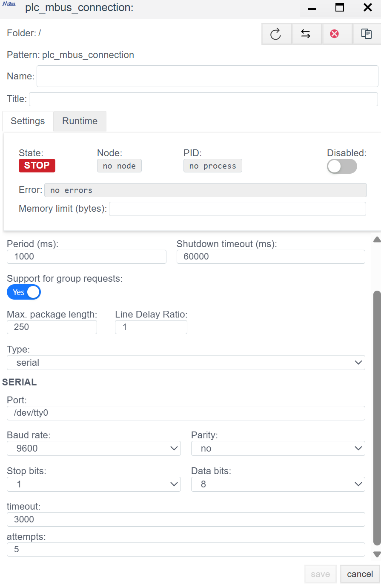
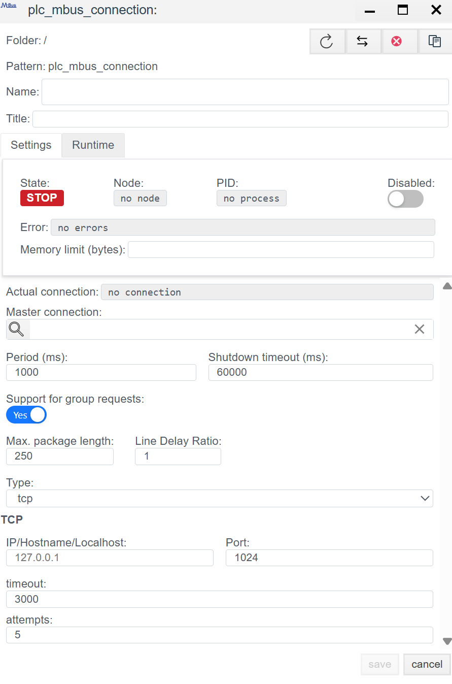

# Руководство по конфигурации драйвера M-Bus (Meter-Bus)

> См. также: [Общие сведения о PLC-соединениях](./general_ru.md)

## Общее описание
**M-Bus (Meter-Bus)** — это специализированный европейский стандарт (EN 13757) для дистанционного считывания данных с приборов коммерческого учета: теплосчетчиков, водосчетчиков, счетчиков газа и электроэнергии.

В системе **Faceplate** драйвер M-Bus является гибридным и поддерживает два физических уровня:
1.  **Serial (COM):** Прямое подключение к серверу через Master-конвертер уровней (M-Bus <-> RS-232/485).
2.  **TCP (Ethernet):** Подключение через удаленные шлюзы (Ethernet-to-MBus) или прозрачные конвертеры.

Архитектура настройки состоит из двух шагов:
1.  **Connection (`plc_mbus_connection`):** Настройка транспорта до шины.
2.  **Binding (`plc_mbus_binding`):** Настройка опроса конкретной переменной внутри прибора.

---

## 1. Настройка соединения (Connection)
> Создать PLC cоединения → [Шаги создания PLC соединения](./general_ru.md#создание-plc-соединения)

На этом этапе мы конфигурируем мастер-устройство, опрашивающее шину.

> Панель диагностики и общие параметры соединения (Settings) описаны в разделе [Общие параметры соединения](./general_ru.md#общие-параметры-соединения-settings).

### 1.1 Параметры Протокола (MBUS)

#### 1.1.1 Режим `serial` (Прямое подключение)
Подключение к устройству выполняется по линии связи RS-485. Подключение станции FACEPLATE к линии связи выполняется с помощью преобразователей RS-232<=>RS-485 или USB<=>RS-485. При использовании одного серийного порта для обмена информацией с несколькими устройствами нужно настроить одно общее соединение. В этом случае M-Bus-адреса устройств определяются при настройке привязок (см. Создание привязок).

| Поле | Описание |
| :--- | :--- |
| **Port** | Системное имя порта (Linux: `/dev/ttyUSB0`, Win: `COM1`). |
| **Baud rate** | Скорость обмена.  *Стандарт:* Обычно **2400** (реже 9600). Должна совпадать с настройками приборов. |
| **Parity** | Четность.  *Стандарт:* Обычно **Even** (Четность). На скриншоте стоит `no`, но для большинства теплосчетчиков требуется `Even`. |
| **Data / Stop bits** | Обычно 8 бит данных и 1 стоп-бит. |
| **Timeout** | Максимальное время ожидания ответа от опрашиваемого устройства. Для M-Bus лучше ставить с запасом (3000-5000 мс). **ВНИМАНИЕ:** увеличение параметра на каналах связи низкого качества может привести к задержкам в работе соединения. |
|**attempts**|Количество попыток запроса. Определяет максимальное число повторных попыток отправки запроса к устройству при отсутствии ответа.|

#### 1.1.2 Режим `tcp` (Сетевой шлюз)
Данный тип может быть использован для подключения через шлюз TCP<=>RS-485. Такое решение позволяет использовать преобразователи TCP<=>RS-485 в качестве master-устройств для организации связи с большим количеством приборов учета.

| Поле | Описание |
| :--- | :--- |
| **IP/Hostname** | IP адрес или имя хоста шлюза. |
| **Port** | Номер порта, используемый для подключения к шлюзу. |
| **Timeout** | Учитывайте сетевые задержки + медлительность самой шины. |
|**attempts**|Количество попыток запроса. Определяет максимальное число повторных попыток отправки запроса к устройству при отсутствии ответа.|

---

##  2. Настройка переменных (Binding)

Особенность M-Bus в том, что прибор отдает **всю** информацию одним большим пакетом. Задача Binding — "выкусить" из этого пакета нужное значение.

> Создать PLC привязку → [Шаги создания PLC привязки](./general_ru.md#создание-plc-привязки)

> Общие поля привязки (Name, Title, State, Tag, Transformation, Access) описаны в разделе [Общие поля PLC-привязки](./general_ru.md#общие-поля-plc-привязки).

### 2.1 Специфичные параметры привязки

| Поле | Описание |
| :--- | :--- |
| **Address** | **Primary Address (Первичный адрес).** Число от 1 до 250. Уникальный адрес счетчика на шине. |
| **Telegram** | Код запрашиваемой телеграммы. Описание поддерживаемых устройством телеграмм должно быть приведено в документации на устройство. |
| **Index** | **Индекс параметра в телеграмме (отсчет с 0).** Телеграмма M-Bus имеет фиксированную структуру, где каждый блок соответствует контролируемому параметру. Номер блока указывает на конкретный параметр, который привязывается к полю объекта FACEPLATE. Описание состава телеграмм должно быть приведено в документации на устройство. |

> Ошибка в PLC привязке → [ошибка привязки](./general_ru.md#ошибка-в-привязке)
---
