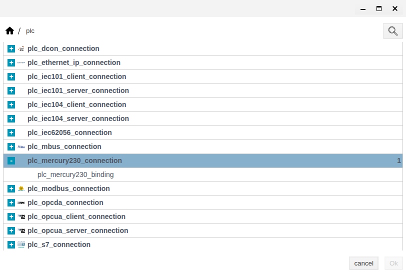
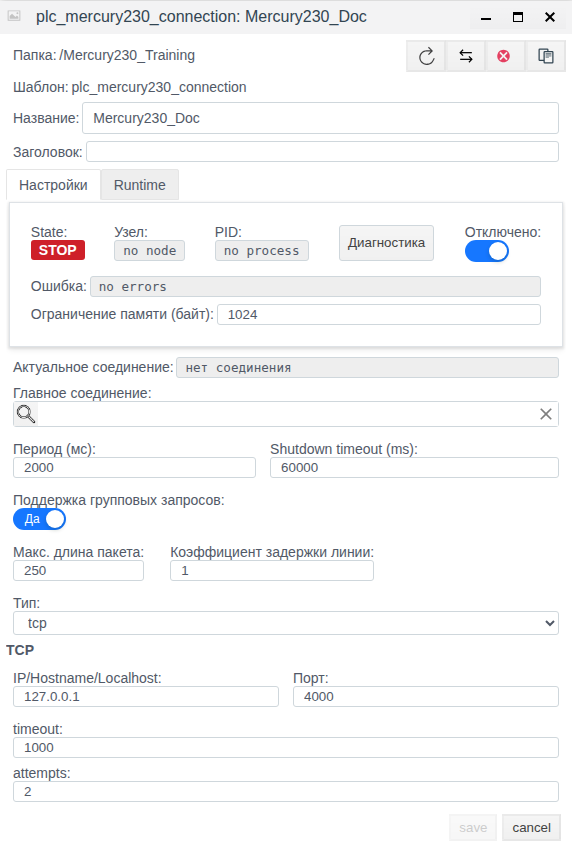
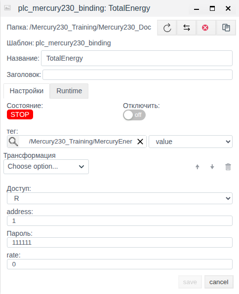
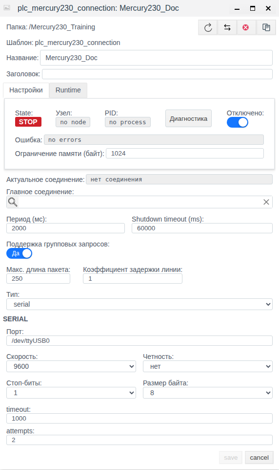
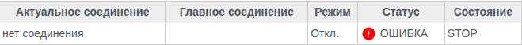
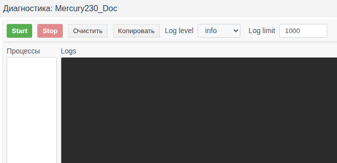

# Меркурий 230 в Faceplate: настройка соединения и привязок

Версия Faceplate: v4.0.7.

Эта инструкция помогает настроить чтение накопленной энергии счётчика в поле тега через TCP или последовательный порт. Учебный пример сохраняет отключённое соединение и привязку, затем проверяет их повторным открытием. Адреса и пароль в примере учебные; открытие транспорта и получение показания ими не подтверждены.

**Содержание**

- [Маршрут настройки](#маршрут-настройки)
- [Пример пересчёта и проверка нескольких тарифов](#пример-пересчёта-и-проверка-нескольких-тарифов)
- [1. Как работает соединение](#1-как-работает-соединение)
- [2. Что подготовить](#2-что-подготовить)
- [3. Создание соединения](#3-создание-соединения)
- [4. Настройка привязок](#4-настройка-привязок)
- [5. Изменение, включение и отключение](#5-изменение-включение-и-отключение)
- [6. Проверка данных](#6-проверка-данных)
- [7. Справочник параметров](#7-справочник-параметров)
- [8. Диагностика и восстановление](#8-диагностика-и-восстановление)

[Каталог соединений](./index.md) · [Подготовка поля и привязки](./bindings.md) · [Преобразования](./transformation.md) · [Диагностика и восстановление](./diagnostics.md)

## Маршрут настройки

Подготовьте внешний источник или клиент и совместимое поле тега по общей инструкции. Затем настройте канал, сохраните полную привязку и проверьте новое значение. Для поддержанной записи/приёма отдельно подтвердите результат на внешней стороне; после исправления сбоя повторите проверку с новым контрольным значением.

[Альтернативный канал и карта сигналов](./bindings.md#настроить-альтернативный-канал) описаны одинаково для всех типов; условия переключения уточняйте по драйверу.

## Пример пересчёта и проверка нескольких тарифов

Обычная привязка читает первое значение накопленной энергии выбранного тарифа. До масштабирования получите для конкретного прибора единицу raw, цену отсчёта и необходимые коэффициенты трансформаторов.

Условный пример карты: цена отсчёта 0.1 кВт·ч уже включает согласованные коэффициенты. Тогда в TotalEnergy к float-полю MercuryEnergy.value задайте Scaling: Factor 0.1, Cмена 0; raw 1000 соответствует 100.0 кВт·ч, новое 1001 — 100.1 кВт·ч. Для иной карты этот коэффициент неприменим. Сохраните и повторно откройте поля назначения и масштаб.

Для второго тарифа создайте отдельную R-привязку с подтверждённым rate и отдельным полем; не направляйте разные тарифы в одно поле. Порядок сеансов увеличивает время обхода. При неизменной энергии свежесть подтверждайте новым успешным запросом/ответом или счётчиком источника.

Скрытый командный режим не является готовой инструкцией управления и не добавляет запись энергии. Рабочий обмен и единицы конкретного прибора этим примером не подтверждаются.

## 1. Как работает соединение

### Подключение и роль Faceplate

Faceplate инициирует обмен: открывает доступ к прибору, запрашивает показание и закрывает сеанс. Соединение доставляет двоичные команды Меркурий через исходящий TCP либо последовательный порт узла выполнения Faceplate. Для TCP нужен совместимый источник или прозрачный преобразователь интерфейса, передающий этот протокол. Серверного режима, UDP и Modbus в данном драйвере нет.

### Понятия и ответственность объектов

| Понятие | За что отвечает |
|---|---|
| Протокол | Формат команд и ответов счётчика, адрес прибора и проверка целостности. |
| Драйвер | Формирование команд и получение поддерживаемого показания в Faceplate. |
| Соединение | Транспорт, период обхода, ожидание ответа и попытки. |
| Привязка | Дочерний объект соединения: адрес прибора, пароль, тариф, доступ, преобразование и назначение результата. |
| Тег / поле тега | Существующий объект проекта и конкретное поле, принимающее значение. Поле выбирают отдельно от тега. |

IP и TCP-порт задают канал до источника. **address** в привязке задаёт адрес самого счётчика внутри протокола. Несколько привязок одного соединения могут обращаться к разным адресам и тарифам.

### Путь данных и направления

При чтении данные проходят путь: соединение → прибор по адресу и паролю привязки → запрос выбранного тарифа → первое значение накопленной энергии из ответа → преобразование → приведение к типу поля → поле тега. Создание соединения или привязки не создаёт прикладной тег автоматически.

Получаемое число — необработанное беззнаковое значение в диапазоне 0–4294967295. Драйвер не назначает ему единицы, не применяет автоматически масштаб или коэффициенты трансформаторов. Единицы и смысл тарифа уточняют по конкретному прибору. Чтение напряжения, тока, мощности, профилей и произвольных регистров этим драйвером не предусмотрено.

Для энергии используйте **R**. Общая форма также предлагает **W** и **RW**, но запись накопленной энергии не реализована: успешный результат записи не означает изменения счётчика. Особенности заранее подготовленного командного режима описаны рядом с настройкой доступа в разделе 4.

## 2. Что подготовить

### Сведения об оборудовании и канале

До включения получите у ответственного за прибор:

- Для TCP — числовой IPv4 и порт источника, доступные с узла выполнения Faceplate. Подпись **IP/Hostname/Localhost** общая; этот драйвер не разрешает DNS-имена.
- Для serial — путь порта на узле выполнения, скорость, чётность, число стоповых битов и битов данных; проверьте наличие последовательного интерфейса и права доступа процесса Faceplate к нему.
- Адрес счётчика, пароль из десятичных цифр и код тарифа в диапазоне 0–5. Соответствие кодов тарифам и допустимую длину пароля определяют по прибору.
- Единицы, масштаб показания и независимый способ подтвердить новый обмен после запуска или восстановления.

### Проектные объекты и доступ

Нужны права на создание и изменение объектов. Для окна диагностики требуется административный доступ.

В примере заранее подготовлены папка `/Mercury230_Training` и тег `/Mercury230_Training/MercuryEnergy` с целочисленным runtime-полем `value`, начальное значение 0. В своём проекте подготовьте подходящий числовой тег и поле, способное хранить весь нужный диапазон. Начальный 0 в примере задан при подготовке; это не показание счётчика.

Внутри папки будут созданы соединение `Mercury230_Doc` и его привязка `TotalEnergy`. Во всех действиях примера соединение остаётся отключённым.

## 3. Создание соединения

### Создать объект

1. В **Общем виде** откройте папку `/Mercury230_Training`.
2. Нажмите **Создать**, перейдите в группу **plc** и выберите родительскую строку соединения Mercury, показанную на рисунке. Дочерняя строка относится к привязке. Подтвердите **Ok**. Список типов использует технические подписи; ориентируйтесь на выделенную родительскую строку.
3. В поле **Название** введите `Mercury230_Doc`. До первого сохранения включите переключатель **Отключено**.

Рисунок 1. Реальный список типов: родительское соединение Mercury раскрыто, под ним виден тип привязки.

### Параметры TCP

1. Установите **Тип** = **tcp**. В группе **TCP** введите **IP/Hostname/Localhost** = `127.0.0.1`, **Порт** = 4000.
2. Задайте **Период (мс)** = 2000, **timeout** = 1000 и **attempts** = 2.
3. Оставьте остальные общие настройки исходными. Убедитесь, что **Отключено** включено, и нажмите **save**.
4. После закрытия формы заново выберите строку соединения и откройте **Редактировать**. Сверьте имя, отключение, транспорт, IP, порт и три числовых параметра. Закройте форму через **cancel**, если ничего не меняли.

Рисунок 2. Сохранённые TCP-параметры отключённого соединения. Неактивная кнопка save означает отсутствие новых правок в повторно открытой форме.

В новой проверенной форме порт исходно равен 1024, а IP показан подсказкой без введённого значения. Вводите оба параметра явно. `127.0.0.1` означает узел выполнения Faceplate; он не является адресом удалённого счётчика сам по себе.

### Последовательный порт

После создания привязки в следующем разделе тот же объект можно перевести на serial по разделу 5. Учебные параметры: `/dev/ttyUSB0`, скорость 9600, 8 бит данных, чётность **нет**, 1 стоповый бит — 8N1. Путь относится к узлу выполнения, а не к компьютеру с браузером. Наличие и открытие этого порта в примере не проверялись.

### Сохранить и проверить

Закрытие формы после **save** подтверждайте отдельным повторным открытием и сверкой значений. Это проверка сохранения конфигурации. Она не доказывает разрешение выполнения, открытие транспорта или ответ счётчика.

## 4. Настройка привязок

### Адрес прибора, пароль и тариф

1. В **Общем виде** откройте `Mercury230_Doc` двойным щелчком и нажмите **Создать** внутри соединения. Откроется форма дочерней привязки.
2. Задайте **Название** = `TotalEnergy`, **address** = 1, **Пароль** = `111111`, **rate** = 0.
3. Оставьте **Отключить** выключенным для привязки. Выполнение всё равно запрещено отключённым родительским соединением.

Пароль в новой проверенной форме пустой; введите его явно. Поле показывает пароль открытым текстом, поэтому на рисунках используется только учебное значение. Драйвер использует фиксированный потребительский уровень доступа 01; выбора другого уровня и отдельного пароля записи в форме нет. Недесятичные символы недопустимы; длина отдельно формой не проверяется.

**rate** передаётся прибору буквально. Значение 0 в примере не является подтверждённым названием тарифа. Форма не задаёт верхнюю границу, но драйвер принимает только 0–5.

### Тег и поле

В поле **тег** выберите `/Mercury230_Training/MercuryEnergy`, затем в соседнем списке обязательно выберите поле `value`. Выбор только тега не завершает назначение результата. Без целевого поля привязка может хранить собственное значение, но это не доставляет показание в нужное поле проекта.

### Доступ и преобразование

Установите **Доступ** = **R** и оставьте **Трансформация** пустой. Значение будет приведено к типу поля без дополнительного масштаба; при приведении дробного результата к целому используется округление.

Общая цепочка преобразований поддерживает масштабирование, подстановку значения, ограничение, демпфирование, скрипт, производную и интегрирование. Выбирайте её по единицам и назначению поля. Подстановка постоянного значения при ошибке может скрыть отсутствие данных. Ошибка преобразования также способна дать пустой результат при отсутствии ошибки обмена у привязки.

**R** и **RW** участвуют в чтении; **W** исключается из циклического опроса. Для записи через **W/RW** требуется поддерживаемая команда и обратимое преобразование. Скрипт, производная и интегрирование не имеют обратного преобразования. Обратное направление следует проверять отдельно, прежде чем использовать его для управления.

У заранее подготовленной конфигурации может быть скрытый командный режим, которого нет в обычном выборе параметров формы. В этом режиме чтение возвращает синтетический 0 после открытия доступа. Запись целого 1 отправляет последовательность команд с паузой 2000 мс, а запись 0 не отправляет эту команду. Физическое назначение команды здесь не установлено; синтетический 0 не является обратной связью оборудования. Привязка **W** при активации или переподключении может повторно передать текущее задание из поля. Такой режим требует отдельной подтверждённой конфигурации и проверки на оборудовании; для приведённого примера он не используется.

### Сохранить и проверить

1. Нажмите **save**, дождитесь закрытия формы, затем отдельно откройте `TotalEnergy` через **Редактировать**.
2. Сверьте адрес, пароль, тариф, R, пустую трансформацию, путь тега и выбранное поле. Длинный путь может быть обрезан по ширине, поэтому проверяйте назначение целиком в контроле выбора.
3. Закройте неизменённую форму через **cancel**.

Рисунок 3. Повторно открытая TotalEnergy: R, адрес 1, учебный пароль, тариф 0, поле value и пустая трансформация.

### Несколько приборов и тарифов

Создавайте отдельную активную дочернюю привязку для каждого сочетания прибора и тарифа. У каждой задавайте свой адрес, пароль, тариф и целевое поле. Они используют общий транспорт соединения. По каждой читаемой привязке выполняется отдельный сеанс доступа, чтения и закрытия; увеличение числа привязок и повторов удлиняет полный обход.

## 5. Изменение, включение и отключение

### Изменить транспорт и параметры

1. Откройте `Mercury230_Doc` через **Редактировать** и проверьте, что **Отключено** включено.
2. Смените **Тип** на **serial**. В группе **SERIAL** задайте **Порт** = `/dev/ttyUSB0`, **Скорость** = 9600, **Четность** = **нет**, **Стоп-биты** = 1, **Размер байта** = 8. Оставьте период 2000, timeout 1000 и attempts 2.
3. Нажмите **save**, затем отдельно повторно откройте соединение и сверьте serial-параметры и отключение.
4. Отдельно откройте `TotalEnergy` и убедитесь, что адрес, пароль, тариф, R, тег, поле и отсутствие трансформации сохранились. Закройте формы без изменений.

Рисунок 4. Тот же отключённый канал после переключения на serial, с сохранёнными 9600/8N1 и параметрами обхода.

Активен только выбранный транспорт; поля другого транспорта к нему не применяются. Для возврата на TCP выберите tcp, проверьте его IP и порт, сохраните и повторно откройте объект.

### Разрешить или запретить выполнение

Для рабочего запуска сначала замените учебные параметры на подтверждённые параметры оборудования и проверьте назначение всех привязок. В форме соединения выключите **Отключено**, сохраните и проверьте состояние. Разрешение выполнения зависит также от узла, зависимостей и общей конфигурации проекта.

Чтобы остановить собственное выполнение соединения, включите **Отключено** и сохраните. Для исключения одного сигнала включите **Отключить** у его привязки и сохраните её. Разрешение отдельной привязки не запускает отключённый родительский канал. После изменения рабочего соединения проверяйте состояние и новые данные: сохранение параметров само по себе не подтверждает возобновления обмена.

**Главное соединение** используется для резервной конфигурации того же конкретного типа. Подчинённая конфигурация принудительно отключена для собственного запуска; её использует процесс главного соединения. Цепочки главных соединений не допускаются. Переключение конфигураций связано с ошибкой подключения; ошибка отдельной привязки не гарантирует переключения. В учебном примере это поле пустое, резервирование не проверялось.

### Проверить состояние после изменения

Откройте **Меню → Драйверы ПЛК**, найдите `Mercury230_Doc` и сопоставьте режим, состояние, актуальное соединение и сообщение ошибки. В примере после всех действий: **Режим** = **Откл.**, **Состояние** = **STOP**, **Актуальное соединение** = **нет соединения**.

Рисунок 5. Фрагмент строки Mercury230_Doc в списке PLC. Красный статус требует чтения пояснения ниже.

В проверенном отключённом объекте колонка **Статус** показывает **ОШИБКА**, а подсказка и поле ошибки редактора содержат `no errors`. Список помечает любую непустую строку ошибки таким статусом. Это особенность отображения; она не подтверждает неисправность связи со счётчиком. Обмен в примере не запускался.

## 6. Проверка данных

### Разрешение, состояние и данные

Различайте три проверки: объект разрешён к выполнению; процесс работает и открывает канал; нужная привязка получает новые данные в выбранное поле. **RUN** может появиться до успешного подключения. Соединение **RUN/OK** возможно при ошибке отдельной привязки и даже без читаемых привязок.

После рабочего включения проверьте узел, PID, актуальное соединение и ошибку канала. Затем проверьте состояние, ошибку и значение нужной привязки, её доступ, отключение и связь с тегом. Сопоставьте результат в поле с адресом, тарифом, единицами и применённым преобразованием. Эти поля состояния заполняются во время выполнения; они не являются настройками пользователя.

### Подтверждение нового чтения

Дождитесь полного обхода с учётом ожиданий и повторов. Период не гарантирует обновление каждого поля строго через указанный интервал. При ошибке чтения цепочка преобразований может получить пустое значение; подстановка по умолчанию способна показать правдоподобную константу.

Подтверждайте новое чтение новым ожидаемым показанием, которое независимо известно по источнику. Если энергия не меняется за время проверки, используйте внешний захват успешного нового запроса и ответа либо независимый счётчик запросов источника. Одинаковое значение не записывается в поле повторно, а отдельного времени последнего чтения и счётчика запросов у этой привязки нет. Неизменное число, RUN/OK и исчезнувшая ошибка недостаточны для подтверждения свежести.

В учебном примере подтверждены сохранение и повторное открытие конфигурации. Начальное значение тега не использовалось как доказательство чтения.

## 7. Справочник параметров

### Соединение

Исходные значения ниже относятся к проверенной новой форме, если не указано иное. Значения в примере задаются явно. Имя и папку выбирает пользователь; состояние, узел, PID, ошибка и актуальное соединение определяются выполнением.

| Поле | Исходное значение | Диапазон / условие | Назначение и проверка |
|---|---|---|---|
| Тип | tcp | tcp / serial | Выбор транспорта. После save повторно открыть и сверить активную группу полей. |
| IP/Hostname/Localhost | Пустой ввод, подсказка 127.0.0.1 | Числовой IPv4, только TCP | Адрес источника с узла выполнения. Ввести явно; DNS не поддерживается. |
| Порт в TCP | 1024 | 1–65535 | Порт источника. В схеме объекта исходно 4000; проверяйте сохранённый порт, не полагайтесь на совпадение defaults. |
| Порт в SERIAL | /dev/tty0 | Непустой путь, только serial | Порт узла выполнения; проверить путь, доступ и затем открытие при рабочем запуске. |
| Скорость | 9600 | 300, 600, 1200, 2400, 4800, 9600, 19200, 38400, 57600, 115200, 230400, 460800, 500000, 576000 | Только serial; сверить с прибором и повторно открыть форму. |
| Четность | нет | нет / четный / нечетный | Только serial; соответствует кодам 0 / 1 / 2. |
| Стоп-биты | 1 | 1 / 2 | Только serial; сверить с линией. |
| Размер байта | 8 | 5 / 6 / 7 / 8 бит | Только serial; сверить с линией. |
| Период (мс) | 1000 | 1–3600000, шаг 10 | Период полного обхода. Если обход дольше периода, следующий начинается сразу; фактическую длительность измеряют. |
| timeout | 100 мс | 1–6000, шаг 1 | Ожидание ответа отдельной операции. Не время всего обхода; ожидание TCP-подключения фиксировано: 3000 мс. |
| attempts | 1 | 1–500, шаг 1 | Попытки отдельной операции. Дополнительные попытки увеличивают длительность обхода. |
| Отключено | В примере включено до первого save | Включено / выключено | Включённый переключатель запрещает собственное выполнение; проверить повторным открытием и состоянием процесса. |
| Shutdown timeout (ms) | 60000 мс | 10–3600000, шаг 10 | Ожидание завершения процесса, отдельно от ответа прибора. В примере не меняется. |
| Главное соединение | Пусто | Тот же конкретный тип; без цепочек | Необязательная связь резервной конфигурации. Проверять актуальную конфигурацию при работе главного соединения. |
| Поддержка групповых запросов | Да | Общее поле | Mercury выполняет одиночные операции; этот переключатель не добавляет групповой опрос. |
| Макс. длина пакета | 250 | 1–10000, шаг 1 | Общее поле группирования, на кадры данного драйвера не влияет. |
| Коэффициент задержки линии | 1 в форме | 1–10 | В одиночном обмене Mercury не применяется; исходное значение схемы 2 не следует принимать за действующую задержку. |
| Ограничение памяти (байт) | После сохранения 1024 | Проверка формы: минимум 10, шаг 100 | Подпись единиц неточна: выполнение трактует число в МиБ. Не считайте 1024 лимитом в байтах; в примере поле не меняется. |

### Привязка

Адрес, пароль, тариф, доступ и назначение задаёт интегратор. Преобразование можно оставить пустым. Читаемый параметр по умолчанию — накопленная энергия; обычная форма не содержит выбора других параметров. Пропущенный тариф получает исходный 0; для проверяемой настройки вводите его явно.

| Поле | Исходное значение | Диапазон / условие | Назначение и проверка |
|---|---|---|---|
| address | 1 | Форма 1–253; схема 0–254 | Адрес прибора, отдельно от IP. Используйте допустимое для прибора значение в границах формы; проверьте ответ нужного адреса. |
| Пароль | Пусто в форме; в схеме 111111 | Десятичные цифры; длина не проверяется | Ввести явно, сверить с прибором. Отображается без маски. |
| rate | 0 | Драйвер 0–5; форма задаёт только минимум 0 | Код тарифа, смысл по прибору. Проверить сохранение и ожидаемое показание. |
| Доступ | R | R / W / RW | Для энергии R. W/RW не добавляют запись энергии; для поддерживаемой команды проверяют обратный путь отдельно. |
| тег и соседнее поле | Не выбраны | Существующий тег и числовое поле | Выбрать оба. Поле может называться иначе; value — имя учебного поля. |
| Трансформация | Пусто | Необязательная цепочка | Прямая цепочка при чтении, обратная при поддерживаемой записи. Проверять результат и тип поля. |
| Отключить | Выключено | Включено / выключено | Исключает эту привязку из обслуживания. Проверить после сохранения. |
| Состояние, ошибка, значение | Заполняются при выполнении | Отдельно от соединения | Проверять нужную привязку и назначенное поле; собственное значение без связи с полем не решает доставку в тег. |

### Состояния и проверка

| Признак | Что означает | Что проверить дальше |
|---|---|---|
| Откл. / Отключено | Собственное выполнение запрещено | Ожидаемое отключение, главное соединение и зависимости. |
| STOP, no node, no process | Нет работающего процесса в показанном состоянии | Разрешение, назначение узла и причины остановки; в примере это ожидаемо. |
| RUN, узел и PID | Процесс запущен | Открытие канала и обслуживание привязок; RUN не подтверждает ответ прибора. |
| Актуальное соединение | Конфигурация, выбранная для работы | Не считать наличие пути доказательством успешного чтения. |
| Ошибка канала / статус списка | Результат общего уровня или его отображение | Прочитать сообщение и tooltip. ОШИБКА с no errors описана в разделе 5. |
| Состояние / ошибка привязки | Результат отдельного сигнала | Адрес, пароль, тариф, доступ, преобразование и поле. |
| Значение в поле | Последний записанный результат | Согласованность с источником и независимое подтверждение нового чтения. |

## 8. Диагностика и восстановление

### Окно диагностики

1. Откройте сохранённое соединение через **Редактировать** и нажмите **Диагностика**. Окно доступно также при STOP.
2. Проверьте **Log level**: исходно **info**, также доступны **warning**, **error**, **debug**. **Log limit** исходно 1000, диапазон 1–100000.
3. Нажмите **Start** для начала сбора журнала. Эта кнопка не включает выполнение соединения. Следите за областями **Процессы** и **Logs**.
4. Нажмите **Stop** для остановки сбора. При необходимости используйте **Копировать** для передачи журнала или **Очистить** для очистки отображения. Закройте окно после проверки.

Рисунок 6. Фрагмент окна: сбор остановлен, области процессов и журнала пусты. В примере сбор запускали и останавливали без включения соединения.

**Start/Stop** здесь управляют сбором сообщений. Пустой журнал не доказывает исправность канала, а debug не гарантирует запись каждого успешного кадра Mercury. Для подтверждения новых данных используйте способы из раздела 6.

### Симптомы и действия

Следующая таблица предназначена для рабочего подключения. Эти неисправности не воспроизводились в отключённом учебном примере.

| Симптом | Проверка | Действие | Подтверждение результата |
|---|---|---|---|
| STOP вместо работы | Отключение, узел, зависимости, главное соединение, ошибка | Разрешить нужное выполнение и исправить указанную причину остановки | Процесс запущен, затем подтверждён новый ответ и результат нужной привязки. |
| Ошибка TCP / connection_error / no_response | Числовой IPv4, сохранённый порт, доступ с узла, совместимый двоичный протокол | Исправить канал; затем адрес, ожидание и попытки по фактическим условиям | Открыт транспорт и получен новый корректный ответ нужного прибора. |
| Ошибка открытия serial | Путь порта на узле, права процесса, поддержка последовательного интерфейса, параметры линии | Исправить доступ и согласовать параметры с прибором | Порт открыт, затем получен новый ответ Mercury. |
| access_denied | Пароль конкретной привязки и потребительский уровень доступа | Ввести согласованный цифровой пароль | Успешно открыт доступ и выполнено новое чтение. |
| invalid_slave_address / invalid_memory_address | Адрес и тариф; второе сообщение может означать недопустимый тариф | Исправить адрес в границах формы и тариф 0–5 | Параметры сохранены; отдельно подтверждён ответ с ожидаемым показанием. |
| invalid_command / device_internal_error / no_open_connection | Ответ прибора, совместимость команды и открытие сеанса | Устранить причину по прибору и повторить проверку | Новый успешный ответ после исправления. |
| invalid_response | Полнота кадра, адрес, целостность и прохождение ответа через TCP-преобразователь | Проверить совместимость канала и передачу полного ответа | Получен полный корректный новый ответ и разобрано показание. |
| RUN/OK канала, ошибка сигнала | Ошибка нужной привязки, её отключение, адрес, пароль, тариф, доступ | Исправить привязку, проверить её состояние отдельно | Успешная обработка сигнала и новое подтверждённое чтение. |
| Поле пустое или число неверно | Выбранные тег и поле, тип, тариф, единицы, преобразование | Исправить назначение и обработку; не добавлять масштаб без данных прибора | Значение поля соответствует независимо известному результату. |
| Прежнее число после отказа | Разрешение, ошибка сигнала, подстановка по умолчанию и свежесть | Устранить отказ и выбрать независимый признак нового обмена | Новое ожидаемое показание либо внешний новый запрос/ответ или счётчик источника. |
| Обход дольше периода | Число привязок, отдельные сеансы, ожидания и повторы | Измерить длительность и согласовать период с нагрузкой | Фактическое время обхода и поступление данных отвечают задаче. |
| Пустые Процессы / Logs | Сбор включён, есть выполнение и события нужного уровня | Проверить процесс отдельно, выбрать уровень; не считать тишину успехом | Подтверждено выполнение и независимо установлен новый обмен. |
| Запись успешна без эффекта | Поддерживается ли запись параметра и что означает результат | Для энергии использовать R; командный режим проверять отдельно | Для аппаратного результата нужны отдельные свидетельства прибора. |

### Подтверждение восстановленного обмена

После исправления повторно откройте конфигурацию и убедитесь, что нужные параметры сохранились. Проверьте процесс и транспорт, затем отдельную привязку и поле тега. Завершайте проверку новым ожидаемым показанием или независимым свидетельством нового успешного запроса и ответа. Очистка ошибки и сохранение прежнего числа сами по себе не подтверждают восстановление.
