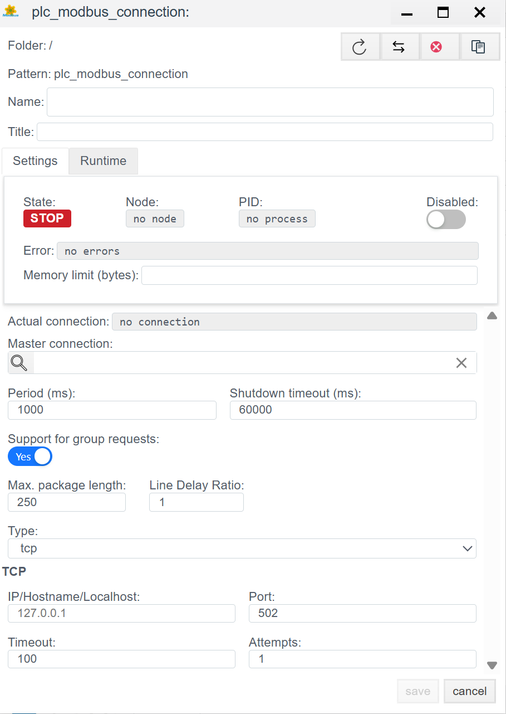
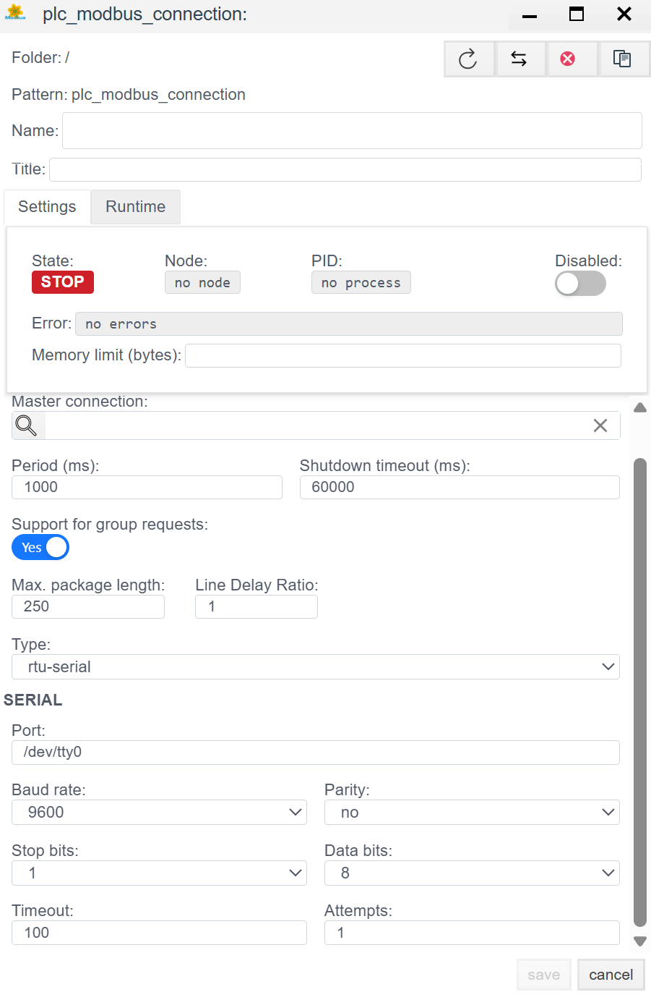
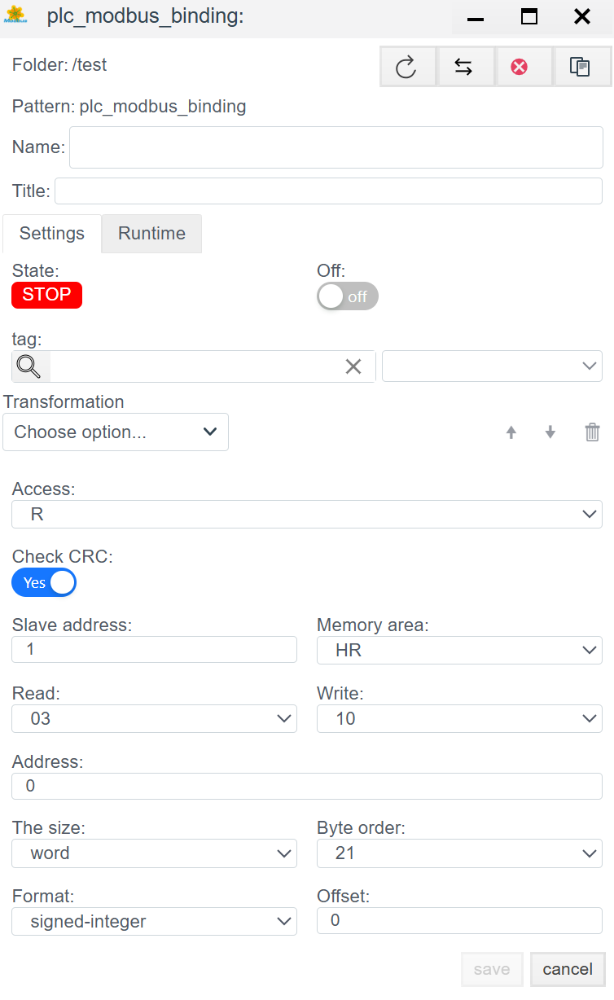

# Руководство по конфигурации Modbus (TCP/RTU)

> См. также: [Общие сведения о PLC-соединениях](./general_ru.md)

## Общее описание
**Modbus** — это де-факто стандарт промышленной автоматизации. В системе **Faceplate** реализован универсальный драйвер, поддерживающий три режима работы, что позволяет опрашивать как современные контроллеры, так и устаревшее оборудование или датчики через шлюзы.

Поддерживаемые режимы (`Type`):
1.  **tcp:** Классический Modbus TCP (Ethernet).
2.  **rtu-serial:** Modbus RTU через физический COM-порт (RS-485/232).
3.  **rtu-tcp:** Modbus RTU инкапсулированный в TCP пакет (Modbus-over-TCP). Используется для работы с прозрачными шлюзами (Moxa, HF и др.).

Процесс настройки состоит из двух этапов:
1.  **Connection (`plc_modbus_connection`):** Настройка транспорта.
2.  **Binding (`plc_modbus_binding`):** Адресация регистров.

---

##  1. Настройка соединения (Connection)
> Создать PLC cоединения → [Шаги создания PLC соединения](./general_ru.md#создание-plc-соединения)
На этом этапе мы выбираем физику связи.

> Панель диагностики и общие параметры соединения (Settings) описаны в разделе [Общие параметры соединения](./general_ru.md#общие-параметры-соединения-settings).

### 1.1 Выбор типа транспорта
Первым делом определите тип подключения в поле **Type**.

#### 1.1.1 Режим `tcp` (Ethernet)
Используется для связи с ПЛК или модулями ввода-вывода, имеющими Ethernet-порт и поддерживающими стек Modbus TCP.

**Варианты применения:**
- Прямое подключение к устройству, поддерживающему MODBUS-TCP
- Подключение через шлюз, который ведет обмен со станцией FACEPLATE по протоколу MODBUS-TCP, проксируя запросы в другую линию связи (например, MODBUS-RTU или даже протоколы не из семейства MODBUS)

| Поле | Описание |
| :--- | :--- |
| **IP/Hostname** | IP-адрес или имя хоста устройства (например, `192.168.1.10`). |
| **Port** | Номер порта для подключения. По умолчанию MODBUS-TCP работает через порт **502**, но при подключении через шлюз (например, TCP⇔RS-485) номер порта может отличаться. |
| **Timeout** | Максимальное время ожидания ответа от опрашиваемого устройства (в мс). ⚠️ **ВНИМАНИЕ:** Увеличение данного параметра на каналах связи низкого качества может привести к увеличению задержек в работе соединения. |
| **Attempts** | Количество повторных попыток обращения к устройству в случае получения некорректного ответа или превышения таймаута. Увеличение помогает достичь более стабильной работы на каналах с низким качеством связи, но может привести к появлению задержек. |

#### 1.1.2 Режим `rtu-serial` (RS-485/232)
Используется для прямого подключения гирлянды устройств к COM-порту сервера.

**Особенности подключения:**
- Подключение к устройству выполняется по линии связи RS-485
- Подключение станции FACEPLATE к линии связи выполняется с помощью преобразователей **RS-232⇔RS-485** или **USB⇔RS-485**
- **Важно:** При использовании одного серийного порта для обмена информацией с несколькими slave-устройствами нужно настроить **одно общее соединение**. В этом случае Modbus-адреса устройств определяются при настройке привязок.

| Поле | Описание |
| :--- | :--- |
| **Port** | Порт, через который ведется обмен данными. Примеры: `COM3` для OS Windows, `/dev/ttyUSB0` для систем семейства Linux. |
| **Baud rate** | Скорость передачи данных. Должна **строго совпадать** на всех устройствах линии (9600, 19200 и т.д.). |
| **Parity** | Использование проверки четности (`no`, `even`, `odd`). |
| **Stop bits** | Количество стоповых бит, передаваемых в пакете (обычно `1`). |
| **Data bits** | Размер байта — количество бит, передаваемых в пакете (обычно `8`). |
| **Line Delay Ratio** | Коэффициент задержки линии. Увеличьте, если линия длинная и "шумная". |

#### 1.1.3 Режим `rtu-tcp` (Modbus-over-TCP)
Используется для работы с прозрачными шлюзами (Moxa, HF и др.).

**Особенности:**
- Подходит для обмена данными с устройствами, поддерживающими MODBUS-RTU
- В отличие от `rtu-serial`, для подключения к устройству используется преобразователь **TCP⇔RS-485**
- FACEPLATE выполняет подключение к преобразователю по TCP, но использует для обмена протокол MODBUS-RTU
- Такое решение позволяет использовать преобразователи TCP⇔RS-485 в качестве Modbus-master устройств для организации связи с большим количеством slave-устройств
- Структура пакета внутри будет как у RTU (с контрольной суммой CRC)

**Настройка:**

| Поле | Описание |
| :--- | :--- |
| **IP/Hostname** | IP-адрес или имя хоста шлюза. |
| **Port** | Номер порта для подключения. По умолчанию MODBUS-TCP работает через порт **502**, но при подключении через шлюз TCP⇔RS-485 номер порта может отличаться. |
| **Timeout** | Максимальное время ожидания ответа от опрашиваемого устройства (в мс). |
| **Attempts** | Количество повторных попыток при получении некорректного ответа. |

---

## 2. Настройка переменных (Binding)

Здесь мы привязываем конкретный регистр Modbus к тегу системы.

> Создать PLC привязку → [Шаги создания PLC привязки](./general_ru.md#создание-plc-привязки)

> Общие поля привязки (Name, Title, State, Tag, Transformation, Access) описаны в разделе [Общие поля PLC-привязки](./general_ru.md#общие-поля-plc-привязки).

### 2.1 Адресация (Addressing)

| Поле | Описание |
| :--- | :--- |
| **Slave address** | **Modbus-адрес устройства на шине.** Может принимать значения от **1 до 255**. Значение поля используется при подключении к устройству через шлюз либо в режиме RTU-SERIAL. *Примеры:* В TCP обычно `1` (или `255`), в Serial — от `1` до `247`. |
| **Memory area** | **Тип области памяти в устройстве:**  • **DI (Discrete Inputs)** — дискретный вход (1xxxx). Тип памяти доступен **только для чтения**. Один регистр DI соответствует одному биту. Если сопоставляемое поле тега имеет целочисленный тип, то в него могут быть считаны более одного регистра. Количество считываемых регистров определяется настройкой "Размер" (см. ниже).  • **AI (Analog Input) / IR (Input Registers)** — входные регистры (3xxxx). Тип памяти доступен **только для чтения**. Каждый регистр состоит из **16-ти бит**. Для передачи чисел с плавающей точкой, а также целых значений более 65535, может быть использовано 2 следующих друг за другом регистра. Это определяется настройками "Размер" и "Формат" (см. ниже).  • **DO (Discrete Outputs) / CS (Coils)** — катушки/выходы (0xxxx). Тип доступен для **чтения и записи**. Один регистр соответствует одному биту. Если сопоставляемое поле тега имеет целочисленный тип, то в него могут быть считаны более одного регистра. Количество считываемых регистров определяется настройкой "Размер" (см. ниже).  • **HR (Holding Registers)** — регистры хранения (4xxxx). Тип доступен для **чтения и записи**. Каждый регистр состоит из **16-ти бит**. Для передачи чисел с плавающей точкой, а также целых значений более 65535, может быть использовано 2 следующих друг за другом регистра. Это определяется настройками "Размер" и "Формат" (см. ниже). |
| **Address** | **Начальный адрес регистра.** Смещение (Offset) адреса регистра. Если "Размер" (см. ниже) привязки обеспечивает передачу более одного регистра, то в настройке должен быть указан адрес **первого регистра из связки**. ⚠️ *Внимание:* В некоторых картах адресов нумерация начинается с 1, в драйвере обычно с 0. Если данные "сдвинуты", попробуйте +/- 1. |
| **Read / Write** | **Коды функций Modbus.** Поля позволяют переопределить функции чтения и записи области (см. [Modbus Application Protocol](http://www.modbus.org/docs/Modbus_Application_Protocol_V1_1b.pdf)). По умолчанию задаются значения, соответствующие выбранной области памяти (например, Read `03`, Write `10` или `06`). |

### 2.2 Формат данных (Data Handling)

| Поле | Описание |
| :--- | :--- |
| **The size** | **Размер данных.** Определяет объем передаваемых данных:  • **bit** — один бит.  • **byte** — 8 бит. Тип может быть использован для передачи 8 следующих друг за другом однобитовых регистров (DI, DO).  • **word** — 16 бит. Тип используется для передачи одного регистра AI или HR, а также для работы с 16-ю следующими друг за другом регистрами типа DI или DO.  • **dword** — 32 бит. Тип может быть использован для передачи 2-х следующих друг за другом регистров AI или HR. Формат передаваемого значения определяется настройкой "Формат" (см. ниже). Также тип может использоваться для передачи 32-х следующих друг за другом однобитовых регистров (DI, DO). |
| **Format** | **Формат передаваемых данных.** Настройка имеет значение при передаваемом объеме данных более одного байта (типы word, dword): • `signed-integer` — Целое число со знаком • `unsigned-integer` — Целое число без знака • `float` — Число с плавающей точкой |
| **Byte order** | **Порядок байт (очередность байтов).** Критически важная настройка. • `21` — прямая (Big Endian, стандарт) • `12` — обратная (Little Endian) • `2143` / `3412` — Различные варианты Swap для 32-битных чисел. Подбирается экспериментально, если число отображается неверно. |
| **Offset** | **Смещение бита (байта) внутри регистра**, начиная с `0`. |
| **Check CRC** | **Проверка контрольной суммы.** Позволяет отключить проверку CRC. Актуально только для MODBUS RTU.  ⚠️ **ВНИМАНИЕ:** Не рекомендуется отключать данную проверку, так как это может привести к **искажению получаемых с устройства данных**. Отключение проверки может быть использовано только при необходимости интеграции с оборудованием, не поддерживающим механизм CRC.  *Обычно:* `Yes` (включено). |

---