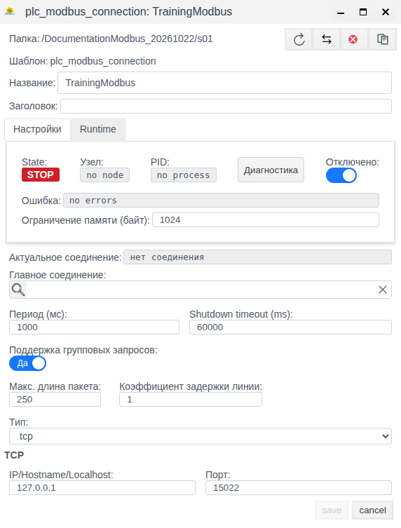
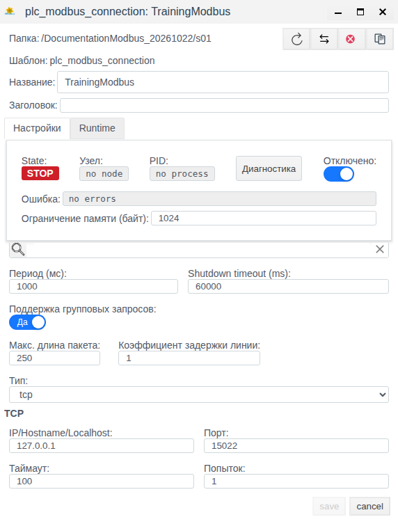
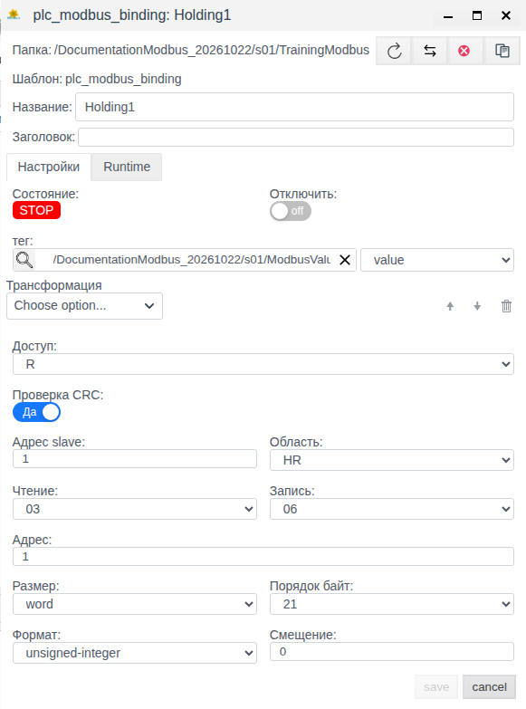
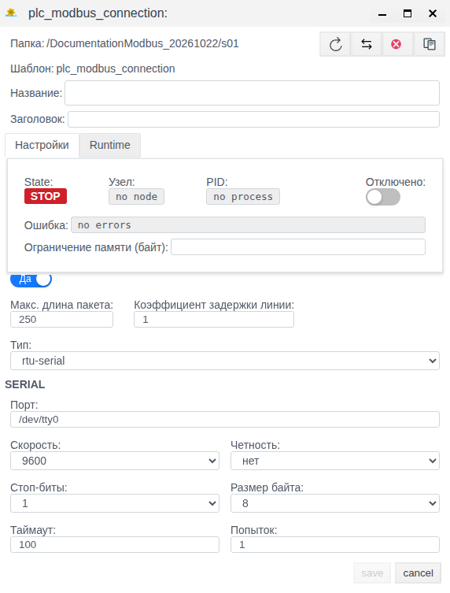
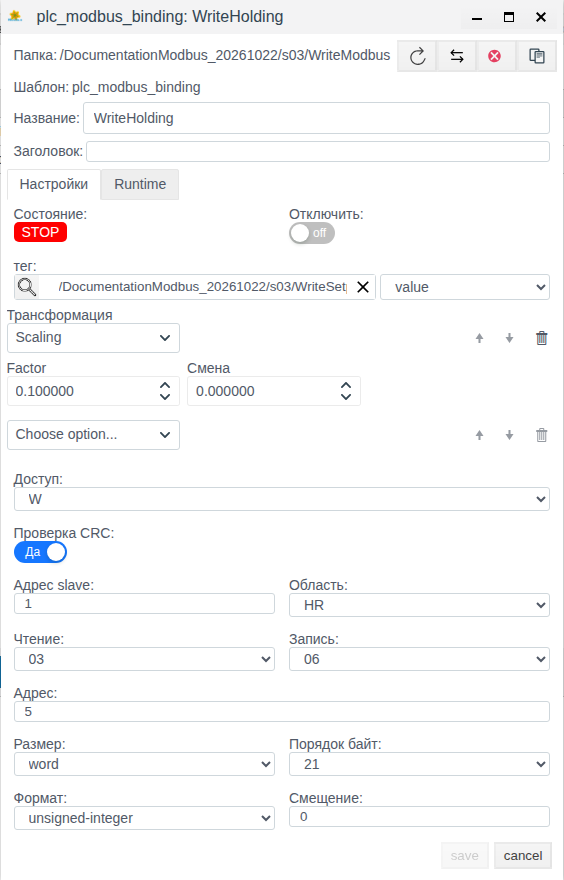
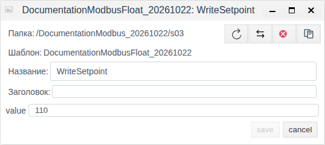
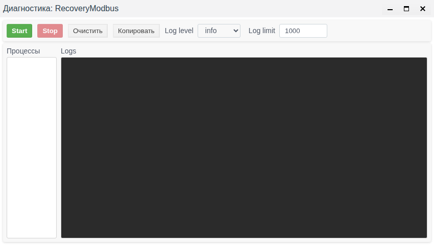

# Modbus в Faceplate: настройка соединения и проверка обмена

Faceplate v4.0.7 · Для интеграторов · Документ для рецензирования

Четыре учебные конфигурации проверены через Studio: создание, сохранение, отдельное повторное открытие и сверка параметров. Общий PROJECT оставлен отключённым. Чтение в поля тегов, W/RW-запись и восстановление обмена не выполнялись; соответствующие шаги ниже описывают ожидаемую проверку на разрешённом стенде.

Снимки реального русского интерфейса Faceplate получены средствами Playwright без ретуши. Они показывают конфигурацию и диагностические формы, а не успешный обмен с устройством.

**Содержание**

- [Как устроен обмен Modbus](#как-устроен-обмен-modbus)
- [Подготовка к подключению](#подготовка-к-подключению)
- [Первый обмен по Modbus TCP](#первый-обмен-по-modbus-tcp)
- [Настройки соединения](#настройки-соединения)
- [Привязки и обработка значений](#привязки-и-обработка-значений)
- [Запись и проверка результата](#запись-и-проверка-результата)
- [Изменение и управление обменом](#изменение-и-управление-обменом)
- [Диагностика и восстановление](#диагностика-и-восстановление)

[Каталог соединений](./index.md) · [Подготовка поля и привязки](./bindings_ru.md) · [Преобразования](./transformation_ru.md) · [Диагностика и восстановление](./diagnostics_ru.md)

## Маршрут настройки

Подготовьте внешний источник или клиент и совместимое поле тега по общей инструкции. Затем настройте канал, сохраните полную привязку и проверьте новое значение. Для поддержанной записи/приёма отдельно подтвердите результат на внешней стороне; после исправления сбоя повторите проверку с новым контрольным значением.

[Альтернативный канал и карта сигналов](./bindings_ru.md#настроить-альтернативный-канал) описаны одинаково для всех типов; условия переключения уточняйте по драйверу.

## Подготовить воспроизводимый учебный источник

Для локального учебного TCP-стенда в комплект включён [источник Modbus TCP](./examples/modbus_training_server.py). Запускайте его на узле, с которого Faceplate обращается к 127.0.0.1, через Python 3: python3 modbus_training_server.py. Он слушает 127.0.0.1:15022, Unit 1, предоставляет пять HR со значениями 1000, 65535, 1000, 1000, 1000 и функции 03/06/10.

В другом терминале python3 modbus_training_server.py --get 1 читает первый регистр; --set 1 1001 задаёт новое контрольное значение. Адрес CLI 1 соответствует PDU 0. Для примера общего руководства с портом 15020 запустите --port 15020 и используйте тот же порт в командном клиенте.

Подготовьте поля примеров по общей инструкции привязок. Сначала подтвердите источник командным клиентом, затем выполняйте шаги статьи. Учебный сервер проверяет протокольные значения; аппаратное действие он не моделирует. Его проверка отдельно от Faceplate не является новым испытанием PLC-драйвера.

## Как устроен обмен Modbus

Соединение Modbus позволяет получать значения устройства в поля тегов Faceplate и передавать в устройство задания из проекта. Faceplate работает как клиент (master): сам отправляет запросы серверу или slave-устройству. Серверную роль для приёма запросов от других Modbus-клиентов это соединение не предоставляет.

Протокол задаёт правила обмена. Драйвер реализует поддержку протокола в Faceplate. Соединение содержит общие параметры канала: транспорт, адрес узла или последовательный порт, период и параметры запросов. Привязка описывает одно значение: устройство, область и адрес, размер и формат, направление, преобразование и поле тега. Тег — объект проекта; поле тега принимает прочитанное значение или содержит задание для записи.

Одно соединение может обслуживать несколько привязок, в том числе к разным slave на общей линии. Привязки размещают непосредственно внутри соединения. Само соединение не создаёт теги и не находит карту регистров автоматически.

На чтении данные проходят путь: **источник → канал соединения → адрес и формат привязки → преобразование → поле тега**. На записи: **изменение поля тега → обратное преобразование → кодирование по формату привязки → запрос записи → источник**. Поле с доступом R получает данные; W задаёт запись; RW работает в обоих направлениях. Это направления обмена, а не права пользователя.

### Выбор транспорта

| Тип | Что передаётся | Что получить до настройки | Как проверить выбор |
|---|---|---|---|
| tcp | Modbus TCP с заголовком MBAP | IP/имя, TCP-порт, Unit ID и карта данных | Устройство или шлюз принимает именно Modbus TCP |
| rtu-tcp | RTU-кадры с CRC через TCP | Адрес и порт прозрачного шлюза, slave и карта | Шлюз переносит RTU-кадры, а не ожидает Modbus TCP |
| rtu-serial | RTU через последовательный порт узла Faceplate | Порт ОС, скорость, чётность, стоп-биты, размер байта, slave и карта | Порт существует на узле обмена и доступен процессу Faceplate |

Шлюз, который принимает Modbus TCP и сам обращается к RTU-устройствам, требует **tcp**. Для прозрачного переноса RTU по TCP выбирают **rtu-tcp**. По одному номеру TCP-порта определить протокол нельзя.

Соединение поддерживает чтение функциями 01/02/03/04 и запись 06/0F/10 (hex). Доступны bit, byte, word, dword, целые со знаком и без знака, числовой формат float, извлечение части регистра и преобразования. Для float32 используют dword. Функции 05, масочная запись 16 и совместная операция 17 не поддерживаются; собственных 64-битных и строковых Modbus-типов нет. Приведение числа к строковому полю тега не превращает его в строку из нескольких регистров.

## Подготовка к подключению

До создания соединения получите карту данных и параметры источника. Для каждого сигнала запишите отдельно область, обозначение в карте, адрес PDU, Unit ID, размер, знаковость или float, порядок байтов и слов, разрешённые функции, единицы измерения и преобразование.

**Обозначение из паспорта, адрес формы, адрес PDU и Unit ID — разные значения.** Если паспорт называет первый holding register «40001» и определяет его PDU-адрес как 0, выберите область HR и введите в форме **Адрес 1**. Префикс 4xxxx автоматически не отбрасывается: ввод 40001 даст адрес PDU 40000. Адрес slave/Unit ID выбирает устройство и не заменяет адрес регистра.

Для приёма подготовьте существующий тег и конкретное совместимое поле. Для −1 и 65535 подойдёт integer; для масштабирования 1000 × 0.1 и задания 120.0 используйте float. Поле должно быть доступно в Runtime. В привязке необходимо выбрать и тег, и поле: одного пути тега недостаточно.

Проверьте права на редактирование папки и выполнение проекта. Разрешение у самого соединения не заменяет разрешение его родительских папок. При отключённом PROJECT дочерний пример не выполняется, даже если у него выключен флаг «Отключено». Включение общего PROJECT может запустить и другие разрешённые объекты; согласуйте такое изменение с ответственным за проект.

Адрес устройства и последовательный порт проверяйте **с узла выполнения Faceplate**. Адрес 127.0.0.1 означает этот узел, а не компьютер с браузером. Для serial нужны доступный порт ОС и совпадающие параметры линии.

### Учебные исходные данные

Примеры используют заранее подготовленный собственный Modbus TCP-источник **127.0.0.1:15022**, Unit ID **1**, с пятью holding-регистрами. Это учебный стенд; чтение регистра и ответ на запись не подтверждают физическое действие оборудования.

| Сигнал | Адрес формы / PDU | Исходные данные | Поле тега |
|---|---|---|---|
| Первое чтение | 1 / 0 | 1000; контрольное изменение 1001 | ModbusValue/value, integer |
| Знаковость | 2 / 1 | FFFF, то есть 65535 без знака | SignedValue/value и UnsignedValue/value, integer |
| Масштабирование | 3 / 2 | 1000; множитель 0.1, сдвиг 0 | ScaledValue/value, float |
| RW-задание | 4 / 3 | 1000; задание 120.0 соответствует 1200 | Setpoint/value, float |
| W-задание | 5 / 4 | 1000; текущее задание до активации 110.0 | WriteSetpoint/value, float |

Перед примером восстановления источник подготавливают с HR1=2000, после обрыва — с HR1=2001. Контрольный сигнал использует HR3. Адрес формы 99 находится вне карты именно этого учебного источника; на другом устройстве он может быть допустимым.

Учебные теги размещены в отдельных папках s01–s04 внутри DocumentationModbus_20261022. До настройки привязок целочисленные поля равны 0; ScaledValue и Setpoint равны 0.0, WriteSetpoint — 110.0. После каждого примера его соединение отключают, чтобы следующие проверки не влияли друг на друга. Самостоятельно подготовьте эквивалентные поля и источник, если используете другой учебный проект.

## Первый обмен по Modbus TCP

Задача — связать первый holding-регистр учебного источника с ModbusValue/value. В этом прогоне через UI проверены создание, сохранение и отдельное повторное открытие конфигурации. Соединение оставлено отключённым: получение 1000 и нового 1001 ниже является ожидаемой проверкой на разрешённом стенде, а не выполненным результатом.

### Создайте соединение и привязку

1. Откройте Studio по адресу http://127.0.0.1:9000/fp/studio и войдите под учётной записью с правами настройки. В **Меню → Общий вид** откройте DocumentationModbus_20261022 → s01. Откройте ModbusValue и убедитесь, что исходное value равно 0; закройте форму без изменения.
2. В s01 нажмите **Создать**, выберите категорию **plc** и шаблон соединения Modbus **plc_modbus_connection**, затем **Ok**. Введите название **TrainingModbus**, тип **tcp**, адрес **127.0.0.1**, порт **15022**. Подтвердите текстовый ввод клавишей Tab. Период оставьте 1000 мс, Таймаут 100 мс, Попыток 1; Главное соединение оставьте пустым. При необходимости прокрутите форму вниз до Таймаута и Попыток.
3. Перед первым сохранением включите **Отключено**, чтобы конфигурация не начала обмен. Нажмите **save**, выйдите из редактора, затем выберите TrainingModbus и **Редактировать**. Проверьте отдельно открытые сохранённые адрес, порт и флаг. Закройте **cancel**, если изменений не требуется.
4. Дважды щёлкните TrainingModbus и нажмите **Создать**. В дочерней привязке задайте **Holding1** и параметры из таблицы ниже. Привязка создаётся внутри соединения, а не рядом с ним.
5. Нажмите лупу у **тег**, откройте DocumentationModbus_20261022 → s01, выберите **ModbusValue**, подтвердите **ОК**. В соседнем списке выберите поле **value**. Проверьте полный путь, если сокращённый путь не помещается в поле.
6. Нажмите **save**, закройте редактор и отдельно откройте Holding1. Проверьте адрес, формат и целевое поле. Функции дополнительно проверьте через **Меню → Драйверы ПЛК → TrainingModbus** в таблице привязок: открытие HR-формы может временно подставить функцию записи 10. Не сохраняйте непреднамеренную подстановку.

| Параметр Holding1 | Значение |
|---|---|
| Доступ / Проверка CRC | R / Да |
| Адрес slave / Область | 1 / HR |
| Чтение / Запись | 03 / 06; при R функция записи не используется |
| Адрес формы / адрес PDU | 1 / 0 |
| Размер / Формат | word / unsigned-integer |
| Порядок байт / Смещение | 21 / 0 |
| тег / поле | ModbusValue / value из папки s01 |
| Трансформация | Без преобразования |
| Отключить у привязки | Выключено; родительское соединение пока отключено |

*Сохранённый TCP-канал: порт 15022 и включённый флаг «Отключено». STOP и отсутствие процесса ожидаемы для этой конфигурационной проверки.*

*После прокрутки видны Таймаут 100 и Попыток 1. Значения подтверждены повторным открытием.*

*Форма Holding1 после восстановления выбора 06 вместо подстановки 10; save недоступна. Сохранённая 06 отдельно подтверждена таблицей привязок. Запрос записи не выполнялся.*

### Проверьте новые данные на разрешённом стенде

На стенде, где выполнение проекта разрешено и источник запущен, выключите **Отключено** у TrainingModbus, сохраните и проверьте привязку. Ожидается, что исходные 0 в ModbusValue/value сменятся на 1000. Затем измените **сам источник** с HR1=1000 на HR1=1001 и независимо прочитайте его Modbus-клиентом. Повторно откройте ModbusValue: ожидается **1001 в том же поле**, без ручного присвоения полю Faceplate.

Проверьте состояния соединения и Holding1 отдельно от значения. RUN, OK или исчезновение ошибки недостаточны для доказательства нового чтения. После проверки включите **Отключено** у собственного TrainingModbus и сохраните. В текущем прогоне поле оставалось 0, соединение не активировалось, переход 1000→1001 не выполнялся.

## Настройки соединения

Параметры соединения относятся к общему каналу. Адрес slave, регистр и формат конкретного значения задаются в привязке. После изменения нажмите Tab, сохраните объект и отдельно откройте его снова; введённое в ещё не сохранённой форме значение не подтверждает конфигурацию.

### Параметры канала и опроса

| Параметр | Исходное значение / варианты | Назначение и условия | Проверка |
|---|---|---|---|
| Название, Папка, Заголовок | Название задаёт интегратор; Заголовок может быть пустым | Место и понятное имя объекта | Проверьте полный путь, чтобы изменить нужное соединение |
| Тип | tcp; tcp / rtu-tcp / rtu-serial | Выбирает транспорт и вид кадра | Сверьте с режимом устройства или шлюза |
| IP/Hostname/Localhost | 127.0.0.1 показан также как подсказка | Адрес узла для обоих TCP-вариантов | Введите фактический адрес и проверьте доступность с узла Faceplate |
| Порт TCP | 502; 1…65535 | TCP-порт источника; в учебном примере 15022 | Повторное открытие должно показать нужный порт |
| Порт SERIAL | В новой форме /dev/tty0 | Порт ОС на узле выполнения; для TCP не используется | Проверьте существование и права процесса |
| Скорость | 9600; 300, 600, 1200, 2400, 4800, 9600, 19200, 38400, 57600, 115200, 230400, 460800, 500000, 576000 | Скорость serial; поддержка зависит от порта и адаптера | Значение совпадает с устройствами линии |
| Четность | нет / четный / нечетный; исходно нет | Формат serial-кадра | Совпадает с линией |
| Стоп-биты | 1 или 2; исходно 1 | Формат serial-кадра | Совпадает с линией |
| Размер байта | 5 / 6 / 7 / 8; исходно 8 | Число информационных бит serial | Совпадает с линией |
| Таймаут | 100 мс в новой форме | Ожидание приёма; не равно длительности всего цикла | Подберите по времени ответа источника; проверьте новый ответ |
| Попыток | 1; в форме 1…50 | Общее число RTU-попыток, включая первую | Не рассчитывайте на этот параметр как на повторы Modbus TCP |
| Период (мс) | 1000 мс | Период цикла опроса | Проверьте фактическое обновление; длительный обмен увеличивает интервал |
| Shutdown timeout (ms) | 60000 мс | Ожидание остановки процесса | Отдельный параметр; не используйте вместо таймаута запроса |
| Поддержка групповых запросов | Да в новой форме | Объединяет совместимые чтения | Сравните результат группового и отдельного чтения на карте устройства |
| Макс. длина пакета | 250 байт | Ограничивает объединённый запрос | Учитывайте допустимые диапазоны и размер запроса устройства |
| Коэффициент задержки линии | 1 в новой форме | Влияет на выбор групп запросов | Меняйте при обоснованной настройке группирования; это не пауза RS-485 |
| Главное соединение | Пусто для самостоятельного канала | Связь дополнительного транспорта с основным | Не задавайте для обычного одиночного подключения |
| Отключено | Выключено в новой форме | Запрещает выполнение собственного соединения при включённом флаге | После сохранения отдельно проверьте состояние и новые данные |
| Ограничение памяти (байт) | После сохранения 1024 | Порог памяти процесса; несмотря на подпись UI, число трактуется в MiB | Не вводите пересчитанные «1024 байта»; согласуйте изменение порога с администратором |

Таймаут и Попыток расположены ниже в прокручиваемой форме. Они присутствуют и при tcp, но Попыток используется RTU-обменом. RTU повторяет не каждый вид неуспеха: некоторые ошибки приёма хвоста ответа завершают транзакцию сразу. Поэтому число попыток и таймаут не дают точную верхнюю границу времени цикла.

Пустое значение и исходное значение новой формы различаются. При конфигурациях, созданных другим способом, отсутствие Таймаута использует 50 мс, отсутствие группирования — выключенное группирование, отсутствие коэффициента — 2. Для учебных примеров проверяйте явно сохранённые значения, а не предполагайте совпадение с новой формой.

### TCP

Выберите **Тип tcp**, введите IP/Hostname/Localhost и TCP-порт устройства. Источник должен принимать Modbus TCP. Slave/Unit ID остаётся параметром привязки. В учебном примере явно сохранены 127.0.0.1 и 15022; подсказка адреса в пустом поле сама по себе не подтверждает сохранённое значение.

Таймаут относится к ожиданию приёма. Поле Попыток видно и в TCP-форме, но TCP-обмен его как число повторов не использует. Проверьте доступность узла, ответ источника и новое значение поля отдельно.

### RTU через TCP

Выберите **Тип rtu-tcp**, адрес и порт прозрачного RTU-шлюза. В привязках задайте slave устройств и оставьте проверку CRC, если нет обоснованной причины её отключать. Настройте Таймаут и общее число RTU-попыток по реальной линии. Успешное открытие TCP-соединения ещё не подтверждает корректный RTU-ответ.

Если шлюз принимает Modbus TCP и преобразует его в RTU самостоятельно, выберите tcp. При осмотре справочника rtu-tcp проверялась только несохранённая форма; транспорт и обмен RTU через TCP не выполнялись.

### Последовательная линия RTU

Выберите **Тип rtu-serial**. Задайте реальный порт ОС на узле Faceplate, скорость, чётность, стоп-биты и размер байта в соответствии с линией. Убедитесь в правах процесса на порт. Значение /dev/tty0 в новой форме является исходным полем, а не результатом поиска подключённого адаптера.

*Осмотр rtu-serial: параметры линии, Таймаут и Попыток. Форма отменена; сохранение serial-конфигурации и обмен через физический порт не проверялись.*

### Группирование чтений

Группирование уменьшает число запросов, объединяя совместимые диапазоны с одинаковыми slave, функцией чтения и настройкой CRC. Групповую запись оно не добавляет. Если внутри объединённого диапазона есть недоступный адрес, устройство может отклонить всю группу и затронуть несколько сигналов.

При ошибке группы временно отключите группирование у собственного тестового соединения и проверьте тот же адрес отдельным запросом. Затем сопоставьте границы карты, размер ответа и максимальную длину пакета. Коэффициент задержки линии влияет на выбор групп; это не физическая задержка между кадрами последовательной линии.

### Дополнительные транспортные каналы

Дополнительное соединение описывает другой транспортный путь и ссылается через «Главное соединение» на основное соединение того же типа. Цепочки таких ссылок не поддерживаются. Основное соединение использует собственные привязки; копировать их в дополнительный транспорт для этого не требуется. Дополнительный объект не запускается как независимое соединение и переводится в отключённое состояние.

Сначала проверьте самостоятельный канал, затем настройте дополнительный и отдельно воспроизведите отказ и смену пути. Не считайте переключение бесшовным и не рассчитывайте на автоматический возврат к предпочтительному пути без проверки на своём стенде. Отображаемый путь «Актуальное соединение» может сохранять последнее выбранное значение после разрыва; он не заменяет подтверждение новых данных. В учебных TCP-примерах этой статьи переключение каналов не проверяется.

### Системные значения

State, Узел, PID, Ошибка и Актуальное соединение формируются при выполнении. Не заполняйте их как адрес устройства или параметры привязки. PID и узел показывают наличие процесса; состояние RUN и отсутствие ошибки ещё не подтверждают чтение нужного регистра. Сопоставляйте их с конкретной привязкой и новым значением правильного поля тега.

## Привязки и обработка значений

Привязка соединяет один адрес источника с одним полем тега. Она размещается непосредственно внутри соединения. Канал остаётся общим, а slave, адрес, формат, направление и преобразования задаются для каждого значения отдельно.

### Параметры привязки

| Параметр | Исходно / допустимые значения | Назначение и условия | Проверка |
|---|---|---|---|
| Название | Задаётся для каждого значения | Имя сигнала внутри соединения | Проверьте путь родительского соединения |
| тег / поле | Выбираются явно | Объект и поле получения данных или задания записи | После выбора тега обязательно выберите соседнее поле |
| Доступ | R; R / W / RW | Чтение, запись или оба направления | Для AI/DI выбирайте R |
| Проверка CRC | Да | Проверяет CRC ответа RTU; на Modbus TCP не влияет | Отключение проверки не удаляет CRC из отправляемого RTU-кадра |
| Адрес slave | 1; поддерживается 1…254 | Идентификатор устройства, Unit ID | HTML-поле допускает 255, но это не поддерживаемое сохраняемое значение |
| Область | HR; HR / AI / DO / DI | Область карты данных | Согласуйте с функциями чтения и записи |
| Чтение | Для HR 03; варианты 01 / 02 / 03 / 04 | Функция запроса чтения | Проверьте после выбора области |
| Запись | Для HR исходно 10; варианты 06 / 0F / 10 | Функция запроса записи | Выставляйте нужную функцию последней и проверяйте в таблице привязок |
| Адрес | В новой форме 0; первый регистр вводят как 1 | Для HR/AI адрес PDU равен адресу формы минус 1 | Не используйте 0 для первого регистра; префикс 4xxxx не отбрасывается |
| Размер | word; bit / byte / word / dword | Ширина извлекаемого значения | Для dword нужны два регистра; для float32 выберите dword |
| Формат | signed-integer; unsigned-integer / float | Знаковость или интерпретация float | Проверяйте известными байтами; для одиночного бита используйте unsigned-integer |
| Порядок байт | 21; текущая форма предлагает 12 / 21 | Перестановка байтов до разбора числа | При dword список остаётся тем же; проверьте известное 32-битное значение |
| Смещение | 0 | Выбор бита или байта после порядка байтов | Допустимые значения зависят от размера и области, см. ниже |
| Трансформация | Без преобразования; доступен список операций | Обработка результата чтения и обратная обработка задания | Для W/RW вся цепочка должна поддерживать обратное направление |
| Отключить | Выключено | Исключает только эту привязку из обмена | После включения подтвердите новое значение именно её поля |

Пустые тег и поле могут использоваться для специальной работы со значением самой привязки. Для передачи в поле проекта выбирайте оба значения; пустую ссылку не считайте выполненной настройкой тега.

### Области и функции

Коды функций в статье указаны в шестнадцатеричном виде.

| Область | Смысл | Чтение | Запись | Направление для настройки |
|---|---|---|---|---|
| DI | Дискретные входы | 02 | Не настраивать | R |
| AI | Входные регистры | 04 | Не настраивать | R |
| DO | Дискретные выходы, coils | 01 | 0F | R / W / RW |
| HR | Holding registers | 03 | 06 для одного word; 10 для регистра или нескольких регистров | R / W / RW |

Область и функция должны согласовываться: фактический запрос определяется функцией. При выборе AI/DI поле записи блокируется, но это не заменяет выбор R. Оставшееся W/RW с функцией 10 может обратиться к holding-регистрам. Функция 05 не поддерживается; для записи DO используется 0F.

**Проверяйте функции после открытия формы.** В текущем интерфейсе открытие HR-редактора подставляет 03/10 как временное изменение. Если сохранено 06, форма может показать 10 с активной кнопкой save. Не сохраняйте эту подстановку автоматически. После выбора области и остальных параметров выставьте нужную функцию последней; сохранённое значение проверьте через **Меню → Драйверы ПЛК**, открыв соединение и его таблицу привязок. В учебном примере именно таблица подтвердила 06. Изменение размера также не выбирает автоматически правильные функции, формат, порядок байтов и смещение.

### Размер, формат и смещение

| Размер | Ширина и целочисленный диапазон | Смещение | Условия |
|---|---|---|---|
| bit | 1 бит; unsigned даёт 0/1 | HR/AI: 0…15; DI/DO: 0…7 | Для ожидаемого логического значения выбирайте unsigned-integer |
| byte | 8 бит; unsigned 0…255, signed −128…127 | 0 или 1 | Для HR/AI выбирает младший или старший байт после перестановки |
| word | 16 бит; unsigned 0…65535, signed −32768…32767 | Только 0 | Один регистр; FFFF даёт 65535 или −1 в зависимости от формата |
| dword | 32 бита; unsigned 0…4294967295, signed −2147483648…2147483647 | Только 0 | Два регистра; для IEEE float32 используйте float |

Поле смещения в HTML допускает 0…16 независимо от размера, но это не означает допустимость всех значений для каждой комбинации. Применяйте диапазоны таблицы. При чтении DI/DO запрос выравнивается по байту; дополнительное смещение не расширяет ответ. Убедитесь, что извлекаемая часть помещается в полученные данные. Для записи DO задавайте смещение 0: при записи оно не применяется.

После порядка 21 слово 1234 hex даёт byte со смещением 0 = 34 hex, со смещением 1 = 12 hex. Бит со смещением 3 у слова 0008 hex даёт 1. Знаковый одиночный бит даёт −1 вместо 1; при приведении к bool это приведёт к false, поскольку логическое значение определяется порогом 0.5. Поэтому bit настраивают как unsigned-integer.

Формат float сам не выбирает ширину. Для float32 нужны dword и два регистра; запись float поддерживается только с dword. Чтение 16-битного float зависит от поддержки такого формата средой выполнения; в примерах обмен float16 не проверяется. Выбор word/float нельзя считать автоматически равнозначным float32.

При поступлении float в integer результат округляется; integer в поле float становится вещественным числом. Это дополнительное приведение после преобразования, поэтому выбор типа поля влияет на результат масштабирования.

### Порядок байтов на известных данных

| Байты ответа | Значение порядка | Байты для разбора | Доступность в текущей форме |
|---|---|---|---|
| 12 34 | 21 | 12 34 → 1234 hex | Есть |
| 12 34 | 12 | 34 12 → 3412 hex | Есть |
| 12 34 56 78 | 21 или 12 | 12 34 56 78 → 12345678 hex | Есть, но для четырёх байтов эти пункты не выполняют перестановку |
| 12 34 56 78 | 4321 | 12 34 56 78 → 12345678 hex | Не предлагается текущим списком; для понимания уже подготовленной конфигурации |
| 12 34 56 78 | 1234 | 78 56 34 12 → 78563412 hex | Не предлагается текущим списком |
| 12 34 56 78 | 2143 | 56 78 12 34 → 56781234 hex | Не предлагается текущим списком |
| 12 34 56 78 | 3412 | 34 12 78 56 → 34127856 hex | Не предлагается текущим списком |

Текущая форма сохраняет список 12/21 и после выбора dword. Наличие других значений в обработке ранее подготовленного проекта не означает возможность выбрать их в этом списке. Проверьте формат на заранее известном значении устройства, прежде чем использовать результат в управлении.

При отсутствующем порядке применяются отдельные правила: word HR/AI использует 21, dword HR/AI — 2143, многобайтовые DI/DO — обратный порядок байтов. Поэтому явно проверяйте порядок и не заменяйте его пустым значением в расчёте на универсальный вариант.

### Преобразования на чтении и записи

На чтении операции идут сверху вниз по списку. На записи применяется обратное действие в обратном порядке. После чтения результат приводится к типу выбранного поля тега.

| Операция в UI | Чтение | Запись | Условия применения |
|---|---|---|---|
| Без преобразования | Значение после декодирования | Задание по формату привязки | Всё равно учитываются размер, порядок байтов и тип поля |
| Scaling | y = x × Factor + сдвиг | x = (y − сдвиг) / Factor | В поле «Cмена» задаётся сдвиг; для записи Factor должен быть ненулевым |
| Default Value | Заменяет нечисловой вход заданным числом | Пропускает задание без изменения | Может подставить правдоподобное число при потере данных; это не доказательство связи |
| Limit Control | Вне допустимого диапазона даёт пустой/недостоверный результат | Ограничивает задание нижней и верхней границами | Верхняя граница должна быть больше нижней; чтение не является таким же ограничением числа, как запись |
| Damper | Сглаживает изменение с положительной постоянной времени | Пропускает задание без изменения | Учитывайте время установления значения; временная база — миллисекунды |
| Integration | Интегрирует числовой вход | Не поддерживается | Используйте только R; временная база — миллисекунды |
| Derivative | Вычисляет изменение по времени | Не поддерживается | Используйте только R; временная база — миллисекунды |
| Скрипт | Выполняет пользовательское преобразование чтения | Не поддерживается | Цепочка с ним не подходит W/RW; учебные примеры обходятся без скрипта |

Без преобразования потеря чтения делает R/RW-поле пустым/недостоверным. Default Value может заменить такой вход числом, поэтому сохранённое правдоподобное значение не подтверждает исправность канала. W-поле чтением не перезаписывается.

Для масштаба Factor=0.1, сдвиг=0 исходное 1000 должно дать 100.0 в поле float; задание 120.0 должно дать исходное 1200 на записи. Проверяйте обе стороны независимо, а не только формулу или число в форме.

### Проверьте знаковость и масштаб на известных данных

В папке s02 подготовлены SignedValue/value и UnsignedValue/value типа integer, ScaledValue/value типа float. Источник содержит HR2=FFFF и HR3=1000. В этом прогоне проверяется сохранённая конфигурация; значения −1, 65535 и 100.0 не подставляются в теги и не объявляются полученными.

1. Создайте в s02 **FormatModbus** по схеме первого примера: tcp, 127.0.0.1:15022, Период 1000 мс, Таймаут 100 мс, Попыток 1, без главного соединения. Включите **Отключено** до первого save.
2. Внутри него создайте три привязки по таблице. Общие параметры: slave 1, HR, Чтение 03, word, порядок 21, смещение 0, R, CRC Да. Если задаёте Запись 06 для единообразия конфигурации, выбирайте её последней; при R запись не выполняется.
3. В ScaledHolding выберите **Scaling**. Щёлкните **Factor**, выделите значение Ctrl+A, введите 0.1 и подтвердите Tab; в **Cмена** оставьте 0. Проверьте отображение **0.100000 / 0.000000**, сохраните, закройте форму и отдельно откройте её снова. Повторное открытие должно подтвердить числовые параметры без повторного ввода.
4. Проверьте таблицу привязок и отдельно сохранённые форматы, адреса, целевые поля и Scaling. Закройте непреднамеренные изменения функций в HR-форме кнопкой cancel. FormatModbus оставьте отключённым.

После добавления новой строки Scaling проверяйте Factor особенно внимательно. Если при отдельном открытии осталось **1.000000**, отредактируйте уже сохранённую привязку: выделите Factor, введите **0.1** клавиатурой, подтвердите Tab, восстановите нужную функцию записи и сохраните. Ещё одно отдельное открытие должно показать **0.100000**. До этого не разрешайте выполнение, особенно для W/RW: обратное преобразование зависит от множителя.

| Привязка | Адрес формы / формат | Поле тега | Преобразование и ожидаемый результат при обмене |
|---|---|---|---|
| SignedHolding | 2 / signed-integer | SignedValue/value | Без преобразования: FFFF → −1 |
| UnsignedHolding | 2 / unsigned-integer | UnsignedValue/value | Без преобразования: FFFF → 65535 |
| ScaledHolding | 3 / unsigned-integer | ScaledValue/value | Scaling 0.1 / 0: 1000 → 100.0 |

*Сохранённый Scaling: Factor 0.100000 и сдвиг 0.000000. Снимок подтверждает параметры, а не получение 100.0 от источника.*

Для последующей проверки на разрешённом стенде запустите только этот пример и сопоставьте реальные значения трёх полей с последним столбцом. Одинаковые FFFF должны дать разные числа из-за знаковости; 1000 должно дать 100.0 в поле float. Если появляется 100 вместо дробного значения при другом входе, проверьте тип поля и округление, затем Factor и сдвиг. После проверки отключите собственный FormatModbus.

## Запись и проверка результата

Запись поддерживается для HR и DO. Выбирайте область и функцию по карте устройства: 06 для одного word HR, 10 для нескольких регистров, 0F для DO. Для записи float используйте dword. В обратном направлении вся цепочка преобразований должна быть обратимой; Scaling требует ненулевого Factor.

В примере используются отдельные регистры HR4 и HR5, чтобы W и RW не конкурировали за один адрес. Проверено сохранение конфигураций; задание 120.0 в поля не вводится, активация W, протокольная запись и независимое чтение её результата не выполняются.

### Подготовьте W и RW

1. В папке s03 подготовьте Setpoint/value типа float со значением **0.0** и WriteSetpoint/value типа float со значением **110.0**. В учебном источнике HR4 и HR5 исходно равны **1000**. До разрешения выполнения отдельно проверьте текущее W-задание: при активации W и изменении его конфигурации предусмотрена отправка текущего значения.
2. Создайте **WriteModbus**, tcp 127.0.0.1:15022, Период 1000 мс, Таймаут 100 мс, Попыток 1, без главного соединения. До первого save включите **Отключено**.
3. Внутри WriteModbus создайте две привязки по таблице. Общие параметры: slave 1, HR, Чтение 03, word, unsigned-integer, порядок 21, смещение 0, CRC Да, Scaling **Factor 0.1 / Cмена 0**. Функцию **Запись 06** выставляйте после остальных параметров.
4. Сохраните, закройте и отдельно откройте обе привязки. Проверьте доступ, адрес, целевое поле и Factor **0.100000**. Подтвердите сохранённую 06 в отдельной таблице привязок; не сохраняйте подстановку 10 при открытии HR-формы. Оставьте WriteModbus отключённым.

Если новая строка Scaling сохранилась с Factor **1.000000**, задайте **0.1** через отдельное редактирование уже сохранённой привязки, подтвердите Tab, проверьте функцию записи и сохраните ещё раз. Повторное открытие должно показать **0.100000**. Порядок проверки числового ввода тот же, что в примере масштабирования.

| Привязка | Адрес формы / PDU | Доступ и поле тега | Преобразование |
|---|---|---|---|
| ReadWriteHolding | 4 / 3 | RW, Setpoint/value | Scaling 0.1 / 0 |
| WriteHolding | 5 / 4 | W, WriteSetpoint/value | Scaling 0.1 / 0 |

*WriteHolding: W, адрес 5, Factor 0.100000 и функция 06. Перед снимком восстановлен выбор сохранённой 06; save недоступна. Привязка не активировалась.*

*Исходное WriteSetpoint/value=110.0. Это задание до активации, а не подтверждение передачи raw 1100 в источник.*

### Подтвердите запись независимо

Следующую проверку выполняйте на разрешённом учебном стенде с включённым выполнением и известным исходным состоянием. В текущем прогоне она не выполнялась.

1. Для RW сначала дождитесь чтения HR4=1000 как **Setpoint/value=100.0**. Затем через форму тега измените задание на **120.0** и сохраните. При Factor=0.1 обратное преобразование даёт **120.0 / 0.1 = 1200**. Независимым Modbus-клиентом прочитайте HR4/PDU3 и подтвердите **1200**.
2. Для W перед активацией подтвердите **WriteSetpoint/value=110.0** и исходный HR5=1000. Отдельно зафиксируйте, что произошло сразу при активации, до ручного изменения задания: ожидаемая отправка текущего задания даёт **1100**. Проверяйте это чтением HR5/PDU4, а не предположением по сохранённой форме.
3. Измените W-задание на **120.0**, сохраните и независимо прочитайте HR5/PDU4. Ожидается **1200**. Разделяйте первоначальную отправку 110.0 и последующее изменение на 120.0.
4. Зафиксируйте адрес, функцию, старое и новое значение источника и время проверки. После проверки отключите собственный WriteModbus. Если проверяете физическое устройство, отдельно подтвердите его фактическое действие разрешённым для него способом.

Число в поле задания показывает введённое задание. OK или отсутствие ошибки не заменяют независимое чтение источника. Для W текущее поле не обновляется чтением; режим реагирует на изменения и предусмотренную первоначальную отправку, а не периодически поддерживает заданное число в устройстве. Собственное чтение RW не должно превращаться в немедленную обратную запись того же обновления.

### Частичная запись регистра

Запись bit или byte в HR включает чтение полного регистра, замену нужной части и запись целого слова. Эта последовательность неатомарна: изменение соседних битов другим участником между чтением и записью может потеряться. Учитывайте конкурирующих писателей и проверяйте соседние данные. Для DO используйте смещение 0; масочная функция 16 не поддерживается.

## Изменение и управление обменом

Сохранение параметров и разрешение выполнения — разные действия. Флаг соединения **Отключено** относится ко всему каналу, а **Отключить** в привязке — к одному значению. Разрешение собственных объектов действует вместе с разрешением родительских папок и проекта.

### Измените сохранённые параметры

1. В **Меню → Общий вид** откройте собственную папку и соединение. Для параметров конкретного сигнала откройте его дочернюю привязку. Проверьте полный путь объекта перед изменением.
2. Измените нужное поле, подтвердите ввод Tab и нажмите **save**. Для функций Modbus сначала выберите область и размер, затем проверьте функции, формат, порядок байтов и смещение.
3. Выйдите из редактора и отдельно откройте объект снова. Сопоставьте сохранённые значения с задачей. Функции HR дополнительно проверьте в таблице привязок через **Драйверы ПЛК**; непреднамеренные изменения открытой формы отменяйте.
4. На выполняющемся разрешённом стенде подтвердите новые данные после изменения. Одно повторное открытие подтверждает конфигурацию и не доказывает обмен.

Изменение параметров соединения может пересоздать его процесс. Изменение привязки обновляет её настройки и план чтения; оно не обязательно разрывает весь канал. Учитывайте возможность отправки текущего задания при изменении W-привязки.

### Отключите и снова разрешите выполнение

Чтобы остановить собственный канал, включите **Отключено** у соединения и сохраните. Чтобы исключить один сигнал, включите **Отключить** у его привязки и сохраните. Отдельно откройте объект и проверьте сохранённый флаг; затем проверьте фактическое состояние процесса и поля. Отключение привязки не предназначено для остановки остальных значений соединения.

На разрешённом стенде для возобновления выключите соответствующий флаг и сохраните. Измените источник на заранее известное новое значение и подтвердите его в нужном поле. Старое число после включения недостаточно. При остановке или ошибке R/RW-поля получают пустой/недостоверный результат через цепочку преобразований; Default Value может вместо этого выдать число. W-задание чтением не перезаписывается.

Все четыре учебных соединения сохранены отключёнными; общий PROJECT и Runtime не переключаются. Активация и подтверждение нового чтения после неё не выполняются.

## Диагностика и восстановление

Проверяйте по цепочке: разрешение выполнения → процесс → канал → конкретная привязка → новое значение поля → независимое подтверждение записи. Это разные уровни результата.

### Что подтверждают состояния

| Признак | Что можно установить | Чем дополнить |
|---|---|---|
| Отключено / Отключить, разрешения папок | Разрешено ли выполнение конфигурации | Состояние процесса и новое значение |
| Узел и PID | Есть ли процесс на узле | Ошибка канала и результат конкретной привязки |
| RUN | Процесс выполняется | Привязка может иметь ошибку; проверьте её отдельно |
| OK / no errors | Ошибка сейчас не показана | Это не счётчик успешных чтений или записей |
| Актуальное соединение | Последний выбранный транспортный путь | После разрыва путь может сохраниться; подтвердите новое чтение |
| Прежнее число в поле | Отображаемое или подставленное значение | Сопоставьте с новым известным значением источника и преобразованием |
| Новое число в правильном поле после изменения источника | Новый результат чтения этого сигнала | Для записи отдельно прочитайте исходный регистр |
| Независимое чтение источника после задания | Состояние регистра/выхода по протоколу | Физическое действие оборудования проверяется отдельно |

В форме привязки нет отдельного штатного времени последнего успешного чтения или счётчика записи. Используйте контролируемое изменение источника и проверку нужного поля. Если преобразование выдаёт пустой результат или подставляет Default Value, исправный общий цикл может не дать ожидаемого числа.

### Откройте соединение, привязки и журнал

В **Меню → Драйверы ПЛК** найдите полный путь своего соединения. Откройте его таблицу привязок, чтобы сопоставить адреса, функции, целевые поля, состояния и ошибки отдельных значений. Для параметров и состояния самого канала откройте соединение из Общего вида; кнопка **Диагностика** расположена в его карточке.

В диагностике видны области **Процессы** и **Logs**, **Log level** и **Log limit**, кнопки **Start**, **Stop**, **Очистить**, **Копировать**. Уровни — info, warning, error, debug; исходный уровень info, лимит 1000. При сборе сообщений окно опрашивает журнал с интервалом 1000 мс. Start/Stop относятся к сбору диагностических сообщений, а не к запуску и остановке PLC-обмена. Пустой журнал или список процессов сами по себе не доказывают ни исправность, ни отсутствие работающего обмена.

*В проверке Start и Stop переключали только сбор логов. Процессы и Logs остались пустыми, соединение — STOP. Снимок показывает реальные элементы окна; содержательного журнала обмена не получено.*

### Типовые ситуации

| Симптом | Где проверить | Возможная причина | Действие | Подтверждение |
|---|---|---|---|---|
| Конфигурация не сохраняется | Форма и сообщение save | Некорректный slave, область, адрес, размер, смещение, поле тега или необратимая цепочка W/RW | Сверьте допустимые комбинации; slave 1…254; смещение по размеру; для W/RW уберите необратимые операции | Успешное save, отдельное повторное открытие и таблица привязок |
| Отключено, STOP, нет узла/PID | Соединение, привязка, папки и PROJECT | Выполнение запрещено у объекта или предка | Проверьте флаги и разрешения; изменение общего проекта согласуйте с ответственным | Разрешение и состояние процесса; затем новое чтение |
| Нет связи или ответа | Узел выполнения, адрес/порт, тип транспорта, Ошибка | Неверный адрес, источник недоступен, выбран другой фрейминг, serial недоступен или параметры линии различаются | Проверьте источник с узла Faceplate; сопоставьте tcp/rtu-tcp/serial, slave, таймаут и RTU-линию | Успешный ответ источника и новое поле тега |
| Не читается один сигнал или группа | Таблица привязок, карта адресов, группирование | Неверная функция/адрес/размер, недоступный адрес внутри группы | Проверьте адрес PDU и карту; временно отключите группирование у тестового соединения; сравните с исправным сигналом | Ошибка исчезла и именно этот сигнал получил новое известное значение |
| Число неверно | Размер, формат, порядок, смещение, преобразование, тип поля | Знаковость, перестановка, float другой ширины, bit со знаком, округление или масштаб | Подайте известные байты; FFFF сравните как signed/unsigned; для bit используйте unsigned; проверьте Factor/сдвиг | Совпадение известного исходного и ожидаемого числового значения |
| Запись не подтверждается | Доступ, write-функция, поле задания, обратное преобразование и источник | R вместо W/RW, неверный адрес/FC, необратимая цепочка, нулевой Factor, задание не изменилось, запись отклонена | Проверьте сохранённую FC в таблице; измените разрешённое тестовое задание; проверьте ответ | Независимое чтение нужного регистра, например raw 1200; для оборудования — его результат |
| Журнал или процессы пусты | Диагностика, состояние и период наблюдения | Сбор не запущен, выбран уровень без сообщений, нет событий или процесс остановлен | Проверьте управление сбором и уровень, дождитесь события; сопоставьте PID, ошибку и поле тега | Реальное сообщение или независимое подтверждение состояния; пустой вывод не считать доказательством |
| После восстановления старое число | Источник, поле тега, преобразования и состояние привязки | Сохранилось прежнее значение, подставлен Default Value, обмен не возобновился или проверяется другое поле | Измените источник на новое известное значение; проверьте путь тега и обработку | Новое значение, например 2001 вместо 2000, получено в нужном поле |

При сохранении могут появляться сообщения invalid_slave_address, invalid_memory_area, invalid_memory_type, invalid_memory_address, invalid_offset. При обмене проверяйте исходное сообщение: timeout, closed, no_response, unexpected_response, unexpected_pdu, invalid_format. Для Modbus TCP исключение 2 соответствует invalid_address; другие типичные исключения — unsupported_operation, invalid_length, reading_error, slave_busy, gateway_path_unavailable, target_device_not_respond. RTU может завершить такую ситуацию как no_response, поэтому текст ошибки транспорта не обязан совпадать с TCP.

### Изолируйте ошибочный адрес

Для учебной конфигурации s04 используйте RecoveryModbus с выключенным групповым чтением. Holding1 читает HR1/Адрес 1 в ModbusValue/value, CheckHolding — HR3/Адрес 3 в CheckValue/value; slave 1, R, word, unsigned-integer, порядок 21, смещение 0, без преобразования. Источник подготавливается с HR1=2000 и HR3=1000.

Изменение Holding1 с адреса 1 на **99**, сохранение, отдельное открытие и возврат на **1** проверяют редактирование конфигурации. На данном источнике адрес 99 находится вне карты. Только при выполняющемся разрешённом обмене можно проверить ошибку этого сигнала и продолжающееся чтение CheckHolding; для доказательства исправного контрольного сигнала измените HR3 с 1000 на 1002 и подтвердите новое значение в CheckValue. В конфигурационном прогоне запрос на адрес 99 от Faceplate не отправляется, рабочий контрольный сигнал и runtime-ошибка не подтверждаются.

*Адрес 99 подтверждён отдельным открытием; функция 06 восстановлена в форме до сохранённого значения. Соединение отключено, протокольная ошибка не воспроизводилась. После снимка адрес возвращён на 1 и проверен повторно.*

### Подтвердите восстановление новым значением

На разрешённом учебном стенде получите **ModbusValue/value=2000**, прервите только собственный источник и зафиксируйте состояние канала и поля. Перед возвратом источника задайте HR1=**2001**; независимым Modbus-клиентом подтвердите новый регистр. После возобновления дождитесь **2001 в том же ModbusValue/value**. Исчезновение ошибки, RUN и прежнее 2000 не являются достаточным подтверждением.

В показанной проверке источник не прерывался для испытания восстановления. Его остановка после завершения работ относится к завершению учебного стенда и не подтверждает восстановление Faceplate. Получение нового 2001 не проверялось.
