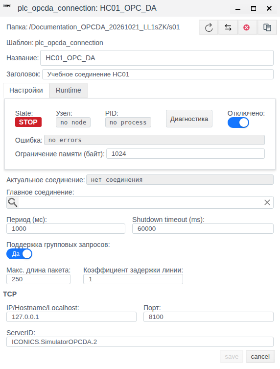
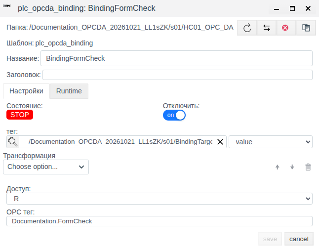

# OPC DA в Faceplate: настройка соединения и привязок

Инструкция для интеграторов Faceplate **v4.0.7**. Описаны параметры соединения, настройка привязок, управление объектами и диагностика.

**Содержание**

- [Маршрут настройки](#маршрут-настройки)
- [Подготовить прокси и закончить привязку](#подготовить-прокси-и-закончить-привязку)
- [Назначение модуля](#назначение-модуля)
- [Что подготовить](#что-подготовить)
- [Настройка соединения](#настройка-соединения)
- [Управление соединением](#управление-соединением)
- [Привязки OPC DA](#привязки-opc-da)
- [Краткий справочник](#краткий-справочник)
- [Диагностика](#диагностика)

[Каталог соединений](./index.md) · [Подготовка поля и привязки](./bindings.md) · [Преобразования](./transformation.md) · [Диагностика и восстановление](./diagnostics.md)

## Маршрут настройки

Подготовьте внешний источник или клиент и совместимое поле тега по общей инструкции. Затем настройте канал, сохраните полную привязку и проверьте новое значение. Для поддержанной записи/приёма отдельно подтвердите результат на внешней стороне; после исправления сбоя повторите проверку с новым контрольным значением.

[Альтернативный канал и карта сигналов](./bindings.md#настроить-альтернативный-канал) описаны одинаково для всех типов; условия переключения уточняйте по драйверу.

## Подготовить прокси и закончить привязку

До рабочего включения администратор источника должен предоставить совместимый OPC DA Proxy, его версию и инструкцию установки, адрес/порт, фактический ServerID и тестовый ItemID с правами чтения/записи. Идентификация дистрибутива прокси в этих материалах не установлена. До получения совместимого прокси настройка остаётся предварительной; обычный OPC DA-сервер не заменяет TCP-прокси Faceplate.

Для учебной карты определите у источника ItemID Training.Pressure с числовым значением 25, единицей в десятых долях инженерной величины. Это условный ItemID, который должен реально существовать на вашем сервере. Подготовьте float-тег OPCPressure.value.

| Поле новой привязки PressureInput | Значение |
|---|---|
| OPC тег | Training.Pressure |
| тег / поле | OPCPressure / value |
| Доступ / Отключить | R / включено до проверки |
| Трансформация | Scaling: Factor 0.1, Cмена 0 |

Создайте PressureInput внутри отключённого соединения, заполните таблицу, сохраните и отдельно откройте её. Проверьте ItemID, тег, поле и Factor 0.100000. После подтверждения прокси и разрешения выполнения исходное 25 должно дать 2.5, новое 26 — 2.6 в том же поле.

Для записи используйте отдельный разрешённый ItemID и поле задания, W/RW и обратимую цепочку. При таком масштабе задание 3.0 соответствует внешнему 30; подтвердите его независимым OPC-клиентом. До запуска проверьте текущее W-задание. Проверка совместимости прокси, чтение и запись этим рецептом не объявляются выполненными.

## Назначение модуля

Модуль OPC DA позволяет получать значения OPC-тегов в поля Faceplate и передавать изменения полей на OPC DA-сервер. Так подключают существующие источники технологических данных и организуют обмен с проектом Faceplate.

Faceplate обращается по TCP к совместимому **OPC DA Proxy**. Прокси обеспечивает доступ к OPC DA-серверу. В Faceplate указываются адрес прокси, его порт и идентификатор сервера **ServerID**.

Протокол задаёт правила обмена данными; в этой инструкции рассматривается OPC DA. Драйвер реализует поддержку этого обмена в Faceplate и работает как клиент через прокси. Тег Faceplate — объект проекта с полями, в которых используются данные. Его имя и выбранное поле отличаются от OPC-тега, который определяется ItemID на внешнем сервере.

| Понятие | Назначение |
|---|---|
| Соединение | Общие параметры доступа к прокси и выбранному OPC DA-серверу, период обмена и состояние подключения |
| Привязка, или биндинг | Настройка обмена одного OPC-тега с выбранным полем Faceplate. Создаётся внутри соединения |
| ServerID | Идентификатор OPC DA-сервера, доступного через прокси |
| ItemID | Идентификатор конкретного OPC-тега на сервере; вводится в поле **OPC тег** привязки |
| Объект и поле Faceplate | Получатель прочитанного значения или источник значения для записи |

При чтении путь данных выглядит так: OPC DA-сервер → прокси → драйвер Faceplate → привязка с нужным ItemID → трансформация и приведение к типу поля → поле выбранного тега Faceplate. При записи изменение поля проходит обработку для обратного направления и передаётся через драйвер и прокси на сервер. Направление выбирается в каждой привязке; одно соединение может содержать несколько привязок.

Общий порядок работы: подготовить прокси и реквизиты → создать соединение → добавить привязки → разрешить работу → проверить состояние и значения.

## Что подготовить

| Что требуется | Для чего |
|---|---|
| Доступ в Студию и права на создание и изменение объектов выбранной папки | Настройка соединения и привязок |
| Подготовленная папка проекта | Размещение соединения |
| Совместимый работающий OPC DA Proxy | Обмен между Faceplate и OPC DA-сервером |
| Адрес и TCP-порт прокси, фактический ServerID | Заполнение соединения; реквизиты предоставляет администратор источника |
| Готовый исполнительный узел Faceplate | Выполнение соединения; сохранение объекта само по себе не подтверждает наличие работающего процесса |
| Точный ItemID и разрешённое направление доступа | Настройка каждой привязки |
| Существующий объект Faceplate с подходящим полем | Приём значения или его передача на сервер; тип и единицы должны соответствовать данным источника |

Совместимый OPC DA Proxy подготавливается заранее. Его установка и настройка доступа к OPC DA-серверу в эту инструкцию не входят. Адрес и порт в форме Faceplate относятся к прокси.

Для подготовки конфигурации источник может быть недоступен. В этом случае оставьте соединение и привязки отключёнными. Проверка сохранённых параметров подтверждает конфигурацию; установление связи, чтение и запись проверяются с работающим источником.

### Основные настройки

| Настройка | На что влияет |
|---|---|
| Адрес, порт и ServerID | Выбор прокси и OPC DA-сервера |
| Период соединения | Период полного цикла обмена; общий для привязок соединения |
| Отключение соединения | Разрешение работы всего соединения и его привязок |
| ItemID, объект и поле привязки | Какой OPC-тег связан с каким полем Faceplate |
| Доступ R/W/RW | Направление обмена |
| Отключение привязки | Участие одной привязки в обмене |
| Трансформация | Необязательная обработка значения |

## Настройка соединения

### Подготовить соединение насосной станции НС01

Задача примера — создать отключённое соединение и проверить, что его параметры сохранены. Прокси и OPC DA-сервер в примере не создаются. Для рабочего подключения используйте тот же порядок с собственными реквизитами.

| Параметр | Значение в примере |
|---|---|
| Папка | Отдельная учебная папка, доступная для записи |
| Название | НС01_OPC_DA |
| Заголовок | Учебное соединение НС01 |
| Отключено | Включено |
| IP/Hostname/Localhost | 127.0.0.1 |
| Порт | 8100 |
| ServerID | ICONICS.SimulatorOPCDA.2 |
| Главное соединение | Пусто |
| Период (мс) | 1000 |
| Shutdown timeout (ms) | 60000 |

Адрес 127.0.0.1 означает узел, выполняющий обмен Faceplate, а не компьютер с браузером. Начальный ServerID из формы используется здесь как учебный реквизит; он не подтверждает наличие установленного сервера.

1. Откройте учебную папку в **Меню → Общий вид**.
2. Нажмите **Создать**.
3. Разверните группу **plc**.
4. Выделите тип **plc_opcda_connection**.
5. Нажмите **Ok**.
6. Введите **Название**: НС01_OPC_DA.
7. Введите **Заголовок**: Учебное соединение НС01.
8. Включите переключатель **Отключено** на вкладке **Настройки**.
9. Явно введите 127.0.0.1 в **IP/Hostname/Localhost**.
10. Проверьте **Порт**: 8100.
11. Проверьте **ServerID**: ICONICS.SimulatorOPCDA.2.
12. Оставьте **Главное соединение** пустым.
13. Сверьте период и время завершения с таблицей исходных данных.
14. Нажмите Tab для завершения редактирования последнего поля.
15. Нажмите **save**.
16. Выделите созданную строку одним нажатием.
17. Нажмите **Редактировать**.
18. Сверьте сохранённые параметры с таблицей.

> [!NOTE]
> 127.0.0.1 в новой форме показывается как подсказка пустого поля. Введите адрес явно. Если изменение поля ещё не принято формой, переведите фокус на другое поле или нажмите Tab.

Результат: соединение существует в выбранной папке, **Отключено** включено, адрес, порт, ServerID и период сохранены. **State = STOP** у отключённого объекта ожидаем. Этот результат не подтверждает доступность прокси или сервера.

## Управление соединением

Продолжите пример на НС01_OPC_DA. Копирование и удаление выполните до добавления привязок; удаляйте только временную копию.

Одиночное нажатие выбирает строку для команд **Редактировать**, **Копировать** или **Удалить**. Двойное нажатие соединения открывает его содержимое — привязки. Повторное одиночное нажатие выбранной строки может снять выделение.

### Найти соединение

1. Откройте **Меню → Драйверы ПЛК**.
2. Введите имя учебной папки в **Поиск по пути**.
3. Откройте список **Тип соединения:**.
4. Отметьте **opcda**.
5. Закройте список типов.
6. Нажмите **Найти**.

После фильтрации таблица показывает **Путь**, **ServerID**, **IP**, **Порт**, **Режим**, **Статус**, **Состояние**. Найдите строку НС01_OPC_DA и сверьте её реквизиты.

### Изменить период

1. Выделите НС01_OPC_DA в **Общий вид**.
2. Нажмите **Редактировать**.
3. Укажите **Период (мс)**: 2000.
4. Нажмите Tab.
5. Нажмите **save**.
6. Откройте форму повторно через **Редактировать**.
7. Проверьте, что период равен 2000, а **Отключено** включено.

Период задаёт цикл обмена. При последовательном обращении к нескольким тегам и длительных операциях фактический интервал обновления каждого значения может отличаться от заданного периода.

### Скопировать и удалить учебную копию

Перед копированием убедитесь, что исходное учебное соединение отключено. После вставки проверьте этот параметр у копии.

1. Выделите НС01_OPC_DA в **Общий вид**.
2. Нажмите **Копировать**.
3. Нажмите **Вставить**.
4. В диалоге **Вставить элементы? (1)** проверьте **Operation = copy** и **Количество копий = 1**.
5. Нажмите **ОК**.
6. Выделите появившуюся копию НС01_OPC_DA_1.
7. Нажмите **Редактировать**.
8. Измените **Название** на НС01_OPC_DA_COPY.
9. Нажмите **save**.
10. Откройте копию повторно через **Редактировать**.
11. Проверьте включённое **Отключено** и период 2000 мс.
12. Закройте форму кнопкой **cancel**.
13. Выделите только НС01_OPC_DA_COPY.
14. Нажмите **Удалить**.
15. Подтвердите **yes** в диалоге **delete items: 1**.
16. Проверьте, что копии нет, а исходное НС01_OPC_DA осталось.

### Проверить переключатель и состояние

Эта проверка выполняется на учебном соединении без привязок. Она показывает сохранение разрешения работы и фактическое состояние объекта.

1. Откройте настройки НС01_OPC_DA.
2. Выключите **Отключено**.
3. Нажмите **save**.
4. Откройте настройки повторно.
5. Проверьте положение переключателя.
6. Посмотрите **State**, **Узел**, **PID**, **Ошибка** и **Актуальное соединение**.
7. Снова включите **Отключено**.
8. Нажмите **save**.
9. Проверьте сохранённое отключение повторным открытием формы.

При проверке конфигурации объект может оставаться в **STOP** с **no node**, **no process** и **no errors**. В таком состоянии работа процесса и обращение к прокси не подтверждены. Для рабочего обмена требуется готовое исполнительное окружение Faceplate; признаки связи приведены в разделе «Диагностика».

Для завершения примера выполните процедуру «Сбор диагностических сообщений» на НС01_OPC_DA с **Log level = debug** и **Log limit = 100**. Проверьте переключение **Start/Stop**, затем команды **Копировать** и **Очистить**. Пустой журнал не подтверждает работоспособность подключения.

## Привязки OPC DA

Привязка определяет, какой OPC-тег связан с полем Faceplate и в каком направлении передаются изменения. Она создаётся непосредственно внутри сохранённого соединения. Настройки прокси и ServerID берутся из этого соединения.

Название привязки — имя объекта в проекте. **OPC тег** — ItemID на OPC DA-сервере. В элементе **тег** выбираются объект Faceplate и его поле; это отдельный адрес назначения или источник значения.

### Выбрать режим доступа

| Доступ | Чтение из OPC DA | Запись в OPC DA | Поведение |
|---|---|---|---|
| **R** | Да | Нет | Прочитанное значение обновляет поле Faceplate. Ручное изменение этого поля не передаётся на OPC DA-сервер и может быть заменено следующим чтением |
| **W** | Нет | Да | Передаётся текущее значение поля при активации привязки и его последующие изменения. Внешние изменения OPC-тега не читаются |
| **RW** | Да | Да | Чтение обновляет поле; изменение поля при работающей связи передаётся на сервер. Принудительной стартовой записи текущего значения нет |

> [!WARNING]
> Для W текущее значение может отправиться при запуске, переподключении, создании, изменении или повторном включении привязки на работающем соединении. Перед разрешением работы проверьте ItemID, исходное поле и значение. В RW изменение поля также является командой записи.

Изменения во время разрыва связи не ставятся в очередь. После восстановления W использует текущее значение поля; для RW нельзя рассчитывать на последующее воспроизведение локального изменения, сделанного без связи.

### Создать и настроить привязку

До настройки подготовьте точный ItemID и существующий объект Faceplate с подходящим полем. Для первоначальной подготовки оставьте соединение отключённым. На работающем соединении сохраняйте новую привязку с включённым **Отключить**, пока её параметры не проверены.

1. В **Общий вид** откройте содержимое нужного соединения двойным нажатием.
2. Нажмите **Создать**. Откроется форма привязки.
3. Введите **Название** привязки.
4. При необходимости заполните **Заголовок**.
5. Включите **Отключить** на вкладке **Настройки**.
6. Нажмите кнопку с лупой у элемента **тег**.
7. Выберите нужный объект Faceplate в дереве.
8. Нажмите **ОК**.
9. В отдельном списке справа от выбранного объекта укажите его поле.
10. Выберите **Доступ**: R, W или RW по таблице режимов.
11. Введите точный ItemID в **OPC тег**.
12. Оставьте **Трансформация** пустой, если дополнительная обработка не нужна.
13. Нажмите Tab.
14. Нажмите **save**.
15. Выделите сохранённую привязку.
16. Нажмите **Редактировать**.
17. Сверьте объект, выбранное поле, ItemID, доступ, трансформацию и отключение.

Результат подготовки — сохранённая отключённая привязка с нужными реквизитами. Значения на иллюстрации показывают компоновку формы; ItemID и цель выбираются для вашего источника.

Пара «объект и поле» технически необязательна. Без неё обмен использует собственное значение привязки, отображаемое как **value** на вкладке **Runtime**. Редактор ручного ввода этого значения в форме отсутствует. Для связи с данными проекта выбирайте и объект, и его поле.

### Трансформация значения

Пустая **Трансформация** означает отсутствие дополнительной обработки; приведение к типу выбранного поля сохраняется. Если обработка нужна, её выбирают в этой же форме. Порядок настройки и числовые примеры приведены в [общем руководстве преобразований](./transformation.md).

Для W/RW преобразование должно поддерживать обратное направление. Скрипт, интегрирование и производная для этих режимов не поддерживаются. При смене R на W/RW проверяется совместимость уже заданной трансформации.

### Разрешить работу и проверить результат

Проверка выполняется после подготовки исполнительного окружения Faceplate, прокси и OPC DA-сервера. Для W/RW заранее согласуйте возможность записи в выбранный тег.

1. Выключите **Отключено** у подготовленного соединения.
2. Сохраните соединение кнопкой **save**.
3. Откройте нужную привязку через **Редактировать**.
4. Выключите **Отключить**.
5. Нажмите **save**.
6. Проверьте состояние соединения и привязки.
7. Проверьте результат выбранного направления по таблице.

| Режим | Проверка результата на работающем источнике |
|---|---|
| R | Сравните поле Faceplate со значением того же ItemID на OPC DA-сервере с учётом трансформации и периода |
| W | Подтвердите приём разрешённого значения на стороне OPC DA-сервера. Значение локального поля само по себе не подтверждает доставку |
| RW | Проверьте чтение в поле Faceplate и отдельно приём разрешённого изменения на сервере |

Если привязка не работает, сначала проверьте её собственное состояние и сообщение, затем соединение. Общее **RUN** соединения не подтверждает доступность каждого ItemID.

### Изменить или отключить привязку

Для подготовки изменений на действующем соединении сначала сохраните привязку с включённым **Отключить**. Затем измените параметры через **Редактировать**, сохраните и проверьте их повторным открытием. При повторном разрешении W возможна немедленная запись текущего значения.

Отключение одной привязки исключает её из обмена и само по себе не очищает последнее значение. Это значение не является подтверждением актуальных данных. Отключение всего соединения прекращает обмен всех его привязок.

## Краткий справочник

### Поля соединения

Начальные значения относятся к новой форме. Вводимые пользователем параметры отделены от состояния, которое заполняет Faceplate.

| Поле | Начальное значение и допустимый ввод | Назначение |
|---|---|---|
| **Название** | Обязательно | Имя объекта в выбранной папке |
| **Заголовок** | Пусто; необязательно | Поясняющая подпись |
| **IP/Hostname/Localhost** | Пусто; подсказка 127.0.0.1; обязательно | IPv4-адрес, DNS-имя или localhost узла прокси |
| **Порт** | 8100; 1–65535; обязательно | TCP-порт прокси |
| **ServerID** | ICONICS.SimulatorOPCDA.2; обязательно | Фактический идентификатор OPC DA-сервера |
| **Период (мс)** | 1000; 1–3600000 | Период полного цикла обмена |
| **Shutdown timeout (ms)** | 60000; 10–3600000 | Время, отводимое на завершение обработчика соединения |
| **Отключено** | Выключено | При включённом переключателе соединение отключено |
| **Главное соединение** | Пусто; необязательно | Связь для резервирования. В этой инструкции рассматривается самостоятельное соединение |
| **Ограничение памяти (байт)** | В новой форме пусто; после сохранения значение подставляет платформа | Общий служебный параметр. Для описанной настройки оставьте без изменений |

В общей форме присутствуют **Поддержка групповых запросов** (начально Да), **Макс. длина пакета** (250; 1–10000) и **Коэффициент задержки линии** (1; 1–10). OPC DA выполняет одиночные операции; эти настройки не включают групповой обмен и не служат способом его ускорения.

### Поля привязки

| Поле | Начальное значение и обязательность | Назначение |
|---|---|---|
| **Название** | Пусто; обязательно | Имя привязки в соединении |
| **Заголовок** | Пусто; необязательно | Поясняющая подпись |
| **Отключить** | Выключено | Исключает привязку из обмена |
| **тег** | Объект и поле не выбраны; пара необязательна | Выбор цели чтения или источника записи. Поле выбирается отдельно после объекта |
| **Доступ** | R; варианты R, W, RW | Направление обмена |
| **OPC тег** | Пусто; обязательно | Точный ItemID. Крайние пробелы удаляются |
| **Трансформация** | Пусто; необязательно | Дополнительная обработка, для W/RW требуется поддержка обратного направления |

### Состояния и значения

| Элемент | Как использовать |
|---|---|
| **State** соединения / **Состояние** привязки | RUN или STOP. STOP возможен и при повторных попытках подключения с работающим процессом: наличие процесса проверяйте по PID. RUN/OK соединения не доказывает успех каждой привязки; проверяйте её отдельно |
| **Ошибка** соединения | Текст сообщения; no errors означает отсутствие показанного сообщения, а не доказанный обмен |
| **Узел**, **PID** | Назначенный узел и процесс. no node / no process не подтверждают выполнение соединения |
| **Актуальное соединение** | Отображаемые сведения о подключении; при отсутствии — нет соединения. Проверяйте вместе с состоянием |
| **error**, **state**, **value** на **Runtime** привязки | Служебное сообщение, состояние и значение привязки. value отображается без ручного редактора |

При остановке соединения или потере связи значения R/RW обрабатываются как пустые; без трансформации результат становится пустым. Значение W сохраняется. Поведение отключённой отдельной привязки описано в разделе управления привязкой.

## Диагностика

Проверьте три результата отдельно: параметры сохранены; процесс соединения работает; нужный ItemID читается или принимает запись. Один успешный этап не подтверждает остальные.

После устранения причины сбоя снова проверьте узел, PID, состояние и ошибку соединения, затем нужную привязку. Для R сравните поле Faceplate с актуальным значением того же ItemID на источнике; если оно постоянно, подтвердите новое чтение доступными средствами диагностики или согласованным изменением учебного источника. Для W/RW отдельно подтвердите приём разрешённого значения на сервере. Сохранившееся прежнее число и исчезновение ошибки сами по себе не доказывают восстановление обмена.

### Сбор диагностических сообщений

1. Откройте сохранённое соединение через **Редактировать**.
2. Нажмите **Диагностика** на вкладке **Настройки**.
3. Выберите **Log level**; для учебной проверки — debug.
4. Задайте **Log limit**; для учебной проверки — 100.
5. Нажмите **Start**.
6. Посмотрите области **Процессы** и **Logs**.
7. Нажмите **Stop**.
8. При необходимости нажмите **Копировать** для сохранения показанных сообщений.
9. При необходимости нажмите **Очистить** для очистки окна сообщений.
10. Закройте окно диагностики.

**Start/Stop** управляют сбором сообщений. Они не запускают и не останавливают OPC-соединение. По умолчанию **Log level = info**, **Log limit = 1000**. Доступны info, warning, error, debug; лимит 1–100000. При закрытии окна сбор прекращается.

### Симптомы и действия

| Симптом или сообщение | Что проверить и сделать | Проверка результата |
|---|---|---|
| **save** недоступна | Заполните необходимые поля; завершите редактирование последнего поля нажатием Tab | Кнопка доступна; после сохранения и повторного открытия параметры совпадают |
| **ERROR!**: `{<<"ServerID">>,required_field}` | Повторно откройте форму соединения и заполните **ServerID** | Сохранение проходит, непустой ServerID перечитывается |
| **ERROR!**: `{<<"itemID">>,required_field}` | Повторно откройте форму привязки и заполните **OPC тег** | Сохранение проходит, ItemID перечитывается |
| STOP и включён **Отключено** или **Отключить** | Для работы разрешите нужное соединение и привязку после проверки реквизитов | При готовом окружении проверьте состояние и результат операции |
| STOP, no node, no process, no errors | Процесс не подтверждён. Уточните у администратора готовность исполнительного узла Faceplate | Появились назначенный узел и процесс; затем проверяйте связь и ItemID |
| В таблице **ОШИБКА**, а подсказка или форма показывает no errors | Откройте форму, прочитайте **Ошибка**, проверьте узел/процесс и журнал. По одной метке причина не определяется | Получены конкретное сообщение или подтверждённое состояние процесса |
| В сообщении invalid_ip | Проверьте адрес и разрешение имени с узла Faceplate | Адрес распознаётся; затем проверьте подключение |
| В сообщении econnrefused, timeout или closed | Проверьте адрес/порт, работающий прокси и сетевую доступность | Процесс устанавливает связь; нужная привязка выполняет операцию |
| invalid response или connect invalid response | Проверьте совместимость прокси и ServerID; передайте полный текст поддержке | Подключение проходит без этого сообщения, операция с ItemID успешна |
| no connection у привязки | Сначала проверьте состояние и ошибку её соединения | Соединение восстановлено; затем проверьте значение привязки |
| Ошибка чтения/записи одной привязки | Проверьте точный ItemID, разрешения направления и соответствие типа поля | У этой привязки успешное состояние и верное значение на нужной стороне |
| W/RW не сохраняется после настройки трансформации | Проверьте поддержку обратного направления обработки; скрипт, интеграл и производная не поддерживаются | Параметры сохраняются с допустимой трансформацией |
| Поле не обновляется либо содержит старое значение | Проверьте отключение привязки, её режим и собственную ошибку | В R/RW значение соответствует источнику с учётом цикла; в W внешние изменения не читаются |
| Журнал пуст | Проверьте запуск сбора, уровень и наличие процесса; пустота не подтверждает исправность транспорта | При выполнении процесса доступны относящиеся к нему сведения либо уточнена причина их отсутствия |
