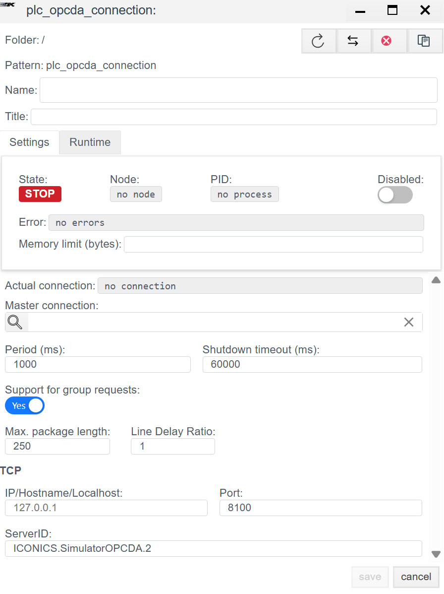

# Руководство по конфигурации OPC DA (Classic)

> См. также: [Общие сведения о PLC-соединениях](./general_ru.md)

## Общее описание
**OPC DA (Data Access)** — это классический стандарт обмена данными в промышленной автоматизации, основанный на технологии Microsoft DCOM. В системе **Faceplate** данный драйвер позволяет подключаться к любым внешним OPC-серверам (например, Kepware, Matrikon, Lectus) и считывать с них данные.

> **Важно:** Поскольку OPC DA базируется на DCOM, для успешного соединения часто требуется настройка прав доступа Windows и DCOM на обеих сторонах (Клиент и Сервер).

Процесс настройки состоит из двух этапов:
1.  **Connection (`plc_opcda_connection`):** Настройка подключения к OPC-серверу.
2.  **Binding (`plc_opcda_binding`):** Подписка на конкретные теги.

---

##  1. Настройка соединения (Connection)

> Создать PLC соединения → [Шаги создания PLC соединения](./general_ru.md#создание-plc-соединения)  
> Панель диагностики и параметры → [Диагностика и базовые настройки](./general_ru.md#диагностика-diagnostics)

На этом этапе мы указываем, где находится OPC-сервер и как он называется.

### 1.1 Параметры Протокола (OPC DA)

В отличие от других драйверов, здесь настройки сети указывают на хост, где запущен OPC Server.

| Поле | Описание |
| :--- | :--- |
| **IP/Hostname/Localhost** | Сетевой адрес компьютера, где установлен OPC-сервер. *Пример:* `192.168.1.5` или `localhost` (если сервер на той же машине). |
| **Port** | **8100** (или другой порт, если используется туннелирование).  *Примечание:* В классическом OPC DA порт TCP жестко не задается (работает через DCOM/RPC, порт 135), но в данном драйвере это поле может использоваться для специфичных OPC-туннелей или внутренних прокси. |
| **ServerID** | **ProgID OPC-сервера.** Это самое важное поле. Оно точно идентифицирует программный компонент сервера в реестре Windows. *Примеры:* `Kepware.KEPServerEX.V6`, `Matrikon.OPC.Simulation.1`, `ICONICS.SimulatorOPCDA.2`. |

---

##  2. Настройка переменных (Binding)

В OPC DA адресация происходит по имени тега (Item ID).

> Создать PLC привязку → [Шаги создания PLC привязки](./general_ru.md#создание-plc-привязки)

> Общие поля привязок (Name, Title, State, Tag, Transformation, Access) → [Общие параметры привязки](./general_ru.md#привязка-к-тегу)

### 2.1 Адресация (OPC Tag)

| Поле | Инструкция |
| :--- | :--- |
| **OPC tag** | **Item ID (Идентификатор элемента).** Полный путь к тегу в адресном пространстве OPC-сервера. *Примеры:* • `Channel1.Device1.Tag1` • `Simulation.Ramp` • `Bucket Brigade.Int4` |

> Ошибка в PLC привязке → [Ошибка привязки](./general_ru.md#ошибка-в-привязке)

---
