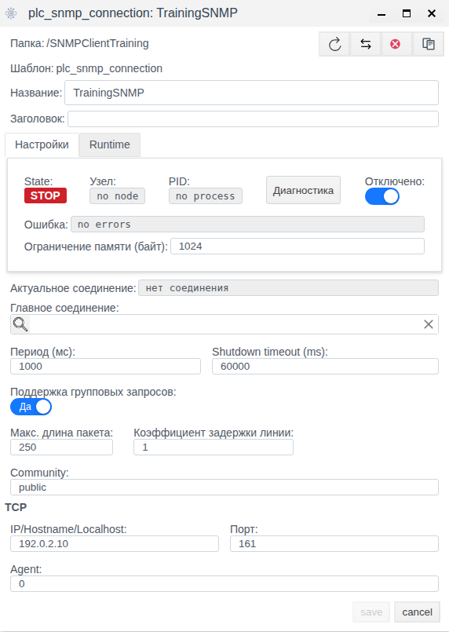
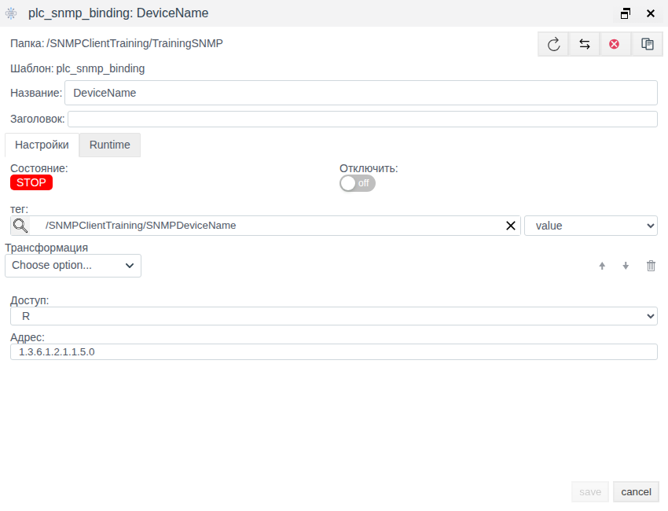

# SNMP в Faceplate: подключение устройств и использование MIB

Версия Faceplate v4.0.7.

Статья описывает настройку SNMP-клиента и назначение MIB. Справочная часть основана на исходниках v4.0.7; сохранение и повторное открытие форм проверены в Faceplate Studio 4.0.6.subs. Единственный практический пример показывает сохранение соединения и привязки без доступного сервера. Соединение остаётся отключённым; получение данных, запись и восстановление обмена в примере не проверяются.

**Содержание**

- [Маршрут настройки](#маршрут-настройки)
- [Дополнить строковый пример числовым сигналом](#дополнить-строковый-пример-числовым-сигналом)
- [Назначение и схема обмена](#назначение-и-схема-обмена)
- [Подготовка устройства и MIB](#подготовка-устройства-и-mib)
- [Настроить SNMP-клиент](#настроить-snmp-клиент)
- [Изменить настройки и управлять обменом](#изменить-настройки-и-управлять-обменом)
- [Диагностика и восстановление](#диагностика-и-восстановление)
- [Запись данных: W и RW](#запись-данных-w-и-rw)
- [Резервирование подключения](#резервирование-подключения)
- [Встроенный агент и поставляемый MIB](#встроенный-агент-и-поставляемый-mib)
- [Справочник параметров и типов](#справочник-параметров-и-типов)

[Каталог соединений](./index.md) · [Подготовка поля и привязки](./bindings.md) · [Преобразования](./transformation.md) · [Диагностика и восстановление](./diagnostics.md)

## Маршрут настройки

Подготовьте внешний источник или клиент и совместимое поле тега по общей инструкции. Затем настройте канал, сохраните полную привязку и проверьте новое значение. Для поддержанной записи/приёма отдельно подтвердите результат на внешней стороне; после исправления сбоя повторите проверку с новым контрольным значением.

[Альтернативный канал и карта сигналов](./bindings.md#настроить-альтернативный-канал) описаны одинаково для всех типов; условия переключения уточняйте по драйверу.

## Дополнить строковый пример числовым сигналом

Наряду с DeviceName используйте числовой OID, тип которого подтверждён MIB/картой агента. Например, sysServices 1.3.6.1.2.1.1.7.0 является INTEGER, если агент предоставляет этот объект. Подготовьте integer-тег DeviceServices.value и R-привязку Services: полный OID, этот тег и поле, пустая цепочка, отключение до проверки.

Сохраните и отдельно откройте привязку. На доступном агенте независимо прочитайте тот же OID и сопоставьте результат. Для изменяемого числового параметра из карты вызовите новое разрешённое изменение и подтвердите его в поле; системное sysServices не следует менять ради теста.

Agent 0 в показанной форме подтверждён сохранением, но не работой с агентом. Перед эксплуатацией подтвердите регистрацию и GET на своей сборке. W/RW и writable community не устраняют обнаруженные проблемы SET: управление требует отдельной проверки совместимости библиотеки и повторной попытки. До этого используйте подтверждённый маршрут R. Встроенный агент и MIB описаны ниже отдельно от клиентского канала.

## Назначение и схема обмена

SNMP позволяет получать параметры сетевого оборудования, контроллеров, шлюзов и ИБП, если они предоставляют SNMP-агент. В клиентском соединении Faceplate выступает **SNMP-менеджером**: отправляет запросы агенту устройства. Рассматриваемый драйвер использует **SNMPv2c, IPv4 и UDP**. Переключателя на SNMPv3 в этом клиенте нет; поле Agent не выбирает версию протокола.

Протокол задаёт правила обмена, а драйвер реализует их в Faceplate. Соединение хранит настройки конкретного устройства и выполнения обмена. Привязка выбирает один OID, направление, преобразование и поле тега. Тег — объект проекта; поле тега — конкретное место, в которое поступает значение или из которого берётся команда. Создание соединения само по себе не создаёт теги.

При чтении данные проходят путь: **агент устройства → ответ по OID → соединение → привязка → преобразование → адаптация типа → выбранное поле тега**. Для каждого OID выполняется отдельный запрос. Несколько привязок используют параметры одного соединения, но имеют собственные адреса и поля назначения.

При записи направление обратное: **поле тега → адаптация типа → обратное преобразование → привязка → команда агенту**. Поддержка записи зависит от режима доступа, типа значения, прав агента и особенностей реализации, описанных в разделе о W/RW.

У UDP нет TCP-сеанса. Драйвер может зарегистрировать агента локально до получения ответа от устройства, поэтому RUN соединения не подтверждает чтение конкретного OID. Встроенный агент Faceplate — отдельная служба; он не является серверным режимом этого PLC-соединения.

## Подготовка устройства и MIB

Для рабочего подключения получите у производителя или администратора:

- IPv4-адрес либо разрешаемое с узла обмена имя, UDP-порт и подтверждение доступности SNMPv2c.
- Community с нужными правами. Значение чувствительно к регистру; слова `public` и `private` сами по себе не назначают права чтения или записи.
- MIB или карту объектов: полный числовой OID экземпляра, SNMP-тип, смысл, единицы, диапазон и доступ.
- Существующий тег и совместимое поле, а для записи — разрешённый объект и способ независимой проверки результата.

Адрес должен быть доступен именно с узла, выполняющего обмен Faceplate. `localhost` относится к этому узлу. Для DNS используйте имя, которое принимает форма и которое разрешается в IPv4; произвольное короткое имя может не пройти проверку формы.

**MIB** описывает имена, типы, доступ и структуру объектов. В привязку вводят числовой адрес, а не символическое имя вроде `SNMPv2-MIB::sysName.0`. Для скаляра нужен индекс экземпляра, обычно `.0`; для таблицы — полный индекс строки. Драйвер не дополняет префикс, индекс или отсутствующие компоненты.

В примере используется `sysName.0`, полный OID `1.3.6.1.2.1.1.5.0`, текстовое имя системы. Это адрес для демонстрации настройки; его наличие и значение на реальном устройстве проверяют отдельно. Чтение по числовому OID не требует загрузки MIB в клиент. Импорт MIB, браузер дерева и автоматическое создание привязок из MIB в рассматриваемом драйвере не предусмотрены.

Тип источника проверяйте до выбора поля. INTEGER и Unsigned32 остаются числами, но TimeTicks и счётчики в этой реализации могут поступать текстом. Одного выбора числового поля для их преобразования недостаточно; подробности приведены в справочнике.

## Настроить SNMP-клиент

### Исходное состояние и учебные параметры

Подготовлена папка **SNMPClientTraining** с отключённым выполнением. В ней существует строковый тег **SNMPDeviceName**, поле **value** пустое. Соединение **TrainingSNMP** и привязка **DeviceName** ещё не созданы. В своём проекте используйте подходящий тег с реальным строковым полем; выбор только тега не заменяет выбор поля.

Учебные параметры: IP `192.0.2.10`, UDP-порт `161`, Community `public`, период `1000` мс, Agent `0`. Адрес приведён для заполнения формы; в рабочей конфигурации замените параметры данными устройства. В этом примере сервер не требуется, папка и соединение остаются отключёнными.

### Создать соединение вместе с привязкой

1. В дереве проекта откройте **SNMPClientTraining** двойным щелчком.
2. Нажмите **Создать**, раскройте **plc** кнопкой **+**, выберите **plc_snmp_connection** и нажмите **Ok**.
3. Проверьте **Папка** и задайте **Название: TrainingSNMP**.
4. Включите **Отключено**. Поле **Главное соединение** оставьте пустым; **Период (мс)** — `1000`.
5. Укажите **IP/Hostname/Localhost: 192.0.2.10**, **Порт: 161**, **Community: public**. В **Agent** оставьте исходное `0`; остальные настройки не меняйте.
6. Нажмите **save** и дождитесь закрытия формы и появления соединения в списке.
7. Выделите сохранённое **TrainingSNMP**, нажмите **Редактировать** и сверьте введённые параметры и включённое **Отключено**. Это отдельное повторное открытие. Закройте форму кнопкой **cancel**.
8. Двойным щелчком откройте **TrainingSNMP** как папку и нажмите **Создать**. В этом контексте форма **plc_snmp_binding** открывается сразу.
9. Задайте **Название: DeviceName** и замените **Адрес** на полный OID `1.3.6.1.2.1.1.5.0`.
10. Нажмите кнопку поиска у **тег**, выберите существующий **SNMPDeviceName** в учебной папке и подтвердите **ОК**. В соседнем списке поля явно выберите **value**.
11. Оставьте **Доступ: R**, пустую **Трансформация** и выключенный собственный переключатель **Отключить** привязки. Отключённые папка и соединение продолжают запрещать обмен.
12. Нажмите **save**. После закрытия формы выделите **DeviceName**, нажмите **Редактировать** и отдельно проверьте OID, тег, поле **value**, R и пустое преобразование.
13. Закройте форму через **cancel** и вернитесь в учебную папку. У **TrainingSNMP** должны сохраниться **Runtime: ВЫКЛ** и **State: Stop**.

В форме соединения сетевой блок подписан **TCP**. Это реальная подпись интерфейса; транспорт SNMP в рассматриваемом драйвере — UDP. **Shutdown timeout (ms)** не является таймаутом ответа устройства. Редакторы таймаута SNMP-запроса и числа повторов на проверенной вкладке **Настройки** не отображаются; вводить их на этом шаге не нужно.

В проверенной форме Agent — текстовый ввод со значением `0`. В модели драйвера v4.0.7 исходный идентификатор — строка `agent engine`. Сохранение и повторное открытие UI-значения подтверждены; его пригодность при выполнении обмена не проверялась. Подпись **Agent** не означает настройку SNMPv3-аутентификации.

Рисунок 1. Повторно открытое соединение: учебный адрес, Agent и отключённое выполнение.

Рисунок 2. Одна R-привязка внутри соединения: полный OID и выбранное поле value.

Результат примера — сохранённые и повторно открытые настройки. STOP, **no process**, **нет соединения** и исходно пустое поле соответствуют этому примеру. **no errors** здесь не доказывает доступность устройства. Исходное значение тега не является результатом SNMP.

## Изменить настройки и управлять обменом

Для изменения сохранённого объекта выделите его в дереве и нажмите **Редактировать**. После **save** закройте и откройте форму заново, чтобы проверить сохранение. Изменение исполняемых настроек может пересоздать процесс соединения; при наличии устройства результат затем проверяют по отдельной привязке и новым данным.

**Отключено** в соединении управляет всем его обменом. **Отключить** в привязке исключает один канал. Для выполнения должны также разрешать работу родительские папки и зависимости. Собственное **Runtime: ВКЛ** у привязки не означает работающего соединения: в учебной настройке родитель отключён и привязка остаётся STOP.

Период относится к полному обходу привязок. Если обход завершён раньше периода, остаётся ожидание; если дольше — следующий цикл начинается без дополнительной паузы. Поэтому период не гарантирует новое значение строго через заданное число миллисекунд. Ошибочные запросы и повторы увеличивают длительность обхода.

Используйте различимые имена соединений, в том числе в разных папках: имя участвует в общей регистрации агента менеджером. Повторная регистрация обновляет адрес, порт и community, но изменение Agent в форме не гарантирует обновления уже существующей регистрации. Остановка соединения сама по себе её не удаляет.

### Преобразование значения

В **Трансформация** операции чтения выполняются сверху вниз, записи — в обратном порядке. Пустая цепочка передаёт значение без обработки. Для W/RW нужна поддержка обратного направления всех операций. Доступные методы:

- **Scaling**: `Y = X × Factor + Shift`. Исходно Factor `1`, Shift `0`. Для обратного преобразования Factor должен быть ненулевым. Factor — коэффициент умножения; Shift — сдвиг в единицах результата этого шага.
- **Default Value**: исходно Value `0`. При чтении сохраняет числовой вход, а нечисловой, включая отсутствие значения или строку, заменяет заданным числом. При записи операция тождественна. Подстановка может скрыть отсутствие связи видимым числом; состояние и ошибку проверяют отдельно.
- **Limit Control**: Lower Limit и Upper Limit исходно `0`; перед применением верхняя граница должна быть больше нижней. При чтении значение вне включительного диапазона становится отсутствующим. При записи числовое значение прижимается к ближайшей границе.
- **Integration**: без пользовательских параметров, только R. Первый результат отсутствует; далее накапливается текущий вход, умноженный на прошедшие миллисекунды. Единицы результата — единицы сигнала × мс. Это состояние текущего вычисления, которое сбрасывается при переинициализации привязки, а не постоянный архивный итог.
- **Derivative**: без пользовательских параметров, только R. Первый результат отсутствует; последующие — изменение сигнала, делённое на миллисекунды. Единицы — единицы сигнала / мс.
- **Damper**: сглаживание, Tlag исходно `1`, положительное значение в миллисекундах. Первый числовой вход проходит напрямую; запись проходит без сглаживания и без обратного восстановления исходного сигнала.
- **Скрипт**: Erlang-обработка только для R. Получает Input, Context и State, возвращает `{Output, State}`. Контекст задаётся через Variable/Tag/Field; начальное состояние — `undefined`. Проверка Compile не доказывает корректность результата на реальных данных.

Для Scaling, Limit Control, Integration, Derivative и Damper нечисловой вход даёт отсутствующий результат; Default Value обрабатывает его подстановкой, а Скрипт — по заданной логике. Числовые операции не превращают текст счётчика в число. Если нужна такая обработка, сначала требуется явное преобразование типа; скриптовая цепочка относится к R. Ошибка преобразования или записи результата в поле не всегда меняет общий RUN привязки, поэтому проверяйте фактическое поле. Default Value заменяет возвращённое нечисловое значение, но не перехватывает исключение предыдущей операции.

## Диагностика и восстановление

Начинайте с разрешения выполнения, состояния соединения и отдельной привязки. Для каждого сигнала сверяйте полный OID, индекс, SNMP-тип, поле назначения и преобразование. Общего RUN недостаточно.

| Наблюдение | Что означает | Что проверить |
|---|---|---|
| Отключено, STOP, no process | Выполнение остановлено или не запущено | Собственные переключатели, родительские папки и зависимости; в примере это заданное состояние |
| RUN соединения | Процесс выполняется, агент мог быть зарегистрирован локально | Ответ конкретного OID, ошибку привязки и новое значение поля |
| no errors при отключённом соединении | Нет текущего сообщения об ошибке | Не считать это проверкой устройства |
| Ошибка адреса или разрешения имени | Некорректный ввод либо имя не разрешается в IPv4 | Адрес, допустимый формой формат и разрешение имени с узла обмена |
| Ожидание ответа / ошибка чтения | Запрос не дал допустимого результата | UDP-порт и маршрут, community, права, OID, доступность агента и длительность обхода |
| noSuchObject / noSuchInstance | Агент сообщает об отсутствующем объекте или экземпляре | Полный OID и индекс; эти ответы могут попасть в текстовое значение даже при RUN |
| RUN привязки, но поле пустое или неверное | Возможны ошибка преобразования, несовместимость поля либо отказ записи результата | Тип ответа, выбранное поле, цепочку и диагностические сообщения |
| Старое или подставленное значение | Свежесть не подтверждена | Источник нового изменения, режим доступа, состояние и наличие подстановок |

Кнопка **Диагностика** открывает сбор сообщений соединения. **Start/Stop** управляют сбором, а не обменом. **Log level** выбирает детализацию, **Log limit** ограничивает буфер, очистка убирает отображённые сообщения, копирование помещает накопленные сообщения в буфер обмена. Пустой журнал не доказывает исправность связи. В единственном примере диагностическое окно и сетевые ошибки не воспроизводились.

При ошибке чтения в поле может поступать результат преобразования отсутствующего значения. При отдельном отключении привязки прежнее значение её целевого поля может сохраняться. При ошибке или остановке активного соединения общий механизм передаёт в целевые поля результат преобразования отсутствующего значения. Поэтому нельзя ожидать одинакового нуля или пустого текста при любом прекращении обмена.

При наличии устройства для проверки восстановления зафиксируйте последнее значение, восстановите доступ и получите новое известное изменение источника. Сопоставьте его с полем тега и ошибкой привязки. Сохранившееся прежнее число или исчезновение ошибки недостаточны; для изменяющегося счётчика учитывайте импортируемый тип. Это порядок проверки рабочего подключения, а не выполненный тест учебного примера.

## Запись данных: W и RW

**R** опрашивает значение. **W** исключён из чтения и инициирует запись при изменении выбранного поля, а также при инициализации активной W-привязки и повторной активации; исходно отсутствующее значение клиентский механизм пропускает. **RW** читает и реагирует на внешние изменения поля. Обновление поля собственным чтением не образует обратную команду. Изменения при отсутствии подключения не следует считать гарантированной очередью команд.

Для записи необходимы writable OID, нужные права community, подходящий тип и обратимая цепочка. Драйвер выбирает тип команды по значению, а не по загруженному MIB: целые передаются как INTEGER, дробные округляются до целого, bool преобразуется в `1`/`0`. Произвольную запись текста, Counter, OID или IPAddress нельзя предполагать по одному наличию W/RW. Строковое поле перед обратным преобразованием пытается преобразоваться в число; нечисловой текст может стать отсутствующим значением.

В исследованной реализации вызов SET не соответствует API исследованных исходников OTP27.2.3; фактически загруженная библиотека в примере не проверялась. После ошибки первого SET повторная попытка также может завершиться внутренней ошибкой вместо повторной записи. Ошибка обратного преобразования не гарантирует подавления команды: может быть передано значение без ожидаемого обратного пересчёта. Эти обстоятельства нужно проверить на предназначенном для записи стенде. Учебный пример остаётся R и не проверяет SET.

Подтверждение команды, независимое чтение результата и эффект на оборудовании — разные проверки. Успешный статус сам по себе не подтверждает физическое действие.

## Резервирование подключения

Поле **Главное соединение** связывает резервный объект с главным того же типа. Резервный объект хранит альтернативные параметры подключения и отключается как самостоятельный исполнитель; привязки обслуживаются главным объектом. Цепочки главных соединений не допускаются.

Перебор подключений связан с ошибкой подключения, а не с любым ошибочным OID. Для SNMP локальная регистрация агента может завершиться успешно при недоступном устройстве, после чего GET выдаёт ошибку отдельной привязки. Поэтому автоматическое переключение по каждому таймауту GET не гарантируется. Проверять резервирование нужно фактическими ответами и новым значением; в учебном примере главное соединение пустое и переключение не испытывалось.

## Встроенный агент и поставляемый MIB

Окружение приложения пытается запустить встроенный агент Faceplate и локальный менеджер. Они имеют собственные настройки и состояние, отличные от параметров отдельного клиента. Значения ниже относятся к поставляемой конфигурации; работающий экземпляр может использовать сохранённое состояние.

| Параметр службы | Значение поставки | Как понимать |
|---|---|---|
| Адрес и порт агента | `127.0.0.1`, UDP `4000` | Отдельная служба Faceplate; не адрес устройства в клиенте |
| Адрес и порт менеджера | `127.0.0.1`, UDP `5000` | Локальная сторона запросов; не удалённый порт агента |
| Идентификаторы служб | `faceplate agent`, `manager's engine` | Отдельны от поля Agent конкретного соединения |
| Максимальный размер сообщения | `484` байта | Поставляемая настройка SNMP; общая «Макс. длина пакета» PLC её не заменяет |
| Community и доступ встроенного агента | `public`; чтение разрешённой ветки, запись для этого доступа не разрешена | Права определяются конфигурацией доступа, а не словом public |
| Стандартные данные | sysName `FACEPLATE`, sysDescr `Erlang/OTP Agent`, sysLocation `FACEPLATE` | Описывают агент, а не произвольные проектные теги |
| Получатель уведомлений | `127.0.0.1`, UDP `162` | Конфигурация назначения сама по себе не подтверждает отправку уведомлений |
| Пользователи SNMPv3 | В поставляемом списке пользователей нет | Библиотечные возможности агента не добавляют SNMPv3 в клиентский драйвер |

Запись `127.0.0.1` в этих файлах не доказывает ограничение сокета только loopback: при стандартных параметрах исследованной библиотеки UDP может слушать все IPv4-интерфейсы. Фактический адрес, доступ и загруженные MIB проверяются отдельно администратором; в примере служба как источник не использовалась.

**FACEPLATE-MIB** содержит пространства OID и описания уведомлений. Эти определения не создают автоматической связи с полями проектных тегов. Готовой настройки публикации произвольных тегов, отправки их тревог или записи входящих traps в теги в рассматриваемом модуле не найдено. Имена веток и уведомлений не следует принимать за уже работающие сигналы.

Инициализация компилирует и загружает MIB отдельно от клиентской формы. Ошибки этого этапа ищут в сообщениях инициализации SNMP; наличие файла MIB или работающего процесса не подтверждает успешную загрузку. Общего UI-импорта MIB для этой службы статья не предполагает.

## Справочник параметров и типов

### Соединение

В таблице различаются значения формы и настройки, известные по модели драйвера. Диапазоны UI не являются гарантией допустимости любого значения на конкретном устройстве.

| Поле | Исходное значение / пример | Назначение и проверка |
|---|---|---|
| Название | Пусто / TrainingSNMP | Имя соединения; используйте различимые имена |
| Заголовок | Пусто | Необязательное описание |
| Отключено | Выключено / включено | Собственное разрешение выполнения; учтите родительские запреты |
| Community | `public` | Строка доступа агента; права уточняются у администратора |
| IP/Hostname/Localhost | Пусто, подсказка `127.0.0.1` / `192.0.2.10` | Адрес внешнего агента, разрешаемый в IPv4 с узла обмена |
| Порт | `161`; UI `1–65535` | UDP-порт внешнего агента |
| Agent | `0` в форме и после повторного открытия | Служебный идентификатор регистрации; сохранение не подтверждает работу обмена |
| Период (мс) | `1000`; UI `1–3600000` | Период полного обхода привязок |
| Shutdown timeout (ms) | `60000`; UI `10–3600000` | Ожидание завершения процесса, не ответа SNMP |
| Поддержка групповых запросов | Да | У SNMP нет групповых операций этого PLC-планировщика; GETBULK не включается |
| Макс. длина пакета | `250`; UI `1–10000` | Общее поле группирования; для этого драйвера не задаёт размер SNMP-сообщения |
| Коэффициент задержки линии | `1`; UI `1–10` | Общее поле группирования; не отдельная задержка между SNMP-запросами |
| Главное соединение | Пусто | Связь резервного объекта с главным того же типа |
| Ограничение памяти (байт) | В новой форме пусто; после сохранения `1024` | Несмотря на подпись, реализация трактует число в МиБ: `1024` МиБ. Не пересчитывайте его как байты |
| Таймаут SNMP-запроса | В модели `100` мс | Ожидание одного запроса; отдельного редактора на проверенной вкладке Настройки нет |
| Повторы SNMP-запроса | В модели `1` | Дополнительные попытки GET: до `2` запросов при ошибке; отдельного редактора на проверенной вкладке нет |
| State, Узел, PID | Заполняет система | Состояние процесса, узел и идентификатор; в примере STOP/no node/no process |
| Ошибка | Заполняет система | Текущее сообщение; no errors не доказывает получение данных |
| Актуальное соединение | Заполняет система | Выбранный канал; в примере нет соединения |

### Привязка

| Поле | Исходное значение / пример | Назначение и проверка |
|---|---|---|
| Папка | Родительское соединение | Проверьте принадлежность TrainingSNMP |
| Название | Пусто / DeviceName | Имя отдельного канала |
| Заголовок | Пусто | Необязательное описание сигнала |
| Адрес | В новой форме `1.6.3.1` / `1.3.6.1.2.1.1.5.0` | Введите полный числовой OID; исходная короткая строка формы не проходит её собственную проверку длины |
| тег | Не выбран / SNMPDeviceName | Существующий объект проекта; автоматического создания сигнала нет |
| Поле рядом с тег | Не выбрано / `value` | Выберите явно после тега; наличие поля в списке не доказывает совместимость типа |
| Доступ | R; варианты R/W/RW | Направление обмена с учётом возможностей драйвера и агента |
| Отключить | Выключено | Исключение одной привязки; родительское отключение действует отдельно |
| Трансформация | Пусто | Цепочка обработки; для W/RW требуется обратное направление |
| Состояние, ошибка, значение | Заполняет система | Результат отдельного сигнала; проверяйте также фактическое поле тега |

Для доставки в проект нужны и тег, и поле. Без этой связи возможно обновление собственного значения привязки, что не означает поступления данных в выбранный тег.

### SNMP-типы и поле тега

| SNMP-тип / направление | Результат преобразования | Что учесть |
|---|---|---|
| INTEGER, Unsigned32 при чтении | Число | Для числового поля; при приведении к integer дробь округляется, к bool применяется порог `0.5` |
| OCTET STRING при чтении | Текст через Unicode-преобразование | Подходит для строкового поля; произвольные бинарные данные требуют проверки кодировки |
| BITS при чтении | Binary после преобразования битов в октеты и Unicode | Не создаёт отдельные дискретные каналы автоматически |
| TimeTicks, Counter32, Counter64, Gauge32 и прочие типы | Текстовое представление значения | Числовое поле не разбирает такой текст автоматически; числовые операции требуют явного преобразования |
| noSuchObject / noSuchInstance | Могут стать текстом значения | Проверяйте смысл ответа, даже если привязка RUN |
| Integer / float / bool при записи | INTEGER; float округляется, bool — `1`/`0` | Тип команды выбирается по значению, не по локальному MIB; SET в примере не проверен |

Единицы измерения задаются картой устройства и вашим преобразованием. Клиент не получает инженерный смысл числа автоматически из наличия OID или MIB.
