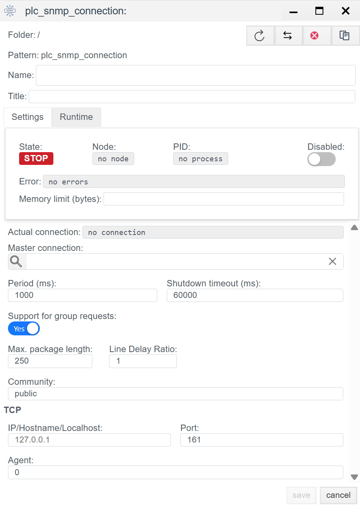

# Конфигурация SNMP в Faceplate

> См. также: [Общие сведения о PLC-соединениях](./general_ru.md)

## Общее описание
**SNMP** (Simple Network Management Protocol) — это открытый коммуникационный протокол, определенный Инженерным советом интернета (IETF). Протокол широко используется для обмена данными с сетевым оборудованием (контроллеры, шлюзы, ИБП). 

В среде **Faceplate** реализована поддержка протоколов версий **SNMPv2** и **SNMPv3**.

Процесс интеграции состоит из двух этапов:
1.  **Создание соединения (`plc_snmp_connection`):** Настройка сетевого транспорта и логики резервирования.
2.  **Создание привязок (`plc_snmp_binding`):** Адресация конкретных переменных (OID) внутри устройства.

---

##  1. Настройка соединения (Connection)
> Создать PLC cоединения → [Шаги создания PLC соединения](./general_ru.md#создание-plc-соединения)
> 
На этом этапе создается транспортный канал до оборудования.

> Панель диагностики и общие параметры соединения (Settings) описаны в разделе [Общие параметры соединения](./general_ru.md#общие-параметры-соединения-settings).

### 1.1 Параметры Протокола (SNMP) 
| Поле | Описание |
| :--- | :--- |
| **Community** | **Строка сообщества (Community String).** Используется как пароль для доступа к данным устройства (для SNMP v1/v2c). • **public** — стандартное значение для прав «только чтение» (Read-only). • **private** — стандартное значение для прав «чтение и запись» (Read-Write). *Важно: Это значение чувствительно к регистру и должно совпадать с настройками в опрашиваемом устройстве.* |
| **IP** | IP-адрес или доменное имя устройства, которое необходимо опрашивать. Примеры: `192.168.1.10` (сетевое устройство) или `127.0.0.1` (локальный агент). |
| **Port** | Сетевой порт агента SNMP. Стандартный порт для запросов: **161**. |
| **Agent** | Идентификатор агента или дополнительный параметр драйвера. Строка, используемая при аутентификации запроса менеджером SNMPv3; для версии SNMPv2 рекомендуется оставить значение по умолчанию (часто `0` или `1`). |

---

##  2. Настройка переменных (Binding)

Внутри соединения создаются объекты `plc_snmp_binding`. Каждый объект соответствует одной переменной (OID) на устройстве.

> Создать PLC привязку → [Шаги создания PLC привязки](./general_ru.md#создание-plc-привязки)

> Общие поля привязки (Name, Title, State, Tag, Transformation, Access) описаны в разделе [Общие поля PLC-привязки](./general_ru.md#общие-поля-plc-привязки).

### 2.1 Специфичные параметры привязки

| Поле | Описание |
| :--- | :--- |
| **Address** | **OID (Object Identifier).** Адрес переменной в иерархии SNMP. *Примеры:* `1.3.6.1.2.1.1.1.0` (абсолютный) или `1.6.3.1` (относительный, если поддерживается). |

> Ошибка в PLC привязке → [ошибка привязки](./general_ru.md#ошибка-в-привязке)

---
