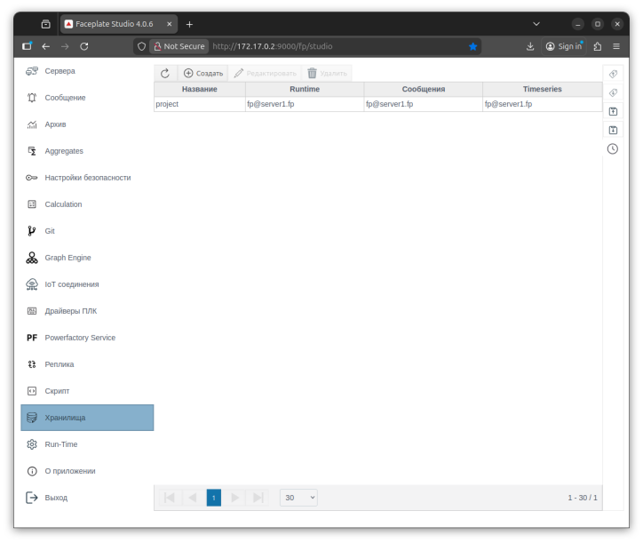
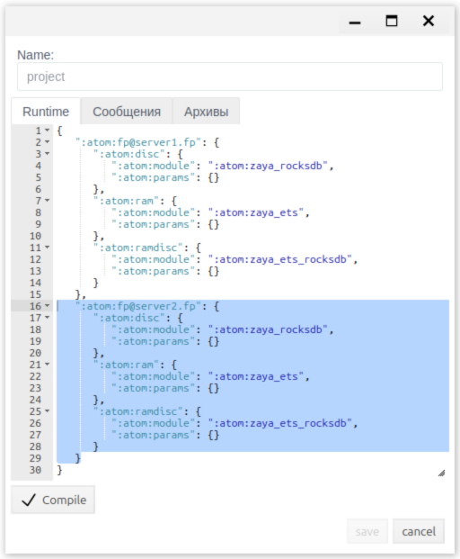
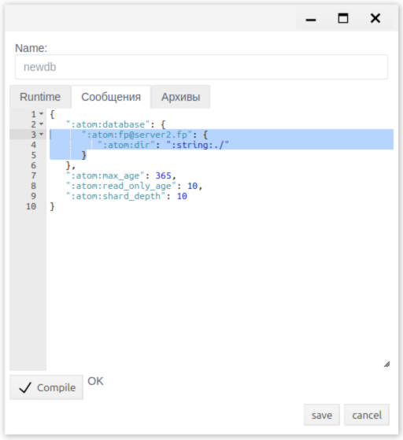
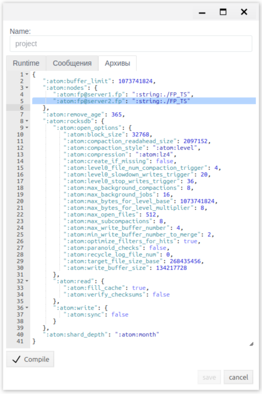
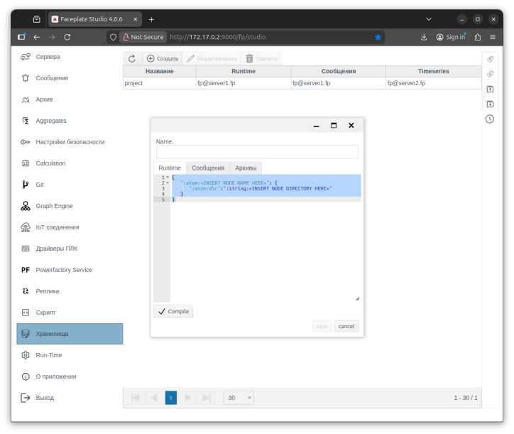
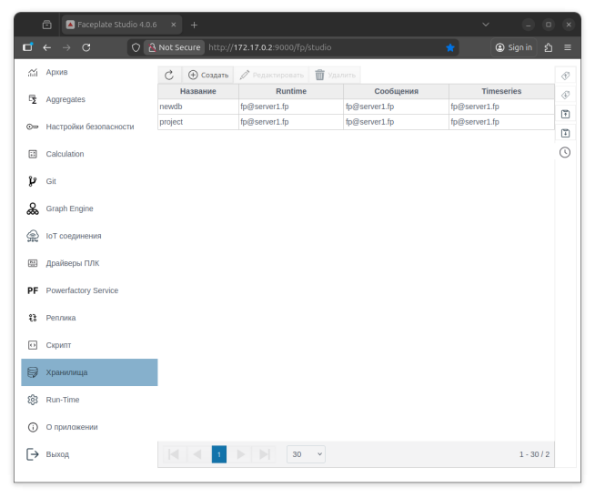
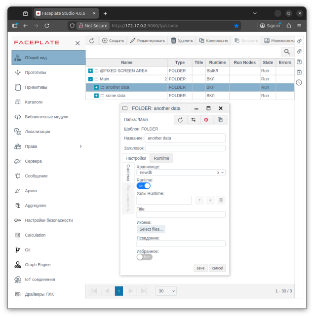
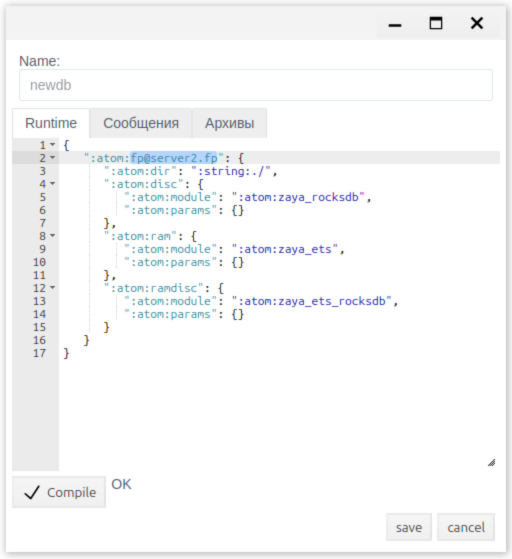
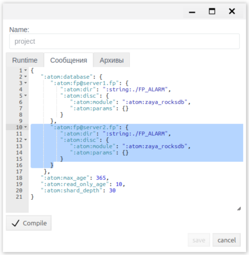
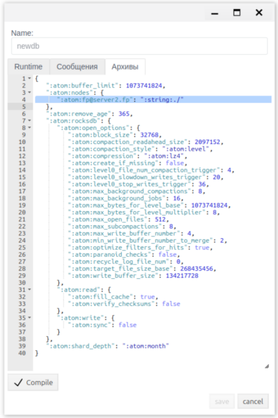

# Введение

Одной из ключевых особенностей FACEPLATE является возможность быстрой и гибкой настройки распределённого хранения данных. Это позволяет балансировать нагрузку между серверами хранения, а при необходимости выносить данные в отдельные базы данных или на отдельные узлы.  
С помощью встроенного модуля редактора хранилищ можно выполнять следующие операции:

* создавать новые базы данных  
* изменять директории хранения баз данных  
* организовывать кластерное хранение данных  
* переносить базы данных между узлами кластера

В рамках одного сервера механизм хранения данных реализован по аналогии с UNIX-подобными системами, где доступные диски монтируются в каталоги, и все данные, создаваемые внутри каталога, физически размещаются на соответствующем диске. В FACEPLATE роль таких «дисков» выполняют базы данных, которые могут располагаться на разных физических носителях. Кроме того FACEPLATE позволяет организовать распределенное хранение данных. Имеется возможность выносить отдельные базы данных на другие сервера. Нужно отметить важный момент что для каждой базы данных можно настроить более одной копии, которые могут храниться на разных серверах, таким образом обеспечивая горячее резервирование данных.

# Возможности

Возможность разделения логически единой базы данных на несколько физически независимых шардов, возможность организации их распределенного хранения и резервирования обеспечивают FACEPLATE следующие преимущества:

* Отказоустойчивость \- FACEPLATE может без потери функциональности или доступа к данным пережить выход из строя отдельных хранилищ или узлов. В зависимости от конфигурации архитектуры хранения FACEPLATE позволяет потерять более половины узлов без отказа функций системы.  
* Балансировка нагрузки \- распределение вычислительных ресурсов между серверами для оптимизации производительности и предотвращения перегрузок.  
* Масштабируемость \- возможность легкого добавления новых узлов без останова системы.

Архитектура хранения данных в FACEPLATE может быть изменена на ходу, без необходимости останова системы или отдельных ее узлов. Можно, например, уже к действующей системе добавить новые сервера, назначить им функции и добавить на них копии или полностью перенести на них часть баз данных.    
Шардирование позволяет реализовать горизонтальное масштабирование \- данные одной логической базы разделяются на независимые части (шарды), которые могут размещаться как на одном сервере, так и на разных серверах кластера. Такой подход позволяет эффективно решать задачи масштабирования когда вертикальное масштабирование экономически невыгодно или невозможно. Каждый шард хранит свою часть данных и может располагаться на отдельном физическом диске или сервере, что позволяет распределить нагрузку между доступными ресурсами и организовать эффективную работу с большими объёмами данных. Преимущества использования:

* Производительность \- повышение скорости обработки запросов при работе с большими объёмами данных;  
* Масштабируемость \- наращивание ресурсов системы по мере роста проекта;  
* Гибкость управления \- управление архитектурой хранения данных без необходимости останова системы или отдельных ее узлов.

# Описание

База данных в FACEPLATE Studio используется для хранения настроек проекта, данных реального времени, поступающих в систему непрерывным потоком, генерируемых сообщений и архивов. Для управления архитектурой хранения данных используется редактор Хранилищ.  
При первом запуске FACEPLATE по умолчанию создаётся база данных “project”. Конфигурация базы данных состоит из трёх основных разделов, это Runtime, Сообщения, Архивы.

***Runtime*** \- раздел предназначен для настройки хранения конфигурации проекта и данных, поступающих в режиме реального времени. Конфигурация определяет типы хранилищ используемых на конкретном узле FACEPLATE и модули драйверов обеспечивающие их работу (более подробно вы можете прочитать в разделе [База данных](https://github.com/faceplate-docs/faceplate/blob/dev/docs/ru/README.md)).

***Сообщения*** \- раздел предназначен для задания параметров хранения системных и прикладных сообщений, генерируемых системой (более подробно о системе сообщений вы можете прочитать в разделе [Сообщения и тревоги](../alarm/alarm_ru.md#9-хранение-и-автоматическая-обработка)). Конфигурация определяет параметры хранения, размещения и жизненного цикла сообщений (алармы, события, системные сообщения) в системе FACEPLATE.

***Архивы*** \- раздел предназначен для настройки хранения архивных (исторических) данных. Данный раздел определяет параметры работы хранилища архивов. Более подробно о системе архивирования вы можете прочитать в разделе [Архивы](../archives/archives_ru.md). Конфигурация определяет параметры хранения, размещения и жизненного цикла архивов.

Более подробно про настройку параметров хранения вы можете прочитать в разделе "[Настройка параметров хранения](https://github.com/faceplate-docs/faceplate/blob/dev/docs/ru/README.md)".

# Резервирование

Для повышения отказоустойчивости и производительности системы FACEPLATE позволяет легко организовать горячее резервирование данных. Это достигается путем добавления копий баз данных на другие имеющиеся сервера. Если для базы данных сконфигурированы копии на 2-х или более серверах, FACEPLATE обеспечивает их синхронизацию в режиме реального времени. Запросы к такой базе распределяются между серверами имеющими копию. Таким образом при выходе какого-либо сервера из строя не происходит отказа, просто запросы уходят к оставшимся доступным серверам.

## Пример

В качестве примера продемонстрируем организацию горячего резервирования базы данных проекта (project) из двух серверов. Сервера должны находиться в сетевом доступе между собой. Далее приведены базовые условия и последовательность действий:

* стабильный канал связи между серверами \- минимум 100 Мбит/сек  
* открытый доступ к портам 4369, 8000, 9000 \- подробнее [тут](https://github.com/faceplate-docs/faceplate/blob/dev/docs/ru/README.md)  
* подготовить директорию с ПО FACEPLATE на каждом сервере \- подробнее [тут](https://github.com/faceplate-docs/faceplate/blob/dev/docs/ru/README.md)  
  * разархивировать ПО FACEPLATE и открыть директорию  
  * изменить конфигурационный файл FACEPLATE по пути faceplate/releases/4.0/vm.args \- подробнее [тут](https://github.com/faceplate-docs/faceplate/blob/dev/docs/ru/README.md). Для нашего примера мы используем имена:  
    * первый сервер: \-name fp@server1.fp  
    * второй сервер: \-name fp@server2.fp  
* Для того чтобы сервера могли находить друг друга по доменным именам (server1.fp, server2.fp) мы добавим соответствующие записи в файл /etc/hosts (linux) на обоих серверах. IP адреса приведены для наглядности, используйте реальные адреса:  
  * 192.168.1.11	server1.fp  
  * 192.168.1.22	server2.fp  
* На 1-м сервере перейдем в папку с FACEPLATE, откроем терминал и выполним в нем следующие команды:   
  * ulimit \-n 200000  
  * ./faceplate/bin/faceplate console  
* Далее следует дождаться запуска 1-го сервера, о чем свидетельствует следующая надпись в консоли (---FACEPLATE STARTED---) и доступный по следующему адресу (http://192.168.1.11:9000/fp/studio) Web-интерфейс. При первом запуске FACEPLATE создает базу данных *project* и необходимое окружение.   
* После того как 1-й сервер запущен, запустим 2-й, но с указанием команды ATTACH к 1-му серверу, Для этого зайдем на 2-й сервер, откроем терминал, перейдем в папку с FACEPLATE и выполним следующие команды:  
  * ulimit \-n 200000  
  * env ATTACH\_TO=fp@server1.fp ./faceplate/bin/faceplate console  
* Далее следует дождаться запуска FACEPLATE на 2-м сервере (аналогично 1-му серверу проверяем логи и доступный Web-интерфейс)

В итоге, после выполнения указанных пунктов, мы имеем 2 сервера объединенных в кластер. При запуске 1-го сервера на нем была создана база данных *project*. Второй сервер не имеет копии базы данных, так как был присоединен к 1-му серверу и получил доступ к уже созданной на нем базе. Для того чтобы добавить на него копию базы данных нужно выполнить следующие настройки. 

### Настройка

Для добавления копии базы данных на новый сервер в настройках хранилища достаточно добавить подключенный инстанс в соответствующий раздел. В нашем примере мы добавим копию базы данных project на сервер 2\.  
Для этого мы откроем интерфейс студии на 1-м или 2-м сервере (не имеет значения), перейдем в редактор “Хранилища” и откроем на редактирование базу данных project. Во вкладке Runtime скопируем конфигурацию для сервера 1 и заменим в ней имя *fp@server1.fp* на *fp@server2.fp*:  

Нужно скомпилировать и сохранить изменения. При нажатии на “save” начнется копирование базы на сервер 2\. В файлах логов должны появиться соответствующие записи. В логах фиксируется процесс копирования базы данных который будет выглядеть так:

* server1  
  * zaya\_copy:copy\_request/1:219 copy: project to 'fp@server2.fp' (начало процесса копирования)  
  * zaya\_schema\_srv:handle\_call/3:229 project db opened at 'fp@server2.fp' (завершение процесса копирования)  
* server2  
  * zaya\_copy:try\_copy/1:119 copy: project from 'fp@server1.fp' (начало процесса копирования)  
  * zaya\_copy:wait\_ready/1:450 copy: project from 'fp@server1.fp' finish copy (завершение процесса копирования)

На данном этапе на сервере 2 имеется копия runtime базы данных project. По умолчанию база данных создается по относительному пути *faceplate/DB*. Если зайти на сервер 2 то по этому пути должны располагаться файлы базы данных.

Далее добавим на сервер 2 копию базы данных сообщений *project*. Для этого откроем опять на редактирование базу данных project и перейдем на вкладку “Сообщения”. Здесь скопируем конфигурацию сервера 1 и заменим в ней имя *fp@server1.fp* на *fp@server2.fp*:  

Нужно скомпилировать и сохранить изменения. После нажатия “save” начнется процесс копирования базы сообщений на сервер 2\. В зависимости от количества накопленных в системе сообщений процесс копирования может занять некоторое время. База данных сообщений разбита на сегменты (более подробно можно прочитать в в разделах [Сообщения и тревоги](../alarm/alarm_ru.md#9-хранение-и-автоматическая-обработка) и [База данных](https://github.com/faceplate-docs/faceplate/blob/dev/docs/ru/README.md)). Каждый сегмент покрывает определенный период времени, о чем говорит его название, например сегмент project\_\_\_2026\_01\_20\_\_2026\_02\_18 содержит сообщения с 2026-01-20 по 2026-02-18. По каждому имеющемуся сегменту в логах будут зафиксированы следующие записи:

* server1  
  * zaya\_copy:copy\_request/1:219 copy: project\_\_\_2026\_01\_20\_\_2026\_02\_18 to 'fp@server2.fp' (начало процесса копирования)  
  * zaya\_copy:copy\_request/1:252 copy: project\_\_\_2026\_01\_20\_\_2026\_02\_18 to 'fp@server2.fp' finished (завершение процесса копирования)  
* server2  
  * zaya\_copy:try\_copy/1:119 copy: project\_\_\_2026\_01\_20\_\_2026\_02\_18 from 'fp@server1.fp' (начало процесса копирования)  
  *  zaya\_copy:wait\_ready/1:450 copy: project\_\_\_2026\_01\_20\_\_2026\_02\_18 from 'fp@server1.fp' finish copy (завершение процесса копирования)

Далее добавим на сервер 2 копию базы данных архивов project. Для этого откроем опять на редактирование базу данных project и перейдем на вкладку “Архивы”. Здесь скопируем конфигурацию сервера 1 и заменим в ней имя *fp@server1.fp* на *fp@server2.fp*:  

Нужно скомпилировать и сохранить изменения. После нажатия “save” начнется процесс копирования базы архивов на сервер 2\. В зависимости от количества накопленных в системе архивов процесс копирования может занять некоторое время. База данных архивов разбита на сегменты (более подробно можно прочитать в в разделах [Архивы](../archives/archives_ru.md) и [База данных](https://github.com/faceplate-docs/faceplate/blob/dev/docs/ru/README.md)). Каждый сегмент покрывает определенный период времени, о чем говорит его название, например сегмент project\_ts\_database\_2026-01-18 содержит архивы начиная с 2026-02-18. Глубина сегмента определяется настройкой *shard\_depth (по умолчанию month)* По каждому имеющемуся сегменту в логах будут зафиксированы следующие записи:

* server1  
  * fp\_ts\_schema:add\_node/3:158 project\_ts\_database node 'fp@server2.fp' with path "./FP\_TS" added to schema (начало процесса копирования)  
  * zaya\_copy:copy\_request/1:252 copy: project\_ts\_database\_2026-01-18 to 'fp@server2.fp' finished (завершение процесса копирования)  
* server2  
  * zaya\_copy:try\_copy/1:119 copy: project\_ts\_database\_2026-01-18 from 'fp@server1.fp' (начало процесса копирования)  
  * zaya\_copy:wait\_ready/1:450 copy: project\_ts\_database\_2026-01-18 from 'fp@server1.fp' finish copy (завершение процесса копирования)

После успешно проделанных действий будет организован кластер из двух серверов, в котором настроено горячее резервирование базы данных project (по умолчанию это все данные проекта). При необходимости можно добавить другие сервера и перераспределить копии баз данных между ними, например организовать Historian Server, на котором будут хранится только архивные данные и перенести копии баз данных с архивами на него (более подробно см. [Historian Server](https://github.com/faceplate-docs/faceplate/blob/dev/docs/ru/README.md)).

# Шардирование

В проектах с большими объемами данных (миллионы объектов) и высокой интенсивностью потоков информации имеет смысл деления базы данных на шарды, что позволит распределять нагрузку по доступным подсистемам хранения и имеющимся серверам. Для понимания принципов шардирования можно привести аналогию монтирования дисков в UNIX-подобных системах. Когда дисковый накопитель монтируется к некоторой папке. В результате все что хранится внутри данной папки физически хранится на смонтированном к ней диске. В случае FACEPLATE роль дискового накопителя играет база данных. По умолчанию FACEPLATE создает одну базу данных project и монтирует ее к корневой папке проекта. Это означает что по умолчанию все что создается в проекте попадает в базу данных project. Но пользователь может создать другие базы данных и монтировать их к папкам внутри проекта, в результате чего проект логически останется единым целым, но физически будет разбит на несколько баз данных (шардов). 

## Пример

Для создания нового шарда базы данных необходимо нажать кнопку «Создать» в редакторе хранилищ.  

После этого откроется диалоговое окно, нужно задать уникальное имя (латиница, без специальных символов) и в каждом разделе требуется указать:

* узел хранения, например \- ":atom:fp@server1.fp"  
* путь к директории хранения \- ":atom:dir":":string:./" (допускается использование относительных и абсолютных путей)  
* скомпилировать

После сохранения настроек база данных будет создана и добавлена в систему. В логах будут зафиксированы следующие записи:

* ecomet\_db:on\_create/1:820 creating a new database newdb\_\_\_2026\_02\_02\_\_2026\_02\_11 (начало процесса создания)  
* fp\_ts\_db\_pool\_sup:init/1:36 DB pool Supervisor has been started newdb\_test\_ts\_database (завершение процесса создания)

Если зайти на сервер, то по указанному пути (faceplate/DB) должны быть созданы директории и файлы базы данных:

* newdb  
* newdb\_\_\_2026\_01\_20\_\_2026\_01\_29  
* newdb\_ts\_database

### Использование

На данном этапе шард создан, но не содержит полезных данных. Если создать новую папку в студии и указать в ее настройках, что к ней смонтирован созданный нами шард, то все что будет создано далее в этой папке физически будет хранится в данном шарде. Для этого в студии нужно перейти в Общий вид, выделить ранее созданную папку или создать новую (более подробно см. [Создание объектов](https://github.com/faceplate-docs/faceplate/blob/dev/docs/ru/Project_strucure/FACEPLATE-start.md)). В свойствах папки есть настройка Хранилище, здесь и выбирается шард *newdb* для хранения объектов*.* Остается сохранить настройки для подтверждения проделанных изменений.  

Таким образом, все объекты, которые будут созданы в папке “some data” \- будут храниться и обрабатываться в шарде базы данных “project”, по умолчанию. И аналогично для папки “another data” \- в новом шарде базы данных “*newdb*”.

### Перенос

Чтобы перенести шард базы данных на другой сервер достаточно добавить копию шарда на другой сервер, после чего можем удалить копию с текущего. Вся процедура также производится в настройках хранилища.  
В примере ниже мы переместим ранее созданную базу данных *newdb* c сервера 1 на сервер 2\. Процесс добавления копии уже расписан в пункте “[Настройка](#настройка)” данного документа. После того как мы выполнили добавление копии базы *newdb* на сервер 2  удалим копию с сервера 1, т. е. оставим единственную копию на сервере 2\. Для этого мы откроем интерфейс студии на 1-м или 2-м сервере (не имеет значения), перейдем в редактор “Хранилища” и откроем на редактирование базу данных *newdb*. Во вкладке Runtime удалим конфигурацию для сервера 1 и оставим в ней только сервер 2 \- *fp@server2.fp*:  

Нужно скомпилировать и сохранить изменения. При нажатии на “save” начнется закрытие базы на сервере 1\. В файлах логов должны появиться соответствующие записи. В логах фиксируется процесс переноса базы данных который будет выглядеть так:

* server1  
  * zaya\_db\_srv:handle\_event/4:402 newdb database close (начало процесса закрытия)  
  * zaya\_schema\_srv:handle\_call/3:288 newdb copy removed from 'fp@server1.fp' (завершение процесса закрытия)  
* server2  
  * zaya\_schema\_srv:handle\_call/3:246 newdb db closed at 'fp@server1.fp' (начало процесса закрытия)  
  * zaya\_schema\_srv:handle\_call/3:288 newdb copy removed from 'fp@server1.fp' (завершение процесса закрытия)

Далее уберём копию базы данных сообщений *newdb* из сервер 1\. Для этого откроем опять на редактирование базу данных *newdb* и перейдем на вкладку “Сообщения”. Здесь удалим конфигурацию сервера 1 и оставим в ней только сервер 2 \- *fp@server2.fp*:  

Нужно скомпилировать и сохранить изменения. При нажатии на “save” начнется закрытие базы на сервере 1\. В файлах логов должны появиться соответствующие записи. В логах фиксируется процесс переноса базы данных который будет выглядеть так:

* server1  
  * zaya\_db\_srv:handle\_event/4:402 newdb\_\_\_2026\_01\_20\_\_2026\_01\_29 database close (начало процесса закрытия)  
  * zaya\_schema\_srv:handle\_call/3:288 newdb\_\_\_2026\_01\_20\_\_2026\_01\_29 copy removed from 'fp@server1.fp' (завершение процесса закрытия)  
* server2  
  * zaya\_schema\_srv:handle\_call/3:246 newdb\_\_\_2026\_01\_20\_\_2026\_01\_29 db closed at 'fp@server1.fp' (начало процесса переноса)  
  * zaya\_schema\_srv:handle\_call/3:288 newdb\_\_\_2026\_01\_20\_\_2026\_01\_29 copy removed from 'fp@server1.fp' (завершение процесса закрытия)

Далее уберём копию базы данных архивов newdb из сервер 1\. Для этого откроем опять на редактирование базу данных *newdb* и перейдем на вкладку “Архивы”. Здесь удалим конфигурацию сервера 1 и оставим в ней только сервер 2 \- *fp@server2.fp*:  

Нужно скомпилировать и сохранить изменения. При нажатии на “save” начнется закрытие базы на сервере 1\. В файлах логов должны появиться соответствующие записи. В логах фиксируется процесс переноса базы данных который будет выглядеть так:

* server1  
  * fp\_ts\_schema:remove\_node/2:171 newdb\_ts\_database node 'fp@server1.fp' removed from schema (начало процесса переноса)  
  * zaya\_schema\_srv:handle\_call/3:288 newdb\_ts\_database\_buffer\_0 copy removed from 'fp@server1.fp' (завершение процесса переноса)  
* server2  
  * zaya\_schema\_srv:handle\_call/3:246 newdb\_ts\_database\_buffer\_0 db closed at 'fp@server1.fp' (начало процесса переноса)  
  * zaya\_schema\_srv:handle\_call/3:288 newdb\_ts\_database\_buffer\_0 copy removed from 'fp@server1.fp' (завершение процесса переноса)

После успешно проделанных действий шард базы данных *newdb* будет перенесен с одного сервера на другой, который в итоге будет использовать ресурсы второго сервера для хранения информации.  
Таким образом можно переносить необходимые шарды базы данных между серверами в кластере.  

> _written by nkn_ 