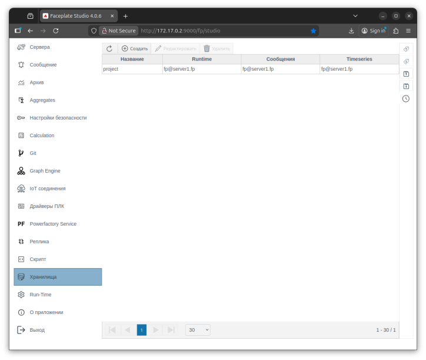
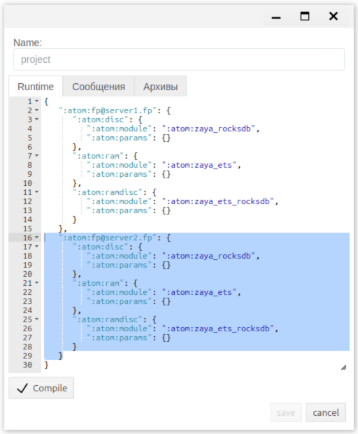
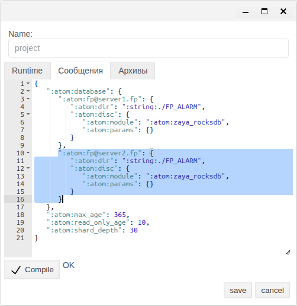
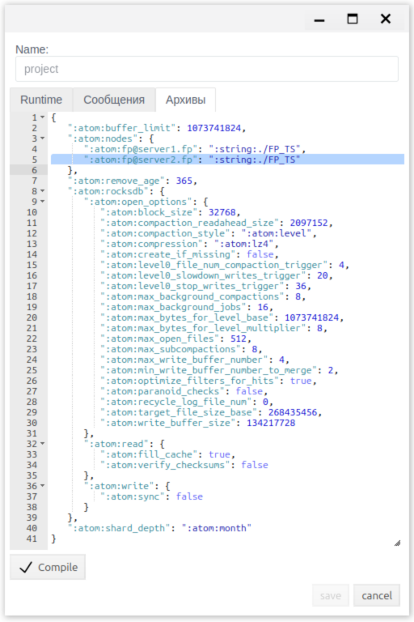
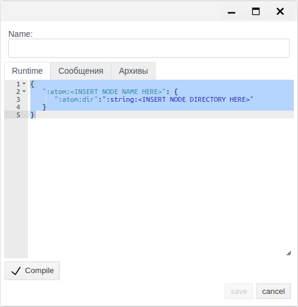
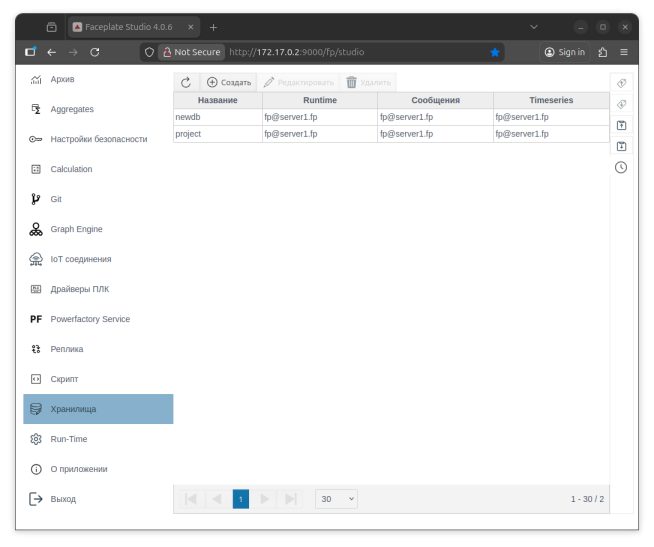
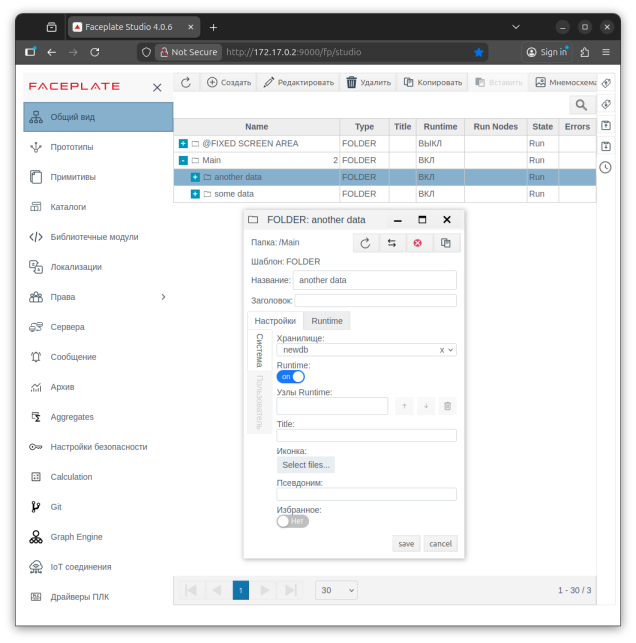
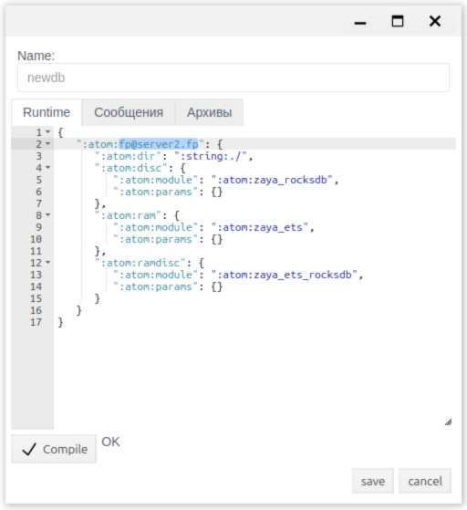
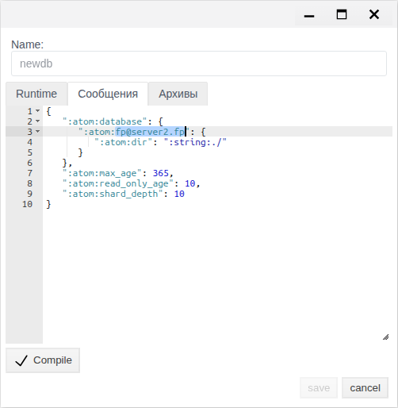
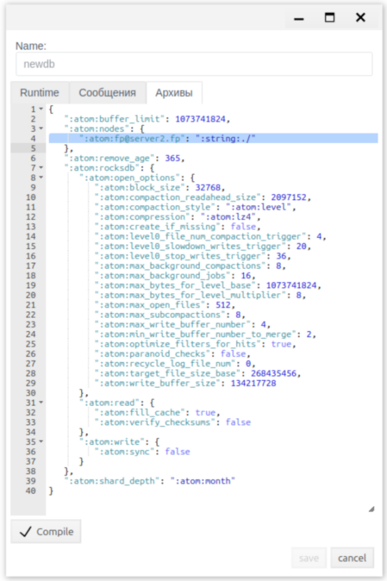

# Хранилища: на каких серверах лежат данные проекта

Документ для инженера-интегратора, который решает, где хранятся данные проекта FACEPLATE: чтобы система продолжала работать при отказе сервера, чтобы разнести большой проект по дискам и серверам или чтобы перенести данные на другой сервер без остановки системы.

# Содержание

- [Глоссарий](#глоссарий)
- [Введение](#введение)
- [Основная часть](#основная-часть)
    - [Подготовка серверов](#подготовка-серверов)
    - [Редактор «Хранилища»](#редактор-хранилища)
    - [Резервирование: копия базы на втором сервере](#резервирование-копия-базы-на-втором-сервере)
    - [Отдельная база для папки](#отдельная-база-для-папки)
    - [Перенос базы на другой сервер](#перенос-базы-на-другой-сервер)
    - [Проверка по журналу](#проверка-по-журналу)
- [Заключение](#заключение)

# Глоссарий

| Термин | Значение |
|---|---|
| База данных | Место, где FACEPLATE хранит данные проекта. При первом запуске создаётся база `project`, и всё, что есть в проекте, хранится в ней. В редакторе **Хранилища** можно создать другие базы |
| Части базы | У каждой базы три части, по одной на вкладку редактора: **Runtime** — объекты проекта и их текущие значения; **Сообщения** — журнал сообщений и тревог; **Архивы** — архивы значений |
| Копия базы | Экземпляр базы на конкретном сервере. Если у базы копии на двух серверах, FACEPLATE держит их одинаковыми и при отказе одного сервера работает с другим |
| Узел | Сервер FACEPLATE с именем вида `fp@<хост>`. Узлы кластера видны на панели **Сервера**, см. [«Узлы кластера»](../../administration/nodes/nodes.md) |
| Кластер | Несколько узлов, объединённых в одну систему, см. [«Резервирование ресурсов»](../../administration/redundancy/redundancy.md#2-резервирование-служб-faceplate) |
| Отдельная база для папки | База, подключённая к папке проекта свойством **Хранилище**: всё, что создаётся в этой папке, хранится в этой базе, а не в `project`. Иначе — шард |
| Сегмент | Часть базы сообщений или архивов за период времени. Название сегмента содержит даты, например `project___2026_01_20__2026_02_18` |

# Введение

По умолчанию весь проект — одна база `project` на одном сервере. Все объекты, сообщения и архивы лежат на диске этого сервера. Если сервер остановится, Studio и Runtime недоступны, пока его не запустят.

Редактор **Хранилища** меняет то, где лежат данные, без остановки системы. С ним решают три задачи:

| Задача | Что вы делаете | Что получаете |
|---|---|---|
| Резервирование | Добавляете базе копию на втором сервере | Сервер можно потерять: Studio и Runtime продолжают работать на другом сервере, Runtime оператора переключается сам (см. [«Узлы кластера»](../../administration/nodes/nodes.md#адрес-узла-для-runtime)). Данные не теряются: копии одинаковые |
| Отдельная база для папки | Создаёте новую базу и подключаете её к папке проекта | Данные этой папки хранятся отдельно: на другом диске или сервере. Большой проект перестаёт быть одной базой, нагрузка делится между дисками и серверами |
| Перенос | Добавляете базе копию на новом сервере и убираете старый | Данные переезжают на другой сервер, пока система работает. Например, архивы — на отдельный сервер архивов (см. [Historian Server](../historian/historian_server.md)) |

Резервирование здесь — это резервирование данных. Резервирование каналов связи с оборудованием описано отдельно, в [«Резервирование ресурсов»](../../administration/redundancy/redundancy.md#5-резервирование-plc-соединений).

Сквозной пример — два сервера `fp@server1.fp` и `fp@server2.fp`. В примере база `project` получает копию на `server2`, затем создаётся база `newdb` для папки `another data`, и в конце `newdb` переносится на `server2`. У вас имена серверов, путей и значения параметров могут быть другими: в настройках копируются те значения, которые уже стоят на вашем первом сервере.

Понадобится доступ к Studio (`http://<сервер>:9000/fp/studio`) под учётной записью с правом изменять проект. Для резервирования и переноса — кластер минимум из двух серверов.

# Основная часть

## Подготовка серверов

Резервирование и перенос работают между серверами одного кластера. Перед настройкой хранилищ серверы готовят так:

* стабильный канал связи между серверами — минимум 100 Мбит/с;
* открытый доступ между серверами к порту 4369 и к порту обмена между узлами FACEPLATE. Порт обмена по умолчанию выбирается заново при каждом запуске; чтобы открыть его на межсетевом экране, закрепите его в `vm.args` двумя строками с одинаковым значением, например:
    * `-kernel inet_dist_listen_min 9100`
    * `-kernel inet_dist_listen_max 9100`
* открытый доступ с рабочих мест к портам 9000 (HTTP) и 9443 (HTTPS), к интерфейсу ECOMET — 8000, подробнее в разделе [«Запуск»](../../Project_strucure/FACEPLATE-start.md#запуск);
* у каждого сервера своё имя в `faceplate/releases/<версия>/vm.args` (параметр `-name`, см. [«Резервирование ресурсов»](../../administration/redundancy/redundancy.md#31-настройка-виртуальной-машины-vmargs)) и общий `-setcookie`;
* серверы находят друг друга по именам: на каждом сервере в `/etc/hosts` записаны адреса всех серверов кластера.

В примере в `vm.args` первого сервера `-name fp@server1.fp`, второго — `-name fp@server2.fp`, а в `/etc/hosts` обоих серверов:

```
192.168.1.11   server1.fp
192.168.1.22   server2.fp
```

Кластер собирается так: первый сервер запускается обычной командой, второй — с переменной `ATTACH_TO`, указывающей на первый. Команды — в [«Резервирование ресурсов»](../../administration/redundancy/redundancy.md#4-запуск-и-сборка-кластера). В примере:

```bash
# server1
ulimit -n 200000
./faceplate/bin/faceplate console

# server2, после того как server1 запущен
ulimit -n 200000
env ATTACH_TO=fp@server1.fp ./faceplate/bin/faceplate console
```

Сервер готов, когда в консоли появилась строка `---FACEPLATE STARTED---` и открывается Studio. Оба сервера видны на панели **Сервера**.

Сразу после присоединения второй сервер работает с базой `project`, которая лежит на первом. Своей копии у него нет: если первый сервер остановится, второй работать не сможет. Копию добавляют в редакторе **Хранилища**, см. [Резервирование](#резервирование-копия-базы-на-втором-сервере).

## Редактор «Хранилища»

Откройте **Хранилища** в меню Studio слева. Список показывает базы проекта и серверы, на которых лежит каждая часть базы.



| Колонка | Значение |
|---|---|
| **Название** | Имя базы |
| **Runtime** | Серверы с копией объектов проекта и текущих значений |
| **Сообщения** | Серверы с копией журнала сообщений |
| **Timeseries** | Серверы с копией архивов |

Кнопки над списком:

| Кнопка | Назначение |
|---|---|
| **Создать** | Создать новую базу, см. [Отдельная база для папки](#отдельная-база-для-папки) |
| **Редактировать** | Открыть выделенную базу для изменения |

Двойной щелчок по строке открывает базу только для просмотра: кнопка **save** в таком окне неактивна.

Окно базы:

| Элемент | Назначение |
|---|---|
| **Name** | Имя базы. Задаётся при создании, потом не меняется. Латинские буквы и цифры, без пробелов и специальных символов |
| Вкладки **Runtime**, **Сообщения**, **Архивы** | Настройки трёх частей базы в формате JSON |
| **Compile** | Проверить текст вкладки. Рядом появляется `OK` или ошибка |
| **save** | Сохранить базу. Изменения применяются сразу, копирование данных идёт в фоне |

Порядок всегда один: правка вкладки → **Compile** → `OK` → **save**. Новая база сохраняется, только когда заполнены все три вкладки.

На каждой вкладке перечислены серверы, на которых лежит эта часть базы. Сервер записывается ключом `":atom:fp@<хост>"`:

| Вкладка | Где список серверов | Что записано для сервера |
|---|---|---|
| **Runtime** | Ключи верхнего уровня | Каталог (`:atom:dir`) и модули хранения (`:atom:disc`, `:atom:ram`, `:atom:ramdisc`) |
| **Сообщения** | Внутри `":atom:database"` | Каталог и модуль хранения. Остальные ключи (`read_only_age`, `max_age`, `shard_depth`) описаны в [«Сообщения и тревоги»](../../alarm/alarm_ru.md#9-хранение-и-автоматическая-обработка) |
| **Архивы** | Внутри `":atom:nodes"` | Каталог. Остальные ключи задают хранение архивов и при добавлении или удалении сервера не меняются |

Каталог (`":atom:dir"`) считается от каталога баз `faceplate/DB`: `":string:./"` — сам `faceplate/DB`, `":string:./FP_ALARM"` — `faceplate/DB/FP_ALARM`.

Чтобы добавить сервер, скопируйте блок уже настроенного сервера и замените в копии имя. Значения внутри блока берутся из вашей установки, их не придумывают заново. Чтобы убрать сервер, удалите его блок.

## Резервирование: копия базы на втором сервере

Копия базы на втором сервере даёт:

* **работу при отказе.** Если первый сервер остановится, Studio и Runtime продолжат работать на втором. Runtime оператора переключится сам, если у узлов заданы адреса (см. [«Узлы кластера»](../../administration/nodes/nodes.md#адрес-узла-для-runtime));
* **сохранность данных.** Копии одинаковые, изменения попадают в обе сразу;
* **распределение нагрузки.** Запросы к базе обслуживают оба сервера.

Копия добавляется по частям, на каждой вкладке отдельно. На снимках — база `project` из примера:

1. **Хранилища** → строка базы → **Редактировать**.
2. Вкладка **Runtime**: скопируйте блок первого сервера и замените в копии имя сервера на имя второго. **Compile** → `OK` → **save**.

    

3. Снова **Редактировать**, вкладка **Сообщения**: то же внутри `":atom:database"`. **Compile** → `OK` → **save**.

    

4. Снова **Редактировать**, вкладка **Архивы**: то же внутри `":atom:nodes"`. **Compile** → `OK` → **save**.

    

После каждого **save** второй сервер получает копию этой части базы. Объём копирования зависит от накопленных данных: объекты проекта копируются быстро, сообщения и архивы — по сегментам, это может занять время. Как следить за копированием, см. [Проверка по журналу](#проверка-по-журналу).

Результат виден в списке: в колонках **Runtime**, **Сообщения** и **Timeseries** базы указаны оба сервера. На втором сервере в `faceplate/DB` появляются файлы базы.

В примере в базу `project` добавлены блоки `":atom:fp@server2.fp"` с теми же значениями, что у `":atom:fp@server1.fp"`. После этого `server2` продолжает работу, если `server1` остановлен.

Так же копию получает любая другая база — например, отдельная база для папки.

## Отдельная база для папки

По умолчанию все объекты проекта хранятся в одной базе `project`. В проекте с миллионами объектов и плотным потоком данных одна база становится узким местом. Отдельная база для папки делит проект на части: логически это по-прежнему один проект, а физически содержимое папки хранится в своей базе — на отдельном диске или сервере. Так работает монтирование диска в каталог в Linux: всё, что записано в каталог, физически лежит на смонтированном диске.

Создание базы:

1. **Хранилища** → **Создать**. Откроется окно с шаблоном на каждой вкладке.

    

2. **Name** — имя базы.
3. На каждой вкладке замените `<INSERT NODE NAME HERE>` на имя сервера, а `<INSERT NODE DIRECTORY HERE>` — на каталог, например `./`. **Compile** → `OK` на каждой вкладке.
4. **save**.

База появляется в списке.



В `faceplate/DB` сервера появляются каталоги базы: `<имя>` (объекты), `<имя>___<даты>` (сегмент сообщений), `<имя>_ts_database` (архивы).

Подключение базы к папке:

1. **Общий вид** → создайте папку или выделите существующую → **Редактировать**.
2. Вкладка **Настройки** → **Хранилище** → выберите базу. В списке все базы проекта.
3. **save**.



Всё, что создаётся в этой папке дальше, хранится в выбранной базе. Работа с объектами в Studio и Runtime не меняется.

В примере создана база `newdb` на `server1` с каталогом `./`. Папка `another data` подключена к `newdb`, папка `some data` — без отдельной базы: её объекты хранятся в `project`.

## Перенос базы на другой сервер

Перенос нужен, когда данные должны жить на другом сервере: новый сервер мощнее, на старом кончается диск, или архивы выносятся на выделенный сервер. Система при переносе не останавливается.

Перенос — это две операции из предыдущих разделов подряд. На снимках — база `newdb` из примера, на всех вкладках у неё остаётся только `server2`:

1. Добавьте базе копию на новом сервере, как в разделе [Резервирование](#резервирование-копия-базы-на-втором-сервере), на всех трёх вкладках. Дождитесь окончания копирования (см. [Проверка по журналу](#проверка-по-журналу)).
2. **Редактировать** → на вкладке **Runtime** удалите блок старого сервера, оставьте только новый. **Compile** → `OK` → **save**.

    

3. Так же на вкладке **Сообщения** внутри `":atom:database"`.

    

4. Так же на вкладке **Архивы** внутри `":atom:nodes"`.

    

После каждого **save** старый сервер закрывает свою копию этой части базы. В списке в колонках базы остаётся только новый сервер. Содержимое папок, подключённых к базе, по-прежнему открывается в Studio и Runtime на любом сервере кластера. Файлы базы на диске старого сервера остаются.

В примере `newdb` перенесена с `server1` на `server2`: сначала добавлены блоки `":atom:fp@server2.fp"`, затем удалены блоки `":atom:fp@server1.fp"`.

## Проверка по журналу

Копирование и закрытие баз отражаются в журнале `console.log` каждого сервера (путь к журналу задаётся в `fp.logger.config`, см. [«Резервирование ресурсов»](../../administration/redundancy/redundancy.md#32-конфигурация-логирования-fploggerconfig)). Для сообщений и архивов строки повторяются по каждому сегменту.

| Действие | Сервер | Строки журнала |
|---|---|---|
| Добавлена копия (**Runtime**, **Сообщения**) | Сервер с данными | `copy: <база> to '<новый сервер>'` — начало;<br>`<база> db opened at '<новый сервер>'` — копия готова |
| | Новый сервер | `copy: <база> from '<сервер с данными>'` — начало;<br>`copy: <база> from '<сервер с данными>' finish copy` — копия готова |
| Добавлена копия (**Архивы**) | Сервер с данными | `<база>_ts_database node '<новый сервер>' with path "<каталог>" added to schema`, затем строки `copy:` по частям архивов |
| Создана база | Сервер базы | `creating a new database <база>___<даты>`;<br>`DB pool Supervisor has been started <база>_ts_database` |
| Убрана копия (**Runtime**, **Сообщения**) | Старый сервер | `<база> database close` — начало;<br>`<база> copy removed from '<старый сервер>'` — копия убрана |
| | Другие серверы | `<база> db closed at '<старый сервер>'`;<br>`<база> copy removed from '<старый сервер>'` |
| Убрана копия (**Архивы**) | Старый сервер | `<база>_ts_database node '<старый сервер>' removed from schema`, затем `copy removed` по частям архивов |

Для сообщений вместо `<база>` в строках стоит имя сегмента, например `project___2026_01_20__2026_02_18`.

# Заключение

По умолчанию весь проект хранится в одной базе `project` на одном сервере. Редактор **Хранилища** меняет это без остановки системы. Копия базы на втором сервере защищает от отказа сервера и потери данных. Отдельная база для папки выносит часть проекта на другой диск или сервер. Перенос — добавление копии на новом сервере и удаление старого. Любое изменение делается одинаково: скопировать или удалить блок сервера на вкладках **Runtime**, **Сообщения**, **Архивы**, на каждой **Compile** → `OK` → **save**, и проверить результат в списке и в журнале.
