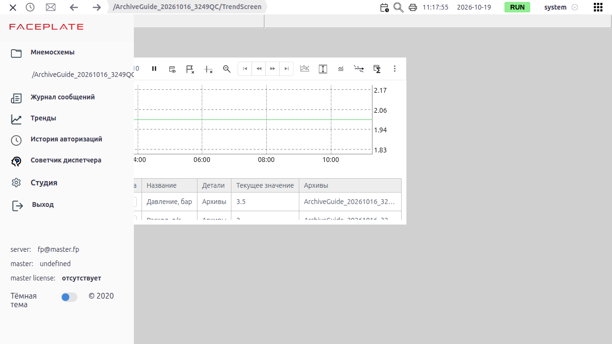
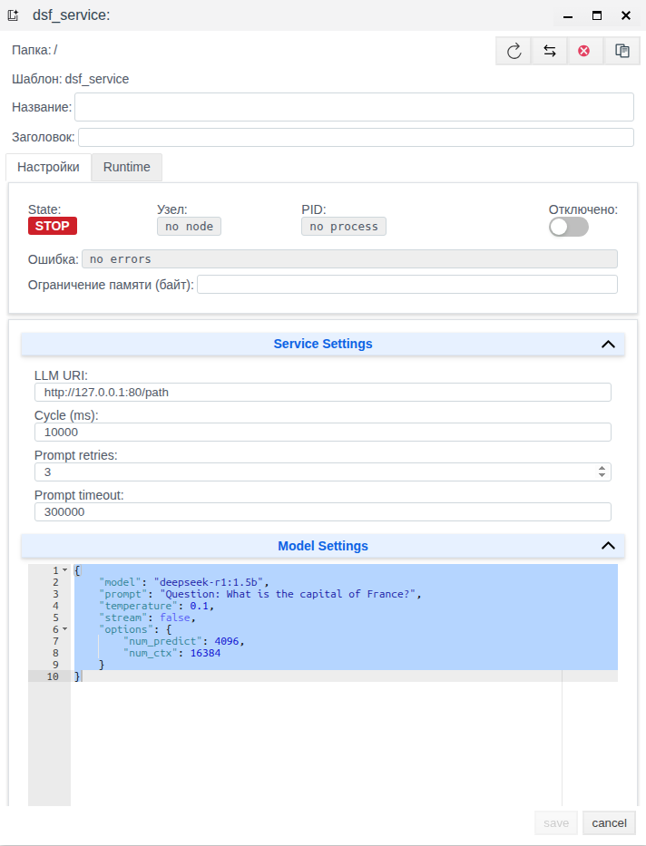

# Советчик диспетчера в Faceplate: настройка службы и разбор тревог

Рабочая версия для интеграторов Faceplate 4.0.7. Документ описывает назначение советчика, настройку службы и проверку результата на учебном насосном узле.



## Для чего нужен советчик

Советчик помогает разбирать события тревог: получает объяснение от языковой модели и связывает его с исходными тревогами. При подключённом поиске документов рядом с объяснением можно просмотреть подходящие инструкции.

Интегратор настраивает службу обработки. Диспетчер открывает сообщения советчика, читает ответ, проверяет исходные события и найденные документы. Добавленный к исходной тревоге комментарий относится к этой тревоге.

Сообщение советчика, исходная тревога и документ — разные объекты работы. Просмотр ответа не заменяет просмотр состояния тревоги. В окне советчика не предусмотрено собственное квитирование сообщения.

Установка сервисов модели и поиска, наполнение базы инструкций и общая настройка тревог выполняются отдельно. Здесь приведены требования к этим предпосылкам и минимальная схема учебных сигналов.

## Как формируется рекомендация

Служба проходит следующую цепочку:

1. Отбирает события возникновения и снятия тревог за очередной интервал.
2. Передаёт отобранные записи скрипту группировки.
3. Формирует запрос для каждой непустой группы.
4. Получает ответ языковой модели.
5. При наличии второго скрипта выполняет дополнительный запрос для заголовка и поиска документов.
6. Сохраняет сообщение с ответом и исходными тревогами.
7. Показывает сообщение и доступные инструкции в советчике.

В обработку попадают события типов alarm, warning и error. Уже активная тревога не обязательно создаёт новое событие в очередном интервале. Для контрольной проверки нужен новый переход состояния, например новое превышение порога.

Группировка определяет, какие события попадут в один запрос. Она также может накапливать данные между циклами. Если скрипт не вернул ни одной группы, запрос к модели не отправляется.

Второй запрос необязателен. Без него служба работает с основным ответом, а поиск документов игнорируется. При втором запросе основной ответ остаётся объяснением; дополнительный ответ используется для заголовка и вопроса сервису поиска.

Ошибка поиска документов не препятствует сохранению сообщения с объяснением. Поэтому наличие ответа и наличие инструкции проверяют отдельно.

## Что подготовить

| Предпосылка | Что проверить |
|---|---|
| Проект и папка | Можно создавать и изменять службу, читать нужные тревоги. Папка включена в выполнение |
| Выполнение скриптов | Доступно выполнение Erlang-выражений службы |
| Сервис языковой модели | Адрес доступен с сервера Faceplate; известны имя модели и поддерживаемые параметры |
| Формат модельного ответа | Сервис принимает JSON и возвращает HTTP 200 с текстовым полем response в JSON |
| Скрипт группировки | Возвращает непустые группы нужных событий и содержит сведения для основного запроса |
| Основной скрипт | Формирует текст запроса из подготовленной группы |
| Поиск документов, для второго примера | Известны адрес, поддерживаемый регион и доступные инструкции; подготовлен второй скрипт |

Адрес модели проверяйте с сервера Faceplate. Адрес loopback относится к серверу, который выполняет запрос, а не к компьютеру с браузером. Совпадение формата с произвольным API автоматически не обеспечивается.

Для примеров используйте отдельную учебную папку **DSF_TRAINING** в существующем проекте. Очистка базы не требуется. Не подменяйте реальные модель и поиск тестовыми ответами при проверке результата.

### Учебный насосный узел

Учебные объекты в этой таблице являются планом подготовки. На исследованном стенде они не создавались и их наличие не подтверждено.

| Объект | Роль | Исходное значение | Порог | Контрольное значение |
|---|---|---|---|---|
| Н-101 | Давление первого насоса, бар | 6.0 | Больше 7.0 | 7.2 |
| Н-101_high | Тревога по давлению Н-101 | Условие тревоги не выполнено | Без задержки и инверсии | Возникновение при 7.2 |
| Н-102 | Давление второго насоса, бар; нужен во втором примере | 6.0 | Больше 6.5 | 6.8 |
| Н-102_high | Тревога по давлению Н-102 | Условие тревоги не выполнено | Без задержки и инверсии | Возникновение при 6.8 |
| Советчик насосного узла | Служба, которую читатель создаёт в первом примере | Ещё не создана | — | Сообщение по учебному событию |

Подготовьте пользовательский тип **DSFPressure** с числовым полем **pressure** типа float. Разрешите изменение поля в режиме выполнения. Начальное значение поля — **6.0**, единица измерения в описании — **бар**.

Создайте экземпляр Н-101 и настройте стандартную тревогу по его полю pressure: сравнение «больше 7.0», задержка 0, без инверсии, тревога включена. Для второго примера аналогично добавьте Н-102 с порогом 6.5. Это схема подготовки; точные переходы к редакторам типа и тревоги в UI данной редакции не проверены.

Возврат давления к 6.0 снимает условие превышения. Событие снятия тоже может попасть в обработку, поэтому не ожидайте строго одного сообщения на полный цикл «возникновение — снятие».

Для первого примера заранее нужны только Н-101 и его тревога. Второй пример зависит от первого и добавляет Н-102, документы и поиск.

## Настройка обработки тревог

Настройки службы сгруппированы в **Service Settings**, **Model Settings**, **Alarm Filter**, **Scripts Pipeline** и **RAG Settings**. Эти подписи и название типа **DSF Service** приведены по описанию формы; перевод и размещение в работающем интерфейсе требуют проверки.



### Подключение модели и цикл обработки

| Настройка | Влияние |
|---|---|
| LLM URI | Адрес, на который сервер отправляет запрос модели |
| Cycle (ms) | Длительность интервала отбора событий, миллисекунды |
| Prompt retries | Общее число попыток запроса; значение 3 означает три попытки |
| Prompt timeout | Ожидание ответа модели, миллисекунды |
| Model Settings | JSON-параметры запроса: модель и поддерживаемые ею настройки |

Время до появления сообщения складывается из ожидания обработки события и времени запросов. При втором запросе и поиске добавляются соответствующие этапы. Значение цикла не является гарантией времени получения ответа.

Для учебного примера используйте следующую структуру **Model Settings**:

```json
{
  "model": "MODEL_NAME",
  "temperature": 0.1,
  "stream": false,
  "options": {
    "num_predict": 4096,
    "num_ctx": 16384
  }
}
```

Замените MODEL_NAME именем реально доступной модели. Это шаблон параметров, а не готовое подключение. Дополнительные ключи должны поддерживаться сервисом. Текст запроса формирует скрипт службы; фиксировать его отдельным значением в этом JSON не требуется.

В примере используется ответ без потока отдельных фрагментов: **stream=false**. Сервис должен вернуть предусмотренный формат целого JSON-ответа.

### Отбор событий и поиск сообщений

Фильтр **Alarm Filter** ограничивает события до группировки и отправки модели. Пустое значение или пустой JSON-объект означают отсутствие дополнительного фильтра службы.

Поиск в окне советчика ограничивает просмотр уже сохранённых сообщений. Он не изменяет события, которые служба ранее отправила модели.

Для второго примера используется отбор по пути учебной тревоги:

```json
{
  "field": "point",
  "operator": "contains",
  "value": "Н-101"
}
```

Поле point относится к месту исходной тревоги. В учебной схеме её путь оканчивается на Н-101_high. Сверьте реальный путь в проекте: совпадение имени датчика и пути тревоги автоматически не предполагается.

Если дополнительный фильтр пуст, ограничение учебными событиями должен обеспечивать подготовленный скрипт группировки. Не считайте пустой фильтр отбором только текущей папки.

### Скрипты обработки

Служба использует Erlang. Редактор **Compile** проверяет синтаксис JSON либо компиляцию выражения, в зависимости от редактора. Успешная проверка не подтверждает правильность данных, сетевого подключения или результата модели.

Начальные шаблоны скриптов в форме не создают полезный результат без настройки.

| Редактор | Вход | Что требуется вернуть |
|---|---|---|
| Первый редактор в Scripts Pipeline | Список отобранных записей тревог и состояние накопления; при первом вызове состояние none | Пару: список групп и новое состояние накопления |
| Prompt Primary Script | Одна подготовленная группа | Текст основного запроса в виде бинарной строки |
| Prompt Secondary Script | Полный ответ первого запроса | Текст дополнительного запроса в виде бинарной строки; редактор необязателен |

Для группы используются следующие ключи. Имена ключей значимы для вводимого выражения.

| Ключ | Содержание |
|---|---|
| alarms | Непустой список ссылок на существующие исходные записи тревог |
| category | Категория группы, бинарная строка |
| region | Регион, бинарная строка; для поиска должен соответствовать сервису документов |
| timestamp | Время группы, целое число миллисекунд Unix |
| point, text | Дополнительные сведения, которые должен заполнить группировщик для основного запроса из этого документа |

В учебной схеме группировщик должен пропускать только тревоги Н-101_high и Н-102_high по их действительным путям, добавлять point и text и формировать группы с нужным регионом.

Готовый группировщик для среды в этой редакции не опубликован и не испытан. Перед выполнением первого примера требуется подготовить его по контракту выше. Поэтому этот пример пока нельзя считать полностью готовым для самостоятельного повторения.

Следующее выражение — вводимый пример для **Prompt Primary Script**. Оно предполагает наличие в группе point и text:

```erlang
fun(Group) ->
    unicode:characters_to_binary([
        "Объясни тревогу давления насосного узла.\n",
        "Укажи возможные причины и порядок проверки.\n",
        "Место: ", maps:get(<<"point">>, Group), "\n",
        "Тревога: ", maps:get(<<"text">>, Group)
    ])
end.
```

Для **Prompt Secondary Script** во втором примере используйте выражение:

```erlang
fun(Response) ->
    unicode:characters_to_binary([
        "Сформулируй заголовок до 12 слов для ответа: ",
        Response
    ])
end.
```

Оба выражения приведены как примеры пользовательского ввода. Их компиляция в редакторе, исполнение с фактическими данными и качество ответов пока не проверены.

### Поиск документов

Поиск задаётся в **RAG Settings**. Поле **URI** определяет адрес сервиса, **Timeout** — ожидание ответа, **Connect timeout** — ожидание подключения.

Регион передаётся из подготовленной группы. Название учебной папки само по себе не создаёт регион в сервисе документов. Значение DSF_TRAINING является только примером и требует замены, если сервис использует другое обозначение.

Для работающего поиска одновременно нужны второй скрипт, доступный адрес сервиса, поддерживаемый регион и документы. Заполнение одного URI без второго скрипта не включает этот этап.

## Получать объяснения превышения давления Н-101

**Задача:** создать службу и связать её объяснение с новым событием превышения давления Н-101.

**Статус примера:** не воспроизведён. Требуются подготовленные учебные сигналы, реальное подключение модели и рабочий группировщик. Второй пример для выполнения этой задачи не нужен.

| Исходные данные | Значение |
|---|---|
| Папка | DSF_TRAINING |
| Давление Н-101 до проверки | 6.0 бар |
| Порог тревоги | Больше 7.0 бар |
| Давление при проверке | 7.2 бар |
| Цикл | 10000 мс |
| Попытки | 3 |
| Ожидание ответа | 300000 мс |
| Дополнительный фильтр | Пусто |
| Второй запрос и поиск | Не настроены |

### Создать и настроить службу

1. Откройте учебную папку в дереве проекта.
2. Создайте объект типа **DSF Service**.
3. Задайте имя **Советчик насосного узла**.
4. В **LLM URI** укажите реальный адрес сервиса модели.
5. В **Cycle (ms)** введите **10000**.
6. В **Prompt retries** введите **3**.
7. В **Prompt timeout** введите **300000**.
8. В **Model Settings** введите параметры реально доступной модели по приведённому шаблону.
9. Выполните проверку JSON через **Compile**.
10. Оставьте **Alarm Filter** пустым.
11. В первый редактор **Scripts Pipeline** введите подготовленный группировщик учебных событий.
12. Выполните проверку группировщика через **Compile**.
13. В **Prompt Primary Script** введите основной запрос из раздела «Скрипты обработки».
14. Выполните проверку основного запроса через **Compile**.
15. Оставьте **Prompt Secondary Script** незаполненным.
16. Оставьте адрес поиска документов незаполненным.
17. Сохраните настройки службы.

Проверьте, что служба и её папка включены в выполнение. Точный маршрут создания и сохранения формы на стенде этой редакции не подтверждён.

### Вызвать событие и проверить объяснение

1. Откройте runtime-форму учебного объекта Н-101.
2. Проверьте, что pressure равно **6.0**.
3. Введите **7.2** в поле pressure.
4. Проверьте возникновение исходной тревоги **Н-101_high**.
5. Дождитесь очередной обработки и ответа модели.
6. Откройте окно советчика диспетчера.
7. Обновите список сообщений.
8. Найдите сообщение по новой учебной тревоге.
9. Откройте сообщение.
10. Откройте связанную исходную тревогу.

**Ожидаемая проверка:** исходная тревога относится к Н-101 и условию превышения 7.0 бар; сообщение содержит ответ и ссылку на эту тревогу. Прочитайте краткий и полный ответ, затем сверните и раскройте доступные разделы сообщения.

Сопоставьте время исходной тревоги и время сообщения. В предлагаемой схеме группировки время сообщения задаётся во время обработки; равенство времён не требуется. Фактическое число сообщений и задержка на стенде не измерялись.

Наличие инструкции в этом примере не требуется: второй запрос и поиск не настроены.

### Найти сообщение и проверить диагностику

Выполните процедуры [«Поиск, время и обновление списка»](#поиск-время-и-обновление-списка) и [«Состояние и диагностический журнал»](#состояние-и-диагностический-журнал) ниже на сообщении и службе из этого примера. Они входят в проверку первого сценария, а не являются отдельными примерами.

После проверки верните pressure Н-101 к **6.0**. Учтите возможное событие снятия при дальнейшем просмотре.

## Подбирать инструкции по тревогам насосного узла

**Задача:** ограничить обработку тревогами Н-101 и проверить подбор инструкций для нового события.

**Статус примера:** не воспроизведён. Нужны законченный первый пример, второй учебный сигнал, реальный поиск, поддерживаемый регион и документы. Ответ модели и найденная инструкция в этой редакции не получены.

| Исходные данные | Значение |
|---|---|
| Служба | Советчик насосного узла из первого примера |
| Начальное давление Н-101 и Н-102 | 6.0 бар |
| Контроль Н-101 | 7.2 бар при пороге 7.0 |
| Контроль Н-102 | 6.8 бар при пороге 6.5 |
| Цикл после изменения | 20000 мс |
| Фильтр | point содержит Н-101 |
| Документ | Реальная инструкция по учебному насосному узлу |
| Регион | Поддерживаемое сервисом значение |

### Изменить настройки

Изменение настроек перезапускает обработку и сбрасывает состояние накопления. После правки требуется новый контрольный проход.

1. Откройте настройки учебной службы.
2. Отключите службу параметром **Disabled**.
3. Сохраните отключённое состояние.
4. В **Alarm Filter** введите JSON-фильтр Н-101 из раздела «Отбор событий и поиск сообщений».
5. Проверьте JSON через **Compile**.
6. В **Cycle (ms)** введите **20000**.
7. В **Prompt Secondary Script** введите дополнительный запрос из раздела «Скрипты обработки».
8. Проверьте выражение через **Compile**.
9. В группировщике задайте регион, поддерживаемый сервисом документов.
10. Проверьте изменённый группировщик через **Compile**.
11. В **RAG Settings → URI** укажите реальный адрес поиска.
12. В **Timeout** укажите **10000**.
13. В **Connect timeout** укажите **20000**.
14. Сохраните настройки.
15. Снимите **Disabled**.
16. Сохраните включённое состояние.

Параметры поиска указаны в миллисекундах. Значения являются начальными ориентирами конфигурации, а не подтверждёнными характеристиками сервиса.

### Проверить отбор и документ

1. Проверьте исходное давление **6.0** у обоих учебных объектов.
2. Измените pressure Н-101 на **7.2**.
3. Измените pressure Н-102 на **6.8**.
4. Проверьте возникновение обеих исходных тревог.
5. Дождитесь обработки нового интервала, ответов модели и поиска.
6. Откройте советчик.
7. Обновите список.
8. Найдите результат новой тревоги Н-101.
9. Откройте исходные тревоги сообщения.
10. Проверьте, что среди них есть новая Н-101_high и нет новой Н-102_high.
11. Откройте список инструкций сообщения.
12. Откройте найденный документ.

**Ожидаемая проверка:** найденный документ относится к учебному насосному узлу и доступен для чтения; показаны имя, текст и оценка соответствия. Оценка приходит от сервиса, пользователь её не задаёт.

Проверяйте новые события после изменения фильтра. Старые сообщения по Н-102 могут оставаться в списке; их наличие не доказывает, что новый фильтр не работает.

Если результат содержит объяснение, но не содержит инструкций, модельный этап и поиск проверяйте раздельно по таблице диагностики.

### Добавить комментарий и завершить учебную работу

1. Откройте исходную тревогу Н-101 из сообщения.
2. Добавьте комментарий **Учебная проверка: связь ответа с тревогой проверена**.
3. Проверьте, что комментарий отображается у этой исходной тревоги.
4. Верните pressure обоих объектов к **6.0**.

Комментарий не подтверждает выполнение рекомендаций и не является квитированием сообщения советчика.

Для завершения второго примера выполните процедуру «Отключение и удаление учебной службы». Добавление комментария, удаление и сохранность старых сообщений на стенде пока не проверены.

## Управление службой и просмотр сообщений

Следующие процедуры используются в сценариях выше. Названия и размещение общих команд требуют подтверждения в работающем UI.


### Поиск, время и обновление списка

Выполните эту процедуру на сообщении первого примера.

1. Откройте список сообщений советчика.
2. Выберите день, в который создано контрольное событие.
3. В **Фильтр по тексту...** введите фрагмент места, заголовка или категории сообщения.
4. Примените поиск.
5. Откройте найденное сообщение.
6. Сверните один раздел сообщения.
7. Раскройте этот раздел.
8. Очистите строку текстового поиска.
9. Примените поиск повторно.
10. В **Относится к...** задайте соответствующий учебному событию факт или связь.
11. Примените поиск.
12. Проверьте исходную тревогу результата.
13. Очистите этот поиск.
14. Повторно примените поиск.
15. Ограничьте время внутри выбранного дня.
16. Проверьте включение контрольного сообщения в выбранное время.
17. Сбросьте отбор времени.
18. Выберите период, охватывающий день проверки.
19. Проверьте переход между страницами, если сообщений больше одной страницы.
20. Выполните ручное обновление.
21. Включите **Обновлять**.
22. Проверьте появление следующего учебного сообщения.
23. Верните режим обновления в требуемое рабочее состояние.

Если данных недостаточно для второй страницы, проверка перелистывания остаётся открытой. Не создавайте вымышленные результаты ради заполнения списка.

По описанию логики поиска строка из одного-двух знаков проверяется на равенство, от трёх — на вхождение. Для учебного поиска используйте различимый фрагмент не короче трёх знаков.

Автоматическое обновление списка предусмотрено с интервалом 5 секунд. Оно перечитывает сообщения; новый модельный ответ требует обработки события службой. Границы периода и часовой пояс отображения этой редакцией на стенде не подтверждены.

### Состояние и диагностический журнал

Выполните процедуру на учебной службе первого примера.

1. Откройте состояние службы.
2. Проверьте **State** и **Error**.
3. Если ошибка есть, прочитайте полный текст в подсказке.
4. Скопируйте текст ошибки доступной командой.
5. Откройте **Диагностика** и нажмите **Start**, см. [«Диагностика объектов Runtime»](../administration/diagnostics/diagnostics.md).
6. Проведите новое учебное событие давления.
7. Прочитайте записи обработки и запросов.
8. Скопируйте записи журнала и нажмите **Stop**.

Если ошибок нет, копирование ошибки пропускается; намеренно портить рабочую конфигурацию для этой проверки не требуется.

Состояние **RUN** подтверждает наличие работающего процесса. Оно само по себе не подтверждает получение ответа, наличие инструкций или правильность группировки.

### Отключение и удаление учебной службы

Выполните эту процедуру в конце второго примера только для созданной учебной службы.

1. Откройте **Советчик насосного узла**.
2. Установите **Disabled**.
3. Сохраните состояние.
4. Проверьте отключение выполнения службы.
5. Запомните одно ранее сохранённое учебное сообщение.
6. Удалите учебную службу через доступную команду управления объектом.
7. Подтвердите удаление, если интерфейс запрашивает подтверждение.
8. Обновите дерево проекта.
9. Проверьте отсутствие службы.
10. Откройте ранее сохранённое сообщение.
11. Проведите новое учебное событие Н-101.
12. Проверьте, что удалённая служба не создаёт по нему новый результат.
13. Верните давление к **6.0**.

По исследованной логике удаление службы не удаляет сохранённые сообщения. Фактическая команда удаления и этот результат требуют проверки в UI. Не удаляйте другие службы, тревоги и документы в рамках учебной процедуры.

## Поля и состояния службы

Начальные значения ниже относятся к шаблонам исследованной конфигурации. Они не доказывают, что в вашем проекте уже сохранены такие значения. Допустимые диапазоны числовых полей в UI этой редакцией не подтверждены.

| Поле или группа | Обязательность | Начальное значение / единицы | Назначение |
|---|---|---|---|
| LLM URI | Обязательно | Пример http://127.0.0.1:80/path | Заменить реальным адресом; пример не является готовым сервисом |
| Cycle (ms) | Обязательно | 10000 мс | Интервал отбора событий |
| Prompt retries | Обязательно | 3 попытки | Общее число попыток; рабочее значение должно быть положительным |
| Prompt timeout | Обязательно | 300000 мс | Ожидание ответа; ожидание подключения модели отдельно фиксировано на 10000 мс |
| Model Settings | Обязательно | JSON-объект | Модель и поддерживаемые параметры; шаблон содержит deepseek-r1:1.5b, temperature 0.1, stream false |
| options.num_predict / options.num_ctx | Если их поддерживает сервис | 4096 / 16384 в шаблоне | Параметры модели внутри JSON; не считать универсальными для любого API |
| Alarm Filter | Необязательно | Пусто или {} | Без дополнительного фильтра; поддерживаются составные условия и сравнения, пример — contains |
| Первый редактор Scripts Pipeline | Обязательно | Начальный шаблон не создаёт полезных групп | Группировка и состояние накопления |
| Prompt Primary Script | Обязательно | Начальный шаблон требует замены | Основной запрос по группе |
| Prompt Secondary Script | Необязательно | Без рабочего скрипта второй этап отсутствует | Дополнительный запрос для заголовка и поиска |
| RAG Settings → URI | Необязательно | Пример http://127.0.0.1:3000 | Поиск документов; пустой адрес не задаёт подключение |
| RAG Settings → Timeout | Необязательно | 10000 мс | Ожидание ответа поиска |
| RAG Settings → Connect timeout | Необязательно | 20000 мс | Ожидание подключения к поиску |
| Disabled | Унаследованная настройка | Текущее значение проекта | Отключение выполнения |
| Memory limit (bytes) | Унаследованная настройка | Единицы требуют уточнения | В этих сценариях не менять; смысл единиц поля не подтверждён |

| Состояние или результат | Кто задаёт | Как использовать |
|---|---|---|
| State: RUN / STOP | Система выполнения | Проверять наличие или остановку процесса, затем проверять результат отдельно |
| Error | Система выполнения | Читать полный текст; усечённая строка не является всей ошибкой |
| PID / Node | Система выполнения | Сведения о процессе и узле для диагностики |
| Время сообщения | Скрипт группировки | Сопоставлять с исходным событием; равенство времён не гарантируется |
| Категория / регион | Скрипт группировки | Описание сообщения и область поиска |
| Краткий / полный ответ | Ответ модели и его представление | При неполном кратком тексте проверять полный ответ |
| Исходные тревоги | Обработанная группа | Проверять связь объяснения с событием |
| Инструкция / оценка 1–5 | Сервис поиска | Читать найденный текст; оценку пользователь не редактирует |

### Правила, влияющие на проверку

| Условие | Следствие |
|---|---|
| Нет событий или непустых групп | Нового модельного запроса и сообщения может не быть |
| Служба или папка отключена | Обработка не выполняется |
| Нет второго скрипта | Поиск документов игнорируется |
| Поиск недоступен | Сообщение с объяснением может сохраниться без инструкций |
| Настройки изменены | Обработка перезапускается, состояние накопления сбрасывается |
| Изменён фильтр службы | Проверять новые события; прежние сообщения не являются новым результатом |
| Очищен поиск в окне | Поиск требуется применить повторно |

## Если рекомендация не появилась

Проверяйте цепочку последовательно: исходное событие → отбор и группировка → запрос модели → сообщение → документы. Сообщения журнала в таблице приведены по описанию поведения и пока не подтверждены в UI стенда.

| Симптом или сообщение | Где проверить | Возможная причина | Действие | Проверка восстановления |
|---|---|---|---|---|
| Список пуст | День, период, время и поиск советчика | Результат скрыт отбором | Очистить поиск, повторно применить его, выбрать нужный день | Найдено контрольное сообщение |
| Список пуст при верном времени | Исходная тревога, Alarm Filter, группировка | Не было нового перехода; событие исключено; группа пустая | Проверить переход 6.0→7.2 и условия отбора | Нужное событие попало в новую группу и сообщение |
| Compile успешен, результата нет | Сохранённые настройки и новое событие | Проверен только синтаксис | Сохранить форму, проверить данные и запуск | Появился ответ по новой тревоге |
| STOP или Error | Отключение службы/папки, полный текст ошибки | Выполнение отключено или не инициализировано | Включить нужные объекты либо исправить причину ошибки | Процесс работает и обрабатывает контрольное событие |
| Ошибка инициализации скрипта | Редакторы, число входных аргументов | Нет выполнения скриптов, ошибка выражения или контракта | Проверить два входа группировки и один вход запросов, исправить выражение | Сохранённая конфигурация запускается |
| no_attempts_left | Журнал запроса, адрес и сервис модели | Исчерпаны попытки; сеть, HTTP-статус или формат ответа | Проверить доступ с сервера и JSON с текстовым response | Новый запрос получает ответ, сообщение сохраняется |
| failed to execute pipeline group | Данные группы и скрипты в диагностике | Группа не соответствует запросу или выражение завершилось ошибкой | Проверить непустые alarms, обязательные ключи и point/text | Новая группа проходит обработку |
| RAG is ignored, no secondary script | Prompt Secondary Script | Второй скрипт отсутствует | Настроить второй запрос, если поиск нужен | Новый результат использует этап поиска |
| RAG is not configured | RAG Settings → URI | Адрес поиска не задан | Указать реальное подключение | Поиск выполняется для нового сообщения |
| RAG is unavailable or error occurred | Поиск, сеть, регион и ответ сервиса | Ошибка обращения к поиску | Исправить доступность и параметры | В новом результате читается нужный документ |
| No sources | Второй запрос, регион, база документов | Нет пригодных инструкций либо ответа поиска | Проверить документ и область поиска отдельно от модели | У нового сообщения есть подходящий документ |
| Краткий ответ пуст или неполон | Полный ответ сообщения | Особенность обработки текста ответа | Открыть полный ответ и проверить формат модели | Нужный текст доступен для чтения |

Проверка **RUN** и отсутствие текущей строки ошибки недостаточны для заключения об успехе. Ошибка отдельной группы может быть видна только в журнале окна **Диагностика**, см. [«Диагностика объектов Runtime»](../administration/diagnostics/diagnostics.md).

После исправления используйте новое контрольное событие. Ранее сохранённый ответ не подтверждает, что изменённая конфигурация уже отработала.

## Ограничения

- Для скриптов этой службы предусмотрен Erlang; выбор JavaScript для этих редакторов не установлен.
- Нужен совместимый сервис модели с предусмотренным форматом JSON-ответа. Произвольный API не подключается автоматически.
- Начальные шаблоны редакторов не являются готовой прикладной конфигурацией.
- Поиск документов зависит от второго запроса, региона, сервиса и доступной базы инструкций.
- В окне советчика не предусмотрены собственные экспорт, квитирование или удаление сообщения, редактирование ответа, загрузка документов и изменение оценки соответствия.
- Очистка ранее сохранённого второго скрипта через форму и её эффект в этой редакции не проверены. Не используйте это как подтверждённый способ возврата к работе без поиска.
- На стенде не подтверждены фактические маршруты UI, создание/сохранение службы, компиляция примеров, получение ответа, подбор инструкции, комментарий, удаление и сохранность старых сообщений.
- Для самостоятельного повторения первого примера ещё нужен рабочий группировщик среды; для второго — реальные документы и подключение поиска.

Следующая проверка этой рабочей версии должна подтвердить учебные сигналы и группировщик, затем пройти оба сценария через UI с реальными сервисами. До неё ожидаемые результаты не являются протоколом испытаний.
