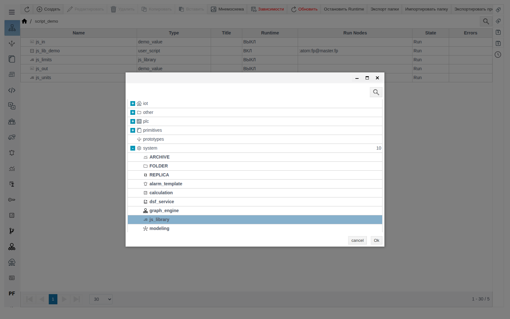
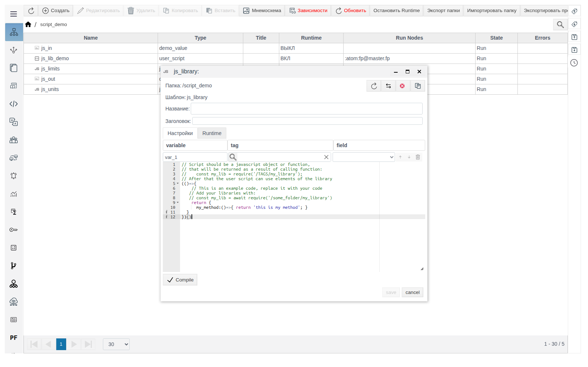
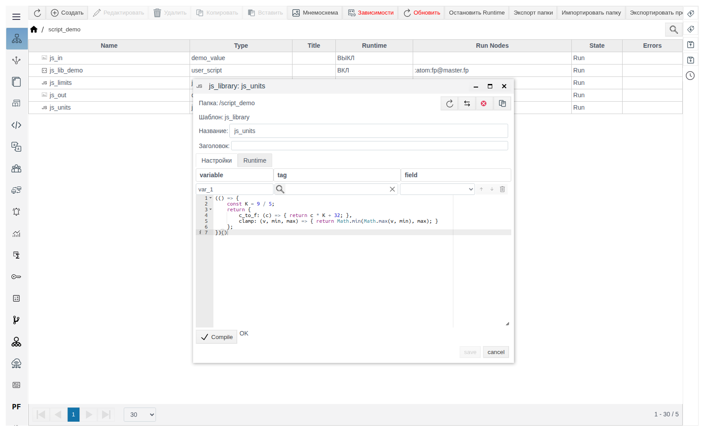
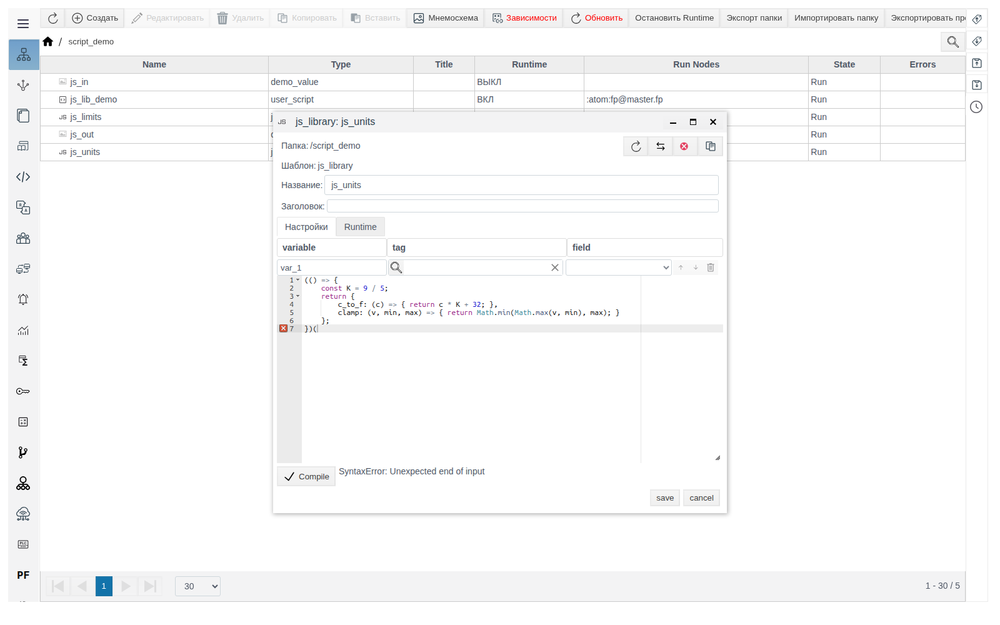
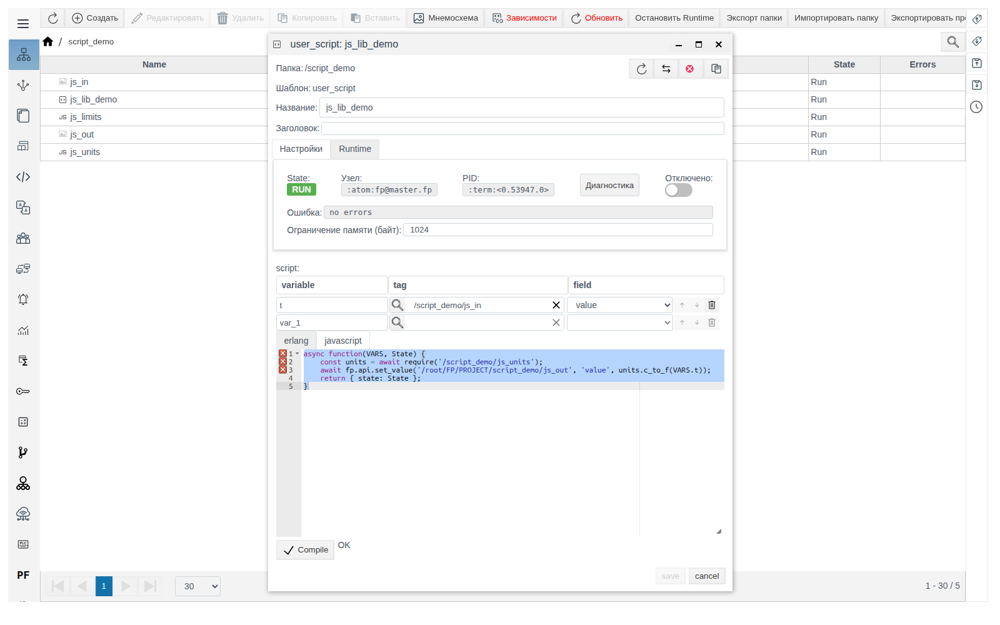
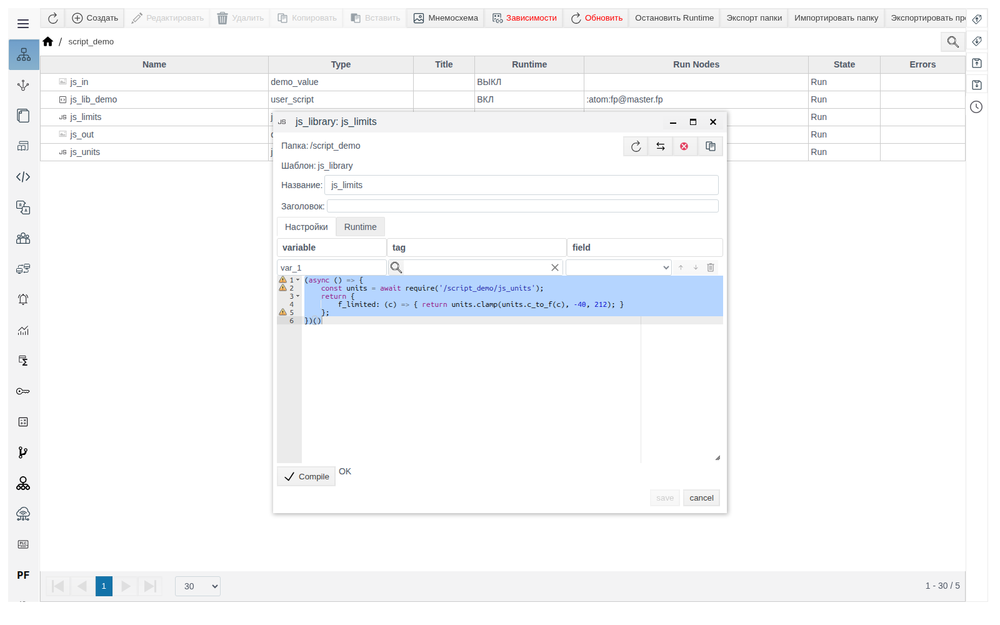
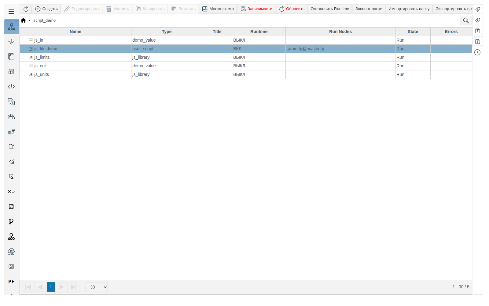
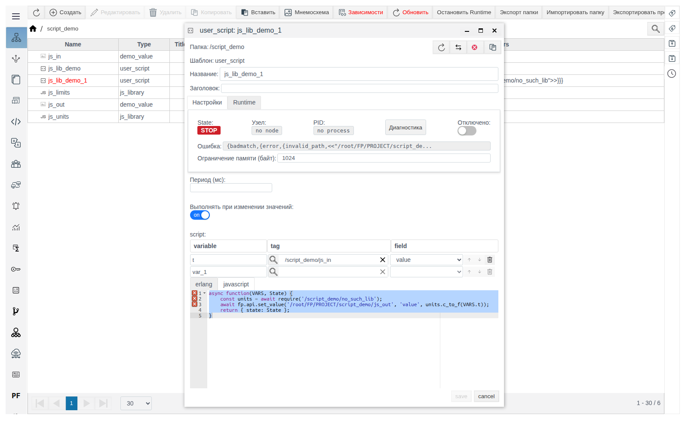

# JS-библиотеки

Документ для инженера-интегратора, который выносит общий код на JavaScript в отдельный объект проекта и подключает его из пользовательских скриптов.

# Глоссарий

| Термин | Значение |
|---|---|
| JS-библиотека | Объект проекта типа `js_library`. Хранит код на JavaScript, результат которого скрипт получает вызовом `require` |
| `require` | Функция, доступная в коде на JavaScript. По пути объекта возвращает результат кода JS-библиотеки |

# Введение

JS-библиотека — общий код на JavaScript для всего проекта: функции, константы, справочные таблицы, которые нужны в нескольких скриптах. Код пишется один раз в объекте `js_library`, а скрипты получают его через `await require('/папка/имя')`.

Библиотека — обычный объект в папке проекта в **Общем виде**. Сама по себе библиотека не выполняется, её код запускает скрипт при вызове `require`.

Сквозной пример — папка `script_demo`:

| Объект | Тип | Назначение |
|---|---|---|
| `js_units` | `js_library` | Функции `c_to_f` (градусы Цельсия в градусы Фаренгейта) и `clamp` (ограничение диапазоном) |
| `js_limits` | `js_library` | Функция `f_limited`, которая использует `js_units` |
| `js_in`, `js_out` | примитив с полем `value` типа `float` | Вход и выход примера |
| `js_lib_demo` | `user_script` | Читает `js_in`, пишет результат `c_to_f` в `js_out` |

Как создать пользовательский скрипт, описано в документе [«Пользовательские скрипты»](../user_script/user_script.md), примитивы — в документе [«Примитивы»](../primitives/Primitives.md).

Понадобится доступ к Studio (`http://<сервер>:9000/fp/studio`) под учётной записью с правом изменять проект.

# Основная часть

## Создание библиотеки

В **Общем виде** войдите в папку двойным щелчком, нажмите **Создать**, раскройте группу **system** и выберите **js_library**.



Откроется форма с шаблоном кода. Таблица **variable / tag / field** над редактором в библиотеке не используется: в коде библиотеки переменной `VARS` нет. Вкладка **Runtime** пустая.



Заполните **Название**, замените шаблон своим кодом, нажмите **Compile**, дождитесь `OK` и сохраните.

## Код библиотеки

Код библиотеки — одно выражение на JavaScript. Его значение и возвращает `require`. Как и в шаблоне, это функция, которая сразу вызывается и возвращает объект с функциями:

```javascript
(() => {
    const K = 9 / 5;
    return {
        c_to_f: (c) => { return c * K + 32; },
        clamp: (v, min, max) => { return Math.min(Math.max(v, min), max); }
    };
})()
```

Первый `return` возвращает объект библиотеки, `return` внутри каждой функции — её результат. Константа `K` видна только внутри библиотеки, скрипту доступны `c_to_f` и `clamp`.



## Compile и сохранение

**Compile** проверяет синтаксис. Рядом с кнопкой выводится `OK` или ошибка, например `SyntaxError: Unexpected end of input` для незакрытой скобки.



Порядок всегда один: **Compile** → `OK` → **save**.

## Подключение в скрипте

Библиотека подключается вызовом `await require('/папка/имя')`. Путь — от корня проекта, как в **Общем виде**.

Скрипт `js_lib_demo` на вкладке **javascript**, переменная `t` — `/script_demo/js_in`, поле `value`; включено **Выполнять при изменении значений**:

```javascript
async function(VARS, State) {
    const units = await require('/script_demo/js_units');
    await fp.api.set_value('/root/FP/PROJECT/script_demo/js_out', 'value', units.c_to_f(VARS.t));
    return { state: State };
}
```

`fp.api.set_value(путь, поле, значение)` записывает значение в поле объекта. Путь здесь полный, с префиксом `/root/FP/PROJECT`.



При `js_in` = `25` скрипт записывает в `js_out` значение `77`.

## Библиотека, использующая другую библиотеку

Внутри библиотеки `require` тоже доступен. Функцию библиотеки, которая его вызывает, объявите асинхронной (`async`). Библиотека `js_limits`:

```javascript
(async () => {
    const units = await require('/script_demo/js_units');
    return {
        f_limited: (c) => { return units.clamp(units.c_to_f(c), -40, 212); }
    };
})()
```

Скрипт подключает её так же: `const limits = await require('/script_demo/js_limits');`. При `js_in` = `150` вызов `limits.f_limited(VARS.t)` даёт `212`, при `js_in` = `-100` — `-40`.



В **Общем виде** библиотеки отмечены значком **JS**, в колонке **Runtime** у них `ВЫКЛ`.



## Изменение библиотеки

Запущенный скрипт загружает библиотеку при первом вызове `require` и дальше работает с этой версией. Новая версия библиотеки попадает в скрипт после его перезапуска. Перезапустите каждый скрипт, который использует библиотеку:

- включите **Отключено**, сохраните, выключите **Отключено**, сохраните;
- или измените код скрипта, нажмите **Compile** и сохраните.

Пример: в `js_units` к результату `c_to_f` добавлено `+ 1000`. До перезапуска `js_lib_demo` при `js_in` = `30` пишет `86`, после перезапуска при `js_in` = `31` — `1087.8`.

## Ошибка в пути

Если по пути `require` нет объекта, скрипт останавливается: **State** — `STOP`, в поле **Ошибка** и колонке **Errors** — `{badmatch,{error,{invalid_path,<<"/root/FP/PROJECT/script_demo/no_such_lib">>}}}`. Значения не записываются.



# Заключение

Порядок работы:

1. В папке проекта создайте объект **system** → **js_library**.
2. Напишите выражение, которое возвращает объект с функциями. Если библиотека подключает другие библиотеки, сделайте функцию `async`.
3. Нажмите **Compile**, дождитесь `OK`, сохраните и закройте форму.
4. В скрипте подключите библиотеку: `const lib = await require('/папка/имя');`.
5. После изменения библиотеки перезапустите скрипты, которые её используют.
