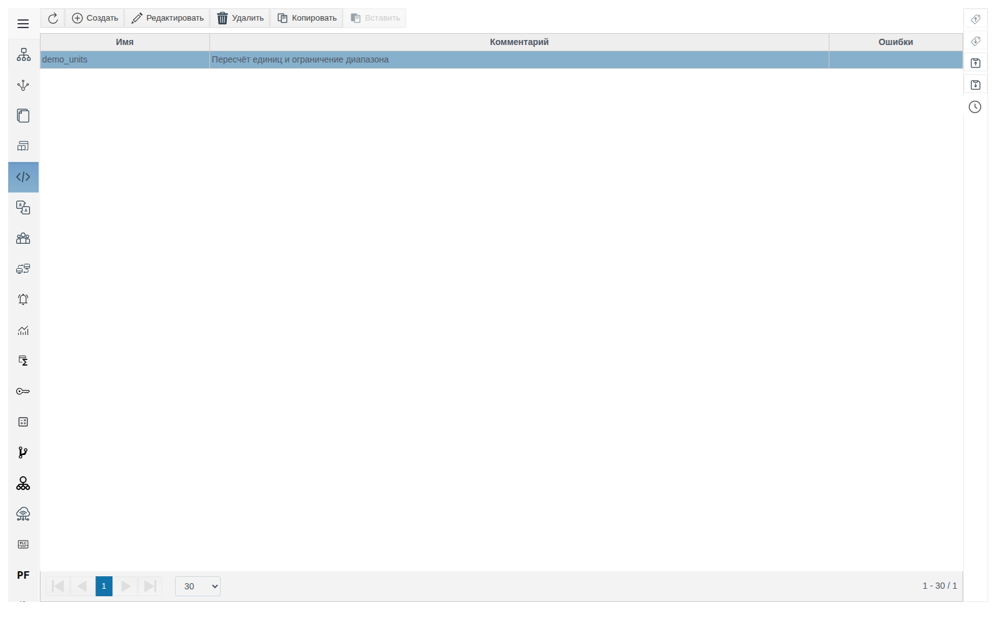
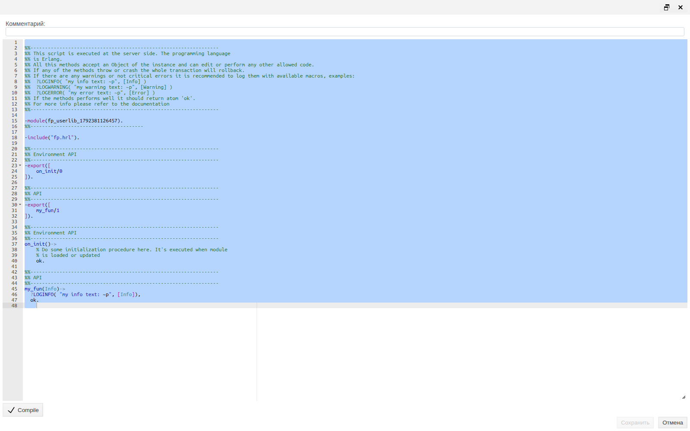
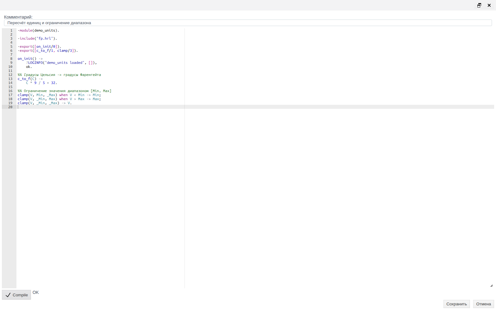
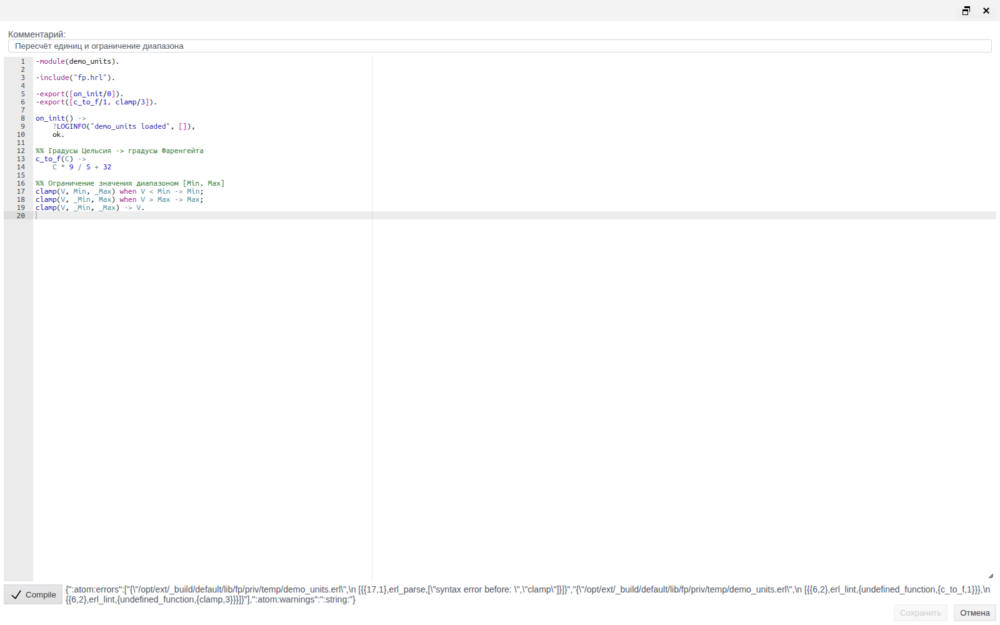
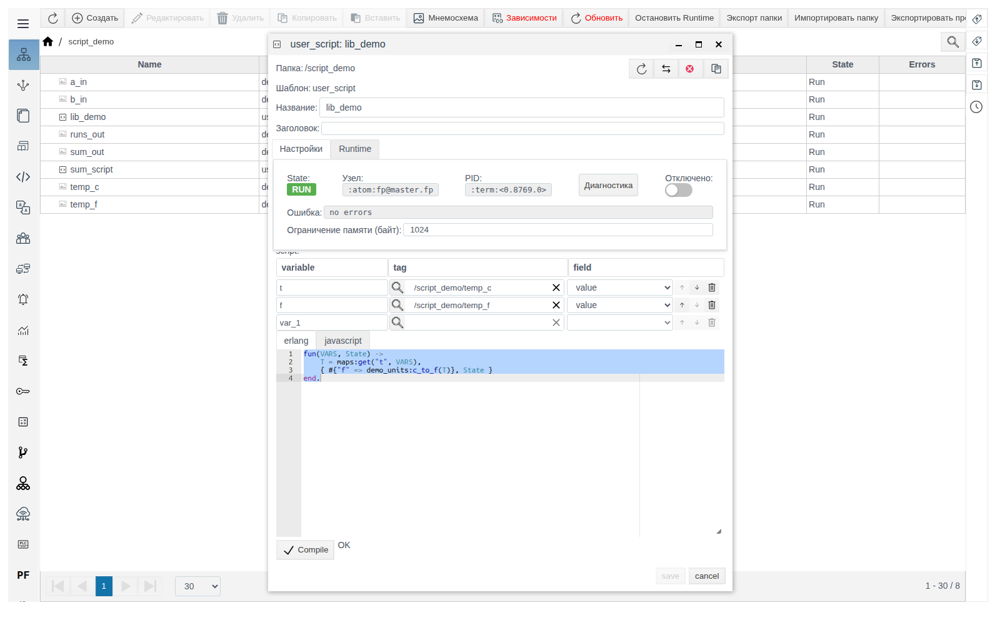
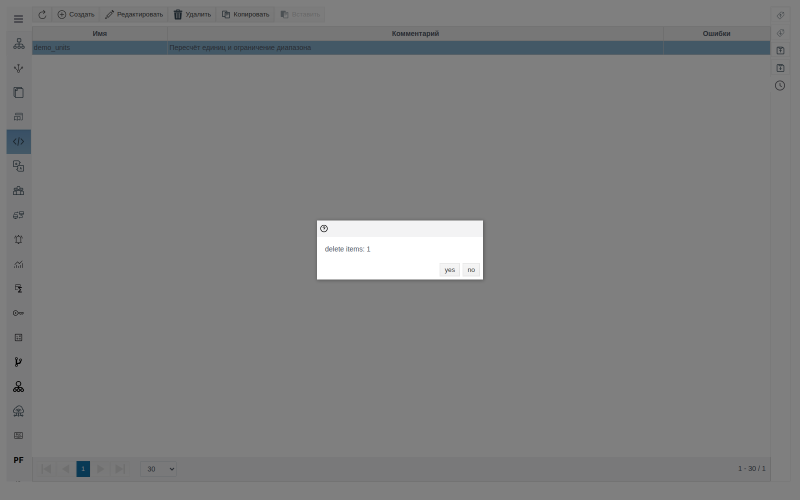

# Библиотечные модули

Документ для инженера-интегратора, который выносит общий код на Erlang в отдельный модуль и вызывает его из пользовательских скриптов проекта. Проверено на FACEPLATE Studio 4.0.7.

# Глоссарий

| Термин | Значение |
|---|---|
| Библиотечный модуль | Модуль Erlang, который хранится в проекте и загружается на сервер FACEPLATE. Экспортированные функции модуля доступны из кода проекта как `модуль:функция(...)` |
| Раздел **Библиотечные модули** | Пункт главного меню Studio: список библиотечных модулей проекта и их редактор |

# Введение

Библиотечный модуль — общий код на Erlang для всего проекта: любые функции, которые нужны в нескольких местах. Код пишется один раз, а пользовательские скрипты вызывают его по имени модуля.

Модуль компилируете вы: нажмите **Compile**, дождитесь `OK`, затем **Сохранить**. Без успешного **Compile** сохранить модуль нельзя. После сохранения сервер загружает модуль сам, правка вступает в силу без перезапуска скриптов.

Сквозной пример: модуль `demo_units` с функциями `c_to_f/1` (градусы Цельсия в градусы Фаренгейта) и `clamp/3` (ограничение значения диапазоном). Пользовательский скрипт `lib_demo` читает температуру из объекта `temp_c` и пишет результат `demo_units:c_to_f/1` в объект `temp_f`. Как создать пользовательский скрипт, описано в документе [«Пользовательские скрипты»](../user_script/user_script.md).

Понадобится доступ к Studio (`http://<сервер>:9000/fp/studio`) под учётной записью с правом изменять проект.

# Основная часть

## Раздел «Библиотечные модули»

Откройте **Библиотечные модули** в главном меню Studio.



| Колонка | Значение |
|---|---|
| **Имя** | Имя модуля из строки `-module(...)`. Задаётся при сохранении, вручную не редактируется |
| **Комментарий** | Произвольное описание модуля |
| **Ошибки** | Текст ошибки, если сервер не смог загрузить модуль. Пусто — модуль загружен |

Кнопки над таблицей: **Создать**, **Редактировать** (или двойной щелчок по строке), **Удалить**, **Копировать**, **Вставить**.

## Создание модуля

Нажмите **Создать**. Откроется редактор с шаблоном модуля: имя вида `fp_userlib_<число>`, подключённый `fp.hrl`, функции `on_init/0` и `my_fun/1`.



Замените шаблон своим кодом, заполните **Комментарий**, нажмите **Compile**, дождитесь `OK` и сохраните. Пример:

```erlang
-module(demo_units).

-include("fp.hrl").

-export([on_init/0]).
-export([c_to_f/1, clamp/3]).

on_init() ->
    ?LOGINFO("demo_units loaded", []),
    ok.

%% Градусы Цельсия -> градусы Фаренгейта
c_to_f(C) ->
    C * 9 / 5 + 32.

%% Ограничение значения диапазоном [Min, Max]
clamp(V, Min, _Max) when V < Min -> Min;
clamp(V, _Min, Max) when V > Max -> Max;
clamp(V, _Min, _Max) -> V.
```



| Элемент | Правило |
|---|---|
| `-module(имя).` | Обязателен. Задаёт **Имя** в списке и имя для вызова. Допустимы строчные латинские буквы, цифры, `_` |
| `-export([...])` | Из других объектов доступны только экспортированные функции |
| `on_init/0` | Необязательна. Вызывается после каждой загрузки модуля: после сохранения и при старте сервера. Ошибка внутри `on_init/0` не мешает загрузке модуля |
| `-include("fp.hrl").` | Заголовочный файл FACEPLATE с макросами журнала `?LOGINFO`, `?LOGWARNING`, `?LOGERROR`. Нужен, только если код их использует |

> **Важно.** Имя модуля общее для всего сервера. Два объекта с одинаковым `-module(...)` загружают один и тот же модуль, и в работе остаётся тот код, который загрузился последним. Давайте модулям уникальные имена с префиксом проекта и не используйте имена модулей Erlang и FACEPLATE.

После сохранения форма остаётся открытой, кнопка **Сохранить** снова становится недоступной. Закройте форму кнопкой **Отмена**.

## Compile и сохранение

**Compile** проверяет код на сервере. Рядом с кнопкой выводится `OK` или ошибка компилятора в исходном виде, например для пропущенной точки в конце функции:

`{":atom:errors":["{\"/opt/ext/_build/default/lib/fp/priv/temp/demo_units.erl\",\n [{{17,1},erl_parse,[\"syntax error before: \",\"clamp\"]}]}", ...`

В тексте ищите пару `{строка,столбец}` и описание: `{17,1}` и `syntax error before: clamp` — ошибка перед строкой 17. Сообщения `undefined_function` для экспортированных функций в той же ошибке — следствие синтаксической ошибки, а не отдельная проблема.



> **Важно.** Порядок всегда один: **Compile** → `OK` → **Сохранить**. При открытии формы и после каждого сохранения кнопка **Сохранить** недоступна, пока **Compile** не вернёт `OK`.

## Вызов из пользовательского скрипта

Функция модуля вызывается полным именем `модуль:функция(аргументы)`. Скрипт `lib_demo` с переменными `t` (`/script_demo/temp_c`, поле `value`) и `f` (`/script_demo/temp_f`, поле `value`):

```erlang
fun(VARS, State) ->
    T = maps:get("t", VARS),
    { #{"f" => demo_units:c_to_f(T)}, State }
end.
```



При `temp_c` = `25` скрипт записывает в `temp_f` значение `77`.

## Изменение модуля

Откройте модуль, исправьте код, нажмите **Compile** и сохраните. Сервер загружает новую версию в течение нескольких секунд, и следующие вызовы из скриптов идут уже в неё. Перезапускать или пересохранять скрипты не нужно.

Если поменять строку `-module(...)`, после сохранения сменится **Имя** в списке. Скрипты, которые вызывают модуль по старому имени, нужно исправить.

## Копирование

Выделите модуль, нажмите **Копировать**, затем **Вставить** и подтвердите вставку кнопкой **OK**. Копия появляется в списке с именем вида `demo_units_1`, но код у неё прежний, с той же строкой `-module(demo_units)`.

> **Важно.** Сразу откройте копию, замените имя в `-module(...)`, нажмите **Compile** и сохраните. Пока имя не изменено, оригинал и копия объявляют один модуль.

## Удаление

Выделите один или несколько модулей (Ctrl+щелчок), нажмите **Удалить** и подтвердите кнопкой **yes**. В окне подтверждения показано только число удаляемых модулей (`delete items: 1`).



> **Важно.** Удаление объекта не выгружает модуль с сервера: вызовы из скриптов продолжают работать со старым кодом до перезапуска сервера. Перед удалением найдите и исправьте все скрипты, которые вызывают модуль.

# Заключение

Порядок работы:

1. В **Библиотечные модули** нажмите **Создать**.
2. Задайте уникальное имя в `-module(...)`, экспортируйте нужные функции, при необходимости добавьте `on_init/0`.
3. Нажмите **Compile**, дождитесь `OK`, сохраните и закройте форму.
4. Проверьте, что колонка **Ошибки** пуста.
5. Вызывайте функции из пользовательских скриптов как `модуль:функция(...)`.
6. После копирования переименуйте модуль в копии. Перед удалением уберите вызовы модуля из скриптов.
