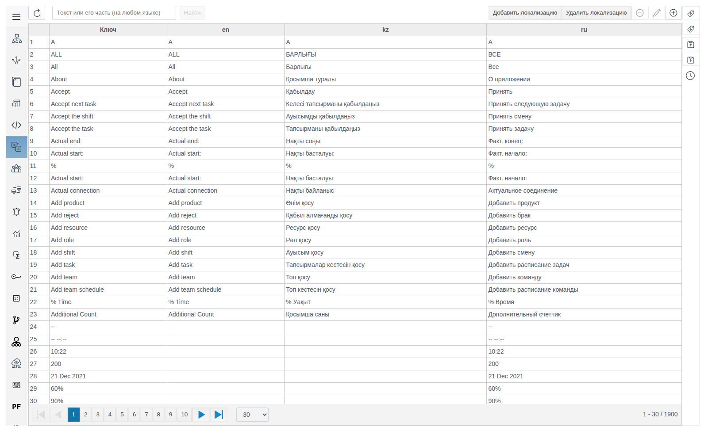
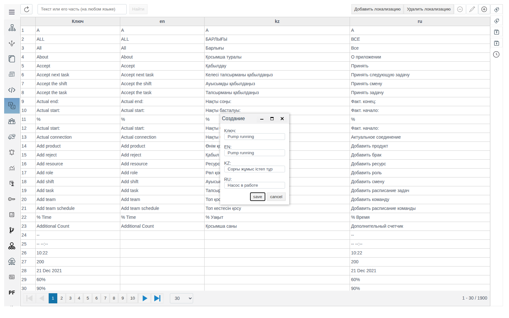
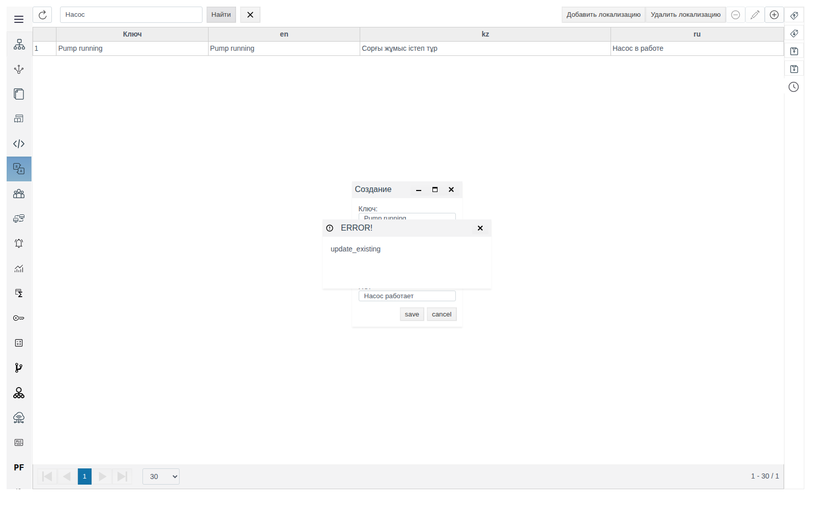
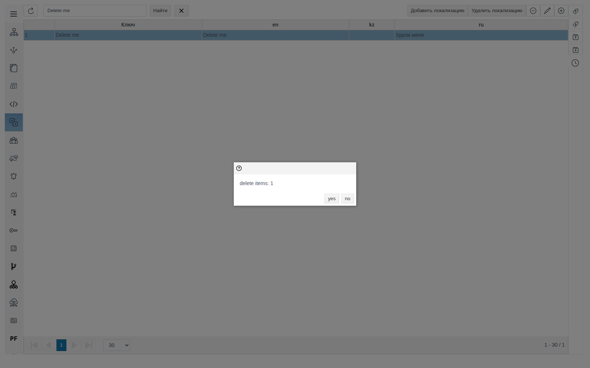
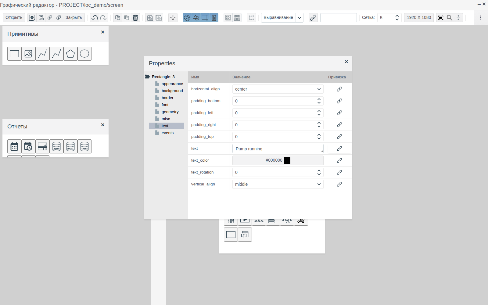
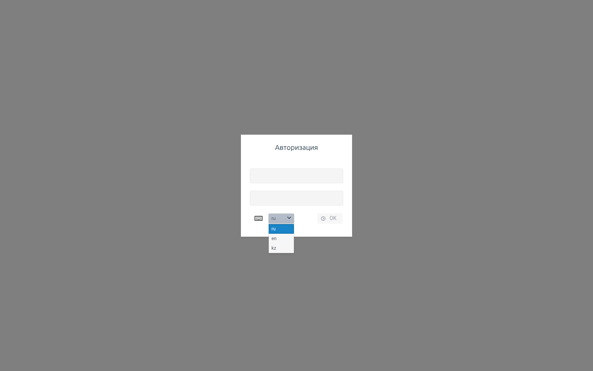
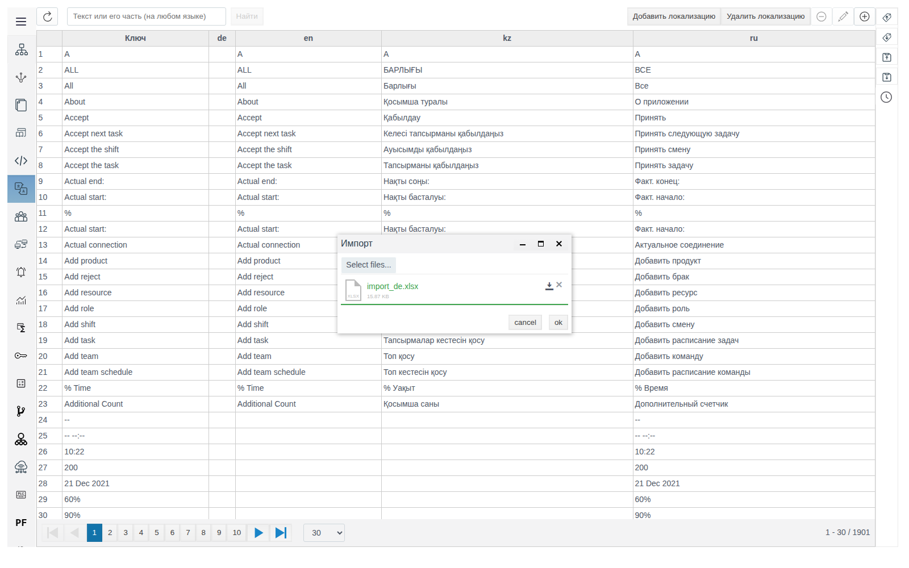

# Локализация

Документ для инженера-интегратора, который настраивает переводы интерфейса FACEPLATE и текстов мнемосхем проекта.

# Содержание

- [Глоссарий](#глоссарий)
- [Введение](#введение)
- [Основная часть](#основная-часть)
    - [Словарь](#словарь)
    - [Ключи и переводы](#ключи-и-переводы)
    - [Текст на мнемосхеме](#текст-на-мнемосхеме)
    - [Выбор языка](#выбор-языка)
    - [Обмен через Excel](#обмен-через-excel)
- [Заключение](#заключение)

# Глоссарий

| Термин | Значение |
|---|---|
| Словарь | Таблица раздела **Локализации**: строка — ключ, колонка — язык |
| Ключ | Исходный текст, по которому ищется перевод. Совпадает с подписью интерфейса Studio или Runtime либо с текстом, введённым в свойство элемента мнемосхемы |
| Локализация | Язык словаря: колонка с кодом языка (`ru`, `en`, `kz`). |

# Введение

Локализация выводит интерфейс Studio и Runtime на языке, выбранном при входе: меню, кнопки, заголовки, сообщения. По тому же словарю переводятся тексты мнемосхем в Runtime: инженер пишет на мнемосхеме текст-ключ и заносит в словарь его переводы, а оператор видит перевод на язык своего сеанса.

Словарь общий для проекта и для интерфейса FACEPLATE: в нём уже есть около 1900 ключей с подписями Studio и Runtime на русском, английском и казахском. Ключи для мнемосхем добавляются в ту же таблицу.

Сквозной пример — надпись состояния насоса: ключ `Pump running`, переводы `Pump running` (en), `Сорғы жұмыс істеп тұр` (kz), `Насос работает` (ru).

Понадобится доступ к Studio (`http://<сервер>:9000/fp/studio`) под учётной записью с правом изменять проект.

# Основная часть

## Словарь

Откройте **Локализации** в главном меню Studio. Первая колонка — **Ключ**, остальные — по одной на каждый язык. Строка поиска (**Текст или его часть (на любом языке)**, кнопка **Найти**) ищет по ключу и по всем переводам, запрос — не короче трёх символов. Кнопка с крестиком сбрасывает поиск.

Кнопки-значки в правом верхнем углу таблицы работают с ключами: **Удалить ключ**, **Редактировать ключ**, **Создать ключ и переводы** (названия показываются во всплывающей подсказке).

## Ключи и переводы

Нажмите **Создать ключ и переводы**. В форме **Создание** заполните **Ключ** и поля языков (**EN**, **KZ**, **RU**) и нажмите **save**.

Ключ уникален. Если ключ уже есть в словаре, сохранение заканчивается ошибкой `ERROR!` с текстом `update_existing`, существующая запись не меняется. Чтобы поменять перевод, найдите ключ, выделите строку и нажмите **Редактировать ключ**.

Чтобы изменить выводимый текст, правьте перевод на нужном языке. Ключ должен совпадать с текстом подписи или свойства элемента: если переименовать ключ, текст со старым значением будет выводиться без перевода.

Для удаления выделите строку и нажмите **Удалить ключ**, подтвердите `delete items: 1` кнопкой **yes**.

## Текст на мнемосхеме

В Runtime переводится текст, который задан значением свойства элемента. Пример — свойство **text** в группе **text** у элемента **Прямоугольник** палитры **Примитивы**. Значение должно совпадать с ключом символ в символ.

Сохраните мнемосхему и откройте её в Runtime. При языке `ru` прямоугольник показывает `Насос работает`.

Как ведёт себя текст в разных местах:

| Где | Что показывается |
|---|---|
| Runtime | Перевод на язык сеанса; если перевода на этот язык нет — сам ключ |
| Графический редактор и **Режим предварительного просмотра** в Studio | Ключ без перевода |
| Значение **value** у **Поля ввода-вывода** | Введённый текст без перевода: это значение поля, а не подпись |

Словарь загружается при входе. Чтобы увидеть изменения в открытом Studio или Runtime, обновите страницу (F5 или Ctrl+R) и войдите заново: подписи интерфейса и тексты мнемосхем выведутся с новыми переводами.

## Выбор языка

Язык выбирается в форме входа (**Авторизация**) в выпадающем списке рядом с кнопкой **OK**, одинаково в Studio и Runtime. В списке три языка: `ru`, `en`, `kz`. На этом языке выводится весь интерфейс сеанса и тексты мнемосхем.

Язык запоминается в браузере и в учётной записи пользователя. Если выбранный язык отличается от языка учётной записи, после входа появляется вопрос `Сохранить настройки локализации?`:

- **yes** — выбранный язык становится языком учётной записи, при следующих входах вопрос не появляется;
- **no** — текущий сеанс остаётся на выбранном языке, а форма входа в следующий раз предложит язык учётной записи.

## Обмен через Excel

Excel удобен, чтобы отдать словарь переводчику и загрузить результат.

**Выгрузка.** На правой панели раздела **Локализации** нажмите **Экспорт .xlsx**. Браузер сохранит файл `localization.xlsx`: лист `localization`, колонки `key` и `loc_<код языка>` для каждого языка.

| key | loc_en | loc_kz | loc_ru |
|---|---|---|---|
| Pump running | Pump running | Сорғы жұмыс істеп тұр | Насос работает |
| Pump stopped | Pump stopped | Сорғы тоқтатылды | Насос остановлен |

**Загрузка.** Нажмите **Импорт .xlsx**, в окне **Импорт** выберите файл (**Select files...**) и нажмите **ok**. Появится сообщение `Импорт выполнен успешно`. Строки сопоставляются по `key`: существующие ключи обновляются, новые добавляются. Ключи, которых нет в файле, не меняются, поэтому в файле достаточно только новых и изменённых строк.

# Заключение

Порядок перевода мнемосхемы:

1. Задайте на мнемосхеме тексты-ключи, например в свойстве **text** прямоугольника.
2. В **Локализации** создайте ключи с переводами или загрузите их через **Импорт .xlsx**.
3. Войдите в Runtime с нужным языком и проверьте мнемосхему; на вопрос `Сохранить настройки локализации?` ответьте **yes**, если язык должен закрепиться за учётной записью.
4. После правки словаря обновите страницу (F5) и войдите заново, чтобы загрузить новые переводы.
