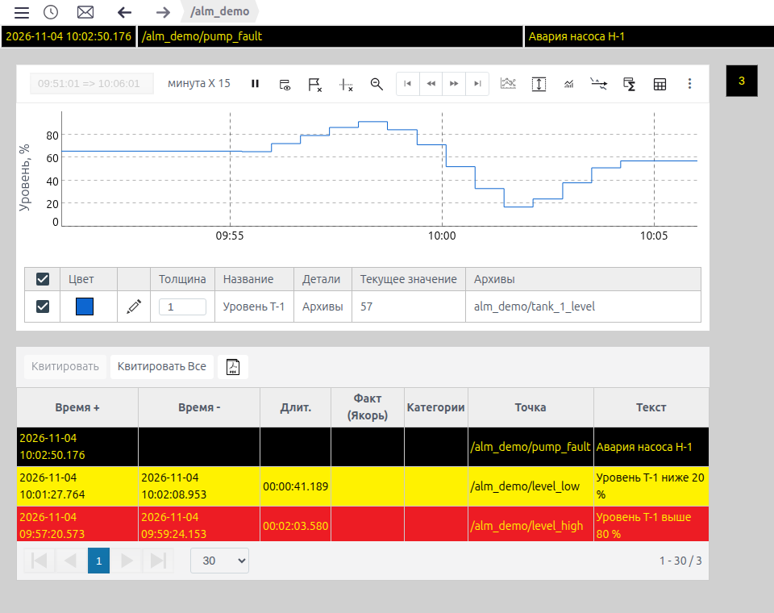
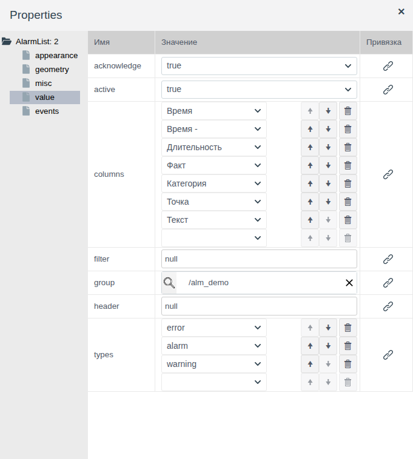
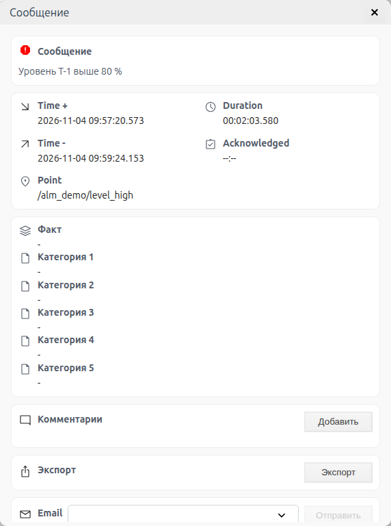
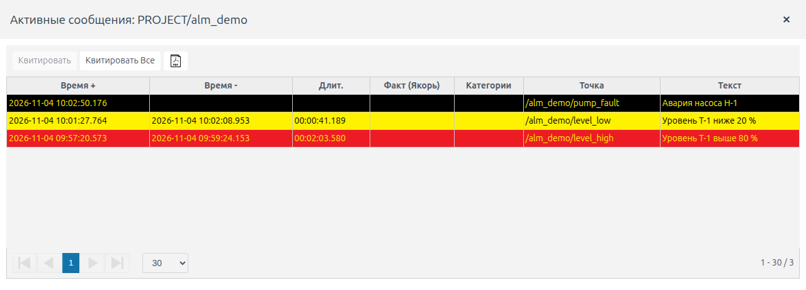
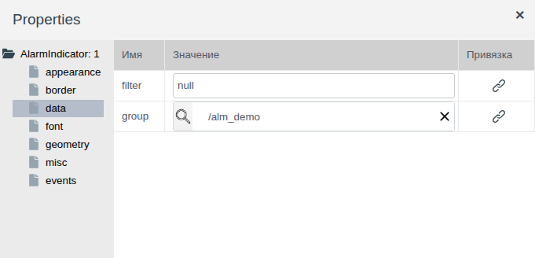
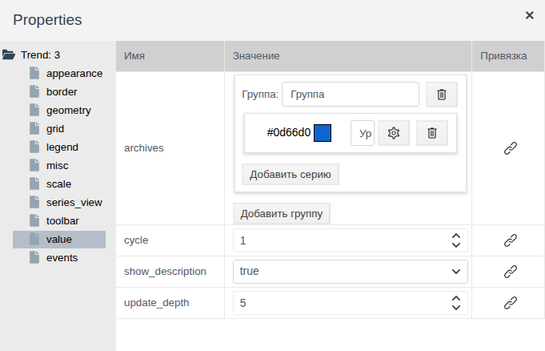
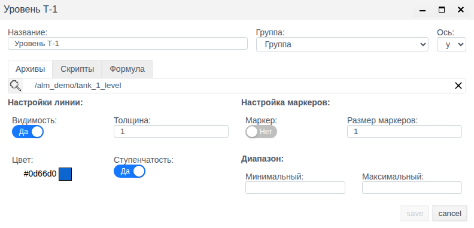
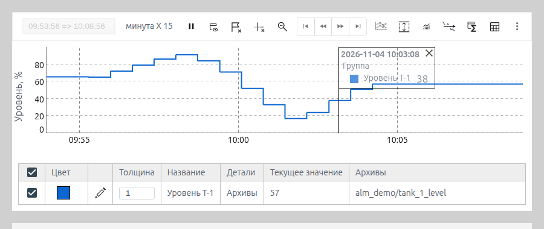

# Тревоги и тренды на экране

Документ для инженера-интегратора, которому нужно показать оператору на мнемосхеме тревоги своего оборудования и график значения за последние минуты или часы.

# Содержание

- [Глоссарий](#глоссарий)
- [Введение](#введение)
- [Основная часть](#основная-часть)
    - [Элементы на палитре](#элементы-на-палитре)
    - [Список сообщений: что попадает в список](#список-сообщений-что-попадает-в-список)
    - [Список сообщений: колонки и вид в Runtime](#список-сообщений-колонки-и-вид-в-runtime)
    - [Список сообщений: работа оператора](#список-сообщений-работа-оператора)
    - [Индикатор сообщений](#индикатор-сообщений)
    - [Тренд: серии](#тренд-серии)
    - [Тренд: серия по скрипту или формуле](#тренд-серия-по-скрипту-или-формуле)
    - [Тренд: окно времени, шкалы и обновление](#тренд-окно-времени-шкалы-и-обновление)
    - [Тренд: оформление и легенда](#тренд-оформление-и-легенда)
    - [Тренд: панель инструментов](#тренд-панель-инструментов)
- [Заключение](#заключение)

# Глоссарий

| Термин | Значение |
|---|---|
| Шаблон сообщения | Объект проекта типа `alarm_template`: следит за полем тега и при выполнении условия создаёт сообщение. Создание шаблона описано в документе [«Сообщения и тревоги в Faceplate», раздел «Настройка сообщения»](../alarm/alarm_ru.md#2-настройка-сообщения) |
| Сообщение | Запись журнала, которую создаёт шаблон: время возникновения, время снятия, текст, тип. Тревога — сообщение о нарушении |
| Тип сообщения | `error`, `alarm`, `warning`, `info`, `dsf` — задаётся в шаблоне. От типа зависит цвет строки в списке и цвет индикатора |
| Активное сообщение | Условие шаблона ещё выполняется: время снятия пустое |
| Квитирование | Подтверждение оператором, что он увидел сообщение. Не снимает активность: квитированное сообщение остаётся активным, пока условие выполняется |
| Группа | Папка проекта или отдельный шаблон, чьи сообщения показывает элемент |
| Архив | Объект проекта типа `ARCHIVE`, который записывает историю значений поля тега. Создание архива описано в документе [«Архивы: настройка источников и запись данных»](../data_storage/archives/archives_ru.md) |
| Серия | Одна линия тренда: архив, скрипт или формула, со своим цветом и осью |
| Срез | Вертикальная линия на тренде с подписью времени и значениями серий в этот момент |
| Легенда | Плашка на графике тренда: время точки под указателем мыши, названия серий и их значения в этой точке |
| Линия уровня | Горизонтальная линия на тренде на заданном значении |

Термины «Тег», «Привязка» — в документе [«Кнопки и ввод значений»](controls.md#глоссарий), «Схема», «Палитра», «Элемент» — в [«Редакторе мнемосхем»](editor.md#глоссарий).

# Введение

Тревоги проекта видны оператору в полосе тревог над схемой и в журнале сообщений. Этого мало, когда на экране одна установка: оператору нужны тревоги именно её оборудования, рядом с её мнемосхемой, и график параметра, по которому видно, как значение подошло к порогу. Для этого на схему ставят три элемента:

- **Список сообщений** — таблица сообщений выбранной папки с квитированием;
- **Индикатор сообщений** — квадрат с числом сообщений, цвет которого показывает самый тяжёлый тип; по щелчку открывает окно со списком;
- **Тренды** — график значений из архивов с панелью для просмотра истории.

Документ описывает свойства этих элементов и их вид в Runtime. Работа в редакторе (добавление, выделение, свойства, сохранение) описана в [«Редакторе мнемосхем»](editor.md).

Сквозной пример — схема `screen` папки `alm_demo`. В папке объект `tank_1` собственного примитива `demo_alm` с полями `level` (float, уровень в ёмкости, %) и `fault` (integer, авария насоса), архив `tank_1_level` поля `level` и три шаблона сообщений:

| Шаблон | Условие | Тип | Текст |
|---|---|---|---|
| `level_high` | `level` > 80 | `alarm` | Уровень Т-1 выше 80 % |
| `level_low` | `level` < 20 | `warning` | Уровень Т-1 ниже 20 % |
| `pump_fault` | `fault` ≠ 0 | `error` | Авария насоса Н-1 |

В примере уровень поднялся выше 80 %, опустился ниже 20 %, затем включилась авария насоса. Тренд показывает уровень за последние 15 минут, список — три сообщения, индикатор — число 3 на чёрном фоне: есть неквитированная авария `error`.



Понадобится доступ к Studio (`http://<сервер>:9000/fp/studio`) под учётной записью с правом изменять проект. Результат проверяется в Runtime (`http://<сервер>:9000/fp/runtime`), Runtime проекта должен быть запущен.

# Основная часть

## Элементы на палитре

Все три элемента находятся на палитре **Controls**:

| Подсказка значка | Корень дерева свойств | Назначение |
|---|---|---|
| Cписок сообщений | `AlarmList` | Таблица сообщений группы с кнопками квитирования |
| Индикатор сообщений | `AlarmIndicator` | Счётчик сообщений группы, цвет по самому тяжёлому типу |
| Тренды | `Trend` | График значений архивов |

Группы **appearance**, **geometry**, **misc** и **events** такие же, как у остальных элементов схемы (см. [«Графические элементы», раздел «Общие свойства»](graphics.md#общие-свойства)).

В редакторе элементы показывают заготовку: список — строки-заполнители, тренд — условную кривую. Сообщения и данные архивов появляются только в Runtime.

## Список сообщений: что попадает в список

Какие сообщения показать, задаёт группа **value**.



| Свойство | Назначение |
|---|---|
| `group` | Папка или шаблон сообщения, выбранные через лупу. Список показывает сообщения шаблонов этой папки или одного шаблона. Пусто — сообщения всего проекта. В примере `/alm_demo` |
| `acknowledge` | `true` — показывать неквитированные сообщения |
| `active` | `true` — показывать активные сообщения |
| `types` | Типы сообщений. У нового элемента `error`, `alarm`, `warning`; в пустой нижней строке можно выбрать ещё `info`, корзина убирает тип. Если удалить все строки, ограничения по типу нет: список показывает и служебные сообщения — сводки «Советчика диспетчера» (`dsf`) и входы пользователей в систему (`oper`; они не привязаны к папке и видны только при пустом `group`). Строки служебных сообщений белые |
| `filter` | Дополнительное условие отбора в окне **JSON** |

`acknowledge` и `active` работают вместе:

| `acknowledge` | `active` | Что показывает список |
|---|---|---|
| `true` | `false` | Неквитированные сообщения: и активные, и уже снятые. Так у нового элемента |
| `false` | `true` | Активные сообщения: и квитированные, и нет |
| `true` | `true` | Сообщения, которые активны или не квитированы. Сообщение уходит из списка, когда оно и снято, и квитировано |
| `false` | `false` | Все сообщения группы, включая снятые и квитированные |

Для экрана установки обычно выбирают `true` / `true`: оператор видит всё, что ещё требует внимания, а квитированная, но не устранённая тревога не пропадает. В примере так и сделано.

`filter` сужает выборку по полям сообщения. По умолчанию значение `null` — условия нет. Щелчок по полю значения открывает окно **JSON** с заготовкой `{}`; замените её условием-массивом `[поле, оператор, значение]`, например только сообщения одного шаблона:

```
["point", "=", "/<папка>/<шаблон>"]
```

Поле `point` — путь шаблона, он виден в колонке **Точка**. После ввода нажмите **Compile**, затем **OK**.

## Список сообщений: колонки и вид в Runtime

Свойство `columns` — список колонок по порядку. Каждая строка — выпадающий список, стрелки меняют порядок, корзина удаляет колонку, пустая нижняя строка добавляет новую.

| Колонка в `columns` | Заголовок в Runtime | Содержимое |
|---|---|---|
| Время | Время + | Время возникновения |
| Время - | Время - | Время снятия. Пусто, пока сообщение активно |
| Длительность | Длит. | Сколько сообщение было активно |
| Факт | Факт (Якорь) | Связанное событие, если сообщения связаны в шаблоне |
| Категория | Категории | Категории 1–5 из шаблона через `/` |
| Точка | Точка | Путь шаблона сообщения |
| Текст | Текст | Текст сообщения |

В Runtime строки отсортированы по времени возникновения, новые сверху. Цвет строки зависит от типа сообщения (типы из `types`):

| Тип | Фон строки | Текст |
|---|---|---|
| `error` | Чёрный | Жёлтый |
| `alarm` | Красный | Жёлтый |
| `warning` | Жёлтый | Чёрный |
| `info` | Голубой | Чёрный |

Список обновляется сам: новое сообщение появляется сверху без перезагрузки схемы, снятое получает время снятия и длительность. Под таблицей — переключатель страниц и число строк на странице (по умолчанию 30), справа — диапазон строк и общее число сообщений.

В примере список 860 × 290 пикселей, все семь колонок; при такой ширине дата и время переносятся на вторую строку.

## Список сообщений: работа оператора

Над таблицей три кнопки:

| Кнопка | Действие |
|---|---|
| **Квитировать** | Квитирует выделенные строки. Неактивна, пока ничего не выделено. Строку выделяют щелчком, несколько — щелчками с Ctrl |
| **Квитировать Все** | Квитирует все строки текущей страницы списка |
| Значок PDF | Отправляет записи списка на печать таблицей на листе A4 в альбомной ориентации. В окне печати браузера выберите принтер или сохранение в PDF |

После квитирования строка остаётся или уходит в зависимости от `acknowledge` и `active`. В примере (`true` / `true`) квитированная тревога `level_high` уже снята, поэтому уходит из списка, а квитированная авария `pump_fault` остаётся, пока активна.

Двойной щелчок по строке открывает карточку сообщения: текст, время возникновения и снятия, длительность, квитирование, точка, факт и категории. Ниже — кнопки **Добавить** (комментарий), **Экспорт** и строка **Email**. Работа с карточкой описана в документе [«Сообщения и тревоги в Faceplate», раздел «Работа оператора»](../alarm/alarm_ru.md#3-работа-оператора).

**Email** пересылает сообщение письмом. В выпадающем списке — пользователи с ролью `operators`; письмо уходит на адрес из поля **Email** их учётной записи (Studio → **Права** → **Пользователи**). Выберите одного или нескольких получателей и нажмите **Отправить**; после отправки появляется «Сообщение отправлено». Письмо содержит текст сообщения, тип, точку, время возникновения, факт и категории. Для отправки в Studio → **Сообщение** → **Настройки** → «Общие настройки» должны быть заполнены параметры SMTP и включён переключатель «Включить email-уведомления» (см. [«Сообщения и тревоги в Faceplate», раздел «Email-уведомления»](../alarm/alarm_ru.md#7-email-уведомления)). В примере письмо о `level_high` отправлено пользователю `mail_test` и получено.



## Индикатор сообщений

Индикатор — квадрат с числом сообщений группы. Он занимает мало места, поэтому его ставят в угол схемы или на кнопку перехода к установке, а список — только на экран самой установки.

Индикатор считает только сообщения типов `error`, `alarm` и `warning`, которые активны или не квитированы; сообщения остальных типов он не учитывает. По учтённым сообщениям он выбирает вид:

| Состояние сообщений группы | Вид индикатора |
|---|---|
| Нет ни активных, ни неквитированных | Индикатор скрыт |
| Есть неквитированные | Мигает, цвет по самому тяжёлому неквитированному типу |
| Все квитированы, но некоторые активны | Горит не мигая, цвет по самому тяжёлому типу |

Цвета: `error` — жёлтое число на чёрном, `alarm` — жёлтое на красном, `warning` — чёрное на жёлтом. Число — сколько сообщений учтено, больше 99 — `99+`.

В примере индикатор 40 × 40 пикселей в правом верхнем углу схемы. После квитирования всех трёх сообщений он перестаёт мигать и показывает 1 на чёрном фоне: авария насоса ещё активна. После её снятия индикатор скрывается.

Щелчок по индикатору открывает окно «Активные сообщения: PROJECT/<папка>» со списком тех же сообщений и теми же кнопками **Квитировать**, **Квитировать Все** и PDF.



Что считать, задаёт группа **data**; вид числа и рамки — группы **font** и **border**.



| Группа | Свойство | Назначение |
|---|---|---|
| **data** | `group` | Папка или шаблон, чьи сообщения считает индикатор. Если выбран один шаблон, индикатор следит только за ним |
| | `filter` | Дополнительное условие в окне **JSON**, как у списка. Например `["type", "=", "alarm"]` — считать только тревоги `alarm` |
| **font** | `font_family`, `font_size`, `bold`, `italic` | Шрифт числа |
| **border** | `border_width`, `border_color`, `border_style`, `border_radius` | Рамка; `border_radius` скругляет углы, при радиусе в половину стороны индикатор круглый |

Цвета фона и числа задаёт тип сообщения, отдельных свойств для них нет.

## Тренд: серии

Что рисует тренд, задаёт свойство `archives` в группе **value**. Значение — набор групп серий. В каждой группе есть поле **Группа** с названием и строки серий: цвет, название, кнопка настройки (шестерёнка) и корзина. **Добавить серию** добавляет строку в группу, **Добавить группу** — новую группу.



Шестерёнка открывает окно серии:



| Поле | Назначение |
|---|---|
| **Название** | Подпись серии в таблице описания, легенде и срезах |
| **Группа** | В какую группу серий входит серия. Название группы выводится над серией в легенде и срезе |
| **Ось** | `y` — левая ось, `y2` — правая. На `y2` выводят параметр с другим диапазоном, например давление рядом с уровнем |
| **Архивы** | Архив, значения которого рисует серия. Выбирается через лупу |
| **Толщина**, **Цвет** | Толщина и цвет линии |
| **Ступенчатость** | **Да** — значение держится до следующей записи архива, линия ступенчатая. **Нет** — точки соединяются наклонными отрезками |
| **Маркер**, **Размер маркеров** | **Да** — точка на каждой записи архива; размер точки в пикселях |

Нажмите **save** в окне серии, затем сохраните схему.

Под графиком в Runtime — таблица описания серий: флажок видимости, цвет, толщина, название, тип источника (**Детали**), текущее значение и архив. Снятый флажок прячет линию.

В примере одна группа «Группа» и одна серия «Уровень Т-1» по архиву `/alm_demo/tank_1_level`, ось `y`, цвет синий, остальное по умолчанию.

## Тренд: серия по скрипту или формуле

Кроме архива серия может показывать значение, вычисленное из нескольких архивов: сумму расходов, разность температур, пересчёт в другие единицы. Для этого в окне серии есть вкладки **Скрипты** и **Формула**.

На обеих вкладках сверху список переменных **variablearchive**: в строке имя переменной и архив, выбранный через лупу. Новая строка появляется после заполнения последней.

На вкладке **Скрипты** — функция на JavaScript. Она получает значения переменных в `VARS` и возвращает число или `null`:

```javascript
function(VARS) {
   const result = VARS.<переменная> * 2;
   if (typeof result !== 'number') return null;
   return result;
}
```

После ввода нажмите **Compile**, затем **save**.

На вкладке **Формула** — выражение в стиле формул электронных таблиц: имена переменных, арифметика и функции, например `ROUND`:

```
ROUND(<переменная> / 10, 0) * 10
```

В таблице описания у такой серии в колонке **Детали** — «Скрипт» или текст формулы, в колонке **Архивы** — имена переменных. Проверено на архиве уровня со значением 65,46: скрипт `VARS.lv * 2` дал 130,91, формула `ROUND(lv / 10, 0) * 10` — 70.

## Тренд: окно времени, шкалы и обновление

Тренд показывает последний отрезок времени, который сдвигается вместе с текущим временем.

| Группа | Свойство | Назначение |
|---|---|---|
| **scale** | `time_step` | Единица длины окна: `second`, `minute`, `hour` |
| | `time_factor` | Длина окна в этих единицах. `minute` и 15 — последние 15 минут |
| | `range_min`, `range_max` | Границы левой оси. Пусто — подбираются по данным |
| | `y2_range_min`, `y2_range_max` | Границы правой оси |
| **value** | `cycle` | Период обновления графика в секундах. Новое значение архива появляется на графике не позже чем через `cycle` секунд |
| | `show_description` | `false` — таблица описания серий под графиком скрыта, график занимает всю высоту |

Длина окна видна в Runtime на кнопке панели, например «минута X 15». В примере `time_step` = `minute`, `time_factor` = 15, `range_min` = 0, `range_max` = 100, `cycle` = 1.

Если границы оси пусты, ось подстраивается под видимые значения: при почти постоянном уровне небольшие колебания растягиваются на всю высоту. Для параметра с известным диапазоном задайте границы явно, чтобы оператор сравнивал положение линии с порогами.

## Тренд: оформление и легенда

| Группа | Свойство | Назначение |
|---|---|---|
| **series_view** | `ylabel`, `y2label` | Подписи левой и правой оси. В примере `ylabel` = «Уровень, %» |
| | `ylabel_width` | Размер шрифта подписи оси, от 12 до 32 |
| | `fill_graph` | `true` — область под линией закрашивается цветом серии |
| | `fill_opacity` | Непрозрачность заливки, от 0 до 1 |
| **grid** | `grid` | `false` — без сетки |
| | `grid_x`, `grid_y` | Шаг сетки по горизонтали и вертикали в пикселях |
| **legend** | `legend` | Когда показывать легенду — подписи серий со значениями: `always` — всегда в левом верхнем углу графика, `follow` — рядом с указателем мыши, `never` — не показывать |
| | `legend_font_family`, `legend_font_size`, `legend_text_color`, `legend_background_color` | Шрифт, цвет текста и фона легенды |
| | `legend_max_numbers_after_point` | Знаков после запятой в значениях легенды и колонке **Текущее значение** |
| | `max_hairlines` | Сколько срезов можно поставить одновременно |
| **misc** | `background_color` | Фон элемента |
| **border** | `border_width`, `border_color`, `border_style`, `border_radius` | Рамка элемента |

Срез оператор ставит правым щелчком по графику: вертикальная линия с датой, временем и значениями серий в этот момент. Срез перетаскивается мышью, × закрывает его. Когда срезов уже `max_hairlines`, новый срез заменяет самый старый. Двойной щелчок по графику добавляет линию уровня на значении под указателем, она появляется в таблице описания как «Линия уровня 1».



## Тренд: панель инструментов

Над графиком — панель инструментов. Флажки группы **toolbar** определяют, какие кнопки на ней видны. Так интегратор оставляет оператору только нужные инструменты, например убирает выгрузку и аналитику с экрана смены.

| Свойство | Значение | Панель |
|---|---|---|
| `toolbar_visible` | `show` | Панель видна. Так у нового элемента |
| | `hide` | Панели нет, график занимает её место |
| | `roll up` | Панель свёрнута; треугольник в левом верхнем углу разворачивает и сворачивает её |

Кнопки идут слева направо. Подсказка — текст, который появляется при наведении на кнопку. Если элемент узкий, последние кнопки уходят в меню **⋮** у правого края панели.

| Флажок | Подсказка кнопки | Назначение |
|---|---|---|
| `set_period` | — | Поле «начало => конец» окна. На паузе в нём задают произвольный период |
| `set_interval` | Период | Длина окна, на кнопке вида «минута X 15» |
| | Старт-Стоп | Пауза: график перестаёт сдвигаться. Повторное нажатие возвращает к текущему времени |
| | Перейти в начало, Шаг назад, Шаг вперед, Перейти в конец | Сдвиг окна на его длину. Доступны только на паузе |
| `set_show_description` | Скрыть/Показать описание | Показ таблицы описания серий |
| `annotations` | Удалить аннотации и срезы | Убирает срезы и пометки с графика |
| `crosshair` | Удалить трассировку и выноски | Убирает линии трассировки и выноски |
| `reset_zoom` | Reset zoom | Возврат масштаба после увеличения участка мышью |
| `compare_period`, `set_interval` | Сравнение периода | Наложение другого периода на текущий. Доступна только на паузе |
| `set_scale` или `select_range` | Задание шкалы | Границы осей во время просмотра |
| `select_archives` | Редактор групп | Состав серий и групп во время просмотра |
| `add_level_lines` | Линии уровня | Список линий уровня |
| `analytics` | Аналитика | Показатели серий за период |
| `analytics_export` или `export` | Экспорт аналитики | Выгрузка показателей |
| `data_export` или `export` | Сохранить в .csv | Выгрузка значений серий за окно в .csv или .xlsx |
| `appearance` | Настройки | Оформление графика во время просмотра |
| `hairline_grid` | Таблица среза | Значения поставленного среза таблицей |
| `export` | Печать | Печать графика |
| — | Экспортировать тренды в файл, Импортировать тренды из файла | Сохранение и загрузка состава тренда файлом .tnd. Видны всегда |
| — | На весь экран | Тренд в отдельном окне на весь экран. Видна всегда |

Где в столбце «Флажок» два свойства, кнопку показывает любое из них со значением `true`; чтобы убрать кнопку, выключите оба. Все флажки у нового элемента включены.

# Заключение

Как выбрать элемент:

| Что показать | Элемент |
|---|---|
| Тревоги установки с квитированием прямо на её схеме | Список сообщений, `group` — папка установки |
| Что на установке есть тревоги, на обзорной схеме или кнопке перехода | Индикатор сообщений, `group` — папка установки |
| Как менялся параметр, когда возникла тревога | Тренд с серией по архиву этого параметра |
| Расчётную величину из нескольких параметров | Тренд с серией по скрипту или формуле |

Порядок работы со списком и индикатором:

1. Создайте шаблоны сообщений в папке установки.
2. Добавьте **Список сообщений**, выберите папку в `group`, задайте `acknowledge`, `active`, при необходимости `types`, `filter` и `columns`.
3. Добавьте **Индикатор сообщений** с той же папкой в `group`.
4. Сохраните схему и проверьте сообщения, квитирование и индикатор в Runtime.

Порядок работы с трендом:

1. Создайте архив поля, которое нужно показать.
2. Добавьте **Тренды**, в `archives` откройте окно серии шестерёнкой, задайте название и выберите архив.
3. Задайте длину окна (`time_step`, `time_factor`), границы осей и подписи.
4. Оставьте на панели нужные кнопки флажками группы **toolbar**.
5. Сохраните схему и проверьте график в Runtime.
