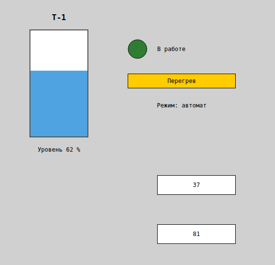
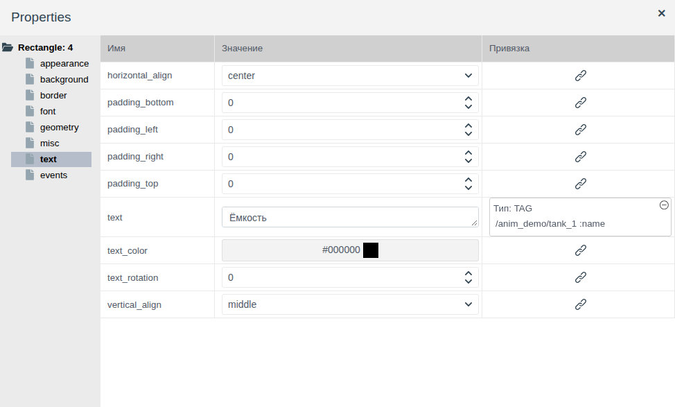
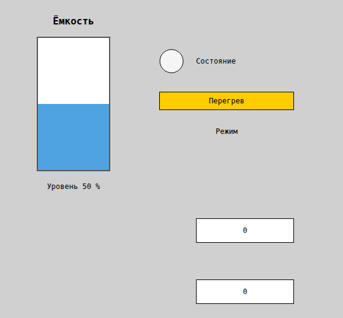
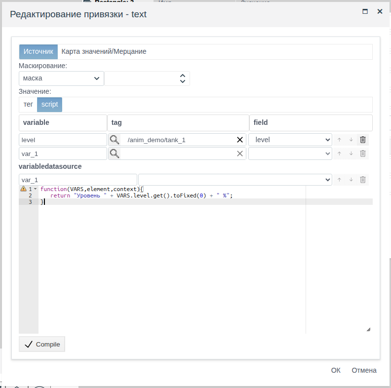
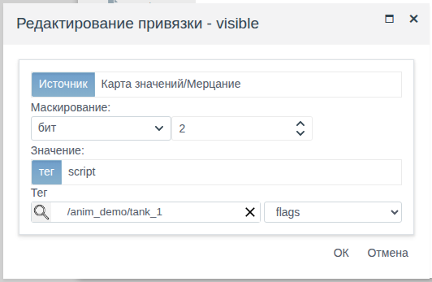
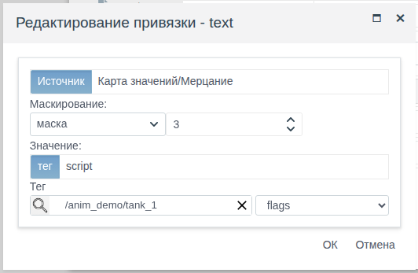
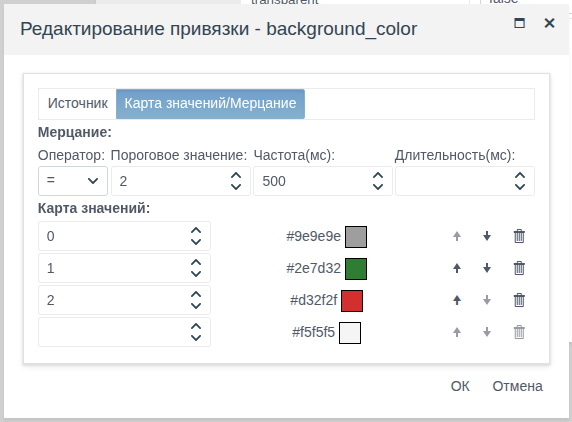
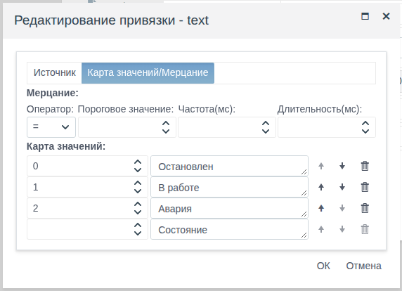
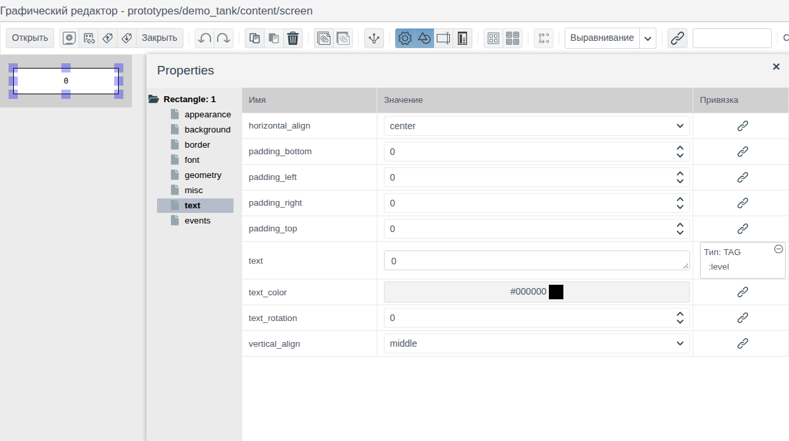

# Привязки и анимация

Документ для инженера-интегратора, который оживляет мнемосхему: элементы должны показывать значения тегов, менять цвет и текст по состоянию оборудования, мигать при аварии, двигаться и менять размер вслед за измеряемой величиной.

# Содержание

- [Глоссарий](#глоссарий)
- [Введение](#введение)
- [Основная часть](#основная-часть)
    - [Колонка «Привязка»](#колонка-привязка)
    - [Окно привязки](#окно-привязки)
    - [Привязка к тегу](#привязка-к-тегу)
    - [Привязка script](#привязка-script)
    - [Маскирование](#маскирование)
    - [Карта значений](#карта-значений)
    - [Мерцание](#мерцание)
    - [Движение и размер](#движение-и-размер)
    - [Привязка на схеме прототипа](#привязка-на-схеме-прототипа)
- [Заключение](#заключение)

# Глоссарий

| Термин | Значение |
|---|---|
| Привязка | Связь свойства элемента с данными проекта. В Runtime свойство получает значение поля тега или результат скрипта и меняется вместе с ним |
| Переменная | Имя, под которым поле тега доступно в скрипте привязки: `VARS.<имя>.get()` |
| Порог | Число в строке карты значений или в настройке мерцания, с которым сравнивается значение поля |

Термины «Тег», «Привязка» в применении к полям ввода — в документе [«Кнопки и ввод значений»](controls.md#глоссарий), «Схема», «Палитра», «Элемент» — в [«Редакторе мнемосхем»](editor.md#глоссарий).

# Введение

Привязка задаётся для свойств элементов схемы: цвета фона, текста, видимости, положения, размера. Через неё лампа окрашивается по состоянию насоса, надпись показывает режим, предупреждение появляется при выставленном бите аварии, а уровень в ёмкости поднимается и опускается вместе с измерением. Отдельных элементов для анимации нет: всё делается привязками.

Документ описывает окно привязки и все его режимы: значение тега, скрипт, маскирование битов, карту значений, мерцание. Отдельно показаны привязка геометрии (движение и размер) и привязка на схеме прототипа. Работа в редакторе (добавление элементов, панель свойств, сохранение) описана в [«Редакторе мнемосхем»](editor.md), сами элементы — в [«Графических элементах»](graphics.md). Обратное направление — запись в теги по действию оператора — задаётся событиями, см. [«Скрипты и события»](events.md).

Сквозной пример — схема `screen` папки `anim_demo`. В папке объект `tank_1` собственного примитива `demo_anim`:

| Поле | Тип | Смысл |
|---|---|---|
| `level` | float | Уровень в ёмкости, % |
| `state` | integer | Состояние насоса: 0 — остановлен, 1 — в работе, 2 — авария |
| `flags` | integer | Слово состояния: биты 0–1 — режим (0 ручной, 1 автомат, 2 дистанция), бит 2 — перегрев |
| `name` | string | Позиционное обозначение ёмкости |

На схеме примера: название ёмкости, ёмкость с заполнением по уровню и подписью уровня, лампа и надпись состояния насоса, плашка «Перегрев» и надпись режима. Ниже — два экземпляра прототипа `demo_tank`, каждый показывает свой уровень.



Понадобится доступ к Studio (`http://<сервер>:9000/fp/studio`) под учётной записью с правом изменять проект. Результат проверяется в Runtime (`http://<сервер>:9000/fp/runtime`).

# Основная часть

## Колонка «Привязка»

В панели **Properties** справа от значения свойства — колонка **Привязка**. Кнопка со звеном цепи открывает окно «Создание привязки — <свойство>». После **ОК** в ячейке вместо кнопки — описание привязки:

- `Тип: TAG` и путь к полю: `/<папка>/<объект> :<поле>`. В примере — `/anim_demo/tank_1 :name`;
- `Тип: SCRIPT` и по строке на каждую переменную скрипта.

Щелчок по описанию открывает привязку для изменения. Значок ⊖ в углу ячейки удаляет привязку после подтверждения «Удалить привязку?» → **yes**.



В редакторе элемент показывает значение из колонки **Значение**, в Runtime — значение из привязки. В примере на холсте ёмкость заполнена наполовину, а надписи показывают заготовки «Состояние», «Режим»; в Runtime на их месте данные `tank_1`. Изменение поля тега сразу видно на открытой схеме. Если значение не получено (у поля ещё нет значения, скрипт завершился ошибкой), элемент в Runtime серый и показывает значение из редактора.



Привязка сохраняется вместе со схемой: после настройки привязок сохраните схему.

## Окно привязки

Окно состоит из двух вкладок.

| Вкладка | Поле | Назначение |
|---|---|---|
| **Источник** | **Маскирование** | Выделение битов из целого числа: режим «маска» или «бит» и число. Пустое число — без маскирования. См. [Маскирование](#маскирование) |
| | **Значение** | Откуда берётся значение: **тег** — поле объекта, **script** — результат скрипта. См. [Привязка к тегу](#привязка-к-тегу), [Привязка script](#привязка-script) |
| **Карта значений/Мерцание** | **Мерцание** | Условие, при котором свойство мигает. См. [Мерцание](#мерцание) |
| | **Карта значений** | Пороги и значения свойства для них. См. [Карта значений](#карта-значений) |

Значение проходит обработку в порядке вкладок: маскирование, затем мерцание и карта значений.

## Привязка к тегу

Свойство получает значение поля как есть.

1. Выделите элемент, откройте группу свойства и нажмите кнопку в колонке **Привязка**.
2. На вкладке **Источник** оставьте **Значение** = **тег**.
3. Нажмите лупу, выберите объект и нажмите **ОК**. В списке справа выберите поле.
4. Нажмите **ОК**.

В примере `text` надписи над ёмкостью привязан к `tank_1.name`: в редакторе надпись «Ёмкость», в Runtime — «Т-1».


Поле должно давать значение, которое понимает свойство:

| Свойство | Поле тега |
|---|---|
| `text`, `title` | Любое: строка выводится как есть, число — числом |
| `background_color`, `border_color`, `text_color`, `gradient_color` | `string` с кодом цвета, например `#00aa00` |
| `visible`, `bold`, `italic`, `transparent` | `bool` |
| `left`, `top`, `width`, `height`, `font_size`, `border_width`, `border_radius`, `text_rotation`, `z_index` | `integer`, `float` в пределах, допустимых для свойства |
| `border_style`, `gradient` | `string` с одним из значений списка свойства, например `dashed`, `horizontal` |
| `texture` | `string` с путём к картинке [библиотеки изображений](images.md), например `/IMAGES/textures/red_brick.jpg` |

Число в цвет или текст состояния превращает [карта значений](#карта-значений), биты в «да/нет» — [маскирование](#маскирование), любое другое преобразование — [скрипт](#привязка-script).

## Привязка script

Свойство получает результат функции на JavaScript. Так значение пересчитывается (уровень в пиксели), форматируется (число в строку с единицами) или собирается из нескольких полей.

1. На вкладке **Источник** выберите **Значение** = **script**.
2. Задайте переменные в таблице **variable** / **tag** / **field**: имя переменной, объект (лупа) и поле. Пустая нижняя строка добавляет переменную.
3. Напишите функцию в редакторе ниже и нажмите **Compile**. Рядом с кнопкой появится **OK**.
4. Нажмите **ОК** окна.

Функция получает переменные в `VARS`. Значение поля — `VARS.<имя>.get()`. То, что функция вернёт через `return`, становится значением свойства. Скрипт выполняется при открытии схемы и при каждом изменении любого из полей переменных.

В примере подпись под ёмкостью показывает уровень с единицами. Переменная `level` — поле `tank_1.level`:

```javascript
function(VARS,element,context){
   return "Уровень " + VARS.level.get().toFixed(0) + " %";
}
```



Переменных может быть несколько: каждая строка таблицы — своя переменная, в скрипте все они доступны через `VARS`. В примере `return VARS.tname.get() + ": " + VARS.level.get();` для полей `name` и `level` даёт «Т-1: 62». Чтобы свойство `text` показало слово, возвращайте строку.

Скрипт может считать значение и по набору записей источника данных — раздел **variabledatasource** окна (см. [«Источники данных на схеме», раздел «Источник в скрипте»](datasources.md#источник-в-скрипте)).

## Маскирование

Маскирование выделяет биты из целого поля — слова состояния контроллера. Задаётся на вкладке **Источник**: режим в списке **Маскирование** и число справа.

| Режим | Число | Результат |
|---|---|---|
| бит | Номер бита, с 0 | 1, если бит выставлен, иначе 0 |
| маска | Маска, например 3 (биты 0 и 1) | Значение поля, побитово умноженное на маску (И): при значении поля 5 и маске 3 — 1 |

Режим «бит» подходит для свойств «да/нет» (`visible`, `bold`, `transparent`). Результат режима «маска» — число; его переводят в цвет или текст картой значений.

В примере плашка «Перегрев»: `visible` привязано к `tank_1.flags`, «бит», 2. При `flags` = 5 (бит 2 выставлен) плашка видна, при `flags` = 2 — скрыта.



В примере надпись режима: `text` привязан к `tank_1.flags`, «маска», 3, а карта значений переводит 0, 1, 2 в «Режим: ручной», «Режим: автомат», «Режим: дистанция». Бит перегрева на режим не влияет: при `flags` = 5 надпись «Режим: автомат».



## Карта значений

Карта переводит число в значение свойства, например в цвет или текст. Задаётся на вкладке **Карта значений/Мерцание** в разделе **Карта значений**: каждая строка — порог (целое число) и значение свойства. Поле значения такое же, как в панели свойств: для цвета открывается окно «Выбор цвета», для текста — поле ввода.

Нижняя строка без порога — заготовка: введите порог, и строка добавится в карту, а ниже появится новая заготовка.

Значение поля получает строку с наибольшим порогом, который не больше значения. Значения ниже первого порога получают первую строку. Пример для карты 3 → зелёный, 8 → красный: 3…7 — зелёный, 8 и больше — красный, 0 — зелёный.

Карта работает с числовыми полями (`integer`, `float`) и с результатом маскирования.

В примере лампа насоса: `background_color` привязан к `tank_1.state`, карта 0 → серый, 1 → зелёный, 2 → красный.



В примере надпись состояния: `text` привязан к тому же полю, карта 0 → «Остановлен», 1 → «В работе», 2 → «Авария».



## Мерцание

Мерцание привлекает внимание оператора: пока условие выполняется, свойство попеременно принимает значение из привязки и значение из редактора. Задаётся на вкладке **Карта значений/Мерцание** в разделе **Мерцание**:

| Поле | Назначение |
|---|---|
| **Оператор** | Сравнение значения поля с порогом: `=`, `>`, `>=`, `<`, `<=` |
| **Пороговое значение** | Порог, целое число |
| **Частота(мс)** | Время в миллисекундах, через которое значения сменяют друг друга |
| **Длительность(мс)** | Сколько миллисекунд длится мерцание после изменения значения. Пусто — пока выполняется условие |

Мерцание включается, когда заданы порог и частота.

В примере у лампы оператор `=`, порог 2, частота 500: при аварии (`state` = 2) лампа мигает красным (цвет из карты) и светло-серым (`background_color` в редакторе). Когда `state` меняется, мерцание прекращается и лампа принимает цвет по карте.

С длительностью мерцание — сигнал о новом событии: оно начинается при изменении значения и через заданное время прекращается. Если схема открыта, когда условие уже выполняется, мерцания нет.

Без карты значений мерцание работает с самим значением поля: например, `border_width` чередует значение тега и толщину из редактора.

## Движение и размер

Положение и размер элемента — такие же свойства, как цвет: `left`, `top`, `width`, `height` группы **geometry**. Привязка к ним двигает элемент и меняет его размер, `text_rotation` поворачивает текст прямоугольника.

В примере заполнение ёмкости — синий прямоугольник внутри рамки высотой 216 пикселей (`top` рамки 60, дно на 278). Высота заполнения пропорциональна уровню, а верхний край опускается так, чтобы низ оставался на дне. Обе привязки — script с переменной `level`:

| Свойство | Скрипт |
|---|---|
| `height` | `return VARS.level.get() * 2.16;` |
| `top` | `return 278 - VARS.level.get() * 2.16;` |

В примере при `level` = 62 заполнение высотой 134 пикселя, при 20 — 43, при 90 — 194.

Так же делается движение: `left` или `top`, вычисленные скриптом из положения задвижки, тележки, уровня.

## Привязка на схеме прототипа

Схема прототипа одна на все экземпляры, поэтому привязка на ней указывает не на объект, а на поле прототипа. Каждый экземпляр, поставленный на схему проекта, показывает свои значения.

1. Откройте схему прототипа (см. [«Редактор мнемосхем», раздел «Схемы прототипа»](editor.md#схемы-прототипа)).
2. Откройте окно привязки и нажмите лупу. В окне выбора один объект — сам прототип. Выберите его, нажмите **ОК** и выберите поле прототипа.
3. Нажмите **ОК**. В колонке **Привязка** — `Тип: TAG` и поле без пути, например `:level`.



В списке полей — поля прототипа (см. [«Прототипы», раздел «Поля»](../prototypes/prototypes.md#поля)).

В примере у прототипа `demo_tank` поле `level`, на его схеме `screen` прямоугольник с `text`, привязанным к `:level`. На схеме `anim_demo` стоят экземпляры `tank_p1` и `tank_p2`: в Runtime первый показывает 37, второй 81 (см. [скриншот во «Введении»](#введение)).

# Заключение

| Задача | Как сделать |
|---|---|
| Показать значение поля | Привязка к тегу |
| Пересчитать, отформатировать, собрать из нескольких полей | Привязка script |
| Окрасить или подписать по состоянию | Карта значений |
| Показать или скрыть по биту слова состояния | Маскирование «бит» на `visible` |
| Разобрать группу битов (режим) | Маскирование «маска» + карта значений |
| Привлечь внимание к аварии | Мерцание |
| Двигать элемент, менять размер | Привязка `left`, `top`, `width`, `height` |
| Одна схема для всех экземпляров | Привязка к полю на схеме прототипа |

Порядок работы:

1. Подготовьте поля тега: числа для состояний и уровней, строки для текстов и кодов цвета.
2. Нарисуйте элементы и задайте в редакторе значения, которые увидит оператор, пока данных нет и во второй фазе мерцания.
3. Привяжите свойства: тег, при необходимости маскирование, карта значений, мерцание или скрипт.
4. Сохраните схему и проверьте её в Runtime, меняя значения полей в форме объекта в Studio.
