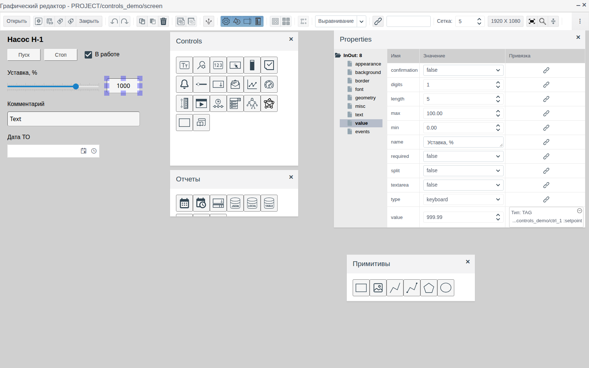
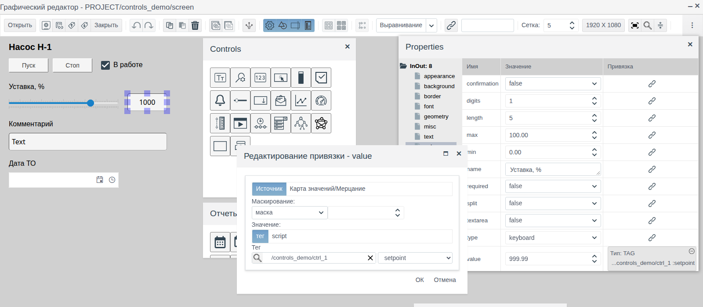
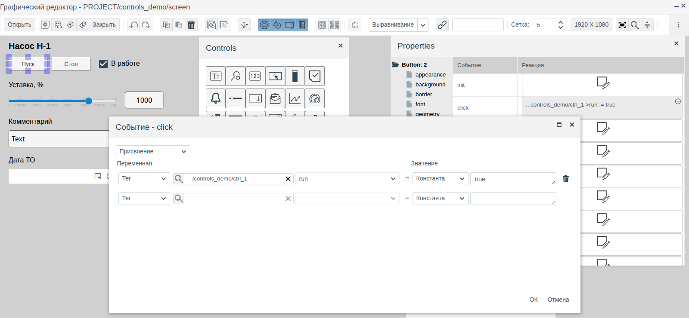
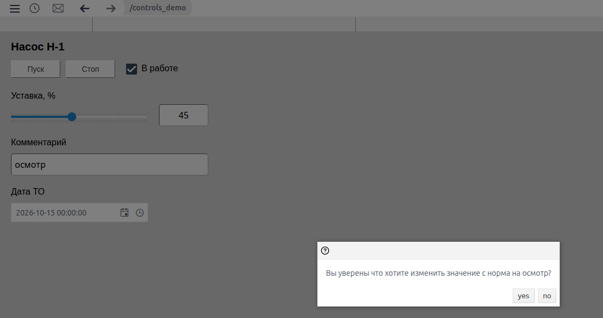
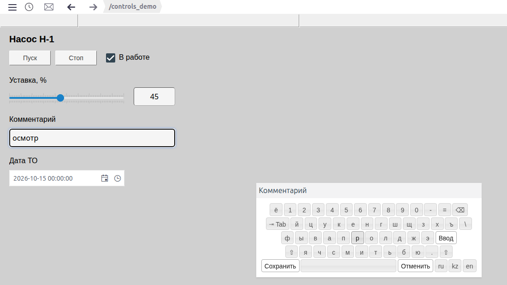
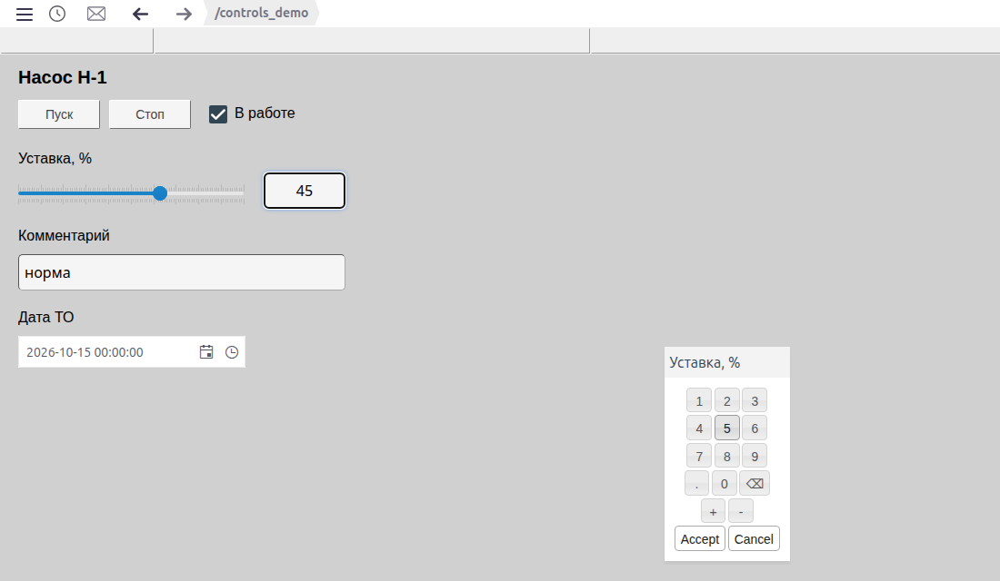
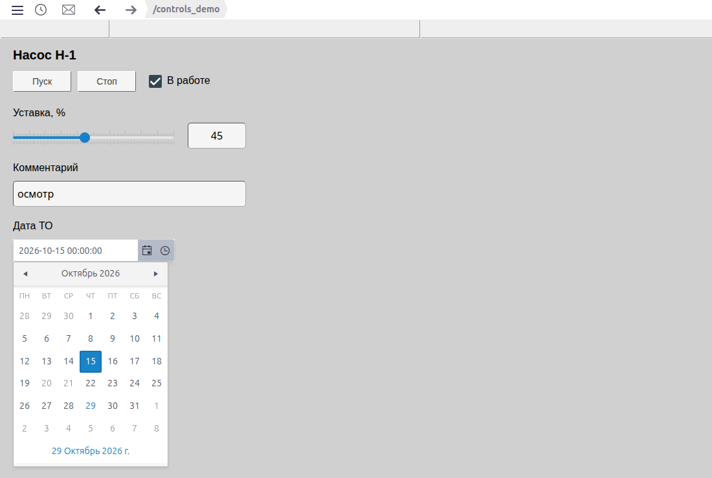
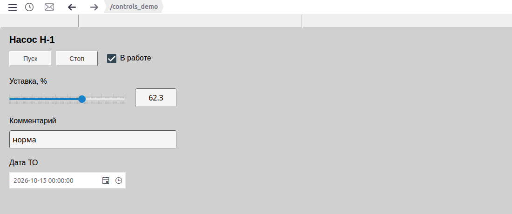

# Кнопки и ввод значений

Документ для инженера-интегратора, который делает на мнемосхеме органы управления: кнопки команд, флажки, ползунки, поля ввода уставок, текста и даты.

# Содержание

- [Глоссарий](#глоссарий)
- [Введение](#введение)
- [Основная часть](#основная-часть)
    - [Элементы на палитрах](#элементы-на-палитрах)
    - [Связь элемента с тегом](#связь-элемента-с-тегом)
    - [Общие свойства](#общие-свойства)
    - [Кнопка](#кнопка)
    - [Флажок](#флажок)
    - [Ползунок](#ползунок)
    - [Поле ввода числа](#поле-ввода-числа)
    - [Поле ввода текста](#поле-ввода-текста)
    - [Экранная клавиатура](#экранная-клавиатура)
    - [Дата и дата со временем](#дата-и-дата-со-временем)
- [Заключение](#заключение)

# Глоссарий

| Термин | Значение |
|---|---|
| Тег | Объект проекта, поле которого показывает или изменяет элемент схемы. В примере — экземпляр `ctrl_1` |
| Привязка | Связь свойства элемента с полем тега. Задаётся кнопкой в колонке **Привязка** панели **Properties** |
| Присвоение | Реакция на событие элемента без скрипта: записать в поле тега константу, значение другого поля или свойство элемента |
| Экранная клавиатура | Окно с клавишами для ввода значения мышью или касанием, без физической клавиатуры |

Термины «Схема», «Элемент», «Палитра» — в документе [«Редактор мнемосхем»](editor.md).

# Введение

Элементы ввода превращают мнемосхему из картинки в пульт: оператор в Runtime пускает и останавливает оборудование, меняет уставки, пишет комментарии, назначает даты. Каждый элемент показывает текущее значение поля тега и записывает в это поле то, что ввёл оператор.

Документ описывает элементы ввода, их свойства и поведение в Runtime. Работа в редакторе (добавление, выделение, свойства, сохранение) описана в [«Редакторе мнемосхем»](editor.md), оформление фигур и надписей — в [«Графических элементах»](graphics.md).

Сквозной пример — схема `screen` папки `controls_demo`: панель управления насосом. Данные лежат в объекте `ctrl_1` собственного примитива `demo_ctrl` с полями `run` (bool), `setpoint` (float), `note` (string) и `service_dt` (string). На схеме кнопки **Пуск** и **Стоп**, флажок «В работе», ползунок и поле уставки, поле комментария и поле даты ТО.



Понадобится доступ к Studio (`http://<сервер>:9000/fp/studio`) под учётной записью с правом изменять проект. Результат проверяется в Runtime (`http://<сервер>:9000/fp/runtime`).

# Основная часть

## Элементы на палитрах

Элементы добавляются на холст перетаскиванием значка с палитры. Название элемента видно во всплывающей подсказке значка, тип — в корне дерева свойств.

| Палитра | Подсказка значка | Корень дерева свойств | Для чего |
|---|---|---|---|
| **Controls** | Кнопка | `Button` | Команда по щелчку: пуск, стоп, квитирование, сброс |
| **Controls** | Чекбокс | `Checkbox` | Включение и выключение логического признака |
| **Controls** | Ползунок | `Slider` | Плавное изменение числа в заданном диапазоне |
| **Controls** | Поле ввода-вывода (значок `123`) | `InOut` | Показ и ввод числа |
| **Controls** | Поле ввода-вывода (значок `Tт`) | `InOutText` | Показ и ввод текста |
| **Отчеты** | Date | `DatePicker` | Выбор даты |
| **Отчеты** | Date - Time | `DateTimePicker` | Выбор даты и времени |

## Связь элемента с тегом

У флажка, ползунка, полей ввода и полей даты значение хранится в свойстве `value` группы **value**. Чтобы элемент показывал поле тега и записывал в него ввод оператора:

1. Выделите элемент, откройте группу **value** и нажмите кнопку в колонке **Привязка** строки `value`.
2. В окне «Создание привязки» на вкладке **Источник** оставьте режим **тег**.
3. Нажмите лупу, выберите объект (в примере `ctrl_1`) и нажмите **ОК**. В списке справа выберите поле.
4. Нажмите **ОК**. В колонке **Привязка** появится `Тип: TAG` и путь к полю.



Щелчок по заполненной привязке открывает её для изменения.

Тип поля должен подходить элементу:

| Элемент | Тип поля тега |
|---|---|
| Флажок | `bool` |
| Ползунок, поле ввода числа | `integer`, `float` |
| Поле ввода текста | `string` |
| Дата, дата со временем | `string`: дата записывается в формате ISO 8601 по UTC, например `2026-10-14T19:00:00.000Z` |

Несколько элементов можно привязать к одному полю: в примере ползунок и поле уставки показывают `setpoint`, и изменение одного сразу видно в другом.

## Общие свойства

| Группа | Свойство | Назначение |
|---|---|---|
| **misc** | `enabled` | `false` — элемент не принимает ввод. У кнопки текст становится цветом `disabled_color` |
| **value** | `name` | У полей ввода: заголовок окна экранной клавиатуры |
| | `required` | У полей ввода: `true` — пустое значение не принимается, оператор видит сообщение |

Группы **appearance**, **geometry**, **misc** (`z_index`, `title`, `cursor`), **border** и **font** такие же, как у графических элементов (см. [«Графические элементы», раздел «Общие свойства»](graphics.md#общие-свойства)).

## Кнопка

Кнопка с текстом. Сама по себе ничего не записывает: действие задаётся в группе **events**, обычно на событии `click`.

Чтобы кнопка записала значение в тег без скрипта:

1. Выделите кнопку, откройте группу **events** и щёлкните ячейку **Реакция** в строке `click`.
2. В окне «Событие - click» оставьте **Присвоение**.
3. В колонке **Переменная**: **Тег**, лупа → объект → **ОК**, справа поле. В примере `ctrl_1`, поле `run`.
4. В колонке **Значение**: **Константа** и значение. У кнопки **Пуск** — `true`, у **Стоп** — `false`.
5. Нажмите **ОК**.



После заполнения строки ниже появляется пустая — для следующего присвоения. Корзина удаляет строку. В колонке **Значение** вместо константы можно взять поле другого тега (**Тег**) или свойство самой кнопки (**Свойство**).

| Группа | Свойство | Назначение |
|---|---|---|
| **text** | `text` | Надпись на кнопке. Enter переносит строку |
| | `text_color`, `disabled_color` | Цвет надписи у доступной и у недоступной (`enabled` = `false`) кнопки |
| | `horizontal_align`, `vertical_align`, `padding_*` | Выравнивание и отступы надписи, как у прямоугольника |
| **background** | `background_color`, `transparent` | Фон, прозрачный фон |
| **border** | `border_width`, `border_color`, `border_radius` | Рамка |

Недоступная кнопка показывает надпись цветом `disabled_color` и на щелчок не реагирует.

## Флажок

Квадрат с галочкой для поля `bool`. В примере флажок «В работе» привязан к `ctrl_1.run`: он отмечен после **Пуск** и снят после **Стоп**. Щелчок по флажку в Runtime переключает поле.

Подпись к флажку делается отдельным прямоугольником без фона и рамки (см. [«Графические элементы», раздел «Прямоугольник», абзац «Надпись»](graphics.md#прямоугольник)).

## Ползунок

Шкала с бегунком. Оператор тянет бегунок или щёлкает по шкале, значение записывается в поле тега.

| Свойство (группа **value**) | Назначение |
|---|---|
| `min`, `max` | Границы шкалы |
| `small_step` | Шаг бегунка и мелкие деления шкалы |
| `large_step` | Крупные деления шкалы с подписями |

Свойство `orientation` группы **appearance**: `horizontal` или `vertical`. В примере ползунок 0…100 с шагом 1 и делениями через 10 привязан к `ctrl_1.setpoint`.

## Поле ввода числа

Поле `InOut` показывает число и принимает ввод. Способ ввода задаёт свойство `type` группы **value**:

| `type` | Как вводит оператор |
|---|---|
| пусто | Ввода нет, поле только показывает значение |
| `direct` | Щелчок по полю, ввод с клавиатуры, Enter или переход в другое место записывает значение. Принимаются только цифры, точка, знак |
| `keyboard` | При наведении справа от поля появляется кнопка с клавиатурой. Она открывает цифровую экранную клавиатуру |

Остальные свойства группы **value**:

| Свойство | Назначение |
|---|---|
| `digits` | Число знаков после точки при показе. Записывается введённое значение без округления |
| `length` | Сколько символов занимает число при показе |
| `split` | `true` — разряды разделяются пробелом |
| `min`, `max` | Допустимый диапазон. Значение вне него не записывается, оператор видит сообщение с нарушенной границей |
| `confirmation` | `true` — перед записью оператор подтверждает изменение (см. [Поле ввода текста](#поле-ввода-текста)) |

Если ввод не принят (вне диапазона, пусто при `required`, не число), поле возвращает прежнее значение.

В примере поле уставки: `digits` = 1, `min` = 0, `max` = 100, `type` = `keyboard`, `name` = «Уставка, %», `value` привязано к `ctrl_1.setpoint`.

Оформление — группы **text** (`align`, `padding`, `text_color`), **font**, **background**, **border** (`border_radius` — скругление углов).

## Поле ввода текста

Поле `InOutText` — то же для строк. Свойство `type`: пусто, `direct` или `keyboard`, они работают как у поля числа. Свойства группы **value**:

| Свойство | Назначение |
|---|---|
| `length` | Наибольшая длина текста. Длиннее не записывается, оператор видит сообщение с допустимой длиной |
| `textarea` | `true` — многострочное поле |
| `confirmation` | `true` — перед записью окно просит подтвердить замену старого значения новым, кнопки **yes** и **no**. **no** возвращает прежнее значение |

В примере поле комментария: `type` = `keyboard`, `length` = 40, `confirmation` = `true`, `value` привязано к `ctrl_1.note`.



Пока у поля тега нет значения, поля ввода и даты в Runtime показываются серыми.

## Экранная клавиатура

Нужна на панелях без физической клавиатуры. Включается свойством `type` = `keyboard` у поля ввода числа или текста. В Runtime наведите мышь на поле: справа появится кнопка с клавиатурой. Окно клавиатуры носит заголовок из свойства `name`.

У поля текста — полная клавиатура с раскладками **ru**, **kz**, **en**. **Сохранить** записывает значение, **Отменить** закрывает окно без записи.



У поля числа — цифровая клавиатура: цифры, точка, `+`, `-`, удаление символа. **Accept** записывает значение с проверкой `min`/`max`, **Cancel** закрывает окно без записи.



## Дата и дата со временем

Элементы **Date** и **Date - Time** с палитры **Отчеты** — поле с календарём. **Date** выбирает дату (показ `гггг-ММ-дд`), **Date - Time** — дату и время (показ `гггг-ММ-дд ЧЧ:мм:сс`): кнопка календаря открывает месяц, кнопка часов — список времени. Дату и время можно и набрать в поле.

| Свойство (группа **value**) | Назначение |
|---|---|
| `value` | Значение; для записи в тег привяжите к полю `string` |
| `interval` | Только **Date - Time**: шаг списка времени в минутах, по умолчанию 30 |
| `config` | Настройки в формате JSON. `disableDates` — список дат, недоступных для выбора |

`config` редактируется в окне JSON: введите текст, нажмите **Compile**, после `ok` — **OK**. В примере у поля даты ТО:

```json
{
  disableDates: ["2026-10-20", "2026-10-21"]
}
```

В календаре эти дни серые и не выбираются.



# Заключение

Порядок работы с элементами ввода:

1. Подготовьте тег с полями нужных типов: `bool` для флажка, `integer`/`float` для ползунка и чисел, `string` для текста и дат.
2. Перетащите элементы с палитр **Controls** и **Отчеты**, подпишите их прямоугольниками без фона.
3. Привяжите `value` каждого элемента к полю тега. Кнопкам задайте **Присвоение** на событии `click`.
4. Для чисел задайте `min`, `max`, `digits`; для текста — `length`; для важных значений — `confirmation`.
5. На сенсорных панелях включите `type` = `keyboard` и задайте `name` — заголовок окна клавиатуры.
6. Сохраните схему и проверьте ввод в Runtime.


