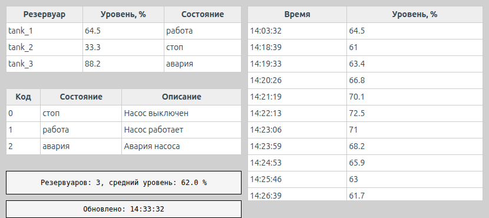
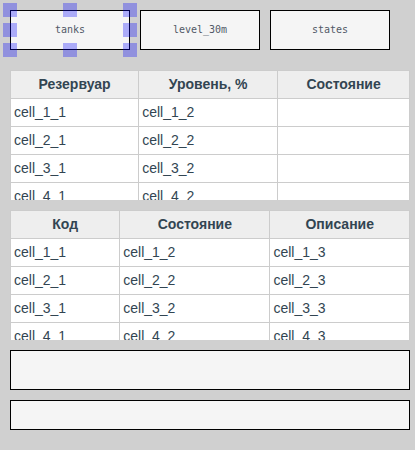
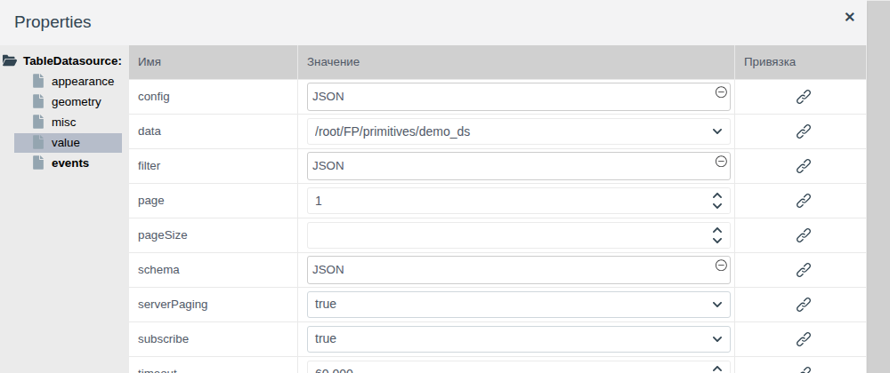
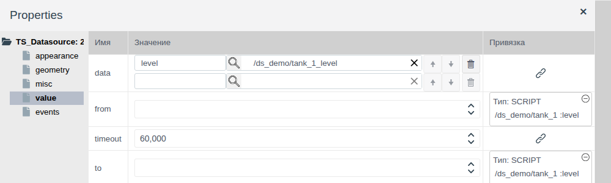
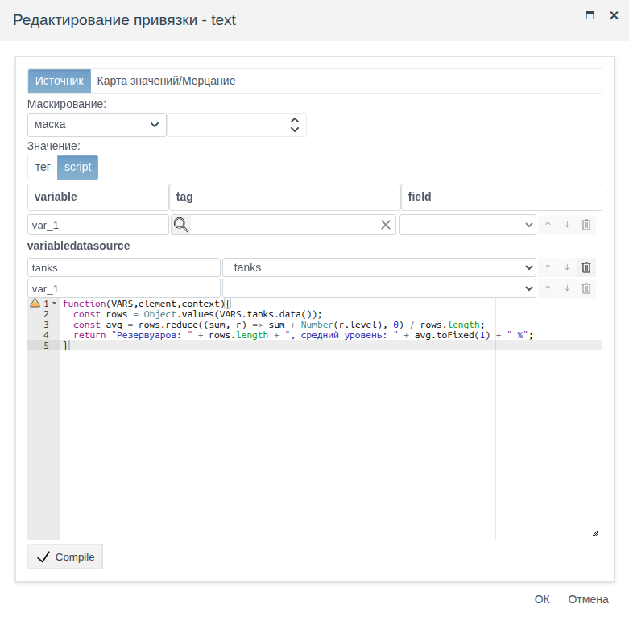

# Источники данных на схеме

Документ для инженера-интегратора, которому нужно показать на мнемосхеме набор записей, а не одно значение: сводку по группе объектов, историю величины за период, справочную таблицу, итог, посчитанный по нескольким объектам.

# Содержание

- [Глоссарий](#глоссарий)
- [Введение](#введение)
- [Основная часть](#основная-часть)
    - [Источники на палитре](#источники-на-палитре)
    - [Общее для всех источников](#общее-для-всех-источников)
    - [Local Datasource: записи на схеме](#local-datasource-записи-на-схеме)
    - [Table Datasource: объекты проекта](#table-datasource-объекты-проекта)
    - [Time-series datasource: история из архивов](#time-series-datasource-история-из-архивов)
    - [Какие элементы читают источник](#какие-элементы-читают-источник)
    - [Источник в скрипте](#источник-в-скрипте)
    - [Событие change](#событие-change)
- [Заключение](#заключение)

# Глоссарий

| Термин | Значение |
|---|---|
| Источник данных | Элемент схемы, который хранит набор записей для других элементов и скриптов. В редакторе выглядит прямоугольником со своим именем, в Runtime не виден |
| Запись | Одна строка набора: объект проекта, строка справочника или точка истории. Поля записи задаёт `schema` источника |
| Псевдоним архива | Имя, под которым значения архива попадают в записи **Time-series datasource**. Задаётся рядом с архивом в свойстве `data` |
| Переменная источника | Строка раздела **variabledatasource** окна скрипта: имя, под которым источник доступен скрипту в `VARS` |

Термины «Тег», «Привязка» — в документе [«Кнопки и ввод значений»](controls.md#глоссарий), «Схема», «Палитра», «Элемент» — в [«Редакторе мнемосхем»](editor.md#глоссарий), «Таблица», «Архив» — в [«Таблицах и временной шкале»](tables.md#глоссарий), «Событие» — в [«Скриптах и событиях»](events.md#глоссарий).

# Введение

Привязка связывает свойство элемента с одним полем одного тега. Таблице и диаграмме этого мало: им нужен набор записей — все насосы папки, точки истории за полчаса, строки справочника. Такой набор хранит источник данных. Элемент выбирает источник по имени, а один источник может питать несколько элементов и скриптов сразу.

Документ описывает три источника палитры **Отчеты**: откуда каждый берёт записи, как его настроить, какие элементы его читают, как обратиться к записям из скрипта и как отследить их изменение. Работа в редакторе (добавление, выделение, свойства, сохранение) описана в [«Редакторе мнемосхем»](editor.md), колонки и заголовки таблицы — в [«Таблицах и временной шкале»](tables.md#таблица-колонки-и-заголовки).

Сквозной пример — схема `screen` папки `ds_view`. Данные лежат в папке `ds_demo`: объекты `tank_1`…`tank_3` собственного примитива `demo_ds` с полями `level` (float, уровень) и `state` (integer, состояние) и архив `tank_1_level`, который записывает `tank_1.level`. На схеме:

- таблица резервуаров из **Table Datasource** `tanks`;
- история уровня `tank_1` за последние 30 минут из **Time-series datasource** `level_30m`;
- справочник кодов состояния из **Local Datasource** `states`;
- строка со средним уровнем, которую считает скрипт по записям `tanks`;
- время последнего обновления `tanks`, которое ставит событие `change`.



Понадобится доступ к Studio (`http://<сервер>:9000/fp/studio`) под учётной записью с правом изменять проект. Результат проверяется в Runtime (`http://<сервер>:9000/fp/runtime`).

# Основная часть

## Источники на палитре

| Подсказка значка | Корень дерева свойств | Откуда записи | Когда записи меняются |
|---|---|---|---|
| Local Datasource | `LocalDatasource` | Заданы на схеме в свойстве `data` или приходят из строкового поля тега | При изменении `data` |
| Table Datasource | `TableDatasource` | Объекты проекта одного типа, отобранные условием | При изменении полей объектов, если включена подписка |
| Time-series datasource | `TS_Datasource` | История одного или нескольких архивов за период `from`…`to` | При изменении `from` или `to` |

Как выбрать:

| Задача | Источник |
|---|---|
| Справочник, список режимов, расшифровка кодов — данные, которые не меняются в работе | Local Datasource с записями в `data` |
| Таблица, которую формирует внешняя система или скрипт и записывает в поле тега | Local Datasource с привязкой `data` к полю |
| Текущие значения полей многих однотипных объектов | Table Datasource |
| Значения величин за прошедший период | Time-series datasource |

## Общее для всех источников



Источник добавляется с палитры **Отчеты**, как любой элемент. Порядок работы:

1. Добавьте источник и задайте ему имя: группа **misc**, свойство `name`. По этому имени источник находят элементы и скрипты. В примере `tanks`, `level_30m`, `states`.
2. Настройте свойства группы **value** — у каждого источника свои, они описаны ниже.
3. Добавьте элемент, который читает источник, и выберите источник в его свойстве `datasource`. Источник должен стоять на схеме раньше этого элемента.
4. Сохраните схему и проверьте записи в Runtime: в редакторе таблицы и диаграммы показывают образец.

Положение и размер источника на схеме ни на что не влияют: в Runtime его не видно. Удобно сложить источники в угол схемы.

Свойства `schema`, `data` и `filter` редактируются в окне **JSON**: щёлкните поле значения, введите текст, нажмите **Compile**, затем **OK**.

Поля записи описывает `schema`: имя поля и его тип. Пример из нового Local Datasource:

```
{
   "column1": {type: fp.item.types.primitives.String},
   "column2": {type: fp.item.types.primitives.Integer},
   "column3": {type: fp.item.types.primitives.Bool}
}
```

У Local Datasource и Table Datasource есть постраничный вывод:

| Свойство | Назначение |
|---|---|
| `pageSize` | Сколько записей отдавать за раз. Пусто — все записи |
| `page` | Номер страницы, начиная с 1 |

Например, при `pageSize` = 2 и `page` = 2 таблица покажет третью и четвёртую записи.

## Local Datasource: записи на схеме

**Local Datasource** хранит записи в свойстве `data` группы **value** — массив объектов, по одному на запись. В примере источник `states` расшифровывает коды состояния насоса:

```
schema:
{
  "code": {type: fp.item.types.primitives.Integer},
  "state": {type: fp.item.types.primitives.String},
  "note": {type: fp.item.types.primitives.String}
}

data:
[
  {"code": 0, "state": "стоп", "note": "Насос выключен"},
  {"code": 1, "state": "работа", "note": "Насос работает"},
  {"code": 2, "state": "авария", "note": "Авария насоса"}
]
```

Чтобы записи приходили извне, привяжите `data` к полю тега типа `string` (колонка **Привязка**, см. [«Привязки и анимация», раздел «Привязка к тегу»](bindings.md#привязка-к-тегу)). В поле должен лежать такой же массив в формате JSON. При каждом изменении поля источник заменяет записи, и таблица на схеме перерисовывается. Так показывают таблицы, которые собирает пользовательский скрипт или внешняя система: состав смены, список заданий, результаты анализа.

Записи можно заменить и из скрипта события: `context.find_by_name("<имя источника>").set({data: '<массив JSON>'})` (см. [«Скрипты и события», раздел «Что доступно из скрипта»](events.md#что-доступно-из-скрипта)).

## Table Datasource: объекты проекта

**Table Datasource** находит объекты проекта одного типа и отдаёт их поля. Новый объект, который подходит под условие, попадёт в записи без правки схемы.



| Свойство | Назначение |
|---|---|
| `data` | Тип объектов. Собственные примитивы — в конце списка: `/root/FP/primitives/<имя>` |
| `filter` | Условие отбора, например объекты одной папки |
| `schema` | Поля объекта, которые попадут в записи. Служебное поле `.name` — имя объекта |
| `subscribe` | `true` — записи обновляются, когда меняются поля объектов. `false` — поля читаются один раз при открытии схемы |
| `pageSize`, `page` | Постраничный вывод (см. [Общее для всех источников](#общее-для-всех-источников)) |
| `serverPaging` | `true` — сервер отдаёт только нужную страницу. `false` — браузер получает все объекты и сам делит их на страницы. На то, что видит оператор, не влияет; `true` экономит трафик при большом числе объектов |

Отбор объектов одной папки:

```
[".folder", "=", "$oid('/root/FP/PROJECT/<папка>')"]
```

В примере `data` = `/root/FP/primitives/demo_ds`, отбор по папке `ds_demo`, `subscribe` = `true`, а `schema`:

```
{
  ".name": {type: fp.item.types.primitives.String},
  "level": {type: fp.item.types.primitives.String},
  "state": {type: fp.item.types.primitives.Integer}
}
```

Поле типа `float` описывайте как `String`: значение выводится как есть, а `Integer` округляет его до целого. Подробнее об условии и типах полей — в [«Таблицах и временной шкале», раздел «Таблица: источник строк»](tables.md#таблица-источник-строк).

С `subscribe` = `true` оператор видит новое значение сразу: в примере после записи в `tank_2.level` числа 45 строка `tank_2` в таблице и средний уровень под ней поменялись без перезагрузки схемы.

## Time-series datasource: история из архивов

**Time-series datasource** читает из архивов значения за период и отдаёт их записями: одна запись на момент, когда хотя бы один архив записал новое значение. В отличие от временной шкалы, которая показывает только цветные состояния (см. [«Таблицы и временная шкала», раздел «Временная шкала: архив»](tables.md#временная-шкала-архив)), источник отдаёт сами числа — их можно вывести таблицей или обработать скриптом.

Подготовьте архив поля (см. [«Архивы», раздел «Архив давления из тега»](../data_storage/archives/archives.md#архив-давления-из-тега)). В примере — `ds_demo/tank_1_level` на поле `tank_1.level`.



| Свойство | Назначение |
|---|---|
| `data` | Список архивов. В строке слева — псевдоним, справа — архив, который выбирается лупой. Пустая нижняя строка добавляет архив, стрелки меняют порядок, корзина удаляет |
| `from` | Начало периода |
| `to` | Конец периода |

`from` и `to` — момент времени в миллисекундах от 1 января 1970 года (UTC), как возвращает `Date.now()` в JavaScript. Пока один из них пуст, источник записей не отдаёт.

Записи источника содержат поле `ts` — момент в тех же миллисекундах — и по полю на каждый псевдоним со значением архива. Первая запись приходится на начало периода и содержит значение, которое архив хранил в этот момент.

Период «последние N минут» задают привязкой script к `from` и `to` (см. [«Привязки и анимация», раздел «Привязка script»](bindings.md#привязка-script)). В примере у обоих свойств одна переменная — поле `tank_1.level`, скрипт `from`:

```javascript
function(VARS,element,context){
  return Date.now() - 30 * 60 * 1000;
}
```

и скрипт `to`:

```javascript
function(VARS,element,context){
  return Date.now();
}
```

Скрипты выполняются при открытии схемы, поэтому таблица показывает 30 минут до открытия. Источник перечитывает архив при каждом изменении `from` или `to`: и из привязки, и из скрипта события, например кнопки «За час» с `context.find_by_name("level_30m").set({from: Date.now() - 3600000, to: Date.now()})`.

Чтобы таблица показала время, а не число миллисекунд, преобразуйте `ts` функцией в колонке таблицы. В примере:

```
header:  ["Время", "Уровень, %"]
columns: [{fields: ["ts"], handler: ({ts}) => new Date(ts).toLocaleTimeString()}, "level"]
```

## Какие элементы читают источник

Элемент читает источник через свое свойство `datasource` (группа **value**). В выпадающем списке — имена всех источников схемы.

| Элемент | Палитра | Источники | Что делает с записями |
|---|---|---|---|
| **Grid** | **Отчеты** | Local Datasource, Table Datasource, Time-series datasource | Строка на запись, колонки — из `columns` (см. [«Таблицы и временная шкала»](tables.md#таблица-колонки-и-заголовки)) |
| **Bar Chart** | **Отчеты** | Local Datasource с полями `name` и `data` | Ряды столбцов (см. [«Стрелочные и линейные индикаторы», раздел «Столбчатая диаграмма»](gauges.md#столбчатая-диаграмма)) |
| Любое свойство любого элемента | — | Все три | Значение, которое скрипт привязки вычислил по записям (см. [Источник в скрипте](#источник-в-скрипте)) |

## Источник в скрипте

Скрипт привязки и скрипт события получают записи источника через раздел **variabledatasource** своего окна. Так по набору записей считают итог, который не выразить колонкой таблицы: число объектов, среднее, количество в аварии.



1. Откройте окно привязки свойства, выберите **Значение** = **script** (для события — тип **Скрипты**).
2. В разделе **variabledatasource** введите имя переменной слева и выберите источник в списке справа. Пустая нижняя строка добавляет переменную.
3. Напишите функцию, нажмите **Compile**, затем **ОК**.

В скрипте записи источника возвращает `VARS.<имя>.data()`. Переберите их через `Object.values(...)`: получится массив записей с полями из `schema`. В примере строка под таблицей резервуаров считает средний уровень по источнику `tanks`:

```javascript
function(VARS,element,context){
  const rows = Object.values(VARS.tanks.data());
  const avg = rows.reduce((sum, r) => sum + Number(r.level), 0) / rows.length;
  return "Резервуаров: " + rows.length + ", средний уровень: " + avg.toFixed(1) + " %";
}
```

Привязка пересчитывается при каждом изменении записей источника. В примере `level` описан в `schema` как `String`, поэтому перед сложением стоит `Number(...)`.

## Событие change

У источников в группе **events** есть событие `change`. Оно наступает, когда источник получил записи при открытии схемы, и потом при каждом их изменении: новое значение поля при `subscribe` = `true`, новое значение `data`, новые `from` и `to`. На `change` назначают скрипт, который должен сработать вместе с обновлением данных: отметить время, подсветить элемент, пересчитать то, что не помещается в привязку. Окно события и аргументы скрипта описаны в [«Скриптах и событиях», раздел «Скрипт события»](events.md#скрипт-события).

В примере источник `tanks` ставит время последнего обновления в прямоугольник с `name` = `updated`:

```javascript
function(VARS,element,context){
   context.find_by_name("updated").set({text: "Обновлено: " + new Date().toLocaleTimeString()});
}
```

После записи в `tank_2.level` время в строке «Обновлено» сменилось вместе со строкой таблицы.

# Заключение

| Что показать | Источник | Элемент |
|---|---|---|
| Справочные данные, заданные на схеме | Local Datasource | Grid, Bar Chart |
| Таблицу, которую готовит скрипт или внешняя система | Local Datasource, `data` привязано к строковому полю | Grid |
| Текущие значения многих однотипных объектов | Table Datasource, `subscribe` = `true` | Grid |
| Значения архивов за период | Time-series datasource, `from` и `to` привязкой script | Grid |
| Итог по набору записей | Любой | Привязка script с переменной источника |

Порядок работы:

1. Добавьте источник с палитры **Отчеты** и задайте `name`.
2. Настройте группу **value**: записи и `schema` у Local Datasource, тип, условие, `schema` и подписку у Table Datasource, архивы и период у Time-series datasource.
3. Добавьте после источника элемент и выберите источник в `datasource` или в разделе **variabledatasource** скрипта.
4. Для действий при обновлении данных назначьте скрипт на событие `change` источника.
5. Сохраните схему и проверьте записи в Runtime.
