# Редактор мнемосхем

Документ для инженера-интегратора, который рисует мнемосхемы проекта в графическом редакторе Studio.

# Содержание

- [Глоссарий](#глоссарий)
- [Введение](#введение)
- [Основная часть](#основная-часть)
    - [Схемы папки](#схемы-папки)
    - [Назначение схем](#назначение-схем)
    - [Схема внутри схемы: Folder Screen](#схема-внутри-схемы-folder-screen)
    - [Схемы прототипа](#схемы-прототипа)
    - [Вкладка «Пользователь»: схема settings](#вкладка-пользователь-схема-settings)
    - [Окно редактора](#окно-редактора)
    - [Холст](#холст)
    - [Добавление элементов](#добавление-элементов)
    - [Выделение](#выделение)
    - [Перемещение и размер](#перемещение-и-размер)
    - [Панель свойств](#панель-свойств)
    - [Копирование, вставка, удаление](#копирование-вставка-удаление)
    - [Отмена и повтор](#отмена-и-повтор)
    - [Выравнивание](#выравнивание)
    - [Группировка](#группировка)
    - [Сохранение и закрытие](#сохранение-и-закрытие)
    - [Экспорт и импорт схемы](#экспорт-и-импорт-схемы)
    - [Одновременное редактирование](#одновременное-редактирование)
    - [Схема в Runtime](#схема-в-runtime)
- [Заключение](#заключение)

# Глоссарий

| Термин | Значение |
|---|---|
| Схема | Мнемосхема, которая хранится в папке проекта или в контенте прототипа. У папки 17 мест для схем: `screen`, `view1`…`view15` и `settings` |
| Экземпляр | Объект проекта, созданный по прототипу (см. [«Прототипы»](../prototypes/prototypes.md)) |
| Графический редактор | Окно Studio, в котором рисуют схему |
| Элемент | Объект на схеме: фигура, элемент управления, источник данных и т. п. |
| Палитра | Панель редактора со значками элементов: **Примитивы**, **Controls**, **Отчеты** |
| Группа | Несколько элементов, объединённых в один: выделяются, перемещаются и выравниваются вместе |

# Введение

Мнемосхема — экран оператора в Runtime. Её рисуют в графическом редакторе Studio: на холст помещают элементы, задают их положение, размер и оформление, сохраняют. Схема принадлежит папке проекта; у папки 17 мест для схем, и у каждого места своё назначение.

Документ описывает схемы папки и их назначение, а также работу в самом редакторе: окно редактора, холст, выделение, свойства, выравнивание, группировку, сохранение и показ схемы в Runtime. Элементы описаны в документах [«Графические элементы»](graphics.md) и [«Кнопки и ввод значений»](controls.md).

Сквозной пример — папка `mnemo_demo`: основная схема `screen` из двух прямоугольников и эллипса, дополнительная схема `view2` «Насос», встроенная в `screen`, и прототип `demo_pump` с экземпляром `pump_1`.

Понадобится доступ к Studio (`http://<сервер>:9000/fp/studio`) под учётной записью с правом изменять проект.

# Основная часть

## Схемы папки

Откройте папку в дереве проекта двойным щелчком и нажмите **Мнемосхема**. Откроется окно «<папка>: Схемы» со строками `screen`, `view1`…`view15` и `settings` (последние строки видны после прокрутки). В каждой строке — имя схемы и три кнопки:

| Кнопка | Действие |
|---|---|
| Карандаш с плюсом / карандаш | Создать схему (пустая строка) или открыть её в редакторе |
| Экран с лупой | Открыть схему в режиме предварительного просмотра: только просмотр, без правки |
| Корзина | Удалить схему. После подтверждения нажмите **save** в окне «Схемы» |

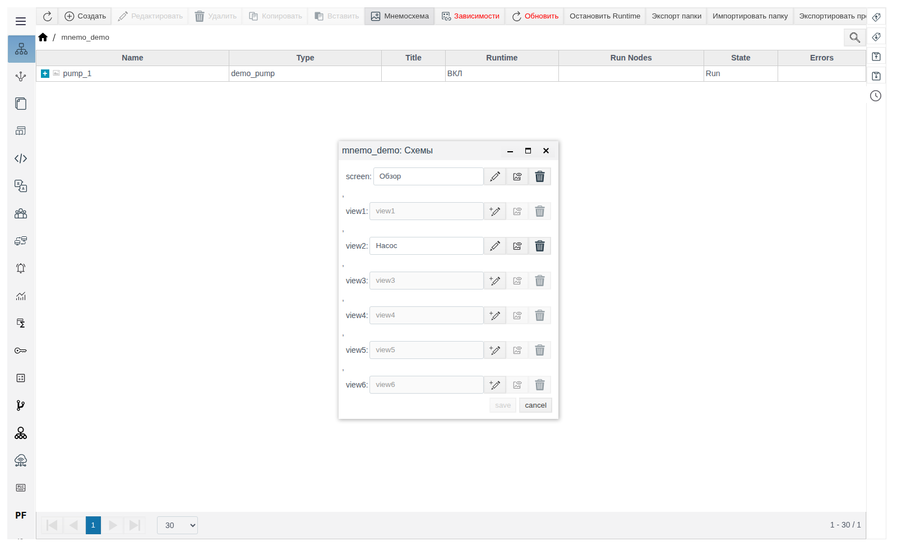

Каждая строка — отдельная схема со своим содержимым: элементы, нарисованные в `screen`, в `view1` не появляются, и наоборот.

Пока схема не сохранена, строка серая, просмотр и удаление недоступны. После первого сохранения поле имени становится редактируемым: введите понятное имя (в примере `Обзор`) и нажмите **save**. Имя показывается в окне «Схемы» и в заголовке редактора; служебное название строки (`screen`, `view1`…) не меняется.

## Назначение схем

| Схема | Где показывается |
|---|---|
| `screen` | Основная схема папки. Открывается в Runtime, когда оператор выбирает папку в меню **Мнемосхемы** (раздел [«Схема в Runtime»](#схема-в-runtime) ниже) |
| `view1`…`view15` | Дополнительные схемы папки. В меню Runtime их нет: их показывают внутри других схем элементом **Folder Screen** |
| `settings` | Вкладка **Пользователь** в форме свойств папки в Studio |

Те же 17 мест есть у контента прототипа. Его схемы вставляются на мнемосхемы проекта элементом «Прототип», а `settings` прототипа показывается в форме каждого экземпляра.

Любую сохранённую схему, в том числе `settings`, можно выбрать в **Folder Screen** и в окне вставки прототипа: они перечисляют схемы по именам.

## Схема внутри схемы: Folder Screen

Элемент **Folder Screen** (палитра **Controls**) показывает внутри одной схемы другую схему любой папки. Так одну и ту же картинку (узел, агрегат, легенду) рисуют один раз и показывают на нескольких экранах.

1. Нарисуйте и сохраните встраиваемую схему, например `view2` папки `mnemo_demo`, и дайте ей имя в окне «Схемы» (в примере `Насос`).
2. Откройте схему, в которую встраиваете, и перетащите на холст **Folder Screen**. Пока схема не выбрана, элемент пишет «Screen folder is undefined» и «View is undefined».
3. В панели **Properties** откройте группу **settings**. В свойстве `folder_list` нажмите лупу и выберите папку в дереве проекта (**ОК**), затем выберите схему в списке **View**. В списке — сохранённые схемы этой папки по именам; схема, которую вы сейчас редактируете, в него не попадает.
4. Задайте положение и размер элемента в группе **geometry** и сохраните.

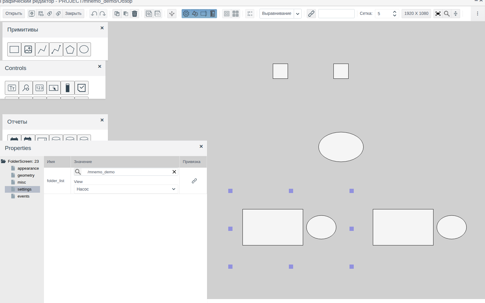

Встроенная схема растягивается или сжимается до размера элемента целиком. Чтобы она отображалась один к одному, задайте встраиваемой схеме размер элемента: в её свойствах `Screen: 0` → **geometry** → `width` и `height` (в примере у `view2` и у элемента 400 × 250).

## Схемы прототипа

У прототипа те же 17 схем: **Прототипы** → выделите прототип → **Контент** → в корне контента **Мнемосхема**. Работа с ними в редакторе такая же, как со схемами папки.

Чтобы поставить схему прототипа на мнемосхему проекта, нужен экземпляр этого прототипа в проекте (в примере `pump_1` в папке `mnemo_demo`).

1. Нажмите на панели инструментов редактора кнопку **Прототипы**. Откроется окно «Select Prototype view» со списком прототипов; раскройте прототип и выделите схему — справа появится её вид.
2. Нажмите **Выбор**, в дереве проекта выделите экземпляр и нажмите **ОК**.
3. Щёлкните на холсте в месте, где должен стоять элемент.

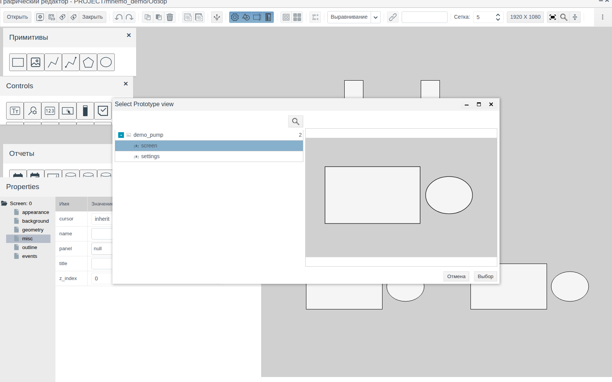

На схеме появится элемент `Prototype` размером со схему прототипа. В группе **settings**: `instance` — экземпляр, `prototype` и `view` — прототип и схема, только для чтения.

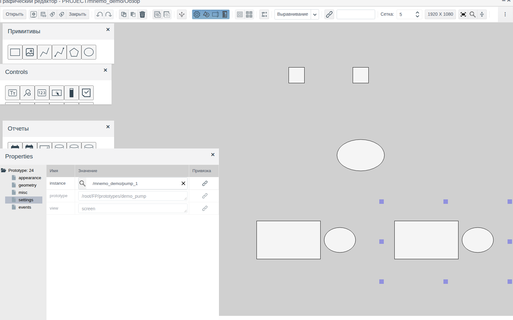

Схема прототипа рисуется один раз; для каждого экземпляра ставится свой элемент «Прототип» с этим экземпляром в `instance`.

## Вкладка «Пользователь»: схема settings

Форма свойств папки (папка → **Редактировать**) состоит из двух вертикальных вкладок: **Система** — поля папки, **Пользователь** — схема `settings` этой папки. Пока `settings` не сохранена, вкладка **Пользователь** неактивна.

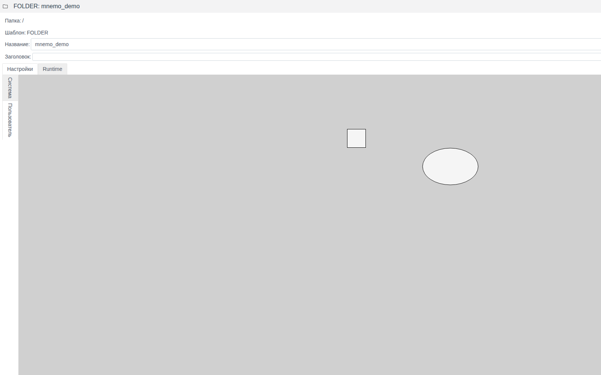

Схема `settings` прототипа показывается на вкладке **Пользователь** в форме каждого его экземпляра.

## Окно редактора

Редактор открывается на весь экран. В заголовке — «Графический редактор - PROJECT/<папка>/<имя схемы>», справа кнопки свернуть и закрыть.

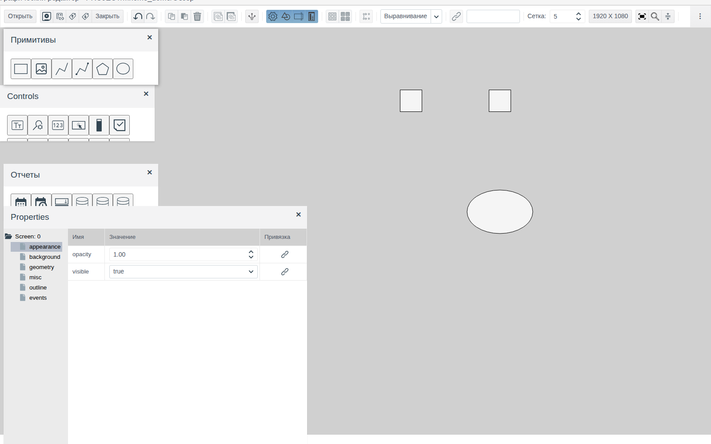

Под заголовком — панель инструментов. Кнопки без подписи показывают назначение во всплывающей подсказке. Каждая кнопка описана в разделе, где ей пользуются.

Поверх холста лежат четыре панели. Их перетаскивают за заголовок, закрывают крестиком и открывают снова кнопками панели инструментов:

| Панель | Кнопка | Содержимое |
|---|---|---|
| **Примитивы** | **Рисование** | Фигуры: прямоугольник, изображение, ломаная, соединительная линия, полигон, эллипс |
| **Controls** | **Элементы управления** | Поля ввода, кнопки, списки, индикаторы, тренды и другие элементы |
| **Отчеты** | **Элементы отчетов** | Выбор даты, источники данных, таблица, столбчатая диаграмма |
| **Properties** | **Свойства** | Свойства выделенного элемента |

Положение и видимость панелей запоминаются для пользователя и восстанавливаются при следующем открытии редактора.

## Холст

Холст — серая область схемы. Размер новой схемы задаёт кнопка с размером экрана на панели инструментов (по умолчанию **1920 X 1080**). Она открывает окно «Задание размера экрана клиента» с полями **Ширина (px)** и **Высота (px)** от 400 до 30000. Значение общее для проекта и действует на схемы, созданные после изменения. Размер существующей схемы меняется в её свойствах, см. [Панель свойств](#панель-свойств).

**Масштаб.** Ctrl + колесо мыши увеличивает и уменьшает холст. Кнопка **Zoom** (лупа) открывает панель с текущим масштабом в процентах, кнопками **−**, **+** и **Сброс** (возврат к 100 %).

**Сетка.** Поле **Сетка** задаёт шаг в пикселях (от 1 до 100, по умолчанию 5). К сетке привязываются координаты при перетаскивании и изменении размера; на шаг сетки сдвигают элемент клавиши со стрелками.

## Добавление элементов

Перетащите значок из палитры на холст. Элемент появится в точке отпускания, станет выделенным, и в панели **Properties** откроются его свойства. Название элемента видно во всплывающей подсказке значка.

Каждый элемент получает номер, уникальный в пределах схемы. Номер показан в корне дерева свойств: `Rectangle: 1`, `Ellipse: 3`.

## Выделение

| Действие | Результат |
|---|---|
| Щелчок по элементу | Выделяет элемент, снимает выделение с остальных |
| Ctrl + щелчок | Добавляет элемент к выделению |
| Рамка: нажать на пустом месте холста и протянуть | Выделяет элементы, которые целиком попали в рамку. Задетые рамкой частично не выделяются |
| Ctrl + A | Выделяет все элементы схемы |
| Щелчок по пустому месту | Снимает выделение |

Выделенный элемент обведён маркерами. При выделении нескольких элементов корень дерева свойств называется `Selection:`, в нём показаны общие группы свойств и узел **subitems** со списком выделенных элементов. Значение, заданное в таблице свойств, применяется ко всем выделенным элементам.

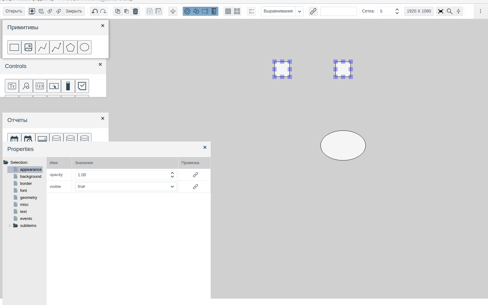

## Перемещение и размер

- **Перетаскивание** перемещает выделенные элементы; координаты привязываются к сетке.
- **Стрелки** сдвигают выделенные элементы на шаг сетки.
- **Маркеры** по углам и сторонам выделения меняют размер; размер тоже привязывается к сетке.
- **Точно** положение и размер задаются в группе **geometry** панели **Properties**: `left`, `top`, `width`, `height` в пикселях от левого верхнего угла схемы.

## Панель свойств

Слева в панели **Properties** — дерево групп свойств выделенного элемента, справа — таблица выбранной группы с колонками **Имя**, **Значение** и **Привязка**. Набор групп зависит от элемента, например у прямоугольника: **appearance**, **background**, **border**, **font**, **geometry**, **misc**, **text**, **events**.

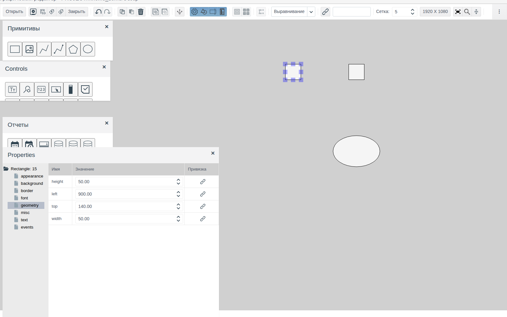

Если щёлкнуть пустое место холста, панель показывает свойства самой схемы — `Screen: 0`. Группы у схемы свои: **appearance**, **background**, **geometry**, **misc**, **outline**, **events**. В **geometry** задаётся размер схемы (`width`, `height`).

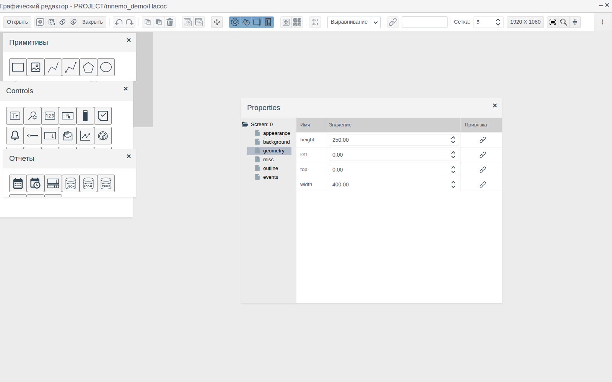

Значение меняется прямо в ячейке: число — вводом или стрелками, вариант — из списка. Изменение сразу видно на холсте. Кнопка в колонке **Привязка** связывает свойство с данными проекта, группа **events** задаёт реакцию на события; пример обоих — в документе [«Кнопки и ввод значений»](controls.md), разделы [«Связь элемента с тегом»](controls.md#связь-элемента-с-тегом) и [«Кнопка»](controls.md#кнопка).

## Копирование, вставка, удаление

| Действие | Клавиши | Кнопка |
|---|---|---|
| Копировать выделенное | Ctrl + C | **Копировать** |
| Вставить | Ctrl + V | **Вставить** |
| Удалить выделенное | Delete | **Удалить** |

Копия появляется со сдвигом на 10 px вправо и вниз от оригинала и становится выделенной. Повторная вставка даёт ещё одну копию со следующим сдвигом.

**Копирование оформления.** Выделите образец и нажмите **Копировать свойства**, затем выделите один или несколько элементов и нажмите **Вставить свойства**. Переносятся свойства оформления — цвета фона и текста, рамка, шрифт; положение, размер и прозрачность не меняются.

## Отмена и повтор

Ctrl + Z (кнопка **Отменить действие**) отменяет последнее действие, Ctrl + Shift + Z (кнопка **Вернуть действие**) повторяет отменённое. Шагом считается каждое действие: добавление, перемещение, сдвиг стрелкой, изменение свойства, удаление, выравнивание, группировка.

## Выравнивание

Выделите два или больше элементов и выберите режим в списке **Выравнивание** на панели инструментов.

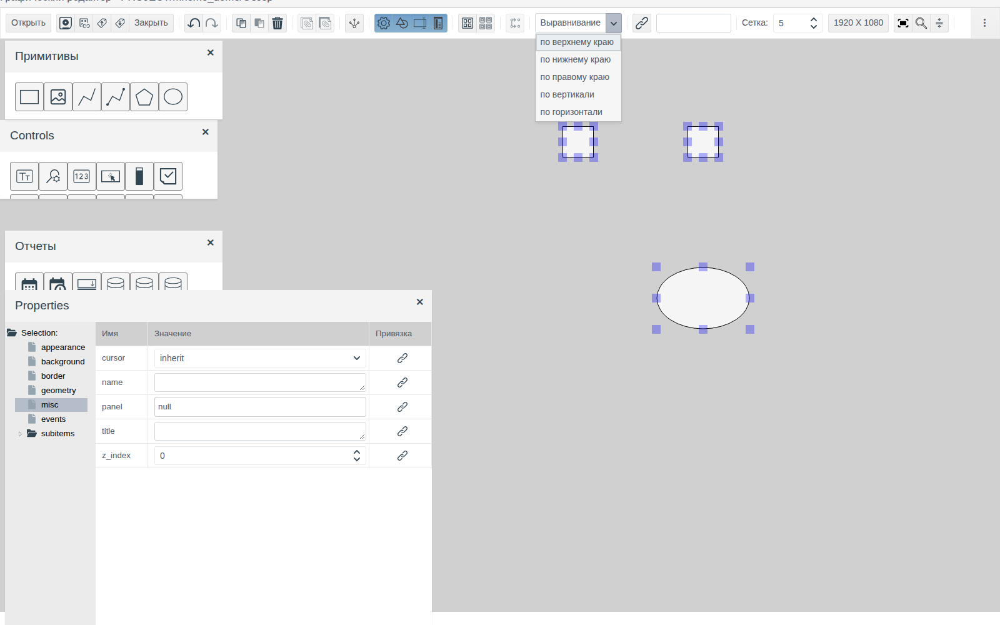

| Режим | Что делает |
|---|---|
| **по верхнему краю** | Верхние края — по самому верхнему элементу |
| **по нижнему краю** | Нижние края — по самому нижнему элементу |
| **по правому краю** | Правые края — по самому правому элементу |
| **по вертикали** | Центры — на одной вертикали, по самому левому центру |
| **по горизонтали** | Центры — на одной горизонтали, по самому верхнему центру |

Выравнивание отменяется одним шагом Ctrl + Z.

## Группировка

Выделите элементы и нажмите **Группировать**. Группа получает свой номер (`Group: 6`) и свойства **appearance**, **background**, **border**, **geometry**, **misc**, **events**; узел **subitems** содержит входящие в неё элементы. Щелчок по любому элементу группы выделяет всю группу, перетаскивание двигает её целиком.

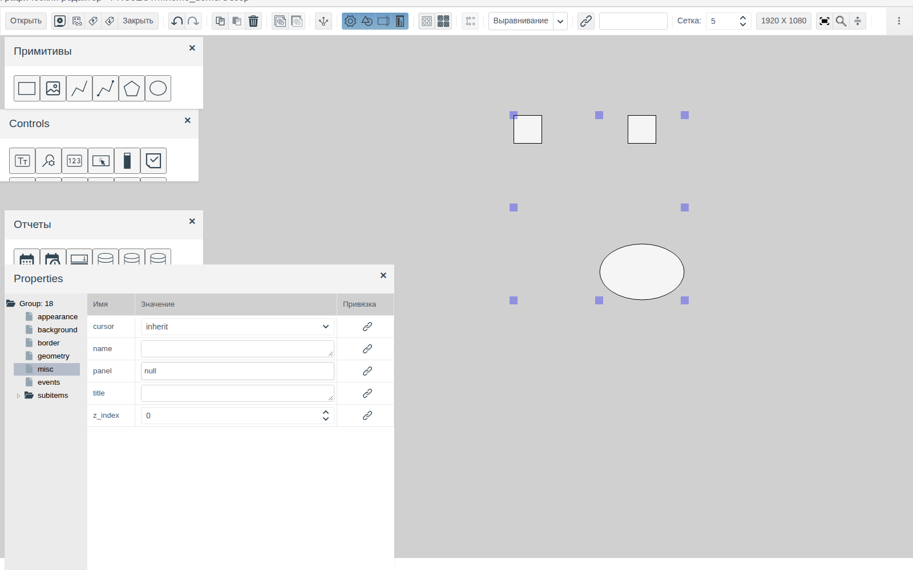

**Разгруппировать** возвращает элементы в схему по отдельности. Кнопка активна, когда выделена группа.

## Сохранение и закрытие

Сохраните схему клавишами Ctrl + S или кнопкой **Сохранить**. После сохранения кнопка становится неактивной до следующего изменения.

Кнопка **Проверить зависимости** проверяет, что объекты проекта, на которые ссылаются элементы схемы, существуют. Если битых ссылок нет, появится сообщение об этом.

**Закрытие.** **Закрыть** на панели инструментов закрывает схему, крестик в заголовке — весь редактор. Если есть несохранённые изменения, редактор спросит «<путь> - сохранить изменения?»: **yes** сохраняет и закрывает, **no** просит подтвердить закрытие без сохранения.

**Автосохранение.** Раз в минуту редактор сохраняет копию изменённой схемы для текущего пользователя. Если работа прервалась без сохранения (закрыта вкладка, разорвался сеанс), при следующем открытии схемы появится вопрос «Имеется несохраненная копия, восстановить?». **yes** открывает копию, **no** — последнюю сохранённую версию. Восстановленную копию сохраните обычным образом.

## Экспорт и импорт схемы

**Экспорт в файл** сохраняет текущую схему в файл `.scn`. Имя файла собирается из пути схемы: `PROJECT_mnemo_demo_screen.scn`.

**Импорт из файла** открывает окно «Выбор файла». Выберите файл `.scn` через **Select files...** и нажмите **ОК**: содержимое открытой схемы заменится содержимым файла. Сохраните схему, чтобы закрепить результат.

## Одновременное редактирование

Схему одновременно правит только один сеанс. Если схема уже открыта в редакторе, другой пользователь (или тот же пользователь в другом браузере) получит окно «Подтвердить»: «В настоящее время граф. редактор используется: <пользователь>. Доступен только режим просмотра. Хотите открыть?». **Да** открывает схему в режиме предварительного просмотра.

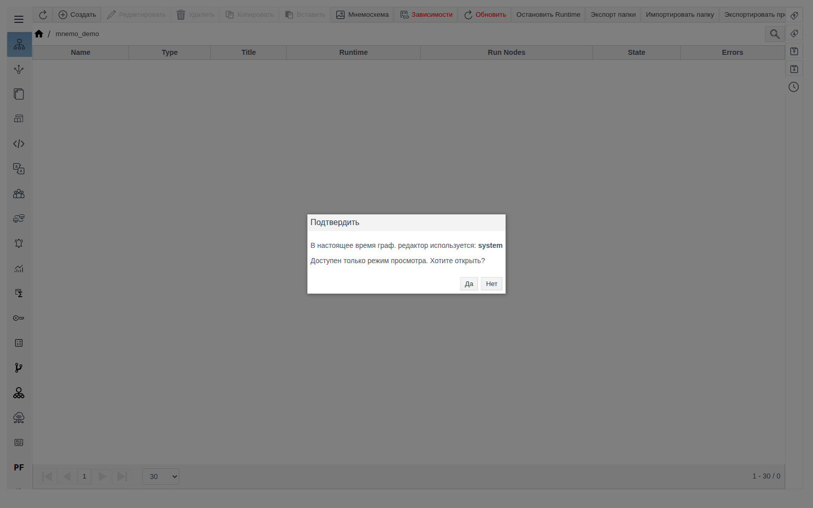

Схема освобождается, когда её закрывают в редакторе или когда закрывается вкладка браузера, в которой она открыта.

## Схема в Runtime

В Runtime (`http://<сервер>:9000/fp/runtime`) откройте меню, затем **Мнемосхемы**. В списке — папки проекта, у которых сохранена схема `screen`. Щелчок по папке открывает эту схему; путь папки показан в верхней строке. Встроенные схемы (Folder Screen) и элементы «Прототип» видны внутри неё: на снимке в нижнем ряду слева — `view2` «Насос», справа — схема прототипа `demo_pump`.

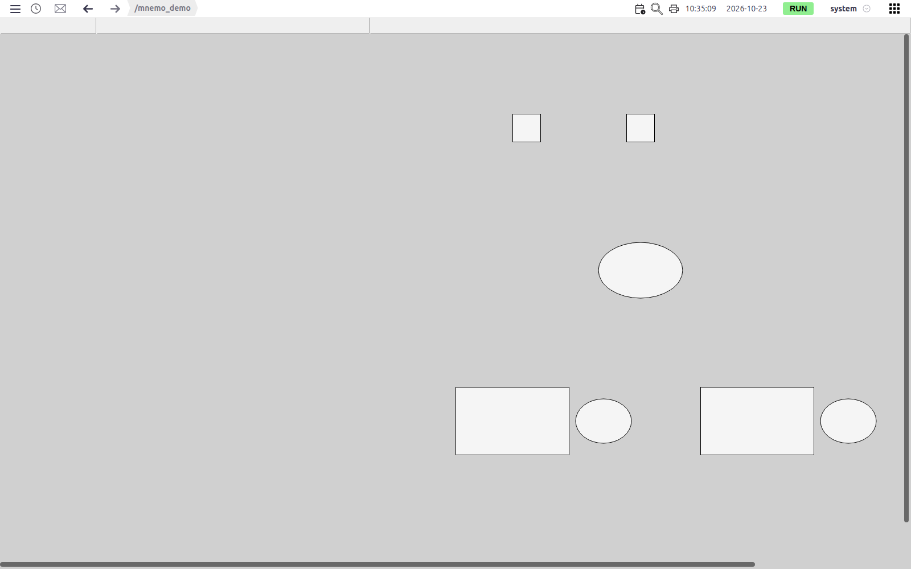

Чтобы посмотреть схему, не выходя из Studio, используйте кнопку просмотра в окне «Схемы».

# Заключение

Порядок работы со схемой:

1. Двойным щелчком войдите в папку, нажмите **Мнемосхема** и создайте схему: `screen` — экран для Runtime, `view1`…`view15` — фрагменты для встраивания через **Folder Screen**, `settings` — вкладка **Пользователь** формы папки.
2. Перетащите элементы из палитр на холст.
3. Расставьте их: перетаскиванием и стрелками с привязкой к сетке, точно — в группе **geometry**; выровняйте и сгруппируйте.
4. Настройте оформление в панели **Properties**; одинаковое оформление переносите кнопками **Копировать свойства** / **Вставить свойства**.
5. Сохраните (Ctrl + S) и при желании дайте схеме имя в окне «Схемы».
6. Повторяющиеся фрагменты рисуйте один раз: в `viewN` папки (встраивание через **Folder Screen**) или в схеме прототипа (элемент «Прототип» на каждый экземпляр).
7. Проверьте результат кнопкой просмотра в окне «Схемы» или в Runtime → **Мнемосхемы**.
