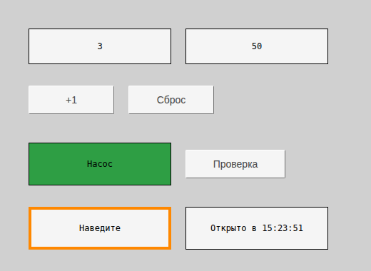
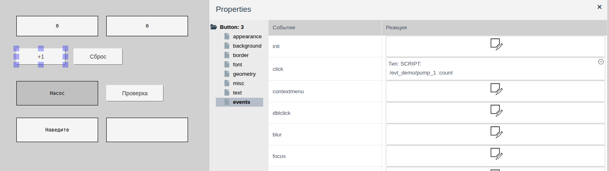
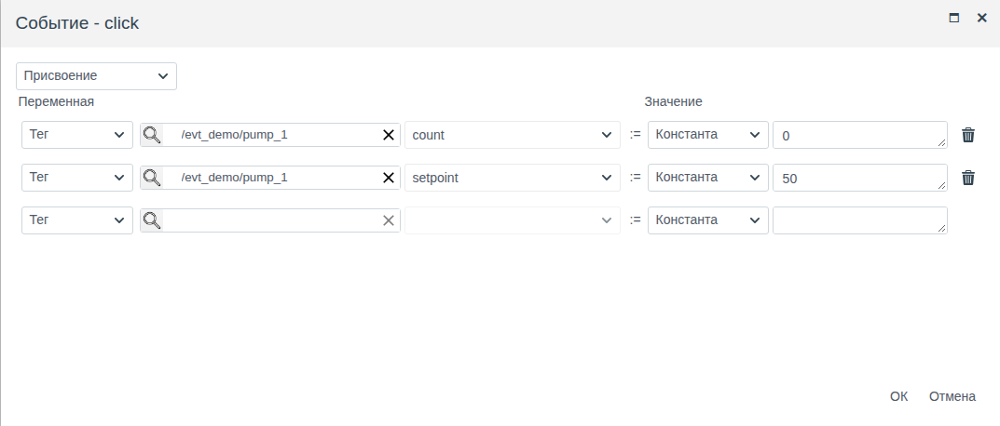
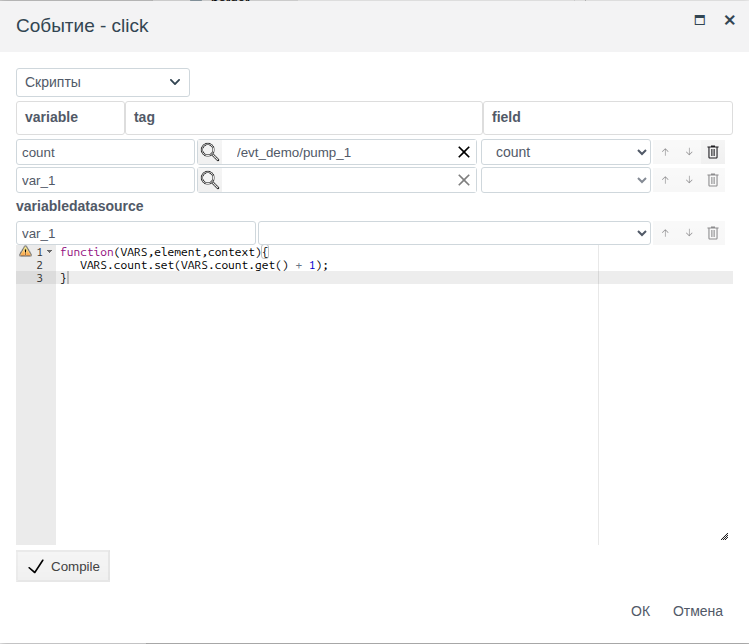
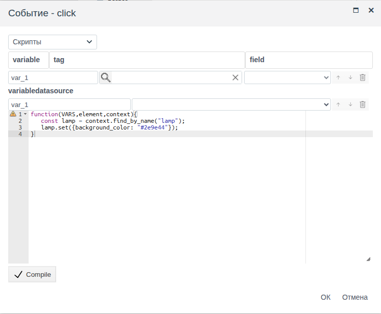

# Скрипты и события

Документ для инженера-интегратора, который настраивает реакции мнемосхемы на действия оператора: кнопка записывает значения в теги, щелчок меняет вид другого элемента, наведение указателя подсвечивает элемент, схема выполняет скрипт при открытии.

# Содержание

- [Глоссарий](#глоссарий)
- [Введение](#введение)
- [Основная часть](#основная-часть)
    - [Группа events](#группа-events)
    - [События](#события)
    - [Окно события](#окно-события)
    - [Присвоение](#присвоение)
    - [Скрипт события](#скрипт-события)
    - [Что доступно из скрипта](#что-доступно-из-скрипта)
    - [Событие и привязка](#событие-и-привязка)
- [Заключение](#заключение)

# Глоссарий

| Термин | Значение |
|---|---|
| Событие | Действие оператора или изменение на схеме, на которое элемент может отреагировать: щелчок, наведение указателя, нажатие клавиши, открытие схемы |
| Реакция | То, что выполняется при событии: присвоение или скрипт. Задаётся в колонке **Реакция** группы **events** |
| Присвоение | Реакция без скрипта: записать в поле тега константу или значение другого поля |
| Имя элемента | Свойство `name` группы **misc**. По нему скрипт находит элемент на схеме |

Термины «Тег», «Привязка» — в документе [«Кнопки и ввод значений»](controls.md#глоссарий), «Переменная» — в [«Привязках и анимации»](bindings.md#глоссарий), «Схема», «Элемент», «Палитра» — в [«Редакторе мнемосхем»](editor.md#глоссарий).

# Введение

Привязка (см. [«Привязки и анимация»](bindings.md)) передаёт данные на схему: свойство элемента следует за полем тега. Событие работает в обратную сторону: действие оператора запускает реакцию, и та записывает значения в теги или меняет свойства элементов. Реакция — присвоение без программирования или скрипт на JavaScript.

Документ описывает список событий, окно события, присвоение, скрипт события и то, что доступно из скрипта. Работа в редакторе (добавление элементов, панель свойств, сохранение) описана в [«Редакторе мнемосхем»](editor.md), кнопка и поля ввода — в [«Кнопках и вводе значений»](controls.md).

Сквозной пример — схема `screen` папки `evt_demo`. В папке объект `pump_1` собственного примитива `demo_evt`:

| Поле | Тип | Смысл |
|---|---|---|
| `count` | integer | Счётчик нажатий |
| `setpoint` | float | Уставка |

На схеме:

| Элемент | Событие | Реакция |
|---|---|---|
| Два прямоугольника вверху | — | Показывают `count` и `setpoint` (привязка `text`) |
| Кнопка «+1» | `click` | Скрипт: увеличить `count` на 1 |
| Кнопка «Сброс» | `click` | Присвоение: `count` := 0, `setpoint` := 50 |
| Прямоугольник «Насос», `name` = `lamp` | — | — |
| Кнопка «Проверка» | `click` | Скрипт: окрасить «Насос» в зелёный |
| Прямоугольник «Наведите» | `mouseenter`, `mouseleave` | Скрипт: оранжевая рамка при наведении, обычная — когда указатель уходит |
| Прямоугольник справа внизу | `init` | Скрипт: показать время открытия схемы |



Понадобится доступ к Studio (`http://<сервер>:9000/fp/studio`) под учётной записью с правом изменять проект. Результат проверяется в Runtime (`http://<сервер>:9000/fp/runtime`).

# Основная часть

## Группа events

У каждого элемента схемы и у самой схемы (щелчок по пустому месту холста, в панели — `Screen: 0`) в панели **Properties** есть группа **events**. В ней таблица: колонка **Событие** — имя события, колонка **Реакция** — настроенная реакция.

Пустая ячейка **Реакция** — кнопка, которая открывает окно «Событие - <имя>». После **ОК** в ячейке описание реакции:

- `Тип: SCRIPT:` и по строке на каждую переменную скрипта: `/<папка>/<объект> :<поле>`;
- для присвоения — по строке на каждое присвоение: `/<папка>/<объект>-><поле> := <значение>`.

В примере у кнопки «+1» в ячейке `/evt_demo/pump_1 :count`, у кнопки «Сброс» — `/evt_demo/pump_1->count := 0` и `/evt_demo/pump_1->setpoint := 50`.

Щелчок по описанию открывает реакцию для изменения. Значок ⊖ в углу ячейки удаляет реакцию после подтверждения → **yes**.



Реакции работают только в Runtime: в редакторе щелчок выделяет элемент. Реакции сохраняются вместе со схемой: после настройки сохраните схему.

## События

Список событий одинаков у всех элементов. У элементов ввода — полей ввода, флажка, ползунка, списков, выбора объекта и выбора из каталога — есть ещё событие `input`.

| Событие | Когда срабатывает |
|---|---|
| `init` | Схема загрузилась в Runtime (см. [Возврат на схему](screens.md#возврат-на-схему)). Подходит для начальной настройки вида |
| `click` | Щелчок левой кнопкой |
| `dblclick` | Двойной щелчок. Перед ним срабатывают два `click` |
| `contextmenu` | Щелчок правой кнопкой |
| `mousedown`, `mouseup` | Кнопка мыши нажата, отпущена над элементом |
| `mouseenter`, `mouseleave` | Указатель вошёл в элемент, вышел из него |
| `focus`, `focusin` | Элемент получил фокус: щелчок по полю ввода, переход по Tab |
| `blur`, `focusout` | Элемент потерял фокус |
| `keydown` | Нажата клавиша, пока элемент в фокусе |
| `keypress` | Нажата клавиша, которая вводит символ, или Enter |
| `input` | Значение элемента изменилось: пришло из тега при открытии схемы или при изменении поля, введено оператором |

Фокус и клавиши получают элементы, с которыми оператор работает с клавиатуры: кнопка и поле ввода с `type` = `direct`. События мыши, `init` и `input` подходят для любого элемента, у которого они есть.

Порядок событий при щелчке по полю ввода: `mousedown`, `focusin`, `focus`, `mouseup`, `click`.

## Окно события

Список вверху окна выбирает тип реакции:

| Тип | Что делает |
|---|---|
| **Присвоение** | Записывает значения в поля тегов. См. [Присвоение](#присвоение) |
| **Скрипты** | Выполняет функцию на JavaScript. См. [Скрипт события](#скрипт-события) |

**ОК** доступна, когда реакция заполнена. **Отмена** закрывает окно без изменений.

## Присвоение

Присвоение — таблица строк «**Переменная** := **Значение**». Каждая строка записывает одно значение в одно поле.

| Колонка | Что выбрать |
|---|---|
| **Переменная** | **Тег**, лупа → объект → **ОК**, справа поле, в которое записывается значение |
| **Значение** | **Константа** и значение или **Тег**, объект и поле, значение которого записывается |

Константа вводится так, как этого требует поле: число — в числовое поле, `true`/`false` — выбором из списка, строка — текстом. После заполнения строки ниже появляется пустая — для следующего присвоения. Корзина удаляет строку. При событии строки выполняются по порядку сверху вниз.

В примере кнопка «Сброс» на `click` записывает в `pump_1` два поля: `count` := 0, `setpoint` := 50.



Присвоение подходит для кнопок «Пуск», «Стоп», «Сброс», «Задать уставку 50»: значения известны заранее. Пример кнопок «Пуск» и «Стоп» — в разделе [Кнопка](controls.md#кнопка) документа «Кнопки и ввод значений». Если значение нужно вычислить, используйте скрипт.

## Скрипт события

Скрипт — функция на JavaScript, которая выполняется при событии. Окно устроено как окно привязки script (см. [Привязка script](bindings.md#привязка-script)):

1. Выберите тип **Скрипты**.
2. Задайте переменные в таблице **variable** / **tag** / **field**: имя переменной, объект (лупа) и поле. Пустая нижняя строка добавляет переменную. Скрипту, который меняет только элементы схемы, переменные не нужны.
3. Напишите тело функции в редакторе и нажмите **Compile**.
4. Нажмите **ОК**.

Отличие от привязки: функция ничего не возвращает. Она выполняет действия — записывает поля тегов, меняет свойства элементов. Перед запуском скрипта значения всех переменных читаются заново, поэтому скрипт видит текущие значения полей на момент события.

В примере кнопка «+1» увеличивает счётчик. Переменная `count` — поле `pump_1.count`:

```javascript
function(VARS,element,context){
   VARS.count.set(VARS.count.get() + 1);
}
```



## Что доступно из скрипта

Функция получает три аргумента.

| Аргумент | Что даёт |
|---|---|
| `VARS` | Переменные из таблицы окна. `VARS.<имя>.get()` — значение поля, `VARS.<имя>.set(значение)` — запись в поле тега |
| `element` | Элемент, на котором произошло событие. `element.get("<свойство>")` — значение свойства, `element.set({<свойство>: значение, …})` — изменение одного или нескольких свойств |
| `context` | Схема, открытая в Runtime. `context.find_by_name("<имя>")` — элемент схемы с этим значением `name`; у него те же `get` и `set` |

Имена свойств — те же, что в панели **Properties**: `text`, `background_color`, `border_width`, `visible` и другие. Свойства, изменённые скриптом, сохраняются, пока схема не загрузится заново: при возврате на неё элементы такие, какими их оставил скрипт, после новой загрузки — такие, как в редакторе (см. [Возврат на схему](screens.md#возврат-на-схему)).

Изменить сам элемент — подсветка при наведении. В примере прямоугольник «Наведите», событие `mouseenter`:

```javascript
function(VARS,element,context){
   element.set({border_color: "#ff8800", border_width: 4});
}
```

Событие `mouseleave` возвращает рамку: `element.set({border_color: "#000000", border_width: 1});`.

Изменить другой элемент — по его имени: задайте элементу `name` и найдите его через `context.find_by_name`. В примере прямоугольнику «Насос» задано `name` = `lamp` (группа **misc**). Кнопка «Проверка», событие `click`:

```javascript
function(VARS,element,context){
   const lamp = context.find_by_name("lamp");
   lamp.set({background_color: "#2e9e44"});
}
```



Настроить вид при открытии схемы — событие `init`. В примере прямоугольник справа внизу показывает время открытия:

```javascript
function(VARS,element,context){
   element.set({text: "Открыто в " + new Date().toLocaleTimeString()});
}
```

## Событие и привязка

| | Привязка | Событие |
|---|---|---|
| Направление | Данные → свойство элемента | Действие оператора → запись в теги, изменение свойств |
| Когда выполняется | При открытии схемы и при каждом изменении поля | При событии |
| Где задаётся | Колонка **Привязка** у свойства | Колонка **Реакция** группы **events** |
| Без программирования | Тег, маскирование, карта значений, мерцание | Присвоение |
| Скрипт | Возвращает значение свойства через `return` | Выполняет действия, ничего не возвращает |

Чтобы оператор изменил то, что показывает привязка, событие записывает поле тега, а привязка выводит новое значение на схему. Так работают «+1» и «Сброс» в примере.

# Заключение

| Задача | Как сделать |
|---|---|
| Записать заранее известное значение в тег по кнопке | Присвоение на `click` с константой |
| Скопировать значение одного поля в другое | Присвоение: **Значение** = **Тег** |
| Записать вычисленное значение | Скрипт: `VARS.<имя>.set(…)` |
| Изменить вид элемента при наведении | Скрипт на `mouseenter` и `mouseleave` с `element.set` |
| Изменить другой элемент | `name` у элемента и `context.find_by_name` в скрипте |
| Выполнить действие при открытии схемы | Событие `init` |
| Отреагировать на изменение значения поля ввода | Событие `input` |

Порядок работы:

1. Решите, что делает реакция: записывает значения, известные заранее (присвоение), или вычисляет их и меняет элементы (скрипт).
2. Элементам, которые меняет скрипт, задайте `name`.
3. Выделите элемент, в группе **events** щёлкните ячейку **Реакция** нужного события и настройте реакцию.
4. Сохраните схему и проверьте её в Runtime. Записанные значения видны в форме объекта в Studio.
