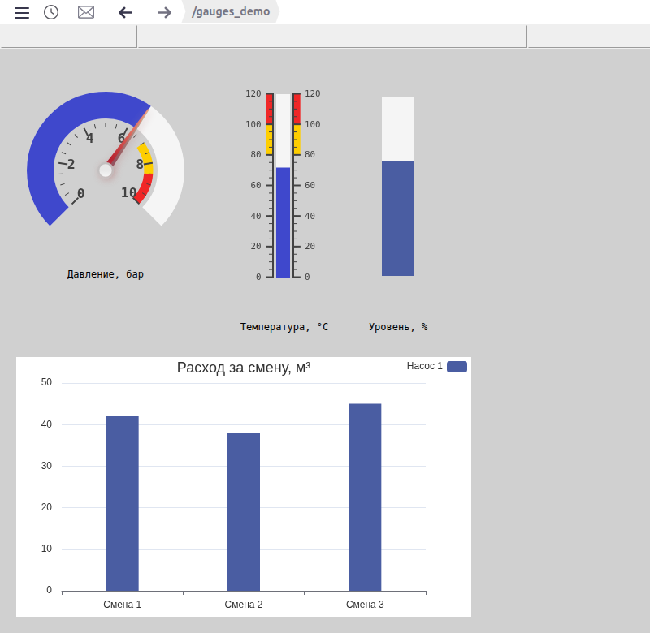
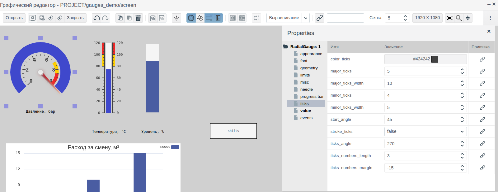
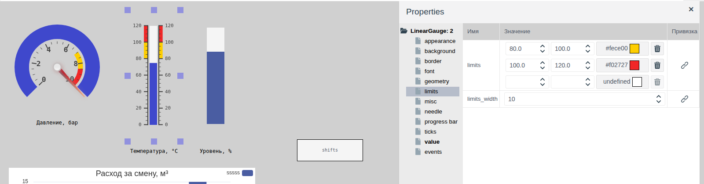
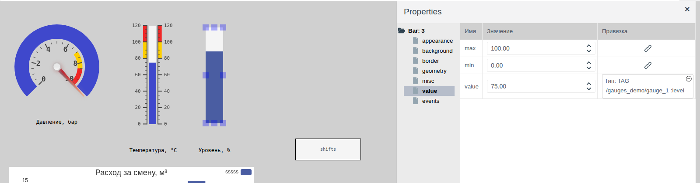
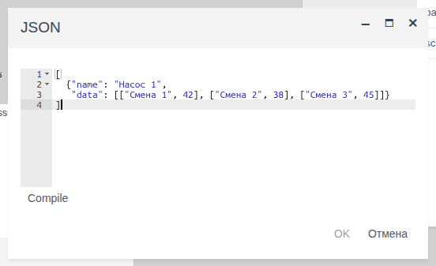
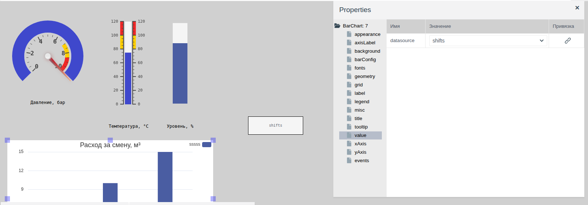

# Стрелочные и линейные индикаторы

Документ для инженера-интегратора, который показывает оператору на мнемосхеме измеряемые величины: давление на круговой шкале, температуру на линейной шкале, уровень столбиком и сводные цифры столбчатой диаграммой.

# Содержание

- [Глоссарий](#глоссарий)
- [Введение](#введение)
- [Основная часть](#основная-часть)
    - [Элементы на палитрах](#элементы-на-палитрах)
    - [Шкала и значение](#шкала-и-значение)
    - [Круговой индикатор](#круговой-индикатор)
    - [Линейный индикатор](#линейный-индикатор)
    - [Цветные зоны](#цветные-зоны)
    - [Бар](#бар)
    - [Столбчатая диаграмма](#столбчатая-диаграмма)
- [Заключение](#заключение)

# Глоссарий

| Термин | Значение |
|---|---|
| Индикатор | Элемент схемы, который показывает число из поля тега на шкале: дугой, столбиком или стрелкой. Оператор значение не меняет |
| Цветная зона | Участок шкалы индикатора, закрашенный своим цветом: предупредительный или аварийный диапазон |
| Источник данных | Невидимый в Runtime элемент схемы, который хранит набор данных для других элементов. Здесь — **Local Datasource** с палитры **Отчеты** |
| Ряд | Набор столбцов диаграммы с общим названием, по одному столбцу на категорию |

Термины «Тег», «Привязка» — в документе [«Кнопки и ввод значений»](controls.md#глоссарий), «Схема», «Палитра», «Элемент» — в [«Редакторе мнемосхем»](editor.md#глоссарий).

# Введение

Индикаторы показывают текущее значение поля тега на шкале и обновляются вместе с ним. Шкала, деления и цветные зоны дают оператору понять, в норме ли величина, без чтения цифр.

Документ описывает три индикатора (круговой, линейный и бар) и столбчатую диаграмму: их свойства, привязку к тегу и вид в Runtime. Работа в редакторе (добавление, выделение, свойства, сохранение) описана в [«Редакторе мнемосхем»](editor.md), привязка свойства к полю тега — в [«Кнопках и вводе значений», раздел «Связь элемента с тегом»](controls.md#связь-элемента-с-тегом), подписи сделаны прямоугольниками из [«Графических элементов»](graphics.md#прямоугольник).

Сквозной пример — схема `screen` папки `gauges_demo`. Данные лежат в объекте `gauge_1` собственного примитива `demo_gauge` с полями `pressure`, `temp` и `level` (все float). На схеме давление 0–10 бар на круговом индикаторе, температура 0–120 °C на линейном, уровень 0–100 % баром и диаграмма расхода по сменам.



Понадобится доступ к Studio (`http://<сервер>:9000/fp/studio`) под учётной записью с правом изменять проект. Результат проверяется в Runtime (`http://<сервер>:9000/fp/runtime`).

# Основная часть

## Элементы на палитрах

Название элемента видно во всплывающей подсказке значка палитры, тип — в корне дерева свойств.

| Палитра | Подсказка значка | Корень дерева свойств | Что показывает |
|---|---|---|---|
| **Controls** | RadialGauge | `RadialGauge` | Число на круговой шкале: дугой и стрелкой |
| **Controls** | LinearGauge | `LinearGauge` | Число на прямой шкале с делениями, как термометр |
| **Controls** | Бар | `Bar` | Число столбиком без шкалы: доля заполнения от `min` до `max` |
| **Отчеты** | Bar Chart | `BarChart` | Набор чисел столбцами по категориям из источника данных |

Группы **appearance**, **geometry** и **misc** такие же, как у остальных элементов схемы (см. [«Графические элементы», раздел «Общие свойства»](graphics.md#общие-свойства)).

## Шкала и значение

У трёх индикаторов значение и диапазон шкалы задаются в группе **value**:

| Свойство (группа **value**) | Назначение |
|---|---|
| `min` | Начало шкалы |
| `max` | Конец шкалы |
| `value` | Показываемое значение. Привяжите его к полю тега типа `integer` или `float` |

Привязка задаётся кнопкой в колонке **Привязка** строки `value` (см. [«Кнопки и ввод значений», раздел «Связь элемента с тегом»](controls.md#связь-элемента-с-тегом)). В редакторе индикатор показывает число из колонки **Значение**, в Runtime — значение поля тега.

У кругового и линейного индикатора деления и подписи шкалы настраиваются в группе **ticks**:

| Свойство (группа **ticks**) | Назначение |
|---|---|
| `major_ticks` | На сколько равных частей делится шкала. На границах частей стоят крупные деления с подписями. В примере 0–10 бар и `major_ticks` = 5: подписи 0, 2, 4, 6, 8, 10 |
| `minor_ticks` | Число мелких делений между соседними крупными |
| `major_ticks_width`, `minor_ticks_width` | Длина крупных и мелких делений |
| `color_ticks` | Цвет делений и подписей |
| `stroke_ticks` | `true` — вдоль делений проведена линия шкалы |
| `ticks_numbers_length` | Наибольшее число цифр в подписи. При 3 подпись 33,333 выводится как 33.3 |
| `ticks_numbers_margin` | Сдвиг подписей относительно делений |

Шрифт подписей задаёт группа **font**: `font_numbers` (семейство), `font_numbers_size` (размер), `font_numbers_weight` (`normal` или `bold`).

У индикаторов нет свойства подписи и единиц измерения. Название величины поставьте рядом прямоугольником с текстом, как в примере.

## Круговой индикатор

Элемент **RadialGauge**: дуга шкалы с делениями. Значение показывает цветная дуга от начала шкалы и, если включена, стрелка.



Форму дуги задают свойства группы **ticks**:

| Свойство (группа **ticks**) | Назначение |
|---|---|
| `ticks_angle` | Длина дуги шкалы в градусах, от 30 до 360. 180 — полукруг |
| `start_angle` | Где начинается шкала: угол в градусах от нижней точки круга по часовой стрелке. При `ticks_angle` = 180 и `start_angle` = 90 шкала — верхний полукруг |

В примере `ticks_angle` = 270 и `start_angle` = 45: дуга с разрывом внизу, 0 слева, 10 справа.

Дугу значения настраивает группа **progress bar**:

| Свойство (группа **progress bar**) | Назначение |
|---|---|
| `bar_progress` | `true` — дуга закрашивается от начала шкалы до значения |
| `bar_width` | Толщина дуги |
| `bar_color` | Цвет закрашенной части |
| `bar_color_background` | Цвет незакрашенной части |
| `bar_color_stroke` | Цвет обводки дуги |
| `bar_shadow` | Размер тени дуги, 0 — без тени |

Стрелку настраивает группа **needle**:

| Свойство (группа **needle**) | Назначение |
|---|---|
| `needle` | `true` — стрелка показана |
| `needle_type` | Вид стрелки: `arrow` — заострённая, `line` — линия |
| `needle_start`, `needle_end` | Где начинается и кончается стрелка, в процентах радиуса от центра |
| `needle_width` | Толщина стрелки |
| `needle_color` | Цвет стрелки |
| `needle_circle_size`, `needle_circle_color` | Размер и цвет кружка в центре |

В примере `min` = 0, `max` = 10, `value` привязано к `gauge_1.pressure`, `needle` = `true`.

## Линейный индикатор

Элемент **LinearGauge**: столбик со шкалой, как у термометра. Новый элемент — 120 × 300 пикселей, шкала вертикальная.

Деления и подписи могут стоять с одной или с обеих сторон столбика:

| Свойство (группа **ticks**) | Назначение |
|---|---|
| `tick_side` | С какой стороны деления: `left`, `right`, `both` |
| `number_side` | С какой стороны подписи: `left`, `right`, `both` |
| `ticks_padding` | Отступ делений от столбика |

Столбик настраивает группа **progress bar**. Кроме свойств кругового индикатора, в ней есть:

| Свойство (группа **progress bar**) | Назначение |
|---|---|
| `bar_length` | Длина столбика в процентах длины элемента, от 0 до 100 |
| `bar_begin_circle` | Колба в начале столбика, как у термометра: размер в процентах ширины столбика. 0 — без колбы |

Стрелка включается так же, свойством `needle` группы **needle**. Свойство `needle_side` задаёт сторону стрелки: `left`, `right`, `both`.

В отличие от кругового индикатора, у линейного есть рамка и фон:

| Группа | Свойство | Назначение |
|---|---|---|
| **border** | `border_width`, `border_color` | Толщина и цвет рамки |
| | `border_style` | Вид линии рамки. Пока вид не выбран, рамки нет |
| | `border_radius` | Скругление углов рамки и фона |
| **background** | `transparent` | `true` — фон прозрачный. Так у нового элемента |
| | `background_color` | Цвет фона при `transparent` = `false` |
| | `texture` | Картинка фона из библиотеки изображений, по умолчанию открывается папка `textures`. Закрывает цвет фона |

В примере `min` = 0, `max` = 120, `major_ticks` = 6, `value` привязано к `gauge_1.temp`.

## Цветные зоны

У кругового и линейного индикатора участки шкалы можно закрасить своим цветом: например, жёлтым — предупредительный диапазон, красным — аварийный. Зоны задаются в группе **limits**.



Каждая строка `limits` — одна зона: начало, конец и цвет. Значения начала и конца задаются в единицах шкалы, а не в процентах. Ввод в пустую нижнюю строку добавляет зону, корзина удаляет. Цвет выбирается щелчком по полю цвета (см. [«Графические элементы», раздел «Выбор цвета»](graphics.md#выбор-цвета)). Свойство `limits_width` задаёт толщину полосы зон.

Новый индикатор создаётся с двумя зонами: 60–80 жёлтая и 80–100 красная. Если шкала другая, исправьте их под свой диапазон.

В примере:

| Индикатор | Жёлтая зона | Красная зона |
|---|---|---|
| Давление, 0–10 бар | 7–8,5 | 8,5–10 |
| Температура, 0–120 °C | 80–100 | 100–120 |

Зоны — неподвижная разметка шкалы. По стрелке или концу дуги (у линейного индикатора — столбика) видно, в какую зону попало значение, но их цвет от зоны не меняется.

## Бар

Элемент **Бар**: прямоугольник, закрашенный на долю от `min` до `max`. Шкалы и подписей нет. Подходит для уровня в ёмкости, загрузки, процента открытия.

| Группа | Свойство | Назначение |
|---|---|---|
| **appearance** | `orientation` | `vertical` — заполнение снизу вверх, `horizontal` — слева направо |
| | `bar_color` | Цвет заполненной части |
| **background** | `background_color` | Цвет незаполненной части |
| | `transparent` | `true` — незаполненная часть прозрачна |
| **border** | `border_width`, `border_color`, `border_style` | Рамка. Пока `border_style` не выбран, рамки нет |

Значение ниже `min` показывается пустым баром, выше `max` — полным.



В примере бар 40 × 220 пикселей, `min` = 0, `max` = 100, `value` привязано к `gauge_1.level`. В редакторе бар заполнен на 75 % — это число из колонки **Значение**. В Runtime при уровне 64 % заполнено 64 % высоты (см. [скриншот во «Введении»](#введение)).

## Столбчатая диаграмма

Элемент **Bar Chart** с палитры **Отчеты** рисует столбцы по категориям: расход по сменам, выработку по агрегатам, простой по причинам. Данные диаграмма берёт не из тега, а из источника данных **Local Datasource** той же схемы.

### Источник данных

Источник — элемент **Local Datasource** с палитры **Отчеты**. В редакторе источник выглядит прямоугольником со своим именем, в Runtime его не видно.

| Группа | Свойство | Назначение |
|---|---|---|
| **misc** | `name` | Имя источника. По нему диаграмма находит источник. В примере `shifts` |
| **value** | `schema` | Описание полей набора данных |
| | `data` | Набор данных |

`schema` и `data` редактируются в окне **JSON**: щёлкните поле значения, введите текст, нажмите **Compile**, затем **OK**.

Для диаграммы задайте `schema`:

```
{
  "name": {type: fp.item.types.primitives.String},
  "data": {type: fp.item.types.primitives.Any}
}
```

В `data` — массив рядов. У ряда два поля: `name` — название ряда, `data` — список пар «категория, значение»:

```
[
  {"name": "Насос 1",
   "data": [["Смена 1", 42], ["Смена 2", 38], ["Смена 3", 45]]}
]
```



Категории становятся подписями под столбцами, значения — высотой столбцов. Если рядов несколько, столбцы рядов стоят в каждой категории рядом.

### Свойства диаграммы

Когда источник уже на схеме, перетащите **Bar Chart**, выделите её и в группе **value** выберите в `datasource` имя источника.



| Группа | Свойство | Назначение |
|---|---|---|
| **value** | `datasource` | Источник данных из списка источников схемы |
| **title** | `title` | Заголовок над диаграммой |
| | `align` | Положение заголовка: `left`, `center`, `right` |
| | `titleColor`, `titleFamily`, `titleSize`, `titleWeight` | Шрифт заголовка: цвет, семейство, размер, насыщенность (`normal` или `bold`) |
| **background** | `background_color` | Фон диаграммы |
| **grid** | `gridTop`, `gridLeft`, `gridBottom`, `gridRight` | Отступы области столбцов от краёв элемента, например `10%` |
| | `isGridBackground` | `true` — область столбцов закрашена цветом `gridBackground` |
| | `gridBackground` | Цвет области столбцов |
| **barConfig** | `barColor` | Цвет столбцов. Один на все ряды |
| | `barWidth` | Ширина столбца в пикселях |
| **xAxis** | `xAxisName` | Подпись оси категорий |
| | `xAxisNameLocation` | Место подписи: `start` — у начала оси, `center` — посередине, `end` — у конца |
| **yAxis** | `yAxisName` | Подпись оси значений, например единицы измерения |
| | `yAxisNameLocation` | Место подписи: `start`, `center`, `end`. При `end` подпись стоит над осью |
| **axisLabel** | `xLabelRotate`, `yLabelRotate` | Наклон подписей категорий и значений в градусах, от −90 до 90 |
| | `xLabelMargin`, `yLabelMargin` | Отступ подписей категорий и значений от оси |
| **fonts** | `labelColor`, `labelFamily`, `labelSize`, `labelWeight` | Шрифт подписей категорий и значений |
| | `globalColor`, `globalFamily`, `globalSize`, `globalWeight` | Шрифт подписей осей `xAxisName` и `yAxisName` |
| **legend** | `isLegend` | `true` — показаны названия рядов |
| | `legendAlign` | Положение легенды: `left`, `center`, `right` |
| | `legendOrient` | `horizontal` — названия в строку, `vertical` — в столбец |
| | `legendOrder` | `left` — цветной значок слева от названия, `right` — справа |
| | `legendColor`, `legendFamily`, `legendSize`, `legendWeight` | Шрифт легенды |
| **tooltip** | `isTooltip` | `true` — при наведении мыши на столбец появляется подсказка |
| | `tooltipTrigger` | `item` — подсказка по одному столбцу: ряд, категория и значение. `axis` — значения всех рядов категории |

Семейство шрифта выбирается из списка: `serif`, `sans-serif`, `monospace`, `cursive`, `fantasy`, `system-ui`.

Пример подписи оси значений: `yAxisName` = `м³`, `yAxisNameLocation` = `end`, `gridTop` = `20%`. Подпись стоит над осью.

Заголовок и легенда стоят вверху диаграммы. Задайте им разное положение в `align` и `legendAlign`, иначе они наложатся друг на друга.

В редакторе диаграмма показывает образец с категориями `ttt`, `aaaa`, `wwww`. Данные источника видны только в Runtime.

В примере диаграмма 560 × 320 пикселей, `datasource` = `shifts`, `title` = «Расход за смену, м³», `barColor` = `#4a5da2`, `barWidth` = 40.

# Заключение

Как выбрать элемент:

| Что показать | Элемент |
|---|---|
| Давление, скорость, нагрузку — величину, привычную оператору по стрелочному прибору | RadialGauge |
| Температуру, уровень по шкале с делениями | LinearGauge |
| Уровень или процент компактно, без шкалы | Бар |
| Сравнение нескольких чисел по категориям | Bar Chart |

Порядок работы:

1. Подготовьте тег с полями типа `integer` или `float`.
2. Перетащите индикатор с палитры **Controls**, задайте `min` и `max`, деления в группе **ticks** и цветные зоны в группе **limits**.
3. Привяжите `value` к полю тега.
4. Подпишите индикатор прямоугольником с названием величины и единицами.
5. Для диаграммы добавьте сначала **Local Datasource** с именем, `schema` и `data`, затем **Bar Chart** и выберите источник в `datasource`.
6. Сохраните схему и проверьте показания в Runtime.
