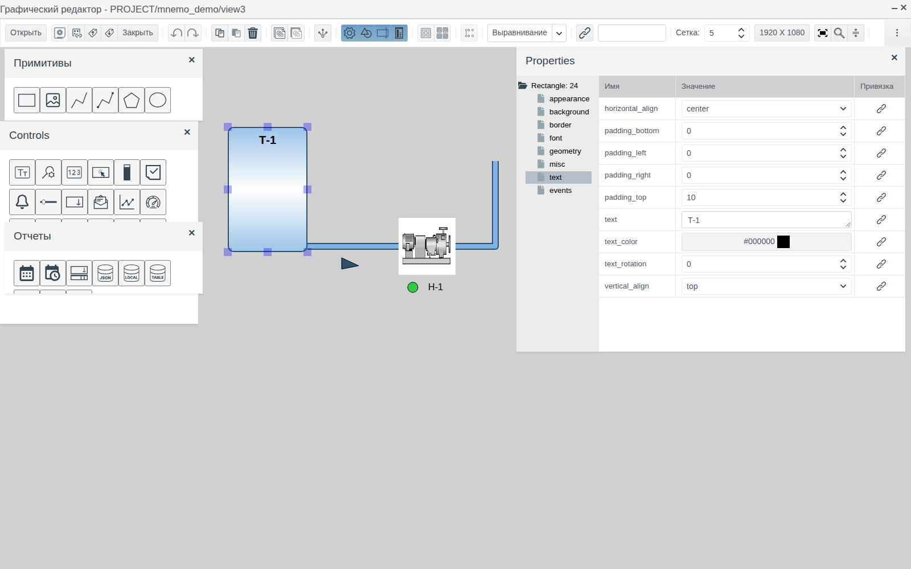
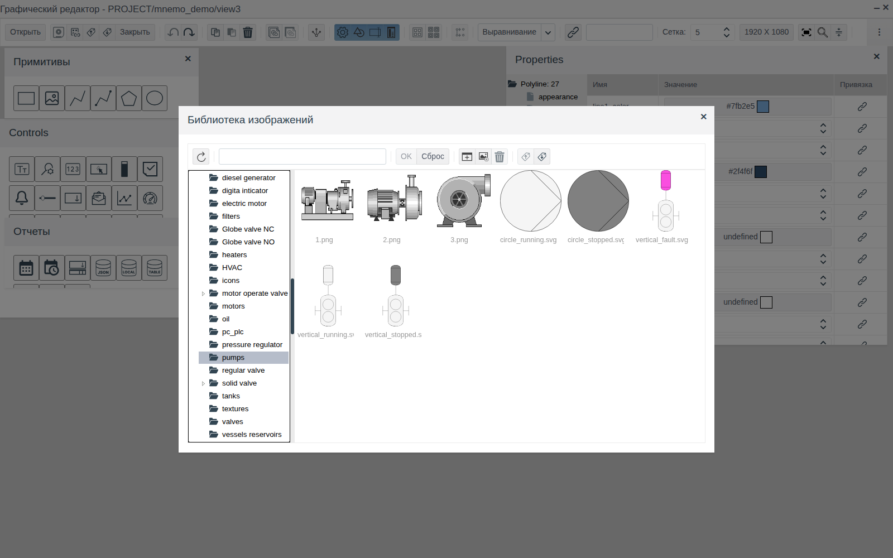
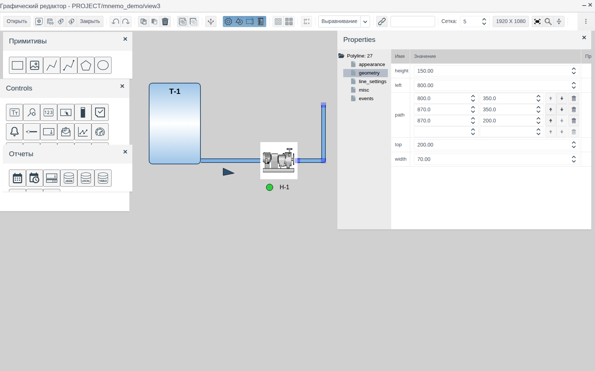
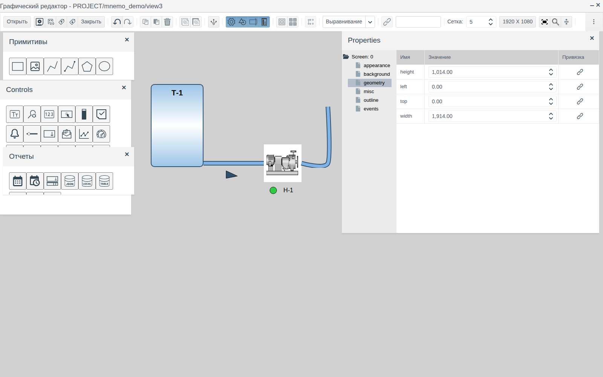
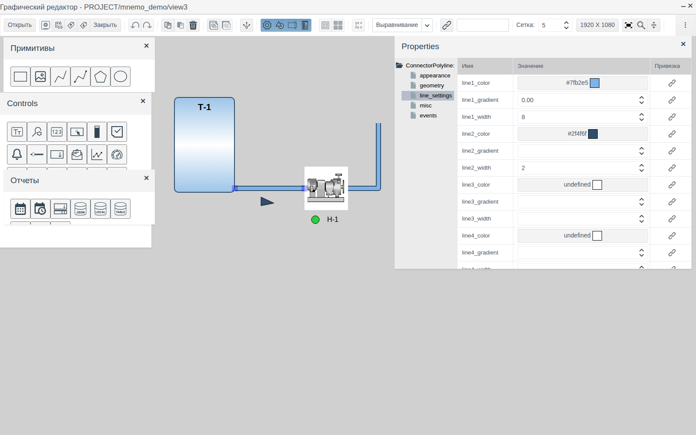
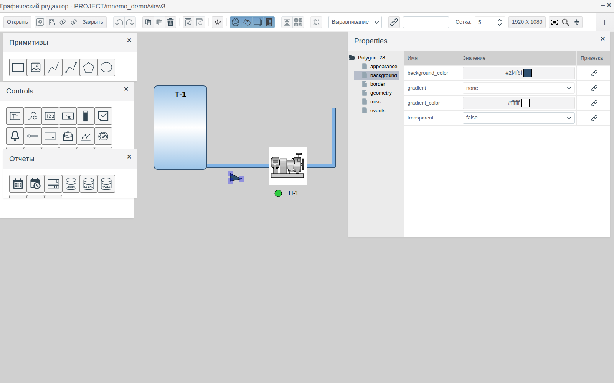
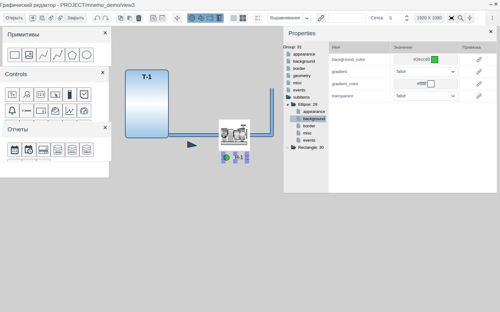
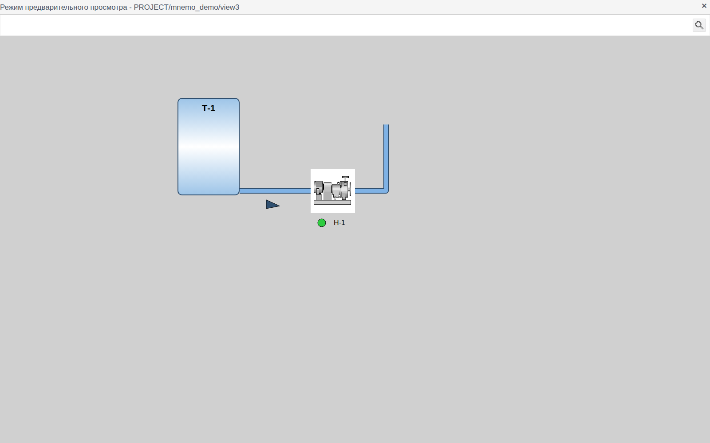

# Графические элементы

Документ для инженера-интегратора, который рисует статическую часть мнемосхемы: оборудование, трубопроводы, подписи, указатели.

# Содержание

- [Глоссарий](#глоссарий)
- [Введение](#введение)
- [Основная часть](#основная-часть)
    - [Палитра «Примитивы»](#палитра-примитивы)
    - [Общие свойства](#общие-свойства)
    - [Выбор цвета](#выбор-цвета)
    - [Прямоугольник](#прямоугольник)
    - [Изображение](#изображение)
    - [Ломаная](#ломаная)
    - [Соединительная линия](#соединительная-линия)
    - [Полигон](#полигон)
    - [Эллипс](#эллипс)
    - [Группа](#группа)
- [Заключение](#заключение)

# Глоссарий

| Термин | Значение |
|---|---|
| Точка | Вершина ломаной, соединительной линии или полигона. Список точек хранится в свойстве `path` |
| Маркер | Квадрат на выделенном элементе. У прямоугольника, изображения, эллипса и группы маркеры стоят по углам и сторонам рамки, у линий и полигона — в точках |
| Библиотека изображений | Хранилище картинок проекта, общее для всех схем. Открывается из свойств элемента и кнопкой **Библиотека изображений** на панели инструментов редактора |

Термины «Схема», «Элемент», «Палитра», «Группа» — в документе [«Редактор мнемосхем»](editor.md).

# Введение

Графические элементы — фигуры, из которых складывается изображение технологического объекта: ёмкости и аппараты, трубопроводы, стрелки направления потока, подписи, лампы состояния. Они находятся на палитре **Примитивы** графического редактора.

Документ описывает каждый элемент палитры: для чего он, какие у него свойства и как его рисовать. Работа в самом редакторе — добавление, выделение, перемещение, выравнивание, группировка, сохранение — описана в [«Редакторе мнемосхем»](editor.md). Привязка свойств к данным проекта, анимация и скрипты описаны в отдельных документах раздела.

Сквозной пример — схема `view3` папки `mnemo_demo`: ёмкость `Т-1` (прямоугольник), картинка насоса (изображение), под ней лампа состояния (эллипс) и надпись «Н-1» (прямоугольник без фона и рамки), трубопровод от ёмкости к насосу со стрелкой направления потока и отвод от насоса вверх.

Понадобится доступ к Studio (`http://<сервер>:9000/fp/studio`) под учётной записью с правом изменять проект.

# Основная часть

## Палитра «Примитивы»

Палитру открывает кнопка **Рисование** на панели инструментов редактора. Элемент добавляется перетаскиванием значка на холст. Название элемента видно во всплывающей подсказке значка.

| Значок (слева направо) | Элемент | Корень дерева свойств | Для чего |
|---|---|---|---|
| Прямоугольник | **Прямоугольник** | `Rectangle` | Аппараты, ёмкости, щиты, рамки, подписи и надписи |
| Картинка | **Изображение** | `Image` | Готовое изображение оборудования из библиотеки изображений |
| Отрезок | **Ломаная** | `Polyline` | Трубопроводы, кабели, шины, выноски |
| Ломаная с точками | **Соединительная линия** | `ConnectorPolyline` | Линия, концы которой прикреплены к элементам и следуют за ними |
| Пятиугольник | **Полигон** | `Polygon` | Фигуры произвольной формы: стрелки, клапаны, треугольники |
| Овал | **Эллипс** | `Ellipse` | Лампы состояния, круглые аппараты, двигатели |

## Общие свойства

Эти группы есть у каждого графического элемента:

| Группа | Свойство | Назначение |
|---|---|---|
| **appearance** | `visible` | `true` — элемент виден, `false` — скрыт |
| | `opacity` | Непрозрачность от 0 (невидим) до 1 (непрозрачен) |
| **geometry** | `left`, `top` | Положение левого верхнего угла в пикселях от левого верхнего угла схемы |
| | `width`, `height` | Ширина и высота в пикселях |
| **misc** | `z_index` | Порядок наложения: элемент с бо́льшим значением рисуется поверх элементов с меньшим |
| | `title` | Всплывающая подсказка: появляется в Runtime, когда оператор наводит мышь на элемент |
| | `cursor` | Вид указателя мыши над элементом в Runtime: `inherit`, `default`, `crosshair`, `pointer`, `text`, `help` |

Группа **events** и кнопки в колонке **Привязка** связывают элемент с данными и скриптами; пример — в документе [«Кнопки и ввод значений»](controls.md), разделы [«Связь элемента с тегом»](controls.md#связь-элемента-с-тегом) и [«Кнопка»](controls.md#кнопка).

## Выбор цвета

Свойства цвета (`background_color`, `border_color`, `text_color`, `line1_color` и т. п.) показывают код цвета и образец. Щелчок по ячейке открывает окно «Выбор цвета»: готовые цвета слева, поле кода `#rrggbb` и палитра оттенков справа, флажок **Прозрачный**. Выберите цвет и нажмите **ОК**.

## Прямоугольник

Самый универсальный элемент: фигура с фоном, рамкой и текстом внутри. В примере это ёмкость `Т-1` с закруглёнными углами, градиентной заливкой и надписью сверху, а также надпись «Н-1» под картинкой насоса.

| Группа | Свойство | Назначение |
|---|---|---|
| **background** | `background_color` | Цвет фона |
| | `gradient` | Градиентная заливка. Пусто — сплошной цвет. `horizontal` — горизонтальные полосы: `background_color` у верхнего и нижнего края, `gradient_color` посередине. `vertical` — то же слева направо |
| | `gradient_color` | Второй цвет градиента |
| | `texture` | Картинка-заливка из библиотеки изображений. Если задана, заменяет цвет и градиент |
| | `transparent` | `true` — фон прозрачный, видны только рамка и текст |
| **border** | `border_width` | Толщина рамки в пикселях, 0 — без рамки |
| | `border_color` | Цвет рамки |
| | `border_style` | Вид линии рамки: `solid`, `dashed`, `dotted`, `double` и др. |
| | `border_radius` | Радиус скругления углов в пикселях |
| **text** | `text` | Текст внутри прямоугольника. Enter переносит строку |
| | `text_color` | Цвет текста |
| | `horizontal_align` | Выравнивание по горизонтали: `left`, `center`, `right` |
| | `vertical_align` | Выравнивание по вертикали: `top`, `middle`, `bottom` |
| | `padding_left`, `padding_right`, `padding_top`, `padding_bottom` | Отступы текста от краёв в пикселях |
| | `text_rotation` | Поворот текста от −90 до 90 градусов |
| **font** | `font_family` | Шрифт: `serif`, `sans-serif`, `monospace`, `cursive`, `fantasy`, `system-ui` |
| | `font_size` | Размер шрифта в пикселях |
| | `bold`, `italic` | Полужирный, курсив |

**Надпись.** Чтобы получить текст без фигуры, задайте прямоугольнику `transparent` = `true` и `border_width` = 0. Так в примере сделана надпись «Н-1» под картинкой насоса.

## Изображение

Показывает картинку из библиотеки изображений: насос, задвижку, двигатель и т. п.

1. Перетащите **Изображение** на холст. Сразу откроется окно «Библиотека изображений».
2. Выберите папку слева и картинку справа, нажмите **OK**.

Картинка масштабируется под размер элемента (по умолчанию 150 × 150). Сменить её можно в свойстве `image` группы **misc**: щелчок по ячейке снова открывает библиотеку.

Группа **border** такая же, как у прямоугольника: `border_width`, `border_color`, `border_style`, `border_radius`. В примере у насоса `border_width` = 0.

## Ломаная

Линия из нескольких точек. Подходит для трубопроводов, кабелей, выносок.

Новая ломаная — отрезок из двух точек. У выделенной ломаной в каждой точке стоит маркер:

| Действие | Результат |
|---|---|
| Перетащить маркер | Точка перемещается |
| Shift + щелчок по маркеру | После этой точки добавляется новая, со сдвигом на 30 px вправо и вниз |
| Ctrl + щелчок по маркеру | Точка удаляется |
| Перетащить линию | Ломаная перемещается целиком |

Точные координаты точек задаются в свойстве `path` группы **geometry**: каждая строка — точка (`left`, `top` в пикселях от левого верхнего угла схемы). Чтобы добавить точку в конец, заполните оба поля пустой нижней строки и нажмите Enter или Tab. Стрелки в строке переносят точку на место выше или ниже, корзина удаляет её. Свойства `left`, `top`, `width`, `height` у ломаной вычисляются по точкам.

Оформление — в группе **line_settings**:

| Свойство | Назначение |
|---|---|
| `line1_width`, `line1_color` | Толщина и цвет основной линии |
| `line2_width`…`line5_width`, `line2_color`…`line5_color` | Дополнительные слои линии. Каждый слой рисуется под предыдущим и выступает за него с обеих сторон на свою толщину. Пустая толщина или цвет — слоя нет |
| `line1_gradient`…`line5_gradient` | Светлая полоса вдоль оси слоя, которая придаёт линии объём: от 0 (нет) до 0.5 (самая широкая) |
| `line_type` | Тип линии: `solid`, `dashed`, `dotted` |
| `round_corner` | `true` — скруглённые изломы |
| `round_end` | `true` — скруглённые концы |
| `tension` | Сглаживание: 1 — прямые отрезки между точками, меньшие значения — плавная кривая через точки |

**Трубопровод.** В примере у трубы два слоя: `line1_width` = 8 голубого цвета и `line2_width` = 2 тёмно-синего. Получается труба с контуром. Для изломов под прямым углом включите `round_corner`.

## Соединительная линия

Ломаная, концы которой крепятся к краям других элементов. Когда элемент перемещают или меняют его размер, конец линии следует за ним.

1. Расставьте элементы, которые нужно соединить, — в примере ёмкость `Т-1` и насос.
2. Перетащите **Соединительная линия** на холст.
3. Перетащите маркер начала на первый элемент: маркер притянется к ближайшей стороне элемента.
4. Так же перетащите маркер конца на второй элемент.

Конец крепится к прямоугольнику, изображению или эллипсу; к линиям и полигону — нет. Чтобы открепить конец, перетащите его маркер на пустое место холста: дальше он не следует за элементом.

Промежуточные точки, свойство `path` и группа **line_settings** — как у ломаной. Связь сохраняется вместе со схемой.

## Полигон

Замкнутая фигура из точек с заливкой и рамкой. Новый полигон — треугольник. Точки добавляются, удаляются и перемещаются так же, как у ломаной: маркерами (Shift + щелчок, Ctrl + щелчок) или в свойстве `path`.

В примере полигон — стрелка направления потока под трубой: треугольник 30 × 20 с тёмной заливкой.

| Группа | Свойство | Назначение |
|---|---|---|
| **background** | `background_color`, `transparent` | Цвет заливки, прозрачная заливка |
| | `gradient` | `none` — сплошная заливка; `horizontal`, `vertical` — градиент с `gradient_color` посередине |
| | `gradient_color` | Второй цвет градиента |
| **border** | `border_width`, `border_color`, `border_style` | Толщина, цвет и тип линии контура (`solid`, `dashed`, `dotted`) |
| **appearance** | `tension` | Сглаживание контура, как у ломаной |
| | `round_corner` | `true` — скруглённые вершины |

## Эллипс

Эллипс, вписанный в рамку `width` × `height`; при равных сторонах — круг. В примере — зелёная лампа состояния насоса, 20 × 20.

| Группа | Свойство | Назначение |
|---|---|---|
| **background** | `background_color`, `transparent` | Цвет заливки, прозрачная заливка |
| | `gradient` | `true` — радиальный градиент: `gradient_color` в центре, `background_color` по краю |
| | `gradient_color` | Цвет в центре |
| **border** | `border_width`, `border_color`, `border_style` | Контур: толщина, цвет, тип линии (`solid`, `dashed`, `dotted`) |

## Группа

Группа объединяет несколько элементов в один. Как создать и разобрать группу — в [«Редакторе мнемосхем», раздел «Группировка»](editor.md#группировка). В примере в группу объединены лампа и надпись «Н-1».

Собственные свойства группы:

| Группа | Свойство | Назначение |
|---|---|---|
| **background** | `background_color` | Фон под элементами группы |
| **border** | `border_width`, `border_color`, `border_style`, `border_radius` | Рамка вокруг группы |
| **geometry** | `left`, `top` | Положение группы; элементы сдвигаются вместе с ней |

Размер группы — рамка вокруг входящих в неё элементов.

**Свойства элементов внутри группы.** Раскройте узел **subitems** в дереве свойств группы, затем узел нужного элемента и выберите группу свойств. Изменения применяются к этому элементу, не разгруппировывая группу. Положение и размер элемента внутри группы здесь не задаются: для этого разгруппируйте, измените и сгруппируйте снова.

# Заключение

Порядок работы с графическими элементами:

1. Нарисуйте оборудование: прямоугольники для аппаратов и ёмкостей, изображения из библиотеки для типового оборудования, эллипсы для ламп и круглых аппаратов.
2. Сделайте подписи прямоугольниками с прозрачным фоном и без рамки.
3. Проведите трубопроводы: соединительной линией между аппаратами, ломаной — для отводов и свободных линий. Объём трубе дают слои `line2`…`line5`.
4. Дорисуйте стрелки и прочие фигуры полигоном.
5. Объедините элементы одного аппарата в группу; оформление элементов внутри группы правьте через **subitems**.
6. Сохраните схему и проверьте её кнопкой просмотра в окне «Схемы».

