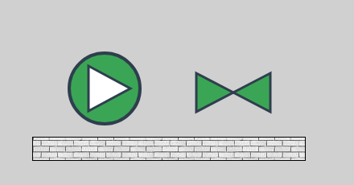
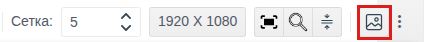
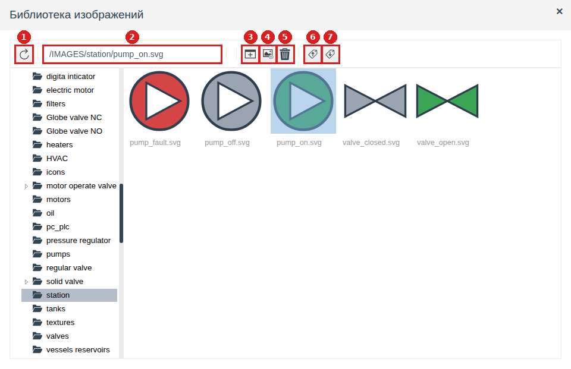
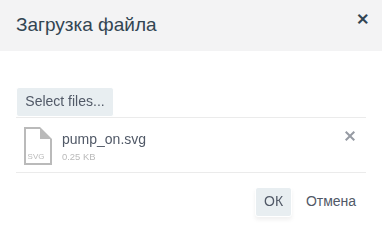
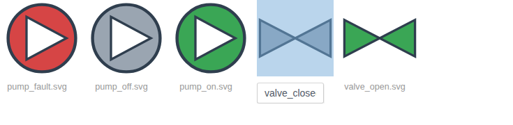
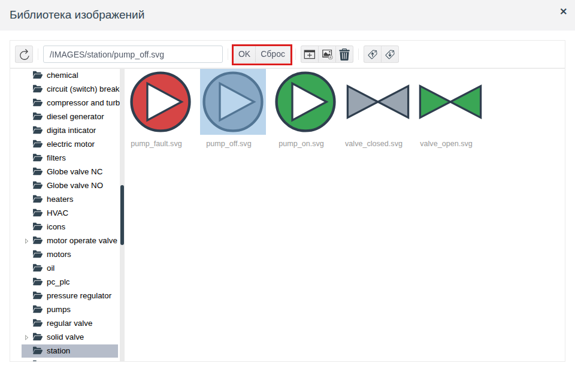
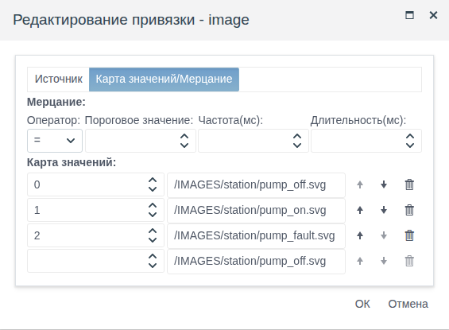

# Библиотека изображений

Документ для инженера-интегратора, который рисует мнемосхемы и хранит для них картинки оборудования, значки и текстуры.

# Содержание

- [Глоссарий](#глоссарий)
- [Введение](#введение)
- [Основная часть](#основная-часть)
    - [Где открывается библиотека](#где-открывается-библиотека)
    - [Окно библиотеки](#окно-библиотеки)
    - [Папки](#папки)
    - [Загрузка картинок](#загрузка-картинок)
    - [Переименование и удаление](#переименование-и-удаление)
    - [Выбор картинки для элемента](#выбор-картинки-для-элемента)
    - [Картинка по состоянию](#картинка-по-состоянию)
    - [Перенос в другой проект](#перенос-в-другой-проект)
- [Заключение](#заключение)

# Глоссарий

| Термин | Значение |
|---|---|
| Библиотека изображений | Хранилище картинок проекта, общее для всех схем. Картинки разложены по папкам, корневая папка — `IMAGES` |
| Путь картинки | Строка вида `/IMAGES/<папка>/<файл>`. Её хранят свойства `image` и `texture`, по ней элемент находит картинку |
| Файл `.iex` | Файл экспорта выбранных картинок и папок библиотеки. Загружается обратно кнопкой **Импорт** окна библиотеки |

Термины «Схема», «Элемент», «Палитра» — в документе [«Редактор мнемосхем»](editor.md#глоссарий).

# Введение

Картинка на мнемосхеме не вставляется в схему файлом. Её загружают в библиотеку проекта, а элемент хранит только путь к ней. Поэтому:

- одну картинку используют сколько угодно схем, в проекте она хранится один раз;
- картинку можно заменить в одном месте, и все схемы с этим путём покажут новую;
- картинки переносятся в другой проект вместе с ним или отдельным файлом.

Картинки из библиотеки показывают три свойства:

| Свойство | Элементы | Что показывает |
|---|---|---|
| `image` (группа **misc**) | **Изображение** (см. [«Графические элементы», раздел «Изображение»](graphics.md#изображение)) | Картинку целиком, растянутую на размер элемента |
| `texture` (группа **background**) | [**Прямоугольник**](graphics.md#прямоугольник), [**LinearGauge**](gauges.md#линейный-индикатор), [**Timeline**](tables.md#временная-шкала-ось-рамка-и-фон) | Заливку фона повторяющейся картинкой вместо цвета |

В поставке библиотека уже содержит папки с типовым оборудованием: насосы, задвижки, двигатели, ёмкости, текстуры. Свои картинки добавляются рядом с ними.

Сквозной пример — папка библиотеки `station` с пятью SVG-картинками: насос в работе, остановлен и в аварии, задвижка открыта и закрыта. На схеме папки проекта `img_demo` насос меняет картинку по полю `state` объекта `pump_1`, рядом стоит открытая задвижка, под ними площадка с текстурой `grey_brick.jpg`.

Понадобится доступ к Studio (`http://<сервер>:9000/fp/studio`) под учётной записью с правом изменять проект. Результат проверяется в Runtime (`http://<сервер>:9000/fp/runtime`).

# Основная часть

## Где открывается библиотека

Библиотека открывается только из графического редактора мнемосхем. От того, откуда её открыли, зависит, что в ней можно сделать:

| Откуда | Что можно | Кнопки **OK** и **Сброс** |
|---|---|---|
| Кнопка **Библиотека изображений** на панели инструментов редактора | Загружать, переименовывать, удалять картинки, создавать папки, экспортировать и импортировать | Нет |
| Ячейка **Значение** свойства `image` или `texture` в панели **Properties** | То же, плюс выбрать картинку для элемента | Есть |
| Поле значения в карте значений привязки `image` или `texture` | То же, плюс выбрать картинку для строки карты | Есть |
| Перетаскивание **Изображения** с палитры на холст | То же, плюс выбрать картинку для нового элемента | Есть |

Кнопка **Библиотека изображений** — значок картинки в правой части панели инструментов. Если панель не помещается в окно браузера, кнопка уходит в меню **⋮** в конце панели.

Изменения в библиотеке сохраняются сразу, без кнопки сохранения схемы, и видны во всех схемах проекта.

## Окно библиотеки

Слева — дерево папок, справа — содержимое открытой папки: сначала вложенные папки, потом картинки. Двойной щелчок по папке справа открывает её.

| № | Кнопка | Что делает |
|---|---|---|
| 1 | Обновить | Перечитывает дерево и папку. Нужна, если картинки менял другой пользователь, пока окно открыто |
| 2 | Поле пути | Показывает путь выделенной картинки. Введите путь и нажмите Enter — откроется её папка, картинка выделится |
| 3 | **Создать папку** | Создаёт папку внутри открытой |
| 4 | **Добавить изображение** | Загружает картинку из файла в открытую папку |
| 5 | **Удалить** | Удаляет выделенные картинки и папки |
| 6 | **Экспорт** | Сохраняет выделенные картинки и папки в файл `.iex` |
| 7 | **Импорт** | Загружает картинки из файла `.iex` |

Щелчок по картинке выделяет её, Ctrl + щелчок добавляет к выделению следующие. Кнопки **Удалить** и **Экспорт** работают с выделенным.

## Папки

Папки нужны, чтобы свои картинки не смешивались с поставочными и чтобы их было удобно переносить: экспорт папки забирает её целиком.

1. Откройте в дереве папку, внутри которой нужна новая, например `IMAGES`.
2. Нажмите **Создать папку**. Появится папка `New folder` (следующие — `New folder_0`, `New folder_1` и т. д.).
3. Щёлкните по её имени под значком, введите своё и нажмите Enter.

В примере в корне `IMAGES` создана папка `station`.

Папки вкладываются друг в друга на любую глубину. Путь картинки повторяет вложенность: `/IMAGES/station/pumps/pump_on.svg`.

## Загрузка картинок

1. Откройте папку, в которую загружаете картинку.
2. Нажмите **Добавить изображение**. В окне «Загрузка файла» нажмите **Select files...** и выберите файл.
3. Нажмите **OK**. Картинка появится в папке и сразу станет выделенной.

За один раз загружается один файл. Имя картинки в библиотеке — имя файла вместе с расширением, например `pump_on.svg`. Кириллица и пробелы в имени допустимы.

Имена внутри одной папки не повторяются. Если в папке уже есть картинка или папка с таким именем, загрузка не выполняется и появляется окно **ERROR!** с текстом `{not_unique,<<"<имя>">>}`. Переименуйте файл или загрузите его в другую папку.

Картинку показывает браузер, поэтому годится любой формат, который он умеет отображать. Проверены SVG, PNG, JPG, GIF, BMP, WEBP и ICO: картинки этих форматов одинаково показываются в редакторе и в Runtime. Форматы, которые браузеры не отображают (например, TIFF), загрузятся, но на схеме видны не будут.

**Какой формат выбрать.** Элемент растягивает картинку на свой размер. SVG масштабируется без потери качества, поэтому для оборудования, которое на разных схемах рисуется разного размера, удобнее SVG. Растровые форматы (PNG, JPG) подходят для фотографий и текстур; загружайте их в том размере, в каком они будут на схеме, иначе при увеличении картинка станет нечёткой.

**Замена картинки.** Чтобы заменить картинку, не трогая схемы, удалите старую и загрузите новую с тем же именем, включая расширение, в ту же папку. Путь не изменится, и схемы с этим путём при следующем открытии покажут новую картинку. Новая картинка в другом формате — это другое имя и другой путь (например, `pump_on.svg` вместо `pump_on.png`): её нужно заново выбрать в свойствах каждого элемента и в картах значений привязок, где стояла старая (см. [Переименование и удаление](#переименование-и-удаление)).

## Переименование и удаление

**Переименование.** Щёлкните по имени картинки или папки под значком, введите новое и нажмите Enter. Расширение входит в имя: при переименовании картинки сохраните его. Занятое в папке имя не принимается: появляется то же окно **ERROR!**, имя остаётся прежним.

**Удаление.** Выделите картинки и папки, нажмите **Удалить** и подтвердите вопрос «Удалить элементы? (N)», где N — число выделенных. Папка удаляется вместе со всем содержимым.

Отдельной команды переноса картинки в другую папку нет: загрузите её в новую папку и удалите из старой.

Схема хранит путь картинки, а не саму картинку. После переименования, удаления или переноса картинки и после переименования папки элементы со старым путём остаются без картинки. Поэтому сначала решите, где картинка будет лежать и как называться, и только потом расставляйте её по схемам. Если путь всё же изменился, выберите картинку заново в свойствах каждого элемента, который её использовал.

## Выбор картинки для элемента

1. Выделите элемент и щёлкните по ячейке **Значение** свойства `image` (группа **misc**) или `texture` (группа **background**). У нового **Изображения** окно открывается само при перетаскивании с палитры.
2. Выберите папку в дереве и картинку справа. Её путь появится в поле пути.
3. Нажмите **OK**.

Окно открывается на текущей картинке элемента. Если картинка ещё не выбрана, открывается папка по умолчанию: для `image` — `active elements`, для `texture` — `textures`.

| Кнопка | Результат |
|---|---|
| **OK** | Свойство получает путь выделенной картинки |
| **Сброс** | Свойство очищается. Для `texture` это значит, что фон снова заливается цветом `background_color` |
| Крестик в заголовке | Окно закрывается, свойство не меняется |

В ячейке свойства после выбора виден путь, например `/IMAGES/station/pump_off.svg`. Сохраните схему: путь записывается в схему при сохранении, как и остальные свойства.

## Картинка по состоянию

Частая задача — показать состояние оборудования картинкой: насос в работе зелёный, остановлен серый, в аварии красный. Для этого свойство `image` привязывают к полю состояния и задают карту значений, где каждому значению поля соответствует картинка из библиотеки. Привязка и карта значений подробно описаны в документе [«Привязки и анимация», раздел «Карта значений»](bindings.md#карта-значений).

1. Загрузите в одну папку библиотеки картинки всех состояний. В примере — `pump_off.svg`, `pump_on.svg`, `pump_fault.svg` в папке `station`.
2. Добавьте на схему **Изображение** и выберите картинку состояния по умолчанию. В примере — `pump_off.svg`.
3. Щёлкните по значку в колонке **Привязка** у свойства `image` и на вкладке **Источник** выберите тег и поле. В примере — `pump_1`, поле `state` (0 — остановлен, 1 — в работе, 2 — авария).
4. На вкладке **Карта значений/Мерцание** заполните строки карты: порог и картинку. Щелчок по полю картинки открывает библиотеку, выбор подтверждается кнопкой **OK**.
5. Нажмите **ОК** в окне привязки и сохраните схему.

В примере при `state` = 1 оператор видит зелёный насос (см. рисунок во [Введении](#введение)), при 0 — серый, при 2 — красный.

Так же меняют текстуру: привязывают `texture` и в карте значений выбирают текстуры.

## Перенос в другой проект

Картинки переносятся файлом `.iex`.

1. Выделите картинки или папки (Ctrl + щелчок для нескольких) и нажмите **Экспорт**. Браузер сохранит файл `fp_image_export.iex`.
2. В другом проекте откройте библиотеку, нажмите **Импорт**, выберите файл в окне «Импорт изображений» и нажмите **OK**. Появится сообщение «Импорт изображений выполнен успешно».

Импорт раскладывает картинки по тем же путям, что были при экспорте, независимо от того, какая папка открыта в окне. Недостающие папки создаются. Картинка с тем же путём заменяется картинкой из файла. Остальные картинки библиотеки не меняются. Поэтому свои картинки удобно держать в своей папке: её экспорт и импорт не затрагивают картинки поставки.

Файл схемы `.scn` (кнопка **Экспорт в файл** редактора, см. [«Редактор мнемосхем», раздел «Экспорт и импорт схемы»](editor.md#экспорт-и-импорт-схемы)) хранит только пути картинок. Переносите схему вместе с `.iex` её картинок; картинки поставки переносить не нужно, они есть в каждом проекте.

Если переносится весь проект, отдельно экспортировать библиотеку не нужно: она входит в экспорт проекта.

# Заключение

| Задача | Как сделать |
|---|---|
| Открыть библиотеку для управления картинками | Кнопка **Библиотека изображений** на панели инструментов редактора (или в меню **⋮**) |
| Добавить свои картинки | Создать папку, загрузить файлы кнопкой **Добавить изображение** |
| Показать картинку на схеме | Элемент **Изображение**, свойство `image` |
| Залить фон картинкой | Свойство `texture` прямоугольника, LinearGauge или Timeline |
| Менять картинку по состоянию | Привязка `image` к полю состояния с картой значений |
| Заменить картинку во всех схемах | Удалить старую и загрузить новую с тем же именем и расширением в ту же папку |
| Перенести картинки в другой проект | **Экспорт** в окне библиотеки → **Импорт** в другом проекте |

Порядок работы:

1. Создайте для картинок проекта свою папку в `IMAGES`, при необходимости — вложенные папки по видам оборудования.
2. Загрузите картинки; для оборудования предпочтительнее SVG. Сразу дайте им окончательные имена.
3. Расставьте картинки на схемах через `image` и `texture`, картинки состояний — через привязку с картой значений.
4. Сохраните схемы и проверьте их в Runtime.
5. Для переноса в другой проект экспортируйте свою папку в `.iex`.
