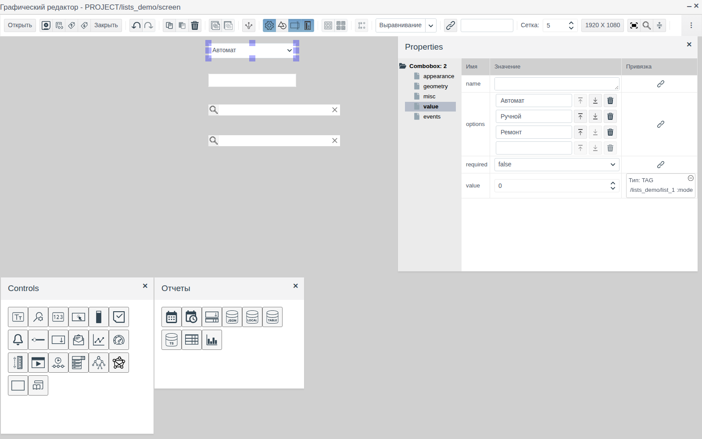
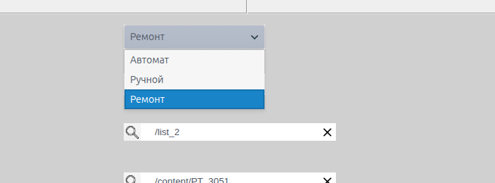
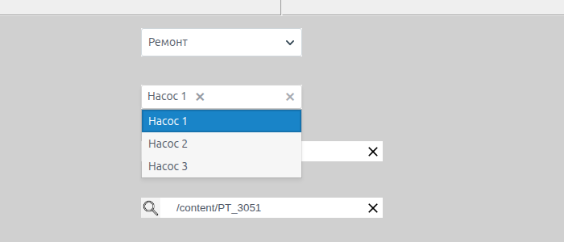
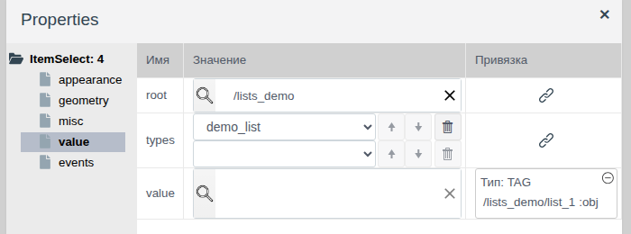
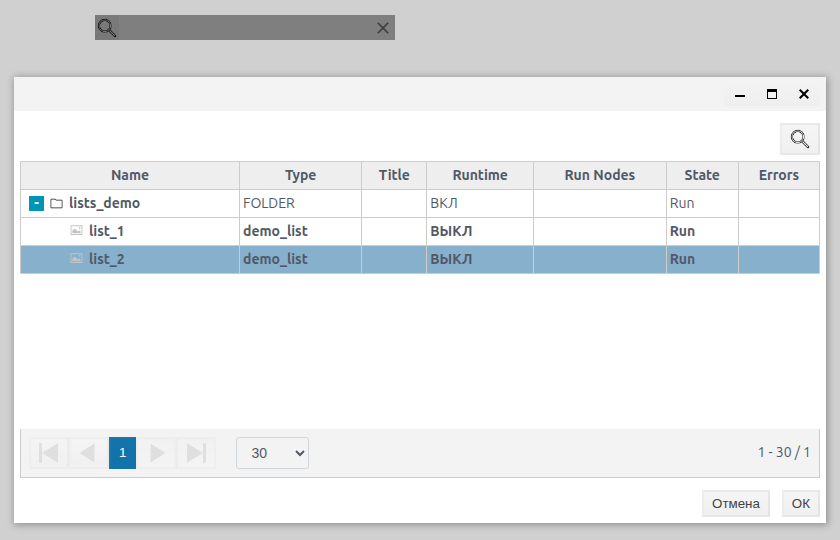
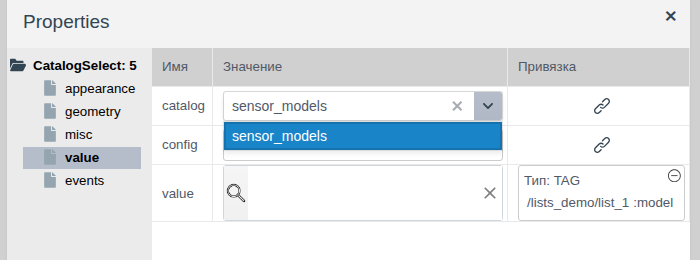
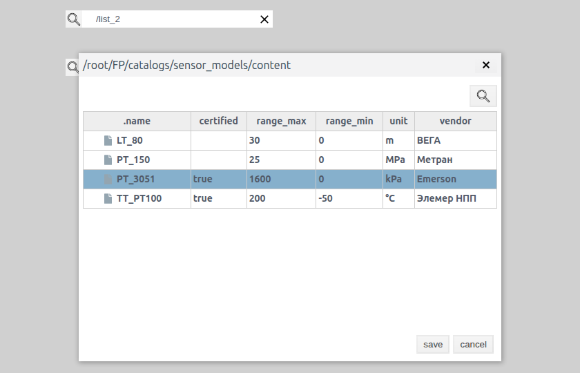
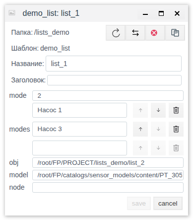
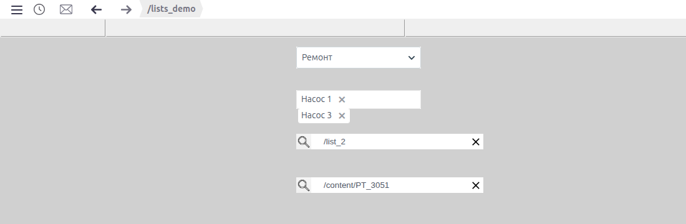

# Выбор из списков

Документ для инженера-интегратора, который даёт оператору на мнемосхеме выбор из готового перечня: режима работы, набора агрегатов, объекта проекта или записи каталога.

# Содержание

- [Глоссарий](#глоссарий)
- [Введение](#введение)
- [Основная часть](#основная-часть)
    - [Элементы на палитрах](#элементы-на-палитрах)
    - [Выпадающий список](#выпадающий-список)
    - [Множественный выбор](#множественный-выбор)
    - [Выбор объекта проекта](#выбор-объекта-проекта)
    - [Выбор записи каталога](#выбор-записи-каталога)
- [Заключение](#заключение)

# Глоссарий

| Термин | Значение |
|---|---|
| Полный путь | Адрес объекта в базе Faceplate. Объекты проекта лежат под `/root/FP/PROJECT`, записи каталогов — под `/root/FP/catalogs/<каталог>/content`. Пример: `/root/FP/PROJECT/lists_demo/list_2` |
| Запись каталога | Строка каталога из раздела **Каталоги** (см. документ [«Каталоги»](../catalogs/catalogs.md)) |

Термины «Тег», «Привязка» — в документе [«Кнопки и ввод значений»](controls.md#глоссарий), «Схема», «Палитра», «Элемент» — в [«Редакторе мнемосхем»](editor.md#глоссарий).

# Введение

Элементы выбора избавляют оператора от ручного ввода: он выбирает значение из перечня, а элемент записывает выбор в поле тега. Перечень задаётся по-разному: списком строк в свойствах элемента, объектами проекта или записями каталога.

Документ описывает четыре элемента выбора, их свойства, способ записи значения в тег и поведение в Runtime. Работа в редакторе (добавление, выделение, свойства, сохранение) описана в [«Редакторе мнемосхем»](editor.md), привязка свойства к полю тега — в [«Кнопках и вводе значений», раздел «Связь элемента с тегом»](controls.md#связь-элемента-с-тегом).

Сквозной пример — схема `screen` папки `lists_demo`. Данные лежат в объекте `list_1` собственного примитива `demo_list` с полями `mode` (integer), `modes` (list, подтип string), `obj` (string) и `model` (string). Рядом лежит второй объект того же типа `list_2`. Каталог `sensor_models` с моделями датчиков создан по документу [«Каталоги»](../catalogs/catalogs.md).

На схеме сверху вниз: режим работы («Автомат», «Ручной», «Ремонт»), насосы в работе («Насос 1», «Насос 2», «Насос 3»), выбор объекта `demo_list` и выбор модели датчика из каталога.

Понадобится доступ к Studio (`http://<сервер>:9000/fp/studio`) под учётной записью с правом изменять проект. Результат проверяется в Runtime (`http://<сервер>:9000/fp/runtime`).

# Основная часть

## Элементы на палитрах

Название элемента видно во всплывающей подсказке значка палитры, тип — в корне дерева свойств.

| Палитра | Подсказка значка | Корень дерева свойств | Что выбирает оператор | Что записывается в тег | Тип поля тега |
|---|---|---|---|---|---|
| **Controls** | Выпадающий список | `Combobox` | Один пункт из списка | Номер пункта, с 0 | `integer` |
| **Отчеты** | multiselect | `MultiSelect` | Несколько пунктов из списка | Тексты выбранных пунктов | `list` с подтипом `string` |
| **Controls** | Itemselect | `ItemSelect` | Объект проекта | Полный путь объекта | `string` |
| **Controls** | CatalogSelect | `CatalogSelect` | Запись каталога | Полный путь записи | `string` |

У всех четырёх элементов значение хранится в свойстве `value` группы **value**. Чтобы выбор оператора попадал в тег, привяжите `value` к полю тега (см. [«Кнопки и ввод значений», раздел «Связь элемента с тегом»](controls.md#связь-элемента-с-тегом)). Привязка работает в обе стороны: элемент показывает текущее значение поля. Пока у поля нет значения, выпадающий список и поля с лупой в Runtime серые.

Группы **appearance**, **geometry**, **misc** и **events** такие же, как у остальных элементов схемы (см. [«Графические элементы», раздел «Общие свойства»](graphics.md#общие-свойства)).

## Выпадающий список

Поле со стрелкой. Щелчок раскрывает список пунктов, выбранный пункт показывается в поле.

| Свойство (группа **value**) | Назначение |
|---|---|
| `options` | Пункты списка. Каждый пункт — отдельная строка. Ввод в пустую нижнюю строку добавляет пункт, стрелки меняют порядок, корзина удаляет |
| `value` | Номер выбранного пункта: первый пункт — `0`, второй — `1` и так далее |

В тег записывается номер пункта, а не его текст. Порядок пунктов поэтому важен: если поменять пункты местами, прежнее значение поля будет показывать другой пункт.

В примере `options` = «Автомат», «Ручной», «Ремонт», `value` привязано к `list_1.mode`. Выбор «Ремонт» записывает в `mode` значение `2`.

## Множественный выбор

Элемент **multiselect** с палитры **Отчеты**. Щелчок по полю раскрывает список, выбранный пункт становится плашкой в поле. Крестик на плашке убирает пункт из выбора.

| Свойство (группа **value**) | Назначение |
|---|---|
| `options` | Пункты списка, редактируются так же, как у выпадающего списка |
| `value` | Выбранные пункты |
| `required` | `true` — выбор не может быть пустым: при попытке убрать последний пункт оператор видит сообщение «Значение не может быть пустым», пункт остаётся, значение в теге не меняется |

В тег записывается список текстов выбранных пунктов, поэтому поле тега должно иметь тип `list` с подтипом `string`. Пустой выбор записывается пустым списком. Чтобы запретить пустой выбор, задайте `required` = `true`.

Плашки, которые не помещаются по ширине, переносятся на следующую строку ниже границы элемента. Задайте высоту и ширину элемента с запасом под наибольший выбор.

В примере `options` = «Насос 1», «Насос 2», «Насос 3», `value` привязано к `list_1.modes`.

## Выбор объекта проекта

Элемент **Itemselect** — поле с лупой. Оператор выбирает объект проекта заданного типа внутри заданной папки.

| Свойство (группа **value**) | Назначение |
|---|---|
| `root` | Папка, внутри которой оператор выбирает объект. Задаётся лупой: в окне с деревом проекта выделите папку и нажмите **OK** |
| `types` | Типы объектов, которые можно выбрать. После выбора типа ниже появляется пустая строка для следующего, стрелки меняют порядок, корзина удаляет |
| `value` | Выбранный объект |

В Runtime лупа открывает окно с деревом папки `root`. Объекты подходящих типов выделены жирным. Выделите объект и нажмите **OK**. В поле элемента показывается путь объекта от `root`, в тег записывается полный путь. Крестик в поле очищает выбор, в тег записывается пустое значение.

В примере `root` = `/lists_demo`, `types` = `demo_list`, `value` привязано к `list_1.obj`. После выбора `list_2` поле показывает `/list_2`, а в `obj` записано `/root/FP/PROJECT/lists_demo/list_2`.

## Выбор записи каталога

Элемент **CatalogSelect** — поле с лупой для выбора записи каталога.

| Свойство (группа **value**) | Назначение |
|---|---|
| `catalog` | Каталог из раздела **Каталоги**, выбирается из списка |
| `value` | Выбранная запись |
| `config` | Оставьте значение по умолчанию `{}` |

В Runtime лупа открывает окно с заголовком — путём к записям каталога. В таблице колонка `.name` и поля каталога. Выделите запись и нажмите **save**, **cancel** закрывает окно без выбора. В поле элемента показывается `/content/<имя записи>`, в тег записывается полный путь записи.

В примере `catalog` = `sensor_models`, `value` привязано к `list_1.model`. После выбора `PT_3051` в `model` записано `/root/FP/catalogs/sensor_models/content/PT_3051`.

Значения полей `list_1` после выбора во всех четырёх элементах:

# Заключение

Как выбрать элемент:

| Что выбирает оператор | Элемент |
|---|---|
| Один пункт из короткого постоянного перечня | Выпадающий список |
| Несколько пунктов из постоянного перечня | multiselect |
| Объект проекта: агрегат, линию, установку | Itemselect |
| Справочную запись: модель, тип, код | CatalogSelect |

Порядок работы:

1. Подготовьте тег с полями нужных типов: `integer` для выпадающего списка, `list` с подтипом `string` для множественного выбора, `string` для выбора объекта и записи каталога.
2. Перетащите элементы с палитр **Controls** и **Отчеты**.
3. Задайте перечень: `options` у списков, `root` и `types` у выбора объекта, `catalog` у выбора записи.
4. Привяжите `value` каждого элемента к полю тега.
5. Сохраните схему и проверьте выбор в Runtime.

