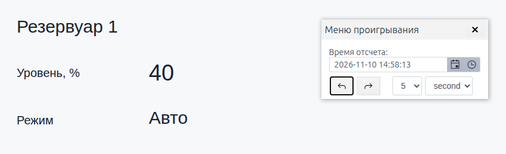
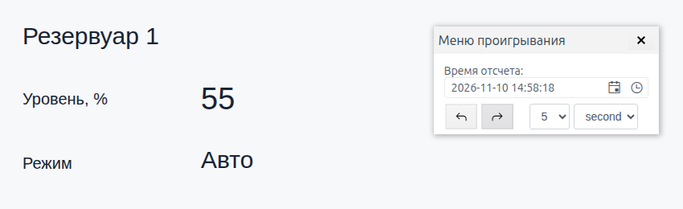
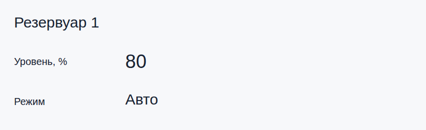

# Проигрывание: просмотр архивных данных на мнемосхеме

Faceplate v4.0.7

## Назначение и возможности

Проигрывание позволяет посмотреть значения на мнемосхеме (экране) на выбранное прошедшее время. Оператор может разобрать состояние установки около события и сравнить несколько моментов, сохранив привычное расположение показателей.

Просмотр выполняется вручную: выберите время или нажмите стрелку для одного шага назад либо вперёд. Автоматического движения времени, запуска, паузы, настройки скорости и повторения участка нет.

Основные понятия:

- **Выбранное время** — момент, на который запрошена история. Оно может отличаться от времени найденной записи.
- **Архивная точка** — сохранённое значение с временной меткой.
- **Шаг перемещения** — величина и единица одиночного сдвига выбранного времени.
- **Кэш текущих значений** — значения, однократно прочитанные при обращении к полям и сохранённые на время работы режима. Непрерывного обновления у них нет.
- **Обычный режим Runtime** — работа мнемосхемы с текущими данными, к которой вы возвращаетесь после закрытия окна проигрывания.

При включении режима мнемосхема загружается заново с другим источником данных. Историческими становятся поля, для которых найден подходящий архив. Остальные показания могут происходить из текущего кэша или из собственной логики мнемосхемы. Весь рабочий стол нельзя считать единым историческим снимком.

Используются нынешние макет, привязки и клиентские скрипты. Старые версии мнемосхемы и конфигурации проекта не восстанавливаются. Просмотр истории сам по себе не останавливает работу серверной части проекта и накопление данных.

## Какие значения показывает мнемосхема

### Первое открытие, архив и текущий кэш

Сразу после открытия окно показывает время открытия, а мнемосхема — результаты текущих чтений, в том числе для архивируемых полей. **Для перехода к истории нужно фактически изменить выбранное время.** Само наличие даты в окне ещё не подтверждает чтение архива.

| Условие | Откуда берётся значение | Когда обновляется | Как понимать показание |
|---|---|---|---|
| Окно только открыто, время ещё не меняли | Текущее чтение поля | При первом обращении; затем сохраняется | История ещё не выбрана |
| Время изменено, подходящий архив найден | Архивная точка на выбранное время | После успешного чтения при смене времени | Историческое значение по правилу предыдущей точки |
| Архива нет, поле уже читали | Кэш текущих значений | Смена времени его не обновляет | Это сохранённое текущее значение, а не история и не живое обновление |
| Архива нет, поле впервые понадобилось позднее | Текущее чтение в этот более поздний момент | Однократно, затем кэш | Оно могло быть прочитано позже соседних полей |
| Архив найден, но подходящей точки нет | Результат отсутствия архивной точки | При чтении выбранного времени | Автоматического перехода к текущему значению нет |
| Чтение завершилось ошибкой | Новые архивные значения не получены | После успешного повторного чтения | Сохранившееся число не подтверждает успешный запрос |

Текущий кэш не является одновременным снимком всех полей: они могут впервые читаться в разные моменты. Изменение времени и переходы внутри того же режима не освежают этот кэш.

Если подходящих архивов вообще не обнаружено, время окна может меняться без обновления показаний и без отдельного сообщения об отсутствии архивов.

### Как выбирается архивная точка

Для каждого архива берётся **последняя точка не позже выбранного времени**. Поиска ближайшей точки в обе стороны, интерполяции и усреднения нет.

| Выбранное время | Используемая точка | Результат и оговорка |
|---|---|---|
| До первой записи | Подходящей точки нет | Архив существует, но на этот момент ещё нет данных |
| Точно на записи | Эта запись | Точное совпадение включается |
| Между записями | Предыдущая запись | Значение сохраняется до следующей точки; промежуточное число не вычисляется |
| После последней записи | Последняя запись | Значение остаётся даже при большом разрыве во времени |
| Архив пуст | Подходящей точки нет | Наличие объекта архива не подтверждает наличие истории |

Возраст найденной точки не ограничивается. Время в окне — время запроса, а не подтверждение новой записи в этот момент. Вместе со значением проигрывание не передаёт время найденной точки и её историческое качество. Отдельный показатель текущего качества исходного поля автоматически историческим не становится.

### Если значения нет

Отсутствие подходящего архива и отсутствие точки в найденном архиве дают разные результаты: в первом случае возможно сохранённое текущее чтение, во втором текущим значением история не заменяется. Вид результата без точки зависит от экранного элемента. Универсального прочерка, пустого поля или нуля ожидать нельзя; проверяйте наличие записей в истории.

## Подготовка мнемосхемы и истории

### Необходимые условия

До начала просмотра должны быть доступны:

- готовая мнемосхема в Desktop Runtime с привязками к нужным объектам и полям;
- обычный режим Runtime при входе в проигрывание;
- рабочее соединение, авторизованная сессия и доступное хранилище истории;
- подходящие архивы с реальными записями за интересующий период;
- права чтения архивов и исходных объектов для текущих чтений.

Права записи для просмотра истории не нужны. Создание архива сегодня не восстанавливает значения за прошлые периоды. Подробная настройка сбора и источников описана в руководстве [«Архивы: настройка источников и запись данных»](../../data_storage/archives/archives.md).

### Привязка поля и связь с архивом

У элемента мнемосхемы должны быть правильно выбраны исходный объект и поле. Для автоматического поиска истории этого поля нужен штатный объект архива с прямым источником, у которого совпадают **и объект, и поле**. Совпадения названий показателя и архива недостаточно. Поддержку произвольного производного типа архива нельзя предполагать по одному сходству его настроек.

Шаг перемещения в окне и период сбора архива независимы. Штатный период архива по умолчанию — 1000 мс; шаг просмотра не меняет накопление данных и не создаёт пропущенные точки. Служебные связи и сведения о хранении обслуживаются системой; для проигрывания их вручную не подставляют.

| Вариант | Как определяется источник истории | Что проверить |
|---|---|---|
| Элемент привязан к полю исходного объекта | Ищется прямой архив именно этого объекта и поля | Привязку элемента, прямой источник архива и наличие записей |
| Элемент привязан к полю значения самого архива | История читается у этого архива | Что показано значение нужного архива и оно накоплено |
| Архив сохраняет результат скрипта | Результат доступен через поле значения самого архива | Привязку к архиву; его входные переменные автоматически не получают такую историю |
| Подходит несколько архивов | Сначала рассматриваются неотключённые, затем отключённые; внутри группы — лексикографический порядок полного пути | Все доступные кандидаты, их состояние и полные пути |
| Архив недоступен при поиске | Он может не попасть в найденные соответствия | Права текущего пользователя, а не только администратора |
| Уже выбранный архив стал недоступен или удалён | Чтение группы архивов завершается ошибкой | Доступность каждого выбранного архива; автоматического перехода на другой нет |

Например, архив результата расчёта расхода не становится историей каждой переменной расчёта. Чтобы показать сохранённый результат, привяжите показатель к значению этого архива. Чтобы восстановить исходные переменные, нужны их собственные подходящие архивы.

### Несколько архивов и права

В окне проигрывания нет ручного выбора архива. Автоматический выбор не сравнивает глубину, свежесть, полноту истории и частоту записи. Отключённый архив тоже может использоваться для чтения накопленных данных. Изменения прав, путей или состояния отключения могут изменить выбор при новом поиске.

Проверяйте настройку под той же ролью, с которой будет работать оператор. Архив, видимый администратору, может отсутствовать в поиске обычного пользователя. При чтении уже выбранных архивов доступ проверяется снова. Ошибка одного архива может сорвать чтение всей группы без частичного результата; другой кандидат автоматически не подбирается.

## Работа с окном проигрывания

### Открытие и завершение просмотра

На активной мнемосхеме нажмите кнопку с пиктограммой календаря на верхней панели Runtime, слева от кнопки масштаба. Откроется **«Меню проигрывания»**. У кнопки входа нет текстовой подписи.

Чтобы закончить просмотр, нажмите **×** в заголовке этого окна. Исходная мнемосхема загружается заново в обычном режиме Runtime. Проверьте текущие показания после выхода: закрытие окна меняет источник данных, а не записывает выбранное архивное состояние в проект.

Вход и выход пересоздают мнемосхему. Её локальное состояние может сброситься, а события инициализации — выполниться повторно.

### Параметры и действия окна

| Элемент | Значения и умолчание | Назначение и результат | Условия и ограничения |
|---|---|---|---|
| «Время отсчета» | Дата и время; сначала время открытия окна | Задаёт выбранное время после принятого изменения | Для первого исторического чтения время нужно изменить |
| Календарь и список времени справа в поле | Выбор даты и времени; список времени с интервалом 1 минута | Помогают заполнить поле; секунды можно редактировать с клавиатуры | Это не перечень архивных точек |
| Величина шага | 1, 5, 10, 15, 30, 60; сначала 1 | Числовая часть шага перемещения | Смена списка сама не сдвигает время |
| Единица шага | second, minute, hour; сначала second | Секунды, минуты, часы | Шаг равен величине × единице; это не скорость и не период записи |
| Стрелка влево | Один выбранный шаг | Перемещает время назад | Не переходит специально к предыдущей записи |
| Стрелка вправо | Один выбранный шаг | Перемещает время вперёд | Не допускает перехода позднее времени открытия окна |
| × в заголовке | Закрытие | Возвращает обычный режим и исходную мнемосхему | Текущие данные проверяются заново |

Окно на подготовленном примере: выбран момент 14:58:13, уровень — 40%, шаг — 5 секунд. Окно можно перетащить за заголовок, чтобы оно не закрывало показатели.

### Ввод времени и часовой пояс

Поле отображает дату и время в виде **год-месяц-день часы:минуты:секунды**, например `2026-11-10 14:58:13`. Можно выбрать день календарём, затем выделить содержимое поля и последовательно ввести дату и время с клавиатуры. Нажмите Tab для завершения ввода. Проверьте фактически принятое время и показания; незавершённый или неверный ввод не гарантирует понятного сообщения об ошибке.

Дата интерпретируется в **часовом поясе браузера**. Отдельной настройки часового пояса в окне проигрывания нет. При работе с другим часовым поясом те же календарные числа означают другой момент. Для сравнения с журналами и архивами заранее установите, в каком поясе указаны их метки.

Начальное время и предел просмотра зависят от часов браузера. Часы серверной строки состояния не задают выбранное время. Если часы клиента и сервера расходятся, это влияет на сопоставление моментов.

### Шаги и границы времени

Начальный шаг — **1 секунда**. Чтобы перемещаться на 5 секунд, выберите величину **5** и единицу **second**, затем нажмите нужную стрелку. Доступны и другие сочетания, например 15 minute или 60 hour.

Верхняя граница фиксируется при открытии окна и не движется вместе с часами. Если правый шаг пересекает её, время остаётся прежним. Эта граница не связана с концом архива. У календаря также нет знания о начале и конце накопленной истории: доступная дата не подтверждает наличие данных.

## Практический пример просмотра истории

### Исходные данные

Задача — посмотреть историю уровня резервуара на готовой мнемосхеме и сравнить два момента. Создание объектов и накопление истории выполняются заранее. В примере используется учебная ветка `/root/FP/PROJECT/DOC_PLAYBACK`.

| Объект или данные | Подготовленное состояние |
|---|---|
| Мнемосхема Overview «Резервуар 1» | Два показателя: «Уровень, %» и «Режим» |
| Tank1, поле level | Числовой уровень; текущее значение 80% |
| Tank1, поле mode | Текущее «Авто»; архива этого поля нет |
| Tank1LevelArchive | Прямой архив поля Tank1.level; другого подходящего архива нет |
| Контрольная точка 10 ноября 2026, 14:58:08 | 40% |
| Контрольная точка 10 ноября 2026, 14:58:18 | 55% |
| Часовой пояс браузера | Asia/Almaty, UTC+05:00 |

На контрольном участке между этими двумя точками других записей нет. Более позднее текущее значение 80% не меняет результаты выбора прошедших моментов. В собственном проекте используйте известные точки своего архива; даты примера не создают данные автоматически.

Показания будут смешанными: уровень берётся из архива, а «Авто» — из текущего кэша. Режим работы резервуара в прошлом этим примером не восстанавливается. Макет мнемосхемы остаётся нынешним.

### Выбор момента и сравнение показаний

1. В обычном Runtime откройте **«Меню» → «Мнемосхемы»** и выберите **/DOC_PLAYBACK/Overview**. Убедитесь, что видны «Резервуар 1», уровень **80** и режим **«Авто»**.
2. Нажмите кнопку проигрывания с пиктограммой календаря. После первого открытия окна уровень пока остаётся **80**: историческое время ещё не выбрано.
3. В поле **«Время отсчета»** выберите календарём **10 ноября 2026 года**. Выделите содержимое поля, последовательно введите с клавиатуры `2026-11-10 14:58:13` и нажмите **Tab**. Проверьте, что поле приняло именно это время, а уровень стал **40**. Это значение точки 14:58:08; следующая точка ещё не наступила.
4. Выберите величину шага **5** и единицу **second**. Само изменение списков не должно сдвинуть время.
5. Один раз нажмите стрелку **вправо**. Проверьте время **14:58:18** и уровень **55**.
6. Один раз нажмите стрелку **влево**. Проверьте возврат к **14:58:13** и уровню **40**. Соседнее «Авто» остаётся сохранённым текущим значением.

Переход на 5 секунд попал точно на следующую архивную точку. Изменение уровня подтверждает чтение другого момента истории.

### Возврат к текущим данным и проверка

Нажмите **×** в заголовке «Меню проигрывания». Убедитесь, что окно закрылось, открыта исходная мнемосхема и уровень снова равен **80**, а режим — **«Авто»**. Значения исходного объекта в этом примере во время просмотра не менялись; в работающей установке после выхода будут её фактические текущие показания.

Сверьте последовательность:

| Действие | Выбранное время или источник | Уровень | Режим |
|---|---|---|---|
| Открытие окна | Текущие чтения, история ещё не выбрана | 80% | «Авто» |
| Выбор момента | 10.11.2026 14:58:13, UTC+05:00 | 40% | Кэш «Авто» |
| Один шаг вперёд | 10.11.2026 14:58:18, UTC+05:00 | 55% | Тот же кэш |
| Один шаг назад | 10.11.2026 14:58:13, UTC+05:00 | 40% | Тот же кэш |
| Закрытие окна | Обычный Runtime, текущие данные | 80% | Текущее «Авто» |

Если результат отличается, сначала проверьте принятую дату, часовой пояс и реальные точки архива. Неподвижное поле без архива само по себе не означает ошибку.

## Особенности и ограничения

### Запись, вычисления и скрипты

Стандартные операции записи через привязки мнемосхемы в проигрывании игнорируются. При этом управляющий элемент может выглядеть доступным; уведомления об успехе или ошибке записи могут не поступить. Неизменное число на мнемосхеме не подтверждает результат команды.

Эта граница не распространяется на любую пользовательскую логику. Клиентские скрипты, события и таймеры продолжают выполняться. Прямые обращения к серверу, внешним источникам и собственные способы отправки команд могут обходить обычный источник данных мнемосхемы. Проигрывание не является общей блокировкой управления оборудованием.

Клиентский расчёт может использовать архивные значения, если его входы читаются через контекст мнемосхемы — её связи элементов с данными. Но текущие часы, таймеры, прямые запросы и внешние данные автоматически в прошлое не переводятся. Результат смешанного расчёта нужно оценивать по происхождению каждого входа.

### Пересоздание, навигация и область действия

При входе и выходе мнемосхема и её контекст пересоздаются. Повторные события инициализации, потеря локально введённых значений и сброс несохранённого состояния нужно учитывать в проектной логике.

При открытом окне навигация не заблокирована. Новые мнемосхемы могут использовать выбранное время и прежний кэш, однако закрытие окна возвращает путь, с которого проигрывание было открыто. Постоянные области рабочего стола и ранее созданные контексты могут сохранить собственный источник данных. Не переносите вывод об историческом состоянии активной мнемосхемы на все панели рабочего стола. Согласованность навигации и возврата для сложного проекта требует отдельной проверки.

### Потеря связи и переподключение

При восстановлении соединения на прежней странице выбранное время, соответствия архивам и кэши могут сохраниться. Само переподключение не гарантирует нового чтения истории и текущих полей. Старое показание после восстановления связи может оставаться кэшированным.

Потерянный запрос автоматически не повторяется; ожидание ответа может остаться незавершённым. Даже после восстановления транспорта нужна успешная авторизация. Новое изменение времени после её завершения может запросить известные архивы заново, но не завершает старый потерянный запрос.

Рабочий стол при восстановлении связи может пересоздаться, а открытое окно проигрывания остаться связанным с прежним экраном. Поэтому нельзя обещать исправность всех элементов окна и возврата только по признаку восстановленной связи. Полная перезагрузка страницы или переход на другой сервер создают новую сессию просмотра: старые время и кэш не сохраняются.

После сбоя проверяйте выбранное время, соответствие показаний известным точкам и фактический возврат к текущим данным. Универсального автоматического восстановления всего режима нет. Общие признаки связи описаны в руководстве [«Строка состояния, связь и переподключение»](https://docs.google.com/document/d/1TdjDwnUF00UwLoUSswVwSDefn_mBS7rA7pVBczxGs1k/edit).

## Диагностика

**Нормальное поведение:** текущие показания сразу после открытия; неподвижное поле без архива; одно и то же значение между соседними точками и после последней точки; неподвижная верхняя граница; игнорирование стандартной записи. Эти признаки сами по себе не доказывают неисправность.

| Симптом | Возможная причина | Что проверить | Признак результата |
|---|---|---|---|
| Окно не открывается | Нет активной мнемосхемы или уже используется специальный режим данных | Откройте готовую мнемосхему в обычном Runtime; завершите прежний режим | Открывается «Меню проигрывания» |
| При открытии остались текущие числа | Историческое время ещё не выбирали | Фактически измените «Время отсчета» на известный прошедший момент | Значение соответствует предыдущей архивной точке |
| Время меняется, архивируемое показание прежнее | Выбирается та же предыдущая точка либо архив не найден | Сравните реальные точки; проверьте прямой источник, объект, поле и права | При переходе через точку с другим значением меняется показание |
| Поле без архива неподвижно | Нормальный текущий кэш | Определите, нужен ли этому полю собственный архив; для текущих данных завершите просмотр | После выхода отображается текущее значение |
| История есть у администратора, но не используется у оператора | Архив исключён правами или выбран другой кандидат | Проверьте чтение под ролью оператора, все подходящие архивы и их пути | Доступна история нужного поля под рабочей ролью |
| Выбрана дата, но архивной точки нет | Пустой архив или время до первой записи | Проверьте начало и фактические записи истории; не ориентируйтесь только на календарь | В момент с известной предыдущей точкой появляется ожидаемое значение |
| После конца истории число не меняется | Нормальный выбор последней точки без ограничения возраста | Сравните конец истории с выбранным временем | Понятно, какая последняя запись используется; новое число ожидается только при наличии другой точки |
| Дата не принята или время выглядит неожиданно | Незавершённый ввод, неверная дата, другой часовой пояс или часы клиента | Выберите день календарём, введите дату и время с клавиатуры, завершите Tab; проверьте пояс и принятую строку | Принято нужное время, результат совпадает с известной историей |
| Правый шаг не меняет время | Он выходит за предел, зафиксированный при открытии | Сравните результат шага со временем открытия окна; проверьте единицу | Шаг внутри предела меняет время на выбранную величину |
| Ошибка чтения, ожидание или старое число | Нет доступа к архиву/хранилищу, архив удалён или связь прервана | Проверьте соединение, авторизацию и каждый выбранный архив; после восстановления проверьте новое изменение времени | Успешно получены значения на известный момент, ожидание завершено |
| После ошибки время новое, а числа старые | Автоматического отката времени и старого кэша нет | Сверьте показания с известными точками после успешного запроса | Дата и значения снова согласованы; одна новая дата недостаточна |
| Стандартная запись не действует, но скрипт продолжает работать | Запись через привязку игнорируется, скрипты и прямые обращения продолжаются | Проверьте способ чтения и отправки команд в проектной логике | Источник и возможное воздействие каждого действия установлены отдельно |
| После переподключения окно или возврат работают неожиданно | Сохранился кэш, запрос потерян или рабочий стол пересоздан | Проверьте завершение авторизации, выбранное время, известное значение и результат выхода | Подтверждены успешное чтение и обычные текущие данные после выхода |

Отсутствие архива, отсутствие записи и ошибка чтения требуют разных проверок. Вид пустого результата и сообщения зависят от ситуации и экранного элемента; не определяйте причину только по одному числу или виду поля.

## Заключение

Проигрывание в Faceplate позволяет вручную просматривать архивные значения на привычной мнемосхеме и сравнивать состояние установки в разные моменты. Для достоверного результата нужны корректные привязки, накопленная история, права чтения и согласованный часовой пояс браузера: на выбранное время используется последняя архивная точка не позже этого момента, а поля без архива сохраняют однократно считанные текущие значения. Пример с уровнем резервуара показывает выбор времени, перемещение шагами и возврат к текущим данным. При работе учитывайте пересоздание мнемосхемы, ограничения записи, продолжающееся выполнение скриптов и особенности восстановления после потери связи; неожиданные показания проверяйте по источнику данных и реальным точкам архива. Завершайте просмотр закрытием окна и проверкой текущих показаний в обычном Runtime.
