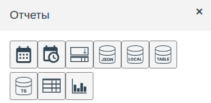
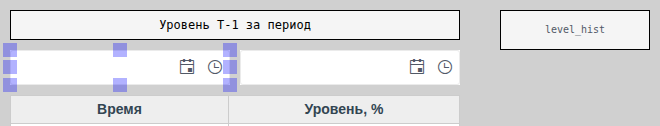
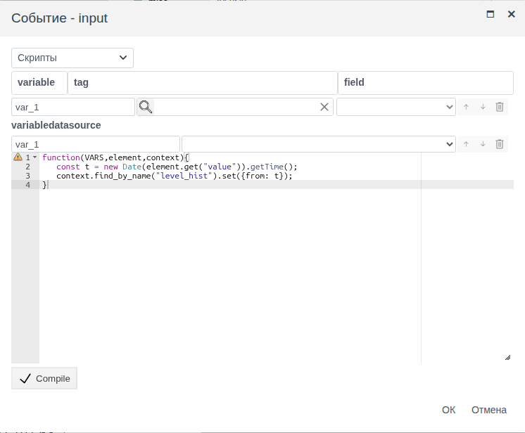
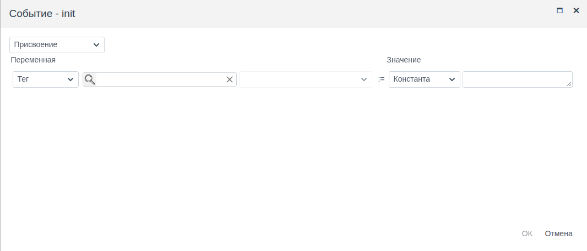
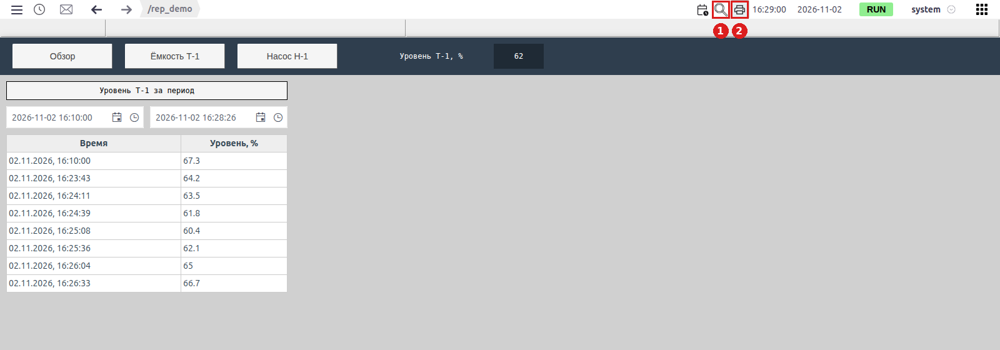
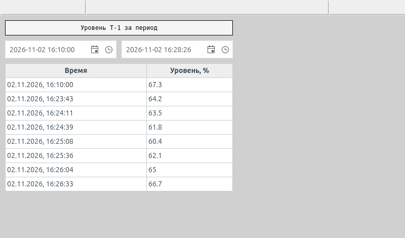
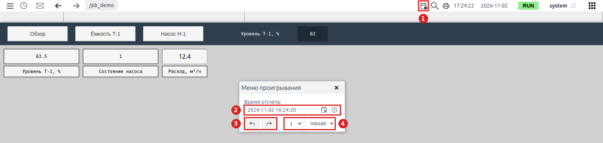

# Отчёты и печать экрана

Документ для инженера-интегратора, которому нужно дать оператору таблицу значений за выбранный им период и возможность распечатать её или сохранить в PDF прямо из Runtime.

# Содержание

- [Глоссарий](#глоссарий)
- [Введение](#введение)
- [Основная часть](#основная-часть)
    - [Палитра «Отчеты»](#палитра-отчеты)
    - [Отчётный экран: период, источник, таблица](#отчётный-экран-период-источник-таблица)
    - [Период по умолчанию: событие init](#период-по-умолчанию-событие-init)
    - [Отчёт в Runtime](#отчёт-в-runtime)
    - [Печать экрана](#печать-экрана)
    - [Прошлое состояние схемы: воспроизведение архива](#прошлое-состояние-схемы-воспроизведение-архива)
- [Заключение](#заключение)

# Глоссарий

| Термин | Значение |
|---|---|
| Отчётный экран | Схема, на которой оператор сам задаёт период, а таблица показывает значения архива за этот период. Отдельного типа объекта нет: это обычная схема из элементов палитры **Отчеты** |
| Полоса тревог | Строка под верхней панелью Runtime, над схемой. В ней появляются активные тревоги |
| Рабочая область | Часть окна Runtime под полосой тревог, в которой показана схема. Её можно масштабировать и прокручивать |
| Воспроизведение архива | Режим Runtime, в котором схема показывает значения архива на выбранный прошлый момент. Включается значком календаря с часами на верхней панели, управляется окном «Меню проигрывания» |
| Печать экрана | Кнопка с принтером на верхней панели Runtime и сочетание Ctrl + P. Передаёт браузеру картинку полосы тревог и видимой части рабочей области |

Термины «Схема», «Палитра», «Элемент» — в [«Редакторе мнемосхем»](editor.md#глоссарий), «Событие» — в [«Скриптах и событиях»](events.md#глоссарий), «Источник данных», «Запись» — в [«Источниках данных на схеме»](datasources.md#глоссарий), «Архив» — в [«Таблицах и временной шкале»](tables.md#глоссарий).

# Введение

Оперативная схема показывает текущие значения. Для разбора смены, передачи журнала или ответа на вопрос «что было с уровнем ночью» нужен отчёт: значения за период, который выбирает сам оператор, на бумаге или в PDF. В FACEPLATE отчёт собирают на обычной схеме из элементов палитры **Отчеты**, а печатают кнопкой Runtime.

Документ описывает, что лежит на палитре **Отчеты**, как связать поля выбора периода с архивом и таблицей, как задать период по умолчанию, что видит оператор и что попадает на лист при печати. Свойства элементов описаны в своих документах, здесь — только то, что нужно для отчёта:

- поля даты — [«Кнопки и ввод значений», раздел «Дата и дата со временем»](controls.md#дата-и-дата-со-временем);
- источники — [«Источники данных на схеме»](datasources.md);
- таблица — [«Таблицы и временная шкала», раздел «Таблица: колонки и заголовки»](tables.md#таблица-колонки-и-заголовки);
- скрипты событий — [«Скрипты и события», раздел «Скрипт события»](events.md#скрипт-события).

Сквозной пример — схема `screen` папки `rep_demo`: история уровня резервуара за период, который оператор задаёт двумя полями. Данные берутся из архива `tank_1_level` папки `ds_demo` (его создание описано в [«Источниках данных на схеме»](datasources.md#time-series-datasource-история-из-архивов)).

Понадобится доступ к Studio (`http://<сервер>:9000/fp/studio`) под учётной записью с правом изменять проект и архив, который пишет историю нужной величины. Результат проверяется в Runtime (`http://<сервер>:9000/fp/runtime`).

# Основная часть

## Палитра «Отчеты»

Палитра **Отчеты** открывается в редакторе мнемосхем кнопкой **Элементы отчетов** на панели инструментов (см. [«Редактор мнемосхем», раздел «Окно редактора»](editor.md#окно-редактора)). На ней элементы для работы с наборами записей и периодами:



| Значок (подсказка) | Назначение | Где описан |
|---|---|---|
| Date | Поле выбора даты | [«Кнопки и ввод значений»](controls.md#дата-и-дата-со-временем) |
| Date - Time | Поле выбора даты и времени | [«Кнопки и ввод значений»](controls.md#дата-и-дата-со-временем) |
| multiselect | Выбор нескольких пунктов списка | [«Выбор из списков»](lists.md) |
| Local Datasource | Источник: записи, заданные на схеме | [«Источники данных на схеме»](datasources.md#local-datasource-записи-на-схеме) |
| Table Datasource | Источник: объекты проекта одного типа | [«Источники данных на схеме»](datasources.md#table-datasource-объекты-проекта) |
| Time-series datasource | Источник: история архивов за период | [«Источники данных на схеме»](datasources.md#time-series-datasource-история-из-архивов) |
| Grid | Таблица записей источника | [«Таблицы и временная шкала»](tables.md#таблица-колонки-и-заголовки) |
| Bar Chart | Столбчатая диаграмма по записям источника | [«Стрелочные и линейные индикаторы»](gauges.md#столбчатая-диаграмма) |

Для отчёта за период нужны три из них: **Date - Time** (начало и конец периода), **Time-series datasource** (история архива) и **Grid** (таблица).

## Отчётный экран: период, источник, таблица

У **Time-series datasource** период задают свойства `from` и `to`: момент времени в миллисекундах. Источник перечитывает архив каждый раз, когда меняется `from` или `to`. Поле **Date - Time** хранит выбранный момент в `value`. Поле и источник связывает скрипт на событии `input` поля: оно наступает, когда оператор выбрал дату в календаре, время в списке или набрал значение в поле. Скрипт переводит выбранный момент в миллисекунды и записывает его в источник.

Чем это лучше привязки `from`/`to` к тегу: период живёт только на схеме оператора. Два оператора могут смотреть отчёт за разные периоды одновременно, в проекте ничего не меняется.



Порядок работы:

1. Добавьте **Time-series datasource**, в **misc** → `name` задайте имя, в **value** → `data` выберите архив и задайте псевдоним (см. [«Источники данных на схеме»](datasources.md#time-series-datasource-история-из-архивов)). `from` и `to` оставьте пустыми, их заполнят скрипты. В примере — `level_hist`, архив `tank_1_level`, псевдоним `level`.
2. Добавьте два поля **Date - Time**. В группе **value** → `name` задайте имена полей начала и конца периода. В примере — `from_dt` и `to_dt`.
3. Добавьте **Grid** после источника, в **value** → `datasource` выберите источник. Заголовки (`header`) и колонки (`columns`) задайте так же, как для любой таблицы истории: время записи — поле `ts`, значение — псевдоним архива. В примере:

    ```
    ["Время", "Уровень, %"]
    ```

    ```
    [{fields: ["ts"], handler: ({ts}) => new Date(ts).toLocaleString()}, "level"]
    ```

4. Выделите поле начала периода, группа **events** → `input` → **Скрипты**, введите скрипт, **Compile** → **OK**:

    ```javascript
    function(VARS,element,context){
       const t = new Date(element.get("value")).getTime();
       context.find_by_name("<источник>").set({from: t});
    }
    ```

5. То же для поля конца периода, в последней строке `{to: t}`.
6. Сохраните схему.

В примере `<источник>` — `level_hist`.



В редакторе таблица заполнена образцом ячеек, записи архива появляются только в Runtime.

## Период по умолчанию: событие init

Пока `from` или `to` пусты, источник записей не отдаёт, и при открытии схемы таблица пустая. Чтобы оператор сразу видел отчёт за типовой период, задайте период скриптом события `init` схемы: оно выполняется при открытии схемы в Runtime.

Щёлкните по пустому месту холста (выделится схема), группа **events** → `init` → **Скрипты**:

```javascript
function(VARS,element,context){
   const to = Date.now();
   const from = to - 24 * 60 * 60 * 1000;
   context.find_by_name("<поле начала>").set({value: from});
   context.find_by_name("<поле конца>").set({value: to});
   context.find_by_name("<источник>").set({from: from, to: to});
}
```

Скрипт ставит в поля последние сутки и передаёт тот же период источнику. Другой период — другое число в строке `from`: 8 часов — `8 * 60 * 60 * 1000`. В примере поля — `from_dt` и `to_dt`, источник — `level_hist`.



## Отчёт в Runtime

Оператор открывает схему через меню **Мнемосхемы** (см. [«Экраны и переходы»](screens.md#как-оператор-находит-экраны)). В примере при открытии поля показывают последние сутки, таблица — все значения уровня за это время.

Чтобы сменить период, оператор щёлкает значок календаря в поле и выбирает день, значок часов — и выбирает время из списка (шаг списка — свойство `interval`), или набирает дату в поле. После выбора таблица перечитывает архив за новый период. Первая строка таблицы — значение архива на момент начала периода, дальше — каждое изменение величины.



Таблица не дописывается сама, пока оператор смотрит отчёт: новые значения появятся после следующего выбора периода.

## Печать экрана

Печать доступна на любой схеме Runtime, не только на отчётной. Запускается двумя способами:

- значок принтера на верхней панели Runtime, справа, между лупой и часами (на рисунке выше — **2**);
- Ctrl + P, пока открыт Runtime.

Runtime делает картинку и открывает диалог печати браузера. В нём выбирают принтер или сохранение в PDF.

На лист попадает то, что оператор видит в рабочей области, и полоса тревог над ней:

| Часть окна Runtime | На листе |
|---|---|
| Полоса тревог | Да |
| Видимая часть схемы | Да |
| Часть схемы за краем окна | Нет |
| Строки таблицы за её прокруткой | Нет |
| Верхняя панель (меню, путь, часы, пользователь) | Нет |
| Фиксированный экран (см. [«Экраны и переходы»](screens.md#фиксированный-экран)) | Нет |



В примере на картинке нет верхней панели и фиксированного экрана с кнопками перехода, которые видны на рисунке Runtime выше; сверху — пустая полоса тревог.

Отсюда два правила для отчётного экрана:

1. **Схема целиком в окне.** Если схема больше окна, оператор перед печатью уменьшает масштаб: значок лупы на верхней панели (на рисунке выше — **1**) открывает панель с текущим масштабом в процентах и кнопками **−**, **+** и **Сброс**. Кнопка **−** уменьшает масштаб вдвое. Колесо мыши с Ctrl тоже меняет масштаб, колесо без Ctrl прокручивает схему. **Сброс** возвращает 100 %.
2. **Все строки таблицы видны.** Высоту **Grid** выбирают по числу строк, которое отчёт даёт за типовой период. Если строк заведомо больше, сократите период по умолчанию в `init` или разместите таблицу на всю высоту схемы.

## Прошлое состояние схемы: воспроизведение архива

Отчётная таблица показывает одну величину за период. Для разбора событий часто нужно другое: вся схема в один прошлый момент — какие были уровни и состояния, когда сработала защита. Для этого в Runtime есть режим воспроизведения архива. Отдельной схемы он не требует: работает на любой открытой схеме.

Значок календаря с часами на верхней панели, слева от лупы (на рисунке — **1**), открывает над текущей схемой окно «Меню проигрывания»:

| № | Элемент окна | Назначение |
|---|---|---|
| 2 | **Время отсчета** | Момент, на который схема показывает значения. Наберите дату и время в поле и нажмите Enter |
| 3 | Кнопки «назад» и «вперёд» | Сдвигают момент на один шаг раньше или позже |
| 4 | Шаг | Число (1, 5, 10, 15, 30, 60) и единица: `second`, `minute`, `hour` |



Что показывает схема:

- пока момент не задан — текущие значения, как обычно;
- элемент, привязанный к полю, у которого есть архив, — значение архива на заданный момент;
- элемент, привязанный к полю без архива, — текущее значение;
- значения из схемы в этом режиме в проект не записываются.

В примере (схема `pb_demo`) уровень `tank_1.level` записывается архивом, состояние насоса — нет. В момент 16:24:20 уровень показывает 63.5 — значение архива, состояние — текущее. Кнопка «вперёд» с шагом 1 `minute` переводит схему на 16:25:20, и уровень меняется на 60.4. Закрытие окна крестиком возвращает схему к текущим значениям.

Значит, воспроизводится только то, что пишет архив: поле, которое нужно видеть в прошлом, должно иметь архив (см. [«Архивы: настройка источников и запись данных»](../data_storage/archives/archives.md)).

Печать в этом режиме даёт схему на заданный момент. Окно «Меню проигрывания» на лист не попадает, поэтому момент на распечатке не указан: если он нужен, подпишите лист.

| | Отчётная таблица | Воспроизведение архива |
|---|---|---|
| Что на листе | Одна величина, все изменения за период | Вся схема в один момент |
| Что готовит интегратор | Отдельную схему: поля периода, источник, таблицу | Ничего, кроме архивов нужных полей |
| Как оператор выбирает время | Начало и конец периода в полях схемы | Момент и шаг в окне «Меню проигрывания» |

# Заключение

| Задача | Что использовать |
|---|---|
| Значения архива за период, выбранный оператором | Два поля **Date - Time**, скрипт на `input` каждого поля → `from`/`to` **Time-series datasource**, **Grid** |
| Отчёт сразу при открытии | Скрипт события `init` схемы задаёт поля и период источника |
| Сводка по объектам проекта или справочник на том же листе | **Table Datasource** или **Local Datasource** и ещё одна **Grid** (см. [«Источники данных на схеме»](datasources.md)) |
| Вся схема в прошлый момент | Значок календаря с часами → «Меню проигрывания»; у нужных полей — архив |
| Бумажная копия или PDF | Значок принтера на верхней панели Runtime или Ctrl + P → диалог печати браузера |

Порядок работы:

1. Добавьте **Time-series datasource**, выберите архив, задайте имя.
2. Добавьте два поля **Date - Time** с именами, **Grid** с выбранным источником, заголовками и колонками.
3. На `input` каждого поля назначьте скрипт, который пишет `from` или `to` источника.
4. На `init` схемы назначьте скрипт периода по умолчанию.
5. Подберите размеры схемы и таблицы так, чтобы отчёт помещался в окно Runtime целиком. Сохраните схему.
6. В Runtime выберите период, проверьте таблицу и распечатайте экран.
