# Рабочий стол Runtime: возможности и пример настройки

Версия документации: Faceplate v4.0.7.

## Назначение и устройство

Рабочий стол Runtime объединяет мнемосхемы проекта, навигацию, сообщения, сведения о состоянии и инструменты отображения. Оператор выбирает нужную мнемосхему и работает с размещёнными на ней элементами. Интегратор готовит содержимое и настройки в Студии.

Откройте страницу `/fp/runtime` по адресу вашей установки Faceplate и авторизуйтесь. Для подготовки мнемосхем нужен также доступ к Студии и графическому редактору.

- **Мнемосхема (экран)** — сохранённое графическое содержимое папки проекта.
- **Рабочая область** — место отображения текущей сменяемой мнемосхемы.
- **Постоянная область** — отдельное содержимое над рабочей областью, общее для переходов между мнемосхемами.
- **Контекст экрана** — связи его элементов с данными и клиентские события.

### Для чего используют мнемосхемы

Мнемосхема представляет технологический объект или участок процесса в наглядном виде: оборудование, соединения, подписи, текущие значения и индикаторы состояния. Оператор видит, где находится измерение и к какому оборудованию оно относится. Например, заполнение резервуара и числовой уровень помогают оценить запас, а температура, давление и режим — уточнить состояние узла.

В проекте удобно разделять обзор установки и детальные виды. Обзор помогает заметить изменение и выбрать нужный объект; детальная мнемосхема показывает точные параметры узла. Оператор открывает нужный вид, сверяет состояние и свежесть показаний, переходит к деталям, сообщениям или трендам. Если проект предусматривает управление, он выполняет разрешённое действие через настроенные элементы и проверяет результат. Набор таких элементов определяется проектом и правами пользователя.

### Связь с графическим редактором

Интегратор создаёт рисунок и настраивает связи элементов с данными в графическом редакторе; см. [руководство «Графический редактор: создание мнемосхем»](../editor.md#схемы-папки). Порядок открытия основной мнемосхемы из Студии приведён в разделе её настройки ниже.

После сохранения этот макет открывается как мнемосхема в Runtime. Постоянные подписи и рисунок остаются такими, какими их сохранил автор; связанные с тегами значения и свойства меняются при поступлении данных. Чтобы увидеть новое измерение, оператору не нужно заново рисовать или сохранять мнемосхему.

Так подготовленное содержимое становится рабочим экраном оператора. Элементы **внутри мнемосхемы** принадлежат проекту; навигация и инструменты вокруг неё принадлежат рабочему столу Runtime.

### Области рабочего стола

В верхней панели находятся навигация, путь, инструменты и сведения о пользователе. Ниже расположены строка сообщений, постоянная область при наличии содержимого и основная рабочая область. Дополнительные функции открываются в своих окнах.

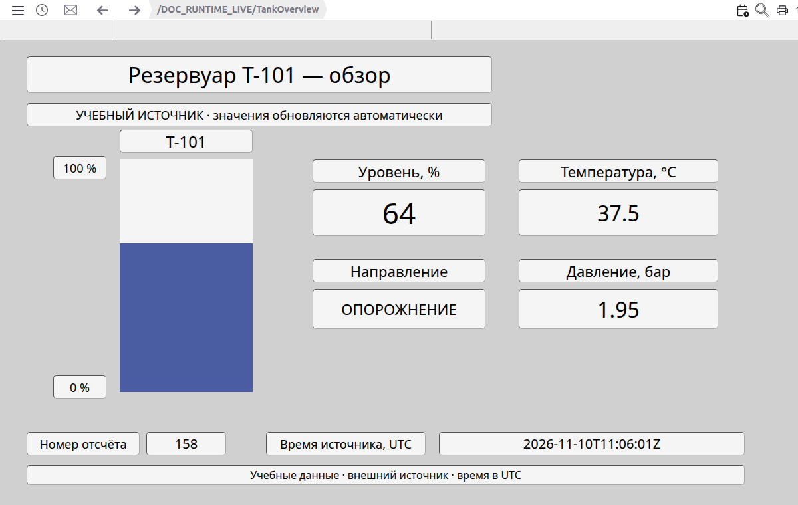

Рисунок 1. Обзор учебного резервуара: заполнение шкалы соответствует уровню 64%, рядом показаны направление, температура и давление. Внизу видны номер отсчёта и время источника. Пример работы и изменение показаний разобраны ниже.

Ниже рассмотрены выбор мнемосхем и инструменты, расположенные вокруг рабочей области.

## Возможности и элементы управления

### Верхняя панель: слева направо

Разбор следует расположению элементов: навигация и путь слева, инструменты и сведения о сеансе справа. У каждой команды показаны её вид и результат действия.

Рисунок 2. «Меню», «История», «Активные сообщения», назад, вперёд и путь текущей мнемосхемы.

Рисунок 3. Проигрывание, масштаб, печать, время, дата, STOP, имя пользователя и «Избранное». На снимке отсутствует необязательная команда PowerFactory.

На снимках используются учебные мнемосхемы «Обзор участка» и «Параметры участка», а также учебное сообщение. Названия и пути в вашем проекте будут другими.

#### Меню

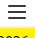

Нажмите кнопку с тремя полосками слева: откроются боковая панель и дерево мнемосхем. Повторное нажатие закроет панель. Через это меню оператор выбирает экран и переходит к дополнительным функциям.

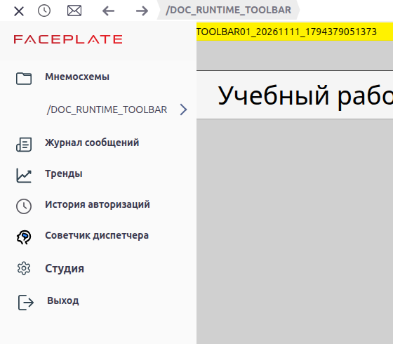

Рисунок 4. Открытая боковая панель; дерево уже показано под пунктом «Мнемосхемы».

#### История

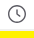

Рядом с «Меню» расположены часы: они открывают окно **«История»** с карточками ранее выбранных мнемосхем. Нажатие карточки открывает соответствующий экран.

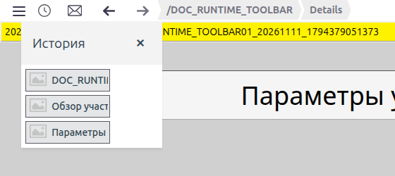

Рисунок 5. В истории показаны три посещённых экрана.

История переходов хранит до 100 записей и относится к пользователю. Окно убирает повторяющиеся пути; удалённые или недоступные как мнемосхемы объекты могут отсутствовать. Хронологический порядок карточек не гарантируется.

#### Активные сообщения

Следующий значок, конверт, открывает окно **«Активные сообщения»** со списком ошибок, аварий и предупреждений.

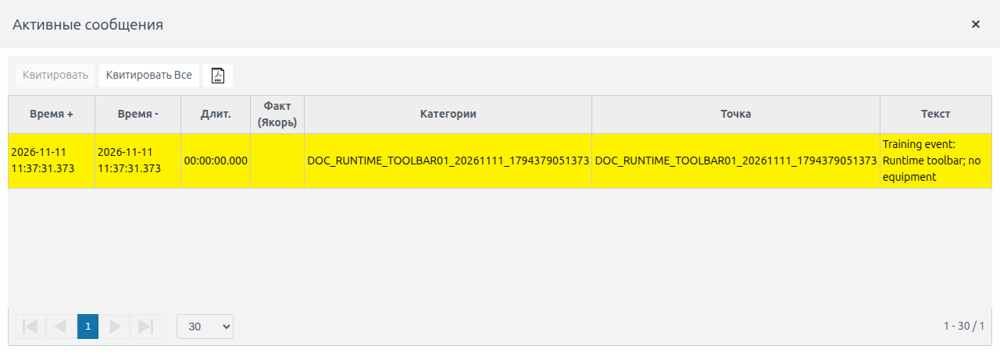

Рисунок 6. В окне показано одно учебное предупреждение; «Время+» и «Время−» обозначают появление и снятие события.

При начальной загрузке конверт может быть недоступен до получения списка сообщений; доступность кнопки сама по себе не показывает количество аварий. Строка последнего сообщения под панелью имеет отдельное действие: нажатие квитирует последнее сообщение. Значение квитирования и правила отбора разобраны в подразделе «Состояние сообщения и квитирование».

#### Назад и вперёд

Стрелка влево возвращает к предыдущему переходу внутри Runtime. В показанном примере после выбора Details она вернула Overview: изменились путь и заголовок рабочей области.

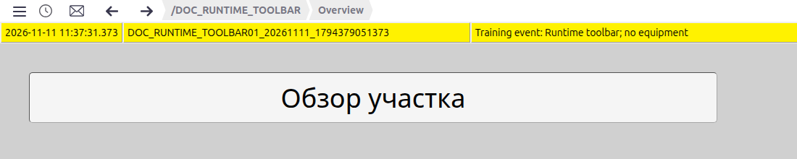

Рисунок 7. После «Назад» открыт Overview с заголовком «Обзор участка».

Стрелка вправо повторяет следующий переход после возврата назад. В том же примере она снова открыла Details.

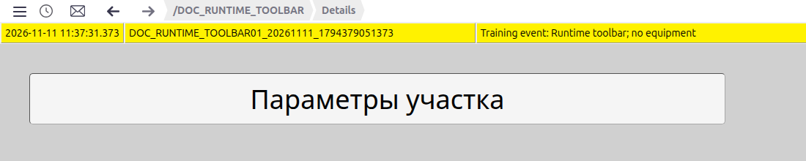

Рисунок 8. После «Вперёд» открыт Details с заголовком «Параметры участка».

Это собственная навигация Runtime. На границе истории соответствующая стрелка недоступна. Если после возврата назад выбрать другую мнемосхему, прежняя ветка переходов вперёд заменяется новой.

#### Путь текущей мнемосхемы

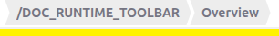

Справа от стрелок показан путь по именам папок. Его части доступны для перехода: нажмите имя родительской папки, чтобы открыть её мнемосхему, если она подготовлена и доступна. В примере выбран родительский экран «Учебный рабочий стол».

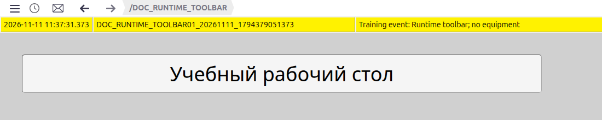

Рисунок 9. После выбора родителя из пути исчезла конечная часть Overview, а рабочая область показала содержимое родительской папки.

Псевдоним карточки и заголовок внутри рисунка могут отличаться от имени папки. При проверке перехода сопоставляйте путь и содержимое.

#### Проигрывание

Значок календаря с часами открывает **«Меню проигрывания»** для текущей мнемосхемы. В нём задают **«Время отсчета»** и шаг перемещения по времени. Вход доступен при открытой мнемосхеме в обычном режиме текущих данных.

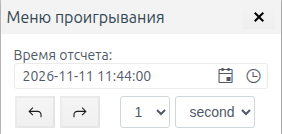

Рисунок 10. Открыто меню выбора времени; в поле шага показана 1 секунда. Здесь время ещё не выбиралось.

Окно позволяет перейти от наблюдения текущих данных к просмотру на выбранное время. Различия архивных и неархивируемых полей, ограничения управления и возврат к текущим данным описаны в подразделе «Архивные и модельные данные».

#### Исследование PowerFactory (при наличии)

При доступном моделировании и открытой мнемосхеме в обычном режиме команда PowerFactory появляется **после проигрывания и перед масштабом**. Она открывает исследование модели. На показанном стенде команды нет; наличие зависит от установки.

#### Масштаб и перемещение

Лупа открывает панель масштаба с текущим процентом, кнопками **«−»**, **«+»** и **«Сброс»**. Повторное нажатие лупы закрывает её.

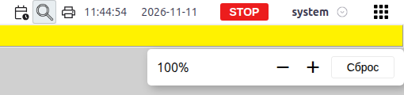

Рисунок 11. При 100% доступны уменьшение, увеличение и сброс вида.

Кнопка **«+»** увеличивает масштаб вдвое, **«−»** уменьшает вдвое. **«Сброс»** возвращает 100% и исходное положение рабочей области. Диапазон — от 1% до 25600%. Большой рисунок можно перемещать средней кнопкой мыши; обычное колесо перемещает содержимое, а Ctrl с колесом меняет масштаб относительно указателя. Положение ограничено границами содержимого.

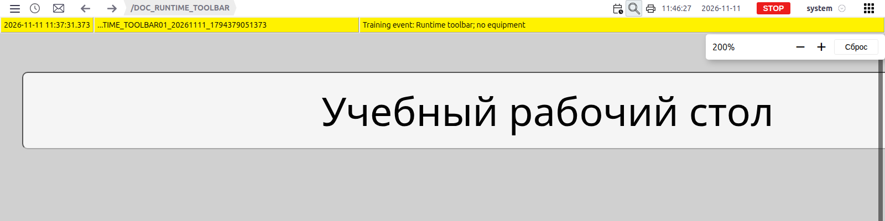

Рисунок 12. После увеличения до 200% заголовок стал вдвое крупнее. Для этого кадра содержимое дополнительно перемещено средней кнопкой мыши, чтобы заголовок был виден.

Масштаб Runtime меняет рабочую область и отличается от масштаба браузера. Штатный выбор другой мнемосхемы сбрасывает масштаб; он не сохраняется как постоянная настройка экрана.

#### Печать

Значок принтера подготавливает изображение текущей рабочей области и строки сообщений, затем вызывает печать браузера. Тот же механизм доступен по Ctrl+P или Cmd+P. Верхняя панель, боковое меню и постоянная область в изображение не входят.

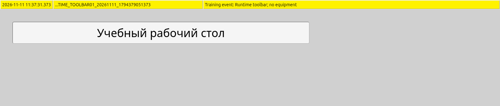

Рисунок 13. Фрагмент настоящего изображения, подготовленного Faceplate: строка сообщения и мнемосхема. Это результат подготовки, а не диалог выбора принтера.

Внешний вид диалога, выбор принтера и сохранение в PDF зависят от браузера и системы. Перед подтверждением печати проверьте состав областей, масштаб и читаемость.

#### Время, дата и RUN/STOP

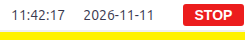

За принтером показаны время, дата и состояние выполнения проекта. Нажатие на эти надписи не открывает окно и не переключает проект.

Runtime запрашивает время сервера раз в секунду и отображает его **в часовом поясе браузера**. Поэтому рабочие места с разными часовыми поясами могут показывать одну серверную метку по-разному. При неудачном запросе на экране может остаться последнее полученное время.

**RUN** означает, что выполнение проекта разрешено; **STOP** — отключено. Это не оценка качества связи и не подтверждение свежести всех показаний. При потере связи прежняя надпись также может остаться. Проверяйте источник и время поступления конкретных данных отдельно.

#### Имя пользователя и смена пароля

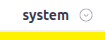

Далее расположено имя текущего пользователя со стрелкой. В примере **system** — имя учётной записи. Нажатие на эту группу открывает форму **«Изменение пароля - system»**.

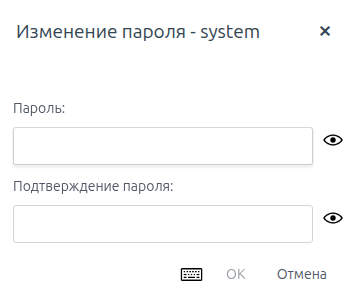

Рисунок 14. Пустая форма с полями «Пароль» и «Подтверждение пароля». «Отмена» закрывает её; пароль меняется только при подтверждении заполненной формы.

#### Избранное

Крайняя правая кнопка, сетка квадратов, открывает окно **«Избранное»**. Выберите карточку, чтобы открыть мнемосхему.

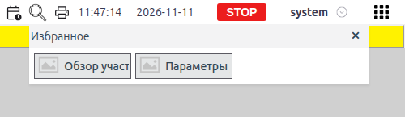

Рисунок 15. Показаны две карточки учебного проекта. Выбор «Обзор участка» открывает Overview, как на снимке перехода назад выше.

Это проектный список: его состав настраивает интегратор, а пользователь видит доступные ему мнемосхемы. Личной команды добавления текущего экрана в избранное нет. Длинная подпись карточки может обрезаться; открытый экран сверяйте по пути и содержимому. Настройки подписей и иконок разобраны ниже вместе с параметрами папки.

### Боковое меню: сверху вниз

Верхняя панель даёт быстрые переходы и инструменты просмотра. Остальные команды собраны в боковой панели: откройте **«Меню»** и двигайтесь по пунктам сверху вниз. После выбора мнемосхемы панель и дерево закрываются.

#### Мнемосхемы

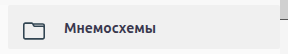

Первый пункт переключает видимость дерева. Поскольку кнопка «Меню» уже показывает дерево, следующее нажатие **«Мнемосхемы»** может скрыть его; ещё одно вернёт список.

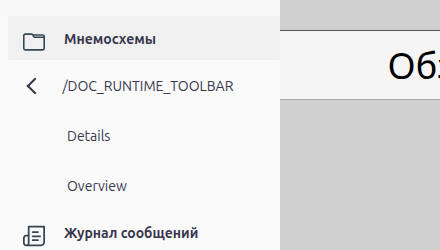

Рисунок 16. Дерево раскрыто до Overview и Details. Нажатие имени выбирает экран, отдельная стрелка «Перейти» раскрывает дочерний уровень; стрелка влево возвращает к родителю дерева.

Папки без собственной мнемосхемы могут объединяться в подпись пути. Список определяется сохранёнными основными мнемосхемами и доступом пользователя.

#### Журнал сообщений

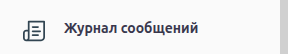

Этот пункт открывает окно **«Архив сообщений»**. В отличие от краткого списка непроквитированных сообщений, здесь используют архив и фильтры, чтобы проверить появление, снятие и квитирование события.

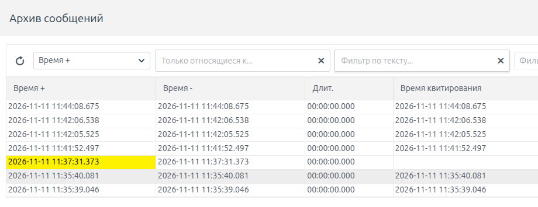

Рисунок 17. Начало окна архива с фильтрами и колонками времени. Жёлтая строка относится к учебному предупреждению; остальные записи — события входа на стенде.

Условия отбора и доступные действия описаны в [руководстве по сообщениям и тревогам](../../alarms/alarm/alarm.md).

#### Тренды

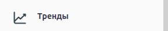

Нажатие открывает **«Выбор трендов»**. В этом окне выбирают данные и группы для графиков; на снимке видны вкладки **«Группы»**, **«Архивы»** и **«Файл»**. Содержимое зависит от настроек и доступных архивов проекта.

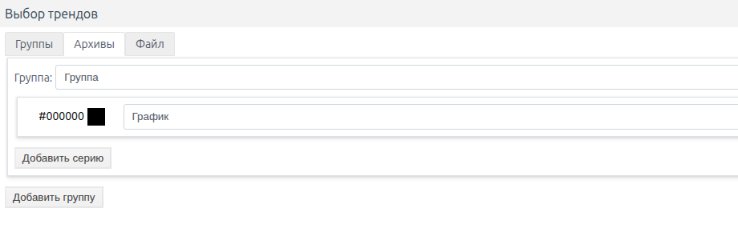

Рисунок 18. На стенде открыта вкладка «Группы» с пустой заготовкой. Само открытие окна ещё не создаёт рабочий график.

Настройка рядов, групп и параметров отображения разобрана в [руководстве по трендам](../../data_storage/archives/trends.md).

#### История авторизаций

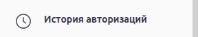

Открывает сведения о последнем успешном и последнем неуспешном входе текущего пользователя. Если попытка не найдена, окно прямо сообщает об этом. Это краткая справка об учётной записи; полный аудит в данном окне не отображается.

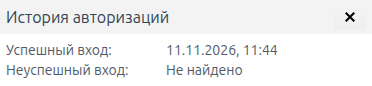

Рисунок 19. Найден успешный вход; для неуспешного показано «Не найдено».

#### Советчик диспетчера

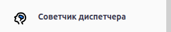

Пункт появляется при установленном модуле и открывает окно советчика. На проверенном интерфейсе заголовок окна — **Dispatcher Support**. В нём доступны отбор по объекту, текстовый фильтр и обновление результатов.

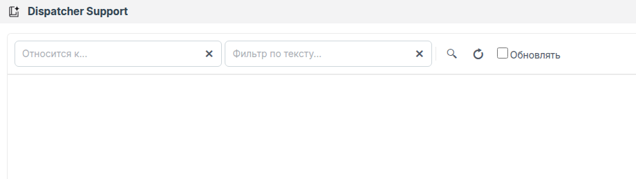

Рисунок 20. Окно открыто, но на учебном стенде результаты отсутствуют. Пустой список сам по себе не подтверждает неисправность.

Подготовка данных и работа службы описаны в [руководстве советчика диспетчера](../../alarms/dsf/dsf.md).

#### Студия

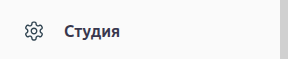

Открывает Студию в новой вкладке браузера. Для доступа нужны административные права; новая вкладка может потребовать отдельного входа. После входа интегратор видит конфигурацию проекта и может перейти к графическому редактору.

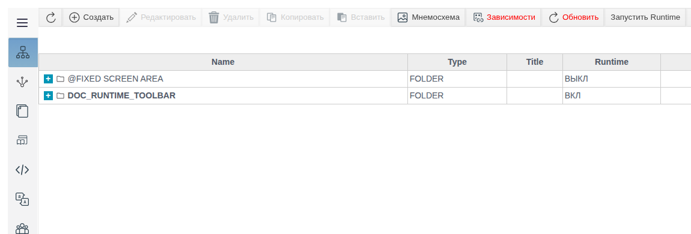

Рисунок 21. Конфигурация учебного проекта в Студии после авторизации в новой вкладке.

Для возврата к наблюдению переключитесь на вкладку Runtime. Как подготовить содержимое экрана, показано в следующем разделе «Настройка мнемосхем и постоянной области».

#### Выход

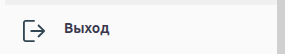

Нажатие открывает подтверждение завершения сеанса. **yes** подтверждает выход, **no** отменяет его и оставляет пользователя в Runtime.

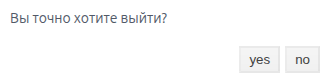

Рисунок 22. Запрос «Вы точно хотите выйти?». На снимке показан запрос до подтверждения; при проверке выход был отменён.

#### Сведения об установке

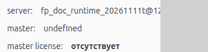

Ниже команд показаны **server**, **master** и **master license**. Это сведения о сервере, ведущем узле и лицензии установки. Они не открывают отдельные окна по нажатию. Длинное имя сервера может обрезаться по ширине панели; вопросы конфигурации узлов и лицензирования относятся к администрированию.

#### Тема оформления

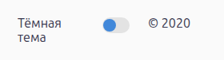

Боковое меню завершается переключателем темы. Подпись **«Тёмная тема»** предлагает перейти к тёмному оформлению; после переключения **«Светлая тема»** возвращает светлое.

Переключение темы меняет оформление оболочки; цвета, заданные автором мнемосхемы, сохраняют собственные настройки. В примере серый фон оставался серым при переходе к тёмной теме.

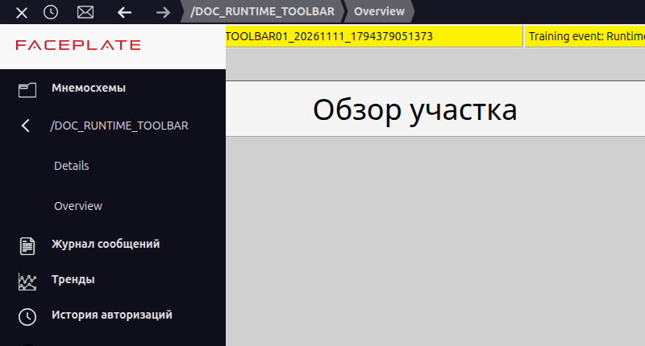

Рисунок 23. Рабочий стол после включения тёмной темы; авторский фон мнемосхемы остался серым.

### Окна и печать

Показанные команды открывают разные окна инструментов. Плавающее окно перемещают за заголовок и закрывают кнопкой ×, если эти элементы предусмотрены. Изменение размеров и разворачивание зависят от конкретного окна; для закреплённых трендов предусмотрен отдельный механизм параметров, описанный в руководстве по трендам.

Окно инструмента и изображение для печати решают разные задачи: первое используется во время работы, второе фиксирует области, перечисленные у кнопки принтера. Настройку состава самой мнемосхемы выполняют отдельно — в Студии.

## Настройка мнемосхем и постоянной области

Описанные выше команды работают с уже подготовленным проектом. Интегратор сначала сохраняет основную мнемосхему, затем задаёт параметры её представления в Runtime и при необходимости готовит постоянную область.

### Основная мнемосхема папки

Чтобы папка появилась в дереве, сохраните её основную мнемосхему. В Студии откройте папку проекта → **«Мнемосхема»** → основная строка **screen** и создайте или отредактируйте макет в графическом редакторе. Другие представления папки не заменяют основную мнемосхему.

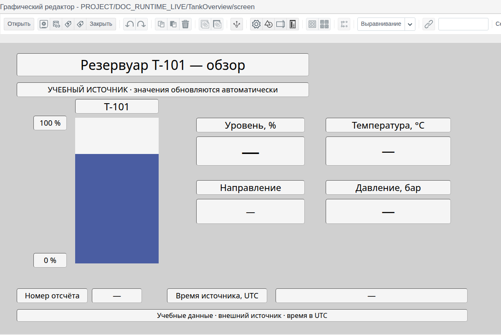

Рисунок 24. Макет учебного резервуара в редакторе: расположение, подписи и шкала подготовлены автором. Для связанных показаний в этом макете оставлены заполнители «—»; Runtime получает вместо них данные, как на рисунке 1. Значок дискеты сразу справа от «Открыть» — «Сохранить». Подробности инструментов — в руководстве графического редактора по ссылке выше.

### Параметры папки и мнемосхемы

После сохранения рисунка настройте его представление на рабочем столе. Параметры папки определяют подпись и карточку в истории и избранном, свойства макета — размеры и фон самой мнемосхемы. Текст внутри рисунка добавляется в графическом редакторе отдельно.

| Настройка | Где задаётся | Назначение | Умолчание или отсутствие | Кто меняет |
|---|---|---|---|---|
| Основная мнемосхема | Вкладка «Мнемосхема», графический редактор | Содержимое рабочего экрана | Без сохранённого содержимого папка не становится обычным пунктом мнемосхем | Интегратор |
| Псевдоним | Настройки папки, Runtime | Подпись в избранном и истории | Используется имя папки | Интегратор |
| Избранное | Настройки папки, Runtime | Включение в проектный список | Без включённого признака экран в список не попадает | Интегратор |
| Иконка | Настройки папки, Runtime | Изображение карточки | Штатная пиктограмма при отсутствии файла | Интегратор |
| Размеры | Свойства самой мнемосхемы, geometry | Размер сохранённого содержимого | Начальные значения зависят от настроек проекта; автоматическая подгонка старых макетов не предполагается | Автор мнемосхемы |
| Фон | Свойства мнемосхемы, background | Цвет рабочей области | Начальный цвет #D0D0D0 | Автор мнемосхемы |
| Доступ | Права проекта и объектов | Просмотр и выполнение разрешённых действий | По назначенным правам проекта и объекта | Администратор / интегратор |
| Постоянная область | Основная мнемосхема специальной папки проекта | Содержимое над рабочей областью | Без содержимого область не показывается | Интегратор |

Для иконки форма принимает SVG, PNG, JPG и JPEG.

Переключатель **Runtime** в форме папки относится к серверному выполнению. Для отображения статического макета его включать не требуется.

### Постоянная область

В проекте предусмотрена папка **`@FIXED SCREEN AREA`**. Её основная мнемосхема задаёт содержимое и размеры постоянной области. Она имеет собственный контекст и располагается над сменяемой рабочей областью. В обычное дерево и избранное эта папка не включается.

Подготовьте содержимое через графический редактор этой папки и сохраните его. После изменения постоянной области переоткройте страницу Runtime: её макет читается при инициализации рабочего стола. Для основной сменяемой мнемосхемы используется другой механизм отслеживания обновлений.

Высота постоянной области занимает часть окна браузера. Выбирайте её с учётом места, необходимого основной мнемосхеме. После подготовки макетов учитывайте, как Runtime загружает их и сохраняет состояние при переходах.

## Данные, контекст и сохранение состояния

Сохранённый макет определяет внешний вид, а открытый экземпляр мнемосхемы имеет собственный контекст и локальные значения. Поэтому переход на другой экран, повторный выбор и обновление страницы дают разные результаты.

### Что происходит при смене экрана

При переходе с мнемосхемы А на мнемосхему Б Runtime может оставить А загруженной в памяти. Оператор её не видит, но получение данных и периодические действия, настроенные автором, могут продолжаться.

Если вернуться с Б на А, Runtime может показать уже загруженную А с её локальным состоянием. Если ещё раз выбрать уже открытую А, Runtime создаст её заново: локально введённые и не сохранённые значения могут сброситься.

Сохранение нового макета в редакторе также может заново загрузить соответствующую мнемосхему в Runtime. Поэтому уход на другой экран не используют для остановки авторских периодических действий; их завершение предусматривают при настройке проекта.

### Что сохраняется

Часть состояния существует в памяти открытой страницы, а последний выбранный экран и история связаны с учётной записью. Таблица показывает различия для обычного режима работы.

| Состояние | Переход на другой экран | Повторный выбор текущего | Обновление страницы | Новый вход |
|---|---|---|---|---|
| Последний открытый экран | Сохраняется выбор пользователя | Выбор записывается снова | Загружается после авторизации, если путь доступен | Загружается, если задан и доступен |
| История переходов | Пополняется | Может содержать повтор пути | Читается сохранённая история | Читается сохранённая история |
| Локальное состояние и контекст | Могут остаться в скрытом экземпляре | Экземпляр пересоздаётся | Не сохраняются памятью прежней страницы | Не восстанавливаются общим снимком |
| Масштаб и положение | Сбрасываются штатной навигацией | Сбрасываются штатной навигацией | Начальные значения | Начальные значения |
| Тема | Сохраняется в открытой странице | Сохраняется в открытой странице | Не сохраняется этим механизмом | Выбирается заново |
| Обычные окна | Поведение зависит от окна | Поведение зависит от окна | Общего восстановления нет | Общего восстановления нет |

Обновление страницы может потребовать повторного входа. Если у пользователя ещё нет последнего выбранного экрана, рабочая область может оставаться пустой до выбора через меню.

Несколько вкладок или рабочих мест одного логина используют общие сохранённые последний экран и историю. Локальная память каждой страницы при этом самостоятельна.

### Свежесть данных и доступ

Правила сохранения объясняют состояние интерфейса, но отдельно нужно оценивать поступление измерений и возможность управления. Значение индикаторов рассмотрено в подразделе «Время, дата и RUN/STOP». Для конкретного показания проверяйте источник, номер отсчёта или время поступления; пример ниже показывает эти поля рядом с измерениями. Если источник остановлен, последние значения могут оставаться на экране.

Просмотр и право управления различаются: видимая кнопка или поле не гарантируют разрешение записи. Если данные доступны, а команда не выполняется, проверяйте права записи и назначение элемента отдельно от связи с сервером.

## Дополнительные функции

Рабочий стол предоставляет входы в связанные функции Faceplate. Таблица собирает их назначение, условия доступности, ограничения и руководства. После неё уточняются правила обработки сообщений и работы с архивными и модельными данными.

| Функция | Назначение | Условия | Существенная граница | Руководство |
|---|---|---|---|---|
| Активные сообщения / Журнал сообщений | Просмотр сообщений и их истории | Доступ пользователя к сообщениям | Отбор списка и состояние события различаются | [Сообщения и тревоги](../../alarms/alarm/alarm.md) |
| Тренды | Просмотр графиков и групп | Доступные данные и права | Собственные окна, параметры и закрепление | [Тренды](../../data_storage/archives/trends.md) |
| Проигрывание | Просмотр данных на выбранное время | Открыта мнемосхема в обычном режиме текущих данных | Неархивируемые поля не образуют исторический срез | [Проигрывание](https://docs.google.com/document/d/1ho98hgPi2a4_MeGCRtHpS6MPb-_ciYo65QlzPFllfqU/edit) |
| Исследование PowerFactory | Работа с модельными данными | Моделирование доступно, открыт экран в обычном режиме | Отдельная сессия и источник данных | Справка установленного модуля |
| Советчик диспетчера | Просмотр результатов советчика | Модуль установлен | Настройка службы описана отдельно | [Советчик диспетчера](../../alarms/dsf/dsf.md) |
| Студия | Конфигурация проекта | Административный доступ | Изменения требуют соответствующих прав | Студия установки Faceplate |

### Состояние сообщения и квитирование

Кнопка **«Активные сообщения»** по умолчанию открывает непроквитированные сообщения, включая уже снявшиеся. Исчезновение строки после квитирования не доказывает снятие аварийного состояния. Подробности фильтров и обработки — в [руководстве по сообщениям](../../alarms/alarm/alarm.md).

### Архивные и модельные данные

Для анализа значений за прошлый период используют проигрывание, а для исследования расчётной модели — PowerFactory. Входы в эти функции показаны на верхней панели.

В **проигрывании** до выбора времени используются фактические значения. После выбора архивные поля читаются из архива, а поля без архива могут сохранять текущие или ранее полученные значения. Поэтому вся мнемосхема не обязательно представляет один исторический срез. Стандартный механизм записи в этом режиме не выполняет управляющие изменения; это ограничение не заменяет контроль произвольных пользовательских скриптов. Закрытие проигрывания возвращает текущие данные и перезагружает экран. Подробные действия — в [руководстве по проигрыванию](https://docs.google.com/document/d/1ho98hgPi2a4_MeGCRtHpS6MPb-_ciYo65QlzPFllfqU/edit).

Исследование модели использует отдельный режим данных; при закрытии выполняется возврат к обычному режиму. Параметры расчётной сессии описаны в справке установленного модуля. Дальнейший пример относится к обычному отображению данных от учебного источника.

## Пример настройки рабочего стола

### Учебный проект и источник данных

Следующие два вида относятся к одному **учебному резервуару Т-101**. В проекте подготовлен тег **Tank1** с уровнем, температурой, давлением, направлением изменения, номером отсчёта и временем источника. В проверенном примере учебный источник автоматически изменял эти поля примерно раз в 2 секунды; оборудование не подключено. Пути ниже относятся к этому подготовленному учебному проекту. Мнемосхемы показывают полученные значения через обычные привязки.

На этом стенде проект оставался в STOP, а поля обновлял отдельный учебный источник. Поэтому новые значения были видны при STOP. В рабочем проекте источник данных и выполнение технологической логики настраиваются отдельно от рисунка мнемосхемы.

### Привязка элементов к тегу

Чтобы полученные значения меняли рисунок, свойства элементов связывают с полями тега. В графическом редакторе выбран элемент **«Бар»**. У его свойства **value** в колонке **«Привязка»** открыто создание связи. На вкладке **«Источник»** выбран тип **«тег»**, объект **`/DOC_RUNTIME_LIVE/Tank1`** и отдельное поле **level**. Аналогично значения текстовых элементов связаны с соответствующими полями этого же тега. После **OK** макет сохранён и повторно открыт. Пользовательский JavaScript для этих связей не нужен.

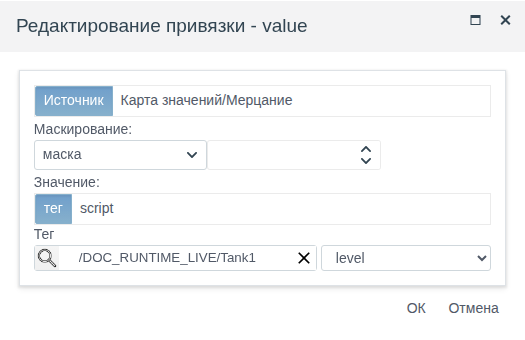

Рисунок 25. В диалоге отдельно выбираются тег и его поле level. Такая связь заставляет значение и заполнение шкалы следовать данным источника. Числовые и строковые показания настраиваются тем же способом.

### Обзор резервуара

После настройки привязок откройте **TankOverview** через **«Меню»** по пути **`/DOC_RUNTIME_LIVE/TankOverview`**. Шкала слева показывает заполнение от 0 до 100%; справа находятся точные значения и направление изменения. Такой обзор помогает оператору быстро оценить состояние узла, затем выбрать нужную детализацию.

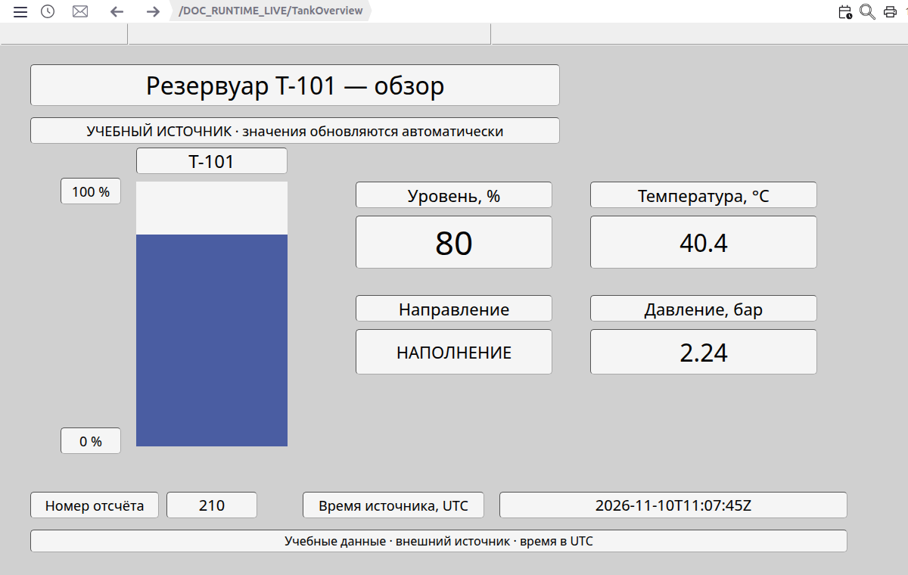

Рисунок 26. Первый кадр обзора: уровень 80%, температура 40,4 °C, давление 2,24 бар, «НАПОЛНЕНИЕ», отсчёт 210, время источника 11:07:45 UTC.

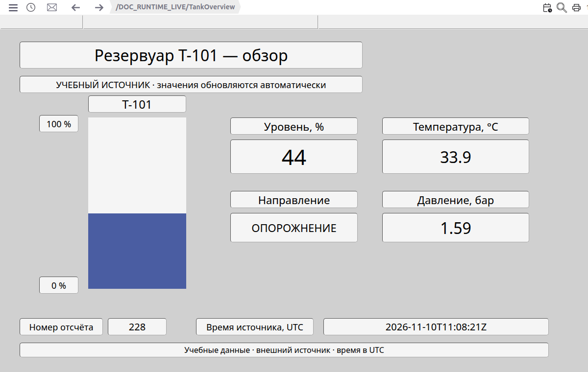

Рисунок 27. Через 36 секунд та же открытая мнемосхема показывает 44%, 33,9 °C, 1,59 бар и «ОПОРОЖНЕНИЕ»; отсчёт 228, время 11:08:21 UTC. Изменилась и высота синего заполнения. Страница между этими кадрами не обновлялась, мнемосхема не выбиралась заново.

### Параметры резервуара

Для чтения точных показаний откройте **TankDetails** через **«Меню»** по пути **`/DOC_RUNTIME_LIVE/TankDetails`**. Этот вид показывает те же поля Tank1 отдельными строками с единицами измерения. Оператор использует его, когда нужно прочитать точное значение и проверить время поступления данных после общего обзора.

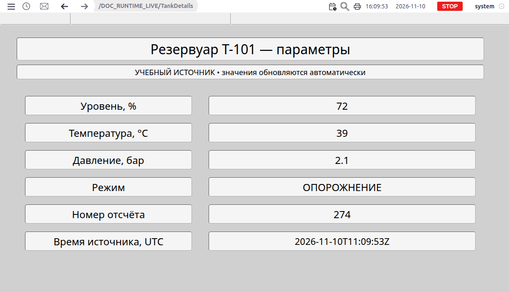

Рисунок 28. Первый кадр параметров: 72%, 39 °C, 2,1 бар, «ОПОРОЖНЕНИЕ»; отсчёт 274, время источника 11:09:53 UTC.

Рисунок 29. Через 20 секунд без перезагрузки и повторного выбора показаны 52%, 35,4 °C и 1,74 бар; отсчёт 284, время 11:10:13 UTC. Подписи строк остались прежними, связанные показания обновились.

Кадры обзора и параметров сняты в разные моменты, хотя оба вида читают один тег Tank1: сопоставляйте их по времени источника. Если вместо ожидаемого обновления значения или вид экрана остаются прежними, используйте диагностическую справку ниже.

## Диагностика и ограничения

Начните с наблюдаемого признака. Проверка должна подтвердить нужный результат — появление мнемосхемы, поступление данных или выполнение разрешённого действия.

| Признак | Что проверить | Действие | Подтверждение результата |
|---|---|---|---|
| Мнемосхемы нет в дереве | Сохранена ли основная мнемосхема, доступна ли папка | Откройте её основное представление в Студии, проверьте сохранение и права | Пункт появился, по выбору открывается нужный макет |
| Дерево исчезло | Не было ли повторного переключения «Мнемосхемы» | Покажите дерево и дождитесь загрузки | Доступные пункты снова видны |
| Избранное или история пусты | Признак избранности, права, наличие посещений и сохранённых экранов | Сверьте настройки папки; откройте доступную мнемосхему | Нужная карточка появилась |
| Экран не открывается | Правильность пути, доступ и сохранённое содержимое | Выберите существующий экран через дерево; при ошибке проверьте его в редакторе | Содержимое и путь совпадают с выбранной папкой |
| Масштаб или локальные значения сбросились | Переход, повторный выбор, обновление страницы или макета | Учитывайте правила сохранения состояния; установите нужный вид заново | Экран отображается в ожидаемом виде |
| Постоянная область не обновилась | Сохранён ли её макет | Переоткройте Runtime, при необходимости войдите снова | Отображается сохранённое содержимое области |
| Просмотр работает, управление запрещено | Права записи и назначение элемента | Обратитесь к администратору за проверкой прав | Разрешённое действие выполняется под нужной учётной записью |
| Данные не меняются при RUN | Связь, серверное время, источник и свежесть значения | Разделите проверку рабочего стола и источника данных | Поступают новые значения от ожидаемого источника |
| Дополнительной функции нет | Установленный модуль, роль, активный экран и режим | Сверьте условия доступности | Вход доступен при выполненных условиях |
| Сообщение исчезло после квитирования | Отбор непроквитированных и состояние события | Проверьте событие в журнале или нужном представлении сообщений | Квитирование и снятие различены |
| Печать отличается от всего рабочего стола | Состав печатаемых областей и масштаб | Проверьте подготовленный результат в браузере | Выбранные области читаемы и содержат нужные данные |

Если причина не найдена, зафиксируйте путь мнемосхемы, время наблюдения, выполненное действие и точный текст ошибки. Это поможет воспроизвести проблему при обращении в поддержку.
