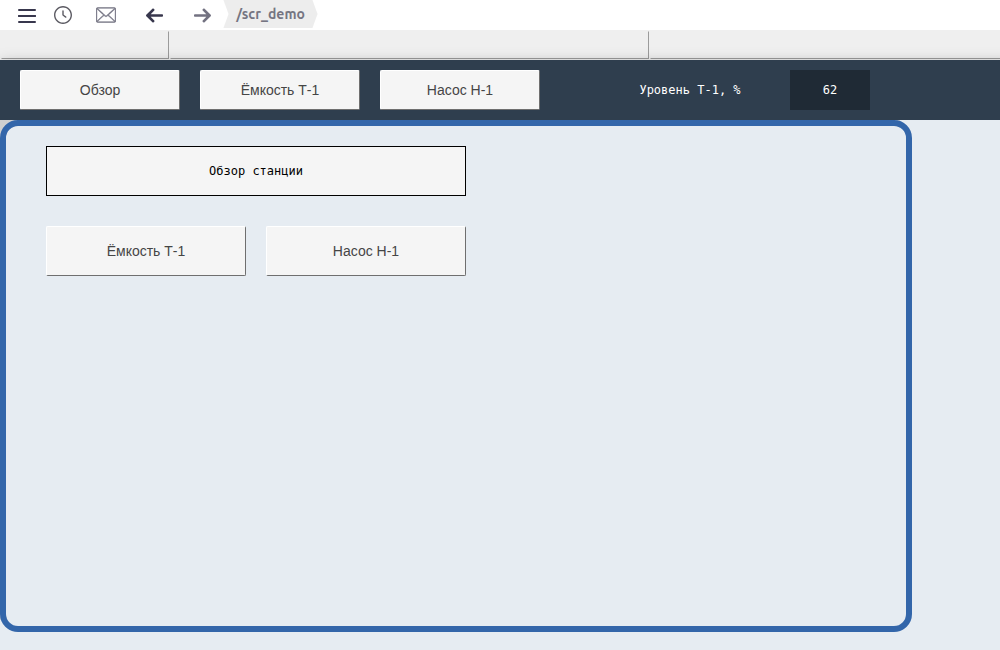
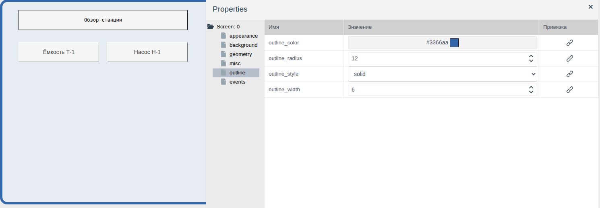
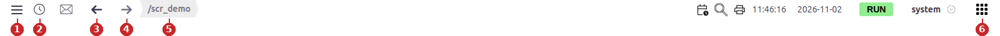
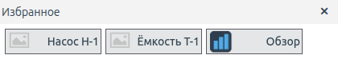
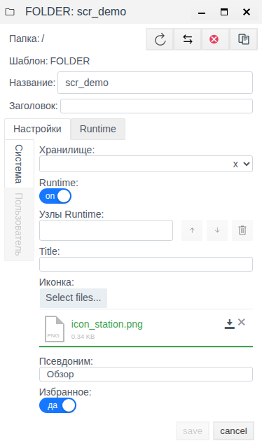
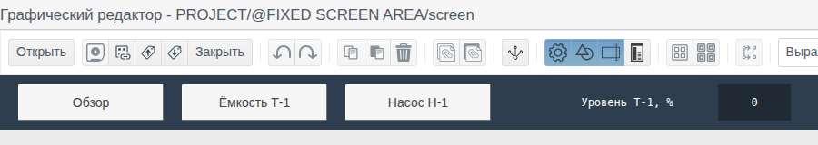
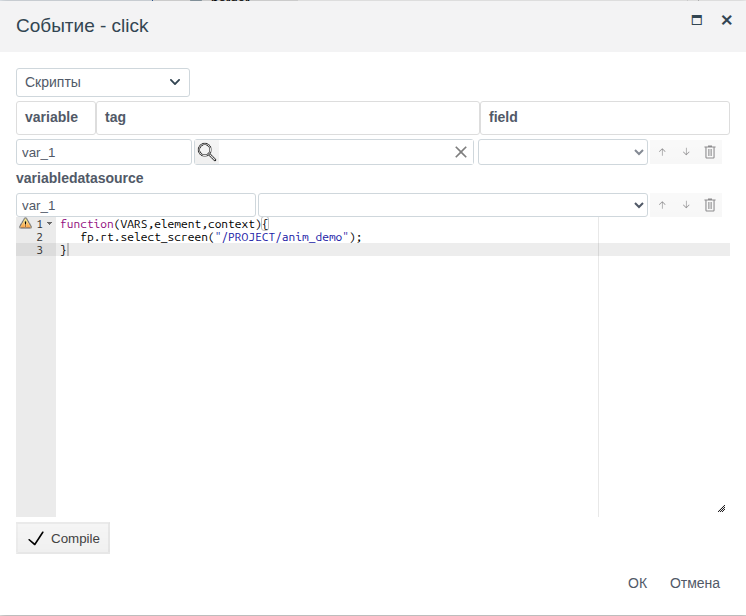

# Экраны и переходы

Документ для инженера-интегратора, который собирает из мнемосхем рабочее место оператора: какие схемы оператор открывает в Runtime, как он переходит между ними и какая панель видна над любой схемой.

# Содержание

- [Глоссарий](#глоссарий)
- [Введение](#введение)
- [Основная часть](#основная-часть)
    - [Экран и папка](#экран-и-папка)
    - [Свойства схемы](#свойства-схемы)
    - [Папка в Runtime: псевдоним, иконка, избранное](#папка-в-runtime-псевдоним-иконка-избранное)
    - [Фиксированный экран](#фиксированный-экран)
    - [Переход на другой экран](#переход-на-другой-экран)
    - [Возврат на схему](#возврат-на-схему)
- [Заключение](#заключение)

# Глоссарий

| Термин | Значение |
|---|---|
| Экран | Схема `screen` папки, открытая в рабочей области Runtime. Одна папка — один экран |
| Рабочая область | Часть окна Runtime, где показан выбранный оператором экран. При переходе меняется только она |
| Фиксированный экран | Схема `screen` системной папки `@FIXED SCREEN AREA`. Runtime показывает её над рабочей областью постоянно, какой бы экран ни был открыт |
| Псевдоним | Поле папки: понятное оператору имя экрана в окнах «Избранное» и «История» Runtime |
| «Избранное» | Окно Runtime со списком экранов, которые интегратор отметил полем папки **Избранное**. Открывается кнопкой в правом углу верхней строки |
| «История» | Окно Runtime со списком экранов, которые уже открывались под этой учётной записью. Открывается кнопкой с часами в верхней строке |

Термины «Схема», «Элемент», «Палитра» — в документе [«Редактор мнемосхем»](editor.md#глоссарий), «Событие», «Реакция» — в [«Скриптах и событиях»](events.md#глоссарий).

# Введение

У каждой папки проекта 17 схем, но экраном Runtime становится только одна — `screen`. Остальные встраиваются в другие схемы (см. [«Назначение схем»](editor.md#назначение-схем) в «Редакторе мнемосхем»). Документ описывает, что ещё нужно, чтобы из набора экранов получилось рабочее место:

- как экран выглядит в Runtime: размер, фон, рамка;
- под каким именем оператор видит экран и как быстро его найти;
- панель, которая видна на всех экранах сразу;
- кнопки перехода между экранами;
- что оператор видит, когда возвращается на уже открытый экран.

Сквозной пример — три экрана: обзорный `scr_demo` (псевдоним «Обзор») и экраны папок `anim_demo` и `controls_demo` (псевдонимы «Ёмкость Т-1», «Насос Н-1»). Над ними фиксированный экран: тёмная полоса с кнопками «Обзор», «Ёмкость Т-1», «Насос Н-1» и текущим уровнем ёмкости.



Понадобится доступ к Studio (`http://<сервер>:9000/fp/studio`) под учётной записью с правом изменять проект. Результат проверяется в Runtime (`http://<сервер>:9000/fp/runtime`).

# Основная часть

## Экран и папка

Папка становится экраном, когда её схема `screen` сохранена хотя бы раз. После этого:

- папка появляется в меню Runtime **Мнемосхемы**. Пункт меню — путь папки от корня проекта, `/<папка>`;
- в дереве проекта Studio имя папки выделено жирным — так видно, у каких папок уже есть экран.

Схемы `view1`…`view15` экранами не становятся и в меню не попадают. Их показывает элемент **Folder Screen** внутри другой схемы (см. [«Схема внутри схемы: Folder Screen»](editor.md#схема-внутри-схемы-folder-screen)). Отсюда правило раскладки: всё, что оператор открывает как отдельный экран, — это `screen` отдельной папки; всё, что повторяется на нескольких экранах, — `viewN`, встроенная в каждый из них.

Сохранённая схема сразу обновляется у всех операторов, у которых этот экран открыт в Runtime: страница не перезагружается, оператор видит новую версию на месте старой. Сохраняйте схему, когда правка закончена: промежуточные версии тоже уйдут на рабочие места.

## Свойства схемы

Свойства самой схемы определяют, как экран ложится в рабочую область. Чтобы их увидеть, щёлкните пустое место холста: в панели **Properties** — `Screen: 0`.

| Группа | Свойство | Что меняет в Runtime |
|---|---|---|
| **geometry** | `width`, `height` | Размер экрана в пикселях. Экран рисуется от левого верхнего угла рабочей области |
| **background** | `background_color` | Цвет экрана. Пока экран открыт, этим же цветом залита рабочая область вокруг него, поэтому экран меньше окна не выглядит «островком» на сером фоне |
| **outline** | `outline_width` | Рамка вокруг экрана, толщина в пикселях. 0 — без рамки |
| | `outline_color` | Цвет рамки |
| | `outline_style` | Вид линии: `solid` — сплошная, `dashed` — штрих, `dotted` — точки и другие |
| | `outline_radius` | Скругление углов рамки |

У новой схемы размер 1914 × 1014. Если экран должен занимать часть окна, уменьшите `width` и `height`: в примере у `scr_demo` 900 × 500, фон `#e6ecf2`, рамка 6 px `#3366aa`, `solid`, скругление 12. На снимке во введении видно, что справа и снизу от рамки рабочая область того же цвета, что и экран.



Группа **events** у схемы та же, что у элементов: `init` выполняется при загрузке экрана, `click` — при щелчке по пустому месту схемы (см. [«Скрипты и события»](events.md)).

## Папка в Runtime: псевдоним, иконка, избранное

### Как оператор находит экраны

Всё, чем оператор переходит между экранами, — в верхней строке Runtime:



| № | Кнопка (подсказка) | Что делает |
|---|---|---|
| 1 | **Меню** | Открывает боковое меню. Пункт **Мнемосхемы** — список всех экранов проекта. Экраны в нём названы путями папок, например `/<папка>`: это имена, которые интегратор дал папкам в дереве проекта |
| 2 | **История** | Окно «История»: экраны, которые уже открывались под этой учётной записью. Список хранится на сервере у учётной записи, поэтому он тот же в любом браузере, где оператор вошёл под своим именем |
| 3, 4 | **Переход назад**, **Переход вперед** | Шаг назад и вперёд по открытым экранам, как в браузере |
| 5 | — | Путь текущего экрана |
| 6 | **Избранное** | Окно «Избранное»: экраны, которые интегратор отметил полем папки **Избранное**. Список один для всех; оператор открывает из него экраны, но не меняет его |

В окнах «История» и «Избранное» экран показан кнопкой с иконкой и псевдонимом папки. Щелчок по кнопке открывает экран в рабочей области, окно закрывается крестиком.



В примере в «Избранном» три экрана; у `scr_demo` своя иконка, у двух других иконка не задана, и на её месте пустая картинка.

### Поля папки

Как экран выглядит в этих окнах, задают три поля формы папки (папка → **Редактировать**, вкладка **Настройки**, **Система**):

| Поле | Что даёт |
|---|---|
| **Избранное** | **да** — экран попадает в окно «Избранное» |
| **Псевдоним** | Имя экрана в окнах «Избранное» и «История» вместо имени папки. Пусто — показывается имя папки |
| **Иконка** | Картинка рядом с именем в этих окнах и в дереве проекта Studio. **Select files...** загружает файл |

После изменения нажмите **save**.



Псевдоним используется только в окнах «Избранное» и «История». В меню **Мнемосхемы**, в пути текущего экрана и в скрипте перехода экран называется путём папки. На схемах псевдоним тоже не появляется: надпись на кнопке перехода — её собственное свойство `text`. В примере псевдоним `scr_demo` и надпись кнопки фиксированного экрана совпадают («Обзор»), но заданы отдельно: смена псевдонима надпись не меняет.

## Фиксированный экран

**Зачем.** Часть информации оператору нужна всегда, на каком бы экране он ни был: кнопки перехода к основным экранам, название объекта, один-два главных показателя. Если рисовать это на каждой схеме, любая правка — новая кнопка, другой показатель — превращается в правку всех схем. Фиксированный экран рисуют один раз, и Runtime сам показывает его над тем экраном, который сейчас открыт.

**Как это выглядит у оператора.** В примере фиксированный экран — полоса высотой 60 px во всю ширину окна, сразу под строкой сообщений. Рабочая область начинается под полосой. Оператор открывает «Ёмкость Т-1» — полоса на месте; переходит на «Насос Н-1» — та же полоса с теми же кнопками, меняется только рабочая область. Значение «Уровень Т-1, %» на полосе меняется вместе с полем `tank_1.level` на любом экране, в том числе на экране насоса, где ёмкости нет. Кнопки полосы переходят на свои экраны откуда угодно.

**Чем отличается от обычного экрана и от Folder Screen:**

| | Обычный экран | Фиксированный экран |
|---|---|---|
| Где виден | В рабочей области, когда оператор его выбрал | Над рабочей областью, всегда |
| Сколько в проекте | По одному на папку | Один |
| Как оператор на него попадает | Меню, «Избранное», «История», кнопки перехода | Никак: он показывается сам, в меню его нет |
| Когда операторы видят изменения | Сразу после сохранения | После перезагрузки страницы Runtime |

Folder Screen тоже показывает одну схему на нескольких экранах, но его ставят в каждую схему вручную, и он виден только там, где поставлен. Фиксированный экран никуда не ставят. Если общий фрагмент нужен на всех экранах — фиксированный экран, если на нескольких — Folder Screen.

**Как создать.** Фиксированный экран — схема `screen` системной папки `@FIXED SCREEN AREA`. Папка всегда есть в корне дерева проекта. Пока её схема не сохранена, полосы нет и рабочая область начинается сразу под строкой сообщений.

1. В Studio откройте **Общий вид**, войдите в папку `@FIXED SCREEN AREA` двойным щелчком и нажмите **Мнемосхема**.
2. Создайте схему `screen`. Выделите саму схему и задайте `height` группы **geometry** — высоту полосы, в примере 60. Runtime отводит под фиксированный экран ровно высоту его схемы: при высоте по умолчанию 1014 он займёт всё окно, и обычные экраны не будут видны.
3. Задайте `background_color`, в примере `#2f3e4e`. Этим цветом залита вся полоса по ширине окна.
4. Нарисуйте элементы. Привязки и события работают так же, как на обычной схеме: в примере три кнопки со скриптом перехода (см. [Переход на другой экран](#переход-на-другой-экран)) и прямоугольник, у которого `text` привязан к `anim_demo/tank_1`, поле `level`.
5. Сохраните схему и перезагрузите страницу Runtime, чтобы увидеть результат.



## Переход на другой экран

Сам оператор переходит между экранами через меню **Мнемосхемы**, окна «Избранное» и «История» и кнопки «назад» и «вперёд» в верхней строке. Кнопка перехода на схеме нужна, чтобы переход был там, где оператор смотрит: с обзорной схемы на детальную, с полосы фиксированного экрана — на любой экран.

Присвоение экран не открывает, поэтому кнопку перехода делает скрипт события (см. [«Скрипт события»](events.md#скрипт-события)). Выделите кнопку, в группе **events** щёлкните ячейку **Реакция** события `click`, выберите **Скрипты** и напишите:

```javascript
function(VARS,element,context){
   fp.rt.select_screen("/PROJECT/<папка>");
}
```

`fp.rt.select_screen` открывает в рабочей области экран папки. Аргумент — путь папки от корня проекта с префиксом `/PROJECT`, то есть тот же путь, что в меню **Мнемосхемы**, с `/PROJECT` впереди. Переменные скрипту не нужны.

В примере у кнопки «Ёмкость Т-1» — `fp.rt.select_screen("/PROJECT/anim_demo");`.



Переход скриптом для Runtime — такой же переход, как из меню: путь в верхней строке меняется, кнопка «назад» возвращает на экран, с которого нажали кнопку, «вперёд» — снова на открытый кнопкой.

В примере скрипт перехода стоит на кнопках «Ёмкость Т-1» и «Насос Н-1» экрана `scr_demo` и на трёх кнопках фиксированного экрана. Кнопки на `scr_demo` видны только на обзоре, кнопки на полосе — везде.

## Возврат на схему

Runtime держит экраны, открытые за сеанс, в памяти. Это определяет, что оператор увидит, вернувшись на экран кнопкой «назад» или из меню **Мнемосхемы**:

| Что на экране | При возврате |
|---|---|
| Значения из привязок | Текущие: если поле тега изменилось, пока оператор был на другом экране, он сразу видит новое значение |
| Свойства, изменённые скриптами событий (`element.set`) | Такие, какими их оставил скрипт |
| Событие `init` | Не выполняется повторно |

Пример из [«Скриптов и событий»](events.md#что-доступно-из-скрипта): на экране `evt_demo` кнопка «Проверка» скриптом красит прямоугольник «Насос» в зелёный. Оператор нажал её, ушёл на другой экран и вернулся — прямоугольник зелёный. Значения из привязок при этом текущие: в проверке на экране `anim_demo` уровень, изменённый за время отсутствия оператора, был показан новым.

Поэтому всё, что должно соответствовать данным, задавайте привязкой: она всегда показывает текущее значение. Скриптом события меняйте то, что относится к действиям оператора на этом экране.

Экран загружается заново — как сохранён в редакторе, с выполнением `init`, — если выбрать в меню **Мнемосхемы** экран, который уже открыт, или перезагрузить страницу Runtime.

# Заключение

| Задача | Как сделать |
|---|---|
| Сделать схему экраном Runtime | Сохранить схему `screen` папки |
| Подогнать экран под окно, задать фон и рамку | Свойства самой схемы: **geometry**, **background**, **outline** |
| Дать оператору быстрый доступ к основным экранам | Поле папки **Избранное**, к нему **Псевдоним** и **Иконка** |
| Показать кнопки и показатели на всех экранах | Фиксированный экран: схема `screen` папки `@FIXED SCREEN AREA` с малой `height` |
| Показать общий фрагмент на нескольких экранах | `viewN` папки и **Folder Screen** в каждой схеме |
| Сделать кнопку перехода | Скрипт на `click`: `fp.rt.select_screen("/PROJECT/<папка>")` |
| Чтобы экран при возврате соответствовал данным | Привязки, а не скрипты событий |

Порядок работы:

1. Разложите экраны по папкам: одна папка — один экран `screen`. Повторяющиеся фрагменты вынесите в `view1`…`view15`.
2. Задайте размер, фон и рамку схем.
3. Включите **Избранное** у основных экранов, задайте им **Псевдоним** и **Иконку**.
4. Нарисуйте фиксированный экран: сначала задайте его `height`, потом общие кнопки перехода и главные показатели.
5. Добавьте кнопки перехода на обзорные схемы.
6. Проверьте в Runtime: переходы, «назад», «Избранное», возврат на экран. Изменения фиксированного экрана — после перезагрузки страницы.
