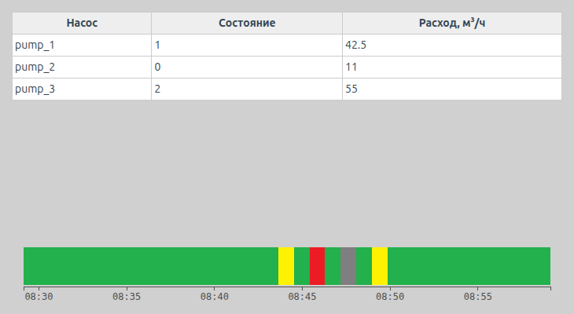
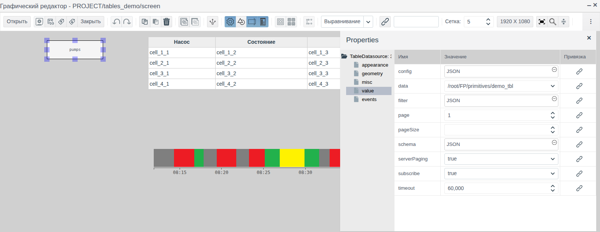
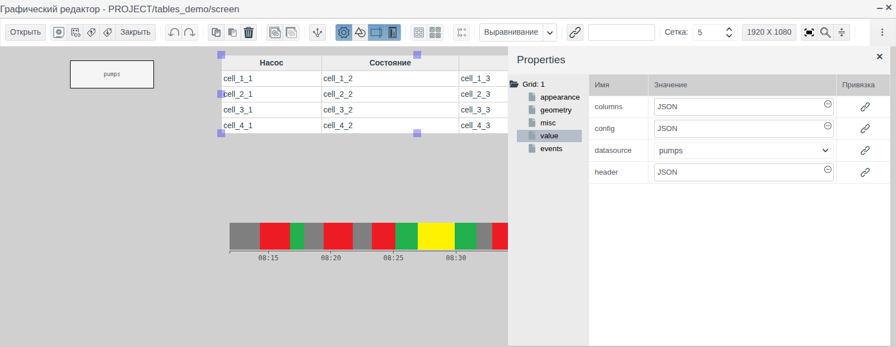
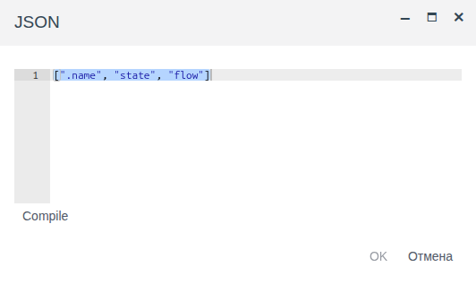
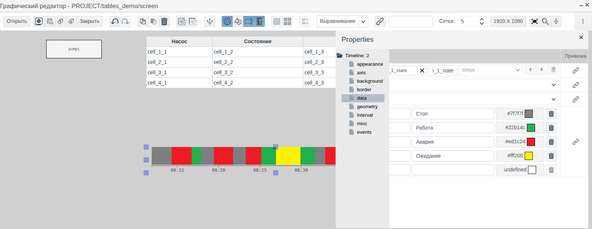
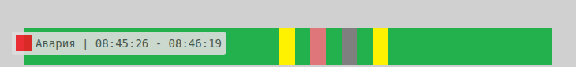

# Таблицы и временная шкала

Документ для инженера-интегратора, которому нужно показать оператору на мнемосхеме сводку по группе объектов (таблицу насосов с их состоянием и расходом) и историю состояний агрегата за последние минуты или часы.

# Содержание

- [Глоссарий](#глоссарий)
- [Введение](#введение)
- [Основная часть](#основная-часть)
    - [Элементы на палитрах](#элементы-на-палитрах)
    - [Таблица: источник строк](#таблица-источник-строк)
    - [Таблица: колонки и заголовки](#таблица-колонки-и-заголовки)
    - [Таблица: цвета](#таблица-цвета)
    - [Временная шкала: архив](#временная-шкала-архив)
    - [Временная шкала: состояния](#временная-шкала-состояния)
    - [Временная шкала: интервал](#временная-шкала-интервал)
    - [Временная шкала: ось, рамка и фон](#временная-шкала-ось-рамка-и-фон)
- [Заключение](#заключение)

# Глоссарий

| Термин | Значение |
|---|---|
| Таблица | Элемент **Grid**: строки — записи источника данных, колонки — их поля |
| Источник данных | Невидимый в Runtime элемент схемы, который хранит набор записей для других элементов. Для таблицы — **Table Datasource** (объекты проекта) или **Local Datasource** (записи, заданные на схеме) |
| Временная шкала | Элемент **Timeline**: полоса, на которой каждый участок времени закрашен цветом состояния агрегата |
| Архив | Объект проекта типа `ARCHIVE`, который записывает историю значений поля тега. Создание архива описано в документе [«Архивы: настройка источников и запись данных»](../data_storage/archives/archives.md) |
| Состояние | Целое число в поле тега, которое означает режим агрегата: 0 — стоп, 1 — работа и т. п. |

Термины «Тег», «Привязка», «Присвоение» — в документе [«Кнопки и ввод значений»](controls.md#глоссарий), «Схема», «Палитра», «Элемент» — в [«Редакторе мнемосхем»](editor.md#глоссарий).

# Введение

Таблица показывает сразу много объектов одного типа: строка на объект, колонка на поле. Она сама находит объекты по типу и папке, поэтому новый насос в папке не требует правки схемы. Временная шкала показывает, когда агрегат работал, стоял или был в аварии: по цветной полосе оператор видит простои за смену без открытия трендов.

Документ описывает оба элемента: свойства, подготовку данных и вид в Runtime. Работа в редакторе (добавление, выделение, свойства, сохранение) описана в [«Редакторе мнемосхем»](editor.md).

Сквозной пример — схема `screen` папки `tables_demo`. В папке три объекта `pump_1`…`pump_3` собственного примитива `demo_tbl` с полями `state` (integer, состояние насоса) и `flow` (float, расход). Таблица показывает все насосы папки, временная шкала — историю состояния `pump_1` за последние 30 минут из архива `pump_1_state`.



Понадобится доступ к Studio (`http://<сервер>:9000/fp/studio`) под учётной записью с правом изменять проект. Результат проверяется в Runtime (`http://<сервер>:9000/fp/runtime`).

# Основная часть

## Элементы на палитрах

| Палитра | Подсказка значка | Корень дерева свойств | Назначение |
|---|---|---|---|
| **Отчеты** | Grid | `Grid` | Таблица записей источника данных |
| **Отчеты** | Table Datasource | `TableDatasource` | Источник: объекты проекта одного типа |
| **Отчеты** | Local Datasource | `LocalDatasource` | Источник: записи, заданные на схеме |
| **Controls** | Timeline | `Timeline` | Временная шкала состояний по архиву |

Группы **appearance**, **geometry**, **misc** и **events** такие же, как у остальных элементов схемы (см. [«Графические элементы», раздел «Общие свойства»](graphics.md#общие-свойства)). На событие `click` таблицы и шкалы можно назначить **Присвоение**, как у кнопки (см. [«Кнопки и ввод значений», раздел «Кнопка»](controls.md#кнопка)).

Свойства `header`, `columns` таблицы и `schema`, `data`, `filter` источников редактируются в окне **JSON**: щёлкните поле значения, введите текст, нажмите **Compile**, затем **OK**.

## Таблица: источник строк

Таблица не привязывается к тегу: строки она берёт из источника данных на той же схеме. Сначала добавьте источник, потом таблицу.

### Объекты проекта: Table Datasource

**Table Datasource** выбирает объекты проекта одного типа, например все экземпляры примитива в папке. В редакторе источник выглядит прямоугольником со своим именем, в Runtime его не видно.



| Группа | Свойство | Назначение |
|---|---|---|
| **misc** | `name` | Имя источника. По нему таблица находит источник. В примере `pumps` |
| **value** | `data` | Тип объектов. Собственные примитивы стоят в конце списка: `/root/FP/primitives/<имя>`. В примере `/root/FP/primitives/demo_tbl` |
| | `filter` | Условие отбора объектов |
| | `schema` | Поля объекта, которые попадут в таблицу |
| | `subscribe` | `true` — таблица в Runtime обновляется, когда меняются поля объектов. `false` — значения читаются один раз при открытии схемы |

Отбор объектов одной папки:

```
[".folder", "=", "$oid('/root/FP/PROJECT/<папка>')"]
```

Путь начинается с `/root/FP/PROJECT/`, дальше — путь папки в дереве проекта. В примере — `$oid('/root/FP/PROJECT/tables_demo')`.

В `schema` перечислите поля и их типы, как в образце нового источника. Служебное поле `.name` — имя объекта. Поле типа `float` описывайте как `String`: значение выводится как есть (`42.5`), а с `Integer` округляется до целого. В примере:

```
{
  ".name": {type: fp.item.types.primitives.String},
  "state": {type: fp.item.types.primitives.Integer},
  "flow": {type: fp.item.types.primitives.String}
}
```

### Записи на схеме: Local Datasource

**Local Datasource** хранит записи прямо на схеме: справочную таблицу, список режимов, данные для проверки вида таблицы. Свойства группы **value**:

| Свойство | Назначение |
|---|---|
| `schema` | Поля записей и их типы, как у Table Datasource |
| `data` | Массив записей, например `[{"column1": "r1", "column2": 10}, …]` |

### Выбор источника

Выделите таблицу и в группе **value** выберите в `datasource` имя источника. В списке — все источники схемы.

В редакторе таблица показывает образец: четыре строки `cell_1_1`, `cell_1_2`… по числу колонок. Записи источника видны только в Runtime.

Таблица читает и **Time-series datasource** — историю архивов за период. Все источники, их подписка, постраничный вывод и событие `change` описаны в документе [«Источники данных на схеме»](datasources.md).

## Таблица: колонки и заголовки

Колонки задаёт свойство `columns`, заголовки — `header`. Оба — массивы, по одному элементу на колонку, в одном порядке.



Элемент `columns` бывает трёх видов:

| Вид | Пример | Что в ячейке |
|---|---|---|
| Имя поля | `"flow"` | Значение поля |
| Поля и функция | `{fields: ["flow"], handler: ({flow}) => flow + " м³/ч"}` | Текст, который вернула функция. Функция получает объект с полями из `fields` |
| Элемент-подпись | `{view: fp.item.view.primitives.Label, options: {links: {text: "flow"}}}` | Значение поля в виде подписи |

Элемент `header` — строка, функция без аргументов, которая возвращает строку, или элемент `{view: fp.item.view.primitives.Html, options: {html: "<div>Расход</div>"}}`.

Новая таблица создаётся с образцом, в котором показаны все виды: так удобно начинать собственные колонки.

В примере:

```
header:  ["Насос", "Состояние", "Расход, м³/ч"]
columns: [".name", "state", "flow"]
```



Функцией удобно переводить код в текст. В примере колонка `{fields: ["state"], handler: ({state}) => state === 1 ? "работа" : "стоп"}` показывает «работа» у насоса с `state` = 1 и «стоп» у остальных.

## Таблица: цвета

| Свойство (группа **appearance**) | Назначение |
|---|---|
| `grid_text_color` | Цвет текста ячеек |
| `grid_header_text_color` | Цвет текста заголовков |

Цвет выбирается щелчком по полю (см. [«Графические элементы», раздел «Выбор цвета»](graphics.md#выбор-цвета)).

## Временная шкала: архив

**Timeline** показывает историю целочисленного поля из архива. Подготовьте:

1. Поле состояния типа `integer` у тега. В примере `pump_1.state`.
2. Объект `ARCHIVE` с источником **тег** на это поле (см. [«Архивы», раздел «Архив давления из тега»](../data_storage/archives/archives.md#архив-давления-из-тега)). В примере `tables_demo/pump_1_state`.

Перетащите **Timeline** с палитры **Controls**, откройте группу **data**, нажмите лупу в строке `archive`, выберите архив и нажмите **ОК**.



В редакторе шкала показывает образец со случайными состояниями. История из архива видна в Runtime.

## Временная шкала: состояния

Свойство `states` группы **data** — карта состояний: какое значение каким цветом закрасить и как подписать. Строка карты: значение, подпись, цвет. Ввод в пустую нижнюю строку добавляет состояние, корзина удаляет. Цвет выбирается кнопкой в поле цвета.

Новая шкала создаётся с картой:

| Значение | Подпись | Цвет |
|---|---|---|
| 0 | stop | серый |
| 1 | run | зелёный |
| 2 | error | красный |
| 3 | wait | жёлтый |

Замените подписи и цвета на принятые в проекте. В примере подписи «Стоп», «Работа», «Авария», «Ожидание».

Значение, которого нет в карте, и время, за которое в архиве нет истории, закрашиваются чёрным.

В Runtime при наведении мыши на участок появляется подсказка: подпись состояния и время начала и конца участка.



## Временная шкала: интервал

Шкала показывает последний отрезок времени, который сдвигается вместе с текущим временем. Длину отрезка и частоту обновления задаёт группа **interval**:

| Свойство | Назначение |
|---|---|
| `time_step` | Единица длины: `second`, `minute`, `hour` |
| `time_factor` | Длина в этих единицах. `time_step` = `minute` и `time_factor` = 30 — последние 30 минут |
| `update_cycle` | Как часто в Runtime дорисовываются новые участки, в секундах |

Новое значение поля появляется на шкале не позже чем через период опроса архива и `update_cycle`. В примере `time_step` = `minute`, `time_factor` = 30, `update_cycle` = 1.

## Временная шкала: ось, рамка и фон

Ось времени с подписями настраивает группа **axis**:

| Свойство | Назначение |
|---|---|
| `axis` | Положение оси: `bottom` — под полосой, `top` — над ней, `hide` — без оси |
| `axis_margin` | Отступ полосы от оси |
| `ticks_count` | Примерное число подписей на оси |
| `ticks_length`, `ticks_width` | Длина и толщина делений |
| `ticks_color` | Цвет делений и подписей |
| `ticks_font`, `ticks_font_size` | Шрифт и размер подписей |

Остальное оформление:

| Группа | Свойство | Назначение |
|---|---|---|
| **geometry** | `margin` | Отступ полосы и оси от левого и правого края элемента |
| **border** | `border_width`, `border_color`, `border_style`, `border_radius` | Рамка: толщина, цвет, вид линии, скругление углов. Пока вид линии не выбран, рамки нет |
| **background** | `transparent` | `true` — фон прозрачный. Так у нового элемента |
| | `background_color` | Цвет фона при `transparent` = `false`. Виден в полях `margin` |
| | `texture` | Картинка фона из [библиотеки изображений](images.md) |

В примере шкала 700 × 70 пикселей, `axis` = `bottom`, остальные свойства по умолчанию.

# Заключение

Как выбрать элемент:

| Что показать | Элемент |
|---|---|
| Текущие значения полей многих однотипных объектов | Grid + Table Datasource |
| Справочные данные, заданные на схеме | Grid + Local Datasource |
| Историю режимов агрегата за последний отрезок времени | Timeline + архив поля состояния |

Порядок работы с таблицей:

1. Подготовьте объекты одного типа в папке.
2. Добавьте **Table Datasource**: `name`, `data`, `filter`, `schema`; для живых значений `subscribe` = `true`.
3. Добавьте **Grid**, выберите источник в `datasource`, задайте `header` и `columns`.
4. Сохраните схему и проверьте строки в Runtime.

Порядок работы со шкалой:

1. Создайте архив целочисленного поля состояния.
2. Добавьте **Timeline**, выберите архив в `archive`, задайте подписи и цвета в `states`.
3. Задайте длину отрезка в `time_step` и `time_factor`.
4. Сохраните схему и проверьте шкалу в Runtime.
