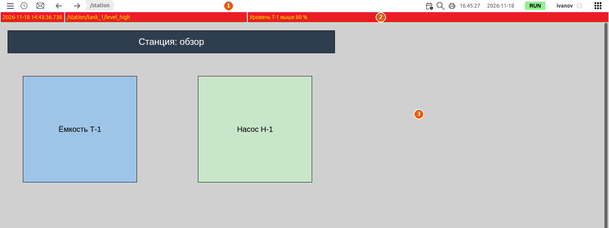
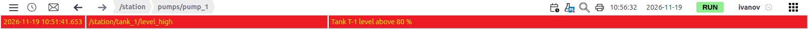
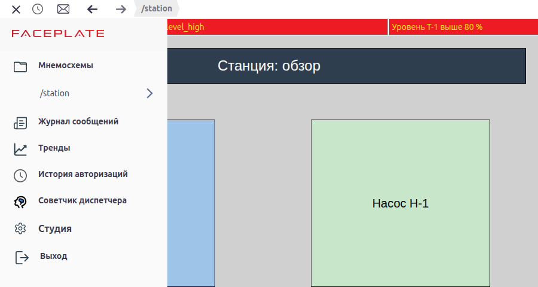
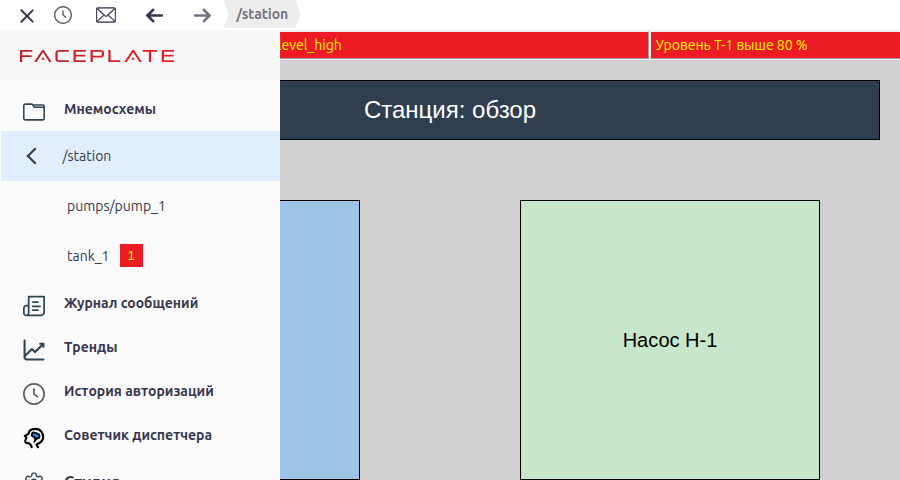
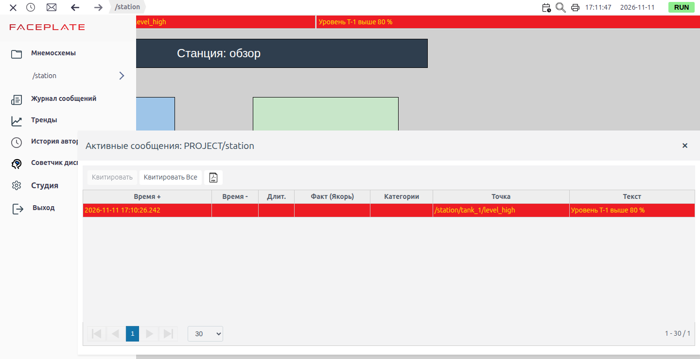
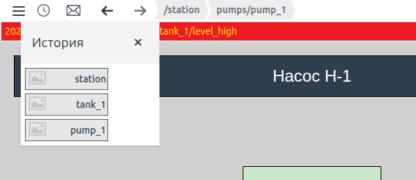
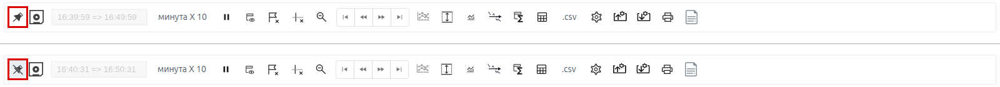

# Рабочий стол и навигатор

Документ для инженера-интегратора, который готовит проект к работе оператора: из чего состоит окно Runtime, как дерево папок Studio превращается в навигатор экранов, что оператор видит в нём и как Runtime запоминает, где оператор был.

# Содержание

- [Глоссарий](#глоссарий)
- [Введение](#введение)
- [Основная часть](#основная-часть)
    - [Окно Runtime](#окно-runtime)
    - [Верхняя строка](#верхняя-строка)
    - [Боковое меню](#боковое-меню)
    - [Навигатор экранов](#навигатор-экранов)
    - [Индикатор тревог в навигаторе](#индикатор-тревог-в-навигаторе)
    - [Путь текущего экрана](#путь-текущего-экрана)
    - [Назад, вперёд и «История»](#назад-вперёд-и-история)
    - [Последний экран после входа](#последний-экран-после-входа)
    - [Что сохраняется при переходах и повторном входе](#что-сохраняется-при-переходах-и-повторном-входе)
    - [Окна поверх экрана](#окна-поверх-экрана)
- [Заключение](#заключение)

# Глоссарий

| Термин | Значение |
|---|---|
| Экран | Схема `screen` папки проекта, открытая в рабочей области Runtime. Одна папка — один экран |
| Рабочая область | Часть окна Runtime под верхней строкой и полосой тревог, где показан выбранный экран |
| Навигатор | Список экранов проекта в боковом меню Runtime, пункт **Мнемосхемы**. Повторяет дерево папок Studio, но только папки с экраном |
| Полоса тревог | Строка под верхней строкой Runtime: самое позднее неквитированное сообщение — время, путь шаблона тревоги, текст. Щелчок по полосе квитирует это сообщение |
| История переходов | Последовательность открытых оператором экранов. По ней работают кнопки «назад» и «вперёд». Привязана к учётной записи, а не к браузеру |
| Закреплённое окно | Окно тренда, привязанное к экрану кнопкой **Закрепить за экраном**. Открывается вместе с экраном и закрывается, когда оператор уходит с него |

Термины «Схема» и «Элемент» — в документе [«Редактор мнемосхем»](../mnemo/editor.md#глоссарий), «Псевдоним», «Фиксированный экран», «Избранное» — в [«Экранах и переходах»](../mnemo/screens.md#глоссарий).

# Введение

Оператор работает в Runtime и переходит между экранами, которые интегратор нарисовал в Studio. Какие экраны попадут в навигатор, как они там называются и вложены, решает не отдельная настройка, а структура папок проекта: навигатор строится по ней автоматически. Поэтому раскладку папок стоит продумать до того, как рисовать схемы.

Документ описывает:

- из каких частей состоит окно Runtime и что открывает каждая кнопка меню;
- как дерево папок Studio отображается в навигаторе и какие папки в нём не видны;
- индикатор тревог рядом с экраном в навигаторе;
- путь текущего экрана, кнопки «назад», «вперёд», окно «История»;
- какой экран оператор видит после входа;
- окна трендов, которые открываются вместе с экраном.

Как задать экрану размер, псевдоним, иконку, отметить его в «Избранном», нарисовать фиксированный экран и кнопки перехода — в [«Экранах и переходах»](../mnemo/screens.md).

Сквозной пример — папка `station` с экраном «Station: overview». Внутри неё папка `tank_1` с экраном ёмкости, объектом `tank` и шаблоном тревоги `level_high` (уровень выше 80 %), и папка `pumps` без экрана, а в ней папка `pump_1` с экраном насоса.

Понадобится доступ к Studio (`http://<сервер>:9000/fp/studio`) под учётной записью с правом изменять проект. Результат проверяется в Runtime (`http://<сервер>:9000/fp/runtime`).

# Основная часть

## Окно Runtime



| № | Часть | Что в ней |
|---|---|---|
| 1 | Верхняя строка | Кнопки меню и навигации, путь текущего экрана, режимы просмотра, время сервера, состояние проекта, учётная запись |
| 2 | Полоса тревог | Самое позднее неквитированное сообщение типа `error`, `alarm` или `warning`: время, путь шаблона, текст. Цвет — по типу сообщения. Щелчок по полосе (подсказка «Квитировать сообщение») квитирует показанное сообщение без подтверждения, и полоса переходит к следующему неквитированному. Когда неквитированных сообщений нет, полоса пустая, даже если тревоги ещё активны. На полосу попадают только сообщения, которые учётная запись может квитировать: возникшие в папках, где у неё есть право записи |
| 3 | Рабочая область | Экран, который выбрал оператор. При переходе меняется только она |

Если в проекте нарисован фиксированный экран, Runtime показывает его между полосой тревог и рабочей областью (см. [«Фиксированный экран»](../mnemo/screens.md#фиксированный-экран)).

## Верхняя строка



Слева направо:

| Кнопка (подсказка) | Что делает | Подробно |
|---|---|---|
| **Меню** | Открывает и закрывает боковое меню | [Боковое меню](#боковое-меню) |
| **История** | Окно со списком экранов, которые открывались под этой учётной записью | [Назад, вперёд и «История»](#назад-вперёд-и-история) |
| **Активные сообщения** | Окно неквитированных сообщений типов `error`, `alarm` и `warning` — и активных, и уже снятых — с квитированием. Квитированное сообщение из окна уходит, даже если тревога ещё активна. Кнопка недоступна, пока полоса тревог пуста | [«Работа оператора»](../alarms/alarm/alarm.md#3-работа-оператора) |
| **Переход назад**, **Переход вперед** | Шаг по истории переходов | [Назад, вперёд и «История»](#назад-вперёд-и-история) |
| Путь | Путь текущего экрана; каждая часть — ссылка на свой экран | [Путь текущего экрана](#путь-текущего-экрана) |
| Значок календаря с часами | Воспроизведение архива на текущем экране | [«Воспроизведение архива»](playback.md) |
| Значок колбы с буквами PF | Режим исследования: расчёт сети в PowerFactory по текущему состоянию проекта. Кнопка есть только при настроенном моделировании PowerFactory | [«Powerfactory Service», раздел «Режим исследования в Runtime»](../integrations/powerfactory_service/powerfactory_service.md#режим-исследования-в-runtime) |
| Лупа | Масштаб рабочей области | [«Печать экрана»](../mnemo/reports.md#печать-экрана) |
| Принтер | Печать рабочей области и полосы тревог | [«Печать экрана»](../mnemo/reports.md#печать-экрана) |
| **Избранное** (крайняя справа) | Окно экранов, отмеченных в Studio полем папки **Избранное**. Если таких нет — уведомление «Избранные мнемосхемы не определены» | [«Папка в Runtime»](../mnemo/screens.md#папка-в-runtime-псевдоним-иконка-избранное) |

Между принтером и **Избранным** — время и дата сервера, индикатор состояния проекта и имя учётной записи (см. [«Строка состояния»](status.md#строка-состояния)).

## Боковое меню

Кнопка **Меню** выдвигает панель слева. Пока панель открыта, кнопка показывает крестик.



| Пункт | Что открывает |
|---|---|
| **Мнемосхемы** | Навигатор экранов под пунктом (см. [Навигатор экранов](#навигатор-экранов)). При открытии меню навигатор уже показан; щелчок по пункту скрывает его, повторный — показывает снова |
| **Журнал сообщений** | Окно «Архив сообщений»: все сообщения с фильтрами и выгрузкой (см. [«Архив и экспорт»](../alarms/alarm/alarm.md#5-архив-и-экспорт)) |
| **Тренды** | Окно «Выбор трендов»: графики по архивам, группы трендов, файлы настроек (см. [«Тренды»](../data_storage/archives/trends.md)) |
| **История авторизаций** | Окно с датой последнего успешного и последнего неуспешного входа под этой учётной записью |
| **Советчик диспетчера** | Окно советчика по тревогам. Пункт есть, только если на сервере установлен модуль советчика (см. [«Советчик диспетчера»](../alarms/dsf/dsf.md)) |
| **Студия** | Studio в новой вкладке браузера. Studio запрашивает имя и пароль; вход — со своими правами: учётной записи без доступа к Studio откроется страница отказа |
| **Выход** | После подтверждения «Вы точно хотите выйти?» — завершение сеанса и форма входа |

Внизу панели — сведения об узле и лицензии, переключатель **Тёмная тема**. Тёмная тема меняет цвет верхней строки и бокового меню; цвета схемы и фон рабочей области задаются на схеме и не меняются. После выбора экрана в навигаторе меню закрывается само.

## Навигатор экранов

### Как дерево Studio становится навигатором

Навигатор повторяет дерево папок проекта, отдельно его настраивать не нужно. Правка в Studio видна в Runtime без перезагрузки страницы — достаточно заново открыть меню.

Правила:

| В Studio | В навигаторе |
|---|---|
| Папка с сохранённой схемой `screen` | Пункт навигатора. Щелчок по имени открывает экран |
| Папка без схемы `screen` | Своего пункта нет. Её имя входит в имя вложенного экрана: `pumps/pump_1` |
| Экран внутри папки с экраном | Вложенный пункт: у родителя появляется стрелка `>` |
| Экраны верхнего уровня | Имя с косой чертой впереди: `/station` |
| Корневая схема проекта (`screen` самой папки `PROJECT`) | Пункт `/` |
| `@FIXED SCREEN AREA`, папка прототипов | В навигатор не попадают |

В примере в Studio три папки с экраном и одна без:

```text
PROJECT
└── station          экран «Station: overview»
    ├── tank_1       экран ёмкости
    └── pumps        без экрана
        └── pump_1   экран насоса
```

В навигаторе на верхнем уровне — один пункт `/station` со стрелкой. Внутри — `pumps/pump_1` и `tank_1`: папка `pumps` своего пункта не получила, её имя стало частью имени экрана насоса.



Имена в навигаторе — имена папок из дерева проекта, а не псевдонимы. Называйте папки так, чтобы оператор понял имя без пояснений: псевдоним из поля папки виден только в окнах «Избранное» и «История».

### Работа с навигатором

- Щелчок по имени открывает экран в рабочей области и закрывает меню.
- Стрелка `>` справа от имени — переход на уровень вложенных экранов. Сам экран при этом не открывается.
- Верхняя строка уровня — родительский экран со стрелкой `<`: щелчок возвращает на уровень выше.
- Навигатор открывается на том уровне, где находится текущий экран. На рисунке выше открыт `tank_1` (путь `/station › tank_1`), и меню сразу показывает содержимое `/station`.

Навигатор — одно из трёх мест, откуда оператор выбирает экран. Два других — окна «Избранное» и «История»: в них экраны показаны псевдонимом и иконкой папки и собраны в один список без вложенности. Навигатор показывает все экраны проекта и их иерархию, «Избранное» — только отобранные интегратором, «История» — те, где оператор уже был.

## Индикатор тревог в навигаторе

Рядом с именем экрана в навигаторе — индикатор: число сообщений, которые возникли в этой папке и во всех вложенных. Оператор видит, на каком экране искать причину, ещё не открыв ни одного экрана.

В примере шаблон `level_high` лежит в папке `tank_1`. Когда уровень превысил 80 %, индикатор с числом 1 появился и у `tank_1`, и на верхнем уровне у `/station`, где ёмкость вложена: у `tank_1` — на снимке выше, у `/station` — на снимке ниже.

Что показывает индикатор:

| Состояние | Вид |
|---|---|
| Есть неквитированные сообщения | Мигает |
| Все сообщения квитированы, но ещё активны | Горит постоянно |
| Активных и неквитированных сообщений нет | Не виден |

Число — все сообщения типов `error`, `alarm` и `warning`, которые активны или не квитированы. Цвет — по самому важному типу: `error` — чёрный с жёлтым числом, `alarm` — красный с жёлтым, `warning` — жёлтый с чёрным. Пока есть неквитированные сообщения, цвет выбирается по ним.

Сообщения типов `info` и `dsf` индикатор не учитывает: они не входят в число и не зажигают индикатор, даже если активны и не квитированы. Если на экране важно видеть такие сообщения, ставьте шаблону тип `warning` или выше, а `info` и `dsf` оператор найдёт в окне «Журнал сообщений».

Щелчок по числу индикатора открывает окно «Активные сообщения: PROJECT/<папка>». В нём те же сообщения, что посчитаны в индикаторе: из этой папки и вложенных. Экран при этом не открывается, меню остаётся на месте. В окне есть кнопки **Квитировать** (выделенное сообщение), **Квитировать Все** и выгрузка в PDF — оператор квитирует сообщения участка, не открывая его экран (см. [«Работа оператора»](../alarms/alarm/alarm.md#3-работа-оператора)).

Индикатор и окно сообщений видны и учётной записи, у которой на папку есть только право чтения. Квитировать сообщения папки может учётная запись с правом записи на неё.



Где загорится число, зависит только от того, в какой папке дерева проекта лежит шаблон тревоги: число появляется у этой папки и у всех папок выше неё. На какой схеме нарисовано оборудование, индикатор не учитывает. В примере шаблон `level_high` лежит в `station/tank_1`, поэтому число горит у `tank_1`: оператор открывает этот экран и сразу видит ёмкость T-1, к которой относится тревога. Если бы шаблон лежал в папке другого экрана, число загорелось бы у того экрана, и оператор искал бы ёмкость не там.

Поэтому шаблон тревоги — объект типа `alarm_template` в дереве проекта Studio (см. [«Шаблон и отдельное сообщение»](../alarms/alarm/alarm.md#шаблон-и-отдельное-сообщение) и [«Создать первую полезную настройку»](../alarms/alarm/alarm.md#создать-первую-полезную-настройку)) — создавайте в папке экрана, на котором нарисовано это оборудование (`<папка экрана>/<шаблон>`), или во вложенной в неё папке.

## Путь текущего экрана

В верхней строке после стрелок — путь открытого экрана, разбитый на части так же, как в навигаторе: `/station` › `pumps/pump_1`. Каждая часть — ссылка: щелчок по `/station` открывает обзор станции. Так оператор поднимается на уровень выше, не открывая меню.

Переход по части пути добавляется в историю переходов, как переход из навигатора.

## Назад, вперёд и «История»

Каждый переход — из навигатора, «Избранного», «Истории», по части пути или кнопкой перехода на схеме — добавляет экран в историю переходов. **Переход назад** и **Переход вперед** шагают по ней, как кнопки браузера. Кнопка недоступна, если шагать некуда. Если вернуться назад и открыть другой экран, шаги «вперёд» от этого места пропадают. История переходов хранит последние 100 экранов: **Переход назад** возвращает не дальше чем на 99 шагов.

История переходов привязана к учётной записи, а не к браузеру. После повторного входа, в том числе в другом браузере, кнопка **Переход назад** ведёт по экранам прошлого сеанса.

Окно «История» (кнопка с часами) показывает экраны из истории переходов списком: каждый экран один раз, с иконкой и псевдонимом папки. Щелчок открывает экран и закрывает окно.



В примере у папок нет псевдонимов, поэтому в окне имена папок `station`, `tank_1`, `pump_1`, а иконки не заданы.

## Последний экран после входа

Runtime запоминает у учётной записи последний открытый экран и открывает его после входа. Оператор, который закрыл браузер на экране насоса, после входа снова видит экран насоса.

У учётной записи, которая ещё ни разу не открывала экран, рабочая область после входа пустая: оператор выбирает экран в навигаторе или в «Избранном». Отдельной настройки стартового экрана нет: после входа открывается экран, на котором оператор закончил прошлый сеанс. Чтобы новый оператор сразу нашёл основные экраны, отметьте их в «Избранном».

## Что сохраняется при переходах и повторном входе

| | Переход на другой экран | Повторный выбор открытого экрана в навигаторе | Обновление страницы (F5) | Выход и новый вход |
|---|---|---|---|---|
| Экран в рабочей области | Выбранный | Тот же, загружается заново | Тот же | Тот же |
| История переходов | Пополняется | Сохраняется | Сохраняется | Сохраняется |
| Масштаб | 100 % | 100 % | 100 % | 100 % |
| Тёмная тема | Остаётся | Остаётся | Выключается | Выключается |

После обновления страницы Runtime запрашивает имя и пароль. Что происходит со схемой при возврате на неё, — в [«Экраны и переходы», раздел «Возврат на схему»](../mnemo/screens.md#возврат-на-схему).

## Окна поверх экрана

Окна Runtime открываются поверх рабочей области и не блокируют её: экран под ними продолжает обновляться, а навигатор переключает экраны.

| Окно | Как открыть | Размер при открытии |
|---|---|---|
| «Активные сообщения» | Кнопка **Активные сообщения** (конверт) в верхней строке | Окно посередине экрана, схема вокруг него видна |
| «Архив сообщений» | **Меню** → **Журнал сообщений** | Весь экран |
| «Выбор трендов» | **Меню** → **Тренды** | Весь экран |
| Окно тренда | Кнопка **ОК** в окне «Выбор трендов» | Весь экран |

У окна, открытого на весь экран, в правом углу заголовка две кнопки без подписей: ❐ (два наложенных квадрата) и × (закрыть). Кнопка ❐ переводит окно в обычный размер: «Архив сообщений» встаёт в правый нижний угол, «Выбор трендов» — посередине экрана, и схема рядом с ними снова видна. В обычном размере вместо ❐ в заголовке кнопка □ — она снова разворачивает окно на весь экран. У «Выбор трендов» и окна тренда в обычном размере есть ещё кнопка «_» — она сворачивает окно до заголовка: у «Выбор трендов» заголовок остаётся на прежнем месте, окно тренда уходит плашкой в левый верхний угол Runtime. Кнопка ❐ на свёрнутом заголовке возвращает окно.

Окно тренда можно закрепить за экраном (см. [«Закрепить график за мнемосхемой»](../data_storage/archives/trends.md#закрепить-график-за-мнемосхемой)). Кнопка **Закрепить за экраном** — первая слева на панели окна тренда, иконка-кнопка в виде канцелярской кнопки; подпись видна только во всплывающей подсказке. Откройте тренд через **Меню** → **Тренды**, находясь на нужном экране, и нажмите её. У закреплённого окна кнопка подсвечена, а иконка перечёркнута: теперь это **Открепить**.



Закреплённое окно:

| Событие | Что происходит с окном |
|---|---|
| Оператор уходит с экрана | Закрывается |
| Оператор закрывает окно крестиком | Закрывается, но закрепление остаётся |
| Оператор возвращается на экран, обновляет страницу (F5) или входит заново на нём | Открывается снова с теми же сериями, даже если перед этим его закрыли крестиком |
| Другой пользователь открывает этот экран | Не появляется: закрепление действует только для учётной записи, которая его сделала |

Закрепление заменяет оператору встроенный тренд, когда интегратор не предусмотрел его на схеме: оператор сам собирает нужные графики и привязывает их к экрану. Встроенный тренд (элемент **Тренды** на схеме, см. [«Тревоги и тренды на экране»](../mnemo/alarms_trends.md)) интегратор ставит для всех пользователей сразу.

**Открепить** на панели тренда снимает закрепление.

# Заключение

| Задача | Как сделать |
|---|---|
| Показать экран в навигаторе | Сохранить схему `screen` папки |
| Сделать экраны вложенными | Вложить папки с экранами одну в другую |
| Сгруппировать экраны без лишнего уровня | Промежуточная папка без экрана: её имя станет частью имени экрана |
| Дать оператору понятные имена в навигаторе | Понятные имена папок; псевдонимы видны только в «Избранном» и «Истории» |
| Показать, на каком экране тревога | Шаблоны тревог типа `error`, `alarm` или `warning` — в папке этого экрана или во вложенной |
| Помочь новому оператору найти основные экраны | Отметить их в «Избранном»: стартового экрана нет, после входа открывается последний экран учётной записи |
| Дать оператору свои графики на экране | Окно тренда → **Закрепить за экраном** |

Порядок работы:

1. Разложите папки проекта так, как оператор должен видеть экраны в навигаторе. Группы без своего экрана сделайте папками без схемы `screen`.
2. Сохраните схемы `screen` нужных папок.
3. Положите шаблоны тревог типов `error`, `alarm` и `warning` в папки тех экранов, где оператор разбирает эти тревоги.
4. Отметьте основные экраны в «Избранном» и задайте им псевдонимы (см. [«Экраны и переходы»](../mnemo/screens.md)).
5. Войдите под учётной записью оператора и проверьте навигатор, индикатор тревог, полосу тревог и кнопки «назад» и «вперёд».
