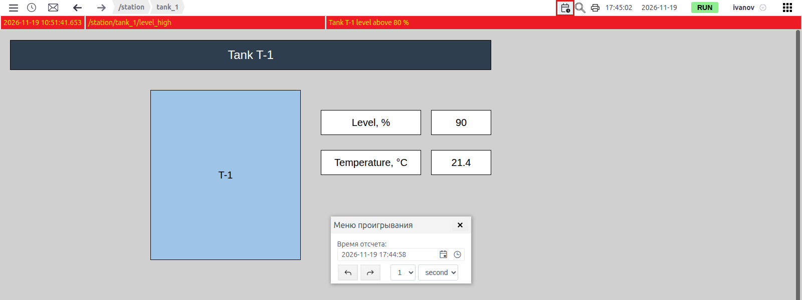
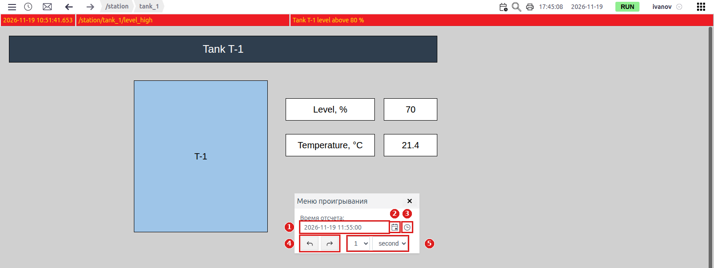

# Воспроизведение архива

Документ о том, как в Runtime посмотреть экран со значениями прошлого момента: открыть режим воспроизведения, выбрать момент, шагать по времени и отличить на экране прошлые значения от текущих.

# Содержание

- [Глоссарий](#глоссарий)
- [Введение](#введение)
- [Основная часть](#основная-часть)
    - [Открыть и закрыть режим](#открыть-и-закрыть-режим)
    - [Окно «Меню проигрывания»](#окно-меню-проигрывания)
    - [Что показывает экран](#что-показывает-экран)
    - [Другой экран в режиме воспроизведения](#другой-экран-в-режиме-воспроизведения)
    - [Управление и печать в режиме](#управление-и-печать-в-режиме)
    - [Пример: уровень ёмкости в 11:55](#пример-уровень-ёмкости-в-1155)
- [Заключение](#заключение)

# Глоссарий

| Термин | Значение |
|---|---|
| Воспроизведение архива | Режим Runtime, в котором экран показывает значения из архива на выбранный прошлый момент. Включается значком календаря с часами в верхней строке |
| Момент | Дата и время в поле **Время отсчета** окна «Меню проигрывания»: на этот момент экран показывает значения |
| Шаг | На сколько кнопки «назад» и «вперёд» окна сдвигают момент: число и единица (`second`, `minute`, `hour`) |
| Поле с архивом | Поле объекта, значения которого записывает архив проекта: источник архива — это поле. Прошлые значения есть только у таких полей |

Термины «Экран», «Рабочая область», «Навигатор» — в документе [«Рабочий стол и навигатор»](desktop.md#глоссарий), «Фиксированный экран» — в [«Экранах и переходах»](../mnemo/screens.md#глоссарий).

# Введение

Чтобы разобрать событие — сработала защита, пришла тревога, оператор принимает смену, — нужно знать, что было на экране раньше: какой был уровень, когда началось отклонение. Режим воспроизведения показывает тот же экран со значениями из архива на выбранный момент. Отдельный экран для этого не нужен: режим включается на любом экране.

Документ описывает:

- как открыть и закрыть режим;
- как выбрать момент и шагать по времени;
- какие значения на экране прошлые, а какие нет;
- что происходит при переходе на другой экран;
- что в режиме не работает и что даёт печать.

Сквозной пример — экран ёмкости `station/tank_1`: уровень записывает архив, температуру — нет. В архиве уровня записи 11:40 — 62 %, 11:50 — 70 %, 12:00 — 78 %. Сейчас уровень 90 %, температура 21.4 °C.

Понадобится доступ к Runtime (`http://<сервер>:9000/fp/runtime`). Прошлые значения есть только у полей, которые записывает архив (см. [«Архивы: настройка источников и запись данных»](../data_storage/archives/archives.md)).

# Основная часть

## Открыть и закрыть режим

Откройте экран и нажмите значок календаря с часами в верхней строке, слева от лупы. Поверх экрана откроется окно «Меню проигрывания».

Пока момент не выбран, экран показывает текущие значения, а в поле **Время отсчета** стоит время открытия окна. Окно можно перетащить за заголовок, чтобы оно не закрывало нужные значения.

Чтобы выйти из режима, нажмите × в заголовке окна. Runtime вернёт экран, с которого режим был открыт, с текущими значениями. Обновление страницы (F5) тоже выключает режим; после него Runtime запрашивает имя и пароль. Переход Runtime на другой узел кластера (см. [«Узлы кластера»](../administration/nodes/nodes.md#адрес-узла-для-runtime)) тоже выключает режим: Runtime открывает тот же экран с текущими значениями.

При открытии окна и при выходе из режима экран загружается заново.

## Окно «Меню проигрывания»

| № | Элемент | Назначение |
|---|---|---|
| 1 | Поле **Время отсчета** | Момент в виде `гггг-ММ-дд ЧЧ:мм:сс`. Щёлкните по части (год, месяц, день, часы, минуты, секунды) и наберите её. Набранный момент применяется по Enter, Tab или щелчку вне поля |
| 2 | Значок календаря | Выбор дня. Выбранный день применяется сразу, время в поле остаётся прежним. Дни позже сегодняшнего календарь не предлагает |
| 3 | Значок часов | Список времени с шагом в минуту. Выбранное время применяется сразу |
| 4 | Кнопки «назад» и «вперёд» | Сдвигают момент на один шаг раньше или позже |
| 5 | Шаг | Число (1, 5, 10, 15, 30, 60) и единица: `second`, `minute`, `hour`. При открытии окна — 1 `second`. Смена шага момент не сдвигает |

Момент меняется только вручную — полем, календарём, списком времени или кнопками «назад» и «вперёд»; сам по себе он не движется. Календарь и список времени не показывают, когда архив делал записи: выбрать можно и момент, на который записей нет.

Время в поле, как и время в верхней строке и на полосе тревог, показано в часовом поясе компьютера, на котором открыт Runtime.

Воспроизведение показывает значения, которые архив уже записал, поэтому момент не бывает позже текущего времени.

## Что показывает экран

Экран показан таким, какой он сейчас: если его меняли, прошлые значения подставляются в нынешние элементы. После выбора момента на одном экране оказываются и прошлые, и текущие значения. Правило зависит не от вида элемента и не от типа объекта, а от того, откуда элемент берёт данные:

| Элемент на экране | Что он показывает |
|---|---|
| Привязан к полю с архивом (прямоугольник, шкала, поле ввода и любой другой элемент с привязкой к полю объекта) | Последнее записанное архивом значение не позже выбранного момента. Между записями значение держится до следующей записи, после последней записи — последнее значение |
| Привязан к полю с архивом, момент раньше первой записи архива | Значения нет |
| Привязан к полю с архивом, архив останавливался (например, на время остановки сервера) | Значения нет — с последней записи перед остановкой до первой записи после запуска. Архив записывает значение, когда оно меняется, поэтому последняя запись бывает задолго до остановки |
| Привязан к полю без архива | Значение, которое поле имело, когда впервые появилось на экране в режиме. До закрытия окна оно не меняется: ни при смене момента, ни при изменении поля в проекте |
| Тренд, таблица значений за период | Свой период, как вне режима: к выбранному моменту не переходят |
| Список тревог, индикатор тревог | Текущие сообщения, в том числе возникшие позже выбранного момента |
| Таблица текущих значений объектов | Текущие значения |
| Фиксированный экран над рабочей областью | Текущие значения |

Полоса тревог под верхней строкой тоже показывает текущие сообщения.

Поле, которое архив читает в скрипте, полем с архивом не считается: такой архив записывает результат скрипта, а не значение поля. Результат скрипта на выбранный момент показывает элемент, привязанный к самому архиву.

Архив записывает значения поля числами. Поэтому числовые и логические поля в режиме выглядят так же, как вне режима, а строковое поле с числом показывает это число. У строкового поля с текстом значения нет: текст архив не записывает. Если в строковом поле какое-то время был текст вместо числа, на моменты из этого промежутка значения тоже нет.

Поле с архивом показывает прошлые значения, только если учётная запись может читать этот архив. Иначе поле ведёт себя как поле без архива.

К выбранному моменту относятся только значения полей с архивом, остальные значения на экране — нет.

## Другой экран в режиме воспроизведения

Окно «Меню проигрывания» остаётся открытым при переходе на другой экран — из навигатора, по части пути или кнопками «назад» и «вперёд» верхней строки (см. [«Рабочий стол и навигатор»](desktop.md#навигатор-экранов)). Новый экран показывает значения на тот же момент, кнопки окна сдвигают момент и на нём. Так можно посмотреть несколько участков установки на один момент.

Крестик окна возвращает экран, с которого режим был открыт, с текущими значениями.

## Управление и печать в режиме

Режим только для просмотра: кнопки и поля ввода экрана выглядят как обычно, но значения в проект не записывают. Управление оборудованием работает после закрытия окна.

Режим меняет только то, что показывает этот Runtime: проект продолжает работать, архивы записывают текущие значения, тревоги возникают как обычно.

Печать в режиме (значок принтера в верхней строке) даёт экран на выбранный момент. Окно «Меню проигрывания» на лист не попадает. Подробно о печати — в [«Отчётах и печати экрана», раздел «Печать экрана»](../mnemo/reports.md#печать-экрана).

## Пример: уровень ёмкости в 11:55

1. Откройте экран `tank_1` (**Меню** → **Мнемосхемы** → `/station` → `tank_1`). Уровень 90 %, температура 21.4 °C.
2. Нажмите значок календаря с часами. Откроется окно «Меню проигрывания», экран пока показывает те же 90 и 21.4 (рисунок в разделе [«Открыть и закрыть режим»](#открыть-и-закрыть-режим)).
3. В поле **Время отсчета** наберите `2026-11-19 11:55:00` и нажмите Enter. Уровень — 70: это запись архива 11:50, следующая будет в 12:00. Температура осталась 21.4: у неё нет архива, это значение на момент открытия окна (рисунок в разделе [«Окно „Меню проигрывания“»](#окно-меню-проигрывания)).
4. Выберите шаг **5** и `minute`, нажмите «вперёд». Момент — 12:00:00, уровень — 78, запись 12:00.

5. Нажмите × в заголовке окна. Экран снова показывает текущие значения: 90 и 21.4.

# Заключение

| Задача | Как сделать |
|---|---|
| Увидеть экран в прошлый момент | Значок календаря с часами → момент в поле **Время отсчета** → Enter |
| Проследить, как менялось значение | Выбрать шаг и нажимать «назад» или «вперёд» |
| Понять, какие значения прошлые | Прошлые — только у полей с архивом; поле без архива до закрытия окна показывает значение на момент, когда оно впервые появилось на экране |
| Посмотреть другой экран на тот же момент | Перейти на него, не закрывая окна |
| Вернуться к текущим значениям | × в заголовке окна |
| Напечатать экран на прошлый момент | Значок принтера в режиме воспроизведения |
