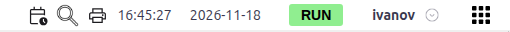
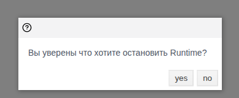
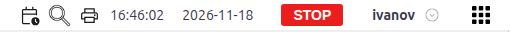
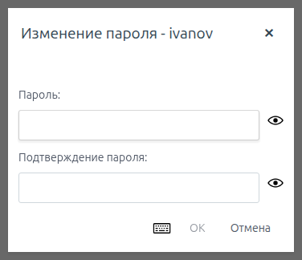
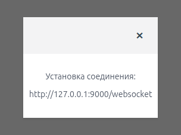

# Строка состояния и связь

Документ для инженера-интегратора, который сдаёт рабочие места операторов: что показывает правая часть верхней строки Runtime, как состояние проекта RUN/STOP связано с кнопками Studio и что видит оператор, когда связь с сервером пропадает и восстанавливается.

# Содержание

- [Глоссарий](#глоссарий)
- [Введение](#введение)
- [Основная часть](#основная-часть)
    - [Строка состояния](#строка-состояния)
    - [Состояние проекта: RUN и STOP](#состояние-проекта-run-и-stop)
    - [Учётная запись и смена пароля](#учётная-запись-и-смена-пароля)
    - [Узел в меню Runtime](#узел-в-меню-runtime)
    - [Потеря связи с сервером](#потеря-связи-с-сервером)
    - [Переключение на другой узел](#переключение-на-другой-узел)
    - [Studio при потере связи](#studio-при-потере-связи)
- [Заключение](#заключение)

# Глоссарий

| Термин | Значение |
|---|---|
| Строка состояния | Правая часть верхней строки Runtime: время и дата сервера, индикатор состояния проекта, имя учётной записи |
| Состояние проекта | Работают ли объекты проекта: скрипты, расчёты, соединения, архивы, шаблоны тревог. `RUN` — работают, `STOP` — остановлены. Переключается в Studio кнопками **Запустить Runtime** и **Остановить Runtime** |
| Узел | Один сервер FACEPLATE с именем вида `fp@<хост>`, см. [«Узлы кластера»](../administration/nodes/nodes.md) |
| Переподключение | Повторные попытки Runtime связаться с сервером после обрыва связи. Идут без участия оператора |

Остальные части верхней строки и меню описаны в [«Рабочем столе и навигаторе»](desktop.md#верхняя-строка).

# Введение

Оператор смотрит на экраны и не видит сервер. Строка состояния — единственное место, где Runtime показывает, что с сервером и проектом всё в порядке: часы идут, индикатор зелёный. Если часы стоят или индикатор красный, данные на экране не обновляются, даже если схема выглядит как обычно.

Документ отвечает на вопросы:

- что означает каждый элемент строки состояния;
- как остановить и запустить проект и как это видно в Runtime;
- как оператор меняет свой пароль;
- что происходит при обрыве связи на одном сервере и в кластере, и что для этого нужно настроить.

Понадобится доступ к Studio (`http://<сервер>:9000/fp/studio`) под учётной записью с правом изменять проект. Результат проверяется в Runtime (`http://<сервер>:9000/fp/runtime`).

# Основная часть

## Строка состояния

| Элемент | Что показывает |
|---|---|
| Время, дата | Время сервера, пересчитанное в часовой пояс компьютера оператора. Обновляется каждую секунду, пока есть связь с сервером. Подсказки **Текущее время**, **Текущая дата** |
| `RUN` / `STOP` | Состояние проекта: зелёный `RUN` — объекты проекта работают, красный `STOP` — остановлены. См. [Состояние проекта](#состояние-проекта-run-и-stop) |
| Имя учётной записи | Под кем выполнен вход. Щелчок открывает окно смены пароля (подсказка **Изменить пароль**), см. [Учётная запись и смена пароля](#учётная-запись-и-смена-пароля) |

Часы берут время с сервера, а не с компьютера оператора. Поэтому по ним видно и расхождение часов сервера, и потерю связи: при обрыве часы останавливаются на последнем полученном значении. Часовой пояс сервера на часы не влияет: важно только время на часах сервера.

## Состояние проекта: RUN и STOP

Проект запускается и останавливается целиком в Studio: **Общий вид**, корень проекта, кнопка на панели инструментов. Кнопка одна и меняет подпись: у работающего проекта — **Остановить Runtime**, у остановленного — **Запустить Runtime**. Перед действием Studio спрашивает подтверждение «Вы уверены что хотите остановить Runtime?» (или «…запустить Runtime?»), действие выполняется после **yes**.

Индикатор во всех открытых окнах Runtime меняется в течение 1–2 секунд, перезагружать Runtime не нужно.

| | `RUN` | `STOP` |
|---|---|---|
| Объекты проекта (скрипты, расчёты, соединения, архивы, шаблоны тревог) | Работают на узлах кластера | Остановлены, в Studio **State** `Stop` |
| Значения на экранах | Обновляются по мере поступления | Не обновляются: новых данных нет |
| Runtime и Studio | Открываются и работают | Открываются и работают |

Новый проект создаётся остановленным: после установки FACEPLATE индикатор показывает `STOP`, пока в Studio не нажата **Запустить Runtime**. Это первое, что нужно сделать перед проверкой экранов на новом сервере.

Остановить можно и часть проекта — одну папку с вложенными: переключатель **Runtime** в форме папки (см. [«Где выполняются объекты»](../administration/nodes/nodes.md#где-выполняются-объекты)). Индикатор в строке состояния относится только к проекту целиком: остановка отдельной папки его не меняет.

## Учётная запись и смена пароля

Щелчок по имени учётной записи открывает окно **Изменение пароля - <учётная запись>**. Сменить свой пароль может любой пользователь Runtime, в том числе оператор без доступа к Studio.

Введите новый пароль в оба поля и нажмите **OK** (до этого кнопка недоступна). Значок глаза справа от поля показывает введённые символы, кнопка с клавиатурой открывает экранную клавиатуру для сенсорных панелей.

Пароль должен отвечать тем же требованиям, что и в карточке пользователя Studio (см. [«Пароль»](../access/users.md#пароль)). Если пароли в полях различаются или не отвечают требованиям, Runtime показывает сообщение, окно остаётся открытым и пароль не меняется. После смены — сообщение об успешном изменении пароля. Текущий сеанс продолжается, новый пароль нужен при следующем входе и после обрыва связи (см. [Потеря связи с сервером](#потеря-связи-с-сервером)).

## Узел в меню Runtime

Внизу бокового меню строка `server` показывает узел, к которому подключён Runtime, например `fp@server1.fp`. После [переключения на другой узел](#переключение-на-другой-узел) здесь появляется имя нового узла. Строка `master license` — лицензия этого узла, см. [«Лицензирование»](../administration/license/license.md#где-видно-лицензию).

## Потеря связи с сервером

Runtime держит постоянное соединение с узлом. Если узел остановлен, перезагружается или сеть до него недоступна, Runtime:

1. Затемняет экран и показывает окно **Установка соединения** с адресом, к которому подключается.
2. Повторяет попытки примерно раз в секунду, пока сервер не ответит. Оператору ничего делать не нужно.

Пока окно на экране, строка состояния не обновляется: часы стоят, индикатор показывает последнее полученное состояние. Значения на экране под окном — последние полученные до обрыва.

Когда сервер снова отвечает, окно закрывается, Runtime сам входит с тем же именем и паролем, с которыми оператор вошёл в начале сеанса, заново строит рабочий стол и открывает экран, который был открыт до обрыва. Вводить пароль не нужно, сколько бы ни длился обрыв. Часы снова идут.

Исключение — за время сеанса пароль учётной записи сменили (сам оператор в окне смены пароля или администратор в Studio) или учётную запись удалили. Тогда Runtime сам не войдёт, и оператору нужно войти заново с новым паролем.

## Переключение на другой узел

В кластере Runtime при обрыве пробует не только свой узел, а по очереди адреса всех работающих узлов. Список адресов Runtime получает от сервера при подключении и обновляет раз в минуту. С первым ответившим узлом Runtime загружает страницу Runtime с его адреса, входит под той же учётной записью и открывает тот же экран. В меню строка `server` показывает новый узел. На проверочном кластере из двух узлов переключение после остановки первого заняло 3–4 секунды.

Чтобы переключение сработало, нужны две настройки:

| Что | Зачем | Где настраивается |
|---|---|---|
| Адрес узла, открываемый с рабочего места оператора | Runtime подключается к узлу по этому адресу. Если имя хоста узла не открывается с рабочего места, переключение не произойдёт | [«Адрес узла для Runtime»](../administration/nodes/nodes.md#адрес-узла-для-runtime) |
| Копия базы проекта на узле | Без копии узел не может отдать данные проекта, когда первый узел остановлен: Runtime остаётся на заставке загрузки | [«Резервирование: копия базы на втором сервере»](../data_storage/storage/storage.md#резервирование-копия-базы-на-втором-сервере) |

Проверить переключение до сдачи системы можно без остановки сервера — прервав сессию Runtime на панели **Сервера** (см. [«Адрес узла для Runtime»](../administration/nodes/nodes.md#адрес-узла-для-runtime)).

## Studio при потере связи

Studio при обрыве показывает окно **Соединение...** и повторяет попытки к тому же узлу. На другой узел Studio не переключается. Когда узел снова отвечает, Studio показывает форму входа: войдите заново.

| | Runtime | Studio |
|---|---|---|
| Окно при обрыве | **Установка соединения** с адресом узла | **Соединение...** |
| Куда подключается | Свой узел и другие узлы кластера | Только свой узел |
| После восстановления | Вход без пароля, тот же экран | Форма входа |

# Заключение

Строка состояния показывает оператору время сервера, состояние проекта и учётную запись. Идущие часы и зелёный `RUN` означают, что связь есть и объекты проекта работают; остановившиеся часы — что связи нет. Проект запускается и останавливается целиком кнопками **Запустить Runtime** и **Остановить Runtime** в Studio; новый проект создаётся остановленным. Оператор меняет свой пароль щелчком по имени учётной записи. При обрыве связи Runtime сам переподключается и возвращает оператора на тот же экран без ввода пароля, а в кластере переходит на другой узел, если у узлов заданы адреса и есть копия базы проекта. Studio при обрыве переподключается только к своему узлу и требует войти заново.
